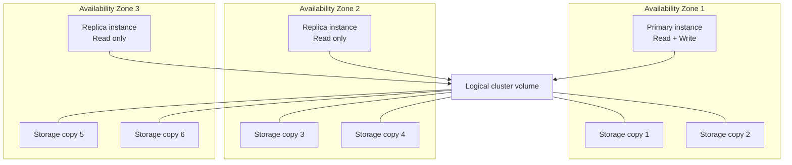
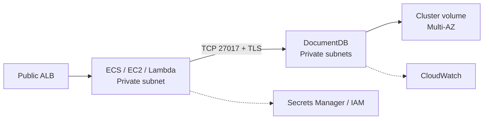

# Amazon DocumentDB and MongoDB Compatibility Considerations

> **Module:** CLOUD_PROVIDERS_AWS  
> **Chapter:** Caching and Specialized Databases  
> **Lesson:** Amazon DocumentDB and MongoDB Compatibility Considerations  
> **Context:** Designing, developing, and operating Java/Spring Boot applications using document data on AWS; evaluating MongoDB compatibility, security, availability, migration, and cost.

## 1. The Problem: Migrating a MongoDB Application to AWS

An online learning platform stores course profiles, lesson content, video metadata, UI configurations, and activity logs as documents. The engineering team currently uses MongoDB with the MongoDB Java Driver and Spring Data MongoDB. Moving the workload to AWS, the team wants a managed database service with backups and recovery, read scaling, reduced replica/patching/storage operations, retention of most of the existing document model and application code, and verification of queries, aggregations, indexes, transactions, and change streams prior to migration.

**Amazon DocumentDB (with MongoDB compatibility)** is an AWS-managed document database service providing a MongoDB-compatible protocol/API for many popular applications, drivers, and tools.

However, **MongoDB compatibility does not mean swapping the endpoint makes every MongoDB feature behave identically**. Amazon DocumentDB has its own architecture, engine, query planner, transaction semantics, API support matrix, and limitations. Every migration decision must verify the exact engine compatibility version and supported operations list.

After this lesson, you can describe DocumentDB architecture, choose a compatibility version, evaluate commands/queries/aggregations/indexes/transactions, connect from Java over TLS, design read preferences, and plan migration, security, monitoring, and cost.

## 2. What Is Amazon DocumentDB?

Amazon DocumentDB is a **MongoDB API-compatible managed document database service** operated by AWS. Applications talk to it using the MongoDB wire protocol and MongoDB-compatible drivers. DocumentDB stores BSON documents and provides collections, queries, indexes, aggregations, and additional features depending on engine version.

**It is not MongoDB Community Server installed on EC2 by AWS.** DocumentDB has a distinct storage/compute architecture, engine implementation, and release cadence. The same driver or MongoDB command may work in one compatibility version while remaining unsupported or behaving differently in another.

### 2.1. Key Components

| Component | Role |
|---|---|
| Cluster | Management unit for databases, endpoints, backups, parameter groups, and storage volume |
| Primary instance | Accepts writes and can handle reads |
| Replica instance | Handles reads; eligible for promotion to primary on failover |
| Cluster volume | Logical storage volume shared across instances |
| Cluster endpoint | DNS endpoint pointing to the current primary |
| Reader endpoint | Distributes new connections across available replicas |
| Instance endpoint | Connects directly to one specific instance |
| Subnet group | Subnets/AZs where DocumentDB places compute instances |
| Cluster parameter group | Cluster-level engine settings |
| Snapshots/backups | Data protection and recovery |

### 2.2. Storage Decoupled from Compute

In instance-based clusters, DocumentDB uses a logical cluster volume **replicated six ways across three Availability Zones** in a Region. Primary and replicas access the same logical volume. A cluster has one primary and up to **15 replica instances**.



Compute instances handle queries and connections; the cluster volume manages durable storage and replication. Adding replicas primarily increases **read capacity and failover targets** rather than creating separate data copies the application must sync. Storage redundancy also does not replace compute replicas if your app needs fast primary failover.

### 2.3. Primary and Replicas

| Capability | Primary | Replica |
|---|---|---|
| Read | Yes | Yes |
| Write | Yes | No |
| Eligible for failover promotion | Already primary | Yes, per failover tier |
| Read consistency | Read-after-write on primary | Eventually consistent |
| Purpose | Writes and queries needing latest data | Read scaling and failover target |

Replica reads usually see low replication lag, though lag varies with write load. Never read from a replica to verify a just-committed write if business logic requires immediate **read-your-writes**.

## 3. MongoDB Compatibility: Understanding the Scope

AWS describes DocumentDB as MongoDB-compatible because most common applications, drivers, and tools work with minimal changes. This is **not a guarantee that every MongoDB command, aggregation stage, index option, server behavior, or administrative API is supported**.

Distinguish three layers:

1. **Wire protocol/driver compatibility:** the driver connects and exchanges protocol messages with the engine.
2. **API/operation compatibility:** specific commands, CRUD methods, query operators, aggregation stages, and data types are supported by the engine.
3. **Behavioral compatibility:** the same command may differ in result ordering, transaction behavior, read preferences, retries, index selection, and errors.

An application connecting successfully proves only layer 1 works. Test all three layers thoroughly.

### 3.1. Compatibility Version Is Not MongoDB Server Version

The compatibility version names the MongoDB API target DocumentDB implements; it **does not mean the engine is that exact MongoDB server codebase**.

| Amazon DocumentDB compatibility | AWS status as of 2026-11-20 | Notes |
|---|---|---|
| **3.6** | Standard support ended **2026-03-30**; paid Extended Support until **2029-03-30** | Do not pick for new deployments; plan upgrades |
| **4.0** | Supported | Supports explicit ACID transactions; legacy differences still require testing |
| **5.0** | Supported; includes **LTS 5.0.0** | Adds features like FLE/vector search per feature matrix |
| **8.0** | GA since **2025-11-14** | Supports MongoDB 8.0 wire protocol, collation, views, and newer aggregation capabilities |

Support dates, minor releases, and patch levels evolve. Check engine version support dates, Regions, and latest release notes before creating clusters.

### 3.2. Engine Version and Engine Patch Version

DocumentDB tracks two identifiers:

- **Engine version:** e.g., `5.0.0` or `8.0.0`; denotes compatibility level and minor engine release.
- **Engine patch version:** e.g., `3.0.xxxxx` for engine 5.0 or `4.0.xxxxx` for engine 8.0; identifies applied patches.

On supported releases, this command displays engine and patch versions:

```javascript
db.runCommand({ getEngineVersion: 1 })
```

On older patches, output may return only a patch identifier. Check release notes for mapping details. At the time of writing, AWS release notes document DocumentDB **8.0.3** released on **2026-11-11**. Never hardcode this patch across all Regions; verify actual Regional availability and maintenance schedules.

### 3.3. Notable Capabilities in 8.0

DocumentDB 8.0 introduces key enhancements: support for MongoDB 8.0 API drivers and apps built for API versions 6.0/7.0; a new query planner; collation and views; aggregation stages like `$replaceWith`, `$vectorSearch`, `$merge`, `$set`, `$unset`, and `$bucket`; operators like `$pow`, `$rand`, and `$dateTrunc`; text index v2; and a 256 TiB storage limit. TLS 1.0/1.1 are no longer supported; **TLS 1.2 or higher is mandatory**.

Do not assume a 8.0 feature exists in 5.0 or 4.0. When selecting an engine, map every application feature against the version matrix.

## 4. Instance-Based Clusters, Serverless, and Elastic Clusters

Amazon DocumentDB offers deployment models with differing feature boundaries. Never choose solely based on the MongoDB compatibility label.

| Model | Characteristics | What to check |
|---|---|---|
| **Instance-based cluster** | Primary + replicas, chosen instance classes, shared cluster volume | Suits apps needing explicit compute/read-replica control |
| **Serverless instances** | Compute capacity auto-scales on demand within configured bounds | Available on specific engine versions; review ACU ranges and workload |
| **Elastic Clusters** | Sharded document database scaling data/throughput across shards | Distinct feature set from instance-based; do not assume all transactions/streams/APIs work |

Per the current feature matrix, instance-based clusters support 4.0, 5.0, and 8.0; Serverless instances are supported on 5.0 and 8.0; Elastic Clusters run on 5.0 and are **not supported on 8.0** in the current matrix. Elastic Clusters carry distinct limits: features like ACID transactions, change streams, IAM database authentication, point-in-time restore, and certain shard operations are unsupported compared to instance-based clusters.

### 4.1. Do Not Confuse Elastic Clusters with MongoDB Sharded Clusters

MongoDB sharding has its own shard-key mechanics and topology. DocumentDB Elastic Clusters also distribute collections across shards, yet **management, shard-key rules, APIs, and operations follow AWS's model**.

Before migrating a MongoDB sharded deployment, inventory shard keys, chunk distributions, and indexes; verify supported shard-key operations; test scatter/gather queries; and recalculate capacity, hot shards, throughput, and cost. Never copy MongoDB sharding configs expecting DocumentDB to interpret them identically.

## 5. When Should You Choose Amazon DocumentDB?

| Need | Fit | Rationale |
|---|---|---|
| App already uses MongoDB drivers and a document model | **High if APIs are compatible** | Reuses most existing data-access code |
| AWS-managed document DB cutting storage/replication toil | **High** | AWS manages cluster storage, backups, and failover |
| Read-heavy workload needing replicas | **High** | Provides read replicas and read preferences |
| Flexible data with evolving document structures | **High** | Natural fit for the document model |
| Requires every latest MongoDB server feature/command | **Evaluate carefully** | Compatibility does not cover all APIs |
| Workload depends on MongoDB-specific sharding/transaction behavior | **Verify first** | Elastic Clusters and instance-based have specific limits |
| Complex SQL joins, foreign keys, relational constraints | **Usually poor fit** | RDS/Aurora PostgreSQL/MySQL fit relational modeling naturally |
| Ultra-fast key-value access, TTL/cache semantics | **Compare DynamoDB/ElastiCache** | Another AWS service may fit better |
| Deep full-text relevance search and analytics | **Compare OpenSearch** | DocumentDB does not replace a dedicated search engine |

**Choose databases by access patterns and feature requirements**, not simply because the team already knows a MongoDB driver.

## 6. Document Data Modeling

DocumentDB fits structured documents with nested objects. Example course document:

```json
{
  "_id": "course-java-101",
  "tenantId": "school-01",
  "title": "Java Fundamentals",
  "status": "PUBLISHED",
  "instructor": {
    "id": "teacher-17",
    "displayName": "Nguyen An"
  },
  "modules": [
    {
      "moduleId": "module-01",
      "title": "Java Basics",
      "lessonCount": 8
    }
  ],
  "createdAt": "2026-11-18T09:30:00Z",
  "updatedAt": "2026-11-20T02:15:00Z"
}
```

### 6.1. Embed or Reference?

| Choice | When it fits | Trade-offs |
|---|---|---|
| **Embed** nested documents | Child data is usually read with parent, bounded size, lifecycle tied to parent | Larger documents; updating subfields rewrites larger documents |
| **Reference** by ID | Child data is large, shared across many parents, or queried/owned independently | Requires multiple queries or application-side joins |
| **Partial denormalization** | Read path wants fewer round trips and tolerates syncing copies | Must maintain consistency across copies |

Example: an instructor's `displayName` shown on the course page can be embedded as a snapshot, while the full instructor profile lives in its own collection.

### 6.2. Avoid Unbounded Documents and Arrays

Never stuff entire event histories, chat logs, or video progress records into a single document. Unbounded arrays bloat documents, make updates expensive, raise write contention, and risk hitting BSON/document size limits.

Split collections around access patterns, such as `CourseActivity` indexed by `tenantId + studentId + occurredAt`.

### 6.3. Schema Validation and Versioning

Flexible documents do not mean zero schema. Define required fields/types, status enums, UTC timestamps, `schemaVersion` for migrating older docs, and validation in both services and the database where supported. During rolling deployments, applications must handle reading both old and new schemas gracefully.

## 7. Queries, Sorting, and Indexes

The MongoDB Java Driver offers familiar filter and sort builders. Still, DocumentDB's index behavior and query planner must be verified on your **exact target engine version**.

### 7.1. Explicit Sort Query Example

```javascript
db.courseActivity
  .find({
    tenantId: "school-01",
    studentId: "student-17",
    status: "ACTIVE"
  })
  .sort({ occurredAt: -1 })
  .limit(20)
```

**Always specify an explicit sort when order matters.** Amazon DocumentDB does not guarantee implicit result ordering; never rely on natural order or ordering observed in an earlier run.

### 7.2. Compound Indexes Aligned to Access Patterns

```javascript
db.courseActivity.createIndex(
  {
    tenantId: 1,
    studentId: 1,
    status: 1,
    occurredAt: -1
  },
  {
    name: "tenant_student_status_time"
  }
)
```

Field order in a compound index matters. Indexes must match actual filter/sort patterns rather than indexing every field "just in case."

Workflow: list critical queries; identify equality/range/sort fields; create candidate indexes; run `explain()` on representative data; compare execution plans, documents examined, latency, and write overhead; and monitor slow query logs post-deploy.

### 7.3. Key Index Differences

- DocumentDB allows only **one index build per collection at a time**.
- Index builds impact active workloads; avoid dropping/rebuilding large indexes casually during peak hours.
- Sparse and partial indexes follow specific rules; certain partial index predicates must match the query predicate's expression and data type exactly for the planner to use them.
- Text indexes and vector indexes vary by engine version.
- Verify index/operator support in the compatibility matrix rather than assuming MongoDB parity.
- Indexes increase storage and write overhead; weigh read speedups against write amplification.

### 7.4. Inspecting Query Plans

```javascript
db.courseActivity
  .find({ tenantId: "school-01", studentId: "student-17" })
  .sort({ occurredAt: -1 })
  .limit(20)
  .explain("executionStats")
```

If a query examines far more documents than it returns, revisit indexes, selectivity, projections, and data modeling. Never benchmark solely against a tiny local collection.

## 8. Aggregations and Functional Differences

DocumentDB supports many aggregation pipeline stages, but **the exact supported list depends on compatibility version**. Use the AWS Supported MongoDB APIs/operations matrix as your source of truth.

```javascript
db.enrollments.aggregate([
  { $match: { tenantId: "school-01", status: "ACTIVE" } },
  { $group: { _id: "$courseId", enrollmentCount: { $sum: 1 } } },
  { $sort: { enrollmentCount: -1 } },
  { $limit: 10 }
])
```

Key behavioral differences from MongoDB to test:

| Topic | Note |
|---|---|
| Result ordering | No implicit sort; add explicit `sort` or `$sort` |
| Sorting in aggregations | Order may not persist across subsequent stages per engine rules; test `$group`/`$push`/`$first`/`$last` |
| `writeConcern` and `journal` | DocumentDB ignores certain client-sent values and enforces service durability semantics |
| Retryable writes | Supported starting in **8.0.2**; earlier versions require `retryWrites=false` |
| Sparse/partial indexes | Certain predicates/queries do not match indexes identically to MongoDB |
| Commands/admin APIs | Not all MongoDB server commands are supported |
| Sharding | Elastic Clusters use a distinct model, not identical to all MongoDB sharding |
| Causal consistency | Does not provide full MongoDB causal consistency; primary and replica reads differ |

DocumentDB 8.0 offers full wire-protocol compatibility with MongoDB 8.0 and broad new capabilities, yet **this does not guarantee identical semantics for every feature**. Continue checking the API support matrix and functional differences.

## 9. Transactions and Retryable Writes

Explicit multi-statement/multi-collection ACID transactions are supported on **instance-based clusters from compatibility version 4.0 onward**. Elastic Clusters have a different feature matrix and do not support ACID transactions like instance-based clusters.

Course enrollment example: insert enrollment, record ledger entry, and update quota in one transaction—commit if valid, abort on error.

```java
try (ClientSession session = mongoClient.startSession()) {
    session.startTransaction();
    try {
        enrollments.insertOne(session,
            new Document("orderId", "order-001")
                .append("studentId", "student-17"));
        ledger.insertOne(session,
            new Document("orderId", "order-001")
                .append("event", "ENROLLMENT_CREATED"));
        session.commitTransaction();
    } catch (RuntimeException error) {
        session.abortTransaction();
        throw error;
    }
}
```

Keep transactions short and always commit or abort explicitly. AWS documents limits including roughly 1-minute execution duration, session timeouts, no cursors inside transactions, no creating new collections inside transactions, a 32 MB transaction log cap, and document-level write lock timeouts. Bulk operations are not automatically wrapped in a single ACID transaction across the entire batch.

Retryable writes are supported only from engine **8.0.2** onward. For 8.0.0/8.0.1, 5.0, and earlier versions, set `retryWrites=false`. Retryable writes do not replace business idempotency or proper transaction design.

## 10. Change Streams: Tracking Document Changes

**Change streams** emit chronologically ordered change events for collection modifications. Use cases: syncing search indexes to OpenSearch, feeding analytics pipelines, sending notifications when enrollments change, or updating read models/caches.

```javascript
const stream = db.enrollments.watch([
  {
    $match: {
      operationType: {
        $in: ["insert", "update", "replace"]
      }
    }
  }
]);

while (stream.hasNext()) {
  const event = stream.next();
  // Publish eventId/resume token to a durable consumer.
}
```

Change events are retained for **3 hours** by default, configurable from 1 hour up to **7 days**. Change streams must be enabled on target collections and incur extra read/write I/O and storage. DocumentDB does not expose a MongoDB oplog for direct application reading.

If a consumer stops longer than the retention period, its resume token expires. Design snapshot-based bootstrap/reconciliation to resume cleanly from a valid checkpoint.

- 3.6/4.0: change streams open against the primary; reading change streams on replicas is unsupported in these versions.
- 5.0+: supports change streams on secondary replicas under specific conditions and limits.
- Elastic Clusters differ from instance-based clusters; the current feature matrix marks change streams unsupported on Elastic Clusters.

**Never treat a change stream as an infinitely durable message queue.** Consumers must checkpoint resume tokens, process idempotently, implement retries/backoff, and handle retention expiry recovery.

## 11. Read Replicas, Endpoints, and Consistency

Amazon DocumentDB provides three endpoint types:

| Endpoint | Connects to | When to use |
|---|---|---|
| **Cluster endpoint** | Current primary | Writes and reads requiring read-after-write |
| **Reader endpoint** | An available replica per new connection | Load-balancing read connections |
| **Instance endpoint** | One specific instance | Debugging, monitoring, or targeted instance tasks |

With the MongoDB driver, AWS recommends connecting to the cluster endpoint with `replicaSet=rs0` so the driver discovers topology, combined with `readPreference=secondaryPreferred` to route reads to replicas while keeping writes on the primary.

```text
mongodb://<user>:<password>@<cluster-endpoint>:27017/<database>
  ?tls=true
  &replicaSet=rs0
  &readPreference=secondaryPreferred
  &retryWrites=false
```

Without replica set mode—or with `readPreference=primary`—the driver sends both reads and writes to the primary. Note that when connecting over an SSH tunnel, AWS warns against adding `replicaSet=rs0` in the usual direct way.

| Read preference | Meaning | Trade-off |
|---|---|---|
| `primary` | Reads primary | Read-after-write; does not offload reads to replicas |
| `secondary` | Reads replicas only | Can fail if no eligible replica is available |
| `secondaryPreferred` | Prefers replicas, falls back per driver rules | May read slightly stale data |
| `primaryPreferred` | Prefers primary, falls back if unavailable | Must understand fallback semantics |
| `nearest` | Picks node by latency and eligibility | Does not imply strong consistency |

Read preference controls **routing**, not instant replica consistency. Replica reads remain eventually consistent, and replication lag can grow under heavy writes.

For instance-based cluster failover to promote a replica to primary, you need at least **one primary and one replica**. AWS detects failures and promotes an eligible replica per failover tier. Applications must use the cluster endpoint, configure sensible server-selection/connect/socket timeouts, keep `MongoClient` long-lived so topology monitoring updates, retry idempotent operations, and handle exceptions when in-flight transactions abort.

**Failover does not guarantee an in-flight transaction completes.** Replica promotion reduces downtime, yet apps must still handle connection errors and indeterminate outcomes.

## 12. Connecting from Java with the MongoDB Java Driver

For document CRUD, apps use the **MongoDB Java Driver**—not the AWS DynamoDB SDK or JDBC/HikariCP. AWS SDK/CLI handle the management plane: creating clusters, describing endpoints, managing snapshots, parameter groups, and AWS resources.

Illustrative Maven dependency:

```xml
<dependency>
  <groupId>org.mongodb</groupId>
  <artifactId>mongodb-driver-sync</artifactId>
  <version>5.3.0</version>
</dependency>
```

Version `5.3.0` follows AWS guidance as an example; pick a driver compatible with your engine version and Spring Boot BOM. Never bump a major driver version without compatibility testing.

### 12.1. TLS and CA Bundle

Amazon DocumentDB enables encryption in transit by default. When connecting over TLS, Java must trust DocumentDB's certificate chain. AWS provides the CA bundle `global-bundle.pem`.

In Java:

1. Download the official CA bundle from the AWS trust store.
2. Import **all required certificates** into a Java truststore per AWS instructions.
3. Supply the truststore path/password via secret mounts or runtime configuration.
4. Enable TLS and keep hostname verification active.
5. Never disable certificate verification to work around connection errors.

DocumentDB 8.0 requires **TLS 1.2 or higher**.

### 12.2. Java 17: Creating a `MongoClient` with SCRAM and TLS

The snippet below illustrates an app running in ECS/EC2 with proper routing and security groups, retrieving database credentials from Secrets Manager or controlled secret injection.

```java
package example.course.docdb;

import com.mongodb.ConnectionString;
import com.mongodb.MongoClientSettings;
import com.mongodb.client.MongoClient;
import com.mongodb.client.MongoClients;
import com.mongodb.client.MongoCollection;
import com.mongodb.client.MongoCursor;
import com.mongodb.client.MongoCredential;
import com.mongodb.client.model.Filters;
import com.mongodb.client.model.Sorts;
import org.bson.Document;

import java.util.concurrent.TimeUnit;

public final class DocumentDbExample {
    public static void main(String[] args) {
        String host = System.getenv("DOCDB_CLUSTER_ENDPOINT");
        String username = System.getenv("DOCDB_USERNAME");
        String password = System.getenv("DOCDB_PASSWORD");
        String tenantId = "school-01";

        if (host == null || username == null || password == null) {
            throw new IllegalStateException("Missing DocumentDB configuration");
        }

        // Truststore is mounted and configured before creating MongoClient.
        System.setProperty(
            "javax.net.ssl.trustStore",
            System.getenv("DOCDB_TRUSTSTORE_PATH"));
        System.setProperty(
            "javax.net.ssl.trustStorePassword",
            System.getenv("DOCDB_TRUSTSTORE_PASSWORD"));

        String uri = "mongodb://" + host
            + ":27017/course"
            + "?tls=true"
            + "&replicaSet=rs0"
            + "&readPreference=secondaryPreferred"
            + "&retryWrites=false"
            + "&serverSelectionTimeoutMS=30000"
            + "&connectTimeoutMS=10000";

        MongoCredential credential =
            MongoCredential.createCredential(
                username, "admin", password.toCharArray());

        MongoClientSettings settings = MongoClientSettings.builder()
            .applyConnectionString(new ConnectionString(uri))
            .credential(credential)
            .applyToSslSettings(ssl -> {
                ssl.enabled(true);
                ssl.invalidHostNameAllowed(false);
            })
            .applyToConnectionPoolSettings(pool -> {
                pool.maxSize(20);
                pool.minSize(0);
                pool.maxWaitTime(5, TimeUnit.SECONDS);
                pool.maxConnectionIdleTime(60, TimeUnit.SECONDS);
            })
            .applyToSocketSettings(socket -> {
                socket.connectTimeout(10, TimeUnit.SECONDS);
                socket.readTimeout(30, TimeUnit.SECONDS);
            })
            .applyToClusterSettings(cluster ->
                cluster.serverSelectionTimeout(30, TimeUnit.SECONDS))
            .build();

        try (MongoClient client = MongoClients.create(settings)) {
            MongoCollection<Document> enrollments =
                client.getDatabase("course").getCollection("enrollments");

            try (MongoCursor<Document> cursor = enrollments.find(
                    Filters.and(
                        Filters.eq("tenantId", tenantId),
                        Filters.eq("studentId", "student-17")))
                    .sort(Sorts.descending("createdAt"))
                    .limit(20)
                    .iterator()) {

                while (cursor.hasNext()) {
                    Document item = cursor.next();
                    System.out.println(item.getString("_id"));
                }
            }
        }
    }
}
```

**Notes:**

- The truststore must hold the imported CA chain; pointing directly to a `.pem` file does not convert it into a Java KeyStore.
- In production, share **one `MongoClient` across the application process lifecycle** rather than creating/closing clients per HTTP request.
- Never log passwords, full connection strings, PII, or sensitive document payloads.
- Replica reads can be stale; force `primary` read preference for operations needing read-after-write.
- `retryWrites=false` applies to engine versions before 8.0.2; enable retryable writes only on 8.0.2+ with driver support.
- `tenantId` above is illustrative; production code must extract tenant/user from a verified identity and check ownership.

### 12.3. Spring Boot and Spring Data MongoDB

Spring Boot configures MongoDB via its starter alongside Spring Data repositories/`MongoTemplate`. Verify which driver version your Spring Boot BOM pulls in, then configure the cluster-endpoint URI, TLS/truststore, read preference/replica set options, connection pool, timeouts, authentication, and secret rotation.

**Never use HikariCP to pool MongoDB connections.** The MongoDB Java Driver manages connection pooling internally. HikariCP is a JDBC pool for relational databases; DocumentDB CRUD uses the MongoDB driver.

## 13. Connection Pooling, Timeouts, and Retries

The MongoDB Java Driver maintains its own connection pool. Per AWS Java driver docs, `maxPoolSize` typically defaults to **100 connections per server pool**, with `minPoolSize` defaulting to `0`. Default settings can be excessive when ECS scales many tasks or clients open pools to multiple cluster members.

### 13.1. Calculating Total Connection Budget

Hypothetical example:

```text
20 ECS tasks × maxPoolSize 20
= theoretical maximum 400 connections per server pool

Plus:
- Lambda execution environments
- background workers
- migration/ETL jobs
- admin tools and monitoring
```

Do not leave `maxPoolSize=100` on every task and forget to multiply by app replicas. Measure active connections, concurrent operations, cluster topology, and instance limits.

### 13.2. Aligning Timeouts to Request Budgets

| Setting | Meaning | Guidance |
|---|---|---|
| `connectTimeoutMS` | Wait for TCP/TLS connection | Tune to network and SLOs |
| `serverSelectionTimeoutMS` | Wait for driver to locate an eligible server | Allow enough time for topology discovery/failover |
| `socketTimeoutMS` | Wait for server response | Never leave unbounded when APIs enforce deadlines |
| `maxPoolSize` | Max pool size per server | Base on concurrency and app instance count |
| `minPoolSize` | Minimum idle connections kept warm | Avoid holding excessive idle sockets |
| `maxIdleTimeMS` | Close idle pooled connections | Coordinate with workload/cluster lifecycle |
| `waitQueueTimeoutMS` | Wait time for a pooled connection | Align with request deadline |

Timeouts across HTTP/API Gateway, the application, the driver, and the database must align. If a client times out before the database responds, write state is ambiguous; use idempotency keys or check state before retrying.

### 13.3. Do Not Retry Every Error

- Network reset/failover: controlled retry if the operation is safe.
- Duplicate key/business validation: never retry endlessly.
- Authentication failure: fix credentials/roles instead of retry-storming.
- Query timeout: inspect indexes, query plans, locks, and server capacity.
- Ambiguous transaction commit: verify business state before re-running.
- Throttling/connection saturation: lower concurrency and back off rather than blindly enlarging pools.

## 14. Authentication and Authorization

There are two separate layers:

1. **AWS IAM control plane:** who can create, modify, or delete clusters, snapshots, and parameter groups, or view AWS metadata.
2. **Database data plane:** which database users/roles can read/write databases, collections, and documents.

Having `docdb:DescribeDBClusters` IAM permission does not grant document read access. Apps still require database authentication and database roles.

### 14.1. Password-Based Authentication (SCRAM)

DocumentDB supports SCRAM-SHA-1 and SCRAM-SHA-256 depending on engine version. Prefer the stronger mechanism when engine and driver support it. Store passwords in AWS Secrets Manager, restrict secret access, and test rotation.

Never commit real passwords into `application.yml`, source code, Docker images, build logs, shell history, shared CLI outputs, or error messages.

### 14.2. IAM Database Authentication

DocumentDB offers the `MONGODB-AWS` mechanism for authenticating via IAM identities and temporary AWS credentials on supported configurations. ECS task/EC2/Lambda IAM roles work via the AWS credential chain without embedding long-lived IAM access keys.

Specific requirements apply:

- Database users/roles must be created in the `$external` database.
- Connection URI uses `authSource=$external` and `authMechanism=MONGODB-AWS`.
- IAM policies must authorize connection to the specific database user/resource.
- Drivers must support `MONGODB-AWS`.
- IAM auth support depends on engine/cluster type; detailed documentation currently covers instance-based DocumentDB 5.0 while feature matrices evolve by version. Verify docs for your exact Region/engine patch before choosing.
- Elastic Clusters do not support IAM database authentication per the current feature matrix.

Illustrative URI:

```text
mongodb://<cluster-endpoint>:27017/course
  ?tls=true
  &tlsCAFile=global-bundle.pem
  &replicaSet=rs0
  &authSource=%24external
  &authMechanism=MONGODB-AWS
```

Never pass static secret/access keys manually in application URIs. Rely on workload roles and driver/SDK temporary credential retrieval.

### 14.3. Database Roles

Create least-privilege users scoped, for instance, to read/write collections within the application database. Never run runtime apps as the primary/master user. Separate credentials for apps, migrations, reporting, and administration.

## 15. VPC, TLS, and Data Encryption

Amazon DocumentDB clusters live inside an **Amazon VPC**. The VPC needs a subnet group with subnets in at least two Availability Zones to support instance placement and HA.



### 15.1. Security Groups

| Security group | Inbound | Outbound |
|---|---|---|
| Application SG | HTTP/app traffic from ALB or approved sources | TCP 27017 to DocumentDB SG |
| DocumentDB SG | TCP 27017 strictly from Application SG and approved admin sources | Per network policy |
| Bastion/management SG | SSH/SSM/VPN per org policy | TCP 27017 to DocumentDB if authorized |

Never open port 27017 to `0.0.0.0/0`. DocumentDB is not a public Internet endpoint. Clients outside the VPC need VPN, Direct Connect, or another approved private access path.

### 15.2. TLS and Encryption at Rest

- Enforce TLS on all database connections.
- Verify CA bundles and hostnames.
- DocumentDB 8.0 requires TLS 1.2 or higher.
- Enable encryption at rest using an AWS KMS key per security requirements.
- Govern KMS key permissions, snapshot copies, and backup restores.
- Never disable TLS to bypass truststore/certificate errors; fix the CA chain and driver settings.

Encryption at rest and TLS protect storage and transit; they **do not replace** database authorization, tenant checks, auditing, and secrets management.

## 16. AWS Console and CLI: Creating a Sandbox Cluster

### 16.1. Prerequisites

- Authorized sandbox AWS account and Region.
- VPC with a subnet group spanning subnets in at least two AZs.
- Security group permitting TCP 27017 from the application SG.
- Master credentials managed securely.
- Selected compatibility version and instance class.
- Defined backup retention, KMS encryption, and tags.
- Estimated instance, storage, I/O, and backup costs.

### 16.2. Create the Cluster and Primary Instance

AWS CLI v2 example for POSIX shells. IDs, names, and passwords are placeholders:

```bash
aws sts get-caller-identity

aws docdb create-db-cluster \
  --db-cluster-identifier course-docdb-demo \
  --engine docdb \
  --engine-version 8.0.0 \
  --master-username docdbadmin \
  --master-user-password "$DOCDB_MASTER_PASSWORD" \
  --db-subnet-group-name course-docdb-subnets \
  --vpc-security-group-ids sg-0123456789abcdef0 \
  --storage-encrypted \
  --backup-retention-period 7 \
  --region ap-southeast-1

aws docdb create-db-instance \
  --db-instance-identifier course-docdb-primary \
  --db-cluster-identifier course-docdb-demo \
  --engine docdb \
  --db-instance-class db.r6g.large \
  --region ap-southeast-1
```

In the CLI, creating the cluster and primary instance are separate calls; wait until both become available before connecting. Specify `--engine-version` explicitly if targeting 8.0, and verify available versions in your Region. Never put real passwords into scripts, repositories, or shell history.

### 16.3. Inspect Cluster Endpoint and Engine Version

```bash
aws docdb describe-db-clusters \
  --db-cluster-identifier course-docdb-demo \
  --region ap-southeast-1 \
  --query 'DBClusters[0].{Status:Status,EngineVersion:EngineVersion,Endpoint:Endpoint,ReaderEndpoint:ReaderEndpoint,Port:Port}'
```

Inspect instances and status:

```bash
aws docdb describe-db-instances \
  --filters Name=db-cluster-id,Values=course-docdb-demo \
  --region ap-southeast-1
```

### 16.4. Test Connectivity with `mongosh`

After downloading the CA bundle and installing a compatible `mongosh`:

```bash
mongosh "mongodb://<cluster-endpoint>:27017/course?tls=true&tlsCAFile=global-bundle.pem&replicaSet=rs0&retryWrites=false" \
  --username course_app \
  --password
```

`mongosh` prompts interactively for the password. Use a least-privilege database user instead of the master user. When testing read replicas, configure the matching read preference and observe eventual consistency.

## 17. Migrating from MongoDB to Amazon DocumentDB

A successful migration validates **feature and data correctness**, not merely copy speed.

### 17.1. Pre-Migration Assessment

Minimum inventory:

- MongoDB server version and driver versions.
- Commands/API operations invoked in application code.
- Query filters, sorts, projections, and aggregation pipelines.
- Indexes: compound, unique, sparse, partial, TTL, text, and vector.
- Transactions, sessions, retryable writes, and write concerns.
- Change streams, resume tokens, consumer lag, and oplog dependencies.
- Sharding, shard keys, collation, views, and server-side scripts.
- Authentication, roles, users, TLS, and network dependencies.
- Dataset size, peak read/write throughput, hot collections, and index sizes.

Use AWS compatibility docs and assessment tools and test against the exact target engine version. Never mistake a small CRUD smoke test for a complete migration assessment.

### 17.2. Migration Tools

| Tool | Use case |
|---|---|
| AWS Database Migration Service (DMS) | Full load and CDC replication per source/target support |
| `mongodump` / `mongorestore` | Datasets and migration paths suited to dump/restore utilities |
| `mongoexport` / `mongoimport` | JSON/CSV export/import per use case; watch data types and metadata |
| Application dual-write/replay | Only with explicit consistency, deduplication, and cutover design |

Check DMS/source version limits, index migration, change streams, and feature parity before picking a tool.

### 17.3. Controlled Cutover

1. Provision target cluster, users, roles, parameter groups, security groups, and backups.
2. Perform initial data load.
3. Build required indexes and verify index status.
4. Sync post-load changes via CDC or a verified replication method.
5. Compare document counts, checksums/aggregates, and sample records per tenant.
6. Run app integration tests, query plan validations, and load tests.
7. Test failover, backup restore, and connection pool behavior.
8. Pick a cutover window and drain/pause writes on the source per runbook.
9. Sync final deltas and switch app endpoints/secrets.
10. Monitor error rates, latency, replication/connection metrics, and business counters.
11. Keep the source through the agreed rollback window; retire only after verifying data and app stability.

Never run dual-writes across two databases without idempotency and conflict resolution. At cutover, clearly establish which store is authoritative.

## 18. Backups, Restore, and Operations

DocumentDB supports automated backups and manual snapshots. Configure retention matching RPO/RTO, protect snapshots with IAM/KMS, and run periodic restore drills.

- Snapshot restores create a new cluster with a new endpoint.
- Post-restore, verify engine version, users, parameter groups, security groups, indexes, and app connectivity.
- Configure backup retention and cross-Region snapshot copies if DR requires them.
- Evaluate global clusters/cross-Region strategies per engine feature support.
- Failover tests require planning, notifications, and explicit success criteria.
- Never assume storage replication replaces backups against accidental deletes or logical corruption.

## 19. Monitoring and Troubleshooting

### 19.1. Key CloudWatch Metrics

| Metric | Meaning | Signals to watch |
|---|---|---|
| `CPUUtilization` | Instance CPU | Sustained high CPU, query saturation |
| `FreeableMemory` | Available memory | Dropping low, cache/memory pressure |
| `DatabaseConnections` | Active connections | Connection leaks or oversized pools |
| `DBInstanceReplicaLag` | Per-instance replica lag | Stale reads, overloaded replica |
| `DBClusterReplicaLagMaximum` | Highest lag across cluster | Read scaling / failover readiness |
| `VolumeBytesUsed` | Storage volume consumption | Growth, capacity/cost forecasting |
| `ReadIOPS` / `WriteIOPS` | I/O operations | Workload shifts, I/O costs |
| `ReadLatency` / `WriteLatency` | Read/write latency | Query pressure or I/O saturation |
| `BufferCacheHitRatio` | Buffer cache hit ratio | Working set exceeding RAM |
| Opcounters and command metrics | Database operations | Query/update/delete mix |

Metric names and dimensions vary by engine/cluster type; pick the exact CloudWatch namespace and dimensions.

### 19.2. Logs and Query Analysis

- Enable audit logs when tracking database access and admin activity.
- Enable the profiler/slow query logs per policy and retention.
- Run `explain` on slow queries.
- Monitor query latency, documents examined, indexes used, and connection counts.
- Never log passwords, IAM tokens, full connection URIs, or PII-bearing documents.
- Performance Insights/Database Insights and certain metrics depend on cluster type and version.

### 19.3. Troubleshooting Table

| Symptom | Likely cause | What to check |
|---|---|---|
| Connection timeout | SG/subnet/route/DNS or target not yet available | VPC path, port 27017, endpoint, instance status |
| TLS handshake / certificate error | Missing CA bundle, wrong truststore, hostname mismatch | CA chain, TLS version, hostname verification |
| Authentication failed | Bad password/secret, wrong DB user or auth mechanism | SCRAM config, secret rotation, database users |
| Driver fails after engine upgrade | Incompatible driver/API version | MongoDB Java Driver version and compatibility guide |
| Unexpected result order | Missing explicit sort | Add explicit `sort` and supporting index |
| Unsupported aggregation command | Stage/operator unsupported by engine | Supported API matrix and pipeline rewrite |
| Retryable writes unsupported | Engine older than 8.0.2 with `retryWrites` enabled | Set `retryWrites=false` |
| Transaction timeout | Long transaction, too many ops, lock contention | Shorten transaction, check locks and transaction log |
| Replica returns stale data | Eventual consistency / replication lag | Read primary for read-after-write |
| Requests fail on failover | Interrupted active connections | Cluster endpoint, topology refresh, idempotent retries |
| Change stream resume token invalid | Consumer fell behind retention window | Bootstrap from snapshot and resume from valid checkpoint |
| IAM auth errors | Unsupported engine/cluster type/driver/IAM mapping | IAM guide, `$external` user, role policy, Region/version |
| CPU/latency spikes post-migration | Missing indexes, different planner, skewed data | `explain`, profiler, workload replay |

### 19.4. Investigation Workflow

1. Isolate whether the failure sits in network, TLS, auth, API compatibility, or query execution.
2. Retrieve exact engine version and patch version.
3. Check driver version, URI options, and endpoint type.
4. Inspect cluster/instance status, CloudWatch metrics, and database logs.
5. Run a minimal reproducing query, then run the real query with `explain`.
6. Compare behavior against source MongoDB on the same dataset.
7. Fix the exact failing layer, validate in sandbox, and document findings.

## 20. Cost and Configuration Selection

DocumentDB costs vary by deployment model, Region, and workload. Components to account for:

| Component | Pricing dimension to check |
|---|---|
| Instance-based compute | Instance-hours by class across primary and replicas |
| Serverless | ACU consumption and capacity configuration |
| Storage | Allocated/consumed cluster volume |
| I/O | Read/write I/O per storage configuration |
| Backups/snapshots | Backup storage per pricing rules |
| Data transfer | Cross-AZ/cross-Region/outbound transfer per pricing |
| Global clusters | Added compute, replication, and data transfer |
| Monitoring/logging | CloudWatch logs, metrics, and retention |

DocumentDB 5.0/8.0 offer storage configurations like Standard and I/O-Optimized depending on engine support. Compare total cost across read/write ratios, I/O volume, and storage growth—not instance price alone.

### 20.1. Sizing Estimation Example

Suppose an instance-based cluster has one primary and two replicas, each with 4 vCPUs, running 720 hours per month:

```text
3 instances × 4 vCPU × 720 hours
= 8,640 vCPU-hours
```

This only illustrates compute scale; **it is not a price quote**. Actual rates depend on Regional DocumentDB pricing, instance classes, storage, I/O, and related charges. Use the AWS Pricing Calculator before deploying.

### 20.2. Cost Optimization

- Pick instance classes sized to CPU, memory, working set, and latency targets.
- Add replicas for read scaling/HA needs rather than "more is always better."
- Create indexes selectively; unused indexes inflate storage and write overhead.
- Track storage growth, I/O patterns, and backup retention.
- Evaluate Serverless for spiky workloads where engine and use case are supported.
- Benchmark Standard vs. I/O-Optimized storage under realistic workloads.
- Tear down unused sandbox clusters; retained snapshots can also incur charges.

## 21. Lab: Testing a Java Application with DocumentDB

**Scenario:** A Course API runs in an ECS private subnet using an instance-based DocumentDB 8.0 cluster to store courses and enrollments. The goal is to verify compatibility, TLS, read preferences, indexes, and failover.

### 21.1. Setup

1. Create a VPC/subnet group with subnets in at least two AZs.
2. Create a security group allowing TCP 27017 solely from the application SG.
3. Create a DocumentDB sandbox cluster and primary instance.
4. Create a least-privilege database user `course_app`.
5. Download the CA bundle and build the Java truststore.
6. Install a compatible MongoDB Java Driver.
7. Store credentials in Secrets Manager or approved secret injection.
8. Record engine version, patch version, endpoint, and Region.

### 21.2. Tasks

- Connect over TLS with the Java MongoDB Driver.
- Create `courses` and `enrollments` collections.
- Insert a document containing nested objects and arrays.
- Query by tenant/student, sort by timestamp, and limit to 20.
- Create a supporting compound index.
- Run `explain` and record `documentsExamined`.
- Connect in replica-set mode, test `secondaryPreferred`, and compare with `primary`.
- Test a transaction inserting into `enrollments` + `ledger` on a compatible instance-based engine.
- Enable change streams on a sandbox collection, save a resume token, and test resuming.
- Execute a sandbox failover drill and observe driver reconnection.
- Run negative tests for bad TLS, bad user, unsupported operations, and `retryWrites` per engine version.

### 21.3. Negative Tests

| Test | Input | Expected outcome |
|---|---|---|
| T1 | Connect from disallowed SG | TCP timeout/refused |
| T2 | Missing CA trust | TLS handshake fails |
| T3 | Wrong password | Authentication failure |
| T4 | App invokes unsupported API | Compatibility error captured |
| T5 | Ordered query missing `.sort()` | Test exposes non-guaranteed ordering |
| T6 | Engine < 8.0.2 with `retryWrites` enabled | Driver/engine reports unsupported |
| T7 | Read replica immediately after write | Observable replication lag |
| T8 | Consumer resume token past retention | Must bootstrap/reconcile |
| T9 | App role holds overly broad DB rights | Flagged in security review |
| T10 | Failover during active transaction | App catches error and reconciles business state |

Never perform failover tests, instance deletions, or parameter group edits on production for lab exercises.

### 21.4. Deliverables

Lab report documenting: engine version/patch, driver version, sanitized connection URI, TLS verification evidence, query/index/`explain` output, read preference behavior, transaction/change stream tests, failover behavior, metrics, and production-readiness recommendations.

## 22. Self-Check Questions

**1. Is Amazon DocumentDB natively hosted MongoDB Community Server?**  
No. It is an AWS-managed document database compatible with MongoDB APIs/wire protocol within supported limits, with its own engine and behavior.

**2. Does a driver connecting successfully prove all MongoDB commands work?**  
No. You must also verify API operations and behavioral compatibility.

**3. Is DocumentDB 3.6 still under Standard Support as of 2026-11-20?**  
No. Standard Support ended 2026-03-30; paid Extended Support runs until 2029-03-30.

**4. How many primaries and maximum replicas can an instance-based cluster have?**  
One primary and up to 15 replica instances.

**5. How is the cluster volume replicated?**  
Six copies across three Availability Zones within a Region.

**6. Are replica reads always read-after-write consistent?**  
No. Replica instances are eventually consistent; target the primary when latest data is required.

**7. When does DocumentDB support explicit ACID transactions?**  
Instance-based clusters from compatibility version 4.0 onward; Elastic Clusters have a different feature set.

**8. Starting in which engine version are retryable writes supported?**  
Starting in 8.0.2; earlier versions require disabling retryable writes in the driver.

**9. What are the default and maximum change stream retention periods?**  
Default 3 hours; configurable up to 7 days.

**10. Why must queries specify an explicit sort?**  
DocumentDB does not guarantee implicit result ordering.

**11. Can HikariCP pool MongoDB CRUD connections?**  
No. The MongoDB Java Driver manages its own connection pool; HikariCP is for JDBC.

**12. Do AWS IAM control-plane permissions automatically grant document read access?**  
No. DocumentDB database users/roles and authentication must still be configured.

**13. What is the minimum TLS version required by DocumentDB 8.0?**  
TLS 1.2.

**14. Does the reader endpoint guarantee read-after-write consistency?**  
No. It routes to replicas, where replication lag can return stale data.

**15. Are change streams an infinitely durable message queue?**  
No. They have a finite retention window and require checkpointing and recovery.

**16. Why can't a migration simply swap the MongoDB connection string?**  
Because commands, aggregations, indexes, transactions, change streams, retry behavior, and semantics can vary by engine version.

## 23. Summary and Official AWS References

Amazon DocumentDB delivers a managed document database with **MongoDB API compatibility**, primary/replica topologies, and multi-AZ distributed cluster storage. It reduces operational toil for MongoDB-compatible workloads on AWS, though it is not a drop-in clone with identical semantics for every MongoDB feature.

Safe migrations require validating **engine compatibility version, drivers, API support, queries/aggregations/indexes, transactions, change streams, retryable writes, and read preferences**. Applications need TLS, VPC/security groups, database roles, backups/restore drills, idempotent retries, and monitoring. Benchmark realistic workloads on your exact target engine version before shifting traffic.

### Official AWS Documentation

- [Amazon DocumentDB — Compatibility with MongoDB](https://docs.aws.amazon.com/documentdb/latest/devguide/compatibility.html)
- [Amazon DocumentDB — Supported features and engine versions](https://docs.aws.amazon.com/documentdb/latest/devguide/docdb-engine-version-supportability.html)
- [Amazon DocumentDB — Engine version support dates](https://docs.aws.amazon.com/documentdb/latest/devguide/docdb-version-support-dates.html)
- [Amazon DocumentDB — Functional differences with MongoDB](https://docs.aws.amazon.com/documentdb/latest/devguide/functional-differences.html)
- [Amazon DocumentDB — How it works](https://docs.aws.amazon.com/documentdb/latest/devguide/how-it-works.html)
- [Amazon DocumentDB — Creating a cluster](https://docs.aws.amazon.com/documentdb/latest/devguide/db-cluster-create.html)
- [Amazon DocumentDB — High availability and replication](https://docs.aws.amazon.com/documentdb/latest/devguide/replication.html)
- [Amazon DocumentDB — Failover](https://docs.aws.amazon.com/documentdb/latest/devguide/failover.html)
- [Amazon DocumentDB — Connect using Java MongoDB Driver](https://docs.aws.amazon.com/documentdb/latest/devguide/java-pg-connect-mongo-driver.html)
- [Amazon DocumentDB — Connect as a replica set](https://docs.aws.amazon.com/documentdb/latest/devguide/connect-to-replica-set.html)
- [Amazon DocumentDB — SCRAM-SHA-256 authentication](https://docs.aws.amazon.com/documentdb/latest/devguide/scram-sha-256-auth.html)
- [Amazon DocumentDB — IAM identity authentication](https://docs.aws.amazon.com/documentdb/latest/devguide/iam-identity-auth.html)
- [Amazon DocumentDB — Transactions](https://docs.aws.amazon.com/documentdb/latest/devguide/transactions.html)
- [Amazon DocumentDB — Change streams](https://docs.aws.amazon.com/documentdb/latest/devguide/change_streams.html)
- [Amazon DocumentDB — Release notes](https://docs.aws.amazon.com/documentdb/latest/devguide/release-notes.html)
- [Amazon DocumentDB — Migration runbook](https://docs.aws.amazon.com/documentdb/latest/devguide/docdb-migration-runbook.html)
- [Amazon DocumentDB — Monitoring with CloudWatch](https://docs.aws.amazon.com/documentdb/latest/devguide/cloud_watch.html)
- [Amazon DocumentDB — Pricing](https://aws.amazon.com/documentdb/pricing/)

> **Practice Note:** Cluster IDs, endpoints, usernames, sample documents, and connection settings in this lesson are illustrative. Never commit passwords or connection URIs with credentials. Verify engine versions, Regions, driver support, VPC, IAM/database roles, pricing, and rollback plans before using real data.
