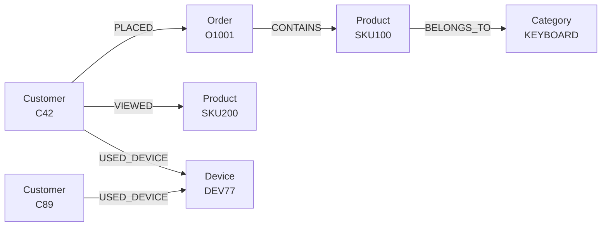
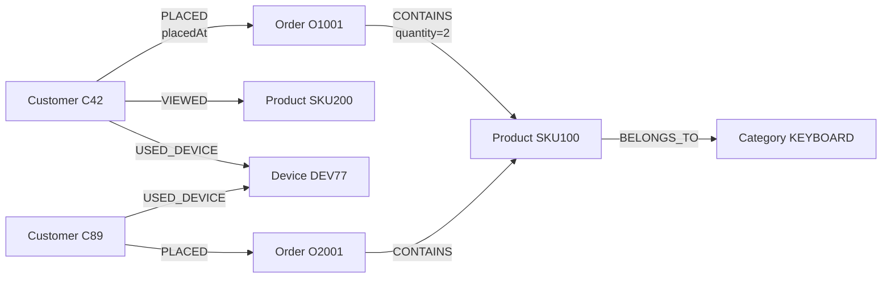
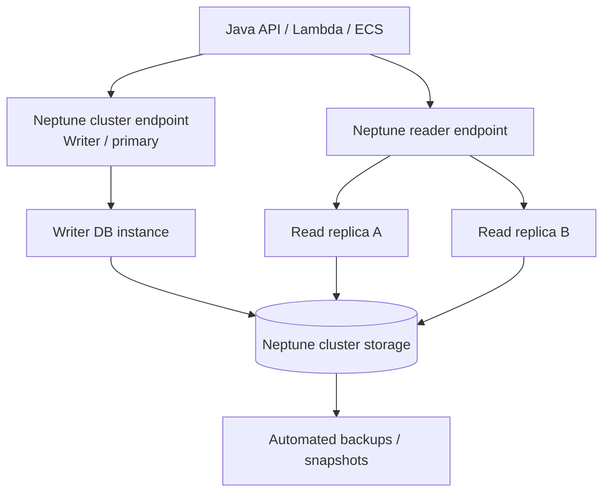
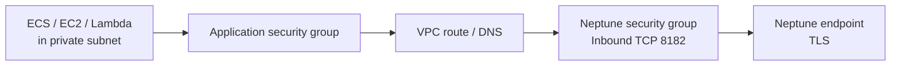
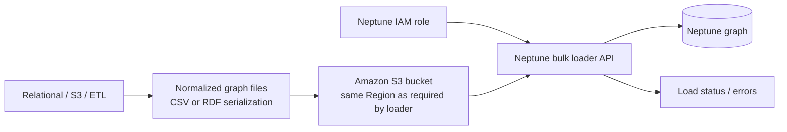

# Amazon Neptune and Graph Data Modeling

**Amazon Neptune** is a managed graph database service on AWS. It fits applications where data is highly connected and business questions depend on traversing those relationships: which customers link to a suspicious account, which products are frequently bought together, which services depend on an infrastructure component, or which entities connect to another within multiple hops.

In relational databases, relationships are represented through foreign keys and JOINs. In a graph database, **vertices (nodes)** and **edges (relationships)** are first-class citizens; queries follow edges directly to find paths and neighborhoods. Neptune supports two primary graph models: **Property Graph** with Gremlin or openCypher, and **RDF** with SPARQL. Choosing the right model keeps data representation clear and queries natural.

This lesson belongs to the **Caching and Specialized Databases** chapter of the **CLOUD_PROVIDERS_AWS** module. When building on AWS, learners need to know when to use DynamoDB/RDS vs. a graph database, and how Neptune fits into an architecture spanning Regions/AZs, VPCs, IAM, EC2/ECS/Lambda, integration services, monitoring, backups, and cost control. Neptune is a specialized database for complex connected data; it neither replaces every database nor acts as a cache.

Our running scenario is **Shop Recommendation & Fraud Detection**. A customer places orders, views products, and may share a device or payment method with another account. The system queries the `Customer → Order → Product` chain, finds related products, and detects clusters of potentially fraudulent accounts.

## 1. Learning Objectives

After this lesson, you can:

1. Explain graph databases, vertices, edges, labels, properties, and traversals.
2. Distinguish a **Property Graph** from an **RDF graph**, and recognize when to use Gremlin, openCypher, or SPARQL.
3. Design a graph schema for Customer, Order, Product, Device, and their relationships in Shop.
4. Choose node IDs, edge directions, labels, relationship properties, and duplicate-prevention strategies.
5. Write basic queries for neighborhoods, paths, and multi-hop relationships.
6. Explain Amazon Neptune DB clusters, writer/reader endpoints, replicas, VPC networking, TLS, and IAM authentication.
7. Integrate Neptune into Java/Lambda/ECS applications with proper access controls and connection management.
8. Distinguish Neptune Database from Neptune Analytics, Neptune ML, and other caching/database services.
9. Identify limits, index/query performance considerations, monitoring, backups, scaling, and costs.
10. Build a testable lab to validate data, queries, and error handling in an AWS sandbox.

## 2. What Is a Graph Database?

A **graph database** stores data as entities and the relationships between them. Instead of joining multiple tables to reconstruct a chain of links, the application traverses directly from node to node.

Example:



Looking directly at the graph, you can see:

- Customer C42 placed Order O1001.
- The order contains Product SKU100.
- Customer C42 also viewed Product SKU200.
- Product SKU100 belongs to Category KEYBOARD.
- Two customers share a link to one Device.

These connections are first-class data in the model, not just foreign-key columns used to join tables.

### 2.1. Why Not Just Use a Relational Database?

An RDBMS can still store relationships and run JOINs. A graph database becomes valuable when an application frequently asks questions like:

- Find all people connected within 3 hops of an account.
- Find products related to the currently viewed product via co-purchases, co-views, and categories.
- Trace dependency paths from a service down to a database or infrastructure resource.
- Identify account rings sharing devices, network addresses, or payment instruments.

When traversal depth varies dynamically with the data, multi-level SQL JOINs or recursive CTEs become hard to read and tune. Graph traversals express them naturally. Conversely, for columnar aggregations, large reporting jobs, or simple CRUD, RDS/DynamoDB/data warehouses often fit better.

### 2.2. Core Building Blocks

| Component | Meaning | Example |
|---|---|---|
| **Vertex / Node** | An entity in the graph | Customer C42 |
| **Edge / Relationship** | A directed link between two vertices | C42 `PLACED` O1001 |
| **Label** | Node type or relationship type | Customer, Order, `PLACED` |
| **Property** | Key-value attribute attached to a node/edge | `name`, `status`, `quantity` |
| **ID** | Model identifier for a node/edge | C42, O1001 |
| **Traversal** | Navigating nodes/edges matching conditions | Customer → Order → Product |
| **Path** | Connected sequence of vertices and edges | C42 → O1001 → SKU100 |

### 2.3. Directed Edges and Relationship Direction

An edge in a property graph has a **source (out vertex)** and a **target (in vertex)**. Example:

```text
Customer C42 --PLACED--> Order O1001
```

Reading outgoing from Customer: the customer placed the order. Reading incoming to Order: the order was placed by the customer. Edge direction is part of the model; if queries need to traverse both ways, graph languages support incoming, outgoing, and bidirectional steps cleanly.

Do not create duplicate reverse edges just to read relationships from both sides unless the domain models two distinct semantics. Storing redundant reverse edges doubles write/storage overhead and can cause traversals to double-count paths.

## 3. What Is Amazon Neptune?

**Amazon Neptune Database** is a managed graph database service supporting both Property Graph and RDF storage and querying. AWS manages cluster infrastructure, storage, backups, and service operations. The application remains responsible for schema design, queries, IAM/network security, data governance, capacity sizing, and business correctness.

### 3.1. Where Does Neptune Fit?

| Problem | How a graph model helps |
|---|---|
| **Fraud detection** | Spot accounts sharing devices/cards/addresses or suspicious multi-hop paths |
| **Recommendations** | Discover products via co-purchase, co-view, and category relationships |
| **Knowledge graphs** | Link concepts, documents, people, organizations, and knowledge sources |
| **Identity resolution** | Unify identity signals across disparate systems |
| **Network & IT operations** | Query topology, dependencies, and blast-radius impact chains |
| **Social graphs** | Friends, followers, groups, and multi-hop connections |
| **Supply chain** | Suppliers, components, shipments, and upstream/downstream dependencies |

### 3.2. When Is Neptune Not the First Choice?

- Storing sessions/caches with TTL and simple key-value lookups: evaluate **Amazon ElastiCache** or DynamoDB as required.
- Storing orders queried by clear primary keys/access patterns: **DynamoDB** often fits better.
- Workloads needing relational joins, constraints, and rich SQL transactions: consider **Amazon RDS/Aurora**.
- Columnar analytics over billions of rows, BI, and reporting: consider **S3 + Athena/Glue**, Redshift, or analytics platforms.
- Large-scale batch graph analytics running in-memory graph algorithms: evaluate **Amazon Neptune Analytics**.

Neptune can serve as one specialized store in a polyglot architecture. Do not move all data into a graph if most queries do not traverse relationships.

### 3.3. Neptune Database vs. Neptune Analytics

| Criterion | Neptune Database | Neptune Analytics |
|---|---|---|
| Purpose | Operational graph database for live apps, queries, and updates | Graph analytics, algorithms, and relationship exploration over loaded graphs |
| Workload | Online graph queries, application transactions | Deep analytics, graph algorithms, exploratory analytics |
| Models | Property Graph and RDF with supported query interfaces | Dedicated graph analytics engine with its own query/algorithm interfaces |
| Operations | DB clusters, instances, storage, and replicas | Analytics graph resource with separate capacity and lifecycle |
| Choose when | App needs a long-lived operational graph database | You need large-scale graph structural analysis and algorithms |

**Do not treat Neptune Analytics as a read replica of Neptune Database.** The two services have distinct purposes, APIs, lifecycles, and pricing models. Check compatibility, import/export flows, and query languages in current docs before designing pipelines.

## 4. Two Data Models: Property Graph and RDF

Neptune supports two major graph models. Both capture relationships, yet represent data and queries differently.

### 4.1. Property Graph

A Property Graph contains:

- **Vertices** with an ID, one or more labels, and properties.
- **Directed edges** with an ID, label, and properties.
- Properties stored as key/value pairs directly on nodes or edges.

Example:

```text
(:Customer {id: "C42", name: "An"})
  -[:PLACED {placedAt: "2026-11-20T08:00:00Z"}]->
(:Order {id: "O1001", status: "PLACED"})
  -[:CONTAINS {quantity: 2}]->
(:Product {id: "SKU100", name: "Keyboard"})
```

In Neptune, Property Graphs are queried via **Gremlin** or **openCypher**. This is the natural fit when modeling domain entities and attributed relationships.

### 4.2. RDF Graph

**RDF (Resource Description Framework)** expresses knowledge as triples:

```text
Subject — Predicate — Object
```

Example:

```text
<urn:customer:C42> <https://shop.example/vocab/placed> <urn:order:O1001> .
<urn:order:O1001> <https://shop.example/vocab/contains> <urn:product:SKU100> .
<urn:product:SKU100> <https://shop.example/vocab/name> "Keyboard" .
```

- **Subject**: the resource being described.
- **Predicate**: the relationship or attribute.
- **Object**: another resource or a literal value.

RDF uses URIs/IRIs to identify resources and supports formal vocabularies/ontologies. Neptune queries RDF using **SPARQL 1.1**.

### 4.3. Comparing Property Graph and RDF

| Perspective | Property Graph | RDF |
|---|---|---|
| Core unit | Vertex, edge, property | Subject-predicate-object triple |
| Relationships | Labeled edges with properties | Predicate identified by a URI |
| Attributes | Attached directly to nodes/edges | Expressed as triples with literal or resource objects |
| Identifiers | Graph element IDs and app IDs | URIs/IRIs |
| Neptune languages | Gremlin, openCypher | SPARQL |
| Strengths | Operational app graphs, traversals, domain relationships | Knowledge graphs, linked data, ontologies, semantic integration |
| Modeling mindset | Entities and relationships | Facts and vocabularies |

**Choose one model matching your domain and query patterns.** Never treat Property Graph and RDF as interchangeable structures differing only in query syntax. Define upfront which data enters which model and which API serves it.

### 4.4. When to Choose Which Model

Choose **Property Graph** when:

- The domain centers on entities like Customer, Order, Product, and Device.
- Relationships carry their own attributes such as `quantity`, `since`, `confidence`, or `timestamp`.
- The application traverses relationships frequently.
- The team prefers Gremlin traversals or openCypher pattern matching.

Choose **RDF** when:

- Data consists of URI-linked facts and knowledge assertions.
- You require vocabularies/ontologies, Semantic Web standards, or linked data.
- You need SPARQL queries and integration across RDF datasets.
- The domain merges multiple knowledge sources under a shared semantic schema.

## 5. Designing a Property Graph for Shop

A clean graph starts from business questions, not from mechanically turning every SQL table into a vertex.

### 5.1. Identify Entities

| Entity | Vertex label | Example ID | Properties |
|---|---|---|---|
| Customer | `Customer` | C42 | `name`, `createdAt`, `tier` |
| Order | `Order` | O1001 | `status`, `currency`, `totalMinorUnits` |
| Product | `Product` | SKU100 | `name`, `brand`, `category` |
| Category | `Category` | KEYBOARD | `title` |
| Device | `Device` | DEV77 | `deviceType`, `firstSeenAt` |
| Payment instrument | `PaymentInstrument` | PI55 | `instrumentType`, `tokenFingerprint` |
| Shipping address | `Address` | ADDR10 | `countryCode`, `postalRegion` |

Do not turn every column into a vertex. Small attributes read only alongside one entity—and never linked independently—belong as **properties**.

### 5.2. Identify Relationships

| Relationship label | From node | To node | Example edge properties |
|---|---|---|---|
| `PLACED` | `Customer` | `Order` | `placedAt`, `channel` |
| `CONTAINS` | `Order` | `Product` | `quantity`, `unitPriceMinorUnits` |
| `BELONGS_TO` | `Product` | `Category` | — |
| `VIEWED` | `Customer` | `Product` | `viewedAt`, `source` |
| `USED_DEVICE` | `Customer` | `Device` | `firstSeenAt`, `lastSeenAt` |
| `PAID_WITH` | `Order` | `PaymentInstrument` | `authorizedAt` |
| `SHIPPED_TO` | `Order` | `Address` | `deliveryType` |
| `SIMILAR_TO` | `Product` | `Product` | `score`, `modelVersion` |

Edge properties shine when data belongs to the **relationship itself**, such as `quantity` on an Order–Product link. Putting `quantity` on `Product` would erase which order bought how many units.

### 5.3. Sample Graph



This graph answers questions such as:

- Which products did Customer C42 buy?
- Who else bought SKU100?
- Which customers share a device with C42?
- Which products can be recommended based on indirect connections?

### 5.4. Keep Node IDs Stable and Namespaced

Use stable domain-derived IDs:

```text
Customer: customer:C42
Order: order:O1001
Product: product:SKU100
Device: device:DEV77
```

Namespacing prevents ID collisions when different entity types share a graph ID space or numeric business IDs. Avoid using person names, emails, or phone numbers as graph IDs when opaque identifiers work. IDs must be generated/validated server-side—never let clients pick another entity's ID.

### 5.5. Preventing Duplicate Nodes and Duplicate Edges

If every incoming event inserts a brand-new `Customer C42` vertex, the graph accumulates duplicates representing the same person, corrupting query results and bloating storage.

- Use stable IDs with strict normalization rules.
- Use upsert/merge operations per your query language's capabilities.
- Enforce uniqueness in the application layer; never assume Neptune provides every RDBMS-style uniqueness constraint.
- Attach business idempotency keys to ingestion events.
- For edges, decide whether a relationship occurs once or repeatedly. For instance, `VIEWED` may repeat over time and require individual timestamped event nodes/edges with unique IDs rather than overwriting a single edge.

## 6. Choosing Granularity: Property or Node/Edge?

One of the most important modeling choices is deciding what becomes a vertex, edge, or property.

| Question | Consider modeling as |
|---|---|
| Has an independent ID and is referenced from multiple places? | Vertex |
| Represents a link between two entities? | Edge |
| Describes an attribute specific to that link? | Edge property |
| Describes one node and is rarely queried on its own? | Node property |
| Has recurring timestamped occurrences? | Event vertex or multiple keyed edges/events |
| Is a large document or binary blob? | S3/object storage, keeping only a reference in the graph |

### 6.1. Example: Where Does `quantity` Belong?

Order O1001 contains two units of SKU100:

```text
Order O1001 --CONTAINS {quantity: 2}--> Product SKU100
```

Putting `quantity` on `Product` loses per-order quantities. If `Product` has `stockQuantity`, that is an inventory property of the product itself—a completely different concept. Placing properties accurately keeps domain semantics clear.

### 6.2. Example: Does `VIEWED` Need Its Own Node?

If you only track whether a customer ever viewed a product, a single `VIEWED` edge may suffice. If you analyze every view's timestamp, campaign, session, referrer, and duration, one edge cannot cleanly hold unlimited distinct occurrences. Instead, you can model:

```text
Customer C42 --PERFORMED--> ViewEvent V1001
ViewEvent V1001 --TARGETED--> Product SKU100
ViewEvent V1001 --IN_SESSION--> Session S77
```

Or store raw view events in an event/stream store and project curated summaries into the graph. Balance query needs against data volume, since creating a vertex for every click can grow the graph rapidly.

### 6.3. Avoiding Supernodes

A node like `Category=ALL` or `Country=VN` can accumulate millions of edges. Traversals hitting such high-degree vertices explode in fan-out. To prevent this:

- Start traversals from higher-selectivity nodes.
- Bound traversal depth and result counts.
- Filter early using selective properties.
- Analyze degree distributions and avoid meaningless hub vertices.
- Offload wide batch explorations to analytics rather than online request paths.

## 7. Property Graph Query Languages: Gremlin and openCypher

Neptune supports two Property Graph query languages. Both traverse relationships while expressing logic differently.

### 7.1. Gremlin: Step-by-Step Traversal

**Gremlin** is the Apache TinkerPop graph traversal language. Queries typically start from vertices or edges and chain traversal steps:

| Step | Meaning | Example |
|---|---|---|
| `V()` | Start from vertices | All nodes |
| `E()` | Start from edges | All relationships |
| `hasLabel()` | Filter by label | `Customer` |
| `has()` | Filter by property | `customerId = C42` |
| `out()` | Follow outgoing edges | Customer → Order |
| `in()` | Follow incoming edges | Order ← Customer |
| `both()` | Follow both directions | Bidirectional relationships |
| `values()` | Extract property values | `name`, `status` |
| `path()` | Return traversed path | Customer → Order → Product |
| `limit()` | Cap output count | Top 20 |

Example finding products purchased by C42:

```groovy
g.V().
  has('Customer', 'customerId', 'C42').
  out('PLACED').
  hasLabel('Order').
  out('CONTAINS').
  hasLabel('Product').
  values('name')
```

Reading left to right:

1. Find the `Customer` with `customerId=C42`.
2. Follow `PLACED` edges to orders.
3. From those orders, follow `CONTAINS` edges to products.
4. Return product names.

Gremlin excels when developers want fine-grained, step-by-step control over directions, filtering, mapping, grouping, and complex traversal pipelines.

### 7.2. openCypher: Declarative Pattern Matching

**openCypher** uses declarative ASCII-art pattern matching to describe node and edge chains. The same query:

```cypher
MATCH (c:Customer {customerId: 'C42'})
      -[:PLACED]->(o:Order)
      -[:CONTAINS]->(p:Product)
RETURN DISTINCT p.name AS productName
```

The pattern visually mirrors the graph: `Customer → Order → Product`, making domain structure immediately readable.

### 7.3. Creating Data with openCypher

```cypher
CREATE
  (c:Customer {
    customerId: 'C42',
    name: 'An'
  }),
  (o:Order {
    orderId: 'O1001',
    status: 'PLACED',
    totalMinorUnits: 125000
  }),
  (p:Product {
    sku: 'SKU100',
    name: 'Keyboard'
  }),
  (c)-[:PLACED {
    placedAt: '2026-11-20T08:00:00Z'
  }]->(o),
  (o)-[:CONTAINS {
    quantity: 2,
    unitPriceMinorUnits: 62500
  }]->(p)
RETURN c, o, p
```

This sample is meant for an **empty lab graph**. Re-running `CREATE` creates duplicate logical elements. For real ingestion, implement upserts/idempotency and unique business IDs in your app—never rely on `CREATE` to prevent duplicates.

### 7.4. Multi-Hop openCypher Query

Find customers who purchased the same product as C42:

```cypher
MATCH (source:Customer {customerId: 'C42'})
      -[:PLACED]->(:Order)
      -[:CONTAINS]->(p:Product)
      <-[:CONTAINS]-(:Order)
      <-[:PLACED]-(other:Customer)
WHERE other.customerId <> source.customerId
RETURN DISTINCT other.customerId AS customerId,
                p.sku AS sharedProduct
LIMIT 50
```

This is a multi-hop pattern. On real data, bound node/edge fan-out, apply `LIMIT`, filter early, and inspect query profiles; one customer buying thousands of items can produce massive intermediate results.

### 7.5. Choosing Gremlin or openCypher?

| Criterion | Gremlin | openCypher |
|---|---|---|
| Expression style | Step-by-step imperative/fluent traversal | Declarative pattern matching |
| Best fit | Flexible traversal logic, multi-step pipelines | Readable domain pattern queries |
| Syntax | Step-based, fluent | Declarative |
| Ecosystem | Apache TinkerPop | openCypher ecosystem |
| Neptune model | Property Graph | Property Graph |

Pick one primary language aligned with team skills and real query patterns. Avoid splitting every API across both languages, as maintaining two query stacks increases training, debugging, and testing overhead.

## 8. RDF and SPARQL

RDF fits data expressed as URI-identified assertions and relationships governed by vocabularies/ontologies. In Neptune, SPARQL queries RDF data.

### 8.1. URIs/IRIs and Literals

An RDF triple:

```text
<urn:customer:C42>
  <https://shop.example/vocab/placed>
  <urn:order:O1001> .
```

Example URIs:

- `urn:customer:C42` identifies the Customer.
- `https://shop.example/vocab/placed` defines the `placed` predicate.
- `urn:order:O1001` identifies the Order.

Literal attributes:

```text
<urn:order:O1001>
  <https://shop.example/vocab/status>
  "PLACED" .

<urn:order:O1001>
  <https://shop.example/vocab/total>
  "125000"^^<http://www.w3.org/2001/XMLSchema#integer> .
```

Literals can carry explicit datatypes or language tags, giving data stronger semantics than untyped strings.

### 8.2. SPARQL `SELECT`

Find orders placed by customer C42:

```sparql
PREFIX ex: <https://shop.example/vocab/>

SELECT ?order
WHERE {
  <urn:customer:C42> ex:placed ?order .
}
```

Find products inside a customer's orders:

```sparql
PREFIX ex: <https://shop.example/vocab/>

SELECT DISTINCT ?product ?name
WHERE {
  <urn:customer:C42> ex:placed ?order .
  ?order ex:contains ?product .
  ?product ex:name ?name .
}
```

### 8.3. RDF Vocabularies and Ontologies

A vocabulary defines predicates like `placed`, `contains`, and `belongsTo`. An ontology models classes, subclasses, and richer semantic constraints, e.g.:

```text
Customer rdfs:subClassOf Person
Order ex:placedBy Customer
Product ex:belongsTo Category
```

Neptune stores and queries RDF triples, but never assume complex ontology entailment/reasoning runs automatically like a full reasoner. If your app needs rule inference, choose an explicit inference/ETL pipeline and verify what the Neptune engine natively supports.

### 8.4. Named Graphs and Data Provenance

RDF can group triples into **named graphs** to separate datasets, sources, or scopes. This helps when merging multi-source data, though named graphs never replace IAM or resource authorization. Apps must still enforce who may read or write which graphs.

## 9. Do Not Confuse the Three Query Languages

| Query language | Data model | Use when | Example |
|---|---|---|---|
| **Gremlin** | Property Graph | Step-by-step traversal | `g.V().has(...).out(...)` |
| **openCypher** | Property Graph | Pattern matching | `MATCH (a)-[:KNOWS]->(b)` |
| **SPARQL** | RDF | Triple patterns, semantic data | `SELECT ?s WHERE { ?s ex:related ?o }` |

A classic design mistake is picking RDF when the team only knows Cypher and writing a custom query translator. Select the right model and query language upfront, validate on real data, and define clear API contracts.

## 10. Amazon Neptune DB Cluster Architecture

Neptune Database uses a **DB cluster** with one primary/writer instance and optional read replicas. The service-managed storage layer is decoupled from compute instances; clusters scale reads with replicas and handle failover per service design.



### 10.1. Writer / Cluster Endpoint

The cluster endpoint resolves to the cluster's current primary instance, suited for **writes** and reads needing writer-level consistency. On failover, AWS updates the endpoint to point to the newly promoted primary; apps must still reconnect and retry properly.

### 10.2. Reader Endpoint

The reader endpoint distributes read connections across available read replicas per service behavior, offloading read traffic from the writer. However:

- It does not guarantee every read sees just-committed writes on a replica.
- Clients holding long-lived connections are not re-balanced per individual query like an HTTP load balancer.
- Apps must manage retries, timeouts, and stale-read tolerances per business rules.

### 10.3. Instance Endpoint

An instance endpoint targets one specific DB instance directly. Useful for troubleshooting or targeting a single instance, whereas production apps should normally use cluster/reader endpoints to benefit from failover and replica routing.

### 10.4. Neptune Storage and Availability Zones

Neptune manages a fault-tolerant storage layer spanning multiple Availability Zones. You do not provision physical disks or pin vertices to AZs. Compute DB instances run inside VPC subnets per cluster config; read replicas and failover improve service availability.

**Never confuse storage durability with application availability.** If the writer instance fails, apps still encounter transient connection errors during failover. Configure retries with backoff, pool refreshes, and sensible timeouts.

## 11. Provisioned Instances and Neptune Serverless

Neptune supports provisioned compute instances as well as **Neptune Serverless** for workloads with variable capacity within supported limits.

| Criterion | Provisioned | Serverless |
|---|---|---|
| Capacity | Pick explicit instance class/size | Capacity scales automatically between configured min/max bounds |
| Best fit | Steady workloads with clear baselines | Variable, unpredictable, or bursty workloads |
| Tuning | Right-sizing, replicas, scaling plans | Min/max capacity, scaling behavior, latency |
| Operations | Manage instance topology | Still manage cluster, network, data, and queries |
| Cost | Per instance-hour and attached resources | Per consumed capacity (NCUs) and attached resources |

Serverless **does not eliminate performance design**. Broad traversals, supernodes, connection storms, or poorly chosen min capacity still hurt latency and cost. Verify engine versions, instance/serverless availability, and Regional limits before choosing.

## 12. Connecting to Neptune Inside a VPC

Neptune DB clusters normally deploy inside an **Amazon VPC** and should never expose endpoints to the public Internet. Workloads inside the VPC or connected networks reach it via security groups, routes, and DNS.

### 12.1. Connection Path



### 12.2. Security Groups

Core principles:

- Assign dedicated security groups to app instances/Lambdas.
- Allow inbound **TCP 8182 strictly from the app security group** on the Neptune DB SG.
- Never open inbound 8182 to `0.0.0.0/0`.
- Verify subnet groups, route tables, NACLs, DNS resolution, and network reachability.

Security-group-to-security-group rules are far cleaner than hardcoding Lambda/EC2 IPs. If apps run in another VPC, configure VPC peering or Transit Gateway with verified DNS, routing, and security rules.

### 12.3. Ports and Endpoints

Neptune endpoints typically serve Gremlin, openCypher, and SPARQL APIs over **TCP port 8182**. Exact paths depend on the query interface:

| Query interface | Example endpoint path |
|---|---|
| Gremlin | `wss://<cluster-endpoint>:8182/gremlin` or supported HTTPS request path |
| openCypher | `https://<cluster-endpoint>:8182/openCypher` |
| SPARQL | `https://<cluster-endpoint>:8182/sparql` |

These formats are illustrative. Use the exact AWS-provided writer/reader hostnames and supported driver/API versions; never guess hostnames or disable TLS.

### 12.4. Lambda in a VPC

When Lambda connects directly to Neptune:

1. Attach Lambda to private subnets with routing to Neptune.
2. Attach an SG to Lambda and allow it on the Neptune DB SG over TCP 8182.
3. Reuse clients/connections sensibly to avoid opening new connections on every invocation.
4. Cap concurrency to prevent connection storms.
5. Handle cold starts, timeouts, retries, and connection resets during DB failovers.

Lambda does not need a public subnet to reach Neptune in the same VPC; proper routing, subnets, and SGs determine connectivity.

## 13. Neptune Security: Networking, TLS, IAM, and Data

Graph databases often hold sensitive relationships: who connects to whom, shared devices, and customer behaviors. Because graph queries traverse multiple hops, unauthorized queries can expose far more context than a single row. Security must cover **network boundaries, authentication, authorization, encryption, and data governance**.

### 13.1. Network Boundaries

- Place Neptune inside private VPC subnets per security architecture.
- Restrict the DB security group to TCP 8182 from approved app security groups only.
- Never expose Neptune endpoints directly to the Internet.
- For cross-VPC or on-premises access, govern peering, Transit Gateway, VPN/Direct Connect, DNS, and routing tightly.
- Inspect NACLs, route tables, and DNS whenever connection timeouts occur.

### 13.2. TLS and Encryption at Rest

Neptune supports TLS for endpoint connections and encryption at rest for cluster storage. In production:

- Enforce HTTPS/WSS with certificate validation enabled.
- Never disable certificate validation to silence connection errors.
- Select KMS keys aligned with ownership and security policies.
- Govern KMS key policies, rotation, and snapshot/restore permissions.
- Never store passwords, tokens, PANs, or raw credentials inside graph properties.

### 13.3. IAM Database Authentication

Neptune supports **IAM database authentication** when enabled on the cluster. Clients sign requests with **AWS Signature Version 4 (SigV4)**, and IAM policies control which principals can invoke supported data API actions.

IAM auth does not automatically turn `Customer C42` into an AWS principal. It authenticates the **AWS workload identity** (e.g., ECS task role or Lambda execution role) at the database boundary. Your backend must still enforce end-user business authorization across Customer, Order, Device, and Tenant data.

Core rules:

- Use ECS task roles, EC2 instance profiles, or Lambda execution roles instead of static access keys.
- When IAM auth is enabled, use a driver/integration with a compatible SigV4 signer for your Neptune endpoint and engine version.
- Keep system clocks synchronized, as SigV4 relies on timestamps.
- Scope IAM policies to the specific cluster/resource and required actions per Neptune IAM documentation.
- Never put IAM secrets or session tokens inside graph properties or logs.

### 13.4. Data Authorization and Tenant Isolation

Suppose Customer C42 is only allowed to view their own records. An API must never accept raw browser-submitted queries like:

```text
MATCH (c:Customer {customerId: 'C89'})-[:PLACED]->(o)
RETURN o
```

simply because the AWS task role has permission to connect to Neptune. The backend must:

1. Authenticate the user via Cognito/OIDC or your identity provider.
2. Extract customer/tenant identity from verified claims and trusted membership data.
3. Populate query parameters from the server-side authorization context.
4. Constrain which labels, relationships, and fields the endpoint returns.
5. Audit privileged queries and monitor anomalous traversals.

Never allow end users to send arbitrary raw Gremlin/openCypher/SPARQL to a production Neptune endpoint unless building a dedicated, tightly sandboxed query console.

## 14. Sending Queries to Neptune

Neptune exposes query interfaces over the cluster endpoint. Exact HTTP/WebSocket semantics, content types, authentication, and engine compatibility vary by query language.

### 14.1. Gremlin Endpoint

Gremlin commonly uses WebSockets at:

```text
wss://<neptune-endpoint>:8182/gremlin
```

Certain HTTP forms are also supported per endpoint/API version. The Java Gremlin Driver maintains a WebSocket connection pool rather than opening a fresh TCP connection per traversal.

### 14.2. openCypher Endpoint

Example HTTP `POST` target:

```text
https://<neptune-endpoint>:8182/openCypher
```

Illustrative request body:

```json
{
  "query": "MATCH (c:Customer {customerId: $customerId})-[:PLACED]->(o:Order) RETURN o",
  "parameters": {
    "customerId": "C42"
  }
}
```

Use parameterized queries wherever supported by the API/driver instead of concatenating user input directly into query strings, reducing injection and escaping bugs.

### 14.3. SPARQL Endpoint

RDF queries typically target:

```text
https://<neptune-endpoint>:8182/sparql
```

Encode and submit SPARQL queries using HTTP methods and content types supported by the Neptune endpoint. For update requests, restrict write permissions strictly and never expose query endpoints publicly.

### 14.4. Never Mix Endpoints and Query Languages

| Endpoint path | Language | Model |
|---|---|---|
| `/gremlin` | Gremlin | Property Graph |
| `/openCypher` | openCypher | Property Graph |
| `/sparql` | SPARQL | RDF |

Using the right path alone is not enough: the client must also match the engine version, protocol, authentication method, and request format.

## 15. Java: Connecting and Querying with Gremlin

For Java applications, the **Apache TinkerPop Gremlin Driver** is a standard option for Property Graphs. Match the driver version to the Gremlin/TinkerPop version supported by your Neptune engine.

### 15.1. Maven Dependency

Example dependency declaration (select the compatible version from your environment's Neptune engine docs):

```xml
<dependency>
  <groupId>org.apache.tinkerpop</groupId>
  <artifactId>gremlin-driver</artifactId>
  <version>compatible-version</version>
</dependency>
```

Never blindly pull the latest TinkerPop release without checking Neptune compatibility; Neptune supports specific TinkerPop versions and may not support every newest TinkerPop feature.

### 15.2. Illustrative Java Gremlin Driver

```java
package example.shop.graph;

import java.util.List;
import org.apache.tinkerpop.gremlin.driver.Client;
import org.apache.tinkerpop.gremlin.driver.Cluster;
import org.apache.tinkerpop.gremlin.driver.Result;
import org.apache.tinkerpop.gremlin.driver.ResultSet;

public final class NeptuneGremlinExample {
    public static void main(String[] args) throws Exception {
        String host = System.getenv("NEPTUNE_ENDPOINT");
        if (host == null || host.isBlank()) {
            throw new IllegalStateException("NEPTUNE_ENDPOINT is required");
        }

        Cluster cluster = Cluster.build(host)
                .port(8182)
                .enableSsl(true)
                .create();

        try (Client client = cluster.connect()) {
            ResultSet resultSet = client.submit(
                    "g.V().has('Customer','customerId',customerId)" +
                    ".out('PLACED').hasLabel('Order').values('orderId')",
                    java.util.Map.of("customerId", "C42"));

            List<Result> results = resultSet.all().get();
            for (Result result : results) {
                System.out.println(result.getObject());
            }
        } finally {
            cluster.close();
        }
    }
}
```

This demonstrates TLS Gremlin connectivity with query bindings. Before running:

- Provide the valid endpoint hostname from your Neptune cluster.
- Match the compatible driver version.
- Ensure network SGs allow TCP 8182 from the app to Neptune.
- This example assumes cluster authentication aligns with your environment. If IAM DB authentication is enabled, integrate SigV4 signing per AWS/driver docs; this minimal snippet **does not perform SigV4 signing**.
- In production, tune connection pools, max in-flight requests, timeouts, reconnects, and metrics instead of leaving unreviewed defaults.

### 15.3. Client Lifecycle

Create the `Cluster`/`Client` once per application lifecycle, reuse its connection pool, and close it cleanly on shutdown. Never instantiate a new `Cluster` per HTTP request. In Lambda, initialize the client outside the handler to reuse across warm invocations while handling stale sockets, failovers, and concurrency caps.

### 15.4. Query Parameters and Injection

Never build Gremlin queries via string concatenation:

```java
String query = "g.V().has('Customer','customerId','"
        + userInput + "')";
```

Untrusted input can alter query structure. Use driver bindings/parameters, allowlist labels/steps, and expose only predefined traversals through your API—never accept raw queries from browsers.

## 16. Creating and Querying Graphs with Gremlin

The commands below run in Gremlin Console or a compatible client and illustrate Property Graphs, not SPARQL syntax.

### 16.1. Create Customer and Order

```groovy
g.addV('Customer').
  property('customerId', 'C42').
  property('name', 'An')

g.addV('Order').
  property('orderId', 'O1001').
  property('status', 'PLACED')
```

These two traversals create two separate vertices. To link them, locate both vertices and connect them with an edge.

### 16.2. Create the `PLACED` Edge

```groovy
g.V().
  has('Customer', 'customerId', 'C42').
  as('c').
  V().
  has('Order', 'orderId', 'O1001').
  as('o').
  addE('PLACED').
  from('c').
  to('o').
  property('placedAt', '2026-11-20T08:00:00Z')
```

This is an illustrative traversal; in real code, verify cardinality and Gremlin traversal behavior for your engine version, and wrap edge creation in duplicate-prevention logic at the ingestion layer.

### 16.3. Traverse from Customer to Products

```groovy
g.V().
  has('Customer', 'customerId', 'C42').
  out('PLACED').
  out('CONTAINS').
  values('name')
```

If a Customer has thousands of orders with hundreds of products each, expansion grows rapidly. Add filters/limits aligned with business patterns, inspect query profiles, and avoid returning huge subgraphs.

### 16.4. Inspecting Paths for Debugging

```groovy
g.V().
  has('Customer', 'customerId', 'C42').
  out('PLACED').
  out('CONTAINS').
  path().
  limit(10)
```

`path()` reveals the exact traversed element sequence. In production, returning full paths consumes memory and can leak connected entity details; use sparingly with tight limits.

## 17. Practical openCypher for Shop

### 17.1. Find a Customer's Orders

```cypher
MATCH (c:Customer {customerId: $customerId})
      -[:PLACED]->(o:Order)
RETURN o.orderId AS orderId,
       o.status AS status
ORDER BY o.createdAt DESC
LIMIT 20
```

Pass `customerId` as a query parameter and verify caller authorization before executing.

### 17.2. Find Co-Purchased Products

```cypher
MATCH (c:Customer {customerId: $customerId})
      -[:PLACED]->(:Order)
      -[:CONTAINS]->(p:Product)
      <-[:CONTAINS]-(:Order)
      <-[:PLACED]-(other:Customer)
WHERE other.customerId <> c.customerId
RETURN p.sku AS sharedSku,
       collect(DISTINCT other.customerId) AS relatedCustomers
LIMIT 50
```

This is a basic collaborative query, not a full recommendation engine. Factor in frequency, recency, category, privacy, excluding already-bought items, and strict result limits.

### 17.3. Find Customers Sharing a Device

```cypher
MATCH (c:Customer {customerId: $customerId})
      -[:USED_DEVICE]->(d:Device)
      <-[:USED_DEVICE]-(other:Customer)
WHERE other.customerId <> c.customerId
RETURN DISTINCT other.customerId AS relatedCustomer,
                d.deviceType AS sharedDeviceType
LIMIT 100
```

Sharing a device is an **investigative signal**, not definitive proof that two accounts belong to one person or are fraudulent. Combine multiple signals, confidence scores, timestamps, and customer-protection policies.

### 17.4. Avoid Unbounded Wide Queries

A pattern like:

```cypher
MATCH (a)-[*1..10]-(b)
RETURN a, b
```

can explode into massive path counts, especially around high-degree hub nodes. Never put unbounded-depth queries behind online endpoints. Bound depth, starting nodes, labels, relationship types, result counts, and timeouts to match SLOs.

## 18. Practical RDF with SPARQL

### 18.1. Load Illustrative Triples

```text
<urn:customer:C42> <https://shop.example/vocab/name> "An" .
<urn:customer:C42> <https://shop.example/vocab/placed> <urn:order:O1001> .
<urn:order:O1001> <https://shop.example/vocab/status> "PLACED" .
<urn:order:O1001> <https://shop.example/vocab/contains> <urn:product:SKU100> .
<urn:product:SKU100> <https://shop.example/vocab/name> "Keyboard" .
```

Centrally govern vocabulary URIs so producers do not invent synonymous predicates like `placed`, `hasPlaced`, and `madeOrder`.

### 18.2. Find Products in a Customer's Orders

```sparql
PREFIX ex: <https://shop.example/vocab/>

SELECT DISTINCT ?product ?name
WHERE {
  <urn:customer:C42> ex:placed ?order .
  ?order ex:contains ?product .
  ?product ex:name ?name .
}
LIMIT 50
```

### 18.3. Filter by Literals and Datatypes

```sparql
PREFIX ex: <https://shop.example/vocab/>
PREFIX xsd: <http://www.w3.org/2001/XMLSchema#>

SELECT ?order ?amount
WHERE {
  ?order ex:total ?amount .
  FILTER(xsd:integer(?amount) > 100000)
}
```

In production RDF, write literals with proper datatypes at ingestion time to avoid repeated runtime casts and inconsistent untyped literals.

## 19. Loading Data into Neptune

Two common ingestion patterns exist: **online writes via query APIs** for incremental events, and **bulk loading from Amazon S3** for large initial loads or migrations. Picking the right one avoids hammering Neptune with millions of tiny app requests.

### 19.1. Online Writes

Online writes suit continuous business events where the app updates the graph right after actions occur, e.g.:

- A Customer is created.
- An Order is placed.
- A Product is added to the catalog.
- A Device links to a customer after verification.

The ingestion pipeline should:

1. Authenticate producers and validate business payloads.
2. Normalize IDs, labels, and relationship types.
3. Enforce idempotency and duplicate policies.
4. Write nodes/edges using query parameters/bindings.
5. Record event IDs, outcomes, and retry states.
6. Provide reconciliation when the source DB and graph projection drift.

Avoid turning every API call into dozens of unbounded traversals without measuring throughput and latency.

### 19.2. Bulk Loader from S3

Neptune provides **bulk loading** from Amazon S3 in supported Property Graph or RDF formats. It fits:

- Initial data loads.
- Legacy database migrations.
- Large snapshots or datasets.
- Rebuilding a graph projection.

High-level workflow:



### 19.3. IAM Role for the Bulk Loader

Neptune needs an IAM role configured to read objects from S3 during bulk loads. The role must:

- Allow Neptune to assume it via the service trust policy.
- Grant read access strictly to the target load bucket/prefix.
- Include `kms:Decrypt` if objects use customer-managed KMS encryption and policy requires it.
- Omit bucket write/delete permissions when the loader only reads.

Align S3 bucket, Neptune cluster, and IAM role within the required Region/trust boundary per loader docs. Never attach broad admin roles just for a one-off import.

### 19.4. Illustrative Bulk Loader Payload

Example request body for Property Graph CSV:

```json
{
  "source": "s3://shop-graph-import/property-graph/",
  "format": "csv",
  "iamRoleArn": "arn:aws:iam::111122223333:role/NeptuneLoadFromS3",
  "region": "ap-southeast-1",
  "failOnError": "FALSE",
  "parallelism": "MEDIUM",
  "queueRequest": "TRUE"
}
```

This configuration is illustrative. Supported formats and parameters depend on graph type and engine version; check the API reference first. The Property Graph loader expects **Neptune loader CSV format**, not arbitrary Excel CSVs. The RDF loader consumes supported RDF serializations.

### 19.5. Calling the Loader Endpoint

Neptune exposes the loader API at:

```text
POST https://<neptune-endpoint>:8182/loader
```

Requests need proper authentication (e.g., SigV4 when IAM DB auth is enabled), network reachability, and a valid body. The loader returns a load job ID for polling status via the loader status API; never treat the initial HTTP acceptance response as proof all records loaded cleanly.

### 19.6. Validating Bulk Load Results

Once the job finishes:

- Inspect overall status, loaded/skipped counts, and error counts.
- Review error details for malformed rows, missing IDs, duplicate IDs, or invalid edges.
- Compare node/edge counts against source dataset expectations.
- Run smoke-test queries across key access patterns.
- Shift live traffic only after verifying data and permissions.

If a job partially fails, identify exactly which records succeeded before designing retries/idempotency. Never blindly re-run the entire dataset if duplicates or unintended property overwrites can result.

## 20. Optimizing Graph Queries

Graph query cost climbs fast when traversals start from too many vertices or cross high-degree relationships. Optimize via **selective starting points**, **bounded traversals**, and **minimal returned payloads**.

### 20.1. Start from a Specific Node

Weak query:

```groovy
g.V().out('PLACED').out('CONTAINS').hasLabel('Product')
```

This scans every vertex in the graph. A much better query when serving one customer:

```groovy
g.V().
  has('Customer', 'customerId', 'C42').
  out('PLACED').
  out('CONTAINS').
  hasLabel('Product').
  limit(50)
```

Starting with a specific label and selective business key lets the engine narrow the traversal immediately.

### 20.2. Filter Early and Avoid Premature Expansion

- Start from nodes with selective keys/properties.
- Specify relationship labels rather than traversing every edge type.
- Filter by timestamp or status before expanding further when supported by the query planner.
- Constrain variable-length paths and maximum depth.
- Return only required IDs, names, or aggregates instead of entire vertex/edge objects.

### 20.3. Limit Results and Paginate

`LIMIT` caps returned rows, yet **does not always cap internal traversal work**. A query may still explore vast paths before picking 10 results. Optimize patterns and query plans rather than relying on `LIMIT` alone.

For online APIs:

- Enforce maximum page sizes.
- Implement cursor/pagination where supported by the query language and API.
- Never return unbounded graph paths.
- Enforce request timeouts and cancellation.
- Apply rate limiting and concurrency controls.

### 20.4. Profile and Explain

Neptune offers **`explain` and `profile`** tools on supported query interfaces to inspect execution plans, operators, intermediate record counts, and timings. Use them to:

1. Verify where the traversal begins.
2. Spot steps generating huge intermediate sets.
3. Catch unintended full scans or fan-outs.
4. Compare queries before and after tuning.
5. Validate on production-scale datasets.

Never tune on a tiny sample graph and deploy to production with a vastly different degree distribution.

### 20.5. How Data Modeling Affects Performance

| Design decision | Impact |
|---|---|
| Stable node IDs | Predictable lookups and upserts |
| Meaningful labels | Traversals stay scoped to target entity types |
| Explicit edge labels | Avoids traversing unrelated edges |
| Properties placed accurately | Eliminates extra joins/traversals |
| Avoiding supernodes | Prevents massive fan-out explosions |
| No blobs in properties | Keeps storage and response payloads lean |
| Separating event history | Prevents individual nodes/edges from bloating indefinitely |

### 20.6. Connection Pools and Concurrency

Opening too many WebSockets or firing too many concurrent traversals triggers connection pressure, queueing, and CPU/memory contention. Enforce:

- Reusing Gremlin driver clusters/pools.
- Sizing pools and max in-flight requests to match workload.
- Enforcing timeouts and cancellation.
- Capping Lambda reserved concurrency or worker concurrency where needed.
- Retrying transient failures with backoff/jitter—never retrying query syntax/validation errors.
- Monitoring connection churn and queue depths.

## 21. Transactions, Consistency, and Idempotency

Neptune supports graph transaction semantics per query interface and engine capabilities. How transactions open/commit and their request scope depend on protocol and driver; never assume separate independent HTTP requests automatically share one transaction.

### 21.1. Atomicity and Business Operations

Suppose placing an order requires:

1. Linking `Customer → Order`.
2. Linking `Order → Product` items.
3. Updating summary metadata.

If writes must succeed or fail together, check transaction support for your query language/driver and engine limits. When operations span **Neptune + DynamoDB + SQS/EventBridge**, no automatic ACID transaction spans all services; use outboxes, sagas/compensation, and reconciliation.

### 21.2. Idempotent Ingestion

Producers can deliver the same event multiple times on retries or stream redelivery. Creating a new vertex/edge on every delivery corrupts the graph with duplicates. Enforce:

- Stable business event IDs.
- Deterministic node IDs derived from domain IDs.
- Application-level upsert checks and uniqueness policies.
- Explicit edge identity rules: single relationship vs. one record per occurrence.
- Persistent ingestion state or inbox records for critical side effects.

### 21.3. Never Rely on `CREATE`-Style Queries to Prevent Duplicates

A create command does not imply "skip if exists." Even where query languages/engines offer `MERGE`/upsert semantics, verify exact match predicates and concurrency behavior; otherwise pair deterministic IDs with conditional checks and serialized ingestion.

### 21.4. Read-After-Write Consistency

If an app writes to the graph and immediately queries another endpoint or replica, verify consistency guarantees along that Neptune query path and cluster setup. Never assume the reader endpoint instantly reflects every just-committed write in order. Flows requiring read-after-write can read from the writer/primary path or use explicit application synchronization.

## 22. Scaling, Availability, and Failover

Neptune clusters scale read workloads via read replicas, right-sized instances, and Neptune Serverless where suitable. However, scaling compute never fixes an unbounded traversal or a supernode-heavy schema.

### 22.1. Separating Read and Write Traffic

| Workload | Recommended endpoint | Notes |
|---|---|---|
| Graph writes/updates | Writer/cluster endpoint | Requires write access, transactions, and idempotency |
| Reads needing immediate post-write visibility | Writer endpoint / compatible path | Verify consistency semantics |
| Read-heavy recommendations | Reader endpoint / replicas | Tolerates slight replica lag per workload |
| Troubleshooting a specific instance | Instance endpoint | Never hardcode in failover-sensitive apps |

### 22.2. Failover

When the writer instance fails, Neptune performs failover per cluster configuration. Applications should:

- Handle connection resets and timeouts cleanly.
- Reconnect via the cluster endpoint rather than cached instance IPs.
- Perform bounded retries on idempotent operations.
- Check existing state/IDs before re-creating records after interrupted writes with ambiguous outcomes.
- Monitor failover events and recovery times.

### 22.3. Read Replicas

Read replicas scale reads and bolster availability, yet never replace backups or resolve single-writer bottlenecks. If writes hammer a hot subgraph, review ingestion patterns, transaction contention, and data modeling.

### 22.4. Capacity Planning

Measure real workload metrics:

- Gremlin/openCypher/SPARQL requests per second.
- Read/write ratios.
- Query latency p50/p95/p99.
- Node/edge counts and graph growth rates.
- Degree distribution and traversal depth.
- Concurrent connections and in-flight requests.
- Bulk-load frequency and dataset sizes.

Select instance classes, replica counts, or serverless min/max NCUs from benchmarks—not total graph bytes alone.

## 23. Monitoring and Operating Neptune

Monitoring must cover **database health**, **query performance**, and **business outcomes**.

### 23.1. Key Metric Groups

| Group | Metrics to watch | Meaning |
|---|---|---|
| Compute | `CPUUtilization`, `FreeableMemory` | CPU/memory pressure |
| Connections | `DatabaseConnections` | Pool/concurrency behavior |
| Latency | Query latency, successful request latency | User-facing performance |
| Requests | Request rates by Gremlin/openCypher/SPARQL | Workload mix |
| Queueing | Pending requests/queue depth per supported metrics | Query backlog |
| Storage | `VolumeBytesUsed` | Graph storage growth |
| Cache | `BufferCacheHitRatio` where available | Buffer cache efficiency |
| Errors | Server errors, client errors, throttling | Failure trends |
| Availability | Failover events, engine uptime | Cluster health |

Exact metric names and dimensions vary by Neptune engine and version. Verify your cluster's CloudWatch namespace and dimensions before creating alarms rather than copying dimensions blindly across dashboards.

### 23.2. Query Logs and Slow Query Investigation

When investigating slow queries:

1. Capture query type, duration, endpoint/instance, and correlation ID.
2. Enable query logs / slow query logs per supported engine/version features.
3. Redact literals containing PII or secrets before shipping to log pipelines.
4. Run `explain`/`profile` to pinpoint expansions and costly operators.
5. Reproduce on production-scale datasets.
6. Alert on latency and error rates, not CPU alone.

Never log full query parameters containing customer identifiers, emails, tokens, or sensitive fields.

### 23.3. Neptune Streams

**Neptune Streams** exposes a change log of graph mutations per service mechanics, supporting:

- Syncing graph changes to downstream systems.
- Building search/index projections.
- Emitting events to Lambda/SQS/EventBridge.
- Tracking mutations for audit/reconciliation.

Streams do not guarantee downstream business completion and do not replace backups. Consumers must checkpoint, handle retries/duplicates, monitor lag, and respect retention limits.

### 23.4. CloudTrail and Application Auditing

CloudTrail audits AWS control-plane actions like creating/modifying clusters, security groups, IAM policies, and configs. It is not an application-level audit log of every business traversal. If you need to know who queried which node or edge, implement redacted application audit/query logging with proper access controls.

## 24. Backups, Restore, and Disaster Recovery

Neptune supports automated backups and manual snapshots per service features and config. Choose retention and rehearse restores to satisfy RPO/RTO targets.

### 24.1. Automated Backups and Snapshots

- Automated backups are managed by Neptune per configured retention.
- Manual snapshots mark release, migration, or critical checkpoints.
- Snapshots/backups do not carry over IAM/network/security configs automatically on restore.
- Restoring creates a new cluster; verify endpoints, parameter groups, subnet/security groups, and app configs.

### 24.2. Restore Drills

Drill procedure:

1. Pick a verified backup or snapshot.
2. Restore into a sandbox environment.
3. Verify cluster status and endpoints.
4. Run smoke tests: look up customers, orders, products, and core traversals.
5. Compare node/edge counts and sample data against the source.
6. Verify IAM auth, TLS, security groups, and connection pools.
7. Measure recovery duration and document real RTO/RPO.

Never assume backups work just because "Enabled" shows in the console—test restores and queries regularly.

### 24.3. Multi-Region DR

If Regional outage recovery is required, design a dedicated DR architecture: data replication/export/import or supported Neptune/analytics pipelines, DNS/application failover, IAM/KMS, secrets, and networking. Never assume a Neptune DB cluster replicates cross-Region automatically simply because its storage spans multiple AZs.

Evaluate data residency, replication lag, conflict resolution, cost, and failback procedures.

## 25. Neptune ML and Machine Learning on Graphs

Graph structures capture relationships flat tables struggle to represent: a customer linked to devices, orders, and payment instruments, or products linked through co-purchase behavior. **Neptune ML** supports machine learning over graph data via integration with Amazon SageMaker and related components per service capabilities.

### 25.1. Common Tasks

| Task | Question | Example |
|---|---|---|
| Node classification | Which class does a node belong to? | Whether an account looks fraudulent |
| Link prediction | Are two nodes likely to connect? | Which product a customer is likely to buy |
| Node regression | What continuous value is predicted for a node? | Risk score or propensity score |
| Recommendations | Which node/product should be recommended? | Graph-context product recommendations |

### 25.2. High-Level Workflow

1. Define the graph task and target labels/relationships.
2. Curate graph data, features, and train/eval splits.
3. Generate graph representations/features per the Neptune ML workflow.
4. Train models via the SageMaker integration.
5. Evaluate with proper metrics while guarding against data leakage.
6. Deploy prediction endpoints or ingest predictions back into apps per architecture.
7. Monitor model drift, data quality, and fairness.

Neptune ML **does not automatically make every graph an accurate model**. Results depend on label quality, feature engineering, sampling, class imbalance, and training data. In fraud detection, a shared device is only a signal—never rely on one isolated link to accuse a user of fraud.

## 26. Distinguishing Neptune Database, Neptune Analytics, and Caching

Because this chapter sits in **Caching and Specialized Databases**, know each service's boundaries:

| Service | Data model | Good fit | Do not use as |
|---|---|---|---|
| **Amazon ElastiCache** | In-memory key-value/cache structures (Redis OSS/Valkey/Memcached per engine) | Caches, sessions, leaderboards, ephemeral data | Persistent graph relationship database |
| **Amazon MemoryDB** | Durable Redis OSS/Valkey-compatible in-memory DB | Durable in-memory data-structure workloads | Specialized graph database |
| **Amazon DynamoDB** | Key-value/document | Key lookups, explicit access patterns, serverless NoSQL | Deep multi-hop graph traversals lacking suitable indexes |
| **Amazon RDS/Aurora** | Relational | SQL, joins, transactions, constraints | Deep, variable-depth graph traversals |
| **Amazon Neptune Database** | Property Graph or RDF | Operational graph apps and relationship queries | General-purpose cache or data warehouse |
| **Amazon Neptune Analytics** | Graph analytics engine/model | Graph algorithms, exploration, structural analysis | Direct OLTP DB replacement in all cases |
| **Amazon S3 + Athena/Glue** | Object data lake/SQL analytics | Raw files, historical datasets, batch analytics | Low-latency online graph traversal |

### 26.1. Combining Multiple Services

A Shop platform might combine:

- **DynamoDB** for order state and idempotency records.
- **Neptune Database** for customer-product-device relationships.
- **ElastiCache** for caching precomputed recommendation outputs.
- **S3** for raw events, bulk import files, and historical datasets.
- **EventBridge/SQS** for streaming domain events to a graph projector.
- **Neptune Analytics** for scheduled or deep graph algorithm runs.

Neptune need not be the source of truth for everything. It can operate as a **specialized projection** fed from authoritative sources, backed by clear sync, reconciliation, and rebuild workflows.

### 26.2. When to Cache Graph Results?

If identical recommendation queries repeat frequently and tolerate slight staleness, cache responses under keys like:

```text
recommendation:C42:catalog-v3
TTL = 60 seconds (example)
```

Enforce invalidation/TTL policies, tenant boundaries, and PII minimization. Caching **does not replace the Neptune graph**: on cache misses, the system still falls back to the graph or prediction store.

### 26.3. Avoiding Unsynchronized Dual Data Sources

When order state lives in DynamoDB and the graph projection lives in Neptune, define:

- Which service is the source of truth.
- Which events/streams update the graph.
- Retries and DLQs if Neptune is temporarily unavailable.
- How to replay/rebuild the graph after incidents.
- Maximum tolerable staleness for recommendation/fraud graphs.
- Privacy deletion/anonymization workflows when users request erasure.

Never write the same business fact independently to two databases without clear ownership and synchronization.

## 27. Hands-On Lab: Building the Shop Graph and Querying Relationships

This lab uses a **Neptune cluster inside an AWS sandbox** provisioned by your instructor or platform team. Real clusters incur costs and require VPC/IAM/KMS setup; never create or delete production clusters for practice.

### 27.1. Setup

| Component | Illustrative value |
|---|---|
| Region | `ap-southeast-1` |
| Graph model | Property Graph |
| Query language | openCypher or Gremlin |
| DB endpoint | Hostname from Neptune console/API |
| Port | TCP 8182 |
| App runtime | Java/Gremlin client or lab tool |
| Security | Private VPC path, SG, TLS, auth per config |

Checklist:

1. Caller/app role targets the right sandbox account.
2. Neptune cluster status is `available`.
3. Client has VPC routing/DNS to the endpoint.
4. Security group allows TCP 8182 from the lab source.
5. TLS and authentication are configured properly.

### 27.2. Step 1 — Create Sample Graph via openCypher

Run in an empty lab graph:

```cypher
CREATE
  (c:Customer {customerId: 'C42', name: 'An'}),
  (o:Order {
    orderId: 'O1001',
    status: 'PLACED',
    createdAt: '2026-11-20T08:00:00Z'
  }),
  (p:Product {sku: 'SKU100', name: 'Keyboard'}),
  (cat:Category {categoryId: 'KEYBOARD', title: 'Keyboard'}),
  (c)-[:PLACED {placedAt: '2026-11-20T08:00:00Z'}]->(o),
  (o)-[:CONTAINS {quantity: 2}]->(p),
  (p)-[:BELONGS_TO]->(cat)
RETURN c, o, p, cat
```

If the lab graph is non-empty, inspect existing nodes before re-running; `CREATE` generates duplicate elements if executed twice.

### 27.3. Step 2 — Check Node and Edge Counts

```cypher
MATCH (n)
RETURN labels(n) AS nodeLabels, count(*) AS total
```

```cypher
MATCH ()-[r]->()
RETURN type(r) AS relationshipType, count(*) AS total
```

Compare counts against your lab dataset; do not assume you are the sole writer if sharing a sandbox cluster.

### 27.4. Step 3 — Query Orders and Products

```cypher
MATCH (c:Customer {customerId: 'C42'})
      -[:PLACED]->(o:Order)
      -[r:CONTAINS]->(p:Product)
RETURN c.customerId,
       o.orderId,
       o.status,
       p.sku,
       r.quantity
```

Expected output: one row showing customer C42, order O1001, product SKU100, and quantity 2.

### 27.5. Step 4 — Traverse from Product to Category

```cypher
MATCH (p:Product {sku: 'SKU100'})
      -[:BELONGS_TO]->(cat:Category)
RETURN p.name, cat.title
```

Expected output: `Keyboard` belongs to category `Keyboard`.

### 27.6. Step 5 — Test a Not-Found Query

```cypher
MATCH (c:Customer {customerId: 'C999'})
RETURN c
```

Zero rows is a normal outcome when a node does not exist. APIs should map empty results to not-found rather than HTTP 500.

### 27.7. Step 6 — Run the Equivalent Gremlin Traversal

```groovy
g.V().
  has('Customer', 'customerId', 'C42').
  out('PLACED').
  out('CONTAINS').
  values('name')
```

Expected output: the matching product name. Compare Gremlin syntax against openCypher and note how each expresses the traversal.

### 27.8. Step 7 — Test Duplicates and Idempotency

Re-run the `CREATE` step and observe duplicates. Then design an upsert/unique business ID pattern matching your engine/query capabilities and app policy. Document:

- Why doesn't `CREATE` prevent duplicates?
- Which node IDs must stay deterministic?
- Which relationships can legitimately repeat?
- Which key should event replays deduplicate on?

### 27.9. Step 8 — Profile Queries

Run `explain`/`profile` on your lab Neptune engine's supported endpoint and query interface. Record:

- Traversal starting point.
- Intermediate record counts.
- Query latency.
- Whether unnecessary expansion occurred.
- Which changes cut steps or intermediate records.

Never extrapolate production throughput from benchmarks on a four-node graph.

### 27.10. Step 9 — Security Checks and Cleanup

- Test from a workload lacking route/SG permissions; the connection must be blocked.
- Test with an unauthorized role; confirm IAM auth rejection if enabled.
- Verify TLS certificate validation.
- Never submit raw queries or real customer identifiers in lab reports.
- If the cluster is a personal lab resource, tear it down via owner/IaC procedures. Never delete shared clusters.

### 27.11. Lab Evidence

| Evidence | What it proves |
|---|---|
| Graph model diagram | Node/edge labels and relationship directions |
| openCypher `CREATE` output | Graph elements created |
| `MATCH` query output | Correct Customer → Order → Product traversal |
| Gremlin query output | Same access pattern via Gremlin traversal |
| Missing-node query | Graceful empty-result handling |
| Explain/profile notes | Understanding of query plans and expansion |
| IAM/SG/TLS config summary | Secured connection path |
| Duplicate/idempotency design | Preventing accidental duplicate graph elements |

## 28. Self-Check Exercises and Suggested Answers

### Exercise A — Vertex, Edge, or Property?

Classify:

| Data | Best component | Explanation |
|---|---|---|
| Customer C42 | Vertex | Entity with independent identity |
| Order O1001 | Vertex | Has status, total, references |
| `PLACED` | Edge label | Customer → Order relationship |
| `placedAt` | Edge property | Timestamp belonging to the placement relationship |
| `quantity` | `CONTAINS` edge property | Product quantity within that specific order |
| Product `name` | Vertex property | Product attribute |
| Specific click event | Event vertex or occurrence edge | Depends on historical and metadata needs |

### Exercise B — Property Graph or RDF?

A recommendation system models Customer, Product, Order, and view/buy links carrying properties like `quantity`, `viewedAt`, and `score`.

**Guidance:** Property Graph expresses attributed relationships and traversals naturally. If integrating diverse knowledge sources via URIs, vocabularies/ontologies, and SPARQL, RDF may fit better.

### Exercise C — Choosing a Query Language

| Need | Suggested choice |
|---|---|
| Step-by-step traversals, flexible pipelines | Gremlin |
| Readable Customer → Order → Product patterns | openCypher |
| Triple patterns and RDF vocabularies | SPARQL |

### Exercise D — Why Not Store `quantity` on `Product`?

Order O1001 buys 2 of SKU100; Order O1002 buys 5 of SKU100.

**Answer:** `quantity` belongs to each Order–Product link, so it goes on the `CONTAINS` edge or a line-item vertex. Putting it on `Product` causes orders to overwrite or confuse each other's quantities.

### Exercise E — Finding Accounts Sharing a Device

Write a pattern finding Customer A and other Customers with `USED_DEVICE` edges to the same Device.

**Suggested answer:** openCypher:

```cypher
MATCH (a:Customer {customerId: $id})
      -[:USED_DEVICE]->(d:Device)
      <-[:USED_DEVICE]-(b:Customer)
WHERE b.customerId <> a.customerId
RETURN DISTINCT b
```

This is only a correlation signal, insufficient by itself to prove fraud.

### Exercise F — Why Is a Graph Traversal Slow?

A query starts from all vertices, traverses 8 bidirectional hops, and returns all paths.

**Answer:** Massive starting set, high edge fan-out, and combinatorial path explosion. Start from selective IDs/labels, constrain labels and depth, filter early, apply `LIMIT`, and profile.

### Exercise G — Duplicate Nodes After Event Replay

An SQS message delivers twice, and the worker runs `CREATE` for Customer C42 each time.

**Answer:** Enforce deterministic node IDs, upsert/duplicate policies, business event IDs, and idempotency state. Never deduplicate solely on SQS `messageId` because transport retries can generate new IDs.

### Exercise H — Reader Endpoint Misses a Recent Write

An app creates a relationship via the writer, queries the reader endpoint right after, and misses the edge.

**Answer:** Check consistency/replica behavior; route read-after-write flows to the writer or an appropriate read path and inspect cluster status. Never re-create the edge just because a replica lagged.

### Exercise I — IAM Auth and Customer Authorization

An ECS task role has permission to connect to Neptune. Customer C42 calls the API requesting C89's graph.

**Answer:** IAM auth authenticates the AWS workload role at the AWS boundary; the backend must enforce customer/tenant authorization from verified user identities. Never let callers choose arbitrary starting nodes unchecked.

### Exercise J — Neptune or ElastiCache?

A session cache needs key lookups with a 5-minute TTL and zero relationship traversals.

**Answer:** ElastiCache or DynamoDB depending on persistence/latency/feature needs; Neptune is unsuited as a simple key-value TTL cache.

### Exercise K — Neptune Database or Analytics?

An online app serves real-time recommendations per request while the data team runs nightly batch graph algorithms.

**Guidance:** Neptune Database fits operational graph queries; Neptune Analytics fits batch graph algorithm workloads. Build a sync/ingest pipeline and control costs—do not treat Analytics as a read replica.

### Exercise L — RDF Vocabulary Drift

Three producers emit `placed`, `hasPlaced`, and `madeOrder` predicates for the exact same meaning.

**Answer:** Govern vocabularies/ontologies, standardize URI predicates, and enforce contract tests. Otherwise SPARQL queries must handle aliases and graph semantics fragment.

### Exercise M — Restoring a Cluster

A snapshot restores cleanly, yet the app fails to connect afterward.

**Answer:** Restores create a new cluster and endpoint; check VPC subnet groups, security groups, DNS, IAM auth, TLS, credentials/signing, app endpoint configs, and smoke queries.

### Exercise N — Dependency Graph Model

Design a graph for Service, Host, Database, and `DEPENDS_ON`/`DEPLOYED_ON` relationships.

**Expected elements:** labels, stable IDs, directed edges, edge properties like `since`/`criticality`, impact-path queries, supernode safeguards, access control, and monitoring.

## 29. Production Checklist for Amazon Neptune

### Graph Data Model

- [ ] Access patterns and graph questions defined upfront.
- [ ] Property Graph vs. RDF chosen around domain and query languages.
- [ ] Naming conventions and ownership defined for node/edge labels.
- [ ] Node IDs are stable, namespaced, and free of unnecessary PII.
- [ ] Edge directions and relationship cardinalities documented.
- [ ] Properties placed accurately on nodes vs. edges.
- [ ] Recurring events and historical links modeled appropriately.
- [ ] Safeguards against duplicate nodes/edges and uncontrolled supernodes.
- [ ] Query language and engine version compatibility verified.

### Queries and Ingestion

- [ ] Queries start from selective nodes/IDs.
- [ ] Depth, output size, concurrency, and timeouts bounded.
- [ ] Parameterized bindings used everywhere; never concatenate untrusted input.
- [ ] `explain`/`profile` and benchmarks run on production-scale datasets.
- [ ] Bulk loads follow exact S3 format, IAM role, and Region requirements.
- [ ] Load errors and partial failures inspected and handled.
- [ ] Online ingestion enforces idempotency, stable IDs, and retry policies.
- [ ] Reconciliation/rebuild path exists from the source of truth.
- [ ] Transactions scoped accurately; no cross-service transaction assumptions.

### Networking and Security

- [ ] Neptune resides in private VPC/subnets per security architecture.
- [ ] SGs allow TCP 8182 strictly from approved app security groups.
- [ ] DB endpoint never exposed publicly to the Internet.
- [ ] TLS certificate validation enabled.
- [ ] IAM database authentication and SigV4 properly configured if used.
- [ ] Least-privilege IAM roles; no hardcoded AWS keys.
- [ ] Application enforces tenant/customer authorization independent of IAM workload identity.
- [ ] API never accepts arbitrary raw traversals from browsers.
- [ ] PII/secrets kept out of graph properties and logs per policy.
- [ ] KMS key policies, backups, and cross-account access reviewed.

### Availability and Operations

- [ ] Writer, reader, and instance endpoints used appropriately.
- [ ] Apps handle connection resets, failovers, reconnects, and ambiguous writes.
- [ ] Connection pools, concurrency, and timeouts benchmarked.
- [ ] Provisioned instance sizes or Serverless min/max NCUs tuned to workload.
- [ ] CloudWatch metrics/alarms cover CPU, memory, connections, latency, requests, errors, and storage.
- [ ] Query logs redacted with proper retention.
- [ ] Stream consumers implement checkpoints, retries, and deduplication.
- [ ] Automated backups, PITR, and manual snapshots match RPO/RTO.
- [ ] Restore drills executed rather than merely enabling backups.
- [ ] Multi-Region DR, data residency, and replication designed separately if needed.
- [ ] Roles cleanly separated across Neptune Database, Neptune Analytics, and caching.
- [ ] Cost model includes compute, storage, backups, I/O/features, analytics, networking, and logging.

## 30. Summary

Amazon Neptune shines when **relationships between data matter as much as the data itself**. A graph model expresses entities, relationships, and multi-hop traversals intuitively:

```text
Customer C42
    │ PLACED
    ▼
Order O1001
    │ CONTAINS {quantity: 2}
    ▼
Product SKU100
    │ BELONGS_TO
    ▼
Category KEYBOARD
```

**Five key principles:**

1. **Pick the right graph model:** Property Graph for attributed entities/relationships; RDF for URI facts and semantic vocabularies.
2. **Pick the right query language:** Gremlin or openCypher for Property Graphs, SPARQL for RDF.
3. **Design around business questions:** stable IDs, explicit edge directions, accurate property placement, and bounded traversals.
4. **Secure both network and business data:** VPC, SGs, TLS, IAM/SigV4, and application-layer tenant authorization.
5. **Operate for resilience:** connection pools, idempotent retries, read replicas, monitoring, backups, and restore drills.

In the **CLOUD_PROVIDERS_AWS** module, understanding Amazon Neptune and graph data modeling helps you recognize when complex relationship queries justify a dedicated graph database, how to integrate it with DynamoDB/RDS/S3/EventBridge/Lambda, and how to operate securely with observability, recovery, and cost control.

### Official AWS and Standards References

- [Amazon Neptune User Guide](https://docs.aws.amazon.com/neptune/latest/userguide/intro.html)
- [Amazon Neptune — Data models](https://docs.aws.amazon.com/neptune/latest/userguide/feature-overview-data-models.html)
- [Amazon Neptune — Gremlin](https://docs.aws.amazon.com/neptune/latest/userguide/access-graph-gremlin.html)
- [Amazon Neptune — openCypher](https://docs.aws.amazon.com/neptune/latest/userguide/access-graph-opencypher.html)
- [Amazon Neptune — SPARQL](https://docs.aws.amazon.com/neptune/latest/userguide/access-graph-sparql.html)
- [Amazon Neptune — DB clusters and instances](https://docs.aws.amazon.com/neptune/latest/userguide/feature-overview-db-clusters.html)
- [Amazon Neptune — Endpoints](https://docs.aws.amazon.com/neptune/latest/userguide/feature-overview-endpoints.html)
- [Amazon Neptune — IAM database authentication](https://docs.aws.amazon.com/neptune/latest/userguide/iam-auth.html)
- [Amazon Neptune — Bulk loading](https://docs.aws.amazon.com/neptune/latest/userguide/bulk-load.html)
- [Amazon Neptune — Query tuning](https://docs.aws.amazon.com/neptune/latest/userguide/gremlin-traversal-tuning.html)
- [Amazon Neptune — Monitoring with CloudWatch](https://docs.aws.amazon.com/neptune/latest/userguide/cloudwatch.html)
- [Amazon Neptune — Backups and restore](https://docs.aws.amazon.com/neptune/latest/userguide/backup-restore.html)
- [Amazon Neptune — Neptune Streams](https://docs.aws.amazon.com/neptune/latest/userguide/streams.html)
- [Amazon Neptune — Neptune ML](https://docs.aws.amazon.com/neptune/latest/userguide/machine-learning.html)
- [Amazon Neptune Analytics](https://docs.aws.amazon.com/neptune-analytics/latest/userguide/what-is-neptune-analytics.html)
- [Apache TinkerPop — Gremlin documentation](https://tinkerpop.apache.org/docs/current/reference/)
- [openCypher documentation](https://opencypher.org/)
- [W3C — RDF 1.1 Concepts](https://www.w3.org/TR/rdf11-concepts/)
- [W3C — SPARQL 1.1 Query Language](https://www.w3.org/TR/sparql11-query/)
- [Amazon Neptune pricing](https://aws.amazon.com/neptune/pricing/)
