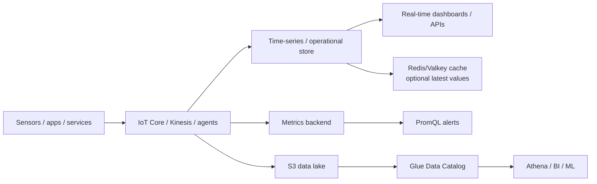
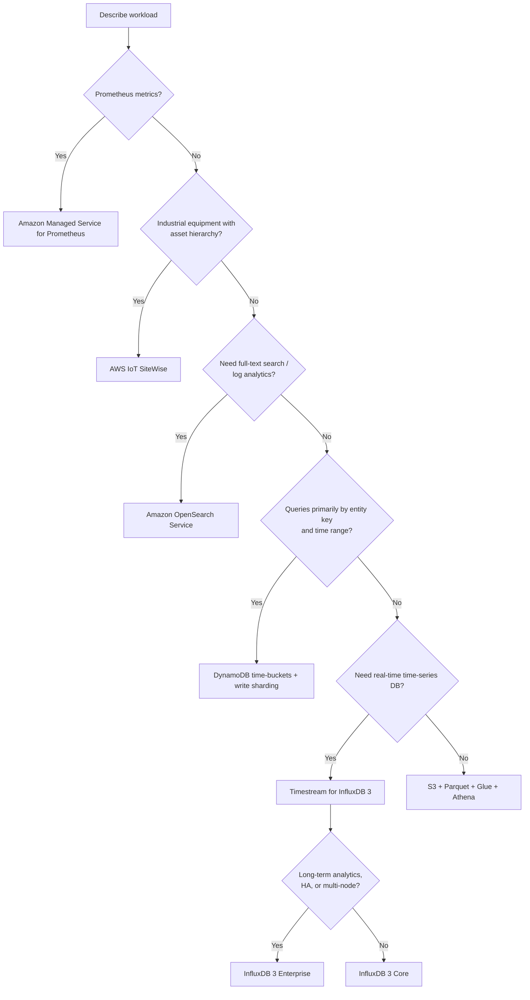
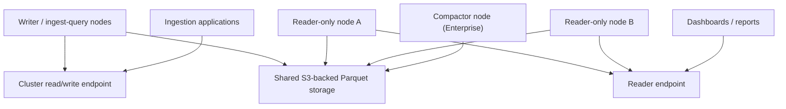
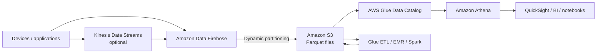
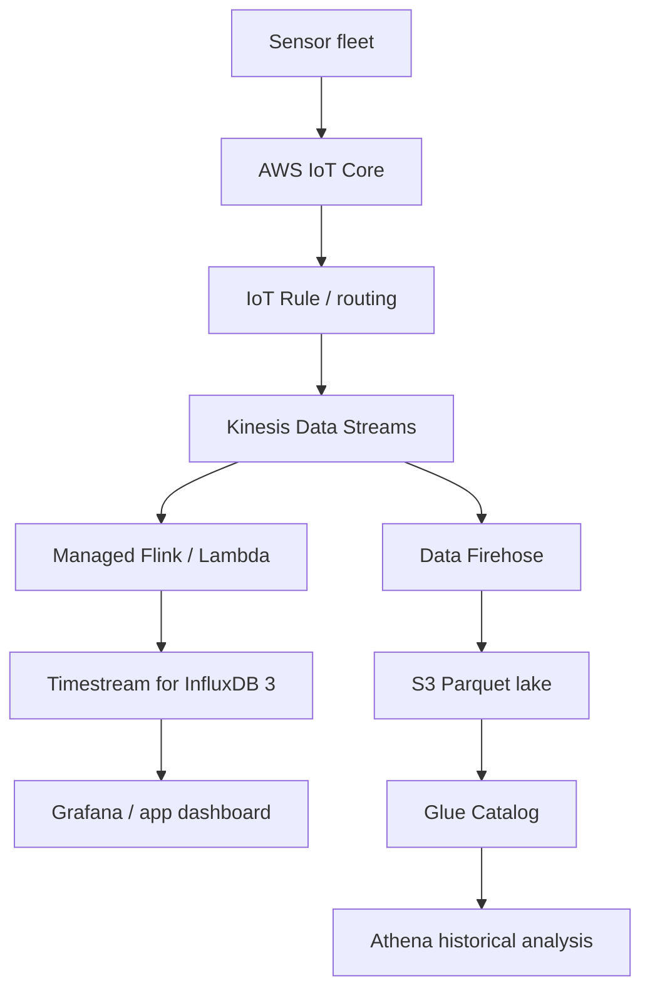
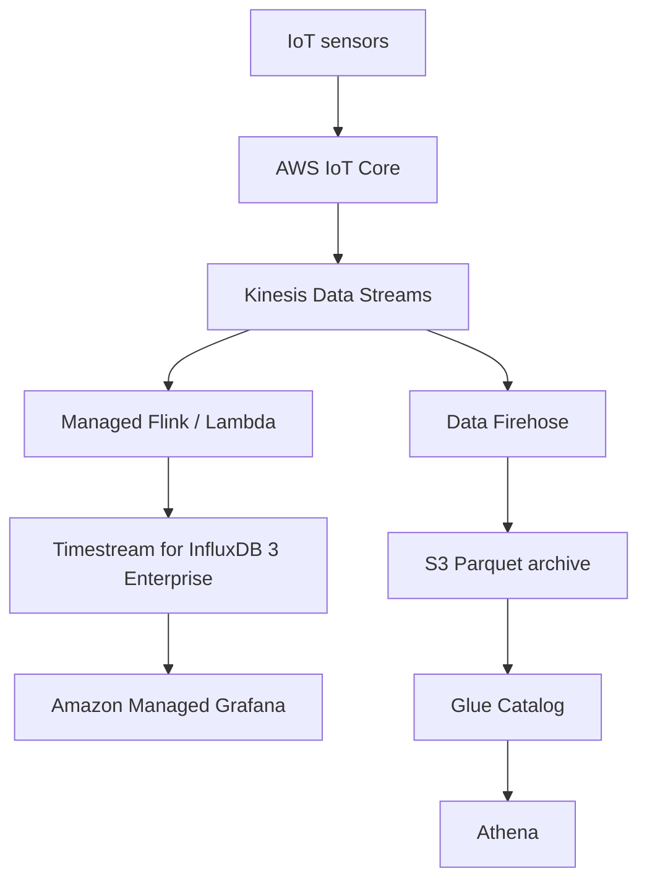
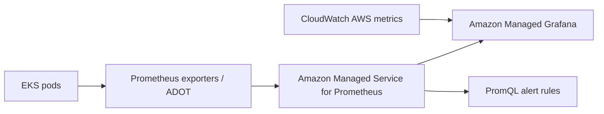
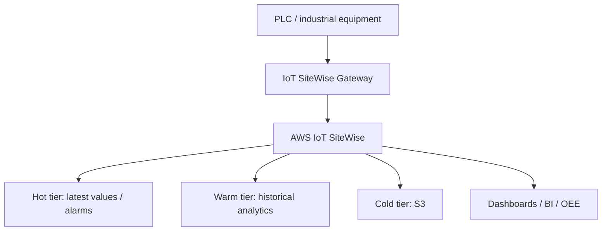
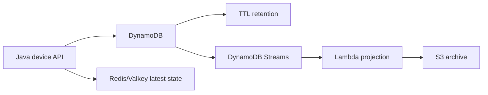
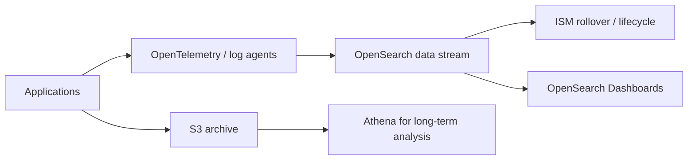

# Evaluating Time-Series Solutions on AWS by Workload Requirements

> **Chapter:** Caching and Specialized Databases  
> **Module:** CLOUD_PROVIDERS_AWS  
> **Context:** Evaluating how to ingest, store, query, and analyze timestamped data in the AWS ecosystem. Learners choose services based on ingestion rate, cardinality, latency, query patterns, retention, availability, security, and cost; combining Timestream for InfluxDB, DynamoDB, Amazon Managed Service for Prometheus, AWS IoT SiteWise, OpenSearch, S3, Athena, Glue, and streaming services.  
> **Reference point:** Content reflects AWS documentation current as of 2026-11-20. Availability, features, and pricing vary by Region, engine version, and edition; verify before deploying.

## Learning Objectives

After this lesson, learners can:

1. Identify time-series workloads and distinguish metrics, events, logs, sensor measurements, current state, and transactional data.
2. Analyze ingestion rates, bursts, series cardinality, late-arriving data, query shapes, freshness, retention, consistency, HA, and data residency.
3. Evaluate Amazon Timestream for InfluxDB 3 Core/Enterprise, managed InfluxDB 2.x instances, and Timestream for LiveAnalytics per current service status.
4. Choose DynamoDB for entity/key-based history access patterns; design time buckets, write sharding, sort keys, and TTLs to avoid hot partitions.
5. Choose Amazon Managed Service for Prometheus for Prometheus-model/PromQL metrics and AWS IoT SiteWise for industrial asset hierarchies.
6. Use Amazon OpenSearch Service when full-text search, log exploration, and time-based data streams are required.
7. Use Amazon S3 + Data Firehose + Glue + Athena as a data lake for long-term history, analytical queries, and low storage cost.
8. Design streaming pipelines via AWS IoT Core, Kinesis Data Streams, Data Firehose, and Lambda, selecting suitable storage targets.
9. Design time-series schemas distinguishing tags/dimensions from fields/measures, avoiding cardinality explosions and poor partition designs.
10. Write Java examples sending line protocol to Timestream for InfluxDB 3, run SQL queries, and use AWS CLI/IaC to inventory resources.
11. Design VPC/IAM/KMS security, backup/recovery, monitoring, retention, migrations, and cost models.
12. Make verifiable decisions backed by benchmarks using production-like data, write rates, and queries.

## 1. What Kind of Data Is Time-Series Data?

**Time-series data** is a sequence of data points tied to points in time or intervals. Each point typically includes:

- **Timestamp:** when the measurement or event occurred.
- **Identity/dimensions/tags:** device, server, sensor, region, tenant, asset type.
- **Measures/fields:** measured values such as temperature, CPU, humidity, pressure, request count.
- **Context:** collection source, schema version, quality flag, sequence or correlation ID.

Example:

```json
{
  "timestamp": "2026-11-20T03:30:00.125Z",
  "site": "plant-a",
  "deviceId": "sensor-17",
  "sensorType": "temperature",
  "temperatureC": 23.7,
  "humidityPct": 62.1,
  "quality": "GOOD"
}
```

This is a single sample. A system with thousands of devices sending millions of samples daily has vastly different requirements from an app writing a few thousand order events.

### 1.1 Distinguishing Closely Related Data Categories

| Data category | Examples | Key traits | Typical queries |
|---|---|---|---|
| **Metrics** | CPU, memory, latency, request rate | Usually aggregated over time windows, many series | p95 latency over the last 5 minutes? |
| **Sensor measurements** | Temperature, pressure, vibration | Device/asset identity, sample rate, physical units | Machine M's temperature over 24 hours? |
| **Events** | Logins, orders placed, device state transitions | Each record carries business meaning; may require exact history | What happened right before the device stopped? |
| **Logs** | Application logs, audit logs | Text/search/filtering, heterogeneous payloads | Find all errors containing exception X? |
| **Current state** | Latest temperature, relay state | Only needs last-known value | Current reading of sensor? |
| **Transactions** | Orders, invoices, payments | ACID/relationships/transactions are central | Did the order and payment commit? |

One system can span multiple storage models. For example, sensor telemetry lives in a time-series database, current device state caches in Redis, business asset metadata lives in Aurora, and long-term raw history resides in S3.

### 1.2 One Data Stream Does Not Mean One Database



Different tiers answer different questions:

- **Operational time-series store:** latest values, short windows, and near-real-time aggregations.
- **Metrics backend:** label-based queries and alerting via PromQL.
- **Search/log store:** full-text and field-level filtering.
- **Data lake/warehouse:** long-term history, joins, and multi-dimensional analytics.
- **Cache:** accelerates frequently read values; never replaces the source of truth.

## 2. Evaluating the Workload Before Picking a Service

Never start with "which time-series database does AWS offer?" First characterize the data and the queries you must run.

### 2.1 Ingestion: How Fast Does Data Arrive?

Metrics to estimate:

- Number of data sources: devices, servers, tenants.
- Points per source per second.
- Average size per point or batch.
- Average write rate, peak rate, and burst duration.
- Retry volume, duplicates, and late arrivals.
- Can writes be batched, or must each point persist immediately?

Example: 20,000 devices sending 1 point/second generate roughly **20,000 points/second**. If a device emits 100 measurements sharing a timestamp, multi-measure/batch writes can cut request overhead depending on the engine.

### 2.2 Cardinality: How Many Distinct Series Exist?

**Cardinality** depends on combinations of identifying attributes. Example:

```text
site × deviceId × sensorType × firmwareVersion
  = number of tag/dimension combinations that can create series
```

Cardinality explodes when nearly unique values become dimensions:

- request IDs,
- session IDs,
- random UUIDs,
- per-event hashes,
- timestamps turned into tags,
- user IDs when users appear once.

In InfluxDB 2.x, high series cardinality inflates index memory and degrades ingest/query performance. InfluxDB 3 handles high-cardinality analytical workloads far better thanks to columnar storage, yet you should still keep schemas lean and tags meaningful. In Prometheus, high label cardinality drives up active time series, ingest/storage bills, and query complexity.

### 2.3 Query Patterns: What Do Users Ask?

| Query pattern | Example | Impact on selection |
|---|---|---|
| **Last value** | Latest temperature of `sensor-17` | Cache/index for latest values or time-series last-value query |
| **Time range** | Samples for one sensor over 6 hours | Time partitioning/indexing and timestamp filtering |
| **Aggregation** | 5-minute averages by site | Time-series SQL/PromQL/rollups |
| **Group by dimensions** | CPU by service, AZ, cluster | Cardinality and indexing |
| **High-cardinality analytics** | Analyze millions of device IDs over months | Columnar/analytical engine or data lake |
| **Full-text search** | Find logs containing "connection reset" | OpenSearch |
| **Relational joins** | Join telemetry with order/customer/asset metadata | Data warehouse/lake/relational DB |
| **Exact point lookup** | Read device state by key | DynamoDB/Redis/relational lookup |
| **Alerting** | CPU > 90% sustained for 5 minutes | Prometheus/CloudWatch/IoT SiteWise alarms |

### 2.4 Freshness, Late Data, and Ordering

Questions to answer:

- Must new data be queryable within milliseconds, seconds, or minutes?
- A sensor goes offline for 3 hours and backfills; does the system accept late data?
- Are device-supplied timestamps trustworthy, or is there clock skew?
- Can identical points arrive twice? Are there sequence/version numbers?
- Is strict ordering required, or are out-of-order events tolerable?
- Do dashboards need exact latest samples or tolerate eventual consistency?

Never overwrite event time with ingestion time when analytics depend on when the event actually happened. Store both whenever auditing or late-arrival analysis is needed.

### 2.5 Retention and Data Lifecycle

Tier data by utility:

- **Hot:** latest minutes/days, frequent queries, low latency.
- **Warm:** weeks/months, historical dashboards and investigations.
- **Cold/archive:** months/years, rare queries, cost-optimized.
- **Derived/rollups:** minute/hour/day summaries so dashboards avoid scanning raw samples.

Tie retention to compliance, PII rules, replay requirements, and cost. TTL or lifecycle expiration does not replace immediate access-control policies; logically expired data may linger until background deletion completes.

### 2.6 Availability, Security, and Data Residency

- Does the workload require Multi-AZ/automatic failover?
- Should query readers be isolated from ingestion writers?
- Are private networking, KMS customer-managed keys, and TLS required?
- May data leave the Region?
- What are RPO/RTO targets during service or Regional outages?
- Is an immutable audit trail required, or only operational telemetry?

### 2.7 Sample Workload Profiles

| Profile | Ingestion | Query | Retention | Initial candidate |
|---|---:|---|---|---|
| 5,000 sensors, last-value dashboard | Moderate | Latest + 1h | 7 days hot | InfluxDB 3 Core or Enterprise per HA needs |
| Millions of EKS metrics | High | PromQL, alerts, group by labels | 150 days–3 years | Amazon Managed Service for Prometheus |
| Industrial assembly line | Moderate/high | Asset hierarchy, transforms, aggregates | Multi-tier | AWS IoT SiteWise |
| Application logs + text search | High | Full-text + filters + time range | Per index lifecycle | OpenSearch data streams |
| Per-device event history | Low/moderate | Query by device + time range | 30–365 days | DynamoDB with time buckets/sharding |
| Multi-year raw telemetry, batch analytics | Very high | Scan by day/tenant, BI | Years | S3 + Parquet + Glue + Athena |
| Fresh metrics + historical analytics | High | Real-time + multi-month queries | Months/years | InfluxDB 3 Enterprise + S3 lake/rollups |

## 3. AWS Service Selection Map

### 3.1 Decision Matrix

| Service | Strengths | Choose when | Not the primary fit when |
|---|---|---|---|
| **Amazon Timestream for InfluxDB 3 Core** | Managed InfluxDB 3, S3-backed Parquet, SQL/InfluxQL, near-real-time queries | Dev/test or near-real-time monitoring of recent data where single-node HA suffices | Need multi-node, compaction, or long-term historical analytics |
| **Amazon Timestream for InfluxDB 3 Enterprise** | Compaction, multi-node, read-only nodes, HA, long-term analytics | High-cardinality telemetry, dashboards + historical queries, production | Workload is strictly Prometheus metrics or full-text log search |
| **Amazon Timestream for InfluxDB 2.x** | Compatibility with InfluxDB 2.7 APIs/clients/Flux, managed instances | Existing v2 apps needing Flux/API compatibility with minimal rewrites | New designs suited to InfluxDB 3 architecture or decoupled analytical storage |
| **Timestream for LiveAnalytics** | Serverless, memory/magnetic tiers, time-series SQL | Eligible existing customer accounts only | New customers cannot onboard to this service |
| **DynamoDB** | Key-value access, predictable low-latency lookups, TTL, Streams | Device/entity history queried by key and time range | Ad-hoc analytical scans or complex time-window aggregations |
| **Amazon Managed Service for Prometheus** | Prometheus data model, PromQL, serverless ingest/query, alerting | EKS/Kubernetes metrics and Prometheus exporters | Raw business events, arbitrary sensor docs, or full-text logs |
| **AWS IoT SiteWise** | Asset models, measurements, transforms, metrics, storage tiers | Industrial equipment and plant/factory asset hierarchies | Generic logs/metrics lacking an industrial asset model |
| **Amazon OpenSearch Service** | Full-text search, filters, aggregations, data streams, ISM | Logs, traces, searchable telemetry documents | Lowest-cost long-term store for every raw sample |
| **Amazon S3 + Glue + Athena** | Durable data lake, Parquet, SQL analytics, lifecycle rules | Long-term history, batch analytics, data science | Millisecond last-value API responses |
| **Amazon Redshift** | Warehouse analytics, joins, BI, large-scale aggregations | Time-series joined with sales/customer/finance dimensions | Primary high-frequency per-sensor write path |
| **Aurora/RDS** | Relational transactions, SQL joins, constraints | Moderate time-series volume centered on relational/business transactions | High-ingestion telemetry with very long retention |
| **ElastiCache Redis/Valkey** | In-memory latest values/caches | Holding frequently read last-known samples or aggregates | Durable time-series source of truth |

### 3.2 Decision Tree



This diagram is an initial filter. Large workloads often pair two targets: a hot database serving APIs/dashboards and an S3 data lake preserving raw history.

## 4. Timestream for InfluxDB 3: The Current Managed Time-Series Choice

Amazon Timestream for InfluxDB 3 runs managed InfluxDB 3 on AWS, suited for apps and DevOps ingesting and analyzing time-series, high-cardinality data, and complex analytical queries.

InfluxDB 3's architecture differs from InfluxDB 1.x/2.x:

- **Apache Arrow** for in-memory processing.
- **Apache DataFusion** for query execution.
- **Apache Parquet** for columnar storage.
- **Amazon S3** for durable storage, decoupling compute from storage.
- Ability to scale compute nodes to match ingest/query load.

AWS announced InfluxDB 3 on Timestream on **2025-10-16**. This is the primary branch to evaluate for new designs—do not confuse it with Timestream for LiveAnalytics or the InfluxDB 2.x engine.

### 4.1 Core vs. Enterprise

| Feature | InfluxDB 3 Core | InfluxDB 3 Enterprise |
|---|---|---|
| Deployment | Single-node | Single-node or multi-node |
| Compaction | None | Yes |
| Multi-node / reader-only nodes | No | Yes |
| High availability | Single node; no multi-node failover topology | Multi-node across AZs per configuration |
| Historical analytics | Primarily recent data, typically a few days | Long-term history supported with compaction/indexing |
| Best fit | Dev/test, POCs, recent monitoring, cost-sensitive | Production, HA, high ingest/query concurrency, long-term analytics |
| Scale | Vertical/single-node limits | Vertical and horizontal up to 15 nodes per current limits |

**Core has no compaction.** Small Parquet files accumulate over time, progressively slowing historical queries. Never choose Core as a multi-month/multi-year analytical store solely because it uses S3 storage.

Enterprise adds:

- Compaction to optimize Parquet file layouts.
- Writer/reader nodes for ingestion and queries.
- Reader-only nodes to isolate dashboard/reporting traffic.
- Multi-node deployments distributed across Availability Zones.
- Long-term historical analytics support.

In current multi-node Enterprise setups, a cluster supports up to **15 nodes** total: configurable across 1–4 writer/reader nodes, 0–13 reader-only nodes, and a compactor node per supported topology. You cannot max out each node role independently past the 15-node cluster cap.

### 4.2 Decoupling Compute from Storage



Benefits:

- Scaling compute/query capacity does not require duplicating entire data volumes like instance-attached database storage.
- S3 delivers durable object storage for Parquet.
- Reader nodes scale independently as dashboard/reporting concurrency climbs.
- The compactor organizes files in the background to preserve historical query speed.

Still, "virtually unlimited" storage does not mean free or limitless. You pay for S3 storage, compute nodes, data transfer, and supporting resources per pricing tables.

### 4.3 Cluster Endpoint and Reader Endpoint

| Endpoint | Permitted operations | Use for |
|---|---|---|
| **Cluster read/write endpoint** | Read + write, routed to writer nodes | Ingestion, admin tasks, and primary-endpoint queries |
| **Reader endpoint** | Read-only, distributes queries across reader nodes | Dashboards, reporting, ad-hoc queries |
| **Node-specific endpoint** | Direct access to one node | Diagnostics/special tasks; discouraged for production |

Never send writes to the reader endpoint. Use cluster-level endpoints for service-managed routing/failover, and never hardcode node-specific endpoints in application code.

### 4.4 Regions and Networking

Timestream for InfluxDB 3 is available in supported Timestream for InfluxDB Regions, including **Asia Pacific (Singapore) — `ap-southeast-1`**. Always check the current Regional endpoint table before provisioning.

For private clusters:

- Select VPC/subnets and security groups per service requirements.
- Allow app security groups to reach the InfluxDB port (default **8086**).
- Private clusters require the S3 access/network policies specified by the service.
- Never open database ports to the open Internet.
- Enforce TLS and token authentication; AWS control-plane IAM permissions do not replace InfluxDB data-plane token permissions.

### 4.5 InfluxDB 3 Line Protocol

A point has the structure:

```text
table_name,tag1=value1,tag2=value2 field1=23.7,field2=62.1 timestamp
```

Example:

```text
sensor_metrics,site=plant-a,device_id=sensor-17 temperature_c=23.7,humidity_pct=62.1 1795140000
```

Breakdown:

- `sensor_metrics`: table/measurement name.
- `site`, `device_id`: **tags**, string metadata used for filtering/grouping.
- `temperature_c`, `humidity_pct`: **fields**, holding measured values.
- `1795140000`: Unix epoch seconds timestamp, matching `precision=s` on the write API.

In InfluxDB 3, a database holds tables; tags and fields are table columns. A row's primary key combines the timestamp and tag set (null tags are omitted from the key).

### 4.6 Tags vs. Fields: Proper Modeling

| Property | Tags | Fields |
|---|---|---|
| Purpose | Identify/describe data source, filter, and group | Measured values or varying attributes |
| Data type | String | Integer, unsigned integer, float, string, boolean |
| Indexing/queries | Treated as metadata keys | Not indexed like tags |
| Examples | `site`, `device_id`, `sensor_type`, `az` | `temperature_c`, `pressure_kpa`, `cpu_pct` |

Rules:

- Make attributes frequently used in `WHERE`/`GROUP BY` into tags.
- Make measured metrics, variable payloads, or unindexed attributes into fields.
- Never reuse the same name for both a tag and a field in the same table.
- Keep schemas consistent; avoid per-device unrelated fields making tables overly wide/sparse.
- Order tags by query priority during initial schema design, as physical column order can lock on initial write.
- Pick the coarsest timestamp precision that meets requirements to reduce unnecessary data and complexity.

InfluxDB 3 improves high-cardinality handling, but that does not mean turning every request ID, hash, or random UUID into a tag. Tag cardinality still impacts index sizes, caching, memory, and query planning.

### 4.7 Batch Writes and Durability

AWS recommends these best practices for InfluxDB 3:

- Batch roughly **5,000–10,000 lines** or up to **10 MB per request** depending on workload.
- Use gzip compression for large payloads.
- Sort tags lexicographically by key.
- Keep timestamp precision consistent.
- Retry transient errors with backoff/jitter.
- Monitor partial-write errors and metrics.
- `no_sync=false` waits for WAL persistence before acknowledging, fitting critical data.
- `no_sync=true` acknowledges earlier at the risk of losing recent writes if the node crashes before WAL persistence completes.

With `accept_partial=true`, a batch writes valid lines and returns errors for invalid ones. Producers must parse responses/failed lines and retry failures separately—never mark an entire batch successful just because part of it wrote.

## 5. Managed InfluxDB 2.x and Timestream for LiveAnalytics: Product Status Distinctions

### 5.1 Timestream for InfluxDB 2.x

A managed-instance service supporting InfluxDB **2.7**, fitting existing InfluxDB 2.x apps needing API/client/Flux/Telegraf compatibility.

Key traits:

- Managed DB instances with provisioned compute classes and storage.
- Memory-optimized instance classes tailored for InfluxDB workloads.
- Select Influx IOPS Included storage tiers.
- Maximum instance storage per current docs around **16 TiB**.
- Multi-AZ deployments create primary and cross-AZ standby for failover.
- Automated backups, patching, VPC security groups, and TLS.
- Default port 8086.

For new designs, compare InfluxDB 2.x against InfluxDB 3 rather than defaulting to 2.x. InfluxDB 3 uses a new storage/query architecture; legacy apps can use compatibility APIs, provided you test schema, data type, query language, and behavioral differences prior to migrating.

### 5.2 Timestream for LiveAnalytics

Amazon Timestream for LiveAnalytics is the legacy serverless time-series database featuring:

- **Memory store:** optimized for fast ingestion and point-in-time queries on recent data.
- **Magnetic store:** optimized for historical data and analytical queries.
- SQL with time-series extensions.
- Separate retention policies for memory and magnetic tiers.
- Scheduled queries for rollups and derived tables.

**Availability change:** AWS closed new-customer access to Timestream for LiveAnalytics starting **2025-06-20**. Existing eligible workloads in payer accounts already using the service may continue and onboard users/linked accounts per AWS rules. New customers should evaluate Timestream for InfluxDB instead.

Never design a new architecture assuming an un-onboarded account can provision LiveAnalytics. If operating legacy LiveAnalytics, maintain a migration/exit plan and track AWS announcements.

### 5.3 Comparing the Three Timestream Options

| Criterion | InfluxDB 3 | InfluxDB 2.x | LiveAnalytics |
|---|---|---|---|
| New customer onboarding | Yes | Managed service in supported Regions | Closed to new customers since 2025-06-20 |
| Data architecture | Parquet on S3, compute decoupled from storage | Instance + provisioned storage | Serverless, memory/magnetic tiers |
| Query | SQL, InfluxQL; APIs/Flight | Flux/Influx APIs per engine | Time-series SQL |
| Scale | Core single-node; Enterprise multi-node | Vertical DB instance / Multi-AZ | Serverless ingest/storage/query |
| Best fit | High cardinality + analytics + production time-series | Existing InfluxDB 2.7 compatibility | Existing deployments, large-scale serverless analytics |

## 6. DynamoDB for Entity-Centric Time-Series Access Patterns

DynamoDB is not a specialized time-series engine like InfluxDB, yet it works well when queries primarily fetch **the history of a specific entity/device over a time range**.

Examples:

- An API reading the latest 100 samples for a sensor.
- Fetching the latest state per device.
- Querying history by customer/device and time window.
- High-throughput event writes requiring key-based lookups and TTL.

### 6.1 Partition Key and Sort Key Design

A straightforward schema:

```text
PK = DEVICE#sensor-17#DAY#2026-11-20
SK = 2026-11-20T03:30:00.125Z#event-001
expiresAt = 1796000000
```

- `PK` groups one device's samples by day.
- `SK` sorts by timestamp plus event ID to disambiguate concurrent records.
- `expiresAt` holds Unix epoch seconds when using TTL.

DynamoDB `Query` requires partition key equality and supports sort-key range conditions, aligning cleanly with per-device/day queries.

### 6.2 Hot Partitions and Write Sharding

If one device emits tens of thousands of events/second, all writes hitting one partition key create a hot partition. Add a shard suffix:

```text
PK = DEVICE#sensor-17#DAY#2026-11-20#SHARD#03
SK = 2026-11-20T03:30:00.125Z#event-001
```

Producers pick shards by hashing event IDs or stable routing keys:

```java
int shard = Math.floorMod(eventId.hashCode(), SHARD_COUNT);
String partitionKey = "DEVICE#" + deviceId
    + "#DAY#" + utcDate
    + "#SHARD#" + String.format("%02d", shard);
```

When reading history, the app fans out queries across relevant shards and merges/sorts by timestamp—a classic trade-off between write throughput and read complexity.

If an entity has low write rates, do not add write sharding blindly; it only inflates `Query` calls, merge work, and cost.

### 6.3 Time Bucketing

Never store years of history for one device under one partition key. Use time buckets:

- Hourly for very high write rates and short query windows.
- Daily for typical telemetry.
- Monthly for low volume and longer windows.
- Per tenant/device group if access patterns align.

Time bucketing bounds item-collection size and prevents long-lived hot partitions.

### 6.4 TTL and Retention

DynamoDB TTL requires a **Number** attribute holding Unix epoch seconds. Example:

```json
{
  "PK": {"S": "DEVICE#sensor-17#DAY#2026-11-20#SHARD#03"},
  "SK": {"S": "2026-11-20T03:30:00.125Z#event-001"},
  "temperatureC": {"N": "23.7"},
  "expiresAt": {"N": "1796000000"}
}
```

TTL deletes asynchronously; expired items can still return in queries while awaiting background deletion. If an API must never return expired records, filter `expiresAt` in application logic. TTL is neither an exact scheduler nor a backup/archive.

### 6.5 When Does DynamoDB Fall Short?

- Querying across many devices over broad time ranges without matching partition keys.
- Ad-hoc `GROUP BY` across multiple dimensions.
- Scanning terabytes of raw data for analytics.
- Full-text search or complex SQL joins.
- Queries forced to fan out across hundreds of shards and merge huge results.

In those cases, evaluate InfluxDB 3, OpenSearch, Prometheus, or S3/Athena depending on goals.

## 7. Amazon Managed Service for Prometheus for Metrics

Amazon Managed Service for Prometheus (AMP) is a Prometheus-compatible monitoring service suited for metrics from:

- Amazon EKS.
- Self-managed Kubernetes.
- Prometheus exporters and OpenTelemetry collectors.
- Application/service metrics following the Prometheus data model.

### 7.1 When to Choose AMP?

Choose AMP when operations already rely on:

- Prometheus scraping / remote write.
- PromQL filtering, aggregation, and alerting.
- Metric labels such as `cluster`, `namespace`, `pod`, `service`, and `region`.
- Grafana dashboards and alert rules.

AMP auto-scales ingestion, storage, and queries across Multi-AZ. Per current docs, default metric retention is **150 days**, configurable up to **1,095 days (3 years)**.

### 7.2 Cardinality in Prometheus

A labeled metric:

```text
http_requests_total{
  service="orders",
  method="POST",
  status="200",
  route="/orders"
}
```

Adding a unique `request_id` or `user_id` label per request causes active time series to grow with request count, multiplying ingestion, storage, and query costs.

Never put unbounded/unique values into labels just to filter by them. Use logs/traces or an event store for per-request granularity.

### 7.3 PromQL Examples

```promql
sum by (service) (
  rate(http_requests_total[5m])
)
```

Computes per-service request rate over a 5-minute window.

```promql
histogram_quantile(
  0.95,
  sum by (le, service) (
    rate(http_request_duration_seconds_bucket[5m])
  )
)
```

Estimates p95 latency per service from histogram buckets.

### 7.4 AMP Is Not a Log Search Database

AMP focuses on numeric metric samples and PromQL. To search log lines, stack traces, message text, or JSON events via full-text, use OpenSearch or a log analytics tool—never stuff logs into Prometheus labels.

## 8. AWS IoT SiteWise for Industrial Asset Data

AWS IoT SiteWise fits when data is not merely isolated sensor samples, but organized into an **asset hierarchy**:

```text
Plant
  └── Production line
       └── Machine
            ├── Motor
            │    ├── temperature measurement
            │    └── vibration measurement
            └── Pump
                 ├── pressure measurement
                 └── flow measurement
```

### 8.1 Asset Property Types

| Property type | Meaning | Examples |
|---|---|---|
| **Attribute** | Relatively static metadata | Manufacturer, serial number, rated power |
| **Measurement** | Raw device readings | RPM, temperature, pressure |
| **Transform** | Derived values computed from measurements | °F from °C, normalized vibration |
| **Metric** | Time-windowed aggregations | Hourly average temperature, OEE |

### 8.2 Storage Tiers

AWS IoT SiteWise provides multiple tiers:

- **Hot tier:** low-latency, frequently accessed measurements and latest values.
- **Warm tier:** cost-efficient history for analytics/BI and reporting.
- **Cold tier:** infrequently accessed data stored in Amazon S3; replicated periodically (docs note roughly every 6 hours).

Design retention carefully per tier. Lowering retention can purge/transition older data per policy; raising retention later does not automatically pull data back from cold/warm into hot.

### 8.3 Automated Aggregates

SiteWise computes standard aggregates across minute/hour/day intervals for numeric asset properties:

- average,
- count,
- minimum,
- maximum,
- standard deviation,
- sum.

Choose SiteWise when industrial asset modeling and plant operations are central. If you only need EKS server/CPU metrics, AMP fits better.

## 9. Amazon OpenSearch Service for Time-Based Search

OpenSearch is a search/analytics engine, not a default fit for every time-series sample.

It fits when records are timestamped documents and you need:

- Full-text search.
- Multi-field filtering.
- Time-bucket aggregations.
- Log and trace exploration.
- Operational dashboards and incident triage.

### 9.1 Data Streams

An OpenSearch data stream spans multiple backing indices:

- Indexing writes land in the latest write index.
- Searches query across backing indices.
- Every document requires a timestamp field (default `@timestamp` or configured field).
- Index templates define mappings and settings.
- Index State Management (ISM) automates backing-index rollovers.

Template example:

```json
PUT _index_template/telemetry-logs-template
{
  "index_patterns": ["telemetry-logs-*"],
  "data_stream": {},
  "priority": 100,
  "template": {
    "mappings": {
      "properties": {
        "@timestamp": {"type": "date"},
        "service": {"type": "keyword"},
        "device_id": {"type": "keyword"},
        "message": {"type": "text"},
        "temperature_c": {"type": "float"}
      }
    }
  }
}
```

Once the template is in place, index documents into the data stream:

```json
POST telemetry-logs-prod/_doc
{
  "@timestamp": "2026-11-20T03:30:00Z",
  "service": "sensor-ingestor",
  "device_id": "sensor-17",
  "message": "temperature threshold warning",
  "temperature_c": 84.2
}
```

### 9.2 When Does OpenSearch Become Expensive?

- Indexing every raw numeric sample with dozens of fields.
- Keeping all indices in hot storage indefinitely.
- Skipping rollovers, lifecycle policies, and shard sizing.
- Allowing runaway dynamic mappings.
- Using full-text indices when only numeric aggregations are needed.

Apply ISM, rollovers, replicas, hot/warm/cold tiers, and retention policies. Before picking OpenSearch as a primary time-series store, benchmark indexing throughput, search latency, shard counts, JVM heap, storage, and query concurrency.

## 10. S3 + Data Firehose + Glue + Athena for Long-Term History

When retaining months/years of data for batch analytics, an **S3 data lake** usually beats keeping all raw points in a hot database on economics.

### 10.1 Data Lake Architecture



Component roles:

- **Kinesis Data Streams:** stream ingestion, fan-out to multiple consumers, buffering/replay per configured retention.
- **Amazon Data Firehose:** managed delivery, buffering, and transformation to destinations like S3; supports dynamic partitioning on S3 destinations.
- **S3:** durable data lake with lifecycle policies, versioning, and access control.
- **Glue Data Catalog:** central metadata and schemas.
- **Athena:** serverless SQL queries over S3 datasets.
- **Glue/EMR:** ETL, file compaction, JSON/CSV-to-Parquet conversion.

### 10.2 Partition Strategy

A clean layout:

```text
s3://company-telemetry/
  source=iot/
    region=ap-southeast-1/
      year=2026/
        month=11/
          day=20/
            hour=03/
              part-0001.parquet
```

Partition on keys frequently used in filters with moderate cardinality:

- date/time buckets,
- region,
- source type,
- site/tenant when counts are moderate and queries routinely filter on them.

Avoid partitioning directly on `device_id` across millions of devices, as that explodes prefixes/partitions and produces tiny files.

### 10.3 Parquet and File Sizing

- Use Parquet/columnar formats instead of raw JSON for analytical queries.
- Compress files to cut storage and bytes scanned.
- Run compaction to eliminate millions of tiny files.
- Maintain stable schemas with versioned schema evolution.
- Use partition pruning so Athena scans less data.
- For predictable partition paths with high partition counts, consider Athena partition projection—keeping in mind the planner still evaluates projected partitions even if empty in S3.

### 10.4 Firehose Dynamic Partitioning

Firehose can route records into S3 prefixes using record keys, e.g.:

```text
!{timestamp:yyyy/MM/dd/HH}/site=!{partitionKeyFromQuery:site}/
```

Dynamic partitioning supports only S3 destinations and must be enabled when creating the Firehose stream—it cannot be turned on retroactively. Because it buffers per partition, end-to-end delivery is not instantaneous.

**Never partition on high-cardinality keys**: active buffer partitions are capped and tiny objects proliferate.

### 10.5 Athena Query Example

```sql
SELECT
    site,
    device_id,
    AVG(temperature_c) AS avg_temperature,
    MAX(temperature_c) AS max_temperature
FROM telemetry_samples
WHERE year = '2026'
  AND month = '11'
  AND day = '20'
  AND site = 'plant-a'
GROUP BY site, device_id
ORDER BY max_temperature DESC;
```

Partition predicates cut scanned bytes when Glue/Athena tables are configured properly. Always check query execution stats and bytes scanned; a simple SQL query can still cost heavily if it scans terabytes.

## 11. Ingestion Pipelines: Choosing How Data Enters

| Source | Ingestion option | Best fit |
|---|---|---|
| IoT devices | AWS IoT Core rules | Device identity, MQTT topics, rule-based routing |
| High-throughput event streams | Kinesis Data Streams | Multiple consumers, stream processing, replay |
| Managed S3 delivery | Data Firehose | Buffering/transform/dynamic partitioning with low ops |
| Kubernetes metrics | Prometheus scraper / ADOT | Remote write to AMP |
| Industrial equipment | IoT SiteWise gateways | OPC-UA/industrial protocols and asset models |
| Java applications | AWS SDK / HTTP API | Direct writes to database/API |
| Batch historical imports | S3 + batch load/ETL | Backfills, migrations, replays |

### 11.1 Decoupling Ingestion from Query Workloads

Example pipeline:



Not every workload needs Kinesis, Lambda, Firehose, and Flink all at once. Each stage adds latency, retries, failure modes, and cost. Use direct ingestion when simple and sufficient; add a stream bus when buffering, fan-out, replay, or stream transformations are needed.

### 11.2 Duplicates and Idempotency

Producers retry when unsure whether the server received a request. In time-series stores, two writes with identical timestamp + tag set may overwrite/upsert depending on engine rules—do not assume every retry creates a separate row.

Design practices:

- Carry a stable `event_id` or `sequence_number` in fields/metadata when auditing matters.
- Keep timestamps and tags deterministic.
- Deduplicate in the ingestion layer if downstream side effects are non-idempotent.
- Define an explicit policy for late-arriving data.
- Monitor write rejects, partial failures, and retry queues.

## 12. Schema Design and Data Lifecycle

### 12.1 Meaningful Timestamps

Store **event time** (when the measurement occurred) for operational analysis, and optionally record `ingested_at` as a field to measure delivery lag and late arrivals.

Example:

```json
{
  "event_time": "2026-11-20T03:30:00Z",
  "ingested_at": "2026-11-20T03:30:03Z",
  "device_id": "sensor-17",
  "temperature_c": 23.7
}
```

If only one timestamp exists, document explicitly in the schema contract whether it represents event time or ingestion time.

### 12.2 Tags/Dimensions Are Not Fields

InfluxDB example:

```text
sensor_metrics,site=plant-a,device_id=sensor-17,sensor_type=temperature temperature_c=23.7 1795140000
```

- Tags: `site`, `device_id`, `sensor_type`.
- Field: `temperature_c`.
- Timestamp: `1795140000`.

Never put `temperature_c` in a tag because it varies continuously and requires numeric aggregation. Never put random event UUIDs in tags unless queries genuinely filter/index by them.

### 12.3 Units and Schema Versioning

Encode units directly in field names:

- `temperature_c`,
- `pressure_kpa`,
- `humidity_pct`,
- `latency_ms`,
- `energy_kwh`.

Never silently change `temperature` from °C to °F under the old field name. Version schemas or introduce new field names while migrating dashboards and queries cleanly.

### 12.4 Rollups and Downsampling

Suppose 1-second raw samples stay hot for 7 days, paired with minute/hour rollups:

```text
Raw:     1 sample/second/device
Rollup:  avg/min/max/count per 1 minute
Archive: daily aggregates + selected raw samples
```

Rollups lower scan/query costs and stretch history. Still, confirm:

- Do aggregates preserve `min`/`max` so spikes are not smoothed away?
- Are percentiles/histograms needed instead of plain averages?
- Do late-arriving points update prior rollups?
- Are reprocessing and reconciliation idempotent?
- Must raw data stay longer for audits or ML retraining?

Never replace all data with averages if you need to investigate brief spikes, micro-outages, or anomalies.

## 13. Java: Writing Time-Series Data to Timestream for InfluxDB 3

The example below uses Java `HttpClient` and the InfluxDB 3 native write API. In production, fetch tokens from AWS Secrets Manager or secure secret injection; **never hardcode tokens** in source or configs.

### 13.1 Line Protocol

```text
sensor_metrics,site=plant-a,device_id=sensor-17 temperature_c=23.7,humidity_pct=62.1 1795140000
```

Timestamp here uses Unix seconds; the request passes `precision=s`.

### 13.2 Java Writer

```java
package example.timeseries;

import java.net.URI;
import java.net.http.HttpClient;
import java.net.http.HttpRequest;
import java.net.http.HttpResponse;
import java.nio.charset.StandardCharsets;
import java.time.Duration;

public final class InfluxDb3Writer {
    private final HttpClient http;
    private final URI writeEndpoint;
    private final String token;

    public InfluxDb3Writer(
            String clusterEndpoint,
            String database,
            String token) {
        this.http = HttpClient.newBuilder()
            .connectTimeout(Duration.ofSeconds(3))
            .build();

        String base = clusterEndpoint.endsWith("/")
            ? clusterEndpoint.substring(0, clusterEndpoint.length() - 1)
            : clusterEndpoint;

        this.writeEndpoint = URI.create(
            base + "/api/v3/write_lp?db=" + database
                + "&precision=s&accept_partial=false");

        this.token = token;
    }

    public void write(String lineProtocol) throws Exception {
        HttpRequest request = HttpRequest.newBuilder(writeEndpoint)
            .timeout(Duration.ofSeconds(10))
            .header("Authorization", "Bearer " + token)
            .header("Content-Type", "text/plain; charset=utf-8")
            .POST(HttpRequest.BodyPublishers.ofString(
                lineProtocol, StandardCharsets.UTF_8))
            .build();

        HttpResponse<String> response = http.send(
            request, HttpResponse.BodyHandlers.ofString());

        if (response.statusCode() < 200
                || response.statusCode() >= 300) {
            throw new IllegalStateException(
                "InfluxDB write failed: HTTP "
                    + response.statusCode());
        }
    }
}
```

Initializing and calling the writer:

```java
import java.time.Instant;

String endpoint = System.getenv("INFLUXDB_CLUSTER_ENDPOINT");
String database = "telemetry";
String token = System.getenv("INFLUXDB_TOKEN");

InfluxDb3Writer writer =
    new InfluxDb3Writer(endpoint, database, token);

long eventTimeSeconds = Instant.now().getEpochSecond();

String line =
    "sensor_metrics,site=plant-a,device_id=sensor-17 "
    + "temperature_c=23.7,humidity_pct=62.1 "
    + eventTimeSeconds;

writer.write(line);
```

### 13.3 Production Hardening Checklist

- Reuse one `HttpClient`/writer instance rather than creating one per sample.
- Escape spaces, commas, equals signs, and backslashes properly in dynamic tag values.
- Format numbers with explicit non-localized formatting (never comma decimal separators).
- Batch lines per size/throughput benchmarks; avoid tiny per-point HTTP calls.
- Send writes to the writer/cluster endpoint.
- Retry 429/5xx/transient network errors with exponential backoff + jitter; never retry 400 schema errors endlessly.
- When `accept_partial=true`, parse per-line error details and retry only failed lines.
- Enable `no_sync=true` only when the business accepts durability trade-offs.
- Never log bearer tokens or full PII-bearing payloads.

### 13.4 SQL Query Example

```sql
SELECT
    time,
    device_id,
    temperature_c,
    humidity_pct
FROM sensor_metrics
WHERE site = 'plant-a'
  AND time >= now() - INTERVAL '1 hour'
ORDER BY time DESC
LIMIT 100;
```

This query scopes both time range and `site` to avoid unnecessary scans. Dashboards can target the reader endpoint while ingestion uses the writer endpoint.

## 14. AWS CLI and IaC: Inventorying Before Provisioning

### 14.1 Check Account and Region

```bash
aws sts get-caller-identity

aws timestream-influxdb list-db-clusters \
  --region ap-southeast-1 \
  --output table

aws timestream-influxdb list-db-instances \
  --region ap-southeast-1 \
  --output table
```

List calls are read-only metadata queries. `list-db-clusters` lists InfluxDB 3 clusters; `list-db-instances` lists InfluxDB DB instances. Do not confuse the `timestream-influxdb` CLI namespace with `timestream-write` for Timestream for LiveAnalytics.

### 14.2 Create an InfluxDB 3 Cluster (Billable)

Condensed CLI example:

```bash
aws timestream-influxdb create-db-cluster \
  --name telemetry-prod-demo \
  --db-instance-type db.influx.2xlarge \
  --vpc-subnet-ids subnet-11111111 subnet-22222222 \
  --vpc-security-group-ids sg-0123456789abcdef0 \
  --region ap-southeast-1
```

**Warning:** This command provisions billable resources. It is not a full production sizing template; Enterprise edition, parameter groups, node topology, VPC/S3 endpoint policies, tags, and backup settings must be tailored to requirements. Never run it against production just to test the CLI.

### 14.3 CloudFormation / IaC

AWS CloudFormation and Terraform manage Timestream for InfluxDB. For InfluxDB 3, manage:

- Cluster, edition, and engine version.
- Instance class and deployment topology.
- VPC subnet groups, security groups, and public accessibility.
- Parameter groups.
- Backup retention and KMS customer-managed keys where supported.
- IAM permissions and S3 access for private clusters.
- Tags, CloudWatch alarms, and EventBridge notifications.

Certain topology changes can restart the cluster. Use change reviews, maintenance windows, and post-deploy verification.

## 15. Security: Control Plane and Data Plane Are Separate Layers

### 15.1 Timestream for InfluxDB 3

| Layer | Mechanism | Examples |
|---|---|---|
| AWS resource management | IAM | Create/describe/update/delete clusters, tags, parameter groups |
| Network | VPC/subnets/security groups | Allow port 8086 strictly from app SGs |
| Data API | InfluxDB token authentication | Database-scoped read/write permissions |
| Transport | TLS | HTTPS / TLS 1.2+ |
| Encryption at rest | AWS-managed or customer-managed KMS per config | Key policy and lifecycle governance |
| Secrets | Secrets Manager / secret injection | Storing InfluxDB tokens |

**IAM permission to create a cluster does not grant data-plane query access.** Applications need properly scoped database tokens; a DBA's IAM control-plane role is separate from an app's data-plane token.

### 15.2 Amazon Managed Service for Prometheus

- Use IAM/SigV4 for control-plane operations and remote write/query integrations per supported mechanisms.
- Restrict workspace access by role/team.
- Keep PII and secrets out of metric labels.
- Restrict remote-write sources and alert-rule permissions.
- Monitor retention and ingestion spend.

### 15.3 DynamoDB / S3 / OpenSearch / SiteWise

- DynamoDB: IAM table/index resource scoping, encryption at rest, TTL policies.
- S3: Block Public Access, bucket policies, KMS, lifecycle rules, and access logs.
- OpenSearch: VPC access, fine-grained access control, TLS, domain policies, encryption.
- IoT SiteWise: IAM, asset permissions, gateway/device identities, and storage tier policies.

### 15.4 Keep Sensitive Data Out of Tags

Tags/dimensions are indexed, queried, and surfaced across dashboards and logs. Never put passwords, access tokens, emails, phone numbers, or sensitive raw identifiers in tags without strict justification and access controls.

## 16. Availability, Backups, and Recovery

### 16.1 InfluxDB 3 Core vs. Enterprise

- Core is single-node with no multi-node HA topology.
- Multi-node Enterprise spreads nodes across AZs; reader-only nodes scale queries.
- Enterprise compaction sustains query speed over historical data.
- Cluster-level endpoints route to healthy nodes; avoid node-specific endpoints in production apps.

### 16.2 Backups

Timestream for InfluxDB 3 provides service-managed backups plus customer-managed backup/restore options per current configuration. For customer-managed backups:

- Create backups on demand or on schedules.
- Incremental backups run after the initial full backup.
- Continuous backups enable point-in-time restore.
- Restoring into a **new cluster** is safer for testing.
- `REPLACE_EXISTING` restores overwrite the current cluster and can cause downtime—a destructive operation.

Note that data written in roughly the **last 15 minutes** may not yet be captured in backup snapshots; select PITR timestamps according to service rules.

### 16.3 S3 Data Lake Recovery

- Enable versioning if you must recover from overwrites or deletes.
- Use lifecycle rules to transition storage classes by retention.
- Configure Cross-Region Replication if RPO/RTO demands it and data residency permits.
- Version and back up Glue Catalog schemas and ETL scripts too.
- Test Athena queries after restores—do not merely verify objects exist in S3.

### 16.4 DynamoDB Recovery

- Configure PITR/backups matching RPO targets.
- TTL is not a backup.
- DynamoDB Streams retain records for only 24 hours, not as a durable archive.
- With Global Tables, understand replication/conflict semantics and replicated write costs.
- Practice restoring into a new table and validating access patterns.

## 17. Monitoring and SLOs

### 17.1 Metrics to Watch by Layer

| Layer | Metrics | Meaning |
|---|---|---|
| Producer | Publish success/errors, queue backlog, retry count | Is ingestion dropping or backing up? |
| InfluxDB | Write throughput, write errors, query latency, CPU/memory | Is the DB keeping up with load? |
| InfluxDB 3 Enterprise | Node health, reader utilization, compaction lag/status | Are queries, ingest, and compaction contending? |
| AMP | Ingested samples, rejected samples, active series/cardinality, query latency | Is label cardinality driving up costs? |
| DynamoDB | Throttles, consumed capacity, hot keys, storage, TTL deletes | Is the partition key skewed or throttling? |
| OpenSearch | Cluster health, indexing pressure, JVM/memory, search latency, shard count | Are indexing or searches saturating? |
| Firehose/S3 | Delivery failures, buffering, active partitions, object sizes | Is the lake lagging or generating tiny files? |
| Athena | Data scanned, query duration, failed queries | Are partition pruning and costs healthy? |
| Business | Expected vs. received samples, device last-seen, missing intervals | Is data missing at the business level? |

### 17.2 SLOs Must Be Measured End-to-End

Examples:

- **Ingestion freshness:** 99% of samples are queryable within 5 seconds of producer emission.
- **Dashboard latency:** p95 query under 1 second over a 1-hour window.
- **Data completeness:** 99.99% of expected samples persisted after retries/reconciliation.
- **Historical analytics:** daily/monthly queries complete within agreed bounds.
- **Recovery:** raw history and derived tables recover within RPO/RTO.

These are illustrative SLO design targets, not AWS service SLAs.

### 17.3 Data Completeness and Reconciliation

1. Compute expected sample counts per device and sampling interval.
2. Count received samples per time bucket.
3. Detect missing intervals.
4. Cross-check ingestion sources and stream offsets.
5. Reprocess or backfill from buffers/archives.
6. Log late arrivals and duplicates.

A database reporting healthy status does not prove every device is actually sending data.

## 18. Cost Model: Do Not Count Storage GB Alone

| Service | Cost components to evaluate |
|---|---|
| Timestream for InfluxDB 3 | Compute node-hours, S3 object storage, data transfer; I/O bundled in `db.influxIOIncluded` |
| Timestream for InfluxDB 2.x | DB instance-hours, provisioned storage, data transfer, Multi-AZ standby |
| Timestream LiveAnalytics | Writes, memory/magnetic storage, bytes scanned by queries (existing customers) |
| AMP | Sample ingestion, compressed storage, query/alert usage per pricing |
| DynamoDB | WCU/RCU or on-demand requests, storage, Streams, Global Tables replicated writes |
| IoT SiteWise | Ingestion, storage tiers, query/asset usage per pricing |
| OpenSearch | Data/manager nodes, storage, replicas, UltraWarm/Cold, data transfer |
| S3 + Athena | S3 storage/requests, Firehose ingestion, Glue/ETL, Athena bytes scanned |
| Kinesis Data Streams | Shards/on-demand throughput, retention, enhanced fan-out per config |
| ElastiCache | Node-hours, memory capacity, replication/backups/data transfer |

### 18.1 Workload-Based Cost Optimization

- **Cut query scans:** time filters, dimension predicates, partition pruning, Parquet columnar format.
- **Cut request overhead:** batch writes and multi-measure records where supported.
- **Rollups:** pre-compute minute/hour/day aggregates for historical dashboards.
- **Tiered storage:** keep recent data hot and push history to warm/cold/S3.
- **Curb cardinality:** keep unique per-event IDs out of tags/labels.
- **Isolate reads from writes:** InfluxDB 3 Enterprise reader nodes, OpenSearch read scaling, or tuned AMP queries.
- **Eliminate small files:** batch/compact S3 objects and tune Firehose buffers.
- **TTL/retention:** expire unneeded data while preserving compliance and recovery needs.

### 18.2 The Cost of High Cardinality

High cardinality inflates:

- Index/metadata memory.
- Active series/label counts.
- Query planning and aggregation work.
- Ingestion and retention footprints.
- Dashboard query concurrency pressure.

Never compare services on $/GB storage alone. Benchmark with production-like unique tag/label counts, because small test datasets hide cardinality scaling costs.

## 19. Reference Architectures by Workload

### 19.1 Near-Real-Time IoT Telemetry with Historical Analytics



- InfluxDB 3 Enterprise serves real-time and historical queries.
- The S3 lake preserves raw history for independent analytics.
- Firehose partitions by date/site/region.
- Grafana queries the reader endpoint for dashboards.
- Kinesis provides buffering/replay and decouples multiple consumers.

### 19.2 EKS Service Metrics



Use AMP for Prometheus metrics, CloudWatch for AWS infrastructure metrics, and Grafana as a unified pane of glass. Keep full-text logs out of metric labels.

### 19.3 Industrial Equipment Monitoring



Use asset models for plants, measurements, transforms, and metrics. SiteWise fits best when tying telemetry to industrial equipment hierarchies and plant operations.

### 19.4 Per-Device Event History



DynamoDB handles per-device/time-bucket queries, Redis/Valkey caches latest state, and S3 archives long-term history. Never rely on TTL for exact-second session/event expiration.

### 19.5 Searchable Logs and Investigations



OpenSearch handles full-text and time filters while S3 holds long-term archives. Keep recent data in hot indices and age/expire via ISM.

## 20. Migration and Interoperability

### 20.1 InfluxDB 2.x to InfluxDB 3

Before migrating:

1. Inventory organizations, buckets, retention policies, tokens, and Flux queries.
2. Audit schemas: measurements, tags, fields, and timestamp precision.
3. Verify whether v1/v2 compatibility APIs satisfy legacy applications.
4. Test-migrate sample data and verify field types and tag immutability.
5. Translate Flux queries to SQL/InfluxQL where needed—never assume full Flux compatibility.
6. Benchmark high-cardinality and historical queries.
7. Run dual-writes/CDC or a staged cutover aligned to RPO.
8. Reconcile row counts, time ranges, aggregates, and gaps.
9. Cut over dashboards, alerts, and query clients.
10. Keep a rollback window and backups before retiring the old system.

### 20.2 LiveAnalytics to InfluxDB 3

AWS guidance supports exporting Timestream for LiveAnalytics data to S3, transforming CSVs where needed, and loading into Timestream for InfluxDB. Map concepts carefully:

| LiveAnalytics | InfluxDB 3 |
|---|---|
| Database/table | Target schema database/table |
| Dimensions | Tags |
| Measures | Fields |
| Time | Timestamp |
| Measure name | Maps to table or field per target query model |
| Memory/magnetic retention | Target retention and lifecycle policy |

Do not blindly convert every dimension into a tag if its cardinality is huge or it is never used in filters. Pick tags vs. fields from real query patterns.

### 20.3 S3 Data Lake Backfill

- Export by time partitions to avoid oversized monolithic jobs.
- Convert CSV/JSON to Parquet where suitable.
- Standardize timezones and timestamp precision.
- Validate schema versions and units.
- Backfill in checkpointed, retryable batches.
- Avoid running backfills during peak ingestion unless compute is sized for it.
- Reconcile row counts and aggregates across time buckets.

## 21. Symptom-Based Troubleshooting

| Symptom | Likely causes | What to inspect |
|---|---|---|
| Rising InfluxDB write latency | Tiny batches, network, CPU/memory, cardinality | Write batch sizes, node utilization, write errors |
| Recent queries fast, historical queries slow on Core | Core lacks compaction; many small Parquet files | Edition, data age, compaction needs |
| InfluxDB 3 Enterprise reader overloaded | Dashboard concurrency, too few reader nodes | Reader endpoint, node metrics, query plans |
| Writes return 401/403 | Token scope, endpoint, network/TLS | Token permissions, cluster endpoint, SG |
| InfluxDB 3 query scans too much data | Missing time predicates or tag filters | Query plan, projected columns, time range |
| InfluxDB 2.x memory climbs | High series cardinality, unique tags | Tag values, series cardinality, schema |
| AMP ingestion cost spikes | Rising label cardinality or scrape rates | Active series, scrape intervals, labels |
| Slow PromQL queries | Overly wide ranges, aggregating too many series | Query range, labels, recording rules |
| DynamoDB throttling | Hot partition key or shard skew | Partition key distribution, write sharding |
| DynamoDB `Query` misses records | Querying only one shard/time bucket | Fan-out queries, pagination, merging |
| SiteWise latest values slow | Storage tier, ingestion pipeline, asset mapping | Hot tier, gateway health, data quality |
| OpenSearch cluster yellow/red | Shard allocation, node capacity, disk | Cluster health, shards, disk, JVM |
| OpenSearch indexing rejected | Mapping conflicts, queue/heap pressure | Field types, indexing pressure, bulk errors |
| Athena scans too much data | Missing partition predicates, unoptimized Parquet | Bytes scanned, Glue schema, partitions |
| Firehose creates tiny files | Small buffers, high partition cardinality | Buffer hints, active partitions |
| Missing historical data | Producer gaps, dropped retries, retention | Stream offsets, S3 archive, reconciliation |
| Divergent query results | Event time vs. ingestion time, timezone, late data | Timestamp source, UTC, schema/version |
| Unexpected cost spike | Cardinality, retention, query scans, node sizing | Cost Explorer, usage metrics, data volumes |

### 21.1 Investigation Runbook

1. Identify the data category and failing business query.
2. Confirm exact service, Region, edition, and endpoint in use.
3. Inspect producer success rates, retries, and queue/stream backlogs.
4. Check schema, tags/labels, cardinality, and timestamp precision.
5. Check database ingestion/query latency, CPU, memory, and nodes.
6. Check retention, rollups, storage tiers, and late-arriving data.
7. Verify IAM, tokens, VPC/security groups, and TLS/KMS.
8. Inspect S3/Glue/Athena partitions and scanned bytes for data lakes.
9. Compare raw events against business aggregates to catch data gaps.
10. Apply config changes after staging benchmarks and track p95/p99 and cost.

## 22. Self-Check Exercises

**Exercise 1 — Workload classification.** An app receives temperature readings every second from 50,000 devices. Dashboards need latest values, grouping by factory, and 90-day history. Which workload metrics must be measured before choosing InfluxDB 3 Core vs. Enterprise?

**Exercise 2 — InfluxDB editions.** Why is single-node Core unsuitable for multi-month history even though data sits in S3? What role does compaction play?

**Exercise 3 — Timestream LiveAnalytics.** A new AWS account wants to create a LiveAnalytics table. Why can't this be the default design, and which alternatives should be evaluated?

**Exercise 4 — Tags vs. fields.** Given `device_id`, `site`, `temperature_c`, and `request_id`, which belong as tags and which as fields? What happens if a per-event unique `request_id` becomes a tag?

**Exercise 5 — Batch writes.** A Java producer sends one HTTP request per point. Why does batching 5,000 lines cut overhead, and what risk comes with `accept_partial=true`?

**Exercise 6 — Durability.** `no_sync=true` cuts latency, yet what does it trade off? Which mode fits critical control or transactional data?

**Exercise 7 — Reader endpoint.** Dashboards and ingestion both query the writer endpoint. Why do Enterprise reader-only nodes and the reader endpoint improve stability?

**Exercise 8 — DynamoDB.** A sensor emits 20,000 events/second all targeting `DEVICE#sensor-17`. What is the risk, how do you shard writes, and how must queries adapt?

**Exercise 9 — TTL.** An event expired 10 minutes ago yet still appears in DynamoDB reads. What must the backend do, and why isn't TTL a scheduler?

**Exercise 10 — AMP.** Why is a `request_id` label a bad idea in Prometheus metrics? When do you use OpenSearch logs/traces instead of AMP?

**Exercise 11 — IoT SiteWise.** A factory needs asset hierarchies, transforms, and hourly OEE. Why does SiteWise fit better than a Prometheus workspace?

**Exercise 12 — OpenSearch.** An app searches logs by full-text, service, and time range. Which problems do data streams and ISM solve?

**Exercise 13 — Data lake.** A team wants low-cost queries across 2 years of raw telemetry. Why does S3 + Parquet + Glue + Athena fit, and what risk does partitioning by `device_id` pose?

**Exercise 14 — Firehose.** Which destination supports dynamic partitioning, and why should you avoid partition keys with millions of unique values?

**Exercise 15 — Data freshness.** A dashboard needs sub-second freshness while monthly reports can run in 10 minutes. Should both hit the same S3/Athena path?

**Exercise 16 — Late arrivals.** A device goes offline for 6 hours and backfills. How should event time and ingestion time be stored, and what must queries/rollups handle?

**Exercise 17 — Cost.** Which cost components drive Timestream for InfluxDB 3? How do AMP, OpenSearch, and Athena cost drivers differ?

**Exercise 18 — Migration.** An app currently runs InfluxDB 2.7 and Flux. Why is moving to InfluxDB 3 more than swapping endpoints?

**Exercise 19 — Security.** Why doesn't IAM cluster-management permission replace InfluxDB data API token permissions, and what network controls are needed?

**Exercise 20 — Architecture.** Design a telemetry pipeline supporting near-real-time dashboards, 3-year SQL analytics, and alerts. Pick ingestion, hot store, metrics/alerts, data lake, and retention.

<details>
<summary>Suggested answers</summary>

1. Ingest rate/peak, batch size, cardinality, query concurrency, retention, late data, HA, Region, and budget; 90-day history + HA points toward Enterprise.
2. Core lacks compaction so many small Parquet files accumulate and slow historical reads; Enterprise compaction optimizes file layout.
3. LiveAnalytics closed to new customers on 2025-06-20; evaluate Timestream for InfluxDB 3 or other services matching access patterns.
4. `device_id` and `site` work as tags if filtered/grouped; `temperature_c` is a field; unique `request_id` should generally not be a tag.
5. Cuts HTTP/network/CPU overhead; partial writes can succeed partially, requiring parsing and retrying failed lines individually.
6. Acknowledges before WAL persistence finishes, risking data loss on crashes; choose standard durable mode (`no_sync=false`) for critical data.
7. Reader-only nodes isolate dashboard/query load from writers/ingestion, scaling concurrency while protecting write latency.
8. Hot partition; add shard suffix/hashing, fan out queries across shards, and merge/sort in the app.
9. API must check expiry itself and reject stale items; TTL deletion runs asynchronously without exact-second guarantees.
10. `request_id` causes cardinality explosion; logs/traces handle per-request IDs and full text cleanly.
11. SiteWise natively models industrial asset hierarchies, measurements, transforms, metrics, and storage tiers.
12. Data streams manage backing indices and the active write index; ISM automates rollovers and lifecycle retention.
13. S3/Parquet cuts storage and scan volume; partitioning by `device_id` creates excessive partitions and tiny files.
14. S3 destination; high-cardinality partitions inflate active partitions, tiny files, and buffering overhead.
15. No. Pair a hot operational store for dashboards with the S3 lake for historical analytics.
16. Store both `event_time` and `ingested_at`; handle late arrivals and idempotent rollup updates/reconciliation.
17. InfluxDB 3: compute nodes + S3 storage + transfer; AMP: ingestion/storage; OpenSearch: nodes/storage/tiers; Athena: bytes scanned + S3.
18. Schemas, APIs, query languages (Flux vs. SQL/InfluxQL), tags/fields, type rules, and query semantics can differ.
19. IAM governs AWS control-plane resources; InfluxDB tokens govern data-plane operations; VPC SGs/TLS restrict network access.
20. IoT Core/Kinesis ingest → InfluxDB 3 Enterprise hot analytics; AMP or service-specific alerts; Firehose → S3 Parquet → Glue/Athena long-term; retention/rollups/monitoring per SLO.

</details>

## 23. Production Checklist

- [ ] Documented ingestion rate, bursts, cardinality, late-arriving data, and query concurrency.
- [ ] Classified metrics, sensor measurements, events, logs, and current state.
- [ ] Defined last-value, time-range, aggregation, full-text, relational join, and historical analytics queries.
- [ ] Distinguished event time vs. ingestion time, timestamp precision, and UTC timezone standards.
- [ ] Evaluated Timestream for InfluxDB 3 Core vs. Enterprise; avoided Core for uncompacted long-term history.
- [ ] Distinguished InfluxDB 3, managed InfluxDB 2.x, and LiveAnalytics legacy availability.
- [ ] Verified Regional support, service editions, endpoints, and current service limits.
- [ ] InfluxDB schema separates tags/fields with explicit naming, units, and schema versioning.
- [ ] Tested batch sizes, retries, partial-write handling, token scopes, and writer/reader endpoints.
- [ ] DynamoDB time-series design uses proper time buckets, write sharding where needed, and pagination/merge logic.
- [ ] Used TTL strictly for cleanup; app validates expiry per business rules.
- [ ] Controlled AMP label cardinality and PromQL query scopes.
- [ ] Configured IoT SiteWise asset models and hot/warm/cold retention for industrial equipment.
- [ ] Configured OpenSearch mappings, data streams, shard sizing, and ISM rollover/retention.
- [ ] Designed S3 partitions avoiding excessive partition counts; verified Parquet/compaction and Athena pruning.
- [ ] Tuned Firehose buffers and dynamic partitioning around freshness, S3 destination, and cardinality.
- [ ] Implemented ingestion buffering, replay/backfill, and idempotency strategies.
- [ ] Applied least-privilege VPC/private networking, IAM, tokens/Secrets Manager, KMS, and TLS.
- [ ] Rehearsed backups/PITR/restores and S3 lifecycle recovery.
- [ ] Monitoring tracks write errors, query p95/p99, iterator/backlog lag, cardinality, data completeness, and cost.
- [ ] Built rollups/downsampling while retaining raw data per compliance/retention rules.
- [ ] Benchmarked with production-like cardinality, batch sizes, time ranges, and concurrency.
- [ ] Defined migration, cutover, rollback, and data reconciliation plans.
- [ ] Cost model accounts for compute, storage, ingestion, query scans, data transfer, backups, nodes, and monitoring.

## Official AWS Documentation

### Timestream for InfluxDB 3 and InfluxDB 2.x

- [Amazon Timestream for InfluxDB 3 — Overview](https://docs.aws.amazon.com/timestream/latest/developerguide/influxdb3.html)
- [Core and Enterprise versions](https://docs.aws.amazon.com/timestream/latest/developerguide/core-and-enterprise-versions.html)
- [Create a cluster in Timestream for InfluxDB 3](https://docs.aws.amazon.com/timestream/latest/developerguide/creating-a-cluster.html)
- [Deployment models](https://docs.aws.amazon.com/timestream/latest/developerguide/deployment-models.html)
- [Writing data to InfluxDB 3](https://docs.aws.amazon.com/timestream/latest/developerguide/writing-data-to-your-influxdb-3-cluster.html)
- [Querying data from InfluxDB 3](https://docs.aws.amazon.com/timestream/latest/developerguide/querying-data-from-influxdb-3.html)
- [InfluxDB 3 schema design best practices](https://docs.aws.amazon.com/timestream/latest/developerguide/schema-design-best-practices.html)
- [InfluxDB 3 storage and billing FAQ](https://docs.aws.amazon.com/timestream/latest/developerguide/faq-storage-billing.html)
- [InfluxDB 3 endpoints and connectivity](https://docs.aws.amazon.com/timestream/latest/developerguide/endpoints-and-connectivity.html)
- [InfluxDB 3 Region endpoints](https://docs.aws.amazon.com/general/latest/gr/timestream.html)
- [Timestream for InfluxDB 2.x](https://docs.aws.amazon.com/timestream/latest/developerguide/timestream-for-influxdb.html)
- [Timestream for LiveAnalytics availability change](https://docs.aws.amazon.com/timestream/latest/developerguide/AmazonTimestreamForLiveAnalytics-availability-change.html)
- [AWS announcement: Timestream now supports InfluxDB 3](https://aws.amazon.com/about-aws/whats-new/2025/10/amazon-timestream-influxdb-3/)

### Other Time-Series and Analytics Options

- [Amazon Managed Service for Prometheus — Overview](https://docs.aws.amazon.com/prometheus/latest/userguide/what-is-Amazon-Managed-Service-Prometheus.html)
- [Amazon Managed Service for Prometheus — Ingestion](https://docs.aws.amazon.com/prometheus/latest/userguide/AMP-ingest-methods.html)
- [AWS IoT SiteWise — Asset properties](https://docs.aws.amazon.com/iot-sitewise/latest/userguide/asset-properties.html)
- [AWS IoT SiteWise — Data storage tiers](https://docs.aws.amazon.com/iot-sitewise/latest/userguide/manage-data-storage.html)
- [AWS IoT SiteWise — Query industrial data](https://docs.aws.amazon.com/iot-sitewise/latest/userguide/query-industrial-data.html)
- [Amazon OpenSearch Service — Data streams](https://docs.aws.amazon.com/opensearch-service/latest/developerguide/data-streams.html)
- [Amazon OpenSearch Service — Index management](https://docs.aws.amazon.com/opensearch-service/latest/developerguide/managing-indices.html)
- [Amazon Data Firehose — Dynamic partitioning](https://docs.aws.amazon.com/firehose/latest/dev/dynamic-partitioning.html)
- [Amazon Data Firehose — Buffering](https://docs.aws.amazon.com/firehose/latest/dev/buffering.html)
- [Amazon Athena — Partition projection](https://docs.aws.amazon.com/athena/latest/ug/partition-projection.html)
- [Amazon Athena — Partitioning](https://docs.aws.amazon.com/athena/latest/ug/ctas-partitioning-and-bucketing-what-is-partitioning.html)
- [Amazon DynamoDB — Data modeling building blocks](https://docs.aws.amazon.com/amazondynamodb/latest/developerguide/data-modeling-blocks.html)
- [Amazon DynamoDB — Time to live](https://docs.aws.amazon.com/amazondynamodb/latest/developerguide/TTL.html)
- [AWS CLI — Timestream for InfluxDB](https://docs.aws.amazon.com/cli/latest/reference/timestream-influxdb/index.html)
- [AWS CLI — Amazon Timestream](https://docs.aws.amazon.com/cli/latest/reference/timestream/index.html)

**Key Takeaway:** Choose a time-series solution by **workload and query pattern**, not service name alone. For new designs on AWS, **Timestream for InfluxDB 3** is the first managed time-series service to evaluate: **Core** suits recent data and single-node deployments; **Enterprise** provides compaction, multi-node HA, and long-term history. Use **AMP** for Prometheus metrics, **IoT SiteWise** for industrial assets, **DynamoDB** for entity-key queries, **OpenSearch** for full-text/time-based search, and **S3 + Athena** for historical analytics. Sound designs integrate hot/cold lifecycles, ingestion buffering, schema/cardinality discipline, IAM/KMS/VPC security, backup/recovery, monitoring, and cost modeling; **Timestream for LiveAnalytics is limited to eligible existing customers**.
