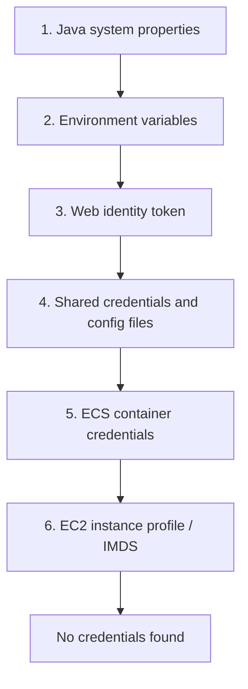

# Default Credential Provider Chain and Profile Configuration

## 1. Why Does the AWS SDK Need a Credential Discovery Mechanism?

A Java Spring Boot application running on a developer laptop, GitHub Actions, Amazon ECS, AWS Lambda, or Amazon EC2 may call the same AWS APIs—such as **S3 GetObject**, **DynamoDB UpdateItem**, or **STS GetCallerIdentity**. Application code should not embed access keys for each environment, because credentials must be issued, rotated, and revoked independently of the build artifact.

**AWS SDK for Java 2.x** uses a **credentials provider** to obtain an AWS identity. When you do not specify a particular provider, the SDK uses the **Default Credentials Provider Chain**: it checks credential sources in priority order and stops at the first provider that returns valid credentials. Credentials can be static keys for testing environments, temporary credentials, IAM Identity Center/SSO, an assumed role via STS, an ECS task role, or an EC2 instance profile.

This lesson belongs to the **AWS SDK for Java** chapter in the **CLOUD_PROVIDERS_AWS** module. The curriculum covers Regions/AZs, IAM, VPC, compute, storage, databases, integration, and serverless; the goal is to select services and deploy applications that are secure, observable, resilient, and cost-controlled. Proper credential management is the security foundation for every SDK call across those environments.

After this lesson, you will be able to:

- Accurately describe the **ordered six provider groups** in Java SDK v2.
- Distinguish between the **credentials provider chain** and the **AWS Region provider chain**.
- Create and select profiles via `~/.aws/credentials`, `~/.aws/config`, `AWS_PROFILE`, and Java system properties.
- Configure IAM Identity Center/SSO, `source_profile`, `role_arn`, `credential_process`, and web identity.
- Choose the appropriate credentials mechanism for local development, ECS, EKS, Lambda, EC2, and CI/CD.
- Use Java SDK 2.x and AWS CLI to verify the **actual identity** the application is using.
- Diagnose errors involving credentials, region, expired sessions, IAM permissions, and profile selection without exposing secrets.

## 2. What Are Credentials and How Does the SDK Use Them?

An AWS request is typically signed with **AWS Signature Version 4 (SigV4)**. The SDK needs credentials to generate the signature, consisting of:

| Component | Meaning |
| --- | --- |
| **Access key ID** | Identifier for the access key used to sign |
| **Secret access key** | Secret used to compute the signature; must never be exposed |
| **Session token** | Token accompanying **temporary credentials** issued by STS/runtime |

A set of temporary credentials contains all three fields above plus an **expiration time**. When using an IAM role, the SDK provider is responsible for fetching fresh credentials when needed. Never store a set of temporary credentials in a global variable and reuse it after the token has expired.

### 2.1. Credentials Providers vs. IAM Policies

Credentials answer the question **"which principal is signing this request?"**. IAM policies answer **"which actions is that principal allowed to perform on which resources?"**. Having valid credentials does not mean having `s3:GetObject` or `dynamodb:PutItem` permissions.

For example:

- `GetCallerIdentity` succeeds: proves the SDK authenticated an STS identity.
- `s3:ListBucket` returns `AccessDenied`: the identity may be valid, but it lacks permission to read the bucket.
- `Unable to load credentials`: the SDK could not find any credentials to sign the request; this fails before the S3/DynamoDB authorization step.

### 2.2. Never Put Credentials in Source Code

Avoid:

- Hardcoding access keys/secrets in Java classes, YAML, `application.properties`, Dockerfiles, or Git.
- Sending credentials in query strings, URLs, logs, exception messages, or frontends.
- Using root account access keys for applications.
- Sharing a single IAM user key across developers, CI/CD, and production runtimes.

Prefer **IAM Identity Center/SSO for humans**, **IAM roles/federation for workloads**, temporary credentials, and least privilege. Profiles with static keys should only be used when there is a specific reason and proper protection/rotation procedures.

## 3. The Default Credentials Provider Chain in Java SDK 2.x

When creating a client like this:

```java
S3Client s3 = S3Client.builder()
    .region(Region.AP_SOUTHEAST_1)
    .build();
```

without calling `credentialsProvider(...)`, the SDK uses the **Default Credentials Provider Chain**. In Java SDK 2.x, the priority order is:



| Order | Provider | Example Sources |
| ---: | --- | --- |
| 1 | **Java system properties** | `aws.accessKeyId`, `aws.secretAccessKey`, `aws.sessionToken` |
| 2 | **Environment variables** | `AWS_ACCESS_KEY_ID`, `AWS_SECRET_ACCESS_KEY`, `AWS_SESSION_TOKEN` |
| 3 | **Web identity token credentials** | `AWS_ROLE_ARN`, `AWS_WEB_IDENTITY_TOKEN_FILE`, and STS |
| 4 | **Shared credentials/config files** | Profiles in `~/.aws/credentials` and `~/.aws/config` |
| 5 | **ECS container credentials** | Container credential endpoint/task role |
| 6 | **EC2 instance profile credentials** | Instance Metadata Service (IMDS) |

The SDK evaluates providers in this order and uses **the first provider that returns valid credentials**. If the selected provider expires or fails to refresh, requests may fail; do not expect the SDK to always fall back to a lower provider to mask a misconfigured higher-priority source.

### 3.1. System Properties

Java system properties can be passed when launching the JVM:

```bash
java \
  -Daws.accessKeyId=EXAMPLE_ACCESS_KEY \
  -Daws.secretAccessKey=EXAMPLE_SECRET_KEY \
  -jar app.jar
```

This is a syntax example only, **not a recommended production deployment method**. Values can show up in process arguments, diagnostics, or deployment management systems. Temporary credentials also require a session token (`aws.sessionToken`). If system properties already provide credentials, this provider takes precedence over environment variables and profiles.

### 3.2. Environment Variables

Java SDK v2 recognizes:

| Variable | Contents |
| --- | --- |
| `AWS_ACCESS_KEY_ID` | Access key ID |
| `AWS_SECRET_ACCESS_KEY` | Secret access key |
| `AWS_SESSION_TOKEN` | Session token when using temporary credentials |

In PowerShell, you can check **which variables are set** without printing secret values:

```powershell
Get-ChildItem Env:AWS_ACCESS_KEY_ID,Env:AWS_SECRET_ACCESS_KEY,Env:AWS_SESSION_TOKEN -ErrorAction SilentlyContinue | Select-Object -ExpandProperty Name
```

If using temporary credentials without `AWS_SESSION_TOKEN`, requests signed with the key pair will be rejected. Local environments can accidentally retain stale access keys; because the environment provider precedes profiles, the SDK may use those keys instead of the SSO profile you just selected.

### 3.3. Web Identity Token Credentials

This provider reads the **role ARN** and **token file**, then calls STS `AssumeRoleWithWebIdentity` to obtain temporary credentials. Common variables include:

- `AWS_ROLE_ARN`
- `AWS_WEB_IDENTITY_TOKEN_FILE`
- `AWS_ROLE_SESSION_NAME` (optional)

This is the core mechanism for **Amazon EKS IRSA (IAM Roles for Service Accounts)** and workloads using OpenID Connect federation. The SDK needs the corresponding STS dependency in the Java application. The token file is provisioned by the platform/workload identity; the application does not fabricate tokens itself.

### 3.4. Shared Credentials and Config Files

If the first three provider groups do not supply credentials, the SDK reads a **profile** from the shared credentials/config files. This is commonly used when developing on a laptop, switching between AWS accounts, or assuming a role from a base profile.

### 3.5. ECS Container Credentials

In Amazon ECS, a **task role** is provided to the container through a credential endpoint configured by the runtime, such as:

- `AWS_CONTAINER_CREDENTIALS_RELATIVE_URI`
- `AWS_CONTAINER_CREDENTIALS_FULL_URI`
- The corresponding authorization token if the endpoint requires one.

The SDK automatically fetches and refreshes credentials from the endpoint. Never bake access keys into images or task definitions. Distinguish the **task role** (permissions for code inside the container) from the **task execution role** (permissions the ECS agent uses to pull images, write logs, and perform startup tasks).

### 3.6. EC2 Instance Profile Credentials

On EC2, attach an **IAM role via an instance profile**. The SDK obtains temporary credentials through the **Instance Metadata Service (IMDS)**, preferably protected by IMDSv2 per instance configuration. Do not store IAM user keys in files on EC2 when the workload can use an instance profile.

## 4. Two Profile Files: credentials and config

On macOS/Linux, the default directory is `~/.aws/`; on Windows it is typically `%USERPROFILE%\.aws\`.

| File | Typical Contents |
| --- | --- |
| `~/.aws/credentials` | Access key, secret key, session token, or profile credential material |
| `~/.aws/config` | Region, output, role settings, SSO, credential process, and profile configuration |

Example structure:

```text
~/.aws/
  credentials
  config
  sso/
    cache/
```

Do not manually create the SSO cache directory or copy token caches between machines. The AWS CLI/SDK manages the cache according to its own mechanism.

### 4.1. Shared Credentials File

Example `~/.aws/credentials`:

```ini
[default]
aws_access_key_id = EXAMPLE_DEFAULT_ACCESS_KEY
aws_secret_access_key = EXAMPLE_DEFAULT_SECRET

[sandbox]
aws_access_key_id = EXAMPLE_SANDBOX_ACCESS_KEY
aws_secret_access_key = EXAMPLE_SANDBOX_SECRET
```

The values above are **placeholders** only. Never commit credentials files to Git, never send them over chat, and never use placeholder keys to call AWS.

### 4.2. Shared Config File

Example `~/.aws/config`:

```ini
[default]
region = ap-southeast-1
output = json

[profile sandbox]
region = ap-southeast-1
output = json
```

Section naming rules differ between the two files:

- Default profile: `[default]`.
- Named profile in the **config file**: `[profile sandbox]`.
- Named profile in the **credentials file**: `[sandbox]` (without the word `profile`).

This is a common reason the SDK/CLI fails to find a profile: writing `[sandbox]` in config instead of `[profile sandbox]`.

### 4.3. How Is the Profile Name Selected?

By default, the SDK uses the profile named `default`. A profile can be selected using:

- Environment variable `AWS_PROFILE`.
- Java system property `aws.profile`.
- Specifying a profile explicitly in `ProfileCredentialsProvider`.

PowerShell example:

```powershell
$env:AWS_PROFILE = "sandbox"
```

or:

```bash
export AWS_PROFILE=sandbox
```

**Important note on precedence:** `AWS_PROFILE=sandbox` chooses which profile is used at the **profile provider step** of the default chain. It **does not override** Java system properties or static environment credentials that appear earlier than profiles. If `AWS_ACCESS_KEY_ID`/`AWS_SECRET_ACCESS_KEY` are set, the SDK may use them instead of the sandbox profile.

### 4.4. Overriding the Two File Paths

You can set:

- `AWS_SHARED_CREDENTIALS_FILE`: path to the credentials file.
- `AWS_CONFIG_FILE`: path to the config file.

PowerShell example:

```powershell
$env:AWS_SHARED_CREDENTIALS_FILE = "C:\work\aws\credentials"
$env:AWS_CONFIG_FILE = "C:\work\aws\config"
```

Setting these path variables alone does not create the files or grant read permissions. Ensure the user running the JVM has access to the files and that paths do not unintentionally point to stale credentials.

## 5. IAM Identity Center (SSO) Profile for Developers

For human users, **IAM Identity Center** enables signing in through the organization's identity provider and selecting an assigned AWS account and permission set/role. The AWS CLI creates an SSO profile in `~/.aws/config`; Java SDK 2.x can use that profile to obtain temporary credentials and refresh them via the SSO mechanism.

### 5.1. Creating a Profile with the AWS CLI

Run on the developer workstation:

```bash
aws configure sso --profile developer
```

The CLI prompts for details such as **SSO start URL or issuer URL**, SSO Region, AWS account, permission set/role, default AWS Region, and output format. After configuring, sign in:

```bash
aws sso login --profile developer
aws sts get-caller-identity --profile developer
```

`get-caller-identity` shows the actual account/ARN the CLI is using. This is an identity check; it does not prove the role has permissions to read any S3 bucket or DynamoDB table.

### 5.2. Sample SSO Profile Configuration

Example `~/.aws/config`:

```ini
[sso-session company]
sso_start_url = https://example.awsapps.com/start
sso_region = ap-southeast-1
sso_registration_scopes = sso:account:access

[profile developer]
sso_session = company
sso_account_id = 111122223333
sso_role_name = DeveloperAccess
region = ap-southeast-1
output = json
```

`example.awsapps.com`, account IDs, and permission sets in the example are placeholders; use the values provided by your organization. An SSO profile does not need IAM user access keys/secrets stored in the credentials file.

### 5.3. SDK Dependencies for SSO

With Java SDK 2.x, an application using an SSO-backed profile needs the corresponding SSO modules. Maven example using the **AWS SDK BOM** to align versions:

```xml
<dependencyManagement>
  <dependencies>
    <dependency>
      <groupId>software.amazon.awssdk</groupId>
      <artifactId>bom</artifactId>
      <version>AWS_SDK_VERSION</version>
      <type>pom</type>
      <scope>import</scope>
    </dependency>
  </dependencies>
</dependencyManagement>

<dependencies>
  <dependency>
    <groupId>software.amazon.awssdk</groupId>
    <artifactId>s3</artifactId>
  </dependency>
  <dependency>
    <groupId>software.amazon.awssdk</groupId>
    <artifactId>sso</artifactId>
  </dependency>
  <dependency>
    <groupId>software.amazon.awssdk</groupId>
    <artifactId>ssooidc</artifactId>
  </dependency>
</dependencies>
```

`AWS_SDK_VERSION` is a Maven property managed by your project, not a built-in Maven value. If the profile uses assume-role/web identity and the application calls STS directly, add `software.amazon.awssdk:sts` with the same BOM. Declare only the service modules the application actually uses.

### 5.4. Token Cache and Login Session

The AWS CLI stores the SSO token cache locally. The Java SDK can use the corresponding cache/token provider when the profile is configured properly and compatible dependencies are present. If the SSO session expires or needs re-authentication, run:

```bash
aws sso login --profile developer
```

Never copy the token cache to another machine, and never place it in a Docker image or Git. When running in production, **do not rely on a developer's SSO profile**; workloads should use dedicated IAM roles or federation.

## 6. Assuming a Role with a Profile and source_profile

A developer might sign in to a tooling account via SSO and then assume a **read-only role in a production account**. The role profile describes the target, while `source_profile` points to the profile supplying the initial credentials to call STS `AssumeRole`.

### 6.1. Cross-Account Role Example

`~/.aws/config`:

```ini
[profile developer]
sso_session = company
sso_account_id = 111122223333
sso_role_name = DeveloperAccess
region = ap-southeast-1

[profile production-readonly]
role_arn = arn:aws:iam::444455556666:role/ProductionReadOnly
source_profile = developer
role_session_name = java-sdk-inspection
region = ap-southeast-1
```

Flow:

1. The SDK selects profile `production-readonly`.
2. The profile provider obtains credentials from `developer` (SSO).
3. The SDK calls STS `AssumeRole` for the role ARN in the production account.
4. STS returns temporary credentials for the target role.
5. The Java client signs requests using `ProductionReadOnly` credentials.

The target role's trust policy must allow the source principal to assume the role; the source permission policy must allow `sts:AssumeRole` on the exact role ARN. **Both sides must align.**

### 6.2. External ID and Session Name

For appropriate third-party/cross-account models, a profile can specify:

```ini
[profile vendor-audit]
role_arn = arn:aws:iam::444455556666:role/VendorAudit
source_profile = developer
external_id = EXTERNAL_ID_PROVIDED_BY_TARGET_ACCOUNT
role_session_name = audit-read-session
region = ap-southeast-1
```

`external_id` helps mitigate the confused deputy risk in appropriate delegation models; it does not replace trust policies or least privilege. Do not invent an external ID and assume the target account will accept it.

### 6.3. source_profile and credential_source

When running workloads on AWS, you do not need a source profile containing static keys. You can use `credential_source` to fetch credentials from the runtime environment:

```ini
[profile production-from-ec2]
role_arn = arn:aws:iam::444455556666:role/ProductionReadOnly
credential_source = Ec2InstanceMetadata
region = ap-southeast-1
```

Common sources include:

| `credential_source` Value | Source |
| --- | --- |
| `Environment` | Credentials from environment variables |
| `Ec2InstanceMetadata` | EC2 instance profile |
| `EcsContainer` | ECS container credentials |

`source_profile` and `credential_source` are two mutually exclusive ways to specify the credential source for assuming a role; do not configure both in the same role profile. With ECS/EC2, you can usually attach the task/instance role directly to the workload and avoid an intermediate assume-role profile unless cross-account access is required.

## 7. credential_process: Integrating an External Credential Helper

A profile can use `credential_process` to invoke an external program and receive credentials over a JSON contract. This is useful when an organization has a custom credential broker or authentication tool, but it also expands the trust boundary: **the SDK executes the program configured in the profile**.

Example:

```ini
[profile corporate]
credential_process = /usr/local/bin/company-aws-credential-helper --profile engineering
region = ap-southeast-1
```

The helper must write JSON credentials to **stdout** following the supported schema, for example:

```json
{
  "Version": 1,
  "AccessKeyId": "TEMPORARY_ACCESS_KEY",
  "SecretAccessKey": "TEMPORARY_SECRET_KEY",
  "SessionToken": "TEMPORARY_SESSION_TOKEN",
  "Expiration": "2026-11-20T12:00:00Z"
}
```

Values are placeholders. When returning temporary credentials, `Expiration` must be a valid timestamp per the credential process contract. The helper must never write credentials to stderr/logs, return expired keys, or prompt the user interactively for secrets on every SDK refresh when a non-interactive flow can be designed.

**Security:** only use helpers managed by a trusted organization; restrict permissions on the executable and config files; verify absolute paths; avoid executables/scripts that another user could replace; never let the helper print secrets to logs. An untrusted profile can cause the JVM to execute an unintended program.

## 8. Web Identity and Workload Identity on AWS

### 8.1. EKS IRSA

**IAM Roles for Service Accounts (IRSA)** binds a Kubernetes service account to an IAM role via OIDC. Pods receive a web identity token and role details; the Java SDK v2 default chain uses the web identity provider to call STS and retrieve temporary credentials.

An illustrative profile/config (in a properly configured environment):

```ini
[profile eks-orders]
role_arn = arn:aws:iam::111122223333:role/EksOrdersRole
web_identity_token_file = /var/run/secrets/eks.amazonaws.com/serviceaccount/token
role_session_name = orders-pod
region = ap-southeast-1
```

In EKS IRSA, environment variables and the token file are usually injected by the admission webhook/runtime; the application should never bake tokens into an image. The IAM role trust policy must scope to the exact OIDC provider, namespace, and service account required.

### 8.2. EKS Pod Identity

Amazon EKS Pod Identity supplies credentials to pods through a platform-configured agent/container credentials mechanism. Use a Java SDK version that supports the provider and configure it per EKS guidelines; do not assume older SDK versions automatically recognize new variables or endpoints.

### 8.3. ECS Task Role

In ECS, configure **taskRoleArn** for the application. ECS provides a credentials endpoint to the container; the Java SDK picks it up automatically via the container credentials provider. `executionRoleArn` is for the ECS agent/runtime and should not be granted application permissions in place of the task role.

### 8.4. Lambda Execution Role

In AWS Lambda, attach an execution role to the function. The runtime supplies temporary credentials; the Java SDK default provider chain obtains credentials from the runtime without needing profiles or access keys in code. Each function should have its own role or a role scoped to its functional group with least privilege.

### 8.5. EC2 Instance Profile

On EC2, attach an instance profile to the instance and grant the role only what the application needs. The Java SDK queries IMDS via the provider chain. Enforce IMDSv2, restrict network/host access, and do not expose the metadata endpoint to untrusted containers or applications that do not need it.

## 9. Explicit Credentials Provider Configuration in Java

By default, let the SDK use the default chain so the same artifact runs across laptops, ECS, and EC2 with each environment's native credential mechanism. However, in developer tools or tests, you can specify an **explicit profile** to avoid relying on the shell's `AWS_PROFILE`.

### 9.1. S3 Client Using the Default Provider Chain

```java
import software.amazon.awssdk.regions.Region;
import software.amazon.awssdk.services.s3.S3Client;

public class S3ClientFactory {
    public static S3Client create() {
        return S3Client.builder()
                .region(Region.AP_SOUTHEAST_1)
                // Do not specify credentialsProvider:
                // The SDK uses the Default Credentials Provider Chain.
                .build();
    }
}
```

Applications should **reuse service clients** rather than creating a new client per HTTP request. Close the client when the application context stops; the SDK manages connection pools and credential providers over the client's lifecycle.

### 9.2. Specifying a Profile Explicitly

```java
import software.amazon.awssdk.auth.credentials.ProfileCredentialsProvider;
import software.amazon.awssdk.regions.Region;
import software.amazon.awssdk.services.s3.S3Client;

public class LocalS3Client {
    public static void main(String[] args) {
        try (ProfileCredentialsProvider credentials =
                     ProfileCredentialsProvider.builder()
                             .profileName("developer")
                             .build();
             S3Client s3 = S3Client.builder()
                     .region(Region.AP_SOUTHEAST_1)
                     .credentialsProvider(credentials)
                     .build()) {

            System.out.println("S3 client configured for developer profile");
        }
    }
}
```

This example suits **local tooling/testing**, not general production configuration. Calling `ProfileCredentialsProvider` explicitly selects that profile directly instead of letting the default chain pick the first provider. If the profile uses SSO, sign in first via the AWS CLI and include the matching SDK dependencies.

### 9.3. Checking Which Identity the Java SDK Actually Uses

Add the `software.amazon.awssdk:sts` dependency under the same AWS SDK BOM, then:

```java
import software.amazon.awssdk.regions.Region;
import software.amazon.awssdk.services.sts.StsClient;
import software.amazon.awssdk.services.sts.model.GetCallerIdentityResponse;

public class AwsIdentityCheck {
    public static void main(String[] args) {
        try (StsClient sts = StsClient.builder()
                .region(Region.AP_SOUTHEAST_1)
                .build()) {

            GetCallerIdentityResponse identity = sts.getCallerIdentity();
            System.out.println("Account: " + identity.account());
            System.out.println("ARN: " + identity.arn());
            System.out.println("UserId: " + identity.userId());
        }
    }
}
```

This is a much safer check than printing credentials. The ARN shows the active account and principal/assumed role; **never print access keys, secret keys, or session tokens**. `GetCallerIdentity` does not require special IAM allow permissions in most cases according to AWS STS behavior.

### 9.4. Do Not Read Credentials Once and Manage Expiration Manually

Avoid extracting `AwsCredentials` from a provider and caching them indefinitely in a static field. Let the SDK provider fetch and refresh temporary credentials across its lifecycle. Refresh mechanisms vary across STS assume role, SSO, web identity, ECS, and EC2; the provider abstraction frees the application from implementing token rotation itself.

## 10. Region Provider Chain Is a Separate Mechanism

**The credentials provider chain selects the identity; the Region provider chain selects the AWS Region.** A client needs both to sign requests and route them to the right endpoint.

When `.region(...)` is omitted, Java SDK v2 resolves the Region in this common order:

1. Java system property `aws.region`.
2. Environment variable `AWS_REGION`.
3. Region in the shared config file profile.
4. EC2 instance metadata service (IMDS).

| Source | Example |
| --- | --- |
| Java system property | `-Daws.region=ap-southeast-1` |
| Environment | `AWS_REGION=ap-southeast-1` |
| Shared config profile | `region = ap-southeast-1` |
| EC2 IMDS | Region of the EC2 instance |

If the SDK cannot find a Region, you may see `Unable to load region from any of the providers in the chain`, even if credentials were found.

### 10.1. Setting the Region Explicitly on the Service Client

```java
DynamoDbClient dynamo = DynamoDbClient.builder()
        .region(Region.AP_SOUTHEAST_1)
        .build();
```

In production applications, reading the Region from managed application/environment configuration is usually easier to review than implicitly relying on the JVM user's profile. Do not hardcode a Region if one artifact needs multi-Region deployment; pass it via environment or deployment configuration.

### 10.2. AWS_REGION and AWS_DEFAULT_REGION

The Java SDK v2 region provider chain uses `AWS_REGION`. `AWS_DEFAULT_REGION` is common in the AWS CLI and some other tools; **do not assume the Java SDK reads it as an alias**. If the CLI works but Java reports a missing Region, check `AWS_REGION`, `aws.region`, profile config, and `.region(...)` on the client.

### 10.3. Selecting a Profile Does Not Select Its Credentials If a Higher-Priority Source Exists

Example:

```text
AWS_PROFILE=developer
AWS_ACCESS_KEY_ID=OLD_ACCESS_KEY
AWS_SECRET_ACCESS_KEY=OLD_SECRET
```

In the default credentials chain, environment credentials precede profiles. As a result, Java may sign with the old access key even though `AWS_PROFILE` points to an SSO profile. The right diagnostic step is checking identity from **the actual running Java process**, rather than relying solely on output from another AWS CLI terminal.

## 11. Choosing a Credentials Source by Environment

| Environment | Preferred Approach | Reason |
| --- | --- | --- |
| **Developer laptop** | IAM Identity Center/SSO profile | Individual sign-in, temporary credentials, role/account switching |
| **Local integration test** | SSO profile or isolated test credentials | Avoids sharing production keys |
| **GitHub Actions/CI** | OIDC federation and STS AssumeRoleWithWebIdentity | No long-lived secrets stored in CI |
| **Amazon ECS** | ECS task role | Runtime provisions/refreshes credentials automatically |
| **Amazon EKS** | IRSA or EKS Pod Identity per architecture | Identity scoped to Kubernetes workloads |
| **AWS Lambda** | Lambda execution role | Runtime credentials managed by AWS |
| **Amazon EC2** | EC2 instance profile | Temporary role credentials via IMDS |
| **Cross-account tooling** | Assume-role profile/STS | Scoped authorization and auditing by target account/role |

### 11.1. Local Development

Recommended workflow:

1. Install AWS CLI v2 and configure an IAM Identity Center profile.
2. Run `aws sso login --profile developer`.
3. Set `AWS_PROFILE=developer` or use explicit `ProfileCredentialsProvider` in local tools.
4. Call STS `GetCallerIdentity` from Java to verify the account/role.
5. Do not export static access keys into the shell while testing SSO.

### 11.2. CI/CD with OIDC

In GitHub Actions or any CI provider supporting OpenID Connect, configure a trust relationship between the identity provider and an IAM role. The pipeline receives an OIDC token and calls STS assume role for temporary credentials. The role trust policy should restrict **repository/project, branch/environment, audience, and subject claims** appropriately; never allow arbitrary public workflows to assume production roles.

When CI runs Java SDK v2, the web identity provider can use the environment variables/token file configured by the action/runtime. Never store production access keys in repository secrets if OIDC federation can satisfy the requirement.

### 11.3. ECS: Task Role and Execution Role

Example task definition showing both roles:

```json
{
  "executionRoleArn": "arn:aws:iam::111122223333:role/EcsExecutionRole",
  "taskRoleArn": "arn:aws:iam::111122223333:role/OrdersTaskRole"
}
```

`EcsExecutionRole` is for the ECS agent to perform startup actions such as pulling images and writing logs per configuration. `OrdersTaskRole` is the identity of the application code. If the application needs to read S3 and write DynamoDB, place those permissions on the **task role**, and do not automatically expand the execution role.

### 11.4. Lambda: One Role Per Function

An order-processing Lambda might only need `dynamodb:GetItem`, `dynamodb:UpdateItem` on the orders table, and `sqs:SendMessage` to a specific queue. Attach that role to the function; never include profile files or IAM user keys inside the ZIP or container image. If another function only reads S3, grant it a separate role tailored to that task.

## 12. AWS CLI: Inspecting Profiles and Identity Without Exposing Secrets

The AWS CLI is a helpful verification tool, but **the CLI and Java SDK are two separate programs that can differ in environment, version, and provider behavior**. Run commands in the same user/shell/container context whenever possible.

### 12.1. Listing Profiles

```bash
aws configure list-profiles
```

This lists profile names, not IAM permissions.

### 12.2. Checking Configuration Sources

```bash
aws configure list --profile developer
```

This command reports credential/region sources as perceived by the CLI. Be careful when sharing output: even though keys are partially masked, avoid posting sensitive environment details in public channels.

### 12.3. Verifying Account and Role

```bash
aws sts get-caller-identity --profile developer
aws sts get-caller-identity --profile production-readonly
```

Compare `Account` and `Arn` against the expected account and role. If the profile uses SSO and is not logged in yet, run `aws sso login --profile developer` and retry.

### 12.4. Running Java with a Specific Profile

PowerShell:

```powershell
$env:AWS_PROFILE = "developer"
java -jar app.jar
```

Or via Java system property:

```bash
java -Daws.profile=developer -jar app.jar
```

Reminder: system properties and static environment credentials take precedence over the profile provider. When testing an SSO profile, clear any unneeded static credentials from the JVM environment.

### 12.5. Never Print Credentials for Debugging

Avoid printing:

- `AWS_ACCESS_KEY_ID` and `AWS_SECRET_ACCESS_KEY`.
- `AWS_SESSION_TOKEN`.
- JSON returned by `credential_process`.
- Contents of the SSO token cache or web identity token file.

Instead, log **STS GetCallerIdentity**, the chosen provider source, profile name, Region, and ARN. When reporting errors, redact account IDs if required by organizational policy and never attach secrets.

## 13. Troubleshooting: Common Errors and Resolutions

| Symptom | Common Cause | What to Check |
| --- | --- | --- |
| `Unable to load credentials from any of the providers in the chain` | No valid credential source found | Profile, SSO login, role/runtime endpoint, env vars present |
| Java uses the wrong AWS account | Stale system property or env credentials precede profile | Call STS `GetCallerIdentity` from the Java process itself |
| `The security token included in the request is invalid` | Wrong key, missing/wrong session token, expired credentials | Check source and refresh; never copy partial temporary credentials |
| `ExpiredToken` | Temporary credentials expired and provider failed to refresh | Re-login SSO, check STS/profile/system clock and SDK version |
| `Unable to load region from any of the providers` | Region not configured | `.region(...)`, `AWS_REGION`, `aws.region`, profile region |
| `Profile file contained no credentials` | Wrong profile selected or profile only sets region | Check section names and credentials/SSO/role source |
| SSO profile does not work in Java | Missing `aws sso login`, missing SDK SSO modules, or wrong profile | Check cache/session, `sso`/`ssooidc` dependencies, and SDK BOM |
| `AccessDenied` after STS identity succeeds | Principal is valid but lacks permission/trust/resource policy | Inspect IAM identity/resource policy, SCP, permission boundary |
| AssumeRole returns AccessDenied | Source/target trust policy mismatch or missing `sts:AssumeRole` | Check principal, role ARN, external ID, claims |
| `credential_process` non-zero exit code | Helper failed, not executable, or stdout invalid schema | Check executable, permissions, safe stderr, and JSON contract |
| ECS cannot find credentials | Missing task role or container endpoint/config | Check task definition `taskRoleArn`, runtime, SDK version |
| EC2 cannot obtain instance profile | No profile attached, IMDS/network/IMDSv2 policy | Check IAM instance profile and metadata options |
| EKS pod uses wrong role | Misconfigured service account annotation/trust/Pod Identity | Check OIDC claims, role ARN, SDK provider support |
| CLI works but Java fails | Different user/home/env, missing SDK modules, different Region/chain | Compare in the same runtime and call STS from Java |

### 13.1. Ordered Diagnostic Procedure

1. **Identity:** Does Java STS `GetCallerIdentity` succeed? What are the ARN and account?
2. **Credentials source:** Which provider was selected? Are stale system properties or static env keys set?
3. **Profile:** Is the profile name right? Does the config section use `[profile name]`? Does the file path match the JVM user?
4. **SSO/STS:** Is the session still valid? Are role trust and `sts:AssumeRole` configured properly?
5. **Region:** Does the client have the right Region? Do endpoint and partition match the resource?
6. **Authorization:** Do IAM identity policies, resource policies, SCPs, permission boundaries, VPC endpoint policies, and KMS policies allow the action?
7. **Runtime:** Are the ECS task role, Lambda execution role, EKS identity, or EC2 instance profile attached properly?

### 13.2. Distinguishing Authentication from Authorization

```text
Unable to load credentials
  -> SDK has no credentials to sign the request

Invalid/Expired token
  -> Credentials exist, but the token is invalid or expired

AccessDenied
  -> Request reached AWS; the principal is not authorized for the action

ResourceNotFound / wrong Region
  -> Identity may be valid, but endpoint/resource/config does not match
```

Do not fix `AccessDenied` by immediately granting `AdministratorAccess`. First identify the **actual principal, action, resource ARN, and policy evaluation**, and grant only the minimum permissions required.

## 14. Profile Security and Credential Operations

### 14.1. File Permissions and Secret Hygiene

On Linux/macOS, if a profile stores static credentials, restrict read permissions to the owning user (e.g., `chmod 600 ~/.aws/credentials`). On Windows, use ACLs so only necessary users/groups have access. SSO profiles still maintain sensitive token caches; never sync the entire `.aws` folder to public storage.

### 14.2. Rotation and Temporary Credentials

- Prefer roles/temporary time-limited credentials over long-lived IAM user keys.
- If your organization still requires access keys, maintain rotation procedures, ownership, expiration reviews, and old-key revocation.
- Never store keys in source code, Git history, Docker images, logs, or crash dumps.
- Let SDK providers refresh credentials; never hardcode fixed expiration windows in Java code.
- If a credential is suspected of compromise, revoke/rotate per incident response procedures and audit CloudTrail.

### 14.3. Never Mix Credentials Across Environments

A single Java artifact may be deployed to dev, staging, and production. Each environment supplies its own role/identity. Never bake `AWS_PROFILE=developer` into a Docker image and hope ECS overrides it with the task role; if static environment keys or profile settings outrank the runtime provider, the app can run under the wrong identity.

### 14.4. Profile Files Are Executable Configuration, Not Just Data

Profiles can specify `credential_process`, role assumption, and token files. Treat profile files as part of **security configuration**:

- Read profiles only from managed paths.
- Review changes to role ARNs, executables, and token file paths.
- Never allow untrusted users to modify files used by production services.
- Never point `credential_process` to scripts in writable temp directories where they could be replaced.
- Audit who has permission to modify profiles, task definitions, environment variables, and instance profiles.

## 15. Case Study: A Java Service from Laptop to Production

An `orders-api` service uses S3 for invoices and DynamoDB for orders. The same JAR runs on developer laptops, CI pipelines, and production ECS Fargate.

### 15.1. Local Development

Developers sign in with IAM Identity Center using the `developer` profile. In their shell, `AWS_PROFILE=developer`; the Java client uses the default chain. Before debugging an S3 error, a developer calls STS `GetCallerIdentity` from the application to confirm the expected account and role.

### 15.2. CI Pipeline

CI uses OIDC to assume `OrdersBuildDeployRole` in the deploy account. The role only has permission to upload artifacts to the pipeline bucket and update required deployment resources. CI never uses a developer's laptop profile or static keys.

### 15.3. ECS Production

The task definition attaches `OrdersTaskRole`. The container ships no credentials file; the SDK fetches temporary credentials from the ECS container endpoint. The role permits read/write access only to the designated DynamoDB table and S3 prefix. `OrdersTaskExecutionRole` only has permission to pull ECR images and write logs as required by ECS.

### 15.4. Diagnosing a Wrong-Account Incident

After deployment, CloudTrail shows requests hitting a test bucket. The operations team:

1. Runs STS `GetCallerIdentity` **inside the same ECS task** using approved diagnostic code.
2. Confirms the ARN is an assumed role in the dev account.
3. Checks the task environment for stale `AWS_ACCESS_KEY_ID`/`AWS_SECRET_ACCESS_KEY`.
4. Finds a static environment credential injected into the task definition/deployment.
5. Removes the unwanted credential source, keeps the task role, redeploys, and re-verifies the identity.

**Lesson:** Neither `AWS_PROFILE` nor a task role is guaranteed to be picked if a higher-priority provider already supplied credentials. Verifying the process's actual identity matters more than reading a profile name in a file.

### 15.5. Resulting Architecture

| Runtime | Credential Source | Permissions |
| --- | --- | --- |
| Developer laptop | IAM Identity Center profile | Developer sandbox |
| CI | OIDC + STS role | Build/deploy |
| ECS production | ECS task role | Runtime orders API |
| EKS batch worker | IRSA or Pod Identity | Batch-specific role |
| EC2 maintenance host | Instance profile | Maintenance-only permissions |

Each workload has its own identity and permissions; source code does not change across environments.

## 16. Production Checklist

1. **Never hardcode keys:** use IAM roles, SSO, or federation; avoid long-lived secrets.
2. **Know the chain order:** system properties → environment → web identity → profile → ECS → EC2.
3. **Check precedence:** clear stale env/system properties when expecting a profile or runtime role to be selected.
4. **Distinguish profile files:** `[profile name]` sections in config, `[name]` in credentials.
5. **Manage SSO properly:** login, SDK modules, token cache, and session lifecycle.
6. **Assume roles securely:** scope trust policies, source permissions, external IDs/claims, and role sessions.
7. **Use runtime identities:** ECS task role, Lambda execution role, EKS workload identity, or EC2 instance profile.
8. **Configure Region separately:** set `.region(...)`, `AWS_REGION`, or profile; never infer Region from credentials.
9. **Verify identity:** call STS `GetCallerIdentity` from the actual Java process/runtime.
10. **Enforce least privilege:** separate build/deploy/runtime permissions; never fix `AccessDenied` with broad admin rights.
11. **Let credentials refresh:** never cache temporary credentials indefinitely; reuse SDK clients.
12. **Secure profiles:** protect files, credential helpers, token files, and configuration write access.
13. **Maintain observability:** never log secrets; log request IDs, policy-compliant role ARNs, and error classes.
14. **Test thoroughly:** local SSO, assume role, ECS/EC2 metadata, web identity, session expiry, and Region mismatches.

## 17. Self-Check Questions

**Question 1.** What is the order of the Default Credentials Provider Chain in Java SDK 2.x?

**Hint:** Java system properties → environment variables → web identity → shared credentials/config profiles → ECS container credentials → EC2 instance profile.

**Question 2.** You set `AWS_PROFILE=developer` but Java still uses a different account. Why?

**Hint:** System properties or static environment credentials precede profiles in the chain; call STS `GetCallerIdentity` from Java to verify.

**Question 3.** What is the difference between `~/.aws/credentials` and `~/.aws/config`?

**Hint:** The credentials file typically stores keys/session tokens; the config file stores Region, SSO, role settings, and profile configuration. Both participate in the profile provider.

**Question 4.** How is a profile named `developer` written in each of the two files?

**Hint:** Config uses `[profile developer]`; credentials uses `[developer]`.

**Question 5.** Which fields make up temporary credentials?

**Hint:** Access key ID, secret access key, and session token; they also have an expiration.

**Question 6.** Does an SSO profile need long-lived access keys stored in the credentials file?

**Hint:** No. IAM Identity Center/CLI handles the token/session flow and provides temporary credentials.

**Question 7.** When using an SSO profile in Java SDK v2, what is required before running locally?

**Hint:** Configure the profile, run `aws sso login --profile ...`, add compatible SDK SSO modules, and verify STS identity.

**Question 8.** How do `source_profile` and `credential_source` differ?

**Hint:** `source_profile` pulls credentials from another profile; `credential_source` pulls them from `Environment`, `Ec2InstanceMetadata`, or `EcsContainer`.

**Question 9.** What risks come with `credential_process`?

**Hint:** The SDK executes the configured program; only trust vetted executables/paths, protect write permissions, and never log secrets.

**Question 10.** Are the ECS task role and execution role the same?

**Hint:** No. The task role is the identity of the application container; the execution role serves the ECS agent/runtime for tasks like pulling images and writing logs.

**Question 11.** Is the Java SDK Region provider chain the same as the credentials chain?

**Hint:** No. The Region chain uses `aws.region`, `AWS_REGION`, profile Region, and EC2 metadata; the credentials chain locates the signing identity.

**Question 12.** Does a successful AWS CLI call with `--profile developer` prove the Java SDK is using that profile?

**Hint:** No. Runtime/user/environment/dependencies can differ; call STS `GetCallerIdentity` from the Java process itself.

**Question 13.** `GetCallerIdentity` succeeds, yet S3 returns AccessDenied. Where is the issue?

**Hint:** Credentials authenticated the principal; check IAM identity/resource policies, SCPs, permission boundaries, KMS, and endpoint policies.

**Question 14.** Should you cache access key/secret/session token in static fields to avoid calling the provider?

**Hint:** No. Temporary credentials expire; let the SDK provider handle refreshing and reuse service clients instead.

**Question 15.** When production ECS has a task role, should a developer's SSO profile be baked into the Docker image?

**Hint:** No. Use the task role and ECS-provided temporary credentials; developer profiles do not belong in production runtimes.

## 18. Key Takeaways

**The AWS SDK for Java 2.x Default Credentials Provider Chain** evaluates six source groups in order: **Java system properties → environment variables → web identity → shared credentials/config profiles → ECS container credentials → EC2 instance profile**. The first provider with valid credentials wins. Consequently, a stale environment variable can cause an application to use the wrong identity even when `AWS_PROFILE` points to a new profile.

**Profiles** are read from `~/.aws/credentials` and `~/.aws/config`; config uses `[profile name]`, while credentials uses `[name]`. Developers should prefer **IAM Identity Center/SSO**, cross-account workflows should use **assume role**, and AWS workloads should use **ECS task roles, EKS workload identity, Lambda execution roles, or EC2 instance profiles**. `credential_process` should only be used with trusted helper binaries and secured configurations.

**The Region provider chain is a separate mechanism**: Java system property `aws.region`, environment variable `AWS_REGION`, profile Region, and EC2 metadata. Valid credentials do not automatically pick the right Region, and a valid Region does not grant IAM permissions. Use **STS GetCallerIdentity from the Java runtime itself** to confirm the account/role, distinguish authentication from authorization, never log secrets, and let the SDK manage temporary credential refreshes. That is the foundation for running AWS applications securely from local development through production.

### AWS Reference Documentation

- [AWS SDK for Java 2.x — Default credentials provider chain](https://docs.aws.amazon.com/sdk-for-java/latest/developer-guide/credentials-chain.html)
- [AWS SDK for Java 2.x — Set credentials](https://docs.aws.amazon.com/sdk-for-java/latest/developer-guide/credentials.html)
- [AWS SDK for Java 2.x — Profile credentials provider](https://docs.aws.amazon.com/sdk-for-java/latest/developer-guide/credentials-profiles.html)
- [AWS SDK for Java 2.x — Region selection](https://docs.aws.amazon.com/sdk-for-java/latest/developer-guide/region-selection.html)
- [AWS SDK for Java 2.x — IAM Identity Center credentials](https://docs.aws.amazon.com/sdk-for-java/latest/developer-guide/credentials-login.html)
- [AWS SDK for Java 2.x — Web identity token credentials](https://docs.aws.amazon.com/sdk-for-java/latest/developer-guide/credentials-web-identity.html)
- [AWS SDK for Java 2.x — Container credentials](https://docs.aws.amazon.com/sdk-for-java/latest/developer-guide/credentials-chain.html#credentials-chain-container)
- [AWS SDK for Java 2.x — Instance profile credentials](https://docs.aws.amazon.com/sdk-for-java/latest/developer-guide/credentials-chain.html#credentials-chain-instance-profile)
- [AWS CLI — Configuration and credential file settings](https://docs.aws.amazon.com/cli/latest/userguide/cli-configure-files.html)
- [AWS CLI — Configure IAM Identity Center](https://docs.aws.amazon.com/cli/latest/userguide/cli-configure-sso.html)
- [AWS STS — GetCallerIdentity](https://docs.aws.amazon.com/STS/latest/APIReference/API_GetCallerIdentity.html)
- [AWS STS — AssumeRole](https://docs.aws.amazon.com/STS/latest/APIReference/API_AssumeRole.html)
- [Amazon ECS — Task IAM roles](https://docs.aws.amazon.com/AmazonECS/latest/developerguide/task-iam-roles.html)
- [Amazon EKS — IAM roles for service accounts](https://docs.aws.amazon.com/eks/latest/userguide/iam-roles-for-service-accounts.html)
- [Amazon EKS — EKS Pod Identity](https://docs.aws.amazon.com/eks/latest/userguide/pod-identities.html)
- [Amazon EC2 — IAM roles for EC2](https://docs.aws.amazon.com/AWSEC2/latest/UserGuide/iam-roles-for-amazon-ec2.html)
- [AWS Lambda — Execution role](https://docs.aws.amazon.com/lambda/latest/dg/lambda-intro-execution-role.html)
- [AWS IAM — Best practices for security credentials](https://docs.aws.amazon.com/IAM/latest/UserGuide/security-creds.html)
