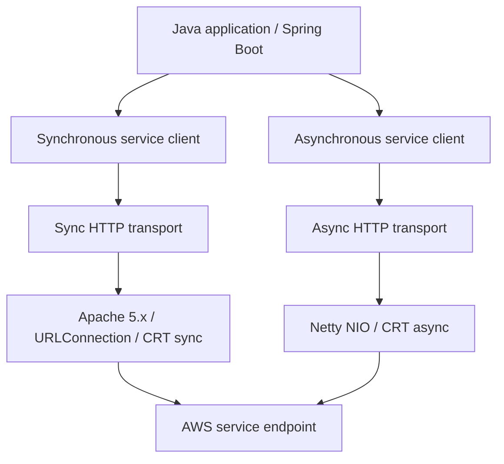
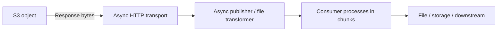
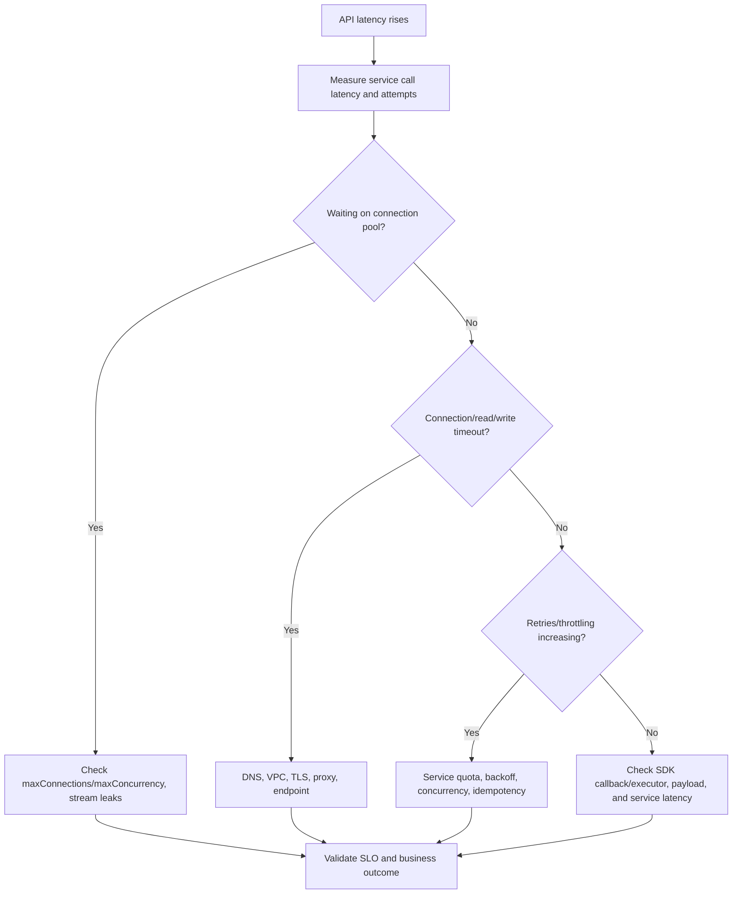

# Synchronous Clients, Asynchronous Clients, and HTTP Transports

> **Chapter:** AWS SDK for Java · **Module:** `CLOUD_PROVIDERS_AWS`

## 1. The Problem: Calling AWS Efficiently from Java Applications

A Spring Boot application running on Amazon ECS needs to call Amazon DynamoDB to read orders, Amazon S3 to download invoices, and Amazon SQS to enqueue background tasks. Some requests need immediate results to return an HTTP response; some batch tasks can execute concurrently and resume when the service responds.

AWS SDK for Java 2.x provides **synchronous** and **asynchronous** service clients. The two client types expose different APIs and require matching HTTP transports:

- **Synchronous service clients** invoke a method and wait for the response to complete on the calling thread.
- **Asynchronous service clients** return a `CompletableFuture` or streaming API, allowing the calling thread to continue working while the request is in flight.
- **HTTP transports** handle networking, TLS, connection pooling, reading/writing bytes, and I/O management.



**Do not confuse an async API with an async HTTP transport.** An `S3AsyncClient` exposes an async service API and requires an async transport. An `S3Client` exposes a sync service API, even when backed underneath by `AwsCrtHttpClient` with an optimized I/O implementation. Pairing the right client and transport is the first prerequisite for working code.

In the `CLOUD_PROVIDERS_AWS` module, this lesson ties together **IAM credentials, Regions, VPC, ECS/Lambda, S3, DynamoDB, SQS, retries, timeouts, and observability**.

**Learning objectives:**

1. Distinguish between synchronous and asynchronous service clients in AWS SDK for Java 2.x.
2. Select the matching synchronous or asynchronous HTTP client for each service client.
3. Compare **Apache5HttpClient, UrlConnectionHttpClient, AwsCrtHttpClient, NettyNioAsyncHttpClient, and AwsCrtAsyncHttpClient**.
4. Manage Maven BOM/dependencies, client lifecycles, thread safety, and connection pools.
5. Configure connection timeouts, read/write timeouts, API call timeouts, retries, and concurrency.
6. Use `CompletableFuture`, exception handling, cancellation, and streaming APIs properly.
7. Integrate SDK clients in Spring Boot, ECS, and Lambda without creating clients per request.
8. Measure latency, throughput, connection saturation, retries, and operational cost.

## 2. Four Concepts to Keep Separate

### 2.1. Service Client

A service client is the API layer targeting an AWS service, for example:

| Client | Service | API |
| --- | --- | --- |
| `DynamoDbClient` | Amazon DynamoDB | Synchronous |
| `DynamoDbAsyncClient` | Amazon DynamoDB | Asynchronous |
| `S3Client` | Amazon S3 | Synchronous |
| `S3AsyncClient` | Amazon S3 | Asynchronous |
| `SqsClient` | Amazon SQS | Synchronous |
| `SqsAsyncClient` | Amazon SQS | Asynchronous |

Service clients encapsulate API operations, request/response models, signing, retries, endpoint/Region handling, and shared SDK mechanics.

### 2.2. HTTP Client / Transport

An HTTP client is the implementation handling network I/O underneath the service client. SDK 2.x separates HTTP configuration from service operation configuration:

- `SdkHttpClient` is for synchronous HTTP transports.
- `SdkAsyncHttpClient` is for asynchronous HTTP transports.

For instance, `DynamoDbClient` requires a synchronous transport; `DynamoDbAsyncClient` requires an asynchronous transport. Never pass `NettyNioAsyncHttpClient` to `DynamoDbClient` or `Apache5HttpClient` to `DynamoDbAsyncClient`.

### 2.3. Threading Model

**Synchronous**:

```text
Thread-1
  |
  | dynamoDbClient.getItem(...)
  v
  Send request -> wait for network -> wait for AWS response
  |
  v
  Receive response / throw exception -> continue
```

The calling thread blocks while awaiting the operation. For workloads with high request concurrency, the application typically needs enough request threads or suitable Java virtual threads.

**Asynchronous**:

```text
Thread-1
  |
  | dynamoDbAsyncClient.getItem(...)
  v
  Receive CompletableFuture -> continue other work
                              |
                         I/O event loop
                              |
                         AWS response
                              |
                         Complete future
                              |
                         Callback / compose
```

Async clients can handle high concurrency via non-blocking I/O using fewer threads. However, **this does not guarantee the entire SDK pipeline never blocks**: credential retrieval, SigV4 signing, or endpoint discovery may perform blocking work in some cases.

### 2.4. Credentials, Region, and Endpoint Are Not HTTP Transports

Three components that are often conflated:

- **Credentials provider** determines the AWS identity signing the request, such as an ECS task role, EC2 instance profile, Lambda execution role, or web identity.
- **Region** determines the Region/service endpoint and signing scope.
- **HTTP transport** manages network connections to the endpoint.

Switching from Apache to Netty does not grant IAM permissions; using an async client does not skip SigV4; setting an endpoint URL does not fix VPC routes or security groups.

## 3. Synchronous vs. Asynchronous: Choosing by Business Flow

### 3.1. Synchronous Service Client

Example reading an item from DynamoDB:

```java
import software.amazon.awssdk.regions.Region;
import software.amazon.awssdk.services.dynamodb.DynamoDbClient;
import software.amazon.awssdk.services.dynamodb.model.AttributeValue;
import software.amazon.awssdk.services.dynamodb.model.GetItemRequest;
import software.amazon.awssdk.services.dynamodb.model.GetItemResponse;
import java.util.Map;

public class OrderLookup {
    public static void main(String[] args) {
        try (DynamoDbClient dynamo = DynamoDbClient.builder()
                .region(Region.AP_SOUTHEAST_1)
                .build()) {

            GetItemResponse response = dynamo.getItem(
                    GetItemRequest.builder()
                            .tableName("orders")
                            .key(Map.of(
                                    "orderId",
                                    AttributeValue.builder().s("ord-1001").build()))
                            .consistentRead(true)
                            .build());

            System.out.println(response.item());
        }
    }
}
```

The snippet imports `Map` and `AttributeValue`; the `orders` table must exist and the IAM role must allow `dynamodb:GetItem`. `try-with-resources` closes the service client when the program finishes. In server applications, never create a new client per HTTP request; create a client and reuse it throughout the application lifecycle.

**Strengths:**

- Sequential control flow that is easy to read and debug.
- Straightforward integration with JDBC, transaction orchestration, and blocking libraries.
- Well-suited to low-latency commands/queries or moderate concurrency.
- On Java 21+, **virtual threads** can be considered for blocking I/O; still bound concurrency, pools, and downstream load.

**Limitations:** Calling threads remain blocked while waiting. Spawning too many platform threads or letting request threads wait indefinitely can exhaust thread pools.

### 3.2. Asynchronous Service Client

Example performing the same DynamoDB operation:

```java
import java.util.Map;
import java.util.concurrent.CompletableFuture;
import software.amazon.awssdk.regions.Region;
import software.amazon.awssdk.services.dynamodb.DynamoDbAsyncClient;
import software.amazon.awssdk.services.dynamodb.model.AttributeValue;
import software.amazon.awssdk.services.dynamodb.model.GetItemRequest;

public class AsyncOrderLookup {
    public static void main(String[] args) {
        try (DynamoDbAsyncClient dynamo = DynamoDbAsyncClient.builder()
                .region(Region.AP_SOUTHEAST_1)
                .build()) {

            GetItemRequest request = GetItemRequest.builder()
                    .tableName("orders")
                    .key(Map.of("orderId",
                            AttributeValue.builder().s("ord-1001").build()))
                    .consistentRead(true)
                    .build();

            CompletableFuture<?> future = dynamo.getItem(request)
                    .thenApply(response -> response.item())
                    .thenAccept(System.out::println);

            future.join(); // Only for CLI demo waiting for completion.
        }
    }
}
```

In web applications, **never call `join()`/`get()` directly on an event-loop thread** just to unwrap the result, as it blocks the thread and defeats async execution. Instead, return `CompletionStage/CompletableFuture` from the service layer, compose operations, or integrate with a reactive framework following its execution model.

**Strengths:**

- Non-blocking network I/O, scaling concurrency on fewer threads.
- Parallelizes multiple independent AWS calls to reduce wall-clock latency.
- Streaming uploads/downloads process data incrementally without buffering the whole payload in memory.

**Limitations:**

- Requires managing concurrency, future chains, callback exceptions, and backpressure.
- Blocking code inside callbacks can stall executor/event-loop resources.
- Stack traces and cancellation debugging are more complex.
- Not every operation or service offers an async client or equivalent async streaming API.

### 3.3. Example: Combining Two Independent Calls

An order page needs order details from DynamoDB and invoice metadata from S3. Because the two calls are independent, they can run concurrently:

```java
CompletableFuture<Order> orderFuture = loadOrderAsync(orderId);
CompletableFuture<InvoiceMetadata> invoiceFuture = loadInvoiceMetadataAsync(orderId);

CompletableFuture<OrderPage> pageFuture =
        orderFuture.thenCombine(invoiceFuture, OrderPage::new);
```

Run sequentially, total latency is roughly **call A + call B**; run in parallel, latency approaches **max(A, B)** plus overhead. Never parallelize when call B depends on call A's output, or when ordering/transactions across services are required.

### 3.4. Quick Selection Rules

| Context | Typical Choice | Reason |
| --- | --- | --- |
| Simple CLI job or scheduled job | Sync | Sequential code, simple operations. |
| Spring MVC service using blocking JDBC | Sync or Java virtual threads | Consistent execution model; benchmark concurrency. |
| Spring WebFlux / reactive pipeline | Async | Avoids blocking the event loop; composes futures/Publishers. |
| Multiple independent concurrent AWS calls | Async | Lowers total wait time and increases I/O concurrency. |
| Uploading/downloading large S3 files | Async + streaming/Transfer Manager | Avoids buffering full payloads in memory. |
| Short Lambda workload, low concurrency | Sync or CRT sync/async per benchmark | Simplicity or startup/throughput optimization per use case. |
| CPU-heavy transformations | Either needs a dedicated executor | Async HTTP does not speed up CPU-bound work. |

**Async is not automatically faster than sync.** Under low concurrency, a sync client can be simpler and equally fast. Benchmark end-to-end measuring latency, CPU, thread usage, connection pools, and cost before rewriting everything.

## 4. HTTP Transports Available in AWS SDK for Java 2.x

### 4.1. Overview Table

| HTTP Transport | Compatible Service Clients | Characteristics | When to Use |
| --- | --- | --- | --- |
| **`Apache5HttpClient`** | Synchronous | Apache HttpClient 5.x, connection pooling, rich configuration; **default sync since SDK 2.46.0**. | Blocking workloads, fine-grained pool tuning, Java 21 virtual threads. |
| **`UrlConnectionHttpClient`** | Synchronous | Built on JDK `HttpURLConnection`, lightweight dependencies, fast startup. | Minimizing third-party dependencies when missing features aren't needed. |
| **`AwsCrtHttpClient`** | Synchronous | AWS Common Runtime (CRT), high-performance I/O implementation, can boost throughput. | Sync API needs with CRT, Lambda, or high-load benchmarks. |
| **`NettyNioAsyncHttpClient`** | Asynchronous | Event-driven Netty NIO, **default async transport**. | Async APIs, high concurrency, and non-blocking I/O. |
| **`AwsCrtAsyncHttpClient`** | Asynchronous | AWS CRT native async HTTP implementation. | Async workloads, Lambda, or high throughput validated by benchmarks. |

**Version milestone:** Starting with **AWS SDK for Java 2.46.0**, `Apache5HttpClient` (Apache 5.x) replaced `ApacheHttpClient` (Apache 4.x) as the default synchronous HTTP client. The legacy `ApacheHttpClient` is deprecated because Apache HttpClient 4.x is in maintenance mode; new projects should prefer Apache5. Older tutorials may still reference `apache-client`/`ApacheHttpClient`, so check your SDK version before copying.

### 4.2. Apache5HttpClient

This is the current default sync transport for many service clients. It uses Apache HttpClient 5.x and supports connection pooling, proxy configuration, connection acquisition timeouts, and explicit socket/network bounds.

Example:

```java
import java.time.Duration;
import software.amazon.awssdk.http.apache5.Apache5HttpClient;
import software.amazon.awssdk.regions.Region;
import software.amazon.awssdk.services.dynamodb.DynamoDbClient;

DynamoDbClient dynamo = DynamoDbClient.builder()
        .region(Region.AP_SOUTHEAST_1)
        .httpClientBuilder(Apache5HttpClient.builder()
                .maxConnections(100)
                .connectionTimeout(Duration.ofSeconds(3))
                .connectionAcquisitionTimeout(Duration.ofSeconds(5))
                .socketTimeout(Duration.ofSeconds(20))
                .connectionMaxIdleTime(Duration.ofSeconds(60)))
        .build();
```

These values are **starting points for benchmarking**, not universal production settings. With a singleton service client, a pool of 100 connections may be ample or oversized depending on request rate, service quotas, ECS task count, and downstream capacity.

**Strengths:** fits synchronous APIs and traditional Java stacks; Apache 5.x improves modern ecosystem compatibility, including better support for Java 21 virtual threads.

**Considerations:** blocking transport; never use it with async service clients. Startup time and dependency footprint can be larger than URLConnection or CRT in certain environments.

### 4.3. UrlConnectionHttpClient

Built on the JDK HTTP connection API, useful when minimizing external dependencies with a simple sync transport. However, it has limitations:

- Only works with **synchronous service clients**.
- **Does not support HTTP PATCH**, preventing certain service operations that require PATCH from running.
- Lacks per-client **idle connection timeout** configuration equivalent to other HTTP clients.
- Fewer pool and connection tuning knobs than Apache5 or CRT.

The JDK offers system property `http.keepAlive.time.server` to alter idle timeouts for `HttpURLConnection`, but that is a **JVM-wide setting** affecting every `HttpURLConnection` in the process rather than a per-client setting. To control idle time per SDK client, use Apache5.

Example:

```java
import java.time.Duration;
import software.amazon.awssdk.http.urlconnection.UrlConnectionHttpClient;
import software.amazon.awssdk.regions.Region;
import software.amazon.awssdk.services.s3.S3Client;

S3Client s3 = S3Client.builder()
        .region(Region.AP_SOUTHEAST_1)
        .httpClientBuilder(UrlConnectionHttpClient.builder()
                .connectionTimeout(Duration.ofSeconds(3))
                .socketTimeout(Duration.ofSeconds(30)))
        .build();
```

Choose URLConnection only after verifying your service operations do not need PATCH and your workload tolerates its idle connection behavior. If your application also uses async clients, you still need an async transport such as Netty or CRT.

### 4.4. AWS CRT-Based HTTP Clients

**AWS Common Runtime (CRT)** is a set of AWS native libraries focused on networking and performance. SDK 2.x provides two classes:

- `AwsCrtHttpClient`: for synchronous service clients.
- `AwsCrtAsyncHttpClient`: for asynchronous service clients.

AWS recommends evaluating CRT for high-throughput workloads or AWS Lambda; CRT can also improve startup, CPU, and memory in some workloads. Actual gains depend on service, payload, runtime, platform, and packaging.

Sync example:

```java
import java.time.Duration;
import software.amazon.awssdk.http.crt.AwsCrtHttpClient;
import software.amazon.awssdk.regions.Region;
import software.amazon.awssdk.services.s3.S3Client;

S3Client s3 = S3Client.builder()
        .region(Region.AP_SOUTHEAST_1)
        .httpClientBuilder(AwsCrtHttpClient.builder()
                .connectionTimeout(Duration.ofSeconds(3))
                .maxConcurrency(100))
        .build();
```

Async example:

```java
import java.time.Duration;
import software.amazon.awssdk.http.crt.AwsCrtAsyncHttpClient;
import software.amazon.awssdk.regions.Region;
import software.amazon.awssdk.services.s3.S3AsyncClient;

S3AsyncClient s3Async = S3AsyncClient.builder()
        .region(Region.AP_SOUTHEAST_1)
        .httpClientBuilder(AwsCrtAsyncHttpClient.builder()
                .connectionTimeout(Duration.ofSeconds(3))
                .maxConcurrency(200))
        .build();
```

**Important TLS note:** CRT HTTP clients do not honor Java system properties `javax.net.ssl.keyStore`, `javax.net.ssl.keyStorePassword`, `javax.net.ssl.trustStore`, and `javax.net.ssl.trustStorePassword` the same way JSSE-based clients do. If your application relies on Java keystore/truststore properties, evaluate Netty/Apache5 or use CRT-supported TLS configuration. CRT includes native runtime binaries; verify packaging, CPU architecture, and container images when deploying.

### 4.5. NettyNioAsyncHttpClient

This is the default async transport for asynchronous service clients. Netty uses event loops and non-blocking I/O to manage many concurrent connections and requests. The SDK configures defaults automatically when you declare only the service client dependency; you only need Netty on the compile classpath when **explicitly configuring the class** or creating a shared transport.

Example:

```java
import java.time.Duration;
import software.amazon.awssdk.http.nio.netty.NettyNioAsyncHttpClient;
import software.amazon.awssdk.regions.Region;
import software.amazon.awssdk.services.dynamodb.DynamoDbAsyncClient;

DynamoDbAsyncClient dynamo = DynamoDbAsyncClient.builder()
        .region(Region.AP_SOUTHEAST_1)
        .httpClientBuilder(NettyNioAsyncHttpClient.builder()
                .maxConcurrency(200)
                .maxPendingConnectionAcquires(1000)
                .connectionTimeout(Duration.ofSeconds(3))
                .connectionAcquisitionTimeout(Duration.ofSeconds(5))
                .readTimeout(Duration.ofSeconds(20))
                .writeTimeout(Duration.ofSeconds(20)))
        .build();
```

`maxConcurrency` caps concurrent HTTP requests; over HTTP/1.1 it corresponds to the connection limit, while over HTTP/2 it depends on permitted streams per connection. `maxPendingConnectionAcquires` bounds the queue waiting for a connection; once full, requests are rejected or time out. Set explicit bounds for **backpressure** instead of allowing unbounded queues.

### 4.6. Quick Selection Matrix

| Requirement | Benchmark First |
| --- | --- |
| Default sync service client | **`Apache5HttpClient`** |
| Sync with minimal external dependencies | **`UrlConnectionHttpClient`** |
| Sync with high throughput / Lambda | **`AwsCrtHttpClient`** |
| Default async service client | **`NettyNioAsyncHttpClient`** |
| Async with high throughput / Lambda | **`AwsCrtAsyncHttpClient`** |
| Apps relying on JSSE keystore/truststore system properties | **`Apache5`/`Netty`**, verify TLS configuration |

No single transport is best for every workload. Benchmark **request size, payload, connection reuse, concurrency, TLS, startup/cold start, and CPU** in a production-like environment.

## 5. Dependencies and Maven BOM

### 5.1. Why Use the AWS SDK BOM?

AWS SDK for Java 2.x spans many artifacts: `s3`, `dynamodb`, `sqs`, `sts`, `apache5-client`, `netty-nio-client`, and `aws-crt-client`. Modules must align on the same compatible release. The **Bill of Materials (BOM)** manages versions centrally so SDK modules are never mixed accidentally.

Maven example:

```xml
<properties>
    <maven.compiler.release>17</maven.compiler.release>
    <aws.sdk.version>2.x.y</aws.sdk.version>
</properties>

<dependencyManagement>
    <dependencies>
        <dependency>
            <groupId>software.amazon.awssdk</groupId>
            <artifactId>bom</artifactId>
            <version>${aws.sdk.version}</version>
            <type>pom</type>
            <scope>import</scope>
        </dependency>
    </dependencies>
</dependencyManagement>

<dependencies>
    <dependency>
        <groupId>software.amazon.awssdk</groupId>
        <artifactId>dynamodb</artifactId>
    </dependency>
    <dependency>
        <groupId>software.amazon.awssdk</groupId>
        <artifactId>s3</artifactId>
    </dependency>
</dependencies>
```

`2.x.y` is a placeholder: pick **a supported SDK 2.x release approved by your organization**, pin it in dependency management, and upgrade with testing. Do not copy example versions from outdated tutorials where default HTTP clients or engine compatibility have changed.

### 5.2. When Must You Declare an HTTP Transport Dependency?

Service client artifacts usually bring default HTTP implementations as runtime dependencies. If you only rely on the default transport, you generally **do not need to import HTTP client classes to configure them**.

When **explicitly configuring** an HTTP client in code, add the matching artifact to the compile classpath:

| Class Used in Code | Maven Artifact |
| --- | --- |
| `Apache5HttpClient` | `apache5-client` |
| `ApacheHttpClient` (legacy/deprecated) | `apache-client` |
| `UrlConnectionHttpClient` | `url-connection-client` |
| `NettyNioAsyncHttpClient` | `netty-nio-client` |
| `AwsCrtHttpClient` / `AwsCrtAsyncHttpClient` | `aws-crt-client` |

If using **S3 Transfer Manager**, add `s3-transfer-manager`. If using the S3-specific CRT client (`S3AsyncClient.crtBuilder`), check the `software.amazon.awssdk.crt:aws-crt` dependency per the S3 Transfer Manager guide; this differs from `software.amazon.awssdk:aws-crt-client` used for generic CRT HTTP transports.

Example to configure Apache5:

```xml
<dependency>
    <groupId>software.amazon.awssdk</groupId>
    <artifactId>apache5-client</artifactId>
</dependency>
```

To configure Netty:

```xml
<dependency>
    <groupId>software.amazon.awssdk</groupId>
    <artifactId>netty-nio-client</artifactId>
</dependency>
```

And to use CRT:

```xml
<dependency>
    <groupId>software.amazon.awssdk</groupId>
    <artifactId>aws-crt-client</artifactId>
</dependency>
```

### 5.3. Trimming the Dependency Footprint

Each service module can pull in runtime HTTP client dependencies. If the application only uses URLConnection, you can exclude Apache5/Netty artifacts from **individual service dependencies** and declare `url-connection-client`. If the application also uses async clients, retain or add an async transport such as Netty or CRT.

**Never exclude dependencies by guesswork.** After excluding, check the dependency tree, build, and test under the actual deployment profile to verify:

- Every sync client has a synchronous transport.
- Every async client has an asynchronous transport.
- Custom clients are configured explicitly rather than relying on classpath priority.
- Native CRT binaries match the target runtime/container architecture.

When multiple HTTP implementations exist on the classpath and a service client does not specify a transport, the SDK selects by priority; `Apache5HttpClient` has the highest priority among current sync implementations. Therefore, if one service client should use URLConnection while another uses Apache5, pass `httpClientBuilder(...)` explicitly to each client.

### 5.4. Equivalent Gradle Kotlin DSL

```kotlin
dependencies {
    val awsSdkVersion = "2.x.y"
    implementation(platform("software.amazon.awssdk:bom:${awsSdkVersion}"))

    implementation("software.amazon.awssdk:dynamodb")
    implementation("software.amazon.awssdk:s3")

    // Only add if code configures transport directly.
    implementation("software.amazon.awssdk:apache5-client")
    implementation("software.amazon.awssdk:netty-nio-client")
}
```

Keep `awsSdkVersion` in a single centralized version definition; never assign different versions across AWS SDK modules.

## 6. Managing Service Client and HTTP Client Lifecycles

### 6.1. Service Clients Are Thread-Safe—Reuse Them

AWS SDK service clients are **thread-safe** and should be created once and shared across the application. Each service client maintains its own connection pool (unless you explicitly share an HTTP transport). Creating an `S3Client`/`DynamoDbClient` per HTTP request causes:

- Repeated pool creation and teardown, losing connection reuse.
- Higher TLS handshake, DNS, and TCP connection overhead.
- Extra threads and sockets, driving memory pressure.
- Socket exhaustion or service quota overload.

**Rule:** Maintain one singleton service client per required service/Region/credentials/endpoint configuration; create multiple clients only for clear reasons such as distinct Regions, endpoints, credentials, or retry policies.

### 6.2. Using `httpClientBuilder`: SDK Manages Transport Lifecycle

When passing a builder:

```java
S3Client s3 = S3Client.builder()
        .region(Region.AP_SOUTHEAST_1)
        .httpClientBuilder(Apache5HttpClient.builder()
                .maxConnections(100))
        .build();

// Use client for multiple requests...

s3.close(); // SDK closes the service client and its dedicated transport created via builder.
```

This is usually the simplest pattern when a transport is dedicated to that service client. Close the service client on application shutdown or when its resource scope exits.

### 6.3. Using `httpClient`: Shared Transport

When multiple service clients should share a single connection pool:

```java
SdkHttpClient sharedHttp = Apache5HttpClient.builder()
        .maxConnections(200)
        .build();

DynamoDbClient dynamo = DynamoDbClient.builder()
        .region(Region.AP_SOUTHEAST_1)
        .httpClient(sharedHttp)
        .build();

S3Client s3 = S3Client.builder()
        .region(Region.AP_SOUTHEAST_1)
        .httpClient(sharedHttp)
        .build();

// On shutdown: close service clients first.
dynamo.close();
s3.close();

// Shared transport must be closed by the application.
sharedHttp.close();
```

When passing an **instance** via `httpClient(sharedHttp)`, calling `close()` on a service client does not close the shared transport. The application owns the lifecycle and must close it after all dependent clients have stopped. For async transports, use `SdkAsyncHttpClient` and manage ownership the same way.

**Never share one HTTP client between sync and async service clients**: their interfaces and I/O models are incompatible.

### 6.4. Lifecycle in Spring Boot

A Spring configuration registers beans in the application context:

```java
@Configuration
public class AwsClientsConfiguration {

    @Bean(destroyMethod = "close")
    DynamoDbClient dynamoDbClient() {
        return DynamoDbClient.builder()
                .region(Region.AP_SOUTHEAST_1)
                .build();
    }

    @Bean(destroyMethod = "close")
    S3AsyncClient s3AsyncClient() {
        return S3AsyncClient.builder()
                .region(Region.AP_SOUTHEAST_1)
                .build();
    }
}
```

Spring manages singleton beans and calls the destroy method when the context shuts down. Services inject clients via constructors; never call `DynamoDbClient.create()` inside a controller method.

### 6.5. Lifecycle in AWS Lambda

In Java Lambda functions, construct SDK clients **outside the handler** to reuse them across warm execution environments:

```java
public class Handler implements RequestHandler<Request, Response> {
    private static final DynamoDbClient DYNAMO =
            DynamoDbClient.builder()
                    .region(Region.AP_SOUTHEAST_1)
                    .build();

    @Override
    public Response handleRequest(Request request, Context context) {
        // Reuse DYNAMO; do not create/close client per invocation.
        return process(request, DYNAMO);
    }
}
```

Lambda may freeze/thaw execution environments, and idle connections may be closed by servers or networks. The SDK/HTTP client handles reconnecting automatically, though applications still need sensible timeouts and retries. **Never store static AWS credentials in static fields**; let the provider chain obtain temporary credentials from the execution role.

## 7. Connection Pools, Concurrency, and Timeouts

### 7.1. Connection Pools Protect Network Resources

A service client retains established HTTP connections for subsequent requests, reducing TCP/TLS handshakes. Two critical limits:

- **Synchronous Apache5:** `maxConnections` caps connections in the pool.
- **Asynchronous Netty:** `maxConcurrency` caps concurrent requests; `maxPendingConnectionAcquires` caps requests queued waiting for a connection.

If the app issues 5,000 concurrent requests against a 100-connection pool, the rest must wait. That provides useful backpressure when designed intentionally; if the queue grows too long, latency spikes and requests time out.

Do not set pools to thousands just to hide a symptom. An ECS service with 20 tasks and a 500-connection pool per task can open up to **10,000 connections** to AWS services—potentially exceeding downstream quotas, NAT capacity, or network limits.

### 7.2. Different Types of Timeouts

| Timeout | Layer | Meaning |
| --- | --- | --- |
| **Connection timeout** | HTTP/network | Max time to establish a new TCP/TLS connection. |
| **Connection acquisition timeout** | Pool | Max time to wait for an available connection/slot in the pool. |
| **Socket timeout** | Apache/URLConnection | Max time waiting for data on an established connection. |
| **Read timeout** | Netty/async | Max time waiting to read response data. |
| **Write timeout** | Netty/async | Max time waiting to write request data. |
| **API call attempt timeout** | Service client | Bounds a single attempt, including SDK attempt execution time. |
| **API call timeout** | Service client | Bounds the entire operation, including retries and backoff delays. |

Example:

```java
S3Client s3 = S3Client.builder()
        .region(Region.AP_SOUTHEAST_1)
        .httpClientBuilder(Apache5HttpClient.builder()
                .connectionTimeout(Duration.ofSeconds(3))
                .connectionAcquisitionTimeout(Duration.ofSeconds(5))
                .socketTimeout(Duration.ofSeconds(20)))
        .overrideConfiguration(o -> o
                .apiCallAttemptTimeout(Duration.ofSeconds(25))
                .apiCallTimeout(Duration.ofSeconds(60)))
        .build();
```

Illustrative numbers: a 60s total API call timeout encompasses one or more attempts plus backoff; each attempt cannot exceed 25s; network connection/socket timeouts sit below that. Choose timeouts based on **SLOs, request payloads, downstream service characteristics, and retry budgets** rather than copying 3/20/60s everywhere.

### 7.3. Netty Async Timeouts and Concurrency

```java
S3AsyncClient s3 = S3AsyncClient.builder()
        .region(Region.AP_SOUTHEAST_1)
        .httpClientBuilder(NettyNioAsyncHttpClient.builder()
                .maxConcurrency(200)
                .maxPendingConnectionAcquires(500)
                .connectionTimeout(Duration.ofSeconds(3))
                .connectionAcquisitionTimeout(Duration.ofSeconds(5))
                .readTimeout(Duration.ofSeconds(30))
                .writeTimeout(Duration.ofSeconds(30)))
        .overrideConfiguration(o -> o
                .apiCallAttemptTimeout(Duration.ofSeconds(40))
                .apiCallTimeout(Duration.ofMinutes(2)))
        .build();
```

If `maxPendingConnectionAcquires` is too low, traffic bursts reject early; if too high, large queues build up, memory climbs, and responses may miss deadlines before even leaving the client. Choose concurrency from load testing and downstream service capacity.

### 7.4. Timeouts Are Not Retries

A timeout terminates an attempt or operation; the retry strategy decides whether to try again. For example:

- TCP connect timeout due to wrong route/SG: retrying repeatedly will not fix network configuration.
- Throttling: retrying with backoff/jitter can succeed once load subsides.
- Invalid credentials/`AccessDenied`: retrying will not change IAM policies.
- API call timeout: caps total client wait time; it does not mean AWS rolled back the operation.

If a timeout occurs after the service processed a request whose response was lost, the client does not know the final state. **A retry may re-send the same business intent**; use idempotency tokens, conditional writes, or state reads before re-applying side effects.

### 7.5. Adaptive Retry and Per-Resource Scoping

The SDK provides retry strategies:

- **Standard:** recommended default for most workloads; exponential backoff, retry quotas/circuit breakers to curb retry storms.
- **Legacy:** preserves older behavior for systems needing backwards compatibility.
- **Adaptive:** adds a client-side rate limiter reacting to throttling; suited for workloads hitting a single constrained resource/downstream.

**Adaptive retry is a poor fit when sharing one client across multiple independent resources**: throttling on resource A can slow down requests to resource B. When using adaptive retry, isolate clients per resource or rate-limiter scope.

### 7.6. Default Retry Changes by SDK Version

**Starting in AWS SDK for Java 2.58.0**, the standard retry strategy became the default:

| Client / Workload | Default Standard | Old Default Legacy |
| --- | --- | --- |
| Most AWS service clients | **3 attempts** (1 initial + 2 retries). | 4 attempts (1 + 3 retries). |
| DynamoDB / DynamoDB Streams | **4 attempts** per dedicated default tuning. | 9 attempts (1 + 8 retries). |

Standard retry classifies transient/throttling errors, applies exponential backoff, uses a retry token bucket, and enforces a circuit breaker. Applications may surface errors sooner than under older SDK releases. When upgrading the SDK, check **latency, error rates, attempt counts, throttling, and application retry loops**; never assume attempt counts remain unchanged.

You can set mode/max attempts via:

```bash
export AWS_RETRY_MODE=standard
export AWS_MAX_ATTEMPTS=4
```

`AWS_MAX_ATTEMPTS` includes the initial attempt. A value of 4 means at most 1 initial attempt + 3 retries. You can also configure this in AWS shared config profiles, JVM system properties, or client override configuration. Manage retry policies centrally rather than letting each service pick arbitrary attempt counts without an SLO.

### 7.7. Retries Do Not Guarantee Exactly-Once Execution

A `CreateOrder` or `SendMessage` request that times out may already have been processed by AWS. Retrying without idempotency can create two orders or two messages. For operations supporting idempotency tokens, supply a **stable token for the same business intent**; never generate a fresh token on each retry. For database writes, use conditional expressions, unique keys, or transactions.

Never stack too many retry layers:

```text
SDK retry: 3 attempts
Application retry: 3 attempts
HTTP gateway retry: 3 attempts
=> Can become many more attempts than expected and extend latency.
```

Assign one primary retry owner, calculate the total retry budget, and ensure operations are idempotent.

## 8. Asynchronous Programming with CompletableFuture

### 8.1. Handling Success and Failure

Async APIs return `CompletableFuture<T>`. Use `thenApply` to transform results, `thenCompose` to chain a dependent async call, `thenCombine` to join two independent futures, and `whenComplete`/`handle` to observe or handle errors.

```java
CompletableFuture<GetItemResponse> future = dynamo.getItem(request);

CompletableFuture<Order> orderFuture = future
        .thenApply(this::toOrder)
        .whenComplete((order, error) -> {
            if (error != null) {
                log.warn("DynamoDB request failed", unwrap(error));
            }
        });
```

The SDK may complete futures exceptionally with a `CompletionException` wrapping the underlying cause. When logging or branching on exceptions, inspect `getCause()` or use an unwrap helper to find the root exception. Never log full requests/responses that may hold PII or credentials.

### 8.2. `thenApply` vs. `thenCompose`

```java
// thenApply: map T -> U
CompletableFuture<String> orderIdFuture =
        dynamo.getItem(request)
                .thenApply(response -> response.item().get("orderId").s());

// thenCompose: map T -> CompletableFuture<U>, flatten nested future
CompletableFuture<Invoice> invoiceFuture =
        dynamo.getItem(request)
                .thenCompose(response -> {
                    String orderId = response.item().get("orderId").s();
                    return loadInvoiceAsync(orderId);
                });
```

Using `thenApply` with a method returning a future produces `CompletableFuture<CompletableFuture<Invoice>>`. `thenCompose` flattens it into a single future.

### 8.3. Choosing an Executor for Downstream Work

Non-async callbacks such as `thenApply` can execute on whichever thread completes the future; do not assume they run on a separate pool. If a callback performs CPU-heavy or blocking work, offload it to a dedicated executor:

```java
ExecutorService cpuExecutor = Executors.newFixedThreadPool(8);

CompletableFuture<Report> reportFuture =
        s3Async.getObject(getRequest, AsyncResponseTransformer.toBytes())
                .thenApplyAsync(response -> buildReport(response.asByteArray()),
                        cpuExecutor);
```

**Never run blocking JDBC, heavy file I/O, or `Thread.sleep` on the Netty event loop.** When a sync API must be called, offload it to a bounded worker executor with configured queue capacity and rejection policy for backpressure.

### 8.4. Combining Multiple Futures

```java
CompletableFuture<Order> order = loadOrderAsync(orderId);
CompletableFuture<Customer> customer = loadCustomerAsync(customerId);

CompletableFuture<OrderView> view =
        order.thenCombine(customer, OrderView::new);
```

`allOf` waits for multiple futures:

```java
CompletableFuture<Void> all = CompletableFuture.allOf(
        loadOrderAsync("ord-1"),
        loadOrderAsync("ord-2"),
        loadOrderAsync("ord-3"));

CompletableFuture<List<Order>> orders = all.thenApply(ignored ->
        List.of(
                loadOrderAsync("ord-1").join(),
                loadOrderAsync("ord-2").join(),
                loadOrderAsync("ord-3").join()));
```

The snippet above illustrates the API, but invoking the async calls a second time is inefficient. In real code, retain the future references and collect their completed results:

```java
List<CompletableFuture<Order>> futures = List.of(
        loadOrderAsync("ord-1"),
        loadOrderAsync("ord-2"),
        loadOrderAsync("ord-3"));

CompletableFuture<List<Order>> ordersFuture =
        CompletableFuture.allOf(futures.toArray(CompletableFuture[]::new))
                .thenApply(ignored ->
                        futures.stream().map(CompletableFuture::join).toList());
```

Here `join` merely reads already-completed futures after `allOf` finishes; it does not trigger additional network calls. If any future fails, `allOf` completes exceptionally; handle partial success explicitly when business rules permit.

### 8.5. Cancellation and Timeouts

You can use `orTimeout`/`completeOnTimeout` to bound waiting at the application layer, keeping in mind:

- Completing a future with a timeout does not guarantee the AWS-side request was cancelled.
- `cancel(true)` is not a business transaction rollback.
- The service may have executed the write before the client timed out or cancelled.
- Use SDK API call timeouts to bound operations, paired with idempotency/reconciliation to confirm outcomes.

Example:

```java
CompletableFuture<GetItemResponse> future = dynamo.getItem(request)
        .orTimeout(2, TimeUnit.SECONDS);
```

This is a **`CompletableFuture` wait limit**, not a replacement for SDK-configured timeouts. If using both, be clear on which timeout fires first and which metrics record the dispatched request.

## 9. Streaming with S3 and Asynchronous APIs

### 9.1. Why Does Streaming Matter?

For a 2 GiB S3 object, reading everything into a byte array puts massive pressure on the heap, causing GC pauses or `OutOfMemoryError`. Streaming lets the application process data in chunks:



### 9.2. Uploading a File with S3AsyncClient

```java
import java.nio.file.Path;
import java.util.concurrent.CompletableFuture;
import software.amazon.awssdk.core.async.AsyncRequestBody;
import software.amazon.awssdk.services.s3.S3AsyncClient;
import software.amazon.awssdk.services.s3.model.PutObjectRequest;
import software.amazon.awssdk.services.s3.model.PutObjectResponse;

CompletableFuture<PutObjectResponse> upload =
        s3Async.putObject(
                PutObjectRequest.builder()
                        .bucket("training-documents")
                        .key("reports/2026/report.pdf")
                        .contentType("application/pdf")
                        .build(),
                AsyncRequestBody.fromFile(Path.of("/tmp/report.pdf")));

upload.whenComplete((response, error) -> {
    if (error != null) {
        log.error("S3 upload failed", error);
    } else {
        log.info("S3 upload completed: {}", response.eTag());
    }
});
```

`AsyncRequestBody.fromFile` lets the SDK stream the file asynchronously. The file must exist and be readable by the process. Do not delete or mutate the source file before the future completes.

### 9.3. Downloading a File with AsyncResponseTransformer

```java
import java.nio.file.Path;
import java.util.concurrent.CompletableFuture;
import software.amazon.awssdk.core.async.AsyncResponseTransformer;
import software.amazon.awssdk.services.s3.S3AsyncClient;
import software.amazon.awssdk.services.s3.model.GetObjectRequest;
import software.amazon.awssdk.services.s3.model.GetObjectResponse;

CompletableFuture<GetObjectResponse> download =
        s3Async.getObject(
                GetObjectRequest.builder()
                        .bucket("training-documents")
                        .key("reports/2026/report.pdf")
                        .build(),
                AsyncResponseTransformer.toFile(
                        Path.of("/tmp/report-downloaded.pdf")));
```

`AsyncResponseTransformer.toFile` writes the response directly to disk without holding the entire object on the heap. Ensure the destination path is safe, disk space is sufficient, and check completion before reading the file.

### 9.4. Sync Streaming and Connection Pools

With `S3Client.getObject`, the SDK can return a `ResponseInputStream`. If you read the stream without **closing it**, the connection is not returned to the pool and the pool will eventually exhaust:

```java
import java.io.OutputStream;
import java.nio.file.Files;
import java.nio.file.Path;
import software.amazon.awssdk.core.ResponseInputStream;
import software.amazon.awssdk.services.s3.model.GetObjectRequest;
import software.amazon.awssdk.services.s3.model.GetObjectResponse;

try (ResponseInputStream<GetObjectResponse> stream =
             s3.getObject(GetObjectRequest.builder()
                     .bucket("training-documents")
                     .key("reports/2026/report.pdf")
                     .build());
     OutputStream output = Files.newOutputStream(Path.of("/tmp/report.pdf"))) {
    stream.transferTo(output);
}
```

Closing the stream is mandatory even on error. For large objects, never call `readAllBytes()` without an explicit heap budget.

### 9.5. Backpressure and Streaming Consumers

Async streaming APIs typically follow Reactive Streams / `Flow.Publisher` semantics: the consumer requests data based on demand. If the consumer processes slowly and an application buffer grows unbounded, memory still spikes despite non-blocking networking.

- Choose appropriate chunk and buffer sizes.
- Never call blocking DB/file APIs inside event-loop callbacks.
- Use bounded queues and dedicated executors for CPU/blocking work.
- Handle errors/cancellation and close resources cleanly.
- Monitor bytes/sec, queue depth, heap, GC, and downstream latency.

**Non-blocking I/O does not mean zero-memory overhead**; streaming requires backpressure across producer, transport, and consumer.

## 10. Credentials, Region, Endpoints, and Proxies

### 10.1. Credentials Provider Chain

Service clients use the **default credentials provider chain** automatically if no provider is specified:

- Java system properties / environment variables in provider chain order.
- Web identity token credentials for OIDC/IRSA or supported ECS/EKS integrations.
- Shared AWS profiles/config.
- ECS container credentials endpoint / EC2 instance profile credentials.

In AWS production, prefer **IAM roles and temporary credentials**:

| Runtime | Recommended Identity |
| --- | --- |
| Amazon ECS | Task role |
| Amazon EKS | IAM Roles for Service Accounts (IRSA) or EKS Pod Identity per setup |
| AWS Lambda | Execution role |
| Amazon EC2 | Instance profile |
| Local development | Appropriate named profile/SSO |

Never hardcode access keys/secrets in source code, Docker images, or `application.yaml`. Credentials providers refresh automatically; never cache temporary credentials indefinitely yourself.

### 10.2. Region

Specify the Region explicitly when an application must behave deterministically per deployment:

```java
DynamoDbClient dynamo = DynamoDbClient.builder()
        .region(Region.AP_SOUTHEAST_1)
        .build();
```

If omitted, the SDK resolves Region via the provider chain/shared config/environment order. For multi-Region workloads, consider **one client per Region** with separate lifecycle and endpoint management. Region must match the service/resource ARN and signing scope; a mismatch leads to resource-not-found or signature/endpoint errors.

### 10.3. Custom Endpoints and Local Development

LocalStack or custom endpoints can use `endpointOverride`:

```java
DynamoDbClient localDynamo = DynamoDbClient.builder()
        .region(Region.US_EAST_1) // Region is still required for signing.
        .endpointOverride(URI.create("http://localhost:4566"))
        .credentialsProvider(
                StaticCredentialsProvider.create(
                        AwsBasicCredentials.create("test", "test")))
        .build();
```

`test/test` credentials and HTTP endpoints are strictly for isolated local/test setups; **never use them in production**. With `endpointOverride`, the SDK does not verify that real resources exist or that VPC networking is configured.

### 10.4. Proxy Configuration

The SDK supports proxies per HTTP transport. Proxy configuration affects connectivity, DNS, TLS, connection pooling, and authentication. Proxies may be configured via builders, system properties, or environment variables such as `HTTP_PROXY`, `HTTPS_PROXY`, and `NO_PROXY` depending on transport support.

Apache5 example:

```java
import software.amazon.awssdk.http.apache5.Apache5HttpClient;
import software.amazon.awssdk.http.apache5.ProxyConfiguration;

Apache5HttpClient.Builder http = Apache5HttpClient.builder()
        .proxyConfiguration(ProxyConfiguration.builder()
                .endpoint(URI.create("http://proxy.internal.example:8080"))
                .build());
```

Never put proxy passwords into logs or source code. Check transport-specific proxy documentation: not all clients read the same system properties or support the same proxy modes.

### 10.5. TLS and Trust Stores

- **Apache5/Netty** integrate with Java TLS/JSSE settings as configured.
- **CRT** has its own TLS configuration and does not use certain JSSE keystore/truststore system properties noted in Section 4.4.
- With corporate proxies or TLS inspection, configure the trust chain securely; never disable certificate verification.
- For AWS endpoints, prefer default certificate validation and the appropriate CA bundle.

TLS issues can surface as handshake timeouts, certificate path errors, or hostname mismatches. Never work around them with `trustAllCertificates`; check the CA, hostname, proxy, and transport first.

## 11. Spring Boot Integration and Workload-Driven Client Design

### 11.1. Configuring Shared Beans

A Spring Boot application can declare both a sync client and an async client:

```java
@Configuration
public class AwsSdkConfiguration {

    @Bean(destroyMethod = "close")
    DynamoDbClient dynamoDbClient() {
        return DynamoDbClient.builder()
                .region(Region.AP_SOUTHEAST_1)
                .overrideConfiguration(o -> o
                        .apiCallTimeout(Duration.ofSeconds(30))
                        .apiCallAttemptTimeout(Duration.ofSeconds(10)))
                .build();
    }

    @Bean(destroyMethod = "close")
    S3AsyncClient s3AsyncClient() {
        return S3AsyncClient.builder()
                .region(Region.AP_SOUTHEAST_1)
                .build();
    }
}
```

Clients are injected via constructor:

```java
@Service
public class OrderRepository {
    private final DynamoDbClient dynamo;

    public OrderRepository(DynamoDbClient dynamo) {
        this.dynamo = dynamo;
    }

    public Map<String, AttributeValue> find(String orderId) {
        return dynamo.getItem(r -> r
                .tableName("orders")
                .key(Map.of("orderId",
                        AttributeValue.builder().s(orderId).build())))
                .item();
    }
}
```

In production, read Region, endpoints, and timeouts from managed configuration/environment; never duplicate beans solely for different request parameters. When working across multiple AWS accounts or Regions, define separate client beans with **explicit credentials providers and Regions** and clear qualifier names.

### 11.2. Never Block the Reactive Event Loop

In Spring MVC (servlet/blocking), synchronous SDK clients fit thread-per-request or virtual threads. In Spring WebFlux, avoid calling synchronous SDK clients directly on the event loop:

```java
// WebFlux: return Mono from async SDK instead of calling .join() on event loop.
public Mono<Order> findOrder(String id) {
    return Mono.fromFuture(orderService.findOrderAsync(id));
}
```

If only a synchronous SDK client is available in a WebFlux app, offload it to a bounded worker scheduler:

```java
return Mono.fromCallable(() -> blockingRepository.findOrder(id))
        .subscribeOn(Schedulers.boundedElastic());
```

This is a fallback for blocking I/O; where an async client can be used, avoid unbounded worker pools or routing every operation through `boundedElastic` without monitoring saturation.

### 11.3. Executor for Future Completion

With the **default Netty async transport**, Netty handles network I/O and the SDK uses an executor to complete futures. With CRT async transport, CRT handles I/O. You can supply a custom executor to control future-completion threads or attach instrumentation:

```java
import java.util.concurrent.ExecutorService;
import java.util.concurrent.Executors;
import software.amazon.awssdk.core.client.config.SdkAdvancedAsyncClientOption;
import software.amazon.awssdk.regions.Region;
import software.amazon.awssdk.services.dynamodb.DynamoDbAsyncClient;

ExecutorService completionExecutor = Executors.newFixedThreadPool(8);

DynamoDbAsyncClient dynamo = DynamoDbAsyncClient.builder()
        .region(Region.AP_SOUTHEAST_1)
        .asyncConfiguration(c -> c.advancedOption(
                SdkAdvancedAsyncClientOption.FUTURE_COMPLETION_EXECUTOR,
                completionExecutor))
        .build();

// On shutdown:
dynamo.close();
completionExecutor.shutdown();
```

If you create this executor yourself, your application owns it and must shut it down when the application exits. Keep completion callbacks short and non-blocking; for CPU-heavy work, use `thenApplyAsync` with a separate bounded executor. Never use unbounded pools; size thread count, queue, and rejection policy around capacity and latency budgets. **Never run blocking work on the Netty event loop.**

### 11.4. S3 Transfer Manager for Large Files

When uploading/downloading many files or large files, evaluate **S3 Transfer Manager** instead of managing multipart chunks manually. Transfer Manager can use the async S3 client or the AWS CRT S3 client for multipart/concurrent transfers; verify versions, dependencies, multipart thresholds, buffer/memory usage, and shutdown lifecycles.

When using the **Java-based `S3AsyncClient`** instead of the CRT S3 client, enable `multipartEnabled(true)` so Transfer Manager leverages multipart/parallel transfers. When creating a default Transfer Manager, the SDK may pick the CRT client if matching CRT dependencies are on the classpath; pass the client explicitly if you want full control over transport and lifecycle.

```java
import java.nio.file.Path;
import software.amazon.awssdk.services.s3.S3AsyncClient;
import software.amazon.awssdk.transfer.s3.S3TransferManager;
import software.amazon.awssdk.transfer.s3.model.FileUpload;

S3AsyncClient s3Async = S3AsyncClient.crtBuilder()
        .region(Region.AP_SOUTHEAST_1)
        .build();

try (S3TransferManager transferManager = S3TransferManager.builder()
        .s3Client(s3Async)
        .build()) {
    FileUpload upload = transferManager.uploadFile(r -> r
            .source(Path.of("/data/archive.zip"))
            .putObjectRequest(p -> p
                    .bucket("training-documents")
                    .key("archive/archive.zip")));

    upload.completionFuture().join(); // Illustrative only for batch/CLI flow.
} finally {
    // Transfer Manager does not close the client passed into the builder.
    s3Async.close();
}
```

This snippet illustrates using the CRT-backed async S3 client; to use `S3AsyncClient.crtBuilder()` and Transfer Manager, declare `s3-transfer-manager` and the matching AWS CRT dependency (`software.amazon.awssdk.crt:aws-crt`) per the [S3 Transfer Manager guide](https://docs.aws.amazon.com/sdk-for-java/latest/developer-guide/transfer-manager.html). This is the S3-specific CRT client, distinct from the generic `AwsCrtAsyncHttpClient` used for other service clients. Transfer Manager does not close the `S3AsyncClient` passed to its builder, so the application must manage that client's lifecycle. In server request paths, do not call `join()`; compose the completion future and return async results.

## 12. Smart Defaults, Retries, and Environment Configuration

### 12.1. Smart Configuration

AWS SDK for Java 2.x offers **smart configuration defaults** to apply a preset group of settings tailored to an environment or traffic profile. These defaults can affect retries, timeouts, and HTTP behavior. When using them:

- Understand which profile/default mode is selected (e.g., `standard`, `in-region`, `cross-region` per SDK support).
- Document applied settings and override them in code when SLOs require it.
- Do not assume identical settings yield identical behavior across Lambda, ECS, EC2, and local development.
- Check the SDK version because defaults can evolve across releases.

Smart defaults establish a baseline, **not a substitute for benchmarking and SLO-specific tuning**.

You can set the mode in shared config:

```ini
[default]
region = ap-southeast-1
defaults_mode = in-region
```

Or via environment variable `AWS_DEFAULTS_MODE` / JVM property `aws.defaultsMode`. With `auto`, the SDK may probe runtime metadata to pick a mode, which can affect startup latency.

### 12.2. Configuring Retries in Code

Example setting a maximum of 4 attempts (one initial attempt plus up to three retries):

```java
DynamoDbClient dynamo = DynamoDbClient.builder()
        .region(Region.AP_SOUTHEAST_1)
        .overrideConfiguration(o -> o.retryStrategy(
                retry -> retry.maxAttempts(4)))
        .build();
```

Or via shared config/environment:

```ini
[profile app-prod]
region = ap-southeast-1
retry_mode = standard
max_attempts = 4
```

`max_attempts` is the total number of attempts, including the initial attempt. Avoid high retry counts for operations with side effects lacking idempotency tokens.

### 12.3. Standard vs. Legacy Retries by Version

| SDK Release | Default Strategy | Typical Default Attempts |
| --- | --- | --- |
| Before 2.58.0 | Legacy | 4 total (DynamoDB 9 total). |
| From 2.58.0 | Standard | 3 total (DynamoDB 4 total). |

The Standard strategy retries classified transient/throttling errors using exponential backoff and a retry quota. Applications may surface errors sooner than under older SDK versions. When upgrading, verify **latency, error rates, attempt counts, throttling, and application retry loops**; never assume attempt counts stay the same.

You can preserve legacy behavior during migration with `AWS_RETRY_MODE=legacy`, then evaluate and move to standard.

### 12.4. Adaptive Retry and Per-Resource Scoping

Adaptive retry includes a client-side rate limiter driven by throttling signals. It helps latency-tolerant workloads targeting **a single constrained resource**. Never use one shared adaptive client across unrelated tables, queues, or buckets, because throttling on one resource slows down every request through that client.

### 12.5. Setting Timeouts Within an End-to-End Budget

Suppose an API gateway enforces a 3-second timeout, the application makes 2 parallel AWS calls, and needs 500ms for serialization and response handling. You cannot give each AWS call a 10-second timeout and expect the endpoint to consistently return within 3 seconds.

Budget allocation:

```text
API budget:                     3,000 ms
AWS call A total budget:        1,800 ms
AWS call B total budget:        1,800 ms
Join/wait budget:               1,900 ms
Serialize + response:             300 ms
Safety margin:                    800 ms
```

This is an illustrative budget breakdown. Because A and B run in parallel, total wait time approximates `max(A, B)` rather than their sum. Account for retries/backoff, network connects, pool acquisition, and client-side executor queues. Use **API call timeout** to bound the entire operation and HTTP-layer timeouts to prevent runaway network waits.

## 13. Logging, Metrics, and Performance Testing

### 13.1. Logging Request IDs and Errors by Service Operation

When AWS returns an error, SDK exceptions expose service metadata, status codes, AWS error codes, and request IDs whenever a response was received. Record useful fields:

- Service name and operation (e.g., `DynamoDB.GetItem`).
- Region, client profile, or endpoint alias (never log credentials).
- HTTP status, AWS error code, request ID, and attempt count if available.
- Total latency, retries/backoff, and failing timeout layer.
- Application-generated business correlation ID.

Never log full payloads, access keys, session tokens, authorization headers, or PII. Request IDs help AWS Support and service logs trace calls, but do not replace business correlation IDs.

### 13.2. SDK Logging and Wire Logging

AWS SDK for Java 2.x uses the SLF4J logging facade. You can adjust log levels to inspect request lifecycles, retries, or HTTP internals in test environments. **Wire logging** records request/response headers and bodies, carrying risk of exposing sensitive data:

- Enable only temporarily for diagnostics in controlled environments.
- Redact credentials, customer data, signed headers, and payloads.
- Never leave DEBUG/wire logging enabled continuously on production traffic.
- Disable immediately after investigation and restrict access to the logs.

### 13.3. Metrics to Monitor

| Metric | Meaning | Diagnosis |
| --- | --- | --- |
| API call latency p50/p95/p99 | Total operation duration. | Timeouts, retries, or service latency. |
| HTTP connection acquisition wait | Waiting for a pool slot. | Small pool, bursts, or unclosed connections. |
| Connection/read/write timeouts | Network-level failures. | VPC, proxy, endpoint, or service latency. |
| Requests in flight / max concurrency | Active concurrent requests. | Netty concurrency or downstream saturation. |
| Pending connection acquires | Queue waiting for connections. | Backpressure and pool saturation. |
| Retry attempts by error class | Retry frequency. | Throttling, transient errors, or retry storms. |
| HTTP 4xx/5xx and AWS error codes | Service/auth/request errors. | IAM, resources, validation, quotas. |
| Async future completion errors | Failed futures. | Exception chains, executor saturation. |
| Thread count/queue depth/heap/GC | JVM resource health. | Blocked callbacks, oversized queues, buffering. |
| S3 bytes/sec, multipart parts, memory | Streaming throughput. | Payload sizes, backpressure, disk/network. |

Not all transports or service clients emit every metric to CloudWatch by default. Use application metrics/Micrometer, SDK metric publishers, or your tracing/observability platform. **Never put request IDs, object keys, or user IDs into metric labels**, due to high cardinality and sensitive data exposure.

### 13.4. Tracing and Correlation

```text
HTTP request
  -> Spring service span
      -> AWS SDK DynamoDB operation span
      -> AWS SDK S3 operation span
  -> response / business outcome
```

Use OpenTelemetry, X-Ray, or your organization's supported tracing stack. When enabling SDK instrumentation, verify agent/SDK version compatibility and avoid emitting overly granular spans for millions of low-level operations unnecessarily. Attach both business correlation IDs and AWS request IDs for cross-referencing.

### 13.5. Benchmarking Sync vs. Async Fairly

A meaningful benchmark holds constant:

1. Identical Region, AWS service/resource, IAM role, and network placement.
2. Identical operation mix, payload size, data distribution, and consistency requirements.
3. Identical concurrency target and request rate; separate cold-start from steady-state.
4. Measure p50/p95/p99 latency, throughput, CPU, heap, thread count, connection count, and retries/throttles.
5. Run long enough for connection pools to warm up, GC to stabilize, and networking to leave cold state.
6. Measure **total cost**: task CPU/memory, NAT/data transfer, service charges, and engineering overhead.

Comparing single-threaded sync against 1,000 in-flight async requests is not a fair benchmark. Compare at **matching SLOs and matching concurrency levels**.

### 13.6. Failure and Resilience Testing

At minimum, test:

- AWS service throttling and transient 5xx responses.
- DNS/connection failures, unavailable proxies, and TLS certificate errors.
- Pool exhaustion and reaching `maxPendingConnectionAcquires`.
- Expired credentials and denied role permissions.
- Async callbacks throwing exceptions, saturated executors, and future timeouts/cancellations.
- S3 streams read by slow consumers or left unclosed by clients.
- ECS task restarts, Lambda cold starts, and network connection resets.

Never induce production throttling or deliberately break production IAM for tests without formal change approval. Mock transports, use local endpoints, or test in isolated environments with safe quotas.

## 14. Common Errors When Choosing Service Clients and HTTP Transports

### 14.1. Diagnostic Table

| Symptom | Common Cause | Resolution |
| --- | --- | --- |
| Compile error finding `Apache5HttpClient` | Missing `apache5-client` compile dependency or unaligned BOM | Declare the artifact aligned through the BOM. |
| Runtime error finding HTTP implementation | Transport accidentally excluded or missing from packaged artifact | Inspect dependency tree, fat JAR, or container image. |
| `DynamoDbAsyncClient` rejects HTTP client type | Passed a sync transport like Apache5 to an async client | Use Netty or CRT async transport. |
| `DynamoDbClient` rejects Netty | Async transport is incompatible with sync service clients | Use Apache5, URLConnection, or CRT sync. |
| API requires PATCH and URLConnection fails | URLConnection transport does not support HTTP PATCH | Switch to Apache5 or CRT sync and test. |
| Pool acquisition timeout | Pool out of connections or streams left unclosed | Size pool carefully, close S3 streams, bound concurrency. |
| Connection timeout | DNS, VPC, route, SG, proxy, endpoint, or network issue | Verify Region, endpoint, security groups, VPC routes, and proxy. |
| Socket/read timeout | Slow service, large payload, too-low timeout, or unstable network | Analyze latency, payload size, and read/write timeouts. |
| Async API yet threads still block | Callback runs JDBC/sleep/CPU work on event-loop or calls `join()` | Compose futures; offload blocking/CPU work to a bounded executor. |
| Hard-to-read `CompletionException` | Root exception wrapped inside future completion | Inspect cause chain and log AWS error metadata. |
| Request surge after timeout | Stacked retry layers or retrying non-idempotent operations | Consolidate retry budget, use idempotency tokens and backoff. |
| Lambda cold start grows after transport change | CRT native packaging, class initialization, or client built inside handler | Move client outside handler, inspect packaging/arch, benchmark. |
| TLS handshake fails after moving to CRT | App depends on JSSE keystore/truststore system properties | Configure TLS per CRT docs or use Apache5/Netty. |
| Proxy works with Apache5 but not CRT | Differences in proxy configuration/env var support | Check transport-specific proxy docs and URL schemes. |
| Low async throughput despite many futures | Low `maxConcurrency`, pending queue, throttling, or executor saturation | Measure each layer, tune concurrency and backpressure. |
| SDK call succeeds yet business action duplicates | Retrying after timeout on a non-idempotent operation | Use client tokens, conditional writes, and state reconciliation. |

### 14.2. Slow API Call Runbook



1. Identify the service, operation, Region, and start time.
2. Inspect latency/attempt counts, AWS request IDs, and error codes.
3. Check thread dumps, connection pool/pending queues, and stream lifecycles.
4. Check network paths, TLS, DNS, proxies, and VPC endpoints/routes.
5. Check IAM/credentials providers and service throttling/quotas.
6. Verify whether retries are amplifying load or causing duplicate side effects.
7. Mitigate with bounded concurrency, realistic timeouts, standard retries, and scaling aligned to downstream capacity.
8. Run smoke tests and business reconciliation after remediation.

### 14.3. Unclosed S3 Streams

If code calls `s3.getObject()` and returns `ResponseInputStream` without closing it, the HTTP connection stays held indefinitely. Across many requests, the Apache pool runs out of idle connections and APIs start throwing connection acquisition timeouts. Use **`try-with-resources`** or enforce explicit stream ownership in abstractions. With async transformers, await future completion and manage file/consumer resources accordingly.

### 14.4. Using an Async Client Like a Sync Client

Code such as:

```java
GetItemResponse response = dynamoAsync.getItem(request).join();
```

compiles and runs, but blocks the caller. On a WebFlux/Netty event loop, repeated calls like this stall the event loop and tank throughput. Return a future/`Mono`, compose async calls, or offload onto a bounded worker scheduler when calling blocking code.

## 15. Hands-On Exercises and Evaluation Scenarios

> **Lab rules:** Use only authorized AWS accounts, Regions, and IAM roles. Live AWS calls can incur charges or mutate data. Without a lab environment, write the configurations, code, and expected behavior; do not run against production.

### Exercise 1 — Choosing Sync vs. Async per Use Case

A system has:

1. A Spring MVC endpoint reading an order from DynamoDB and returning an HTTP response.
2. A Spring WebFlux endpoint calling S3 and DynamoDB independently and combining both results.
3. A batch job uploading 10,000 files to S3.
4. A Lambda function processing an SQS message, reading one record, and writing status.
5. A Java service using blocking JDBC and calling SQS twice per request.

For each use case:

- Choose synchronous or asynchronous service clients.
- Choose the specific HTTP transport and justify it.
- Identify where threads block or futures compose.
- Propose connection, timeout, and retry budgets.
- List tests for latency, concurrency, memory, and error handling.

**Passing criteria:** Do not pick async solely for being "faster"; never block the WebFlux event loop with `join()`.

### Exercise 2 — Dependency and Transport Compatibility

A Maven project uses `dynamodb` and `s3` on SDK 2.x. The team wants:

- DynamoDB using a custom Apache5 sync pool.
- S3 using Netty async.
- Another experiment using URLConnection sync to shrink dependencies.

Tasks:

1. Write the BOM dependency management block.
2. Add `apache5-client` and `netty-nio-client` where classes are configured directly.
3. Explain why URLConnection works only for sync clients.
4. If Netty is excluded while still instantiating `S3AsyncClient`, where will the failure surface?
5. When multiple HTTP implementations sit on the classpath, why should you pass explicit builders?
6. Note the default change from Apache4 → Apache5 starting in SDK 2.46.0.

### Exercise 3 — Configuring Apache5 and Netty

For a DynamoDB read workload:

```text
Peak requests in flight:  300
P95 service response:     120 ms
Target API p99:            500 ms
Network connect budget:   100 ms
```

Propose:

- `maxConnections` or `maxConcurrency`.
- `maxPendingConnectionAcquires` (if using Netty).
- Connection acquisition timeout, connection timeout, socket/read timeout.
- `apiCallAttemptTimeout` and `apiCallTimeout`.
- Backpressure/rejection behavior when exceeding concurrency.

Explain why these numbers are only starting baselines and require load testing.

### Exercise 4 — Async Futures and Exception Handling

An endpoint needs to:

- Call DynamoDB `GetItem` to fetch an order.
- Call S3 `GetObject` for invoice metadata once `orderId` is retrieved.
- Call SQS `SendMessage` once both results are valid.

Tasks:

1. Use `thenCompose` to chain dependent operations.
2. Use `thenCombine`/`allOf` for independent operations.
3. Handle `CompletionException` and log the AWS request ID.
4. Offload CPU-heavy processing to a bounded executor.
5. Bound API call timeouts and define behavior when the client times out.
6. Never call `join()` on the WebFlux event loop.

**Passing criteria:** Future chains avoid unintended nested futures, exceptions are observed, and errors are never swallowed.

### Exercise 5 — S3 Streaming and Connection Pools

A service downloads a 1.5 GiB file from S3:

1. Compare `S3Client.getObject` + `ResponseInputStream` against `S3AsyncClient` + `AsyncResponseTransformer.toFile`.
2. Write download code that avoids buffering the whole file on the heap.
3. If the sync stream is left unclosed, what happens to the Apache connection pool?
4. When using Transfer Manager, why is a multipart-enabled async client or CRT needed?
5. Measure heap, GC, bytes/sec, part concurrency, and disk throughput.
6. Design cleanup/cancellation when the client disconnects mid-download.

### Exercise 6 — Retries and Idempotency on Timeouts

A service sends a create-shipment command to an AWS service or writes order data. The request times out after 2 seconds, yet the service may have processed it successfully.

1. Explain why retries can create duplicate side effects.
2. Distinguish retryable throttling/transient errors from `AccessDenied`/validation errors.
3. Explain how to use client tokens, conditional writes, or stable business keys.
4. Compare standard retry defaults since 2.58.0 with prior legacy behavior.
5. Propose an overall retry budget across SDK, application, and API gateway.
6. Explain when adaptive retry can affect unrelated resources.

### Exercise 7 — Spring Boot Lifecycle and Lambda Reuse

A team calls `DynamoDbClient.builder().build()` inside every controller method and builds `S3AsyncClient` inside a Lambda handler.

1. Identify issues with connection pools, threads, TLS handshakes, and cold starts.
2. Refactor into Spring singleton beans with destroy methods.
3. Refactor the Lambda client into a static/final field outside the handler.
4. Explain when multiple clients are warranted for distinct Regions/credentials.
5. When sharing an HTTP client instance, who is responsible for closing it?
6. When supplying a custom future completion executor, who shuts it down?

### Exercise 8 — Benchmarking Sync/Async and Transports

Design a benchmark for the same S3/DynamoDB operation across:

- Sync Apache5.
- Sync CRT.
- Async Netty.
- Async CRT.

Hold Region, IAM, payload, request mix, concurrency, and warm-up constant. Collect p50/p95/p99 latency, throughput, CPU, heap, threads, pool waits, retries, network, and cost. Explain when a transport achieves high throughput yet exhibits worse p99 latency or startup time.

### Exercise 9 — Debugging TLS, Proxy, and Endpoints

A Java application runs in a private subnet:

- Sync Apache5 connects to the AWS endpoint successfully.
- After switching to CRT, TLS handshakes fail.
- After moving to WebFlux, async requests time out.

Investigate:

1. Does the app rely on JSSE keystore/truststore system properties?
2. Are proxy settings supported by the new transport?
3. Are VPC routes, NAT/VPC endpoints, DNS, and security groups correct?
4. Is the async future completion executor running blocking code?
5. Are connection acquisition queues or concurrency limits being hit?
6. How do you recover safely without disabling TLS verification?

### Exercise 10 — Incident Tabletop: Pool Exhaustion

An ECS service runs 40 tasks. Every task creates a new DynamoDB client per HTTP request. Following a marketing campaign:

- TCP connections surge rapidly.
- p99 API latency exceeds 5 seconds.
- `Connection acquisition timeout` errors appear.
- DynamoDB throttling also climbs.

Build a runbook:

1. Determine how many clients/pools are created per task.
2. Refactor to a singleton client and measure connections after deploying.
3. Configure bounded pools/concurrency, API call timeouts, and standard retries.
4. Bound application concurrency to protect DynamoDB.
5. Measure retries/attempts, pool wait times, p99 latency, and business success.
6. Define rollback criteria if the new deployment increases errors.

### Self-Check Questions

1. How does a service client differ from an HTTP transport?
2. How do `DynamoDbClient` and `DynamoDbAsyncClient` differ in return type and threading?
3. Why does the async SDK not guarantee the entire pipeline is always non-blocking?
4. What kind of HTTP client does a sync service client require?
5. What kind of HTTP client does an async service client require?
6. Starting in which SDK version did Apache5 become the default sync HTTP client?
7. Why was the legacy `ApacheHttpClient` deprecated?
8. When is URLConnection appropriate, and what are its two main limitations?
9. Which sync and async HTTP client classes does CRT provide?
10. Why does CRT not honor certain JSSE keystore/truststore system properties?
11. What problem does Netty's event loop solve?
12. How does `maxConnections` differ from `maxConcurrency`?
13. Which resource does `maxPendingConnectionAcquires` protect?
14. How does `connectionTimeout` differ from `apiCallTimeout`?
15. Does `apiCallTimeout` include retries and backoff?
16. Why must `ResponseInputStream` always be closed?
17. How does `thenApply` differ from `thenCompose`?
18. When should you use `thenCombine` instead of sequential chaining?
19. Why should you never call `join()` on the WebFlux event loop?
20. What kinds of errors does `CompletionException` typically wrap?
21. Does cancelling a future roll back the AWS-side operation?
22. Who closes a shared HTTP client passed via `httpClient(instance)`?
23. Why should service clients be reused?
24. Why do SDK retries not guarantee exactly-once execution?
25. How many default attempts does standard retry perform starting in SDK 2.58.0?
26. What special default attempt count does DynamoDB use?
27. When is adaptive retry a poor fit for a shared client?
28. Why does async streaming still require backpressure?
29. Why should Lambda create service clients outside the handler?
30. Which conditions must be held constant for a fair sync vs. async benchmark?

## 16. Official AWS Documentation and Deployment Checklist

AWS SDK for Java 2.x evolves defaults and HTTP implementations across releases. When upgrading or adopting a new transport, rely on current Developer Guide and API reference documentation rather than outdated tutorials.

### 16.1. Overview, Clients, and Async Programming

- [AWS SDK for Java 2.x — Developer Guide](https://docs.aws.amazon.com/sdk-for-java/latest/developer-guide/home.html)
- [Migrate from AWS SDK for Java 1.x to 2.x](https://docs.aws.amazon.com/sdk-for-java/latest/developer-guide/migration.html)
- [Asynchronous programming with the SDK for Java 2.x](https://docs.aws.amazon.com/sdk-for-java/latest/developer-guide/asynchronous.html)
- [Best practices for using the SDK for Java 2.x](https://docs.aws.amazon.com/sdk-for-java/latest/developer-guide/best-practices.html)
- [Client configuration](https://docs.aws.amazon.com/sdk-for-java/latest/developer-guide/client-configuration.html)
- [Smart configuration defaults](https://docs.aws.amazon.com/sdkref/latest/guide/feature-smart-config-defaults.html)
- [Credentials provider chain](https://docs.aws.amazon.com/sdk-for-java/latest/developer-guide/credentials-chain.html)
- [Region selection](https://docs.aws.amazon.com/sdk-for-java/latest/developer-guide/region-selection.html)

### 16.2. HTTP Clients and Transports

- [Configure HTTP clients in the SDK for Java 2.x](https://docs.aws.amazon.com/sdk-for-java/latest/developer-guide/http-configuration.html)
- [Configure Apache 5.x HTTP client](https://docs.aws.amazon.com/sdk-for-java/latest/developer-guide/http-configuration-apache5.html)
- [Configure URLConnection HTTP client](https://docs.aws.amazon.com/sdk-for-java/latest/developer-guide/http-configuration-url.html)
- [Configure Netty NIO asynchronous HTTP client](https://docs.aws.amazon.com/sdk-for-java/latest/developer-guide/http-configuration-netty.html)
- [Configure AWS CRT-based HTTP clients](https://docs.aws.amazon.com/sdk-for-java/latest/developer-guide/http-configuration-crt.html)
- [Configure HTTP proxies](https://docs.aws.amazon.com/sdk-for-java/latest/developer-guide/http-configuration-proxy-support.html)
- [AWS SDK for Java 2.x — Timeout configuration](https://docs.aws.amazon.com/sdk-for-java/latest/developer-guide/timeouts.html)
- [Apache5HttpClient API reference](https://docs.aws.amazon.com/java/api/latest/software/amazon/awssdk/http/apache5/Apache5HttpClient.html)
- [NettyNioAsyncHttpClient API reference](https://docs.aws.amazon.com/java/api/latest/software/amazon/awssdk/http/nio/netty/NettyNioAsyncHttpClient.html)
- [SdkAdvancedAsyncClientOption API reference](https://docs.aws.amazon.com/java/api/latest/software/amazon/awssdk/core/client/config/SdkAdvancedAsyncClientOption.html)

### 16.3. Retries, Logging, and S3 Streaming

- [Retry strategies in AWS SDK for Java 2.x](https://docs.aws.amazon.com/sdk-for-java/latest/developer-guide/retry-strategy.html)
- [Logging with the SDK for Java 2.x](https://docs.aws.amazon.com/sdk-for-java/latest/developer-guide/logging-slf4j.html)
- [S3 Transfer Manager](https://docs.aws.amazon.com/sdk-for-java/latest/developer-guide/transfer-manager.html)
- [AWS CRT-based S3 client](https://docs.aws.amazon.com/sdk-for-java/latest/developer-guide/crt-based-s3-client.html)
- [Amazon S3 examples for SDK for Java 2.x](https://docs.aws.amazon.com/sdk-for-java/latest/developer-guide/examples-s3.html)
- [AWS SDK for Java 2.x API reference](https://sdk.amazonaws.com/java/api/latest/)
- [Maven Central — software.amazon.awssdk](https://central.sonatype.com/namespace/software.amazon.awssdk)

### 16.4. Pre-Production Checklist

| Item | Required Evidence |
| --- | --- |
| **Appropriate service client** | Sync/async matches execution model; reactive event loops are never blocked. |
| **Compatible transport** | Sync uses Apache5/URLConnection/CRT sync; async uses Netty/CRT async. |
| **Unified SDK version** | BOM pins version; Apache5/Netty/CRT artifacts are aligned. |
| **Client lifecycle** | Clients are thread-safe singletons with proper shutdown; shared transports closed by owner. |
| **Credentials/Region** | IAM roles and temporary credentials, explicit Region, no hardcoded keys. |
| **Network/TLS/proxy** | VPC routes/SG/DNS, certificate validation, and transport-specific proxy support verified. |
| **Connection pool/concurrency** | Pool size, max concurrency, and pending queues validated under load testing. |
| **Timeouts** | Connection/pool/read/write/API attempt/API call timeouts align with SLOs. |
| **Retries/idempotency** | Standard/legacy/adaptive chosen intentionally, total attempts bounded, writes idempotent. |
| **Async execution** | Future chains, executors, blocking work, cancellation, and backpressure verified. |
| **Streaming** | S3 streams closed cleanly; async bodies/transformers avoid buffering whole objects on heap. |
| **Observability** | Request IDs, errors, latency, retries, pool waits, thread/heap, and business metrics tracked. |
| **Resilience tests** | Throttling, TLS/network failures, pool exhaustion, timeouts, and Lambda cold starts tested. |
| **Cost** | CPU/memory, network/NAT, task scaling, retries, and service charges estimated. |

**Key takeaway:** **The service client defines whether the API is sync or async; the HTTP transport defines how the SDK performs I/O.** Sync clients default to **Apache5** since SDK 2.46.0; async clients default to **Netty**. **CRT** provides both sync and async transports, while **URLConnection** is sync-only with feature limitations. Reusing clients, pairing compatible transports, sizing pools/timeouts/retries to SLOs, and keeping futures and streams non-blocking are the foundation for running AWS SDK for Java reliably across Spring Boot, ECS, and Lambda.
