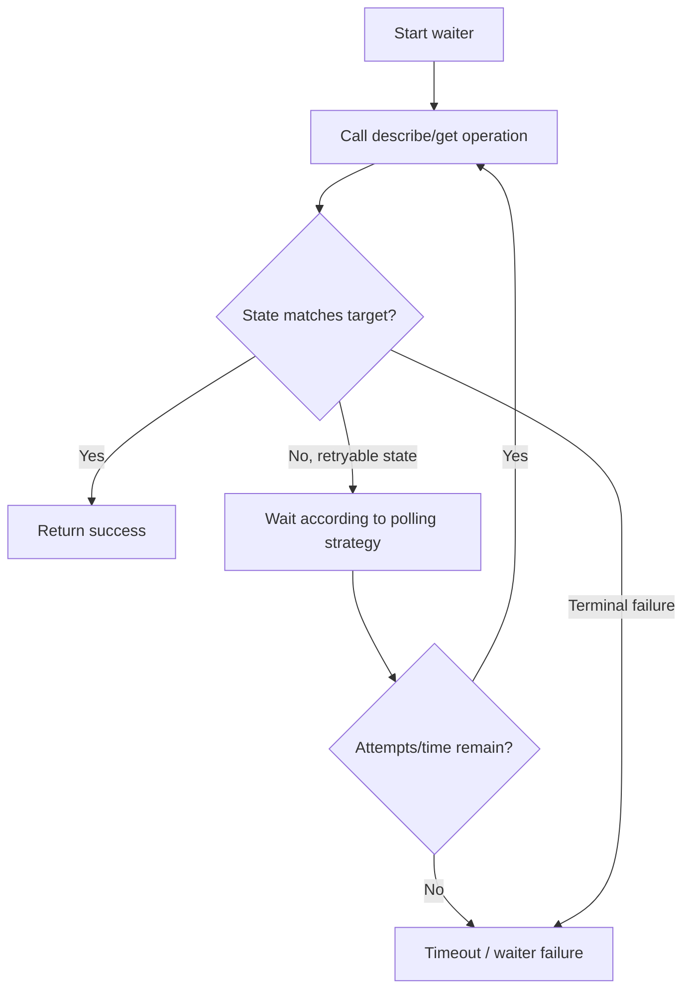

# Paginators, Waiters, and Multi-Page Result Handling in AWS SDK for Java v2

When an application calls AWS APIs, **a single response does not always contain the entire result set**. A service may limit how many records it returns in one call and provide a token to fetch the next page. For example, S3 returns `NextContinuationToken`, DynamoDB returns `LastEvaluatedKey`, and EC2 uses `NextToken`. Reading only the first response can silently drop data.

**Paginators** in AWS SDK for Java v2 iterate across multiple pages by automatically sending follow-up requests and exposing results either page-by-page or item-by-item. **Waiters** solve a different problem: after creating a table, launching an instance, or initiating an asynchronous operation, the application needs to wait until the resource reaches a desired state. A waiter automatically polls the API using a polling strategy and stops on success, terminal failure, or timeout.

This lesson belongs to the **AWS SDK for Java** chapter of the **CLOUD_PROVIDERS_AWS** module. Learners will practice using paginators, waiters, and multi-page result handling with AWS SDK for Java v2 in the context of Java applications integrating with S3, DynamoDB, EC2, and other AWS services. The goal is to build clients that **read complete datasets, keep memory usage bounded, wait for resources properly, handle errors, and control costs**.

The running example is a Shop application: listing report objects in S3, querying multiple orders in DynamoDB, and waiting for an EC2 instance to reach the running state. Bucket names, tables, Regions, and IDs are illustrative; substitute your own sandbox resources during hands-on practice.

## 1. Learning Objectives

After this lesson, you will be able to:

1. Explain why AWS APIs paginate and why the first response may not contain all results.
2. Distinguish between page, item, page size, continuation token, and pagination cursor.
3. Use synchronous paginators in AWS SDK for Java v2 to iterate over pages or items.
4. Use async paginators with `S3AsyncClient` and Reactive Streams.
5. Implement manual pagination when needing token control, early stopping, or checkpoint persistence.
6. Distinguish between `NextContinuationToken`, `NextToken`, and `LastEvaluatedKey`.
7. Understand `Limit`, `MaxKeys`, `MaxResults`, the 1 MB page limit, and `FilterExpression` in DynamoDB.
8. Use service waiters to wait until a DynamoDB table, EC2 instance, or other resource becomes ready.
9. Customize `WaiterOverrideConfiguration`, wait timeouts, and polling attempt limits.
10. Distinguish waiter polling from SDK retries, application retries, and fixed sleeps.
11. Handle errors, backend API pagination, concurrency, backpressure, and memory usage.
12. Design labs and production checklists for paginators and waiters.

## 2. Why Is Pagination Needed?

An AWS service can hold thousands, millions, or more resources. Returning everything in one response would inflate payload size, memory, latency, and timeout risk. Consequently, many APIs cap results per call.

Example S3 bucket with 2,500 objects:

```text
Request 1  ──► Page 1: 1,000 objects + token A
Request 2  ──► Page 2: 1,000 objects + token B
Request 3  ──► Page 3:   500 objects + no next token

Total: 2,500 objects
```

If an application reads only page 1, it processes just 1,000 objects without necessarily receiving any error. That is a dangerous logic bug because the program appears to succeed while operating on incomplete data.

### 2.1. Terms to Distinguish

| Term | Meaning |
|---|---|
| **Page** | A subset of results returned by the service in one request |
| **Page size** | Maximum or target number of records per page defined by the API |
| **Pagination token** | Value returned by the service to request the next page |
| **Paginator** | SDK mechanism that automatically sends subsequent requests and iterates results |
| **Item-level iteration** | Iterating individual records across pages |
| **Page-level iteration** | Iterating response pages while keeping page-level metadata |
| **Checkpoint** | Saved state used to resume work after an interruption |
| **Cursor** | Token returned by a backend API to clients for fetching subsequent pages |

### 2.2. Pagination Is Not Client-Side Slicing

Pagination is a **contract between the client and the AWS service**:

1. The client sends an initial request.
2. The service returns a page and possibly a continuation token.
3. The client passes that token in the next request.
4. The service returns the next page according to API semantics.
5. The loop terminates when no token or further page remains.

Never invent offsets like SQL `OFFSET 1000` when the AWS API does not support offsets. Tokens represent a service-managed continuation position.

### 2.3. Not Every API Has a Paginator

The SDK generates paginators for operations marked as paginated in the service model. Some APIs return all results in one response, and some carry tokens without a generated paginator on that specific SDK operation. Check client methods and API references before writing code.

## 3. How Does AWS SDK for Java v2 Provide Paginators?

AWS SDK for Java v2 generates paginators for many service operations. A paginator is typically a **lazy** iterable or publisher:

- Creating the paginator does not immediately fetch all pages.
- When the application begins iterating, the SDK sends the first request.
- When the iterator needs the next page, the SDK automatically passes the prior page's token.
- You can iterate by **response pages** or flatten into **items** if supported by the paginator.

### 3.1. Two Types of Paginators

| Type | Clients | Consumption |
|---|---|---|
| **Synchronous paginator** | `S3Client`, `DynamoDbClient`, `Ec2Client` | `Iterable`, `SdkIterable`, `for` loop, or stream |
| **Asynchronous paginator** | `S3AsyncClient`, `DynamoDbAsyncClient`, `Ec2AsyncClient` | Reactive Streams publisher and subscriber |

Synchronous paginators are easy to read and fit sequential batch jobs or workers. Async paginators fit reactive/non-blocking systems coordinating I/O and backpressure.

### 3.2. Paginators Do Not Preload All Data

Example:

```java
var pages = s3.listObjectsV2Paginator(request);

for (var page : pages) {
    // Each page is requested when the loop needs it.
    process(page);
}
```

This processes sequentially page by page. If code collects everything into a `List` or calls `toList()` on the stream, the application can still consume huge amounts of heap. Paginators fetch data one page at a time; **how you consume the results determines memory usage**.

## 4. Paginator with Amazon S3: ListObjectsV2

S3 `ListObjectsV2` uses:

- Request field `continuationToken`.
- Response field `nextContinuationToken`.
- Response flag `isTruncated`.
- `maxKeys` to limit maximum keys per response (up to 1,000 for `ListObjectsV2`).

SDK v2 provides `listObjectsV2Paginator(...)`.

### 4.1. Maven Dependency

A Java project needs the AWS SDK for Java v2 S3 module and a configured Region/credentials provider. Align SDK versions with the BOM in Maven:

```xml
<dependencyManagement>
  <dependencies>
    <dependency>
      <groupId>software.amazon.awssdk</groupId>
      <artifactId>bom</artifactId>
      <version>2.x.y</version>
      <type>pom</type>
      <scope>import</scope>
    </dependency>
  </dependencies>
</dependencyManagement>

<dependencies>
  <dependency>
    <groupId>software.amazon.awssdk</groupId>
    <artifactId>s3</artifactId>
  </dependency>
</dependencies>
```

`2.x.y` is a placeholder: replace it with a concrete SDK v2 release chosen by your project; never copy this literal into real dependencies. In real projects, the BOM keeps all SDK modules on the same version.

### 4.2. Iterating Page by Page

```java
import software.amazon.awssdk.regions.Region;
import software.amazon.awssdk.services.s3.S3Client;
import software.amazon.awssdk.services.s3.model.ListObjectsV2Request;
import software.amazon.awssdk.services.s3.model.ListObjectsV2Response;

public final class S3PageExample {
    public static void main(String[] args) {
        String bucket = System.getenv("SHOP_REPORT_BUCKET");
        if (bucket == null || bucket.isBlank()) {
            throw new IllegalStateException("SHOP_REPORT_BUCKET is required");
        }

        try (S3Client s3 = S3Client.builder()
                .region(Region.AP_SOUTHEAST_1)
                .build()) {

            ListObjectsV2Request request = ListObjectsV2Request.builder()
                    .bucket(bucket)
                    .prefix("reports/")
                    .maxKeys(500)
                    .build();

            for (ListObjectsV2Response page :
                    s3.listObjectsV2Paginator(request)) {
                System.out.printf(
                        "Page objects=%d truncated=%s%n",
                        page.contents().size(),
                        page.isTruncated());

                page.contents().forEach(object ->
                        System.out.printf("%s %d bytes%n",
                                object.key(), object.size()));
            }
        }
    }
}
```

The paginator fetches the next page automatically as the loop advances. `maxKeys(500)` caps each page request; it does not cap the total number of objects returned across the entire paginator.

### 4.3. Iterating Individual Objects via Flattened Iterable

If you only need the objects, use the generated paginator's `contents()` method:

```java
var request = ListObjectsV2Request.builder()
        .bucket(bucket)
        .prefix("reports/")
        .maxKeys(500)
        .build();

s3.listObjectsV2Paginator(request)
        .contents()
        .forEach(object -> processObject(object.key(), object.size()));
```

This is convenient when page metadata like `isTruncated`, response headers, or request IDs are not needed. When you need page-level control, iterate `ListObjectsV2Response` as shown in the previous section.

### 4.4. Counting Objects Without Collecting Into a List

If you only need the count:

```java
long count = 0;

for (var page : s3.listObjectsV2Paginator(request)) {
    count += page.contents().size();
}

System.out.println("Total objects = " + count);
```

Never call `collect(toList())` just to read `.size()`, as that retains all object metadata in memory. For very large buckets, streaming page-by-page counting keeps memory usage flat.

### 4.5. Prefix and Delimiter

S3 object keys form a flat key namespace; a "folder" is merely a prefix convention. For example:

```text
reports/2026/01/a.csv
reports/2026/01/b.csv
reports/2026/02/c.csv
images/logo.png
```

- `prefix("reports/")` lists only keys starting with `reports/`.
- `delimiter("/")` groups common prefixes to simulate directory listings.
- Pagination may still be necessary even with `prefix` and `delimiter`.

Do not confuse `commonPrefixes()` with objects; when a delimiter is used, responses can contain both `contents` and `commonPrefixes`.

## 5. Paginator with DynamoDB Query

DynamoDB `Query` returns results in pages. A Query response can be bounded by:

- `Limit`: maximum number of items **evaluated** in the request.
- A maximum **1 MB of evaluated data** per Query page.
- `FilterExpression`: filters items after they are read/evaluated.

If more data remains, the response includes `LastEvaluatedKey`. The next request passes that key into `ExclusiveStartKey`.

### 5.1. Generated Query Paginator

```java
import java.util.Map;

import software.amazon.awssdk.services.dynamodb.model.AttributeValue;
import software.amazon.awssdk.services.dynamodb.model.QueryRequest;

var request = QueryRequest.builder()
        .tableName("ShopOrders")
        .keyConditionExpression("PK = :pk")
        .expressionAttributeValues(Map.of(
                ":pk", AttributeValue.builder()
                        .s("CUSTOMER#C42")
                        .build()))
        .limit(100)
        .build();

for (var page : dynamoDb.queryPaginator(request)) {
    System.out.printf(
            "Returned=%d evaluated=%d%n",
            page.count(),
            page.scannedCount());

    page.items().forEach(this::processOrder);
}
```

The paginator fetches pages until `LastEvaluatedKey` is empty. `limit(100)` applies to each Query request/page per API semantics; it **does not mean the whole paginator returns at most 100 items**.

### 5.2. Flattening Items When Page Metadata Is Not Needed

The generated DynamoDB Query paginator can flatten results via `items()`:

```java
dynamoDb.queryPaginator(request)
        .items()
        .forEach(this::processOrder);
```

If you need to inspect `Count`, `ScannedCount`, `ConsumedCapacity`, or `LastEvaluatedKey`, iterate page-by-page instead of using flattened items alone.

### 5.3. Limit Is Not the Final Item Count After Filtering

Suppose:

```text
Limit = 100
Items evaluated = 100
FilterExpression keeps = 7

The page may return:
  Count = 7
  ScannedCount = 100
  LastEvaluatedKey = may be present
```

`FilterExpression` does not make DynamoDB read only 7 items. It is applied after the service evaluates items within the Query page boundary. With a highly selective filter, a page can return few or zero items while still carrying a `LastEvaluatedKey`.

### 5.4. An Empty Page Does Not Necessarily Mean the End

A Query page can:

- Return `Count = 0`.
- Have `ScannedCount > 0`.
- Still return a `LastEvaluatedKey`.

Therefore, when paginating manually, **never stop solely because `items().isEmpty()`**. Rely on `LastEvaluatedKey` to determine whether more pages remain.

## 6. Paginator with EC2 DescribeInstances

EC2 `DescribeInstances` can return many reservations/instances and uses `NextToken` for pagination. SDK v2 includes a generated paginator:

```java
import software.amazon.awssdk.services.ec2.Ec2Client;
import software.amazon.awssdk.services.ec2.model.DescribeInstancesRequest;

var request = DescribeInstancesRequest.builder()
        .maxResults(100)
        .build();

for (var page : ec2.describeInstancesPaginator(request)) {
    page.reservations().forEach(reservation ->
            reservation.instances().forEach(instance ->
                    System.out.printf("%s %s%n",
                            instance.instanceId(),
                            instance.state().nameAsString())));
}
```

The paginator passes `NextToken` from the previous response into the next request. `maxResults(100)` follows EC2 API semantics and does not necessarily equate to 100 instances, as responses group instances into reservations.

## 7. Synchronous Paginators: Page or Item Iteration?

Before using a paginator, determine what your business logic needs:

| Need | Iteration Style |
|---|---|
| Print or process every record | Flattened items such as `contents()` / `items()` |
| Log metadata per response | Iterate page objects |
| Check `ScannedCount` / `Count` | Iterate page objects |
| Save a token checkpoint per page | Iterate page objects |
| Stop as soon as a matching record is found | Item iteration and `break` if supported by iterator |
| Process pages in batches | Page iteration |

### 7.1. Early Stopping

Example finding the first object ending with `.csv`:

```java
String foundKey = null;

for (var object : s3.listObjectsV2Paginator(request).contents()) {
    if (object.key().endsWith(".csv")) {
        foundKey = object.key();
        break;
    }
}
```

The loop exits as soon as a match is found; the paginator does not request remaining pages. However, if early pages contain no match, the SDK keeps fetching pages until one matches or data ends.

### 7.2. Never Iterate a Paginator Twice to Count and Then Process

Paginators are lazy, so each iteration can re-issue requests. For example:

```java
long count = paginator.contents().stream().count();
paginator.contents().forEach(this::process);
```

This snippet can perform two full passes against the service. To count and process in one pass, increment a counter inside the same loop. Never retain an `Iterable` assuming page data is cached.

### 7.3. Never Run Multiple Iterators Arbitrarily on One Paginator

Each iterator can start from the first request and drive its own sequence of API calls. Running multiple concurrent iterators multiplies API calls, increases database load, and duplicates results. Run a single controlled traversal per job, or explicitly partition work by key, prefix, or range.

## 8. Asynchronous Paginators with S3AsyncClient

Async paginators return a Reactive Streams publisher. Unlike synchronous paginators, they do not block the calling thread; subscribers receive pages as they arrive.

### 8.1. Basic Usage

```java
import software.amazon.awssdk.services.s3.S3AsyncClient;
import software.amazon.awssdk.services.s3.model.ListObjectsV2Request;

var request = ListObjectsV2Request.builder()
        .bucket(bucket)
        .prefix("reports/")
        .maxKeys(500)
        .build();

s3Async.listObjectsV2Paginator(request)
        .subscribe(page -> page.contents().forEach(object ->
                processObjectAsync(object.key())));
```

This illustrates the consumer callback; in production, handle errors, completion, and lifecycle explicitly. When using a simple `Consumer` callback, verify how your SDK version's publisher surfaces errors, or use a full `Subscriber` when you need control over backpressure and error signals.

### 8.2. Reactive Streams Subscriber with Backpressure

```java
import org.reactivestreams.Subscriber;
import org.reactivestreams.Subscription;

import software.amazon.awssdk.services.s3.model.ListObjectsV2Response;

s3Async.listObjectsV2Paginator(request)
        .subscribe(new Subscriber<ListObjectsV2Response>() {
            private Subscription subscription;

            @Override
            public void onSubscribe(Subscription value) {
                this.subscription = value;
                this.subscription.request(1);
            }

            @Override
            public void onNext(ListObjectsV2Response page) {
                try {
                    page.contents().forEach(object ->
                            processObjectAsync(object.key()));
                    subscription.request(1);
                } catch (RuntimeException error) {
                    subscription.cancel();
                    logPaginationFailure(error);
                }
            }

            @Override
            public void onError(Throwable error) {
                logPaginationFailure(error);
            }

            @Override
            public void onComplete() {
                logPaginationCompleted();
            }
        });
```

The subscriber requests one page at a time (`request(1)`), providing publisher-level backpressure. If `processObjectAsync` simply enqueues work and returns immediately, it can still flood downstream with thousands of tasks. In that case, bound the worker queue concurrency or request the next page only after the current page finishes processing.

### 8.3. Never Block the Event Loop with Heavy Work

Inside `onNext`, avoid blocking I/O, CPU-heavy parsing, or `Thread.sleep()`. Offload heavy work to a bounded executor/worker pool. When downstream processing fails, decide whether to cancel the subscription, retry the page, or persist a checkpoint to resume.

## 9. Manual Pagination with S3 Continuation Tokens

Generated paginators fit most cases. Manual pagination helps when you need to:

- Persist the continuation token after every page.
- Stop at a defined checkpoint.
- Expose cursor-based pagination in an API.
- Control page sizes and retries per page.
- Support operations without a generated paginator or needing custom logic.

### 9.1. Manual Loop

```java
String token = null;

while (true) {
    var builder = ListObjectsV2Request.builder()
            .bucket(bucket)
            .prefix("reports/")
            .maxKeys(500);

    if (token != null) {
        builder.continuationToken(token);
    }

    var response = s3.listObjectsV2(builder.build());

    response.contents().forEach(object ->
            processObject(object.key()));

    if (!Boolean.TRUE.equals(response.isTruncated())) {
        break;
    }

    token = response.nextContinuationToken();
    if (token == null || token.isBlank()) {
        throw new IllegalStateException(
                "S3 response is truncated but has no continuation token");
    }
}
```

In S3 `ListObjectsV2`, responses expose `isTruncated()` and `nextContinuationToken()`. Production code can check `isTruncated()` to tell whether more pages remain and verify a token is present per the response contract. The loop above illustrates standard termination when the final page has no continuation token.

### 9.2. Persisting Checkpoints Safely

For multi-hour jobs, you can persist:

```text
jobId
bucket
prefix
continuationToken
lastProcessedKey
updatedAt
status
```

Checkpoints should be updated **only after the page has been durably processed**. Saving the token before processing completes risks skipping objects if the process crashes. Processing first and crashing before committing the checkpoint may reprocess the page; therefore side effects must be idempotent.

### 9.3. A Token Is Not an Object Key

A continuation token is an opaque service token. Never decode, edit, or synthesize a token from the last key unless an API explicitly defines that format. Store and pass back the exact value returned by the service.

## 10. Manual DynamoDB Pagination with LastEvaluatedKey

DynamoDB uses a different mechanism from S3:

- Responses return `LastEvaluatedKey`.
- The next request sets `ExclusiveStartKey` to that key.
- Pagination ends when `LastEvaluatedKey` is empty.

### 10.1. Manual Query Loop

```java
import java.util.Map;

import software.amazon.awssdk.services.dynamodb.model.AttributeValue;
import software.amazon.awssdk.services.dynamodb.model.QueryRequest;

Map<String, AttributeValue> startKey = Map.of();
long totalReturned = 0;

do {
    var builder = QueryRequest.builder()
            .tableName("ShopOrders")
            .keyConditionExpression("PK = :pk")
            .expressionAttributeValues(Map.of(
                    ":pk", AttributeValue.builder()
                            .s("CUSTOMER#C42")
                            .build()))
            .limit(100);

    if (!startKey.isEmpty()) {
        builder.exclusiveStartKey(startKey);
    }

    var response = dynamoDb.query(builder.build());

    for (var item : response.items()) {
        processOrder(item);
        totalReturned++;
    }

    startKey = response.lastEvaluatedKey();
} while (!startKey.isEmpty());

System.out.println("Returned items = " + totalReturned);
```

This snippet relies on the SDK returning an empty map for `lastEvaluatedKey()` when no more pages exist, which is standard for SDK v2 collection accessors. When writing a custom wrapper, normalize `null`/empty cases per your wrapper's contract.

### 10.2. Why Not Stop on an Empty Page?

When using `FilterExpression`, DynamoDB may evaluate items and filter out every item on the page. `items()` is then empty even though `LastEvaluatedKey` is populated. Stopping on `items().isEmpty()` misses subsequent pages that contain matching items.

### 10.3. LastEvaluatedKey Must Preserve All Key Attributes

On tables with composite keys or when querying secondary indexes, the key map contains multiple attributes needed to resume. Persist **the entire map** returned by the SDK rather than guessing just `PK` or `SK`.

## 11. Distinguishing Tokens Across Services

There is no single token shared across all AWS APIs:

| Service/API | Response Token | Request Token | Ends When |
|---|---|---|---|
| S3 `ListObjectsV2` | `NextContinuationToken` | `ContinuationToken` | No more pages/tokens (`IsTruncated=false`) |
| DynamoDB `Query`/`Scan` | `LastEvaluatedKey` | `ExclusiveStartKey` | Key is empty |
| EC2 `DescribeInstances` | `NextToken` | `NextToken` | No more token |
| CloudWatch Logs APIs | `nextToken` | `nextToken` | No more token per API |

Never pass an S3 token into a DynamoDB request or treat `LastEvaluatedKey` as an integer offset. Tokens belong to a specific API and must be passed verbatim.

## 12. Page Size, Limit, and MaxResults

Page size influences request count, latency, memory, and cost. However, the exact semantics of `Limit`, `MaxKeys`, and `MaxResults` vary by API:

| API | Field | Meaning |
|---|---|---|
| S3 `ListObjectsV2` | `maxKeys` | Maximum object keys returned in one response |
| DynamoDB `Query` | `limit` | Maximum items evaluated in one request, before filtering |
| DynamoDB `Scan` | `limit` | Maximum items evaluated in one request |
| EC2 `DescribeInstances` | `maxResults` | Maximum results per API semantics; may be grouped by reservation |

**Do not apply the same mental model of `limit=100` across every service.** Read the API documentation for each operation and inspect `Count`, `ScannedCount`, `IsTruncated`, `NextToken`, or `LastEvaluatedKey`.

### 12.1. Small Page Sizes

Pros:

- Smaller responses.
- Lower memory spikes.
- Earlier start of downstream processing.
- Helpful when downstream is slow or concurrency is constrained.

Cons:

- More API requests.
- More network round trips and longer total duration.
- Can increase overhead and throttling if uncontrolled.

### 12.2. Large Page Sizes

Pros:

- Fewer requests in some workloads.
- Fewer round trips when downstream processes quickly.

Cons:

- Larger responses and higher memory pressure.
- Each page takes longer, delaying checkpoints.
- Can trigger downstream bursts if every page fans out many tasks.

### 12.3. There Is No Universal Optimal Page Size

Benchmark with realistic data and concurrency. Measure:

- Request count.
- Actual returned page size.
- p50/p95/p99 latency.
- Heap usage and garbage collection.
- Throttling and retries.
- Downstream processing lag.
- Cost by API call count and data volume processed.

## 13. What Is a Waiter?

Some AWS operations complete **asynchronously**. For example:

- Sending `CreateTable` does not mean the table is `ACTIVE` immediately.
- Sending `RunInstances` does not mean the EC2 instance is ready to serve traffic.
- Creating a bucket or object may require verifying state/visibility before the next step runs.

A **waiter** is a controlled polling mechanism. It repeatedly calls a state-describing operation (such as `DescribeTable` or `DescribeInstances`) under a polling strategy and checks whether the response matches the desired condition.

### 13.1. Waiter Lifecycle



Waiters do not create resources, replace create/update APIs, or guarantee downstream business logic has finished. They solely wait for the resource state the waiter is defined to observe.

### 13.2. How Waiters Differ from Paginators

| Criterion | Paginator | Waiter |
|---|---|---|
| Purpose | Read across multiple pages | Wait for a resource to reach a target state |
| Request pattern | Prior page's token fetches next page | Repeatedly calls a status-checking operation |
| Stop condition | No pagination token remains | Success/failure acceptor matches, or attempts/timeout exhausted |
| Output | Multiple pages or items | A single terminal state and matching response |
| Example | List 20,000 S3 objects | Wait for an EC2 instance to be `running` |

### 13.3. Never Replace Waiters with Thread.sleep()

Common anti-pattern:

```java
Thread.sleep(30_000);
var table = dynamoDb.describeTable(request);
```

This assumes the table is always ready in 30 seconds:

- If ready in 2 seconds, the application wastes 28 seconds waiting.
- If provisioning takes 45 seconds, the code proceeds too early.
- If creation fails permanently, `sleep` never notices.

Waiters inspect actual state, enforce timeouts, and detect terminal failure states per the waiter model.

## 14. Waiter with DynamoDB: Waiting for a Table to Exist

After creating a DynamoDB table, an application can use the generated `DynamoDbWaiter`.

### 14.1. Complete Example

```java
import software.amazon.awssdk.regions.Region;
import software.amazon.awssdk.services.dynamodb.DynamoDbClient;
import software.amazon.awssdk.services.dynamodb.model.CreateTableRequest;
import software.amazon.awssdk.services.dynamodb.model.BillingMode;
import software.amazon.awssdk.services.dynamodb.model.DescribeTableRequest;
import software.amazon.awssdk.services.dynamodb.model.KeySchemaElement;
import software.amazon.awssdk.services.dynamodb.model.KeyType;
import software.amazon.awssdk.services.dynamodb.model.ScalarAttributeType;
import software.amazon.awssdk.services.dynamodb.model.AttributeDefinition;

public final class DynamoDbWaiterExample {
    public static void main(String[] args) {
        try (DynamoDbClient dynamoDb = DynamoDbClient.builder()
                .region(Region.AP_SOUTHEAST_1)
                .build()) {

            String tableName = "ShopOrdersLab";

            dynamoDb.createTable(CreateTableRequest.builder()
                    .tableName(tableName)
                    .attributeDefinitions(
                            AttributeDefinition.builder()
                                    .attributeName("PK")
                                    .attributeType(ScalarAttributeType.S)
                                    .build())
                    .keySchema(
                            KeySchemaElement.builder()
                                    .attributeName("PK")
                                    .keyType(KeyType.HASH)
                                    .build())
                    .billingMode(BillingMode.PAY_PER_REQUEST)
                    .build());

            var waiter = dynamoDb.waiter();
            var describeRequest = DescribeTableRequest.builder()
                    .tableName(tableName)
                    .build();

            var response = waiter.waitUntilTableExists(describeRequest);
            response.matched().response().ifPresent(result ->
                    System.out.println("Table status = "
                            + result.table().tableStatus()));
        }
    }
}
```

`waitUntilTableExists` waits until the table exists according to the waiter's condition. Afterward, the application can inspect `TableStatus` or other required settings. Creating a table above is a sandbox illustration; if the table already exists, `CreateTable` throws a resource-in-use error and the waiter does not turn a create error into success.

### 14.2. Waiting for a Table to No Longer Exist

In cleanup workflows, use the corresponding waiter when provided by the service client:

```java
var waiter = dynamoDb.waiter();
waiter.waitUntilTableNotExists(
        DescribeTableRequest.builder()
                .tableName("ShopOrdersLab")
                .build());
```

Delete only lab resources you own after confirming the account and Region. The waiter waits for post-delete status; it does not verify backups exist or that other consumers no longer depend on the table.

## 15. Waiter with EC2: Waiting for an Instance to Run

After `RunInstances`, an EC2 instance transitions through multiple states. Applications wait for `running` before proceeding; however, `running` **does not mean the application inside the OS is healthy**.

### 15.1. Ec2Waiter Example

```java
import java.time.Duration;
import java.util.List;

import software.amazon.awssdk.regions.Region;
import software.amazon.awssdk.services.ec2.Ec2Client;
import software.amazon.awssdk.services.ec2.model.DescribeInstancesRequest;
import software.amazon.awssdk.services.ec2.model.Instance;
import software.amazon.awssdk.services.ec2.model.Reservation;
import software.amazon.awssdk.core.waiters.WaiterOverrideConfiguration;

public final class Ec2WaiterExample {
    public static void main(String[] args) {
        String instanceId = System.getenv("EC2_INSTANCE_ID");
        if (instanceId == null || instanceId.isBlank()) {
            throw new IllegalStateException("EC2_INSTANCE_ID is required");
        }

        try (Ec2Client ec2 = Ec2Client.builder()
                .region(Region.AP_SOUTHEAST_1)
                .build()) {

            var request = DescribeInstancesRequest.builder()
                    .instanceIds(instanceId)
                    .build();

            var override = WaiterOverrideConfiguration.builder()
                    .maxAttempts(30)
                    .waitTimeout(Duration.ofMinutes(10))
                    .build();

            var waiter = ec2.waiter();
            var result = waiter.waitUntilInstanceRunning(request, override);

            result.matched().response().ifPresent(response ->
                    response.reservations().stream()
                            .map(Reservation::instances)
                            .flatMap(List::stream)
                            .map(Instance::instanceId)
                            .forEach(id ->
                                    System.out.println("Running: " + id)));
        }
    }
}
```

`maxAttempts` and `waitTimeout` bound waiting; the waiter stops when the condition succeeds or either limit is reached. Choose realistic values based on provisioning time and system SLOs rather than setting infinite limits to mask failures.

### 15.2. Instance Running Does Not Mean Application Healthy

`waitUntilInstanceRunning` only verifies that the EC2 state is `running`. It does not verify whether:

- The OS has finished booting.
- User data / cloud-init scripts have completed.
- The Java process has bound its port.
- Load balancer health checks report healthy.
- The application has connected to databases and dependencies.

When a workflow requires application readiness, pair the EC2 waiter with **SSM, health endpoints, ALB target health, or application readiness checks**. Define clear readiness criteria per layer.

## 16. Waiter with S3

S3 client v2 includes generated waiters for states such as bucket/object existence or non-existence (depending on service API and SDK version). For example, waiting for an object to appear after upload:

```java
import software.amazon.awssdk.services.s3.S3Client;
import software.amazon.awssdk.services.s3.model.HeadObjectRequest;

var waiter = s3.waiter();
var request = HeadObjectRequest.builder()
        .bucket(bucket)
        .key("reports/daily.csv")
        .build();

var result = waiter.waitUntilObjectExists(request);
result.matched().response().ifPresent(head ->
        System.out.println("Object size = " + head.contentLength()));
```

The waiter polls with the appropriate status API (such as `HeadObject`) until the object becomes visible or hits timeout/failure. Check which waiter methods are available in your specific SDK version and service client.

## 17. Customizing Waiters

SDK v2 provides `WaiterOverrideConfiguration` to tune waiting behavior for a single waiter call.

### 17.1. maxAttempts and waitTimeout

```java
import java.time.Duration;

import software.amazon.awssdk.core.waiters.WaiterOverrideConfiguration;

var override = WaiterOverrideConfiguration.builder()
        .maxAttempts(20)
        .waitTimeout(Duration.ofMinutes(5))
        .build();

var result = dynamoDb.waiter().waitUntilTableExists(
        describeRequest,
        override);
```

- `maxAttempts`: maximum polling checks per waiter configuration.
- `waitTimeout`: overall waiting time budget.
- Whichever limit—attempts or timeout—is reached first ends the waiter with a failure/timeout.

### 17.2. Choosing Timeouts by Workflow

| Task | Timeout Approach |
|---|---|
| Waiting for a new table to become ACTIVE in lab | Based on provisioning time, with an explicit cap |
| Waiting for EC2 `running` | Based on instance type/boot behavior and workflow deadline |
| Waiting for an object to appear after upload | Based on pipeline SLA, usually shorter than provisioning |
| Waiting for cluster/database readiness | Based on resource creation time and deployment window |

Do not put a 30-minute timeout on every operation just to cut failures. Overly long timeouts tie up jobs/HTTP threads, hide failed states, and slow pipelines.

### 17.3. Default Polling Strategy

Generated waiters use polling strategies and acceptors defined in the service model/SDK. Do not assume every waiter polls at the same fixed interval or attempt limit. When tight control is needed, apply supported overrides, measure real durations, and consult that service waiter's documentation.

### 17.4. Waiter Failures and Exception Handling

A waiter can terminate because:

- The desired state was reached.
- The resource entered an invalid terminal state.
- `maxAttempts` was exhausted.
- `waitTimeout` expired.
- A non-retryable service/API error or client/configuration error occurred.

Applications should log resource ID, Region, waiter name, elapsed time, attempt context if available, and exception type. Separate retryable timeouts in business workflows from terminal states that require operator intervention.

## 18. Waiter, SDK Retry, and Application Retry Are Three Separate Layers

| Mechanism | Goal | Example |
|---|---|---|
| **SDK retry** | Resend an API call that hit a transient error like throttling or 5xx per retry strategy | `DescribeTable` request hits a transient error |
| **Waiter polling** | Repeatedly call a status-check API until an acceptor matches | Table is still `CREATING`, so keep polling |
| **Application retry** | Retry a business operation per application idempotency and policy | Report-generation job retried after a crash |

A single waiter call executes multiple polls; each poll request goes through SDK retry logic if that API call encounters transient errors. Total requests can therefore exceed waiter attempt counts in some situations. Configure timeouts, retry modes, and logging for predictable behavior.

### 18.1. Never Retry Validation Errors Infinitely

- `ValidationException`: invalid request or schema—fix the input.
- `AccessDeniedException`: inspect IAM/SCP/endpoint policies—do not retry relentlessly.
- `ResourceNotFoundException`: verify resource name, account, Region, and expected state.
- Throttling/transient service errors: rely on appropriate SDK retries/backoff.
- Waiter timeout: inspect resource status, events, and provisioning logs before deciding to retry.

### 18.2. Avoid Duplicating Side Effects

Waiters merely observe state, whereas application retries re-run create/update operations. If an operation is not idempotent or fails to check existing resources, retrying can create duplicate resources or conflicts. Use deterministic resource names/IDs, conditional operations, and reconciliation before retrying.

## 19. Pagination in Java Backend REST APIs

Backends rarely want to return tens of thousands of records in one response. Instead, an API can return:

```json
{
  "items": [
    {"key": "reports/2026/01/a.csv"},
    {"key": "reports/2026/01/b.csv"}
  ],
  "nextCursor": "opaque-cursor-value"
}
```

The client passes the cursor in the next request:

```text
GET /api/reports?limit=100&cursor=opaque-cursor-value
```

The backend decodes/validates the cursor, calls the AWS API with the underlying token, and returns the next page.

### 19.1. Cursors Must Be Bound to Query Context

A cursor should bind to:

- The queried service, table, bucket, or index.
- The authenticated tenant/customer.
- Filters, prefixes, sort order, and parameters affecting results.
- The AWS-returned pagination token.
- Page size policy and cursor format version.
- An expiration timestamp if the API bounds cursor lifetime.

If a client changes filters or tenant while reusing an old cursor, the backend must reject the mismatched cursor. Never let clients supply raw `ExclusiveStartKey` or continuation tokens directly to access out-of-scope data.

### 19.2. Never Expose Raw Tokens as Access Capabilities

AWS pagination tokens are not authorization credentials. Even though tokens are often opaque, the backend must still enforce IAM and business authorization on every request. Encrypt or sign cursors to prevent tampering and bind them to tenant/query context.

### 19.3. Enforce Page Size Limits on the Server

Never trust a `limit` sent by a browser. For example:

```java
int pageSize = Math.max(1, Math.min(requestedLimit, 100));
```

The server sets min/max bounds tailored to the workload. If a client sends `limit=1000000`, never forward that value to the service API or accumulate millions of records on the heap.

### 19.4. Cursors Do Not Replace Authorization

Suppose user C42 receives a cursor for customer C42's query. User C89 must never be allowed to pass that cursor to read C42's data, or vice versa. Every page request must authenticate the caller and verify the cursor's tenant context against the verified identity.

## 20. Pagination Is Not a Snapshot Transaction

Paginators issue multiple requests over time. Meanwhile, the underlying dataset can change:

- S3 objects may be added, deleted, or overwritten between page requests.
- DynamoDB items may be inserted, deleted, or updated while a Query progresses.
- EC2 instances may change state or terminate between Describe calls.

Therefore, **standard pagination does not inherently provide a point-in-time consistent snapshot**.

### 20.1. Example of Missing or Duplicate Items

```text
T0: Page 1 read keys A ... J
T1: A new object is added in a sort position before the cursor
T2: Page 2 continues with the old token
T3: Result depends on service/listing semantics
```

For jobs requiring an exact dataset at a point in time:

- Use immutable datasets or versioned manifests/inputs.
- Record timestamps/snapshots and query scope.
- For DynamoDB, consider point-in-time export-to-S3 when suited to the use case.
- Use event/change logs to capture mutations occurring during the batch run.
- Design processing to be idempotent and reconcilable.

### 20.2. Never Assume a Paginator Delivers Exactly Once

If a job crashes after applying side effects but before saving its checkpoint, the page will be re-read. If the checkpoint is saved before processing completes, records can be skipped. Follow the order:

1. Read page.
2. Process records idempotently.
3. Persist results durably.
4. Only then commit the checkpoint/token.

This is a standard rule for batch jobs; exact transaction boundaries depend on where checkpoints and business results are stored.

## 21. Error Handling for Paginators

Paginators automate sending follow-up requests, but cannot guarantee every page succeeds unconditionally. A mid-stream page can still fail due to network issues, throttling, credentials, resource changes, or service errors.

### 21.1. Error Categories

| Error | Handling |
|---|---|
| Transient throttling / 5xx | Let SDK retry per retry strategy; if still failing, resume from checkpoint |
| `AccessDenied` | Inspect IAM/resource/SCP/endpoint policies; do not retry infinitely |
| `ValidationException` | Fix request/schema/key/token format |
| `ResourceNotFound` | Verify table/bucket/Region and lifecycle |
| Expired/invalid application cursor | Require client to restart pagination |
| Downstream processing failure | Pause/bound concurrency, retry idempotently, or record failed item |
| Waiter timeout | Inspect resource state and provisioning events |

### 21.2. Retry the Page or Restart from the Beginning?

If the job tracks checkpoints, save the **next page's token only after the current page succeeds**. When fetching the next page exhausts SDK retries on transient errors, resume from the committed token.

Never persist a new checkpoint before the current page is durably processed. If a job lacks checkpoints, restarting from the beginning may replay side effects, so ensure processing is idempotent.

### 21.3. Retrying Must Not Alter the Token

When retrying a page request after a network error, keep the exact request context and token for that page. Never substitute a token from another page or fabricate a new offset. If a response is lost after the service handled the request, idempotent processing and checkpoints protect correctness.

## 22. Performance, Memory, and Cost

Every subsequent page is an additional API request. Pagination avoids huge single responses, but does not eliminate total record volume or total API cost.

### 22.1. Estimating Request Count

Suppose S3 holds 25,000 objects and `maxKeys=1,000`:

```text
Approximate pages = ceil(25,000 / 1,000) = 25

Each page requires one ListObjectsV2 request.
If the job restarts from the beginning, requests may be issued again.
```

This estimate assumes maximum page fill; actual page counts may be higher depending on delimiters, prefixes, service behavior, or changing data.

### 22.2. Never Collect Everything

Avoid writing:

```java
List<S3Object> allObjects =
        s3.listObjectsV2Paginator(request)
                .contents()
                .stream()
                .toList();
```

when a bucket can hold millions of objects. That pulls all metadata onto the heap. Instead, process each object or page incrementally and persist only what is needed.

### 22.3. Cap Concurrency

If every object spawns an asynchronous task:

```text
1 page = 1,000 objects
1,000 objects -> 1,000 downstream tasks
10 pages -> 10,000 tasks if enqueued unbounded
```

Publisher-level backpressure in a paginator does not automatically bound your application's downstream queues. Use bounded executors, semaphores, reactive operators with concurrency limits, or page-at-a-time processing.

### 22.4. Metrics to Track

Record:

- Pages requested/succeeded/failed.
- Items evaluated/returned/processed.
- API latency and retry counts.
- Checkpoint age and job progress.
- Waiter elapsed time, attempts, and timeouts.
- Heap, GC, worker queue depth, and downstream error rates.
- S3/DynamoDB/EC2 request costs by workload.

Never log raw credentials or customer data inside cursors/tokens. Log job IDs, page sequence numbers, and categorized/redacted resource identifiers.

## 23. Common Implementation Pitfalls

| Mistake | Consequence | Fix |
|---|---|---|
| Reading only the first response | Silently drops data | Use a paginator or manual token loop |
| Stopping DynamoDB on an empty page | Misses pages after selective filters | Check `LastEvaluatedKey` |
| Treating DynamoDB `Limit` as post-filter result count | Fewer records returned than expected | Distinguish evaluated/returned and paginate |
| Using an S3 key as continuation token | Next request fails or skips | Pass `NextContinuationToken` verbatim |
| Collecting all items into a `List` | Heap spikes, GC pressure, `OutOfMemory` | Stream/process page-by-page |
| Iterating a paginator twice | Duplicates AWS API calls | Count and process in a single pass |
| Fixed `Thread.sleep()` to wait for resources | Wastes time or proceeds too early | Use generated waiters |
| Infinite waiter timeout | Jobs hang and pin resources | Set `maxAttempts` / `waitTimeout` |
| Treating EC2 `running` as app healthy | Workflow runs before app readiness | Add application-layer health checks |
| Retrying condition/validation errors endlessly | Wastes requests and masks bugs | Classify exceptions properly |
| Saving checkpoint before processing page | Risks losing records on crash | Commit checkpoint after durable side effects |
| Returning raw cursors without tenant binding | Risk of cross-tenant access | Sign/bind cursors and authorize every request |
| Using waiters to verify business logic | Misjudges system health | Define proper application health checks |

## 24. Lab: S3 Paginator and DynamoDB Waiter

This lab uses a **sandbox AWS account** and synthetic data. Creating buckets/tables can incur charges and requires IAM permissions. Never run on production or shared resources without owner approval.

### 24.1. Preparation

| Component | Illustrative Value |
|---|---|
| Region | `ap-southeast-1` |
| S3 bucket | `shop-sdk-pagination-lab-<unique-suffix>` |
| S3 prefix | `reports/` |
| DynamoDB table | `ShopOrdersLab` |
| DynamoDB key | `PK` (String) |
| Java | JDK 17+ for `var` examples |
| SDK | AWS SDK for Java v2, aligned via BOM |
| Credentials | IAM Identity Center/profile or sandbox role |

Before starting:

1. Run `aws sts get-caller-identity`.
2. Confirm the account is a sandbox.
3. Verify the Region and required S3/DynamoDB permissions.
4. Create a Maven project with S3 and DynamoDB dependencies.
5. Use environment variables or profiles; never hardcode credentials.

### 24.2. Step 1 — Prepare S3 Objects

Create a dedicated lab bucket and upload more than 1,000 small objects under prefix `reports/`. Generate test files with a separate script using sequential names for easy verification:

```text
reports/0001.json
reports/0002.json
...
reports/1200.json
```

Files do not need large contents; the goal is having more keys than fit in a small page.

### 24.3. Step 2 — Run the Paginator with a Small Page Size

Run the S3 paginator code from Section 4.2 with `maxKeys(100)`. Record:

- Number of pages iterated.
- Total objects.
- First and last pages.
- Total request count from logs/metrics if available.

Expected: the paginator continues until all object keys under the prefix are read.

### 24.4. Step 3 — Compare Flattened Items

Use `contents()` from Section 4.3 to process each object. Compare results with page-level iteration. Ensure you iterate only once so you do not re-issue all requests.

### 24.5. Step 4 — Manual S3 Pagination

Run the manual loop from Section 9.1. Observe `nextContinuationToken` after each page (do not record raw tokens in shared documents if restricted by policy). Compare the total object count with the generated paginator.

### 24.6. Step 5 — Create a DynamoDB Table and Waiter

Use `CreateTableRequest` from Section 14.1 with a dedicated lab table name. After sending the create request, call `waitUntilTableExists`. Record:

- Time elapsed from sending `CreateTable` until waiter success.
- Response `TableStatus`.
- Behavior if the table already exists and `CreateTable` fails.

Do not delete the table before confirming data is no longer needed.

### 24.7. Step 6 — Load Multiple DynamoDB Items

Insert a batch of sample items sharing a partition key or spanning multiple partition keys per lab schema. Use `PutItem`/`BatchWriteItem` as appropriate; if using `BatchWrite`, retry `UnprocessedItems` with backoff.

### 24.8. Step 7 — Query Multiple Pages

Run `queryPaginator` from Section 5.1 with `limit(10)` and record:

- Page count.
- Total `Count`.
- Total `ScannedCount`.
- Processed item count.
- Which pages contain `LastEvaluatedKey`.

Next, add a highly selective `FilterExpression` and observe pages returning few or zero items while still carrying `LastEvaluatedKey`.

### 24.9. Step 8 — Test Waiter Timeout in Sandbox

Configure a small `maxAttempts` in a scenario where the target state cannot match yet, or against a controlled test resource. Observe the exception/result and log elapsed time. Never intentionally break production resources to trigger timeouts.

### 24.10. Step 9 — Clean Up Resources

After verifying the account, Region, and that you own the resources:

- Delete S3 objects under the lab prefix.
- Delete the lab bucket if no longer needed.
- Delete the lab DynamoDB table if no longer needed.
- Revoke any temporary IAM policies/roles created solely for the lab.

Never delete shared buckets/tables or resources you do not own.

### 24.11. Lab Evidence

| Evidence | What to Prove |
|---|---|
| S3 page logs | Paginator reads completely across multiple pages |
| Generated vs. manual pagination | Both approaches yield the exact same result set |
| DynamoDB page counts | Understanding of `Count` vs. `ScannedCount` |
| Empty filtered page with token | Loop does not stop solely on an empty page |
| Waiter result | Table reached the exists condition |
| Waiter timeout case | Understanding of limits and failure handling |
| Checkpoint/cursor design | Safe resumption and protected pagination state |

## 25. Self-Check Exercises and Suggested Answers

### Exercise A — Why Is a Paginator Needed?

An S3 bucket has 4,500 objects. The first request returns 1,000 keys and `IsTruncated=true`. A developer processes only the first response.

**Answer:** The application processes only 1,000 of 4,500 objects and silently skips 3,500 objects. Use `listObjectsV2Paginator` or a manual continuation-token loop.

### Exercise B — Which Token Belongs to Which Service?

| Token | API |
|---|---|
| `NextContinuationToken` | S3 `ListObjectsV2` |
| `LastEvaluatedKey` | DynamoDB `Query`/`Scan` |
| `NextToken` | EC2 `DescribeInstances` |

**Answer:** Tokens are part of each API's contract; never interchange them or synthesize them from offsets.

### Exercise C — What Does DynamoDB Limit=100 Mean?

A Query specifies `Limit=100`, and `FilterExpression` retains only 4 items.

**Answer:** `Limit` caps evaluated items per request; `Count` can be 4 while `ScannedCount` is 100. The response may still include `LastEvaluatedKey`.

### Exercise D — Does an Empty Page Mean the End?

A Query page returns `items=[]` while `LastEvaluatedKey` is non-empty.

**Answer:** Not done yet. Continue requesting with `ExclusiveStartKey`; `FilterExpression` simply filtered out every item on that page.

### Exercise E — Why Not Collect All Objects?

A bucket contains 5 million objects. Code calls `contents().stream().toList()`.

**Answer:** Holds all object metadata in heap, drives GC pressure, and risks `OutOfMemory`. Process page-by-page or item-by-item and persist results in batches.

### Exercise F — Waiter vs. Thread.sleep?

A developer calls `CreateTable` and then sleeps 30 seconds before writing data.

**Answer:** Table creation time varies; sleeping wastes time or runs prematurely. Use `DynamoDbWaiter.waitUntilTableExists` with bounded timeout and attempts.

### Exercise G — Is EC2 Running Enough?

The waiter reports the EC2 instance is `running`, yet the Java API on the instance is unresponsive.

**Answer:** `running` is an EC2 lifecycle state, not proof that the OS, user data, or application is healthy. Add readiness checks via SSM, health endpoints, or load balancer target health.

### Exercise H — Does a Waiter Timeout Cancel CreateTable?

A waiter times out after `CreateTable` was accepted.

**Answer:** A waiter timeout only means the application stopped waiting per policy. It does not cancel the resource operation or roll back `CreateTable`. Check table status before deciding next steps.

### Exercise I — SDK Retry or Waiter?

`DescribeTable` throttles once, then returns `CREATING` several times, then `ACTIVE`.

**Answer:** SDK retry recovers from the transient throttling error on that request; the waiter keeps polling while the table remains `CREATING` until it becomes `ACTIVE`.

### Exercise J — When to Persist a Checkpoint?

A batch job saves the new continuation token before writing page results to the database, then crashes.

**Answer:** The job may skip unwritten records. Process pages idempotently and commit checkpoints only after side effects are durable.

### Exercise K — Is a Cursor Authorization?

Client C89 sends a cursor issued to C42.

**Answer:** The backend must authenticate the caller and bind cursors to tenant/query context. Tokens do not replace IAM or business authorization.

### Exercise L — Does an Async Paginator Bound Worker Queues?

A publisher emits a 1,000-object page; each object enqueues a task into an unbounded executor.

**Answer:** No. Publisher backpressure only paces publisher demand; downstream queues can still grow unbounded. Use bounded executors/concurrency caps and request the next page when appropriate.

### Exercise M — Why Are Multiple Pages Not a Snapshot?

While a Query paginator runs, items are added and deleted.

**Answer:** Page requests execute at different points in time; pagination is not inherently a snapshot transaction. When a point-in-time view is required, use snapshots/exports/manifests or appropriate versioning.

### Exercise N — Calculating Page Count

S3 has 12,500 keys with `maxKeys=500`.

**Estimated answer:** `ceil(12,500 / 500) = 25` pages if every response returns 500 keys. Actual counts may be higher if the service returns fewer keys due to conditions or request behavior.

## 26. Production Checklist for Paginators and Waiters

### Pagination

- [ ] Verified whether the operation has a generated paginator in the active SDK version.
- [ ] Distinguished page-level vs. item-level iteration.
- [ ] Never assumed a single response contains the full result set.
- [ ] Used the exact token field required by each service API.
- [ ] DynamoDB continues whenever `LastEvaluatedKey` is present, even on filter-emptied pages.
- [ ] Understood `Limit`/`MaxKeys`/`MaxResults` per API.
- [ ] REST API pagination cursors are bound to query and tenant context.
- [ ] Clients cannot tamper with raw tokens or key maps.
- [ ] Large datasets are never collected into heap lists.
- [ ] Bounded concurrency and backpressure are enforced for async processing.
- [ ] Checkpoints are committed only after pages are durably processed.
- [ ] Side effects are idempotent when pages are replayed.
- [ ] Concurrent mutations between pages are accounted for; pagination is not assumed to be a snapshot.
- [ ] Metrics track page counts, item counts, retries, latency, and job progress.

### Waiters

- [ ] Generated waiters are used where the service SDK models the target state.
- [ ] Fixed `Thread.sleep()` is never used as a readiness mechanism.
- [ ] `maxAttempts` and `waitTimeout` are tuned to workflow/SLO.
- [ ] Waiter success is distinguished from application readiness.
- [ ] Terminal states, waiter timeouts, and API exceptions are handled explicitly.
- [ ] Resource ID, Region, elapsed time, and error types are logged.
- [ ] Validation and access-denied errors are never retried infinitely.
- [ ] Waiter timeouts are understood not to cancel accepted resource operations.
- [ ] Idempotency and reconciliation protect create/update retries.
- [ ] Async waiters are used only where supported by the service client and SDK version.

### SDK and Operations

- [ ] AWS SDK for Java v2 BOM aligns all module versions.
- [ ] IAM roles/temporary credentials are used instead of hardcoded keys.
- [ ] Client lifecycles and connection pooling are properly managed.
- [ ] Retry strategies and waiter strategies are configured deliberately and separately.
- [ ] API page sizes have enforced min/max bounds and benchmarks.
- [ ] S3/DynamoDB/EC2 API call counts and costs are monitored.
- [ ] Labs/tests cover final pages, empty pages, invalid tokens, throttling, and timeouts.
- [ ] Runbooks exist to resume or restart failed pagination jobs.

## 27. Summary

In AWS SDK for Java v2, **Paginators** and **Waiters** are two tools for managing multi-step API lifecycles cleanly:

```text
Paginator:
  Request page 1
       │
       ▼
  Read page + token
       │
       ▼
  Request next page
       │
       ▼
  Repeat until no token

Waiter:
  Call describe/get
       │
       ▼
  Check expected state
       │
       ├─ Match -> success
       ├─ Retryable state -> poll again
       └─ Timeout/terminal failure -> handle error
```

**Five essential principles:**

1. **Never stop at the first page.** Use paginators or manual token loops to process complete datasets.
2. **Know each API's tokens and page size semantics.** S3 continuation tokens, DynamoDB `LastEvaluatedKey`, and EC2 `NextToken` behave differently.
3. **Handle streaming and checkpoints deliberately.** Never collect large datasets onto the heap, and never commit checkpoints before side effects are durable.
4. **Waiters check infrastructure state, not application health.** EC2 `running` does not prove app readiness; waiter timeouts do not cancel accepted operations.
5. **Retries, pagination, and waiters require idempotency and observability.** Track request counts, page progress, timeouts, retries, downstream lag, and costs.

In the **CLOUD_PROVIDERS_AWS** module, mastering paginators and waiters enables Java applications to read complete datasets from S3/DynamoDB/EC2, wait reliably for resources, recover batch jobs safely, and operate AWS workloads securely, observably, and cost-effectively.

### AWS Reference Documentation

- [AWS SDK for Java 2.x — Paginators](https://docs.aws.amazon.com/sdk-for-java/latest/developer-guide/pagination.html)
- [AWS SDK for Java 2.x — Waiters](https://docs.aws.amazon.com/sdk-for-java/latest/developer-guide/waiters.html)
- [AWS SDK for Java 2.x — Retry strategies](https://docs.aws.amazon.com/sdk-for-java/latest/developer-guide/retry-strategy.html)
- [AWS SDK for Java 2.x — Service clients](https://docs.aws.amazon.com/sdk-for-java/latest/developer-guide/using.html)
- [Amazon S3 — Listing object keys programmatically](https://docs.aws.amazon.com/AmazonS3/latest/API/API_ListObjectsV2.html)
- [Amazon DynamoDB — Query pagination](https://docs.aws.amazon.com/amazondynamodb/latest/developerguide/Query.Pagination.html)
- [Amazon DynamoDB — Query API](https://docs.aws.amazon.com/amazondynamodb/latest/APIReference/API_Query.html)
- [Amazon EC2 — DescribeInstances API](https://docs.aws.amazon.com/AWSEC2/latest/APIReference/API_DescribeInstances.html)
- [Amazon EC2 — Instance lifecycle](https://docs.aws.amazon.com/AWSEC2/latest/UserGuide/ec2-instance-lifecycle.html)
- [Reactive Streams specification](https://www.reactive-streams.org/)
