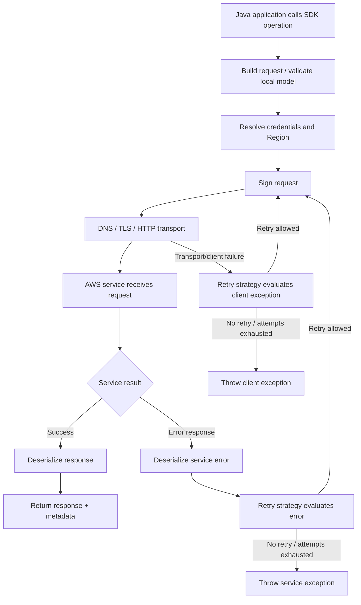
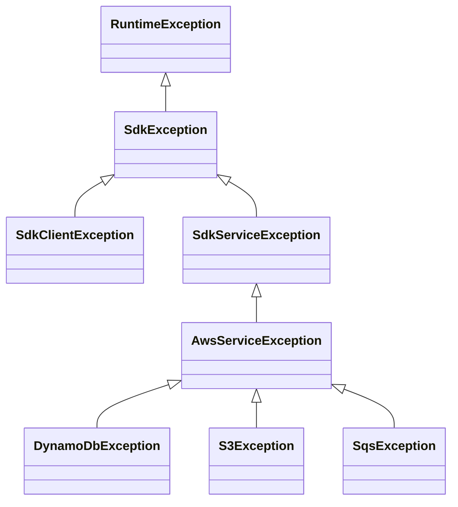
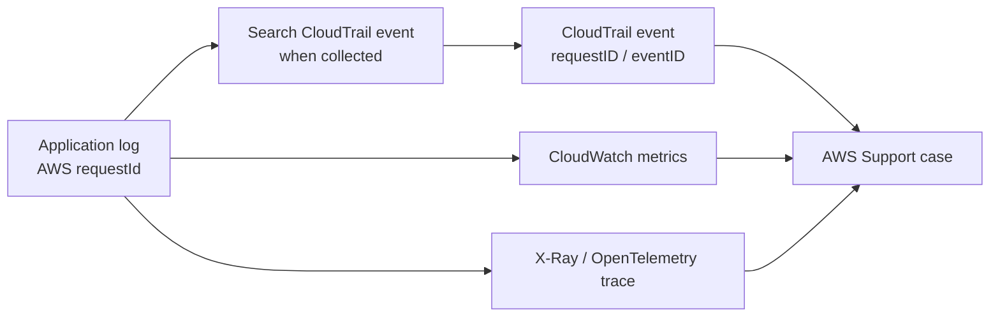

# Exceptions, Request IDs, and Diagnosing SDK Errors

When a Java application calls AWS, a failed request can stem from multiple layers: invalid input data, IAM permissions, Region/endpoint configuration, DNS/TLS/network issues, service throughput limits, or transient AWS-side faults. Simply logging an exception message and retrying every error makes root-cause analysis difficult and can add load while the service is already throttling.

AWS SDK for Java 2.x provides a structured exception hierarchy and response metadata to distinguish **client-side errors** from **errors returned by an AWS service**. For service errors, the **AWS request ID**, error code, and HTTP status are critical lookup fields. This lesson explains how to catch exceptions at the right level, read request IDs from both successful and failed responses, configure retries, log traceably, and diagnose failures layer by layer.

This lesson belongs to the **AWS SDK for Java** chapter of the **CLOUD_PROVIDERS_AWS** module. It connects IAM, Regions/AZs, VPC, EC2/ECS/EKS/Lambda, DynamoDB, S3, SQS, CloudWatch, CloudTrail, X-Ray, and operating Java applications on AWS.

> **Operational principle:** Classify the exception first. If AWS returned an error, log **service + operation + Region + request ID + error code + HTTP status**. If the SDK could not send the request or read the response, there will typically be **no AWS request ID**; in that case inspect the cause chain, credentials, DNS, TLS, and networking. Retry only recoverable errors with safe semantics.

## 1. Learning Objectives

After this lesson, you will be able to:

1. Describe the exception hierarchy of AWS SDK for Java 2.x.
2. Distinguish `SdkException`, `SdkClientException`, `SdkServiceException`, and `AwsServiceException`.
3. Catch exceptions from most specific to most general and avoid masking root causes.
4. Read AWS error codes, HTTP status codes, service names, request IDs, and extended request IDs.
5. Extract request IDs from successful responses via response metadata.
6. Explain how request IDs differ from application correlation IDs, X-Ray trace IDs, and CloudTrail event IDs.
7. Separate input, IAM, network, throttling, transient service, and business errors.
8. Understand automatic retries, standard/legacy/adaptive retry strategies, and backoff.
9. Design idempotency for write operations with uncertain outcomes.
10. Configure per-attempt and total API call timeouts.
11. Write structured logs without exposing credentials, tokens, or sensitive data.
12. Handle exceptions across both synchronous and asynchronous clients.
13. Correlate request IDs with CloudTrail, CloudWatch, X-Ray, and application logs.
14. Follow a diagnostic runbook starting from a production error with a request ID.
15. Test failure scenarios in a sandbox without impacting production.

## 2. Lifecycle of an AWS SDK Request

An SDK call typically flows through these steps:



This diagram highlights two major failure groups:

- **Client-side errors:** the request could not be dispatched, failed to connect, failed to load credentials, timed out, failed TLS/DNS, or failed response deserialization.
- **Service-side errors:** AWS received the request and returned an error response, such as `AccessDeniedException`, `ValidationException`, or `ThrottlingException`.

Successful requests also carry metadata containing a request ID. Thus, **request IDs are useful even when no exception occurs**.

## 3. Exception Hierarchy in SDK for Java 2.x

Core SDK exceptions are unchecked exceptions extending `RuntimeException`. Applications are not forced to declare `throws` on every SDK call.



| Exception | Meaning | Has AWS Error Response? |
| --- | --- | --- |
| `SdkException` | Common base class for SDK exceptions | Not necessarily |
| `SdkClientException` | Error inside SDK/client sending request or handling response | Usually no |
| `SdkServiceException` | Generic service-returned error | Yes |
| `AwsServiceException` | AWS service error with AWS-specific details | Yes |
| `DynamoDbException` | DynamoDB-specific exception | Yes |
| `S3Exception` | Amazon S3-specific exception | Yes |
| `SqsException` | Amazon SQS-specific exception | Yes |

### 3.1. SdkClientException

`SdkClientException` indicates the SDK hit a client-side issue while preparing, sending, or processing a response. Examples:

- Unable to load AWS credentials from the provider chain.
- Unable to resolve the hostname.
- Network unreachable, connection reset, or socket timeout.
- TLS handshake failure due to certificates/truststore.
- Misconfigured endpoint or HTTP client.
- SDK unable to parse the response from transport/service.

Normally the service never returned a structured error response, so **there is no AWS request ID to look up**. Inspect `getCause()` and the full cause chain.

### 3.2. AwsServiceException

`AwsServiceException` represents an error response from an AWS service. The request reached the service, which could not fulfill it.

Key details include:

- HTTP status code.
- AWS error code.
- Error message returned by the service.
- AWS request ID of the failed request.
- Extended request ID for services that provide one.
- HTTP response details via `AwsErrorDetails`.

Usually, the SDK throws a specific subclass such as `DynamoDbException`, `ConditionalCheckFailedException`, `NoSuchKeyException`, or `QueueDoesNotExistException`. Prefer catching subclasses when the application needs specialized handling.

### 3.3. Why Distinguish the Two Groups?

Suppose the same `GetItem` call fails:

- `SdkClientException: Unable to execute HTTP request`: check DNS, routes, proxy, TLS, timeouts, or credentials.
- `DynamoDbException` with `AccessDeniedException`: check IAM, permission boundaries, SCPs, resource policies, or endpoint policies.
- `DynamoDbException` with `ProvisionedThroughputExceededException`: check capacity, partition keys, GSIs, and throttling.
- `DynamoDbException` with `ValidationException`: fix the request or expression.

Catching only `RuntimeException` lumps all of these causes together and prevents choosing the right remediation.

## 4. What Is an AWS Request ID?

An **AWS request ID** is an identifier attached by an AWS service to an API request processed by that service. It helps AWS and operations teams locate the request in the service's internal logs and tracing systems.

Important points:

1. Request IDs are generated service-side, not invented by the application.
2. Each retry attempt is a distinct request and can have its own request ID.
3. The final exception typically surfaces the request ID of the **last attempt that returned a service error**.
4. A request ID by itself does not tell the client the root cause.
5. Request IDs are not access keys, session tokens, or passwords, though they still belong in controlled internal logs.
6. Not every client-side failure has a request ID.
7. Some services also return an `extendedRequestId`; not all services do.

### 4.1. Request ID vs. Other IDs

| ID | Generated By | Purpose |
| --- | --- | --- |
| **AWS request ID** | AWS service | Look up an API request on the AWS side |
| **Extended request ID** | Certain AWS services | Additional service-specific diagnostic identifier |
| **Application correlation ID** | Application / API gateway | Link logs belonging to the same business request |
| **X-Ray trace ID** | AWS X-Ray tracing | Trace requests across multiple services |
| **CloudTrail event ID** | CloudTrail | Identify an event record inside CloudTrail |
| **Idempotency token** | Application / API request | Identify a business intent to prevent duplicate side effects |

Do not reuse an AWS request ID as a business order ID, idempotency token, or system-wide trace ID. Log each identifier in its own field.

### 4.2. Request ID on Successful Responses

AWS service responses generally provide response metadata. DynamoDB example:

```java
GetItemResponse response = dynamoDb.getItem(request);

String requestId = response.responseMetadata() == null
    ? null
    : response.responseMetadata().requestId();

log.info("DynamoDB GetItem completed requestId={}", requestId);
```

`requestId()` comes from the SDK's response metadata. Some service-specific response metadata objects expose extra fields. Do not parse raw HTTP response headers manually when the SDK already provides metadata APIs.

### 4.3. Request ID on Service Exceptions

In SDK v2, call `requestId()` on `SdkServiceException`/`AwsServiceException`:

```java
try {
    dynamoDb.getItem(request);
} catch (DynamoDbException e) {
    String requestId = e.requestId();
    log.error("DynamoDB request failed requestId={}", requestId);
}
```

For services supporting extended request IDs, call `extendedRequestId()` on the service exception. Check the API reference for your exact service and client version.

### 4.4. Request ID on Client-Side Errors

For `SdkClientException`, there is usually no service request ID:

```java
try {
    dynamoDb.getItem(request);
} catch (SdkClientException e) {
    log.error("SDK client failure; no AWS service request ID is expected", e);
}
```

Never fabricate a synthetic string and label it as an AWS request ID. Use an application correlation ID or trace ID to link client logs.

## 5. Reading Error Details from AwsServiceException

`AwsServiceException` exposes `awsErrorDetails()` to inspect service error metadata.

Common accessors:

| Accessor | Contents |
| --- | --- |
| `requestId()` | AWS request ID |
| `extendedRequestId()` | Extended ID if returned by the service |
| `awsErrorDetails().serviceName()` | AWS service name |
| `awsErrorDetails().errorCode()` | Service-returned error code |
| `awsErrorDetails().errorMessage()` | Error message from the service |
| `awsErrorDetails().sdkHttpResponse().statusCode()` | HTTP status code |
| `awsErrorDetails().sdkHttpResponse().headers()` | HTTP response headers |

Example:

```java
import software.amazon.awssdk.awscore.exception.AwsErrorDetails;
import software.amazon.awssdk.services.dynamodb.model.DynamoDbException;

void inspect(DynamoDbException e) {
    AwsErrorDetails details = e.awsErrorDetails();

    String requestId = e.requestId();
    String errorCode = details == null ? null : details.errorCode();
    String serviceName = details == null ? null : details.serviceName();

    Integer statusCode = null;
    if (details != null && details.sdkHttpResponse() != null) {
        statusCode = details.sdkHttpResponse().statusCode();
    }

    log.error(
        "AWS service error service={} requestId={} status={} errorCode={}",
        serviceName, requestId, statusCode, errorCode
    );
}
```

Do not assume every field is non-null on every failure. Write null-safe code and avoid depending on the formatting of `toString()`.

### 5.1. Never Rely on Parsing Messages Alone

Avoid code like:

```java
if (e.getMessage().contains("AccessDenied")) {
    // ...
}
```

Messages can change, may echo input data, and are not a stable contract. Rely on exception types, `errorCode()`, and status codes. Treat messages as supplemental context for operators.

### 5.2. HTTP Status Alone Is Not Enough to Classify

AWS service error codes are a much more accurate guide for action. Do not blindly apply a "never retry 400, always retry 500" rule:

- DynamoDB returns several throttling errors with HTTP 400.
- An HTTP 400 with error code `RequestTimeout` can be classified as transient.
- HTTP 5xx responses are often transient, yet you should still inspect the specific error code.
- `AccessDeniedException` and `ValidationException` generally cannot be resolved by retrying.

**Inspect the error code first, then use HTTP status as supporting context.**

## 6. Common Errors When Calling AWS

### 6.1. Request and Data Errors

| Error Code / Exception | Common Cause | Action |
| --- | --- | --- |
| `ValidationException` | Invalid field, data type, key schema, or expression | Fix the request; do not retry verbatim |
| `ResourceNotFoundException` | Wrong resource name/ARN, Region, or account | Verify resource and endpoint |
| `ConditionalCheckFailedException` | Business condition was no longer met | Handle conflict / business flow |
| `IdempotentParameterMismatchException` | Reused idempotency token with different parameters | Fix token/request logic |
| `TransactionCanceledException` | One or more transaction actions were cancelled | Inspect cancellation reasons if provided |

### 6.2. Permission and Identity Errors

| Error Code / Exception | Check |
| --- | --- |
| `AccessDeniedException` | IAM identity policy, resource policy, permission boundary, SCP, VPC endpoint policy |
| `UnrecognizedClientException` | Credentials, session token, signature, system clock |
| `InvalidSignatureException` / `SignatureDoesNotMatch` | Region, service signing name, clock skew, proxy altering request |
| `ExpiredTokenException` | STS session expired, credential refresh |
| `KMSAccessDeniedException` | KMS key policy, IAM, and encryption context |

Never conclude `AccessDenied` simply means a role lacks one action. Effective permissions may be constrained by SCPs, permissions boundaries, session policies, resource policies, or endpoint policies.

### 6.3. Throttling and Limit Errors

| Error Code / Exception | Investigation Path |
| --- | --- |
| `ThrottlingException` | Service rate limit, account quota, or resource limit |
| `ProvisionedThroughputExceededException` | DynamoDB table/index capacity or hot partition |
| `RequestLimitExceeded` | API/account rate limit |
| `TooManyRequestsException` | High request rate or concurrency exceeding limits |
| `SlowDown` | Services such as S3 requesting rate reduction |

Mitigations include exponential backoff, jitter, reducing concurrency, distributing keys, scaling capacity, or requesting quota increases. Retrying will not fix a workload hammering a single hot partition.

### 6.4. Transient Service Errors

| Error | Action |
| --- | --- |
| `InternalServerError` / `InternalServerErrorException` | SDK retries per strategy; if persistent, capture request IDs and UTC timestamps |
| HTTP 500/502/503/504 | Check error code, retry behavior, and service health |
| `RequestTimeout` | Check client/service timeouts; retry if strategy permits |
| Connection reset / socket timeout | Check networking, client timeouts, and endpoints |

## 7. Client-Side Errors: Inspecting the Cause Chain

`SdkClientException` often wraps an underlying Java or HTTP client exception. For example:

```text
SdkClientException
  └── SdkClientException: Unable to execute HTTP request
       └── UnknownHostException
```

Or:

```text
SdkClientException
  └── SSLHandshakeException
       └── CertificateException
```

Common causes:

| Cause | Check |
| --- | --- |
| `UnknownHostException` | DNS resolver, VPC DNS, endpoint hostname, proxy |
| `ConnectException` | Routes, firewalls, SG/NACL, endpoint, and port |
| `SocketTimeoutException` | Service latency, network path, attempt timeout |
| `SSLHandshakeException` | Truststore, CA, hostname verification, TLS version |
| Credential provider errors | Credentials chain, profile, role, SSO login |
| `SdkClientException` parsing response | Proxy/WAF response, content type, malformed response |
| `ApiCallTimeoutException` | Total API call time exceeded deadline |
| `ApiCallAttemptTimeoutException` | A single attempt exceeded attempt timeout |

### 7.1. Walking the Cause Chain

```java
static Throwable rootCause(Throwable error) {
    Throwable current = error;
    while (current.getCause() != null && current.getCause() != current) {
        current = current.getCause();
    }
    return current;
}
```

Do not log only the root cause while discarding the outer exception. The outer exception carries SDK context; the root cause pinpoints the Java/HTTP-level failure.

## 8. Catching Exceptions in the Right Order

A common pattern:

1. Catch specific business/modeled exceptions first.
2. Catch specific service exceptions.
3. Catch `AwsServiceException` or the service-specific base exception.
4. Catch `SdkClientException`.
5. Catch `SdkException` as a boundary fallback.

DynamoDB example:

```java
try {
    dynamoDb.putItem(request);
} catch (ConditionalCheckFailedException e) {
    // Business conflict: do not blindly retry with the same condition.
    handleConditionConflict(e);
} catch (TransactionCanceledException e) {
    // Analyze cancellation reasons and transaction state.
    handleTransactionCanceled(e);
} catch (DynamoDbException e) {
    // AWS returned a service error response.
    logDynamoDbServiceError(e);
} catch (SdkClientException e) {
    // Client could not complete the request/response path.
    logSdkClientError(e);
} catch (SdkException e) {
    // Fallback for other SDK errors.
    logUnexpectedSdkError(e);
}
```

If `SdkException` is caught before `DynamoDbException`, the subsequent catch blocks become unreachable. Java requires catching subclasses before superclasses.

**Never catch and return default values like `null` or an empty list** if doing so causes the app to report false success. Translate failures into domain errors or let the boundary handle them per policy.

## 9. Service Error Logging Pattern in Java

A useful log entry captures:

- Service and operation.
- Region.
- Application correlation ID / trace ID.
- AWS request ID and extended request ID if available.
- HTTP status and error code.
- Attempt count when exposed by instrumentation.
- SDK version and client name when helpful for investigation.
- Approved resource identifiers, such as a non-sensitive table name.

SLF4J example:

```java
package example.aws;

import org.slf4j.Logger;
import org.slf4j.LoggerFactory;
import software.amazon.awssdk.awscore.exception.AwsErrorDetails;
import software.amazon.awssdk.core.exception.SdkClientException;
import software.amazon.awssdk.services.dynamodb.model.DynamoDbException;

public final class AwsErrorLogger {
    private static final Logger log =
        LoggerFactory.getLogger(AwsErrorLogger.class);

    private AwsErrorLogger() {}

    public static void logDynamoDbFailure(
            String operation,
            String region,
            String correlationId,
            DynamoDbException error) {

        AwsErrorDetails details = error.awsErrorDetails();
        String service = details == null ? "DynamoDB" : details.serviceName();
        String errorCode = details == null ? null : details.errorCode();

        Integer statusCode = null;
        if (details != null && details.sdkHttpResponse() != null) {
            statusCode = details.sdkHttpResponse().statusCode();
        }

        log.error(
            "AWS service call failed service={} operation={} region={} " +
            "correlationId={} requestId={} extendedRequestId={} " +
            "statusCode={} errorCode={}",
            service,
            operation,
            region,
            correlationId,
            error.requestId(),
            error.extendedRequestId(),
            statusCode,
            errorCode
        );
    }

    public static void logClientFailure(
            String operation,
            String region,
            String correlationId,
            SdkClientException error) {

        Throwable root = rootCause(error);

        log.error(
            "AWS SDK client failure operation={} region={} correlationId={} " +
            "rootCauseType={}",
            operation,
            region,
            correlationId,
            root.getClass().getName()
        );

        // Stack traces should only be recorded in controlled internal logs.
        log.debug("AWS SDK client exception details", error);
    }

    private static Throwable rootCause(Throwable error) {
        Throwable current = error;
        while (current.getCause() != null && current.getCause() != current) {
            current = current.getCause();
        }
        return current;
    }
}
```

This is an illustrative example. In real applications, add structured logging/MDC and organizational redaction rules. Never log full request/response bodies just to extract a request ID.

## 10. Capturing Request IDs on Both Success and Failure

DynamoDB `GetItem` example:

```java
import org.slf4j.Logger;
import org.slf4j.LoggerFactory;
import software.amazon.awssdk.core.exception.SdkClientException;
import software.amazon.awssdk.services.dynamodb.DynamoDbClient;
import software.amazon.awssdk.services.dynamodb.model.AttributeValue;
import software.amazon.awssdk.services.dynamodb.model.DynamoDbException;
import software.amazon.awssdk.services.dynamodb.model.GetItemRequest;
import software.amazon.awssdk.services.dynamodb.model.GetItemResponse;

import java.util.Map;

public final class GetItemWithRequestId {
    private static final Logger log =
        LoggerFactory.getLogger(GetItemWithRequestId.class);

    public static void main(String[] args) {
        String table = System.getenv().getOrDefault("DDB_TABLE", "OrdersDemo");

        GetItemRequest request = GetItemRequest.builder()
            .tableName(table)
            .key(Map.of(
                "pk", AttributeValue.builder().s("ORDER#1001").build(),
                "sk", AttributeValue.builder().s("META").build()))
            .consistentRead(false)
            .build();

        try (DynamoDbClient dynamoDb = DynamoDbClient.create()) {
            GetItemResponse response = dynamoDb.getItem(request);

            String requestId = response.responseMetadata() == null
                ? null
                : response.responseMetadata().requestId();

            log.info(
                "GetItem completed table={} requestId={} itemFound={}",
                table,
                requestId,
                response.hasItem()
            );

        } catch (DynamoDbException e) {
            AwsErrorLogger.logDynamoDbFailure(
                "GetItem", "configured-region", "application-correlation-id", e
            );

        } catch (SdkClientException e) {
            AwsErrorLogger.logClientFailure(
                "GetItem", "configured-region", "application-correlation-id", e
            );
        }
    }
}
```

Outcomes:

- On success, the request ID comes from `response.responseMetadata().requestId()`.
- When the service returns an error, the request ID comes from `e.requestId()`.
- When the client never receives a service response, there is normally no request ID.

Never hardcode placeholder strings for Region or correlation ID in production. Pull Region from client configuration and correlation ID from the request context.

## 11. Handling Errors with Asynchronous Clients

With `DynamoDbAsyncClient`, the SDK returns a `CompletableFuture`. Exceptions may be wrapped inside `CompletionException` when the application calls `join()`/`get()`.

```java
import software.amazon.awssdk.core.exception.SdkClientException;
import software.amazon.awssdk.services.dynamodb.DynamoDbAsyncClient;
import software.amazon.awssdk.services.dynamodb.model.DynamoDbException;
import software.amazon.awssdk.services.dynamodb.model.GetItemRequest;

import java.util.concurrent.CompletionException;

static Throwable unwrap(Throwable error) {
    Throwable current = error;
    while ((current instanceof CompletionException)
            && current.getCause() != null) {
        current = current.getCause();
    }
    return current;
}

void readAsync(DynamoDbAsyncClient client, GetItemRequest request) {
    client.getItem(request).whenComplete((response, failure) -> {
        if (failure != null) {
            Throwable cause = unwrap(failure);

            if (cause instanceof DynamoDbException serviceError) {
                logDynamoDbServiceError(serviceError);
            } else if (cause instanceof SdkClientException clientError) {
                logSdkClientError(clientError);
            } else {
                log.error("Unexpected asynchronous failure", cause);
            }
            return;
        }

        String requestId = response.responseMetadata() == null
            ? null
            : response.responseMetadata().requestId();

        log.info("Async GetItem success requestId={}", requestId);
    });
}
```

If `join()` is called later, the failure is rethrown wrapped in `CompletionException`. Unwrap the cause before classifying. In reactive frameworks, handle error signals appropriately and avoid blocking the event loop with `join()`.

## 12. Retry Strategies in SDK for Java 2.x

The SDK provides automatic retries. When a request hits a recoverable error, the SDK can wait via backoff and re-send. The application typically receives either the eventual successful response or the final exception after retries stop.

Errors commonly considered for retry:

- Throttling / rate exceeded.
- Certain transient service errors.
- Certain network errors such as socket timeout or connection reset.
- Certain concurrency / optimistic lock failures per service semantics.

Errors that should normally not be retried verbatim:

- `AccessDeniedException`.
- `ValidationException`.
- `ResourceNotFoundException`.
- `ConditionalCheckFailedException` when business conditions have not changed.
- Requests targeting the wrong Region, account, or resource.

### 12.1. Three Retry Strategies

| Strategy | Characteristics | When to Use |
| --- | --- | --- |
| **Standard** | Exponential backoff, throttling/transient classification, retry quota/circuit breaking | Recommended for most workloads |
| **Legacy** | Backwards-compatible behavior from older versions | When preserving legacy behavior during migration |
| **Adaptive** | Adds a client-side rate limiter driven by throttling feedback | Rate-limited workloads with one client dedicated to one resource |

**Standard** is recommended for most applications. Retry defaults evolve across SDK releases and service clients; do not rely on a retry count cited in an old blog post. Pin your SDK version, read that version's retry guide, and configure explicitly when attempt counts impact SLOs.

### 12.2. maxAttempts Includes the Initial Attempt

Setting `maxAttempts(5)` breaks down as:

- 1 initial attempt.
- Up to 4 retry attempts.

Do not mistake this for 5 retries plus an initial attempt. Total elapsed time also depends on request timeouts and backoff delays.

### 12.3. Configuring the Standard Retry Strategy

```java
import software.amazon.awssdk.core.retry.RetryMode;
import software.amazon.awssdk.services.dynamodb.DynamoDbClient;

DynamoDbClient client = DynamoDbClient.builder()
    .overrideConfiguration(config ->
        config.retryStrategy(RetryMode.STANDARD))
    .build();
```

You can configure max attempts per SLO:

```java
DynamoDbClient client = DynamoDbClient.builder()
    .overrideConfiguration(config ->
        config.retryStrategy(strategy ->
            strategy.maxAttempts(5)))
    .build();
```

This API example targets SDK releases supporting `RetryStrategy`. `RetryStrategy` was introduced in SDK 2.26.0; older code may use `RetryPolicy`. Align dependency versions and follow the migration guide.

### 12.4. Adaptive Retry Can Affect Multiple Resources

The Adaptive strategy assumes one client talks to one resource. If one client is shared across multiple DynamoDB tables, throttling on one table can cause the client-side rate limiter to slow down calls to the other tables.

Use adaptive retry only when resource scope is clear and clients are isolated appropriately. Never turn on adaptive globally just because throttling occurred.

## 13. Retries and Idempotency

Retries improve success rates, but **do not automatically make operations idempotent**.

Dangerous scenario:

1. Application sends a create-payment or create-order command.
2. The AWS service or downstream processes the request.
3. The response is lost on the network.
4. The client times out, unaware whether the operation succeeded.
5. The client resends the request and triggers the side effect a second time.

How to handle this:

- Use idempotency keys for operations with side effects.
- Use DynamoDB conditional writes to avoid creating duplicate records.
- Use `ClientRequestToken` on `TransactWriteItems` where appropriate.
- For SQS FIFO, supply deduplication IDs as required.
- For SQS Standard, design idempotent consumers because messages can be delivered more than once.
- After an ambiguous timeout, read current state by idempotency key before deciding to re-execute.
- Enforce an overall deadline so retries do not outlive the API or transaction timeout.

### 13.1. Do Not Retry Business Conflicts Like Network Errors

For example, `ConditionalCheckFailedException` can mean an order already exists or its version changed. Resending the exact same request without re-reading state usually just repeats the error.

| Error | Handling |
| --- | --- |
| Throttling | SDK backoff/retry; simultaneously adjust capacity or rate |
| Timeout on write with unknown outcome | Check idempotency/state before retrying |
| Conditional check failed | Handle business conflict |
| Validation error | Fix the request |
| Access denied | Fix permissions or policy |
| Temporary 5xx | SDK retry; if persistent, log request ID and UTC timestamp |

## 14. Timeouts: Attempt vs. Full API Call

The SDK configures two primary timeouts:

- **API call attempt timeout:** bounds a single request attempt.
- **API call timeout:** bounds the entire operation, including retries and backoff.

Example:

```java
import java.time.Duration;
import software.amazon.awssdk.services.dynamodb.DynamoDbClient;

DynamoDbClient client = DynamoDbClient.builder()
    .overrideConfiguration(config -> config
        .apiCallAttemptTimeout(Duration.ofSeconds(2))
        .apiCallTimeout(Duration.ofSeconds(8)))
    .build();
```

With this setup, a single attempt is capped at 2 seconds and the full operation is capped at 8 seconds. If the API call timeout expires before the retry strategy finishes, the application receives an overall timeout exception.

### 14.1. Sizing Timeouts to SLOs

- Never set attempt timeouts so short that normal network jitter fails.
- Total API timeout must fit within the outer HTTP request deadline, queue visibility timeout, or Lambda timeout.
- Leave room for retries and backoff when business deadlines allow.
- Ensure upstream timeouts are not shorter than downstream needs.
- Monitor p95/p99 latency, not just averages.

### 14.2. Timeouts Do Not Prove the Service Did Not Execute the Operation

If a client times out after sending a request, the service may have completed it while the response arrived too late. For write operations, always account for ambiguous state and idempotency.

## 15. Diagnosing DynamoDB Errors

DynamoDB is great for practice because it exposes rich modeled exceptions:

| Exception | Cause | Diagnosis |
| --- | --- | --- |
| `ConditionalCheckFailedException` | Condition expression evaluated false at write time | Check version/status and business state |
| `ProvisionedThroughputExceededException` | Insufficient throughput on table/index/partition | CloudWatch consumed/throttle metrics, GSIs, key distribution |
| `ThrottlingException` | Rate/partition/account limit | Error details, table/index ARN, quotas |
| `ResourceNotFoundException` | Wrong table/index or Region | `DescribeTable`, account/Region |
| `ValidationException` | Invalid key/expression/type | Request model, expression attribute names/values |
| `TransactionCanceledException` | An action in the transaction was cancelled | Cancellation reasons, conflicts, conditions |
| `InternalServerErrorException` | Transient service error | Retry strategy, request ID, UTC timestamp |

### 15.1. TransactionCanceledException

A transaction can cancel due to a failed condition check, transaction conflict, capacity limit, or other error. When the SDK/service returns cancellation reasons, inspect each action index corresponding to the items in the transaction.

Never assume every `TransactionCanceledException` is throttling. It may be a business condition failure that should return a conflict to the caller.

### 15.2. Verifying Table and Region

Use the AWS CLI with the matching profile and Region:

```bash
aws sts get-caller-identity --profile training

aws dynamodb describe-table \
  --table-name OrdersDemo \
  --region ap-southeast-1 \
  --profile training
```

If the CLI succeeds while the application fails, compare identity, credential source, Region, endpoint override, VPC routing, and client config. The CLI and Java SDK may be using different profiles or roles.

## 16. Diagnosing S3 and SQS Errors

### 16.1. S3

| Error | What to Check |
| --- | --- |
| `NoSuchBucket` | Bucket name, partition, account, and Region |
| `NoSuchKey` | Object key, encoding, prefix, version |
| `AccessDenied` | IAM, bucket policy, KMS key, access point, VPC endpoint |
| `SlowDown` | Request rate, prefix distribution, SDK backoff |
| `InvalidAccessKeyId` | Credentials provider and account |
| `SignatureDoesNotMatch` | Region, endpoint, clock skew, proxy/header mutation |

S3 can return an **extended request ID**. When engaging AWS Support, include both the request ID and extended request ID if present.

### 16.2. SQS

| Error | What to Check |
| --- | --- |
| `QueueDoesNotExist` | Queue URL, account, and Region |
| `AccessDenied` | `sqs:SendMessage`, `ReceiveMessage`, queue policy |
| `ReceiptHandleIsInvalid` | Use the latest receipt handle from the current receive call |
| `ThrottlingException` | API rate/concurrency, retries/backoff |
| Timeout on `SendMessage` | Outcome may be unknown; design consumer/deduplication |

In particular, SQS Standard guarantees at-least-once delivery. Applications must handle duplicate messages even when the SDK throws no exception.

## 17. Request IDs and CloudTrail

CloudTrail records AWS API events configured for collection. Certain event records include a `requestID` field that matches the request ID returned by the SDK.

However:

- **Management events** and **data events** are distinct categories.
- DynamoDB data-plane operations such as `GetItem`/`PutItem` require enabling appropriate data event collection to be recorded.
- CloudTrail Event history does not store all data-plane requests by default.
- Not all client-side errors generate a CloudTrail event.
- CloudTrail `eventID` is different from `requestID`.

Example investigation flow:



When searching events, filter by UTC timestamp, event source/name, account, and Region, then match `requestID` if present on the event. If no event exists, check data selectors, trail/event data store config, retention, and read permissions.

## 18. Request IDs, CloudWatch, and Tracing

### 18.1. CloudWatch Metrics Are Not Request Logs

CloudWatch service metrics are aggregated over time and dimensions. You can inspect:

- `ThrottledRequests`.
- `SuccessfulRequestLatency`.
- `ConsumedReadCapacityUnits`.
- `ConsumedWriteCapacityUnits`.
- `5xxError`.
- `4xxError` where emitted by the service.

These metrics show when and how severely errors occurred, but usually **cannot be queried directly by AWS request ID**. Use request IDs for service-side investigation, CloudTrail/logs for event context, and metrics to gauge impact scope.

### 18.2. X-Ray and OpenTelemetry

Use trace IDs to follow a user request across API Gateway, Lambda/ECS, SDK calls, and downstream services. In logs, keep fields distinct:

```json
{
  "timestamp": "2026-11-20T03:15:42.120Z",
  "level": "ERROR",
  "service": "orders-api",
  "operation": "DynamoDb.GetItem",
  "region": "ap-southeast-1",
  "correlationId": "app-generated-id",
  "traceId": "1-xxxxxxxx-xxxxxxxxxxxxxxxxxxxxxxxx",
  "awsRequestId": "service-returned-request-id",
  "errorCode": "ProvisionedThroughputExceededException",
  "httpStatus": 400
}
```

This JSON is illustrative, not real request or trace ID values.

### 18.3. Carrying Correlation IDs Across the Application

- API Gateway/Lambda have their own invocation request IDs.
- Java services can accept or generate a correlation ID.
- The SDK returns an AWS request ID per service call.
- X-Ray/OpenTelemetry generate trace IDs.
- CloudTrail records an event ID and request ID when an event is logged.

Keep each identifier in its own dedicated field so the relationship between one user request and multiple AWS API calls stays intact.

## 19. Safe Logging

Good logs aid debugging without exposing data.

### 19.1. What to Log

- UTC timestamp.
- Application/service name and environment.
- Operation name, Region, and approved resource identifiers.
- Exception class.
- AWS error code and HTTP status.
- AWS request ID / extended request ID.
- Application correlation ID / trace ID.
- Retry/attempt details if captured via instrumentation.
- SDK version and HTTP client type when relevant.

### 19.2. What Never to Log

- AWS secret access keys, session tokens, or access tokens.
- `Authorization` headers, SigV4 signatures, or cookies.
- Raw request/response payloads containing PII.
- Passwords, API keys, or database credentials.
- Full S3 presigned URLs containing signatures/tokens.
- Sensitive message or record contents.
- Unfiltered raw exception response bodies.

### 19.3. Messages Can Echo Input Data

Some validation/service errors echo field names, expressions, or input values. Never expose verbatim error messages in public logs or end-user API responses. Log error codes/request IDs alongside sanitized messages, and keep detailed diagnostics in access-controlled internal systems.

## 20. Timeouts, Retries, and End-to-End Latency

An API call can take longer than a single attempt because the SDK executes retries and backoff.

\[
T_{\mathrm{total}} \approx
\sum_{i=1}^{n} T_{\mathrm{attempt},i}
+\sum_{i=1}^{n-1} T_{\mathrm{backoff},i}
\]

Where:

- \(n\) is the number of attempts executed.
- \(T_{\mathrm{attempt}}\) includes network, service, and deserialization time for one attempt.
- \(T_{\mathrm{backoff}}\) is the wait time before each retry.

Illustrative example: 3 attempts taking 500 ms each, with backoffs of 100 ms and 300 ms:

\[
T_{\mathrm{total}} = 3(500) + 100 + 300 = 1,900\ \mathrm{ms}
\]

Thus, an error surfacing after 1.9 seconds can be the sum of multiple attempts, not just the final call.

### 20.1. Separating Latency Layers

| Segment | Signals to Observe |
| --- | --- |
| Application queue/thread pool | Wait time, saturation |
| Credentials/Region resolution | Credential refresh, profile/SSO |
| DNS/TLS/connection pool | Connection creation, handshakes, reuse |
| AWS service response | Service latency, request ID |
| SDK retry/backoff | Attempts, retry delays |
| Serialization/business logic | CPU, payload size, mapping |
| Upstream caller | End-to-end deadline |

Never simply raise timeouts to hide an exhausted connection pool or a throttled service.

## 21. Instrumentation: Knowing How Many Times the SDK Retried

The final exception does not necessarily contain the full attempt history. When you need visibility into every attempt:

- Use an SDK metrics publisher compatible with your SDK version.
- Use `ExecutionInterceptor`/lifecycle instrumentation to record operation and attempt events.
- Record total API call duration, individual attempt durations, and retry counts.
- Never wrap an external retry loop without knowing how many attempts the SDK already performs.
- When instrumenting, avoid recording raw request headers or payloads.

Depending on SDK version, certain retry metrics/attributes may vary in naming or require extra modules. Check the Developer Guide/API Reference for your pinned release.

### 21.1. Retry Quota and Circuit Breaking

The Standard strategy uses a retry quota/token bucket to curb continuous retries when downstream fails heavily. Once the quota is empty, the SDK fails fast instead of fueling a retry storm. Circuit breaking can also disable retries during sustained failure spikes while still letting initial attempts through.

This protects downstream services. Applications should not defeat it by wrapping calls in infinite retry loops.

## 22. AWS CLI vs. Java SDK: Same Request, Different Configuration

When the CLI succeeds and the Java SDK fails, do not jump to blaming the service. The two tools may be using:

- Different credentials providers.
- Different Regions.
- Different profiles or assumed roles.
- Different endpoint overrides or proxies.
- Different retry strategies and timeouts.
- Different VPC/network paths.

Comparison runbook:

1. `aws sts get-caller-identity` with the CLI profile.
2. Compare the CLI Region with the Java client Region.
3. Verify Java uses the expected profile, SSO session, instance/task role, or web identity.
4. Verify effective policies and resource ARNs.
5. Compare endpoint overrides, proxies, and CA truststores.
6. Record the SDK version and retry strategy.
7. Execute the exact same request against the same resource and key.

Example CLI commands:

```bash
aws sts get-caller-identity --profile training

aws dynamodb describe-table \
  --table-name OrdersDemo \
  --region ap-southeast-1 \
  --profile training
```

`aws --debug` can help in sandboxes to inspect HTTP request/response flows, but output is very verbose. Before sharing, strip `Authorization` headers, credentials, tokens, payloads, and signed URLs.

## 23. Runbook: From Production Error to Root Cause

When an AWS SDK error occurs, follow these steps in order:

### Step 1 — Capture Context

- Exact UTC timestamp.
- Application, service, version, and environment.
- Verified AWS account and role.
- Region and endpoint.
- Operation and target resource.
- Application correlation ID and trace ID.

### Step 2 — Classify the Exception

- `AwsServiceException`: the service returned an error response.
- `SdkClientException`: the client failed during send/receive/parse.
- Domain exception: a business rule failed.
- Other exceptions: inspect cause chains and wrappers.

### Step 3 — If It Is a Service Error

Record:

- `requestId()`.
- `extendedRequestId()` if present.
- `awsErrorDetails().serviceName()`.
- `awsErrorDetails().errorCode()`.
- `awsErrorDetails().sdkHttpResponse().statusCode()`.

Never send only the message; request ID and error code are the primary lookup fields.

### Step 4 — If It Is a Client Error

Check:

- Cause chain.
- Credentials provider and token refresh.
- Region and endpoint.
- DNS, TLS, proxy, and routes.
- Attempt timeout and API call timeout.
- Connection pool and HTTP client.

Do not expect an AWS request ID if the request never reached the service.

### Step 5 — Inspect Retry Behavior

- Did the SDK retry?
- Were `maxAttempts` or retry quotas exhausted?
- Could duplicate side effects have occurred?
- Did total duration exceed the upstream deadline?
- Is this a non-retryable business or authorization error?

### Step 6 — Cross-Check Observability

- CloudWatch metrics: did errors/throttling/latency spike at the same time?
- CloudTrail: was the event logged and does `requestID` match?
- X-Ray/OpenTelemetry: which service introduced the latency or error?
- AWS Health/service events: are there active incidents or maintenance?
- Application logs: are many requests affected or only one key/resource?

### Step 7 — Choose Remediation and Verify

- Fix request, IAM, Region, or networking if misconfigured.
- Adjust rate, capacity, or key distribution for throttling.
- Use bounded retries for transient faults.
- Reconcile idempotency if write outcomes are ambiguous.
- Open an AWS Support case when needed, supplying request ID, Region, service, operation, and UTC timestamp.

## 24. Common Exception-Handling Mistakes

| Anti-Pattern | Consequence | Fix |
| --- | --- | --- |
| Catching `Exception` and logging only `getMessage()` | Loses type, request ID, and cause | Catch service, client, and domain errors separately |
| Retrying every exception | Retries validation/access denied and adds load | Decide via error codes and retry strategy |
| Infinite retries | Retry storms and missed deadlines | Bound attempts and total timeout |
| Logging only HTTP status | Misses service error codes | Log both error code and request ID |
| Using request ID as trace ID | Cannot correlate multiple calls | Keep correlation ID and trace ID separate |
| Assuming every error has a request ID | Wastes time searching for nonexistent IDs | Distinguish client errors from service errors |
| Logging full requests/responses | Leaks PII and secrets | Use structured fields and redaction |
| Ignoring `CompletionException` | Fails to match actual exceptions | Unwrap causes in async flows |
| Retrying non-idempotent writes blindly | Creates duplicate side effects | Use idempotency tokens / conditional writes |
| Raising timeouts to hide connection leaks | Increases latency and resource consumption | Monitor pool, transport, and attempt metrics |
| Disabling retries globally | Reduces resilience against transient faults | Tune strategy per workload |
| Sharing one adaptive client across many resources | Throttling on one resource slows others | Isolate clients per resource or use standard |

## 25. Practice Lab: Investigating Orders API Errors

### 25.1. Context

A Spring Boot service on ECS Fargate calls the DynamoDB `Orders` table. Some requests return HTTP 500 with `SdkException` logged and no request ID. Other requests throw `ProvisionedThroughputExceededException`.

### 25.2. Task A — Classify Exceptions

For each scenario:

| Scenario | Suggested Exception |
| --- | --- |
| DNS hostname fails to resolve | `SdkClientException` with `UnknownHostException` cause |
| Role lacks `dynamodb:GetItem` | `DynamoDbException`/`AwsServiceException` with `AccessDeniedException` |
| Wrong key type | `DynamoDbException` with `ValidationException` |
| Table does not exist in selected Region | `ResourceNotFoundException` |
| Provisioned capacity exceeded | `ProvisionedThroughputExceededException` |
| Condition expression evaluates false | `ConditionalCheckFailedException` |
| Service returns temporary internal error | `InternalServerErrorException` or matching service error |

Explain which scenarios have an AWS request ID and why.

### 25.3. Task B — Complete the Log Schema

Use this schema:

```json
{
  "timestamp": "...",
  "application": "orders-api",
  "operation": "DynamoDb.GetItem",
  "region": "...",
  "correlationId": "...",
  "traceId": "...",
  "awsRequestId": "...",
  "extendedRequestId": null,
  "exceptionClass": "...",
  "errorCode": "...",
  "httpStatus": null,
  "attemptCount": null
}
```

Explain which fields come from the exception, response metadata, app context, and SDK metrics. Never populate a synthetic AWS request ID for client-side failures.

### 25.4. Task C — Choose Retry Handling

For each error, decide:

- Automatic retry?
- Fix configuration?
- Return business conflict?
- Requires idempotency?
- Requires request ID investigation?

Never treat `AccessDeniedException`, `ValidationException`, or `ConditionalCheckFailedException` the same way as throttling or transient errors.

### 25.5. Task D — Cross-Check CloudTrail

A service error includes a request ID and UTC timestamp. Check:

1. Are DynamoDB data events enabled?
2. Do event source/name, account, and Region match?
3. Does the CloudTrail event contain `requestID`?
4. Is `eventID` being confused with `requestID`?
5. If no event appears, could it be due to data event selectors, retention, or a client-side failure?

### 25.6. Task E — Async Failure

A `DynamoDbAsyncClient` future completes exceptionally with `CompletionException`. Write code to unwrap the cause and separate `DynamoDbException` from `SdkClientException`. Log the request ID when a service exception occurs.

### 25.7. Task F — Read-Only Audit

If an AWS sandbox is available, gather:

```text
AWS account / role (redacted): ...
Region / endpoint: ...
SDK artifact version: ...
Retry mode / maxAttempts: ...
HTTP client / proxy: ...
API timeout / attempt timeout: ...
Operation and resource: ...
Exception class: ...
Root cause class (if client-side): ...
AWS error code: ...
HTTP status: ...
AWS request ID: ...
Extended request ID: ...
Application correlation ID / trace ID: ...
CloudWatch metrics around failure: ...
CloudTrail event collected? requestID matched? ...
IAM/network/config changes: ...
Retry/idempotency behavior: ...
Owner / next action: ...
```

**Passing criteria:** accurately separate service and client errors, extract request IDs from the proper source, avoid conflating request IDs with trace IDs, choose retries by error semantics, protect sensitive data in logs, and produce a runbook ready for operations handoff.

## 26. Self-Check Questions

1. Does AWS SDK for Java 2.x use checked or unchecked exceptions?
2. What is `SdkException` the base class for?
3. Which side of the call does `SdkClientException` indicate failed?
4. Does `AwsServiceException` indicate the request reached the AWS service?
5. Why does `SdkClientException` usually lack an AWS request ID?
6. What does `SdkServiceException.requestId()` return?
7. How does `AwsErrorDetails.errorCode()` differ from `errorMessage()`?
8. Which accessor retrieves the HTTP status code in SDK v2?
9. Where do you read the request ID on a successful response?
10. Do all services return an extended request ID?
11. How does an AWS request ID differ from an X-Ray trace ID?
12. How does an AWS request ID differ from a CloudTrail event ID?
13. Why can each retry attempt have a different request ID?
14. Why does the final exception not represent every attempt completely?
15. Why should you not classify errors solely by HTTP 400 vs. 500?
16. Should `ValidationException` be retried verbatim?
17. What factors must be checked for `ProvisionedThroughputExceededException`?
18. What kind of failure does `ConditionalCheckFailedException` typically reflect?
19. Which workloads suit the Standard retry strategy?
20. What risk does Adaptive retry pose when one client calls multiple resources?
21. With `maxAttempts=5`, how many initial calls and max retries occur?
22. How does API call timeout differ from attempt timeout?
23. Why can retrying a write after a timeout create duplicate side effects?
24. How should you handle `CompletionException` from the async SDK?
25. Can CloudWatch metrics look up a specific request directly by AWS request ID?
26. When do DynamoDB data events appear in CloudTrail?
27. Why should you never log `Authorization` headers or raw response bodies?
28. If the CLI succeeds while the Java SDK fails, which settings should you compare?
29. When should you open an AWS Support case with a request ID?
30. Which log fields belong in a service error diagnostic runbook?

## 27. Official AWS Documentation

1. [Handling errors in the AWS SDK for Java 2.x](https://docs.aws.amazon.com/sdk-for-java/latest/developer-guide/handling-exceptions.html).
2. [Exception changes from SDK for Java 1.x to 2.x](https://docs.aws.amazon.com/sdk-for-java/latest/developer-guide/migration-exception-changes.html).
3. [Configure retry behavior in the AWS SDK for Java 2.x](https://docs.aws.amazon.com/sdk-for-java/latest/developer-guide/retry-strategy.html).
4. [AWS SDK for Java 2.x API — AwsServiceException](https://sdk.amazonaws.com/java/api/latest/software/amazon/awssdk/awscore/exception/AwsServiceException.html).
5. [AWS SDK for Java 2.x API — SdkServiceException](https://sdk.amazonaws.com/java/api/latest/software/amazon/awssdk/core/exception/SdkServiceException.html).
6. [AWS SDK for Java 2.x API — SdkClientException](https://sdk.amazonaws.com/java/api/latest/software/amazon/awssdk/core/exception/SdkClientException.html).
7. [AWS SDK for Java 2.x API — AwsErrorDetails](https://sdk.amazonaws.com/java/api/latest/software/amazon/awssdk/awscore/exception/AwsErrorDetails.html).
8. [AWS SDK for Java 2.x API — AwsResponseMetadata](https://sdk.amazonaws.com/java/api/latest/software/amazon/awssdk/awscore/AwsResponseMetadata.html).
9. [Configure timeouts in the AWS SDK for Java 2.x](https://docs.aws.amazon.com/sdk-for-java/latest/developer-guide/timeouts.html).
10. [AWS SDK for Java 2.x metrics](https://docs.aws.amazon.com/sdk-for-java/latest/developer-guide/metrics.html).
11. [AWS CloudTrail event record contents](https://docs.aws.amazon.com/awscloudtrail/latest/userguide/cloudtrail-event-reference-record-contents.html).
12. [Logging data events with CloudTrail](https://docs.aws.amazon.com/awscloudtrail/latest/userguide/logging-data-events-with-cloudtrail.html).
13. [CloudWatch metrics for AWS services](https://docs.aws.amazon.com/AmazonCloudWatch/latest/monitoring/aws-services-cloudwatch-metrics.html).
14. [AWS X-Ray concepts](https://docs.aws.amazon.com/xray/latest/devguide/xray-concepts.html).
15. [DynamoDB error handling](https://docs.aws.amazon.com/amazondynamodb/latest/developerguide/Programming.Errors.html).
16. [DynamoDB throttling diagnosis](https://docs.aws.amazon.com/amazondynamodb/latest/developerguide/TroubleshootingThrottling.html).
17. [Amazon S3 error responses](https://docs.aws.amazon.com/AmazonS3/latest/API/ErrorResponses.html).
18. [Amazon SQS error handling](https://docs.aws.amazon.com/AWSSimpleQueueService/latest/SQSDeveloperGuide/troubleshooting-api-errors.html).

> **Key takeaway:** `AwsServiceException` indicates the AWS service returned an error and typically supplies **request ID + error code + HTTP status**. `SdkClientException` generally requires investigating the cause chain, credentials, DNS, TLS, and networking. Use bounded retry strategies, protect idempotency, log correlation ID, trace ID, and request ID separately, and correlate CloudTrail, CloudWatch, and X-Ray based on the data each tool actually collects.
