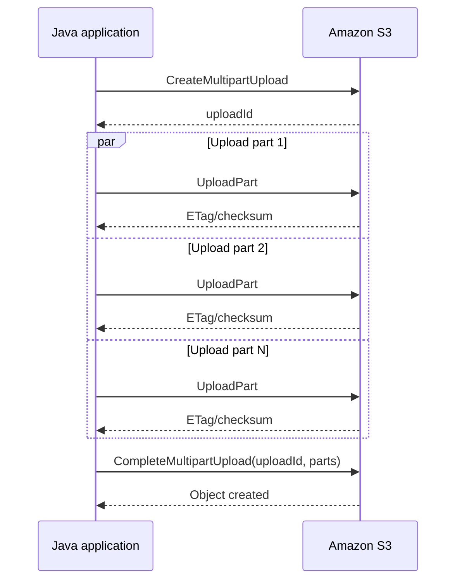
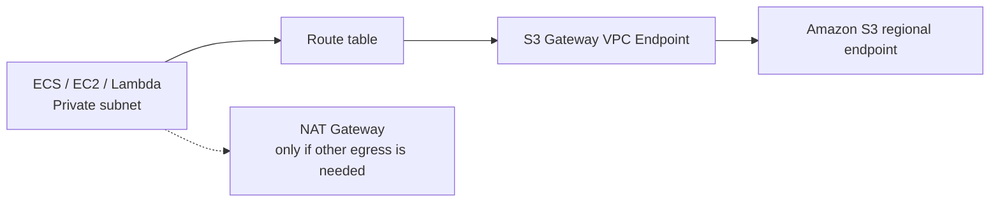

# S3 Client, Transfer Manager, and Large File Transfers

> **Module:** CLOUD_PROVIDERS_AWS  
> **Chapter:** AWS SDK for Java  
> **Lesson:** S3 Client, Transfer Manager, and Large File Transfers  
> **Context:** Java/Spring Boot applications, ECS, Lambda, and AWS services needing to upload, download, or copy large objects using Amazon S3.

## 1. The Problem: Transferring Large Files Safely and Under Control

An online learning platform receives lecture videos, PDFs, session recordings, and learning datasets. A single video file can be several GB; many learners download materials concurrently; background workers copy datasets across buckets. The application must:

- Upload/download large files without loading the entire file into the heap.
- Leverage parallelism to increase throughput over suitable networks.
- Automatically retry failed transfer parts on network interruptions.
- Track progress, detect failed transfers, and resume certain paused transfers.
- Verify data integrity using checksums.
- Enforce IAM least privilege, TLS, encryption, and private networking.
- Clean up abandoned multipart uploads so orphaned parts do not incur storage costs.
- Account accurately for request, storage, I/O, data transfer, and KMS costs.

AWS SDK for Java 2.x offers multiple API layers for S3. **`S3TransferManager`** is the high-level utility for file and directory transfers; underneath, it can use either the AWS CRT-based S3 client or the Java-based asynchronous S3 client with multipart enabled.

### Learning Objectives

After this lesson, you will be able to:

1. Choose between `S3Client`, `S3AsyncClient`, and `S3TransferManager`.
2. Distinguish single-request uploads from multipart uploads.
3. Know S3 limits: max object size, part count, part size, and SDK default thresholds.
4. Configure Maven BOM and dependencies for AWS SDK for Java 2.x.
5. Upload/download files using `S3TransferManager`, track progress, and handle errors.
6. Choose between the CRT-based and Java-based multipart async clients by workload.
7. Handle `InputStream`s with known or unknown content length.
8. Pause/resume transfers, manage multipart uploads, and verify checksums.
9. Protect objects using IAM, bucket policies, TLS, SSE-S3/SSE-KMS, and VPC endpoints.
10. Optimize concurrency, memory, retries, observability, and cost.

## 2. Amazon S3 Stores Objects, Not a Real File System

Amazon S3 is object storage. An object consists of:

- **Bucket:** container for objects within an AWS Region.
- **Key:** unique identifier of the object within the bucket, e.g., `courses/java-101/lesson-01.mp4`.
- **Body:** the object's bytes.
- **Metadata:** system metadata such as `Content-Type`, `Content-Length`, and user-defined metadata.
- **Tags:** key/value pairs for policies, lifecycles, and classification.
- **Version ID:** identifier for the version if bucket versioning is enabled.

S3 uses a flat key namespace. Slashes (`/`) in keys create the illusion of folders, yet they are simply prefixes in the object name. Directory Transfer Manager maps relative file paths to object keys beneath a chosen prefix.

Example:

```text
Bucket: learning-assets-prod

Object key:
courses/java-101/lesson-01.mp4
courses/java-101/slides/week-01.pdf
students/student-17/avatar.png
```

Never place raw local filesystem paths like `C:\Users\...` directly into keys without normalization. Keys should follow conventions for tenant, content type, date, or business ID, and never contain secrets.

## 3. Single PUT vs. Multipart Upload

For small or medium files, a single `PutObject` request is simplest. When files are large, multipart upload splits one object into independent parts:

1. Call `CreateMultipartUpload` to initiate the upload and obtain an `uploadId`.
2. Split the file into parts, each with a distinct `partNumber`.
3. Upload parts, optionally in parallel and in any order.
4. Collect each part's ETag/checksum.
5. Call `CompleteMultipartUpload` so S3 assembles the parts into the final object.
6. If unable to finish, call `AbortMultipartUpload` to delete incomplete parts.



If a single part fails, that part can be retried without re-sending the entire object. The object becomes visible as a complete object only after `CompleteMultipartUpload`.

### 3.1. Current Multipart Upload Limits

| Limit | Value |
|---|---:|
| Maximum object size | **48.8 TiB** (approx. 50 TB decimal) |
| Maximum parts per upload | **10,000** |
| Part numbers | 1–10,000 |
| Size per part | **5 MiB–5 GiB** |
| Last part | Exempt from the 5 MiB minimum |
| Max `ListParts` per response | 1,000 parts |
| Max `ListMultipartUploads` per response | 1,000 uploads |

A single `PutObject` via SDK/REST/CLI has a **5 GB** object size limit. Whenever a file exceeds the single-PUT limit, multipart upload is required. AWS recommends considering multipart once objects reach roughly **100 MB** or larger; that is a general S3 recommendation, not a mandatory cutoff.

### 3.2. Two Different Thresholds: S3 Recommendation vs. SDK Default

- S3 recommends considering multipart starting around **100 MB** for retry and parallelism benefits.
- S3 Transfer Manager and the Java async multipart client default to roughly an **8 MiB** threshold/part size in documented SDK configurations.
- Threshold is the object size where multipart kicks in; part size is the size of each chunk. These are two separate parameters.
- You can tune threshold and part size to balance request overhead, memory, concurrency, and throughput.

### 3.3. Choosing Part Size and Part Count

```text
numberOfParts = ceil(objectSize / partSize)
numberOfParts <= 10,000

5 MiB <= partSize <= 5 GiB
objectSize <= 48.8 TiB
```

Example 200 GiB file:

- A 16 MiB part size produces too many parts, exceeding the 10,000 limit.
- A 64 MiB part size produces roughly 3,200 parts, well within limits.
- A 256 MiB part size issues fewer requests, but each part is larger and requires sizing memory, buffers, and concurrency.

Never pick a part size from one tiny sample file. Test with the largest expected file size, real bandwidth, memory limits, and retry behavior.

## 4. Which S3 Client to Choose in AWS SDK for Java 2.x?

| Client | API | When Appropriate | Trade-Offs |
|---|---|---|---|
| `S3Client` | Synchronous, blocking | Simple object CRUD, low volume, readable sequential code | Does not provide high-level parallel multipart file transfers |
| Java-based `S3AsyncClient` | Async, `CompletableFuture` | Non-blocking workloads needing a Java async client with optional multipart | Requires managing async lifecycles, backpressure, and multipart settings |
| CRT-based `S3AsyncClient` | Async via AWS Common Runtime | Large files, high throughput, unknown-length streams, per-part retries | Requires `aws-crt`; some builder options differ from the Java-based client |
| `S3TransferManager` | High-level async API | File/directory uploads/downloads, progress tracking, pause/resume, parallel transfers | Requires understanding underlying client, lifecycle, and transfer outcomes |

**Do not confuse the two CRT components:**

- The CRT-based S3 client uses `aws-c-s3`, supporting the S3 multipart upload API and byte-range downloads.
- The CRT-based HTTP client is a general-purpose HTTP transport; it does not provide S3 multipart orchestration on its own.

### 4.1. CRT-Based S3 Client

The CRT-based S3 client can:

- Automatically use multipart uploads and byte-range fetches.
- Retry individual failed parts instead of restarting the whole file.
- Improve connection pooling and DNS load balancing.
- Handle `InputStream`s with unknown content length more efficiently.
- Deliver high transfer throughput when the app has sufficient network bandwidth and resources.

In return, some configuration options on the Java-based S3 async builder have no direct equivalent on the CRT builder. Check the API reference for your exact SDK version.

### 4.2. Java-Based Async Client with Multipart Enabled

If you do not use CRT, you can still back `S3TransferManager` with the Java-based `S3AsyncClient`:

```java
S3AsyncClient s3AsyncClient = S3AsyncClient.builder()
    .region(Region.AP_SOUTHEAST_1)
    .credentialsProvider(DefaultCredentialsProvider.create())
    .multipartEnabled(true)
    .build();

S3TransferManager transferManager = S3TransferManager.builder()
    .s3Client(s3AsyncClient)
    .build();
```

Parallel multipart transfers are enabled only when the underlying client is a CRT-based S3 client or a Java-based S3 async client with multipart enabled. A plain `S3AsyncClient.builder().build()` is not equivalent to a multipart-enabled client.

### 4.3. Differences When Migrating from AWS SDK for Java 1.x

Transfer Manager v2 is not a simple rename of v1:

| Aspect | SDK for Java 1.x | SDK for Java 2.x |
|---|---|---|
| Package | `com.amazonaws.services.s3.transfer` | `software.amazon.awssdk.transfer.s3` |
| Main class | `TransferManager` | `S3TransferManager` |
| Underlying client | Synchronous S3 client | `S3AsyncClient` |
| Model | Blocking transfer API | Async API and `CompletableFuture` |
| Multipart/parallel | Managed by v1 TransferManager builder | CRT-based or Java async multipart client |

When migrating, review client instantiation, ownership/shutdown, executors, callbacks/progress listeners, multipart thresholds, and exception handling. Do not just swap package/class names assuming old behavior remains identical.

## 5. Maven Dependencies and Version Alignment

Use the **AWS SDK BOM** so all SDK v2 modules share the same version. The example below uses an illustrative version; before building, update the BOM version to a release tested by your project.

```xml
<properties>
    <maven.compiler.release>17</maven.compiler.release>
    <aws.sdk.version>2.59.4</aws.sdk.version>
</properties>

<dependencyManagement>
    <dependencies>
        <dependency>
            <groupId>software.amazon.awssdk</groupId>
            <artifactId>bom</artifactId>
            <version>${aws.sdk.version}</version>
            <type>pom</type>
            <scope>import</scope>
        </dependency>
    </dependencies>
</dependencyManagement>

<dependencies>
    <dependency>
        <groupId>software.amazon.awssdk</groupId>
        <artifactId>s3</artifactId>
    </dependency>

    <dependency>
        <groupId>software.amazon.awssdk</groupId>
        <artifactId>s3-transfer-manager</artifactId>
    </dependency>
</dependencies>
```

This configuration uses Transfer Manager's default Java-based async multipart client when `aws-crt` is absent from the classpath.

### 5.1. Optional CRT Dependency

To use the CRT-based S3 client, add `software.amazon.awssdk.crt:aws-crt` at a compatible version verified on Maven Central and your target platform. CRT is a separate artifact; do not assume the AWS SDK BOM manages its version.

```xml
<dependency>
    <groupId>software.amazon.awssdk.crt</groupId>
    <artifactId>aws-crt</artifactId>
    <version>${aws.crt.version}</version>
</dependency>
```

Never use wildcards or unpinned versions in production. Pin both the SDK BOM and CRT versions, run integration tests on the target OS and CPU architecture, and upgrade through your dependency management process.

## 6. Creating S3TransferManager and Managing Lifecycle

Shortest form:

```java
try (S3TransferManager transferManager = S3TransferManager.create()) {
    // upload/download/copy
}
```

`S3TransferManager.create()` selects a default client automatically:

- If `software.amazon.awssdk.crt:aws-crt` is on the classpath, the SDK can instantiate a CRT-based S3 client.
- Otherwise, the SDK uses the Java-based S3 async client with multipart enabled.

If you build a client yourself and pass it into the builder, the application must manage the underlying client's lifecycle per API ownership rules. Close the transfer manager and any application-created clients when no longer needed. Never create a new client per HTTP request.

### 6.1. CRT-Based Custom Builder

```java
S3AsyncClient s3AsyncClient = S3AsyncClient.crtBuilder()
    .region(Region.AP_SOUTHEAST_1)
    .credentialsProvider(DefaultCredentialsProvider.create())
    .targetThroughputInGbps(10.0)
    .minimumPartSizeInBytes(16L * 1024 * 1024)
    .build();

S3TransferManager transferManager = S3TransferManager.builder()
    .s3Client(s3AsyncClient)
    .build();
```

`targetThroughputInGbps` is a configuration hint for the client, not a guaranteed network speed. `minimumPartSizeInBytes` governs how parts are split. Increase these values only after measuring memory, throughput, and part counts; part size must stay within S3 limits.

### 6.2. Java-Based Async Builder

```java
S3AsyncClient s3AsyncClient = S3AsyncClient.builder()
    .region(Region.AP_SOUTHEAST_1)
    .credentialsProvider(DefaultCredentialsProvider.create())
    .multipartEnabled(true)
    .multipartConfiguration(config -> config
        .thresholdInBytes(16L * 1024 * 1024)
        .minimumPartSizeInBytes(16L * 1024 * 1024))
    .build();

S3TransferManager transferManager = S3TransferManager.builder()
    .s3Client(s3AsyncClient)
    .build();
```

Method names and options may vary across SDK versions; consult the API reference for your pinned BOM. Never copy builder options from CRT to the Java-based client or vice versa without verifying compilation.

## 7. Uploading Files with Transfer Manager

When a file is already on disk, `uploadFile` is the direct choice. The SDK splits the file into parts, uploads in parallel, and returns a transfer handle to track progress.

```java
import java.nio.file.Path;
import java.nio.file.Paths;
import java.util.Map;

import software.amazon.awssdk.transfer.s3.S3TransferManager;
import software.amazon.awssdk.transfer.s3.model.FileUpload;
import software.amazon.awssdk.transfer.s3.model.UploadFileRequest;
import software.amazon.awssdk.transfer.s3.model.CompletedFileUpload;
import software.amazon.awssdk.transfer.s3.progress.LoggingTransferListener;
import software.amazon.awssdk.services.s3.model.ServerSideEncryption;

public final class CourseAssetUploader {
    public static void upload(Path source, String bucket, String key,
                              String kmsKeyArn) {
        try (S3TransferManager manager = S3TransferManager.create()) {
            UploadFileRequest request = UploadFileRequest.builder()
                .source(source)
                .putObjectRequest(put -> put
                    .bucket(bucket)
                    .key(key)
                    .contentType("video/mp4")
                    .metadata(Map.of("asset-type", "lesson-video"))
                    .serverSideEncryption(ServerSideEncryption.AWS_KMS)
                    .ssekmsKeyId(kmsKeyArn))
                .addTransferListener(LoggingTransferListener.create())
                .build();

            FileUpload upload = manager.uploadFile(request);
            CompletedFileUpload completed =
                upload.completionFuture().join();

            System.out.println("Upload completed: " +
                completed.response().eTag());
        }
    }

    public static void main(String[] args) {
        upload(
            Paths.get("/data/lesson-01.mp4"),
            "learning-assets-prod",
            "courses/java-101/lesson-01.mp4",
            System.getenv("S3_KMS_KEY_ARN"));
    }
}
```

### 7.1. Reading Results Properly

- `uploadFile` returns a `FileUpload` representing the in-progress transfer.
- `completionFuture` completes when the transfer finishes.
- `join` waits for completion and throws `CompletionException` if the transfer fails.
- `CompletedFileUpload` provides the final operation response.
- `LoggingTransferListener` logs basic progress; you can write a custom `TransferListener` to emit metrics or events.
- For directory uploads, inspect `failedTransfers()`; never assume an entire directory upload is atomic.

Never log presigned URLs, credentials, personal data, or sensitive metadata inside listeners.

## 8. Downloading Files Without Keeping Large Objects on the Heap

For large files, prefer `downloadFile` to stream directly to the filesystem instead of using `AsyncResponseTransformer.toBytes()`.

```java
import java.nio.file.Path;
import java.nio.file.Paths;

import software.amazon.awssdk.transfer.s3.S3TransferManager;
import software.amazon.awssdk.transfer.s3.model.DownloadFileRequest;
import software.amazon.awssdk.transfer.s3.model.FileDownload;
import software.amazon.awssdk.transfer.s3.model.CompletedFileDownload;
import software.amazon.awssdk.transfer.s3.progress.LoggingTransferListener;

public final class CourseAssetDownloader {
    public static void download(String bucket, String key, Path destination) {
        try (S3TransferManager manager = S3TransferManager.create()) {
            DownloadFileRequest request = DownloadFileRequest.builder()
                .getObjectRequest(get -> get
                    .bucket(bucket)
                    .key(key))
                .destination(destination)
                .addTransferListener(LoggingTransferListener.create())
                .build();

            FileDownload download = manager.downloadFile(request);
            CompletedFileDownload completed =
                download.completionFuture().join();

            System.out.println("Downloaded: " +
                completed.response().contentLength());
        }
    }

    public static void main(String[] args) {
        download(
            "learning-assets-prod",
            "courses/java-101/lesson-01.mp4",
            Paths.get("/data/downloads/lesson-01.mp4"));
    }
}
```

`downloadFile` can use byte-range fetches to download parts in parallel when supported by the client. Ensure the destination directory exists and is writable, check free disk space, and handle existing destination files per business requirements.

### 8.1. Never Load Large Files Into a Byte Array

This pattern keeps the entire object in memory:

```java
ResponseBytes<GetObjectResponse> bytes = s3Client.getObject(
    request,
    ResponseTransformer.toBytes());
```

Use this only for small objects with an explicit size bound. For large files, use `ResponseTransformer.toFile`, `S3AsyncClient` with `AsyncResponseTransformer.toFile`, or `S3TransferManager.downloadFile`.

## 9. Uploading from an InputStream and Content Length

When uploading from an `InputStream`, the SDK needs to know the body length or use a streaming mechanism that supports unknown lengths.

### 9.1. Exact Content Length Known

```java
long contentLength = Files.size(path);

s3Client.putObject(
    request,
    RequestBody.fromInputStream(inputStream, contentLength));
```

The content length must match the actual byte count:

- If declared smaller than the actual data, the object may be truncated.
- If declared larger, the request may fail or stall waiting for EOF.
- Never use a `String`'s UTF-16 character count as byte length; character encoding can produce a different byte count.

### 9.2. Content Length Unknown Up Front

With synchronous `S3Client`, `RequestBody.fromContentProvider(...)` may buffer the entire stream in memory to determine content length. This is dangerous for large or unbounded streams.

With async clients, use `AsyncRequestBody.fromInputStream(inputStream, null, executor)` to signal an unknown size. Both the CRT-based S3 client and the multipart-enabled Java async client support this flow.

```java
ExecutorService executor = Executors.newSingleThreadExecutor();

try (S3AsyncClient s3 = S3AsyncClient.crtCreate()) {
    AsyncRequestBody body =
        AsyncRequestBody.fromInputStream(inputStream, null, executor);

    PutObjectResponse response = s3.putObject(
        request,
        body).join();
} finally {
    executor.shutdown();
}
```

This snippet illustrates an unknown-length stream. In production, define clearly who owns and closes the `InputStream`, executor, and client, and handle cancellation, timeouts, and exceptions. Never create an unbounded thread pool per request.

### 9.3. When to Use TransferManager.upload Instead of uploadFile?

- `uploadFile` is for `Path`s/files already on the local filesystem.
- `upload` accepts an `AsyncRequestBody`, fitting data arriving from a producer, stream, or pipeline.
- For large or unknown-size streams, use a multipart-capable async client to avoid buffering the entire body.
- If the source stream can only be read once, retries require a mechanism to replay/recreate the stream or an appropriate multipart client.

## 10. Pause, Resume, and Handling Interrupted Transfers

Transfer Manager supports pause/resume for certain file transfers when the underlying client supports multipart. `FileUpload.pause()` returns a `ResumableFileUpload`, which can be serialized to disk and resumed later.

```java
FileUpload upload = transferManager.uploadFile(uploadRequest);

// When the application needs to pause:
ResumableFileUpload resumable = upload.pause();
resumable.serializeToFile(Paths.get("/var/lib/course/upload-state.json"));

// When the worker restarts:
ResumableFileUpload saved =
    ResumableFileUpload.fromFile(
        Paths.get("/var/lib/course/upload-state.json"));

FileUpload resumed = transferManager.resumeUploadFile(saved);
resumed.completionFuture().join();
```

Conditions and limitations:

- Pause/resume requires the CRT-based S3 client or the multipart-enabled Java S3 async client.
- If the source file changes after pausing, the SDK may restart the upload from scratch.
- Resume state must be stored securely; never expose sensitive details.
- With SSE-C, customer-provided keys are not serialized into resumable state; re-supply the key upon resuming.
- Presigned URL downloads have their own limits: the URL may expire while paused, and presigned URL downloads do not support pause/resume.
- Resume state does not replace job state, idempotency, ownership, and cleanup in your orchestration layer.

Never treat pause/resume as a guarantee that a transfer can resume indefinitely. Store state, expirations, file identity, source version/size, and business status.
## 11. Manual Multipart Upload via Low-Level API

`S3TransferManager` is usually the right choice for file-based transfers. Use the low-level multipart API when you need fine-grained step-by-step control, such as:

- Splitting data by custom record or block boundaries.
- Uploading from a source without a local file.
- Managing upload IDs and checkpoints yourself.
- Integrating with specialized workflows or storage pipelines.

Key APIs:

| Step | API | Data to Persist |
|---|---|---|
| Initiate | `CreateMultipartUpload` | `uploadId`, bucket, key |
| Upload part | `UploadPart` | `partNumber`, ETag/checksum |
| List parts | `ListParts` | Uploaded parts, paginated |
| Complete | `CompleteMultipartUpload` | Ordered list of parts by part number |
| Abort | `AbortMultipartUpload` | `uploadId` |
| List in-progress uploads | `ListMultipartUploads` | Upload IDs, keys, and initiation timestamps |

### 11.1. Lifecycle Pseudocode

```text
createResponse = CreateMultipartUpload(bucket, key)
uploadId = createResponse.uploadId

parts = []
for each chunk:
    response = UploadPart(uploadId, partNumber, chunk)
    parts.add(partNumber, response.eTag)

try:
    CompleteMultipartUpload(uploadId, sortByPartNumber(parts))
catch error:
    AbortMultipartUpload(uploadId)
    throw error
```

When resuming a low-level upload, verify the upload ID still exists, reconcile already-uploaded parts, upload missing part numbers, and complete with the sorted full list. `ListParts` and `ListMultipartUploads` paginate results; handle pagination cleanly.

### 11.2. Abort Is Part of Error Handling

If an upload cannot continue, call `AbortMultipartUpload`. Otherwise S3 retains the uploaded parts and bills storage until the upload completes or is cleaned up by an abort/lifecycle rule.

Never catch an exception and simply discard the upload ID. Persist enough upload ID/checkpoint state to abort or resume in a controlled manner.

## 12. Checksums, ETag, and Data Integrity

Amazon S3 supports checksums to verify data was not altered in transit. Supported algorithms include CRC64/NVME, CRC32, CRC32C, SHA-1, SHA-256, MD5, and certain XXHash/SHA-512 variants per the support matrix.

### 12.1. ETag Is Not Always an MD5

- For some single-part `PutObject` and SSE-S3 objects, ETag may equal the object's MD5.
- With SSE-KMS or SSE-C, ETag is not the MD5 of the plaintext data.
- With multipart uploads, the object's ETag **is not the MD5 digest of the entire object**.
- Multipart ETags typically reflect a hash of part digests plus the part count; never treat it as a whole-file checksum.

When integrity verification is required, use the S3 checksum API/metadata or compute SHA-256/CRC on both source and destination. Never compare a multipart object's ETag against a local file MD5 and assume corruption.

### 12.2. Full-Object vs. Composite Checksums

- **Full-object checksum:** computed across the entire byte stream.
- **Composite checksum:** aggregated from individual part checksums.
- Not every algorithm supports both types. For example, CRC64/NVME supports full-object, whereas SHA-256 supports only composite in multipart uploads per current S3 documentation.
- The AWS SDK can compute checksums automatically; specify an appropriate `ChecksumAlgorithm` per API/SDK version.

### 12.3. Example Setting Checksum Algorithm

```java
PutObjectRequest request = PutObjectRequest.builder()
    .bucket(bucket)
    .key(key)
    .checksumAlgorithm(ChecksumAlgorithm.CRC32C)
    .build();

PutObjectResponse response =
    s3Client.putObject(request, RequestBody.fromFile(path));
```

This example shows `PutObject`. For multipart uploads, select a compatible checksum algorithm/type and ensure the algorithm is declared when initiating the multipart upload per S3 requirements. Read back checksum metadata when verification is required.

## 13. Encryption, Metadata, and Object Ownership

### 13.1. Server-Side Encryption

| Mechanism | Meaning | When to Use |
|---|---|---|
| SSE-S3 | S3 manages encryption keys | Suitable for most standard workloads |
| SSE-KMS | Uses AWS KMS keys | When key policies, auditing, and key control are required |
| SSE-C | Customer supplies key per request | Only with strict customer key management processes |

Never write SSE-C keys into logs or resumable state files. For SSE-KMS multipart uploads, the IAM principal needs appropriate KMS permissions, including encrypt/decrypt actions across upload and completion; the key policy must also allow access.

### 13.2. Metadata and Tags

Set accurate `Content-Type` so browsers and CDNs handle files properly. User metadata suits short, non-sensitive attributes; tags suit policies, lifecycles, and classification.

Never cram entire application records into S3 metadata. Metadata is not designed for relational storage or complex querying.

### 13.3. Object Ownership and ACLs

For new buckets, prefer **Bucket owner enforced Object Ownership** so the bucket owner owns all objects and ACLs are disabled. Manage access via IAM policies, bucket policies, and access points; never enable ACLs merely to work around `AccessDenied` caused by an incorrect bucket policy.

## 14. IAM Least Privilege for Transfer Manager

An upload/download application needs scoped object-level permissions. Example policy allowing operations only under prefix `incoming/course-assets/`:

```json
{
  "Version": "2012-10-17",
  "Statement": [
    {
      "Sid": "ListTargetPrefix",
      "Effect": "Allow",
      "Action": [
        "s3:ListBucket",
        "s3:ListBucketMultipartUploads"
      ],
      "Resource": "arn:aws:s3:::learning-assets-prod",
      "Condition": {
        "StringLike": {
          "s3:prefix": [
            "incoming/course-assets/*"
          ]
        }
      }
    },
    {
      "Sid": "TransferObjects",
      "Effect": "Allow",
      "Action": [
        "s3:PutObject",
        "s3:GetObject",
        "s3:AbortMultipartUpload",
        "s3:ListMultipartUploadParts"
      ],
      "Resource": "arn:aws:s3:::learning-assets-prod/incoming/course-assets/*"
    }
  ]
}
```

This sample policy illustrates resource scoping; adjust it to match actual APIs and bucket policies. Operations such as copy, directory listing, tagging, versioning, or KMS require additional permissions.

### 14.1. Multipart-Specific Permissions

| API | IAM Action |
|---|---|
| `CreateMultipartUpload` | `s3:PutObject` |
| `UploadPart` | `s3:PutObject` |
| `CompleteMultipartUpload` | `s3:PutObject` |
| `AbortMultipartUpload` | `s3:AbortMultipartUpload` |
| `ListParts` | `s3:ListMultipartUploadParts` |
| `ListMultipartUploads` | `s3:ListBucketMultipartUploads` |

If the bucket uses a customer-managed SSE-KMS key, add the necessary KMS permissions for that key. Never grant `s3:*` or `kms:*` on all resources just to get a transfer working.

For multipart uploads encrypted with a customer-managed KMS key, callers typically need at least KMS permissions such as `kms:GenerateDataKey` and `kms:Decrypt` on that specific key, and the key policy must permit them. Exact conditions depend on encryption mode, S3 Bucket Keys, and the API operation. Avoid `Resource: "*"` when the key ARN can be scoped.

## 15. Networking: VPC Endpoints and Data Paths

S3 exposes public regional endpoints, yet applications in a VPC can connect privately through an **S3 Gateway VPC Endpoint** or an appropriate Interface Endpoint.



A Gateway Endpoint routes traffic from subnets to S3 over the AWS network without requiring NAT for S3. Verify:

- Route tables associate the right gateway endpoint.
- Endpoint policies allow the required buckets and actions.
- Bucket policies do not inadvertently deny traffic via VPC/endpoint conditions.
- Security groups and NACLs permit the traffic path.
- DNS and bucket/client Regions match.
- Cross-Region transfers can incur data transfer charges and added latency.

Do not assume having a VPC endpoint makes every bucket reachable; IAM, endpoint policies, and bucket policies all apply together.

## 16. Directory Upload/Download and Object Copy

### 16.1. Upload Directory

`uploadDirectory` walks a local directory and uploads each file as an object. You can specify bucket, prefix, and delimiter.

```java
UploadDirectoryRequest request = UploadDirectoryRequest.builder()
    .source(Paths.get("/data/course-assets"))
    .bucket("learning-assets-prod")
    .s3Prefix("courses/java-101/")
    .build();

DirectoryUpload upload = transferManager.uploadDirectory(request);
CompletedDirectoryUpload result = upload.completionFuture().join();

result.failedTransfers().forEach(failure ->
    logger.warn("Transfer failed: {}", failure));
```

A directory upload is not atomic. Some files may succeed while others fail. Always inspect `failedTransfers()`, persist a manifest, and implement dedicated retries.

### 16.2. Download Directory

`downloadDirectory` lists objects under a bucket/prefix and downloads them to a local directory. Account for large object counts, pagination, `s3:ListBucket` permissions, disk space, and key-to-path mapping. Never accept unvalidated user input as a prefix.

### 16.3. Copying Large or Cross-Region Objects

Transfer Manager offers a `copy` API to duplicate objects; for cross-Region copies on the CRT-based S3 client, enable `crossRegionAccessEnabled(true)` per SDK documentation. Copies can incur request and data transfer charges, and destination metadata/encryption must be designed explicitly.

## 17. Presigned URLs and Direct Client Uploads

For browser and mobile clients, a strong pattern is having the backend authorize the user and issue a **presigned URL** so the client uploads directly to S3. File bytes bypass the Java API server, reducing backend memory and network load.

Flow:

1. Client sends upload metadata/intent to the API.
2. Backend authenticates the user, tenant, and file type/size policy.
3. Backend generates a safe object key and a short-lived presigned request.
4. Client uploads directly to S3.
5. Backend verifies object metadata/checksum and updates business state.
6. S3 events/EventBridge trigger scanning or processing pipelines.

A presigned URL is a bearer capability: anyone holding the URL can perform the signed action within its scope and expiration. Never log the URL, keep expirations short, and never let clients dictate raw object keys where overwrites or cross-tenant writes could happen.

S3 Transfer Manager supports certain presigned URL download APIs in recent SDK releases (documented from SDK 2.48.0). **Presigned URL downloads require the Java-based `S3AsyncClient`; the CRT-based S3 client does not currently support this flow.** Presigned downloads also do not support pause/resume because the URL can expire while paused.

## 18. Retries, Timeouts, and Concurrency

Large transfers generate many requests and parts, so retry and concurrency settings directly shape throughput and cost.

### 18.1. Part-Level Retries

- The CRT-based client can retry individual parts on network failures.
- Manual multipart uploads must retry the exact failed part number and track ETags/checksums.
- Retries do not automatically make a business operation idempotent; avoid creating multiple object keys for the same job unintentionally.
- If `CompleteMultipartUpload` fails with an uncertain outcome, inspect object/upload state before starting a fresh upload.

### 18.2. Concurrency and Memory

Higher throughput generally requires more in-flight parts, and each part consumes buffers and network resources. Estimate memory pressure:

```text
Approximate in-flight payload memory
≈ concurrent parts × buffered bytes per part
  + HTTP/TLS buffers
  + application buffers
```

This is a rough estimate; CRT and Java async implementations differ. Cap concurrent transfers, part sizes, executor pools, and upload jobs according to container memory, CPU, and network bandwidth.

Never call `join` on an event-loop thread or servlet request thread in a reactive app without understanding the impact. Compose `CompletableFuture`s or offload blocking waits onto a worker pool.

### 18.3. Timeout Hierarchy

| Timeout | Purpose |
|---|---|
| HTTP request deadline | Bounds how long an API caller waits |
| SDK API call timeout | Bounds the entire API operation |
| API attempt timeout | Bounds an individual HTTP attempt |
| Connect/socket timeout | Bounds establishing and reading from the network |
| Job deadline | Bounds the end-to-end file transfer workflow |

For multi-GB files, never hold an HTTP request open until the transfer finishes. Run a background job, return a `jobId`, persist state/progress, and let the client poll or subscribe.

## 19. Multipart Cleanup, Lifecycle, and Cost

S3 retains uploaded parts until the multipart upload completes or is aborted. Incomplete parts still accrue storage charges under S3 billing rules.

### 19.1. Lifecycle Rule for Incomplete Multipart Uploads

Configure `AbortIncompleteMultipartUpload` to automatically clean up abandoned multipart uploads, such as after 7 days under the target prefix.

```xml
<LifecycleConfiguration>
  <Rule>
    <ID>abort-stale-multipart-uploads</ID>
    <Status>Enabled</Status>
    <Filter>
      <Prefix>incoming/course-assets/</Prefix>
    </Filter>
    <AbortIncompleteMultipartUpload>
      <DaysAfterInitiation>7</DaysAfterInitiation>
    </AbortIncompleteMultipartUpload>
  </Rule>
</LifecycleConfiguration>
```

This lifecycle action deletes parts of **incomplete uploads**; it does not delete completed objects. Set the window long enough for legitimate transfers—never too short for workloads that may pause across multiple days.

### 19.2. Costs to Account For

| Component | Cost Driver |
|---|---|
| PUT / UploadPart / Complete requests | Request charges; multipart generates more requests |
| GET / byte-range downloads | Request charges and data transfer |
| Storage | Completed objects and incomplete parts |
| Cross-Region / Internet egress | Data transfer along network paths |
| KMS | KMS request charges and key usage |
| CloudWatch | Logs, metrics, alarms, and retention |
| Compute | ECS/Lambda/EC2 workers and network resources |
| Retrieval / transitions | Storage class and lifecycle policy charges |

Multipart can increase request counts while shortening upload duration, cutting whole-file retry waste, and boosting reliability. Evaluate total cost on real workloads rather than counting `PUT` requests alone.

## 20. Observability and Troubleshooting

### 20.1. Tracking Transfers

Record non-sensitive fields:

```text
jobId
bucket
objectKey (redacted/normalized if needed)
sourceSizeBytes
bytesTransferred
partCount
durationMs
retryCount
transferStatus
checksumAlgorithm
failureCode
```

Use a `TransferListener` to log progress and emit metrics. Never log credentials, presigned URLs, customer encryption keys, or document contents.

### 20.2. Common Errors

| Symptom | Possible Cause | Resolution |
|---|---|---|
| `AccessDenied` on upload | Missing `s3:PutObject`, bucket policy deny, endpoint policy | Check IAM identity, bucket policy, and VPC endpoint policy |
| `AccessDenied` on abort | Missing `s3:AbortMultipartUpload` | Grant the action on the target object ARN |
| KMS `AccessDenied` | Missing KMS key policy or `GenerateDataKey`/`Decrypt` | Check key policy and IAM role |
| Upload truncated | Declared `InputStream` content length smaller than actual bytes | Pass exact byte length |
| Request hangs | Declared content length larger than actual bytes or stream never EOFs | Check producer/length and timeouts |
| Too many parts | Part size too small for the object size | Increase part size so parts <= 10,000 |
| `EntityTooSmall` | Non-final part smaller than 5 MiB | Adjust chunk size; only the last part is exempt |
| Incomplete uploads consuming storage | Missing abort call or lifecycle rule | Abort stale uploads and add lifecycle cleanup |
| ETag does not match MD5 | Multipart upload or SSE-KMS/SSE-C | Use S3 checksum APIs instead of treating ETag as MD5 |
| Transfer Manager not parallel | Underlying client is neither CRT nor multipart-enabled | Use CRT or `multipartEnabled(true)` |
| `UnsupportedOperationException` on pause | Client lacks multipart pause/resume support | Pick a multipart-capable client |
| Slow downloads | Single-range/heap buffering or network bottleneck | Use `downloadFile`, byte-range fetches, measure throughput |
| OOM uploading stream | Synchronous unknown-length stream buffered in memory | Use async multipart client or file-based upload |
| Directory upload reports partial failures | Transfer is not atomic; some requests failed | Process `failedTransfers()` and retry individual objects |
| Presigned download fails with CRT | CRT-based S3 client does not support that API yet | Use Java-based multipart `S3AsyncClient` |
| Upload finished yet app marks job failed | App timed out after S3 completed | Check object/version/checksum before retrying |

### 20.3. Investigation Workflow

1. Identify bucket, key, Region, upload ID, and job ID.
2. Inspect the root exception and S3 request ID.
3. Verify credentials provider, IAM role, and bucket/KMS policies.
4. Check client type, multipart enablement, part size, and content length.
5. Check incomplete multipart uploads and lifecycle rules.
6. Compare checksums instead of relying solely on ETag.
7. Review CloudWatch/application metrics, retry counts, memory, and networking.
8. Reproduce in a sandbox with a similarly sized file before changing production settings.

## 21. Lab: Uploading Multi-GB Videos from Java to S3

**Scenario:** Course API receives videos from a worker, uploads them to bucket `learning-assets-sandbox`, records metadata, and emits `UPLOADED` status after S3 confirms completion.

### 21.1. Preparation

1. Create a sandbox bucket in an authorized Region.
2. Enable Block Public Access and Bucket owner enforced Object Ownership.
3. Enable default encryption (SSE-S3 or SSE-KMS per lab requirements).
4. Create a worker IAM role with only the required permissions on the lab prefix.
5. Configure a lifecycle rule to abort incomplete multipart uploads after an appropriate window.
6. Add the AWS SDK BOM, `s3`, and `s3-transfer-manager`; add CRT if benchmarking it.
7. Prepare small, 100 MB, and multi-GB test files.
8. Never put real personal data into the sandbox bucket.

### 21.2. Tasks

- Upload a small file using `S3Client.putObject`.
- Upload a large file using `S3TransferManager.uploadFile`.
- Log progress via `LoggingTransferListener`.
- Compare the Java-based async multipart client against the CRT-based client.
- Vary threshold and part size in the sandbox.
- Download a file to disk via `downloadFile`.
- Compute a local checksum, retrieve the object checksum, and compare.
- Test pause/resume upload with a supported client.
- Test `uploadDirectory` and inspect `failedTransfers`.
- Test `InputStream` uploads with known and unknown content length.
- Test an IAM role missing `s3:AbortMultipartUpload` and observe the cleanup failure.
- Inspect incomplete uploads and the lifecycle rule.
- Measure elapsed time, peak memory, part count, retry count, and request usage.

### 21.3. Metrics Table

| Test | Client | File Size | Part Size | Concurrency | Duration | Peak Memory | Retry Count | Result |
|---|---|---:|---:|---:|---:|---:|---:|---|
| Small object | `S3Client` | Measure | N/A | N/A | Measure | Measure | Measure | Pass/Fail |
| Large file | Java multipart | Measure | Measure | Measure | Measure | Measure | Measure | Pass/Fail |
| Large file | CRT S3 client | Measure | Measure | Measure | Measure | Measure | Measure | Pass/Fail |
| Unknown stream | CRT/async multipart | Measure | Measure | Measure | Measure | Measure | Measure | Pass/Fail |
| Resume | Multipart-capable client | Measure | Measure | Measure | Measure | Measure | Measure | Pass/Fail |

Never fabricate benchmark numbers. Run with identical files, Regions, and network conditions and record exact client settings for a fair comparison.

### 21.4. Negative Tests

| Test | Condition | Expected Result |
|---|---|---|
| T1 | Worker missing `s3:PutObject` | Upload fails with `AccessDenied` |
| T2 | Worker missing `s3:AbortMultipartUpload` | Cleanup abort fails with `AccessDenied`; incomplete multipart warning |
| T3 | `InputStream` declares content length smaller than actual bytes | Object may be truncated; test catches mismatch via checksum/size |
| T4 | Part size forces part count over 10,000 | Upload invalid; raise part size |
| T5 | Compare multipart ETag against whole-file MD5 | Test must not treat the two values as matching checksums |
| T6 | Pause with a client lacking multipart support | API may throw `UnsupportedOperationException` |
| T7 | Presigned URL expires mid-transfer | Request fails; backend must issue a fresh URL per policy |
| T8 | VPC endpoint policy or bucket policy denies | `AccessDenied` despite IAM role `Allow` |
| T9 | SSE-KMS role lacks KMS permissions | Multipart upload fails at the KMS step |

Never run negative tests against production buckets or real data.

### 21.5. Cleanup

- Delete test objects no longer needed.
- Abort any remaining incomplete multipart uploads.
- Remove test lifecycle rules/policies if required by the lab.
- Delete the test bucket and KMS test key only after confirming no dependencies remain; check versioning before deleting the bucket.
- Verify no lingering parts or test snapshots continue accruing charges.

## 22. Self-Check Questions

**1. How do `S3Client` and `S3TransferManager` differ?**  
`S3Client` is the low-level synchronous API for S3 operations; Transfer Manager is a high-level API managing file/directory transfers, multipart, progress tracking, and pause/resume.

**2. What is the maximum number of parts in an S3 multipart upload?**  
10,000 parts per upload.

**3. What is the valid range for multipart part size?**  
5 MiB to 5 GiB; the final part is exempt from the 5 MiB minimum.

**4. What is the maximum S3 object size?**  
48.8 TiB according to current multipart limits.

**5. At roughly what size does S3 recommend considering multipart?**  
Around 100 MB; the SDK Transfer Manager / Java async multipart default threshold can be 8 MiB.

**6. What does Transfer Manager need for parallel transfers?**  
Either the CRT-based S3 client or the Java-based S3 async client with multipart enabled.

**7. Is the CRT-based S3 client the same as the CRT HTTP client?**  
No. The CRT-based S3 client uses S3 multipart APIs; the CRT HTTP client is a general-purpose HTTP transport.

**8. Why should multi-GB files not be downloaded with `ResponseTransformer.toBytes()` or read into a byte array?**  
It can trigger heap spikes and `OutOfMemoryError`; stream to disk or use Transfer Manager instead.

**9. Why must an exact content length be passed to `RequestBody.fromInputStream`?**  
An inaccurate length can cause truncation, failures, or stalled connections waiting on EOF.

**10. Is a multipart ETag the MD5 of the whole object?**  
No. Use S3 checksum APIs to verify integrity.

**11. What does `CompleteMultipartUpload` do?**  
Assembles uploaded parts into the finalized S3 object.

**12. If an upload fails and will not be resumed, what should you do?**  
Call `AbortMultipartUpload` or configure a lifecycle `AbortIncompleteMultipartUpload` rule for cleanup.

**13. Is `S3TransferManager.uploadDirectory` atomic?**  
No. Some files may succeed while others fail; inspect `failedTransfers()`.

**14. Can HikariCP be used to pool S3 clients?**  
No. Use AWS SDK client lifecycle and connection management; HikariCP is a JDBC connection pool.

**15. Is a presigned URL harmless to log?**  
No. It is a bearer capability; never log or share it beyond the authorized recipient.

**16. When should you use the CRT-based S3 client?**  
When workloads transfer many large files requiring multipart, unknown-length streams, high throughput, and per-part retries; measure in benchmarks before adopting.

## 23. Summary and Official AWS Documentation

`S3Client` fits synchronous S3 operations and small/medium objects. `S3AsyncClient` provides an asynchronous API; with multipart enabled, the Java-based client runs parallel transfers. The **AWS CRT-based S3 client** provides strong throughput and resilience for large files. **`S3TransferManager`** is the high-level abstraction for uploading/downloading files and directories, tracking progress, pausing/resuming, and leveraging multipart/byte-range transfers.

To transfer large files safely, choose the right client, size thresholds/parts within the 10,000-part limit, supply accurate stream content lengths, verify checksums, handle abort/cleanup, bound concurrency, and enforce IAM/KMS/TLS least privilege. Measure throughput, memory, retries, request counts, and cost on representative workloads before production rollout.

### Official AWS Documentation

- [AWS SDK for Java 2.x — Transfer Manager](https://docs.aws.amazon.com/sdk-for-java/latest/developer-guide/transfer-manager.html)
- [AWS SDK for Java 2.x — S3 clients and examples](https://docs.aws.amazon.com/sdk-for-java/latest/developer-guide/examples-s3.html)
- [AWS SDK for Java 2.x — CRT-based S3 client](https://docs.aws.amazon.com/sdk-for-java/latest/developer-guide/crt-based-s3-client.html)
- [AWS SDK for Java 2.x — Java async client multipart configuration](https://docs.aws.amazon.com/sdk-for-java/latest/developer-guide/s3-async-client-multipart.html)
- [AWS SDK for Java 2.x — Uploading streams and content length](https://docs.aws.amazon.com/sdk-for-java/latest/developer-guide/best-practices-s3-uploads.html)
- [AWS SDK for Java 2.x — Transfer Manager API reference](https://docs.aws.amazon.com/java/api/latest/software/amazon/awssdk/transfer/s3/S3TransferManager.html)
- [AWS SDK for Java 2.x — Migration from Transfer Manager v1 to v2](https://docs.aws.amazon.com/sdk-for-java/latest/developer-guide/migration-s3-transfer-manager.html)
- [Amazon S3 — Multipart upload limits](https://docs.aws.amazon.com/AmazonS3/latest/userguide/qfacts.html)
- [Amazon S3 — Multipart upload overview](https://docs.aws.amazon.com/AmazonS3/latest/userguide/mpuoverview.html)
- [Amazon S3 — Check object integrity with checksums](https://docs.aws.amazon.com/AmazonS3/latest/userguide/checking-object-integrity-upload.html)
- [Amazon S3 — Required permissions for API operations](https://docs.aws.amazon.com/AmazonS3/latest/userguide/using-with-s3-policy-actions.html)
- [Amazon S3 — Abort incomplete multipart uploads with lifecycle](https://docs.aws.amazon.com/AmazonS3/latest/userguide/mpu-abort-incomplete-mpu-lifecycle-config.html)
- [Amazon S3 — Upload objects](https://docs.aws.amazon.com/AmazonS3/latest/userguide/upload-objects.html)
- [Amazon S3 — Pricing](https://aws.amazon.com/s3/pricing/)

> **Practical note:** Bucket names, ARNs, paths, KMS keys, credentials, and file sizes in this lesson are illustrative examples. Never commit access keys or presigned URLs. Verify Regions, bucket policies, endpoint policies, multipart limits, checksum support, pricing, and cleanup lifecycles before transferring production data.
