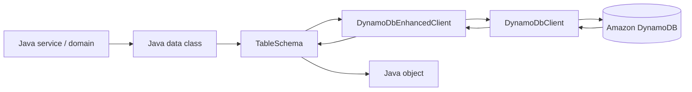

# DynamoDB Enhanced Client and Java Object Mapping

## 1. From DynamoDB AttributeValue to Java Objects

A Java Spring Boot application stores orders in **Amazon DynamoDB**. At the DynamoDB layer, each item is a collection of attributes such as `PK`, `SK`, `status`, `total`, and `createdAt`; at the Java layer, the development team wants to work with `Order`, `OrderLine`, or `Customer` rather than assembling `Map<String, AttributeValue>` in every method.

**DynamoDB Enhanced Client** is a high-level library in **AWS SDK for Java 2.x** that maps Java data classes to DynamoDB items and back. You define a `TableSchema` once, obtain a `DynamoDbTable<T>`, and invoke CRUD, query, scan, batch, and transaction operations directly with Java objects.

This lesson belongs to the **AWS SDK for Java** chapter of the **CLOUD_PROVIDERS_AWS** module. The learning path explores Regions/AZs, IAM, VPC, compute, storage, databases, integration, and serverless; learners build skills in service selection, secure deployment, monitoring, resilience, and cost control. Enhanced Client is the key bridge between Java domain models and DynamoDB in those systems.

After this lesson, you will be able to:

- Distinguish between **`DynamoDbClient`**, **`DynamoDbEnhancedClient`**, **`DynamoDbTable`**, and **`TableSchema`**.
- Map JavaBeans with `@DynamoDbBean` and immutable classes with `@DynamoDbImmutable`.
- Declare partition keys, sort keys, secondary indexes, and attribute names.
- Choose annotated schemas, static schemas, or document schemas based on the data model.
- Handle nulls, nested objects, collections, and custom `AttributeConverter`s.
- Use CRUD, query, scan, pagination, and async publishers properly.
- Understand `VersionedRecordExtension`, `AtomicCounterExtension`, and conditional updates.
- Use batch/transaction APIs, enforce IAM controls, test mappings, and troubleshoot errors.

## 2. Where Does Enhanced Client Sit in AWS SDK for Java 2.x?

SDK v2 provides a **low-level DynamoDB client** and the **Enhanced Client**:

| Component | Responsibility | When to Use |
| --- | --- | --- |
| `DynamoDbClient` | API close to DynamoDB service: `AttributeValue`, expressions, keys, detailed request/response | Need full API control, dynamic schemas, or specialized operations |
| `DynamoDbEnhancedClient` | High-level mapping layer managing schemas and extensions | Java data classes with stable structures, object-oriented CRUD/queries |
| `DynamoDbTable<T>` | Represents a DynamoDB table mapped to type `T` | Calling `putItem`, `getItem`, `updateItem`, `query`, `scan` |
| `TableSchema<T>` | Defines how Java objects convert ↔ DynamoDB items | Declaring keys, attributes, converters, getters/setters |
| `DynamoDbIndex<T>` | Represents a secondary index on a table | Querying GSIs/LSIs using the same data model |
| `DynamoDbEnhancedAsyncClient` | Asynchronous Enhanced Client API | Reactive/async applications and non-blocking pagination |

Enhanced Client is not a separate database, nor does it alter DynamoDB limits or data modeling rules. It builds low-level requests from Java models and maps responses back into objects.

### 2.1. Mapping Flow



### 2.2. Enhanced Client vs. DynamoDBMapper v1

Do not confuse Enhanced Client v2 with `DynamoDBMapper` from AWS SDK for Java 1.x. SDK v2 uses package `software.amazon.awssdk.enhanced.dynamodb`, annotations spelled `DynamoDb...` (lowercase `b`), and constructs `DynamoDbTable` with a table name and `TableSchema`.

| AWS SDK v1 | AWS SDK v2 Enhanced Client |
| --- | --- |
| `DynamoDBMapper` | `DynamoDbEnhancedClient` |
| `@DynamoDBTable` | Table name passed to `.table(name, schema)` |
| `@DynamoDBHashKey` | `@DynamoDbPartitionKey` |
| `@DynamoDBRangeKey` | `@DynamoDbSortKey` |
| `mapper.load()` | `table.getItem()` |
| `mapper.save()` | `table.putItem()` or `table.updateItem()` |
| `@DynamoDBVersionAttribute` | `@DynamoDbVersionAttribute` |

Never mix v1 and v2 annotations or imports in the same data model.

## 3. Dependencies and Client Initialization

### 3.1. Maven with AWS SDK BOM

Example `pom.xml`:

```xml
<dependencyManagement>
  <dependencies>
    <dependency>
      <groupId>software.amazon.awssdk</groupId>
      <artifactId>bom</artifactId>
      <version>AWS_SDK_VERSION</version>
      <type>pom</type>
      <scope>import</scope>
    </dependency>
  </dependencies>
</dependencyManagement>

<dependencies>
  <dependency>
    <groupId>software.amazon.awssdk</groupId>
    <artifactId>dynamodb</artifactId>
  </dependency>
  <dependency>
    <groupId>software.amazon.awssdk</groupId>
    <artifactId>dynamodb-enhanced</artifactId>
  </dependency>
</dependencies>
```

`AWS_SDK_VERSION` is a project-selected property/placeholder managed centrally. Use the BOM so AWS SDK modules share compatible versions; never arbitrarily combine `dynamodb` 2.x with `dynamodb-enhanced` from a different version.

When using the asynchronous Enhanced Client with Netty or a specific HTTP client, configure the corresponding transport dependencies for your runtime. If using SSO, STS, or other services, add those modules aligned under the same BOM.

### 3.2. Creating Low-Level and Enhanced Clients

```java
import software.amazon.awssdk.regions.Region;
import software.amazon.awssdk.services.dynamodb.DynamoDbClient;
import software.amazon.awssdk.enhanced.dynamodb.DynamoDbEnhancedClient;

public final class DynamoDbFactory {
    public static DynamoDbEnhancedClient createEnhancedClient() {
        DynamoDbClient lowLevel = DynamoDbClient.builder()
                .region(Region.AP_SOUTHEAST_1)
                .build();

        return DynamoDbEnhancedClient.builder()
                .dynamoDbClient(lowLevel)
                .build();
    }
}
```

This snippet illustrates client wiring; production applications should manage the lifecycle of both clients in a DI container (e.g., Spring beans) and close the low-level client on shutdown. `DynamoDbEnhancedClient` delegates to the supplied low-level client and does not replace credentials/Region configuration.

### 3.3. Credentials and Region Still Follow the AWS SDK

Enhanced Client has no separate credential system. `DynamoDbClient` uses the Java SDK v2 credentials provider chain and Region configuration. Local setups can use IAM Identity Center profiles; ECS uses task roles; Lambda uses execution roles; EC2 uses instance profiles. Call STS `GetCallerIdentity` to verify the active account and role.

## 4. TableSchema: The Mapping Contract Between Java and DynamoDB

`TableSchema<T>` describes:

- Which Java type is mapped.
- Which getters/setters or builders read/write values.
- Which Java property corresponds to each DynamoDB attribute.
- Primary key and secondary index key attributes.
- Which converter transforms each Java type into a DynamoDB `AttributeValue`.
- Metadata required for Enhanced Client CRUD, queries, and table operations.

**Schema generation involves relatively expensive introspection**, so build schemas once at startup rather than calling `TableSchema.fromBean()` on every request.

### 4.1. Schema Types

| Type | How Created | Best Fit |
| --- | --- | --- |
| `BeanTableSchema` | `TableSchema.fromBean(MyBean.class)` | Annotated mutable JavaBeans |
| `ImmutableTableSchema` | `TableSchema.fromImmutableClass(MyType.class)` | Immutable classes with builders |
| `StaticTableSchema` | `TableSchema.builder(MyType.class)...build()` | Explicit schema declaration without annotations/JavaBean conventions |
| `StaticImmutableTableSchema` | Builder for immutable types | Immutable models with schema defined in code |
| `DocumentTableSchema` | `TableSchema.documentSchemaBuilder()` | Flexible attributes without a fixed full schema |

Choose the schema style that fits how your model is structured. You do not need to force every domain class into a JavaBean if a static schema or immutable class fits better.

## 5. Mapping JavaBeans with @DynamoDbBean

A JavaBean requires:

1. Class-level `@DynamoDbBean` annotation.
2. Public no-argument constructor so the schema can instantiate objects.
3. Valid getters/setters for persisted properties.
4. At least one property marked as the partition key.

Example table `ShopTable` with String composite keys `PK` and `SK`:

```java
import software.amazon.awssdk.enhanced.dynamodb.mapper.annotations.DynamoDbBean;
import software.amazon.awssdk.enhanced.dynamodb.mapper.annotations.DynamoDbPartitionKey;
import software.amazon.awssdk.enhanced.dynamodb.mapper.annotations.DynamoDbSortKey;
import software.amazon.awssdk.enhanced.dynamodb.mapper.annotations.DynamoDbAttribute;
import java.math.BigDecimal;
import java.time.Instant;

@DynamoDbBean
public class OrderRecord {
    private String pk;
    private String sk;
    private String status;
    private BigDecimal total;
    private Instant createdAt;

    public OrderRecord() {
    }

    @DynamoDbPartitionKey
    @DynamoDbAttribute("PK")
    public String getPk() {
        return pk;
    }
    public void setPk(String pk) {
        this.pk = pk;
    }

    @DynamoDbSortKey
    @DynamoDbAttribute("SK")
    public String getSk() {
        return sk;
    }
    public void setSk(String sk) {
        this.sk = sk;
    }

    public String getStatus() {
        return status;
    }
    public void setStatus(String status) {
        this.status = status;
    }

    public BigDecimal getTotal() {
        return total;
    }
    public void setTotal(BigDecimal total) {
        this.total = total;
    }

    public Instant getCreatedAt() {
        return createdAt;
    }
    public void setCreatedAt(Instant createdAt) {
        this.createdAt = createdAt;
    }
}
```

**Place annotations on either the getter or the setter, never both** for the same attribute. The pattern above annotates getters so the schema reads metadata from accessors.

### 5.1. Creating the Schema and Table Resource

```java
import software.amazon.awssdk.enhanced.dynamodb.DynamoDbEnhancedClient;
import software.amazon.awssdk.enhanced.dynamodb.DynamoDbTable;
import software.amazon.awssdk.enhanced.dynamodb.TableSchema;

TableSchema<OrderRecord> orderSchema =
        TableSchema.fromBean(OrderRecord.class);

DynamoDbTable<OrderRecord> orders =
        enhancedClient.table("ShopTable", orderSchema);
```

Calling `table()` creates an **in-memory resource mapping**; it does not create the table on AWS. If the table already exists, you can use it immediately. To create a new table, call `createTable()` or provision via IaC/low-level APIs with defined keys, indexes, and capacity; always inspect real resources and never overwrite or duplicate production tables.

### 5.2. Renaming Attributes

`@DynamoDbAttribute("PK")` maps getter `getPk()` to the DynamoDB attribute named `PK`. Without it, Enhanced Client derives the name from the JavaBean property—for example, `getStatus()` maps to `status`.

Key names in `TableSchema` must match the real table's key schema **exactly**. If the table defines partition key `pk` while the model maps `PK`, operations will fail with a key attribute mismatch.

### 5.3. Ignoring Non-Persisted Properties

`@DynamoDbIgnore` marks a getter that should not be mapped to DynamoDB—for example, `getDisplayLabel()` computed from other fields rather than persisted. Never add arbitrary convenience getters to an immutable class without marking them ignored, or the schema may treat them as mapped attributes.

## 6. Declaring Primary Keys and Secondary Indexes

### 6.1. Partition Key and Sort Key

| Annotation | Meaning |
| --- | --- |
| `@DynamoDbPartitionKey` | Table partition key |
| `@DynamoDbSortKey` | Table sort key |
| `@DynamoDbSecondaryPartitionKey(indexNames = "...")` | Partition key for one or more secondary indexes |
| `@DynamoDbSecondarySortKey(indexNames = "...")` | Sort key for one or more secondary indexes |

Example GSI `orders_by_customer` with partition key `customerId` and sort key `createdAt`:

```java
@DynamoDbSecondaryPartitionKey(indexNames = "orders_by_customer")
public String getCustomerId() {
    return customerId;
}

@DynamoDbSecondarySortKey(indexNames = "orders_by_customer")
public Instant getCreatedAt() {
    return createdAt;
}
```

Annotations only tell Enhanced Client how to interpret item and index keys. They **do not create GSIs** on an existing table. The GSI must already exist on the DynamoDB table (provisioned via IaC, console, or API) and the index name must match exactly when querying.

### 6.2. Key Design Remains the Application's Responsibility

Enhanced Client does not change DynamoDB design fundamentals:

- Partition keys distribute data and define query boundaries.
- Sort keys organize items, support range queries, and enable access patterns.
- GSIs enable extra access patterns at the cost of extra storage, write amplification, and eventual consistency.
- LSIs have constraints and must be declared at table creation time.

Never add a GSI just because a model has an `email` getter; verify which queries require an index, which attribute projection suffices, and whether the write cost is acceptable.

## 7. Mapping Immutable Classes with @DynamoDbImmutable

Immutable Java records/domain objects prevent accidental state mutation. Enhanced Client supports immutable classes via `@DynamoDbImmutable(builder = ...)`, following these rules:

- The class exposes getters (which can be named `id()` instead of `getId()`).
- The builder exposes a matching setter for each getter with matching name and type.
- The builder exposes a public `build()` returning the immutable class.
- The builder has a public no-arg constructor, or the class exposes a public static `builder()` returning the builder.
- Every getter not overriding `Object` and not marked `@DynamoDbIgnore` is mapped as an attribute.

Concise example:

```java
import software.amazon.awssdk.enhanced.dynamodb.mapper.annotations.DynamoDbImmutable;
import software.amazon.awssdk.enhanced.dynamodb.mapper.annotations.DynamoDbPartitionKey;
import software.amazon.awssdk.enhanced.dynamodb.mapper.annotations.DynamoDbSortKey;

@DynamoDbImmutable(builder = Customer.Builder.class)
public final class Customer {
    private final String id;
    private final String email;
    private final String displayName;

    private Customer(Builder builder) {
        this.id = builder.id;
        this.email = builder.email;
        this.displayName = builder.displayName;
    }

    public static Builder builder() {
        return new Builder();
    }

    @DynamoDbPartitionKey
    public String id() { return id; }

    @DynamoDbSortKey
    public String email() { return email; }

    public String displayName() { return displayName; }

    public static final class Builder {
        private String id;
        private String email;
        private String displayName;

        public Builder id(String value) {
            this.id = value;
            return this;
        }
        public Builder email(String value) {
            this.email = value;
            return this;
        }
        public Builder displayName(String value) {
            this.displayName = value;
            return this;
        }
        public Customer build() {
            return new Customer(this);
        }
    }
}
```

Schema:

```java
TableSchema<Customer> customerSchema =
        TableSchema.fromImmutableClass(Customer.class);
```

### 7.1. When Using Lombok

Lombok `@Value` and `@Builder` can trim boilerplate, provided DynamoDB annotations land on the **generated getters** and the builder satisfies the required conventions. For boolean properties, pay close attention to getter naming conventions expected by `ImmutableTableSchema`; do not assume every Lombok-generated method fits automatically.

### 7.2. Choosing Bean vs. Immutable

| Criterion | Bean | Immutable |
| --- | --- | --- |
| Instantiation | Public no-arg constructor | Builder and `build` method |
| Mutation | Getters/setters | Getters only |
| Mapping | `TableSchema.fromBean()` | `TableSchema.fromImmutableClass()` |
| Best fit | Simple DTOs/persistence beans | Domain/value objects where mutation is undesired |
| Boilerplate | Many getters/setters | More builder code if not using Lombok |

You do not have to force your domain model and persistence model to be the same class. You can map DynamoDB into a persistence bean and convert to a domain object to maintain a clean boundary between storage schema and business rules.

## 8. Static TableSchema: Defining Mappings in Code

If you prefer not to annotate classes or your models do not follow JavaBean conventions, build the schema programmatically. Static schemas typically incur lower startup introspection overhead than annotation-based schemas and keep mapping definitions explicit in one place.

Suppose `Product` is a plain JavaBean with getters/setters:

```java
public class Product {
    private String productId;
    private String name;

    public Product() {
    }

    public String getProductId() {
        return productId;
    }
    public void setProductId(String productId) {
        this.productId = productId;
    }

    public String getName() {
        return name;
    }
    public void setName(String name) {
        this.name = name;
    }
}
```

Illustrative schema:

```java
import software.amazon.awssdk.enhanced.dynamodb.TableSchema;
import software.amazon.awssdk.enhanced.dynamodb.mapper.StaticAttributeTags;

static final TableSchema<Product> PRODUCT_SCHEMA =
    TableSchema.builder(Product.class)
        .newItemSupplier(Product::new)
        .addAttribute(String.class, a -> a.name("PK")
            .getter(Product::getProductId)
            .setter(Product::setProductId)
            .tags(StaticAttributeTags.primaryPartitionKey()))
        .addAttribute(String.class, a -> a.name("name")
            .getter(Product::getName)
            .setter(Product::setName))
        .build();
```

This builder defines both getters and setters so Enhanced Client can instantiate and populate the bean on reads. For immutable objects, use `StaticImmutableTableSchema` or the corresponding immutable builder so the schema can construct complete objects.

### 8.1. When Is a Static Schema Useful?

- Models originate from third-party libraries you cannot annotate.
- You want to decouple storage schemas from domain classes.
- You want to avoid reflection/introspection at startup.
- You need converters, attribute names, and tags configured in one central place.
- You want strict schema control within the persistence module.

## 9. Nested Objects, Maps, Lists, and Sets

DynamoDB supports attribute types such as **String (S), Number (N), Binary (B), Boolean (BOOL), Null (NULL), List (L), Map (M), String Set (SS), Number Set (NS), and Binary Set (BS)**. Enhanced Client provides built-in converters for many common Java types and collections.

An order item might contain:

```json
{
  "PK": "ORDER#O301",
  "SK": "META",
  "customer": {
    "id": "C001",
    "name": "An"
  },
  "lines": [
    {
      "productId": "P100",
      "quantity": 2
    }
  ],
  "tags": ["priority", "web"]
}
```

When nested classes are properly defined and annotated, Enhanced Client maps them to Maps and Lists.

### 9.1. Nested Bean

```java
@DynamoDbBean
public class Address {
    private String city;
    private String country;

    public Address() {}

    public String getCity() { return city; }
    public void setCity(String city) { this.city = city; }

    public String getCountry() { return country; }
    public void setCountry(String country) { this.country = country; }
}

@DynamoDbBean
public class CustomerProfile {
    private String customerId;
    private Address address;

    public CustomerProfile() {}

    @DynamoDbPartitionKey
    public String getCustomerId() { return customerId; }
    public void setCustomerId(String customerId) {
        this.customerId = customerId;
    }

    public Address getAddress() { return address; }
    public void setAddress(Address address) {
        this.address = address;
    }
}
```

When `TableSchema.fromBean(CustomerProfile.class)` builds the schema, it detects the nested bean `Address` and maps it as a document map. For unannotated classes or non-JavaBean models, build a nested schema via builder and embed it inside the parent schema.

### 9.2. Immutable Nested Classes

Nested immutable classes also require `@DynamoDbImmutable` and builder conventions. If a nested object should instead flatten into top-level attributes, use `@DynamoDbFlatten` per documentation rather than assuming object maps flatten automatically.

### 9.3. Map, List, and Set

Java collections such as `List<String>`, `Set<String>`, and `Map<String, String>` are mapped by default converters when element types are supported. Note:

- DynamoDB **String Sets / Number Sets / Binary Sets do not allow empty sets**.
- Lists preserve order; Sets do not guarantee order.
- Map keys in DynamoDB must be Strings.
- Total item size remains subject to the **400 KB** limit.
- Nested documents do not create relational joins or automatic transactions with other items.

Never store an unbounded list inside a single item if it could exceed 400 KB or cause write contention; consider modeling separate items under a sort key instead.

## 10. Attribute Converters: Translating Java Types to DynamoDB Types

Enhanced Client uses `AttributeConverter<T>` to convert between Java types and DynamoDB `AttributeValue`s. SDK v2 ships default converters for common types including `String`, `Integer`, `Long`, `BigDecimal`, `Instant`, maps, lists, and sets.

### 10.1. Using Default Converters

| Java Type | Typical DynamoDB Representation |
| --- | --- |
| `String` | `S` |
| `Integer`, `Long`, `BigDecimal` | `N` |
| `Boolean` | `BOOL` |
| `byte[]` / supported binary types | `B` |
| `List<T>` | `L` |
| `Map<String,T>` | `M` |
| `Set<String>` | `SS` |
| `Instant` | Built-in SDK converter |

Prefer wrapper types (`Long`, `Integer`) over primitives (`long`, `int`) on data class attributes whenever you need to distinguish **attribute absent** from **value 0**. Primitives default to `0`, losing the "unset" distinction.

### 10.2. Custom AttributeConverter for Money

Suppose the domain defines `Money`:

```java
import java.math.BigDecimal;

public record Money(BigDecimal amount, String currency) {}
```

We can store `Money` as a Map:

```java
import java.math.BigDecimal;
import java.util.Map;
import software.amazon.awssdk.enhanced.dynamodb.AttributeConverter;
import software.amazon.awssdk.enhanced.dynamodb.EnhancedType;
import software.amazon.awssdk.enhanced.dynamodb.AttributeValueType;
import software.amazon.awssdk.services.dynamodb.model.AttributeValue;

public final class MoneyConverter implements AttributeConverter<Money> {
    @Override
    public AttributeValue transformFrom(Money money) {
        return AttributeValue.builder()
                .m(Map.of(
                        "amount", AttributeValue.builder()
                                .n(money.amount().toPlainString()).build(),
                        "currency", AttributeValue.builder()
                                .s(money.currency()).build()))
                .build();
    }

    @Override
    public Money transformTo(AttributeValue value) {
        Map<String, AttributeValue> map = value.m();
        return new Money(
                new BigDecimal(map.get("amount").n()),
                map.get("currency").s());
    }

    @Override
    public EnhancedType<Money> type() {
        return EnhancedType.of(Money.class);
    }

    @Override
    public AttributeValueType attributeValueType() {
        return AttributeValueType.M;
    }
}
```

Apply the converter to the getter:

```java
@DynamoDbConvertedBy(MoneyConverter.class)
public Money getTotal() {
    return total;
}
```

Validation is omitted here for brevity; production converters must handle nulls, legacy/malformed records, currency codes, and rounding rules. Never use `double` for money because floating-point rounding errors corrupt financial values.

### 10.3. Custom AttributeConverterProvider

To apply a converter by type across an entire schema instead of annotating every field, configure an `AttributeConverterProvider`. The provider returns a converter matching `EnhancedType<T>`. When supplying custom providers, decide whether to include `DefaultAttributeConverterProvider` as a fallback; a custom provider list can replace defaults if misconfigured.

## 11. Null Semantics: A Common Cause of Data Loss on updateItem

Understand this behavior thoroughly before deploying Enhanced Client to production:

- On **`putItem`**, Java properties that are `null` are **omitted** from the new item.
- On **`updateItem` by default**, Java properties that are `null` can **delete the corresponding attribute** from the stored item.

For example, suppose a DynamoDB item holds `name`, `email`, and `phone`. You construct a Java object setting only `id` and `name`, leaving `email`/`phone` null, and call `updateItem`. Under default behavior, those null attributes can be removed from the item.

### 11.1. Example of the Risk

```java
Customer customer = new Customer();
customer.setCustomerId("C001");
customer.setName("New Name");
// email and phone left null

customerTable.updateItem(customer);
```

If the intent was only to change `name`, the call above can wipe out `email` and `phone`.

### 11.2. IgnoreNullsMode

Enhanced Client provides `IgnoreNullsMode` for updates:

| Mode | General Behavior |
| --- | --- |
| `IgnoreNullsMode.DEFAULT` | Nulls are not ignored; null scalars/maps/lists/sets can remove the matching attribute |
| `IgnoreNullsMode.SCALAR_ONLY` | Ignores null scalar attributes across levels; maps/beans require an existing structure to update inner fields |
| `IgnoreNullsMode.MAPS_ONLY` | Ignores null maps/beans; non-null maps/beans are added/replaced per mode semantics |

Example preserving unset scalar attributes:

```java
Customer partial = new Customer();
partial.setCustomerId("C001");
partial.setName("New Name");

Customer updated = customerTable.updateItem(r -> r
        .item(partial)
        .ignoreNullsMode(IgnoreNullsMode.SCALAR_ONLY));
```

For nested maps/beans, pick the mode based on existing item structure. `SCALAR_ONLY` cannot create a brand-new map/bean by updating a nested path if the parent map does not exist yet—it can fail with an invalid document path error. `MAPS_ONLY` can add/replace a supplied map/bean while skipping null maps/beans. Provided non-null lists/sets still replace their corresponding collections.

### 11.3. When Should You Read Before Updating?

A safe pattern is `getItem`, modifying the loaded object, and then calling `updateItem`. That preserves untouched fields and lowers accidental deletion risk, at the cost of one read and potentially requiring optimistic locking for concurrent writers.

If updating only a few fields without an initial read, use an update request with the appropriate `IgnoreNullsMode` or a low-level `UpdateExpression` describing the exact mutation. **Null does not automatically mean "leave unchanged" in every mode.**

## 12. CRUD with DynamoDbTable

Once you have a `DynamoDbTable<OrderRecord>`, CRUD operations work with Java types instead of hand-built `AttributeValue` maps.

### 12.1. PutItem

```java
OrderRecord order = new OrderRecord();
order.setPk("ORDER#O301");
order.setSk("META");
order.setStatus("CREATED");
order.setTotal(new BigDecimal("250000.00"));
order.setCreatedAt(Instant.now());

orders.putItem(order);
```

`putItem` writes the item by primary key. If the key already exists, `PutItem` **replaces the item** by default per DynamoDB semantics. To insert only if absent, use `PutItemEnhancedRequest` with a condition expression or the low-level API; never assume Enhanced Client turns puts into insert-only operations.

### 12.2. GetItem

```java
OrderRecord order = orders.getItem(r -> r
        .key(k -> k
                .partitionValue("ORDER#O301")
                .sortValue("META")));
```

The key builder must supply both partition key and sort key when the table uses a composite key. When no item exists, the result is typically `null`; handle missing items before dereferencing. Enhanced Client requests can enable consistent reads where supported by the API.

### 12.3. UpdateItem

```java
OrderRecord order = orders.getItem(r -> r
        .key(k -> k.partitionValue("ORDER#O301").sortValue("META")));

if (order != null) {
    order.setStatus("PAID");
    orders.updateItem(order);
}
```

This illustrates read-modify-write; if multiple requests can update the same item concurrently, add `@DynamoDbVersionAttribute` or a `ConditionExpression` to prevent lost updates. Calling `updateItem` does not provide optimistic locking unless the version extension is enabled in the schema.

### 12.4. DeleteItem

```java
OrderRecord deleted = orders.deleteItem(r -> r
        .key(k -> k
                .partitionValue("ORDER#O301")
                .sortValue("META")));
```

`deleteItem` removes the item by key. For conditional deletion (such as deleting only when `status` is still `CANCELLED` and version matches), pass a condition expression in the enhanced request. `@DynamoDbVersionAttribute` does not automatically protect every delete operation; see the extensions section.

### 12.5. Enhanced Client Does Not Create Tables Whenever table() Is Called

`enhancedClient.table("ShopTable", schema)` only creates an in-memory table handle. To create a new table in code, you can call:

```java
orders.createTable(r -> r
        .provisionedThroughput(t -> t
                .readCapacityUnits(5L)
                .writeCapacityUnits(5L)));
```

This is an example using provisioned capacity, not suitable for every production table. GSIs, projections, billing mode, encryption, PITR, tags, deletion protection, and streams must be configured per requirements; production infrastructure is normally managed with CDK, CloudFormation, or Terraform.

## 13. ConditionExpression and UpdateExpression with Enhanced Client

Enhanced Client still supports DynamoDB conditions and expressions; request builders let you attach `Expression` objects to typed operations.

### 13.1. PutItem Only If Absent

```java
import software.amazon.awssdk.enhanced.dynamodb.Expression;
import software.amazon.awssdk.enhanced.dynamodb.model.PutItemEnhancedRequest;

Expression onlyIfMissing = Expression.builder()
        .expression("attribute_not_exists(#pk)")
        .putExpressionName("#pk", "PK")
        .build();

PutItemEnhancedRequest<OrderRecord> request =
        PutItemEnhancedRequest.builder(OrderRecord.class)
                .item(order)
                .conditionExpression(onlyIfMissing)
                .build();

orders.putItem(request);
```

The condition is evaluated atomically inside DynamoDB during `PutItem`. If the item already exists, the request fails with a conditional check exception; classify it as a duplicate/conflict rather than retrying infinitely.

### 13.2. UpdateItem with a Status Condition

```java
import software.amazon.awssdk.enhanced.dynamodb.Expression;
import software.amazon.awssdk.enhanced.dynamodb.model.UpdateItemEnhancedRequest;
import software.amazon.awssdk.services.dynamodb.model.AttributeValue;

Expression canPay = Expression.builder()
        .expression("#status = :created")
        .putExpressionName("#status", "status")
        .putExpressionValue(":created",
                AttributeValue.builder().s("CREATED").build())
        .build();

order.setStatus("PAID");

UpdateItemEnhancedRequest<OrderRecord> updateRequest =
        UpdateItemEnhancedRequest.builder(OrderRecord.class)
                .item(order)
                .conditionExpression(canPay)
                .build();

orders.updateItem(updateRequest);
```

This example uses low-level `AttributeValue` for the expression value. In production code, separate model objects, state transitions, and request builders cleanly, and test missing items, mismatched statuses, and concurrent updates.

### 13.3. Complex UpdateExpressions

Enhanced Client supports update behavior annotations and extensions to customize writes; for complex update expressions (atomic increments, list/map path updates, `if_not_exists`, `REMOVE`), low-level `DynamoDbClient.updateItem` remains a completely valid choice. **Not every DynamoDB operation has to go through Enhanced Client**; use the right abstraction for the job.

## 14. Query, Sort Key Conditions, and Secondary Indexes

### 14.1. Query by Partition Key

`Query` is the primary read pattern when the partition key is known:

```java
import software.amazon.awssdk.enhanced.dynamodb.model.QueryConditional;

PageIterable<OrderRecord> pages = orders.query(r -> r
        .queryConditional(QueryConditional.keyEqualTo(k -> k
                .partitionValue("ORDER#O301"))));

pages.items().forEach(order -> {
    System.out.println(order.getStatus());
});
```

When a table has a sort key, you can add conditions such as `sortBeginsWith`, `sortGreaterThanOrEqualTo`, or `sortBetween` matching your access pattern. `Query` always requires an equality condition on the partition key; it cannot run arbitrary SQL-like queries across any attribute.

### 14.2. Querying a GSI

Suppose GSI `orders_by_customer` has partition key `customerId` and sort key `createdAt`:

```java
DynamoDbIndex<OrderRecord> byCustomer =
        orders.index("orders_by_customer");

PageIterable<OrderRecord> customerOrders = byCustomer.query(r -> r
        .queryConditional(QueryConditional.keyEqualTo(k -> k
                .partitionValue("C001"))));
```

The GSI must exist on the DynamoDB table; Enhanced Client does not create indexes from annotations alone. GSI reads are **eventually consistent**, so never rely on them for strict read-after-write checks that must immediately observe newly written items.

### 14.3. Filter Expressions Do Not Replace Key Conditions

Filter expressions apply after DynamoDB reads items within the key condition range; they never turn an unindexed lookup into an efficient query. Filters do not reduce read capacity consumed for items evaluated before filtering. Design partition keys, sort keys, and indexes around access patterns before adding filters.

## 15. Pagination: PageIterable and PagePublisher

Query, scan, and batch methods can span multiple pages. A single DynamoDB response does not necessarily hold all results; Enhanced Client automatically fetches subsequent pages as you iterate `PageIterable`/`PagePublisher`.

### 15.1. Synchronous PageIterable

```java
PageIterable<OrderRecord> pages = byCustomer.query(r -> r
        .queryConditional(QueryConditional.keyEqualTo(k -> k
                .partitionValue("CUSTOMER#C001"))));

// Process each item; SDK fetches the next page automatically when needed.
pages.items().forEach(order -> process(order));

// Or process page-by-page to observe item counts and consumed capacity.
pages.stream().forEach(page -> {
    System.out.println("Items in page: " + page.items().size());
});
```

`PageIterable.items()` provides an iterable/stream across all items on all pages. Avoid calling `stream().count()` and then iterating again unnecessarily; the first pass already executes all network requests.

### 15.2. Async PagePublisher

`DynamoDbEnhancedAsyncClient` returns `PagePublisher<T>` for queries and scans. You can subscribe with a Reactive Streams `Subscriber` or the SDK's consumer API. Async publishers support backpressure; consumers should process pages/items at sustainable rates instead of buffering unboundedly into a `List`.

```java
PagePublisher<OrderRecord> publisher =
        asyncOrders.query(r -> r
                .queryConditional(QueryConditional.keyEqualTo(k -> k
                        .partitionValue("CUSTOMER#C001"))));

publisher.items()
        .subscribe(order -> process(order))
        .join();
```

This snippet calls `join()` to wait for completion in a demo program. In async/reactive servers, never block the event loop with `.join()`; connect the publisher to your reactive pipeline and handle errors and backpressure.

### 15.3. Scan vs. Query

| Query | Scan |
| --- | --- |
| Starts from a partition key | Traverses table data via scan |
| Can narrow with a sort key condition | Can filter, yet still reads items before filtering |
| Typically fits production access patterns | Typically fits admin/reporting/batch jobs or small datasets |
| Uses GSIs/LSIs for index queries | Cannot become efficient solely via filters |

Never use `scan()` on low-latency user-facing endpoints over large tables. If business queries frequently search by another attribute, design a GSI/LSI or adjust the data model.

## 16. Enhanced Client Extensions: Version, Atomic Counter, and Timestamp

Enhanced Client provides **extensions** that transform items before writes or after reads, enabling extra behavior activated by model annotations.

In the default Enhanced Client configuration, two extensions are loaded:

1. `VersionedRecordExtension`: optimistic locking via a version attribute.
2. `AtomicCounterExtension`: auto-increments attributes marked as counters.

If you explicitly configure `.extensions(...)`, Enhanced Client **no longer auto-loads the default extensions**. To keep version and counter behavior, include them explicitly alongside your custom extensions.

### 16.1. VersionedRecordExtension

Annotate a numeric property with `@DynamoDbVersionAttribute`:

```java
@DynamoDbVersionAttribute
public Long getVersion() {
    return version;
}
public void setVersion(Long version) {
    this.version = version;
}
```

When calling `putItem` on a new item, the extension initializes the version per SDK defaults. On `updateItem`, the SDK adds a condition ensuring the persisted version matches what the client read; on success, the version increments automatically. You can configure `startAt` and `incrementBy` via the annotation/extension API.

**Important notes:**

- The version extension applies to `putItem`, `updateItem`, and their corresponding transaction operations.
- `deleteItem` **does not automatically enforce** the version condition just because the model carries `@DynamoDbVersionAttribute`; pass a manual condition expression if deleting requires matching a version.
- If one service uses Enhanced Client with extensions while another writes via low-level client bypassing versions, OCC no longer protects all write paths.
- With DynamoDB Global Tables, concurrent updates resolve according to Global Tables consistency modes; single-Region version locking does not act as a cross-Region distributed lock.

### 16.2. AtomicCounterExtension

Mark a `Long` numeric property with `@DynamoDbAtomicCounter`:

```java
@DynamoDbAtomicCounter
public Long getAccessCount() {
    return accessCount;
}
public void setAccessCount(Long accessCount) {
    this.accessCount = accessCount;
}
```

The extension emits atomic counter updates when the record is written; start values and increments are configurable. Because it fires on **every eligible write**, carefully review interactions with `putItem`, `updateItem`, retries, and transactions. Do not use counter annotations when business rules require incrementing once per unique event without an idempotency guard.

### 16.3. Auto-Generated Timestamp and UUID

The SDK includes additional extensions such as:

- `AutoGeneratedTimestampRecordExtension`: updates an `Instant` annotated with `@DynamoDbAutoGeneratedTimestampAttribute` on successful writes; **not loaded by default**.
- `AutoGeneratedUuidExtension`: generates a UUID for a String attribute annotated with `@DynamoDbAutoGeneratedUuid` on new record creation; **not loaded by default**.

These extensions must be registered explicitly and can be combined with `@DynamoDbUpdateBehavior` to constrain behavior. Never assume an annotation works automatically without registering its extension.

### 16.4. Custom Extensions Modifying Requests

Custom extensions implement `DynamoDbEnhancedClientExtension` with hooks like `beforeWrite()` and `afterRead()`—for instance, injecting an update expression for `updatedAt` or validating metadata. Because extensions run at the mapping layer:

- Scope precisely which tables and operations they apply to.
- Never clobber condition or version expressions added by other extensions.
- Order extensions deliberately.
- Test across Put, Update, Delete, and transaction paths.
- Never hide core business rules inside extensions away from the application layer.

### 16.5. Registering Custom Extensions While Keeping Defaults

Example configuring versioning, counters, and a custom extension:

```java
DynamoDbEnhancedClientExtension versioned =
        VersionedRecordExtension.builder().build();

DynamoDbEnhancedClientExtension counter =
        AtomicCounterExtension.builder().build();

DynamoDbEnhancedClient enhanced = DynamoDbEnhancedClient.builder()
        .dynamoDbClient(lowLevelClient)
        .extensions(versioned, counter, auditExtension)
        .build();
```

`auditExtension` is an application-provided implementation. Passing only `auditExtension` without `versioned` and `counter` disables those two default behaviors.

## 17. Batch Operations and Transaction Operations

Enhanced Client exposes batch and transaction operations via client-level methods. They are not interchangeable:

| API | Atomicity | When to Use |
| --- | --- | --- |
| `batchGetItem` | Not a transactional read snapshot | Reading many keys more efficiently than individual requests |
| `batchWriteItem` | Not all-or-nothing; may leave unprocessed items | Bulk puts/deletes without conditions or multi-item atomicity |
| `transactGetItems` | Transactional read semantics | Reading multiple items within a single transaction |
| `transactWriteItems` | All-or-nothing across transaction actions | Multiple items that must change together atomically |

### 17.1. BatchGetItem

Conceptual example:

```java
BatchGetResultPageIterable result = enhancedClient.batchGetItem(r ->
        r.addReadBatch(ReadBatch.builder(OrderRecord.class)
                .mappedTableResource(orders)
                .addGetItem(orderKey1)
                .addGetItem(orderKey2)
                .build()));

result.resultsForTable(orders).forEach(order -> process(order));
```

`BatchGet` groups multiple keys but does not guarantee a transactional snapshot. DynamoDB may return `UnprocessedKeys`; Enhanced Client handles paging/retries per API behavior, yet applications must still monitor errors and throughput.

### 17.2. BatchWriteItem

Example:

```java
enhancedClient.batchWriteItem(r -> r.addWriteBatch(
        WriteBatch.builder(OrderRecord.class)
                .mappedTableResource(orders)
                .addPutItem(order1)
                .addPutItem(order2)
                .addDeleteItem(orderKey3)
                .build()));
```

`BatchWrite` supports only Put and Delete, does not support condition expressions like conditional `PutItem`/`UpdateItem`, and can leave parts of the batch unprocessed. It is unsuitable when order and inventory updates must commit atomically together.

### 17.3. TransactWriteItems with Enhanced Client

Example combining a condition check, update, and delete:

```java
enhancedClient.transactWriteItems(r -> r
        .addConditionCheck(customerTable, c -> c
                .key(customerKey)
                .conditionExpression(customerMustBeActive))
        .addUpdateItem(orderTable, paidOrder)
        .addDeleteItem(cartTable, cartKey));
```

This executes a single transaction across the declared DynamoDB items. `ConditionCheck` checks a separate item; never add both a `ConditionCheck` and an `Update` targeting the same item in one transaction. To check and modify the same item, attach the condition directly to the Update action.

### 17.4. Transaction Limits Still Apply

Enhanced Client does not relax DynamoDB transaction limits:

- Maximum **100 unique actions/items**.
- Maximum **4 MB** total transaction size.
- No two actions can target the same item in one transaction.
- Transactions stay within a single AWS account and Region.
- External APIs, SQS, email, and payment providers are outside DynamoDB ACID transactions.

On transaction conflicts or throttling, inspect cancellation reasons and perform bounded retries with a stable idempotency key. `TransactWriteItems` `ClientRequestToken` provides a 10-minute idempotency window; longer business idempotency requires a persisted record.

## 18. Enhanced Document API for Flexible Schemas

When items vary in structure across record types, you do not have to maintain a huge Java class packed with dozens of nullable fields. The **Enhanced Document API** uses `EnhancedDocument` and `DocumentTableSchema`, letting you declare fixed primary keys while keeping remaining attributes flexible.

Useful when:

- One table stores diverse document types with varying shapes.
- Extensible attributes come from customers or plugins.
- Applications read/write JSON-like maps whose full schema is unknown at compile time.

Never use schemaless documents to avoid key/index design or input validation. Applications must still enforce data types, access patterns, the 400 KB item limit, and payload version compatibility.

Conceptual example:

```java
import software.amazon.awssdk.enhanced.dynamodb.AttributeConverterProvider;
import software.amazon.awssdk.enhanced.dynamodb.DynamoDbTable;
import software.amazon.awssdk.enhanced.dynamodb.TableMetadata;
import software.amazon.awssdk.enhanced.dynamodb.TableSchema;
import software.amazon.awssdk.enhanced.dynamodb.document.EnhancedDocument;
import software.amazon.awssdk.enhanced.dynamodb.mapper.AttributeValueType;

DynamoDbTable<EnhancedDocument> configTable =
        enhancedClient.table("ShopConfig",
                TableSchema.documentSchemaBuilder()
                        .addIndexPartitionKey(
                                TableMetadata.primaryIndexName(),
                                "PK",
                                AttributeValueType.S)
                        .addIndexSortKey(
                                TableMetadata.primaryIndexName(),
                                "SK",
                                AttributeValueType.S)
                        .attributeConverterProviders(
                                AttributeConverterProvider.defaultProvider())
                        .build());

EnhancedDocument document = EnhancedDocument.builder()
        .putString("PK", "CONFIG#shop")
        .putString("SK", "META")
        .putString("theme", "dark")
        .putNumber("revision", 3)
        .putBoolean("enabled", true)
        .build();

configTable.putItem(document);

EnhancedDocument loaded = configTable.getItem(r -> r
        .key(k -> k.partitionValue("CONFIG#shop").sortValue("META")));
String theme = loaded.getString("theme");
```

The Enhanced Document API was introduced in AWS SDK for Java 2.x **2.20.3 and later**. `DocumentTableSchema` requires defining primary index keys and converter providers (at minimum the default provider for standard types). Never pass a plain POJO `TableSchema.fromBean()` for an `EnhancedDocument`. Validate JSON strings before storing and avoid stuffing oversized payloads into single items.

## 19. Security and IAM When Using Enhanced Client

Enhanced Client calls DynamoDB through the low-level SDK client, so IAM permissions are evaluated at the DynamoDB API level. Java object mapping grants no new permissions.

### 19.1. Least Privilege

| Use Case | Typical Required API Actions |
| --- | --- |
| Read an item | `dynamodb:GetItem` |
| Create an item | `dynamodb:PutItem` |
| Update an item | `dynamodb:UpdateItem` |
| Delete an item | `dynamodb:DeleteItem` |
| Query table/index | `dynamodb:Query` |
| Scan | `dynamodb:Scan` |
| Batch | Matching actions like `dynamodb:BatchGetItem`, `dynamodb:BatchWriteItem` |
| Transactions | `dynamodb:TransactGetItems`, `dynamodb:TransactWriteItems` |
| Read streams | Stream/shard permissions required by the consumer |

Grant only the actions and table/index ARNs the service genuinely uses. A read-only order API should never hold `DeleteTable`, `UpdateTable`, or `dynamodb:*`.

### 19.2. Tenant Isolation and Authorization

`ConditionExpression` and version annotations protect against certain race conditions; they **do not authenticate users** or prove a caller is allowed to view an order. Applications must:

1. Authenticate the principal (JWT, IAM, authorizer, or identity provider).
2. Derive tenant/customer ID from the trusted identity, never blindly trusting an ID in the request body.
3. Authorize access to the business object.
4. Construct partition keys from the authenticated context.
5. Enforce IAM least privilege; consider condition key `dynamodb:LeadingKeys` when partition keys follow tenant prefixes.

### 19.3. VPC Endpoints, TLS, and KMS

- DynamoDB APIs run over HTTPS/TLS; Enhanced Client never needs inbound database ports opened like RDS.
- Workloads in private subnets can use a **DynamoDB Gateway VPC Endpoint** and endpoint policy to restrict access.
- DynamoDB encrypts data at rest; customer-managed KMS keys add control but require proper key policies and grants.
- Never log full items, custom converter payloads, PII, or tokens.
- PITR/backups and table deletion protection must be configured per policy; Enhanced Client does not enable them automatically.

## 20. Performance, Pagination, and Cost

Enhanced Client makes code cleaner, yet request capacity, partition behavior, and DynamoDB limits remain unchanged.

### 20.1. Optimizing Schemas and Client Lifecycles

- Initialize `TableSchema` once at startup.
- Reuse `DynamoDbClient`, `DynamoDbEnhancedClient`, and `DynamoDbTable`; never build them per request.
- Prefer `Query` by partition key; avoid `Scan` on large tables.
- Use `attributesToProject` when full items are not required.
- Avoid loading all pages into memory when results can be large.
- Tune retries/backoff, timeouts, and concurrency to the workload.

### 20.2. Mapping Does Not Shrink Item Size

A Java object with 30 fields does not mean all 30 attributes must be stored. Persist only what is needed in the schema/persistence model. DynamoDB bills capacity by item/request size and access patterns, not lines of Java code.

Cost factors include:

- Read/write request units or provisioned capacity.
- Transactional read/write units, which cost more than non-transactional equivalents.
- Storage, backups/PITR, Streams, and Global Tables replication.
- GSI storage and write amplification from index maintenance.
- CloudWatch logs/metrics and applicable data transfer.

### 20.3. Query Pagination and Backpressure

Large queries span multiple pages and network requests. Use `PageIterable`/`PagePublisher` to process page by page. With async publishers, honor backpressure; never collect millions of objects into an `ArrayList` when streaming processing works.

### 20.4. Consistency and Indexes

- Base tables and LSIs support strongly consistent reads where offered by the API.
- GSIs support only eventually consistent reads.
- Enhanced Client does not make GSI reads read-after-write consistent.
- `TransactGetItems` is for transactional multi-item reads, not the default for everyday queries.

### 20.5. Batch or Transaction?

Choose batch when efficiency across many items is the goal and **atomicity is not required**. Choose transactions when business invariants require multiple items to commit together. Never use batch to sidestep transaction limits while pretending the batch is all-or-nothing.

## 21. Testing Mappings and Integrations

Mapping bugs can fail before hitting AWS (invalid schema) or surface only when serializing an edge-case data type. Test both object mapping and real DynamoDB behavior.

### 21.1. Unit Testing TableSchema

With `TableSchema`, you can test object ↔ attribute-map conversion without calling AWS:

```java
TableSchema<OrderRecord> schema =
        TableSchema.fromBean(OrderRecord.class);

OrderRecord order = new OrderRecord();
order.setPk("ORDER#O301");
order.setSk("META");
order.setStatus("CREATED");

Map<String, AttributeValue> attributes = schema.itemToMap(order, true);
OrderRecord restored = schema.mapToItem(attributes);

assertEquals("ORDER#O301", restored.getPk());
assertEquals("CREATED", restored.getStatus());
```

Import the exact APIs/helpers from your active Enhanced Client SDK version. This unit test verifies mapping, not IAM, real table key schemas, GSIs, conditional writes, or transactions on live DynamoDB.

### 21.2. Integration Testing

Test against DynamoDB Local, Testcontainers, or an AWS sandbox per project strategy:

- Table has matching partition/sort keys.
- Put/Get round-trips preserve `BigDecimal`, `Instant`, nested maps/lists.
- `updateItem` with nulls/default/`IgnoreNullsMode` does not delete attributes unexpectedly.
- GSIs/LSIs exist and query as expected.
- Version extension rejects stale updates.
- Batch operations handle unprocessed items.
- Transactions roll back when a condition fails.
- Runtime IAM roles hold exact required actions.

DynamoDB Local is helpful for many tests, yet does not fully substitute for live AWS service behavior, IAM, KMS, Global Tables, or load/performance testing.

### 21.3. Contract Tests for Converters

For custom converters, verify:

1. `transformFrom` produces the expected DynamoDB `AttributeValue` type.
2. `transformTo` restores the exact value.
3. Null, empty, and malformed values obey the contract.
4. Monetary precision and timestamp time zones are preserved.
5. Legacy items written by prior converter versions remain readable or have a migration path.

## 22. Troubleshooting

| Symptom | Likely Cause | Where to Check |
| --- | --- | --- |
| `TableSchema.fromBean` fails introspection | Missing no-arg constructor, mismatched getter/setter, bad annotation | Check JavaBean conventions and mapper debug logs |
| `NoSuchMethodException` or builder error on immutable | Getter lacks matching builder setter, missing builder/`build` method | Verify names, types, visibility, and constructor/static builder |
| `DynamoDbException: The provided key element does not match the schema` | Wrong partition or sort key name/type | Compare `TableSchema` against the live table key schema |
| `ValidationException: One or more parameter values were invalid` | Wrong attribute type, empty set, missing key, or invalid expression | Check converters and request |
| `PutItem` overwrites existing item | `PutItem` replaces items with matching keys by default | Add `attribute_not_exists` condition for insert-only |
| `UpdateItem` deletes attributes unexpectedly | Default null handling removes matching attributes | Check object nulls and `IgnoreNullsMode` |
| Nested update fails with invalid document path | Parent map/bean missing when using `SCALAR_ONLY` | Use `MAPS_ONLY` or read/create parent map first |
| `ConditionalCheckFailedException` on version update | Item was updated concurrently by another writer | Re-read, merge per business rules, return conflict |
| Version fails to auto-increment | Missing version annotation/tag or custom extension replaced defaults | Check whether `VersionedRecordExtension` is registered |
| Counter increments unexpectedly on every write | `AtomicCounterExtension` fires on every matching write | Inspect annotations, write paths, and idempotency |
| GSI query misses recently written item | GSI is eventually consistent or index name/key is wrong | Verify index status and consistency expectations |
| Query stops after one page | Code reads only the first page instead of `PageIterable`/`PagePublisher` | Iterate all pages/items |
| Scan consumes excessive capacity | Scan reads broadly before filtering | Switch access pattern to Query/index, project fewer attributes |
| Transaction cancelled | Condition failed, conflict, limit, or throttling | Inspect cancellation reasons, keys, and transaction size |
| `AccessDeniedException` | Missing permissions in IAM/resource/endpoint/KMS policy | Check runtime role and action/resource ARNs |
| `ResourceNotFoundException` | Wrong Region, account, table/index name, or table not ACTIVE | Check STS identity, Region, `DescribeTable` |
| Enhanced Document fails to map | Passed POJO schema instead of `DocumentTableSchema` or missing key defs | Check document schema and converter providers |

### 22.1. Diagnostic Workflow

1. Verify account, Region, and that the table/index exists.
2. Verify the IAM principal and allowed DynamoDB actions.
3. Compare key names/types between table schema and Java model.
4. Check converters, null handling, nested types, and schema initialization.
5. Separate conditional conflicts from throttling, 5xx, and validation errors.
6. Inspect pagination, consumed capacity, hot partitions, and retry behavior.
7. If using extensions, verify default extensions are still loaded alongside custom configuration.

## 23. Case Study: Orders API on ECS Fargate

A Java Spring Boot service stores orders in `ShopTable`. Each order has partition key `PK=ORDER#<id>` and sort key `SK=META`; GSI `orders_by_customer` supports querying order history by customer.

### 23.1. Data Model

- `OrderRecord`: persistence bean with PK/SK, `customerId`, `status`, `total`, `createdAt`, `version`.
- `OrderLine`: nested bean inside a list when item size and access patterns fit.
- `MoneyConverter`: enforces clear monetary representation.
- `@DynamoDbVersionAttribute`: prevents stale writes when multiple APIs/workers modify the same order.

### 23.2. API Flows

**Create order:**

1. API authenticates caller and tenant.
2. Builds `OrderRecord` with valid keys and status.
3. Calls `putItem` with a condition if order ID must be unique.
4. Writes outbox/idempotency records in a transaction if multiple items must commit together.

**Read order:**

1. Uses `getItem` when PK/SK are known.
2. Uses `query` on the GSI when fetching orders by customer.
3. Never uses `scan` for order history endpoints.

**Update status:**

1. Reads item and version.
2. Validates transition `CREATED → PAID`.
3. Calls `updateItem`; `VersionedRecordExtension` injects the version condition.
4. On conflict, re-reads and applies business rules rather than blindly overwriting.

**Fulfillment events:**

1. Transaction writes order state and outbox event.
2. DynamoDB Streams / outbox publisher emits the event.
3. Downstream consumers are idempotent by event ID.
4. Never assume DynamoDB transactions cover email or shipping providers.

### 23.3. Runtime and Observability

The ECS task role grants DynamoDB permissions strictly for the required table and indexes. Metrics and logs track request latency, consumed capacity, throttling, conditional failures, transaction conflicts, and business success. Never log full customer/order items or secrets.

## 24. Production Deployment Checklist

1. **Choose model/schema:** JavaBean, immutable, static, or document schema matching the use case.
2. **Initialize `TableSchema` once:** never run introspection on every request.
3. **Match key schema:** partition/sort key names, types, and index names match the live table.
4. **Separate domain and persistence:** keep storage annotations from leaking into business rules where inappropriate.
5. **Test converter contracts:** `BigDecimal`/Money, `Instant`, nested objects, and legacy data tested thoroughly.
6. **Review null semantics:** audit `updateItem` defaults and `IgnoreNullsMode` to prevent accidental attribute deletion.
7. **Guard concurrency:** enable version extension or condition expressions for read-modify-write.
8. **Check extensions:** when configuring custom extensions, re-include `VersionedRecordExtension`/`AtomicCounterExtension` as needed.
9. **Paginate completely:** Query/Scan handles all pages; async consumers enforce backpressure.
10. **Design access patterns:** use Query/indexes instead of Scan for frequent workloads.
11. **Know batch vs. transaction:** understand atomicity, unprocessed items, and the 100-action / 4 MB limits.
12. **Enforce IAM least privilege:** scope tables/indexes, runtime roles, and VPC endpoint policies.
13. **Manage client lifecycle:** reuse clients, close cleanly, configure timeouts and retries.
14. **Test comprehensively:** unit mapping, converter contracts, integration tests, failure cases, and IAM.
15. **Monitor observability/cost:** consumed capacity, latency, throttles, conflicts, and GSI/Streams/backup costs.

## 25. Self-Check Questions

**Question 1.** Is DynamoDB Enhanced Client a separate database or a mapping layer in AWS SDK for Java 2.x?

**Hint:** It is a high-level mapping layer over the low-level DynamoDB client and does not change service semantics or limits.

**Question 2.** Does `DynamoDbEnhancedClient.table(name, schema)` create a table on AWS automatically?

**Hint:** No. It creates an in-memory resource mapping; `createTable()` or IaC creates the actual resource.

**Question 3.** What does a JavaBean need for `TableSchema.fromBean()` to map it?

**Hint:** `@DynamoDbBean`, a public no-arg constructor, valid getters/setters, and key annotations.

**Question 4.** How do `@DynamoDbPartitionKey` and `@DynamoDbSecondaryPartitionKey` differ?

**Hint:** One marks the table's partition key; the other marks the partition key of a secondary index.

**Question 5.** Why does placing a GSI annotation on a Java getter not create the GSI?

**Hint:** Annotations only describe the mapping; the index must exist on the DynamoDB table.

**Question 6.** When should you use `@DynamoDbImmutable`?

**Hint:** When the class is immutable, exposing getters and a matching builder with setters and `build()`.

**Question 7.** Why prefer `Long` over `long` for optional attributes?

**Hint:** `Long` can be `null` to represent an unset attribute, whereas `long` defaults to `0`.

**Question 8.** How does default `updateItem` handle Java `null` values?

**Hint:** Nulls can delete existing attributes; use `IgnoreNullsMode` or read the item first.

**Question 9.** Can `IgnoreNullsMode.SCALAR_ONLY` add a nonexistent nested map?

**Hint:** Not when updating a nested path; use `MAPS_ONLY` or create the parent map first.

**Question 10.** What is the role of `AttributeConverter`?

**Hint:** Converts a Java type to a DynamoDB `AttributeValue` and back.

**Question 11.** Why avoid `Scan` for customer order history endpoints?

**Hint:** `Query` by partition key or GSI is far more efficient; `Scan` reads broadly before filtering.

**Question 12.** How does `PageIterable` differ from `PagePublisher`?

**Hint:** Sync APIs return `PageIterable`; async APIs return `PagePublisher`, supporting Reactive Streams and backpressure.

**Question 13.** Which extensions does Enhanced Client load by default?

**Hint:** `VersionedRecordExtension` and `AtomicCounterExtension`; supplying a custom extension list replaces defaults unless re-added.

**Question 14.** Does `@DynamoDbVersionAttribute` automatically add a version condition to `deleteItem`?

**Hint:** No; pass a manual condition expression for conditional deletes.

**Question 15.** Is `BatchWriteItem` all-or-nothing?

**Hint:** No. Items may remain unprocessed; use transactions when multi-item atomicity is required.

**Question 16.** What are DynamoDB transaction limits?

**Hint:** Up to 100 actions/items, 4 MB total, at most one action per item, within a single account and Region.

**Question 17.** Does Enhanced Client include email or SQS inside a DynamoDB transaction?

**Hint:** No. External side effects require outbox patterns, Streams, idempotent consumers, or sagas.

**Question 18.** Does querying a GSI immediately after a write always return the new item?

**Hint:** No. GSIs are eventually consistent.

**Question 19.** When custom extensions are passed to the builder, are default extensions kept automatically?

**Hint:** No. Explicitly add `VersionedRecordExtension`/`AtomicCounterExtension` if default behavior is desired.

**Question 20.** When should you use the Enhanced Document API?

**Hint:** When items have flexible attributes without a fixed schema; you still need defined keys, payload validation, and controlled access patterns.

## 26. Key Takeaways

**DynamoDB Enhanced Client** is the high-level mapping layer in **AWS SDK for Java 2.x**. You define a `TableSchema<T>` to convert Java objects ↔ DynamoDB items, then use `DynamoDbTable<T>` for CRUD, Query, Scan, Batch, and Transactions. Table names are passed when creating the table resource mapping; schemas come from annotated JavaBeans, immutable classes, static builders, or document schemas.

**Mapping quality depends on key/index design, converters, nested types, and null semantics.** In particular, `putItem` omits null properties on new items, whereas default `updateItem` can delete attributes whose Java fields are null; choose the right `IgnoreNullsMode` or read first. `VersionedRecordExtension` and `AtomicCounterExtension` are loaded by default, though configuring custom extensions replaces defaults. Version annotations do not automatically guard every delete.

Enhanced Client does not turn DynamoDB into a relational database: `Query` still needs a partition key, GSIs are eventually consistent, `Scan` can burn capacity, batches are not atomic, and transactions remain capped at 100 actions / 4 MB. IAM security, pagination, retries, idempotency, testing, and monitoring remain the application's responsibility. Matching schemas and operations to access patterns keeps Java code clean while preserving performance and data integrity.

### AWS Reference Documentation

- [DynamoDB Enhanced Client — Overview](https://docs.aws.amazon.com/sdk-for-java/latest/developer-guide/dynamodb-enhanced-client.html)
- [Learn the basics of the DynamoDB Enhanced Client API](https://docs.aws.amazon.com/sdk-for-java/latest/developer-guide/ddb-en-client-use.html)
- [Get started with the DynamoDB Enhanced Client](https://docs.aws.amazon.com/sdk-for-java/latest/developer-guide/ddb-en-client-gs.html)
- [Generate a TableSchema from a data class](https://docs.aws.amazon.com/sdk-for-java/latest/developer-guide/ddb-en-client-gs-tableschema.html)
- [Work with immutable data classes](https://docs.aws.amazon.com/sdk-for-java/latest/developer-guide/ddb-en-client-use-immut.html)
- [Use advanced mapping features](https://docs.aws.amazon.com/sdk-for-java/latest/developer-guide/ddb-en-client-adv-features.html)
- [Data class annotations](https://docs.aws.amazon.com/sdk-for-java/latest/developer-guide/ddb-en-client-anno-index.html)
- [Work with attributes that are beans, maps, lists and sets](https://docs.aws.amazon.com/sdk-for-java/latest/developer-guide/ddb-en-client-adv-features-nested.html)
- [Control attribute conversion](https://docs.aws.amazon.com/sdk-for-java/latest/developer-guide/ddb-en-client-adv-features-conversion.html)
- [Update items that contain complex types](https://docs.aws.amazon.com/sdk-for-java/latest/developer-guide/ddb-en-client-adv-features-nested.html)
- [Use extensions to customize DynamoDB Enhanced Client operations](https://docs.aws.amazon.com/sdk-for-java/latest/developer-guide/ddb-en-client-extensions.html)
- [Change update behavior of attributes](https://docs.aws.amazon.com/sdk-for-java/latest/developer-guide/ddb-en-client-adv-features-upd-behavior.html)
- [Work with paginated results: scans and queries](https://docs.aws.amazon.com/sdk-for-java/latest/developer-guide/ddb-en-client-use-multirecord.html)
- [DynamoDB Enhanced Client asynchronous programming](https://docs.aws.amazon.com/sdk-for-java/latest/developer-guide/ddb-en-client-async.html)
- [Work with JSON documents with the Enhanced Document API](https://docs.aws.amazon.com/sdk-for-java/latest/developer-guide/ddb-en-client-doc-api.html)
- [DynamoDB transactions](https://docs.aws.amazon.com/amazondynamodb/latest/developerguide/transaction-apis.html)
- [DynamoDB read consistency](https://docs.aws.amazon.com/amazondynamodb/latest/developerguide/HowItWorks.ReadConsistency.html)
- [DynamoDB IAM authorization](https://docs.aws.amazon.com/amazondynamodb/latest/developerguide/security-iam.html)
- [DynamoDB CloudWatch metrics](https://docs.aws.amazon.com/amazondynamodb/latest/developerguide/metrics-dimensions.html)
- [DynamoDB pricing](https://aws.amazon.com/dynamodb/pricing/)
