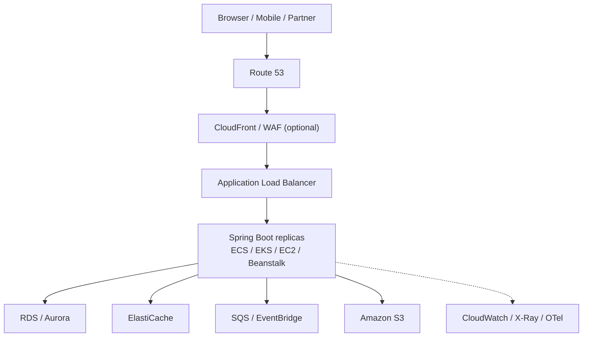
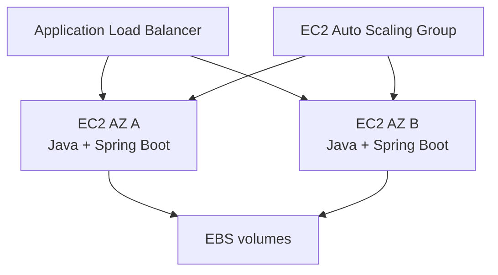
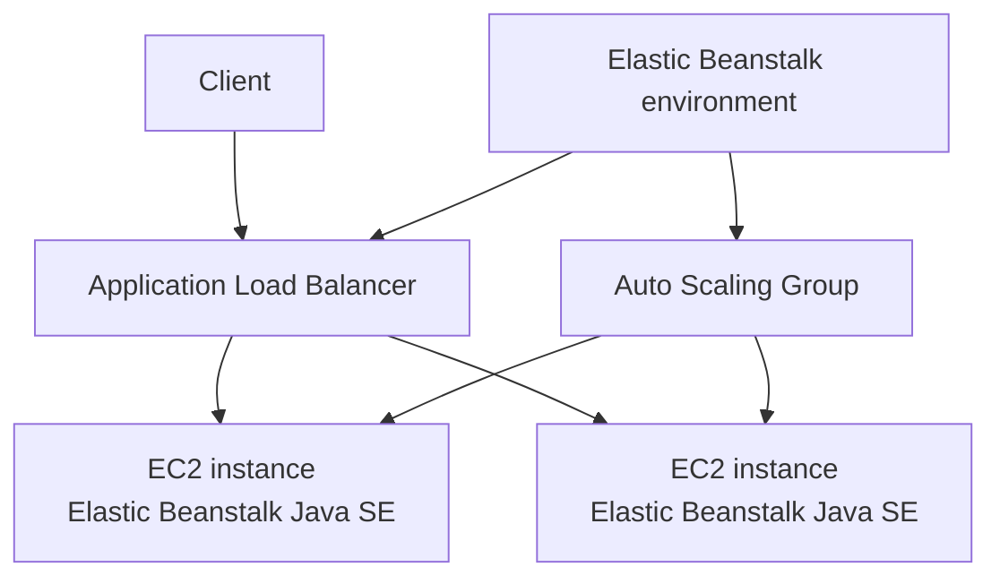
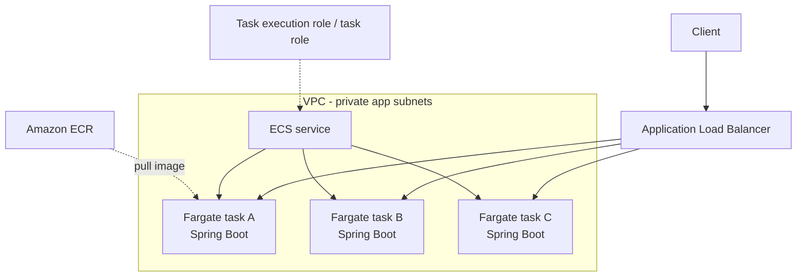
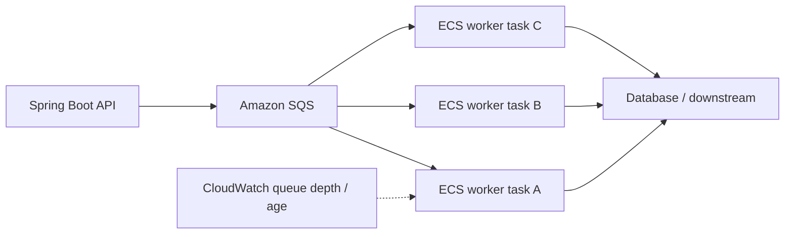
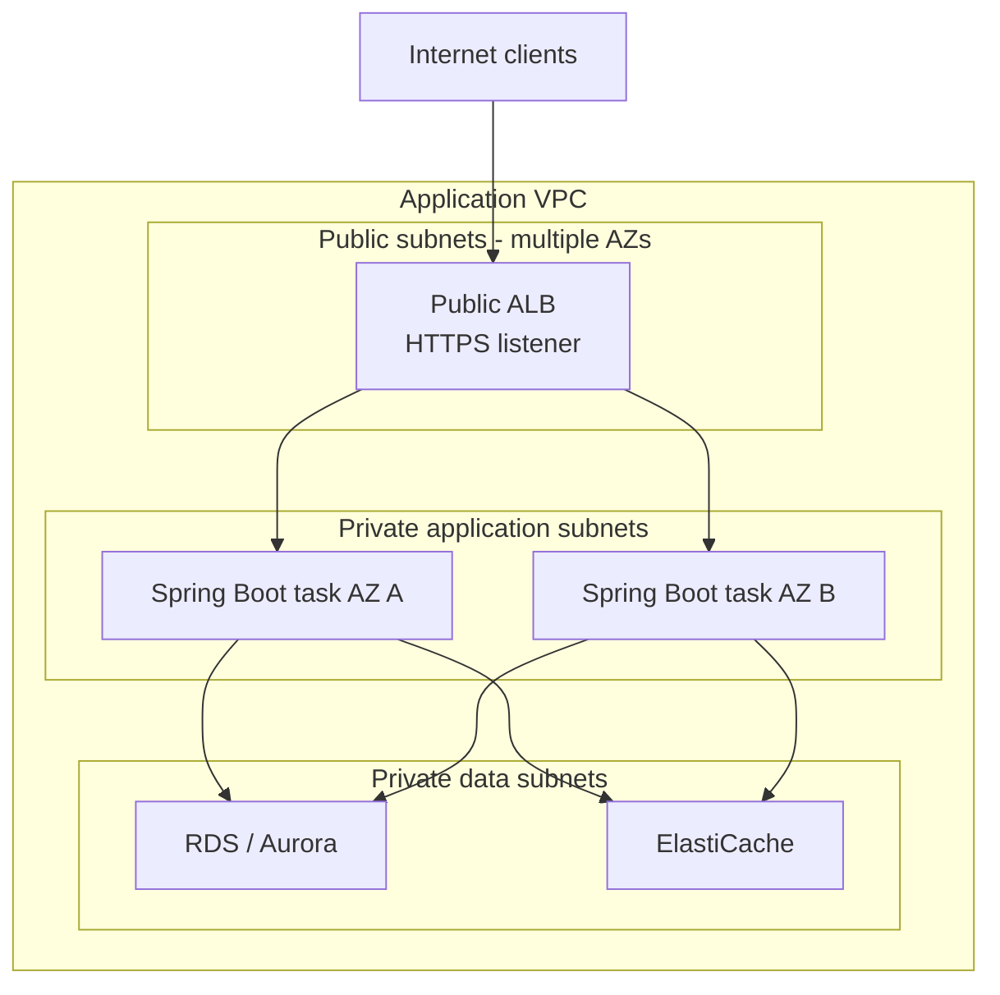
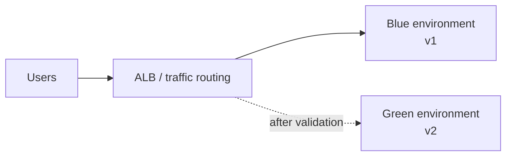
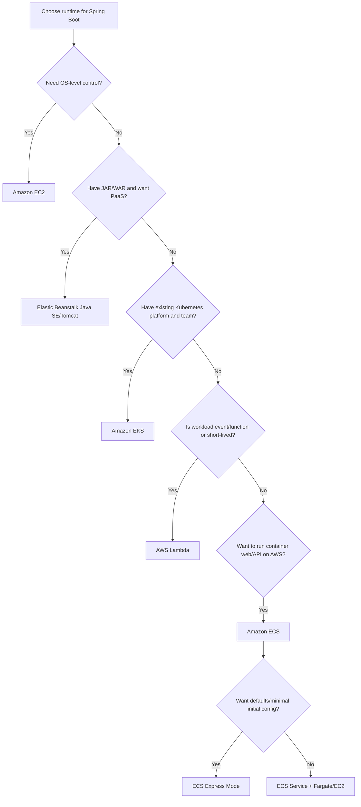

# Choosing a Runtime Environment for Spring Boot on AWS

> **Chapter:** Java and Spring Boot Applications  
> **Module:** CLOUD_PROVIDERS_AWS  
> **Objective:** Choose an appropriate compute environment to deploy Java/Spring Boot applications on AWS; understand the trade-offs between control, infrastructure management overhead, scalability, availability, security, release workflows, and total cost.
>
> **Scope:** Amazon EC2, AWS Elastic Beanstalk, Amazon ECS with AWS Fargate or EC2 capacity, Amazon ECS Express Mode, Amazon EKS, AWS Lambda, and AWS App Runner for existing customers. Services, platform versions, quotas, pricing, and features vary by Region/time; check AWS documentation before making production decisions.

## 1. The problem: one Spring Boot application can run in many places

A company builds an order management system using Java 21 and Spring Boot 3. The application provides a REST API, processes payments, sends notifications, accesses PostgreSQL, and generates background reports.

Requirements:

- Continuous HTTP API with p95 latency under 250 ms during peak hours.
- Average traffic of 150 requests/second, with campaigns reaching 1,500 requests/second.
- Need to deploy multiple application replicas across multiple Availability Zones.
- Do not store sessions or uploaded files on the local disk of a single instance.
- Each service may only access the exact AWS resources it needs.
- Rolling/blue-green deployment and rollback when health checks fail.
- CloudWatch logs/metrics, tracing, and alerting.
- Database connections must not grow unboundedly as app replicas scale out.
- The team currently has Java/Spring Boot experience; Kubernetes experience is limited.

There are many ways to run the same JAR or container image on AWS:

- Run directly on **Amazon EC2**.
- Deploy the JAR to **AWS Elastic Beanstalk**.
- Package with Docker and run on **Amazon ECS + AWS Fargate**.
- Run ECS tasks on **EC2 capacity** or ECS Managed Instances.
- Run Kubernetes on **Amazon EKS**.
- Use **Amazon ECS Express Mode** to reduce infrastructure configuration for container web/APIs.
- Run functions on **AWS Lambda** when the workload fits the invocation model.
- **AWS App Runner** is only for customers who already had access; the service has closed to new customers.

There is no single best choice for every Spring Boot app. The right question is: **which parts does the team need to control, what is the shape of the workload, and who will operate the remaining infrastructure layers?**

## 2. Separating three decisions: packaging, orchestration, and compute

Concepts are often conflated:

1. **Packaging:** whether the application is delivered as a JAR/WAR or a container image.
2. **Orchestration/runtime:** who manages the lifecycle, desired count, health checks, deployments, and scaling of application instances.
3. **Compute capacity:** whether processes/containers run on self-managed VMs, AWS-managed EC2 under a capacity model, or serverless compute.

Example:

```text
Spring Boot source code
        |
        v
Maven/Gradle build
        |
        +--> executable JAR
        |
        +--> Docker image
                  |
                  v
              Amazon ECR
                  |
          +-------+--------+
          |                |
          v                v
       Amazon ECS       Amazon EKS
          |                |
       Fargate / EC2    EC2 / Auto Mode /
       Express Mode     Fargate (where supported)
```

- A JAR is an **application artifact**.
- A Docker image is an **artifact packaging the application together with its runtime/dependencies**.
- ECS/EKS are **container orchestrators**.
- Fargate is a **serverless compute engine for containers**, not a standalone orchestrator.
- EC2 is **virtual machine compute**; it can run a JAR directly or run containers.
- Lambda is an **event/invocation runtime**; it is not a small always-on EC2 running a Spring Boot web server.

### 2.1. Not every application needs to be containerized

A Spring Boot executable JAR can run on:

- EC2 with systemd/a service manager.
- Elastic Beanstalk Java SE platform.
- Lambda via an appropriate adapter/function model.
- A container image on ECS/EKS.

Containers are useful when you want to build a consistent artifact across laptops, CI, and production; isolate runtime/dependencies from the host; or leverage ECS/EKS. However, containerization introduces image builds, registries, vulnerability scanning, task definitions/manifests, and operating a container platform.

### 2.2. A web application usually needs more components than compute



Compute is only one layer. Production design must also address databases, caches, queues, object storage, DNS, load balancing, secrets, identity, logs, and alerting.

## 3. Overview of options

| Environment | Artifact delivery | Managed infrastructure | Level of control | When typically appropriate |
|---|---|---|---|---|
| **Direct EC2** | JAR/WAR or container | VM, EBS, networking at the AWS level; OS/app managed by team | High | Legacy apps, OS/custom agents, specialized workloads |
| **Elastic Beanstalk** | JAR/WAR or container depending on platform | Provisions EC2, load balancer, Auto Scaling, health reporting | Medium | Java web apps needing a relatively simple PaaS |
| **ECS + Fargate** | Container image | ECS control plane and compute hosts managed by AWS | Medium | Containerized APIs/workers without managing EC2 hosts |
| **ECS + EC2** | Container image | ECS orchestration; team manages EC2 capacity unless using managed option | Medium–high | Steady workloads needing bin packing/GPU/instance customization |
| **ECS Managed Instances** | Container image | ECS manages the EC2 instances for this capacity option | Medium | Need instance family/performance control while reducing host operations |
| **ECS Express Mode** | Container image | Auto-configures ECS/Fargate, ALB HTTPS, autoscaling, networking, and monitoring | Low–medium initially; deeply customizable | Stateless web/APIs wanting fast deployment with production defaults |
| **EKS** | Container image + Kubernetes manifests/Helm | EKS manages control plane; data plane via Auto Mode/managed/self-managed nodes | High at Kubernetes layer | Existing Kubernetes platform/team/tooling |
| **Lambda** | ZIP/JAR or container image per Lambda runtime contract | Runtime, invocation scaling, execution environments managed by AWS | Low at host, high in function code | Event-driven, bursty, short-lived requests/processing |
| **App Runner** | Source code or image | Managed web app service | Low | Only accounts/customers previously enabled for App Runner |

**Important note on App Runner:** AWS closed App Runner to **new customers as of April 30, 2026**. Existing customers can continue using the service and create resources per the announcement. For new accounts, AWS recommends **Amazon ECS Express Mode** for a similarly simple container web/API deployment experience.

## 4. Amazon EC2: running a JAR directly or via container

### 4.1. How it works

You create an EC2 instance, choose an AMI, instance type, VPC/subnet, security group, IAM instance profile, and EBS volume. Then you install the Java runtime, download the JAR, and run the process using a service manager.



Example Linux service using systemd:

```ini
[Unit]
Description=Spring Boot Orders API
After=network.target

[Service]
User=spring
WorkingDirectory=/opt/orders
EnvironmentFile=/etc/orders/orders.env
ExecStart=/usr/bin/java -jar /opt/orders/orders-api.jar
Restart=on-failure
RestartSec=5
SuccessExitStatus=143
TimeoutStopSec=45

[Install]
WantedBy=multi-user.target
```

Systemd keeps the process running after the SSH session ends, restarts it on failure according to policy, and supports service lifecycle management.

### 4.2. Advantages

- Control over OS, filesystem, JVM, native libraries, and system agents.
- Easy integration with legacy software requiring host-level customization.
- Ability to choose memory-optimized, compute-optimized, Graviton, or specialized instance families.
- Familiar to teams with Linux/Windows server experience.
- Can combine EC2 Auto Scaling Groups, ALB, EBS, and other AWS services for HA.

### 4.3. Operational responsibilities

The team must manage:

- OS patching, Java updates, and package vulnerabilities.
- Process supervision, startup scripts, and log rotation.
- Deployment/rollback and artifact synchronization across instances.
- Scaling policies, instance replacement, and capacity planning.
- EBS usage, filesystem permissions, and backups if local data is stored.
- Security hardening, SSM access, IAM instance profiles, and host monitoring.
- Health checks, connection draining, and graceful shutdown.

**EC2 does not automatically provide HA just by running on AWS.** A single instance remains a single point of failure. Production typically requires at least two instances across multiple AZs, a load balancer, an Auto Scaling Group, health checks, and externalized state.

### 4.4. When to choose EC2

Choose EC2 when:

- The application depends on specific OS packages, kernel tuning, filesystems, or special agents.
- Host-level observability/security tooling is required.
- The workload is very steady and the team can optimize utilization/capacity.
- There is a clear reason to operate the VM lifecycle yourself.

If you only need to run a Spring Boot JAR, do not need OS customization, and do not want to operate servers, compare Elastic Beanstalk or ECS before choosing EC2 directly.

## 5. AWS Elastic Beanstalk: managed platform for Java web apps

### 5.1. Model

Elastic Beanstalk accepts a source bundle/artifact and creates and manages the AWS resources to run the application. For Java, the primary platform choices include:

- **Java SE:** runs the executable JAR of a Java web application; suitable for Spring Boot executable JARs.
- **Tomcat:** for WAR/Servlet/JSP deployments requiring a Tomcat platform.

The Java SE platform includes an nginx reverse proxy in front of the app on the corresponding platforms; platform versions are based on Amazon Linux and AWS Corretto per current documentation.



### 5.2. Environment tiers

- **Web server tier:** receives HTTP requests from the load balancer/clients.
- **Worker tier:** processes background tasks, typically integrating an SQS daemon/queue pattern per configuration.

A Spring Boot REST API application typically starts in the web server tier. If the workload needs independent background jobs, consider separating a worker process/service rather than letting web request threads handle all long-running tasks.

### 5.3. Advantages and limitations

Advantages:

- No need to manually wire together the entire EC2/ASG/ALB and deployment mechanism.
- Provides environment health reporting, logs, and platform updates.
- Supports single-instance for dev or load-balanced environments for production.
- Uses the JAR directly without requiring Docker.

Limitations:

- Still runs on EC2; the team needs to understand instance types, VPCs, scaling, and security groups.
- Advanced customization requires `.ebextensions`, platform hooks, or configuration files.
- Platform branches have lifecycles; deprecation/retirement and Java runtime compatibility must be tracked.
- Not a general-purpose Kubernetes/container orchestration platform.
- Configuration changes can trigger environment updates/replacements; deployment policies and rollbacks must be tested.

### 5.4. When to choose Beanstalk

Beanstalk fits well when:

- You have an existing Spring Boot JAR/WAR and want a relatively simple PaaS.
- The team does not yet need Kubernetes or ECS-specific capabilities.
- You want AWS to manage much of the provisioning/deployment while still using an EC2-based platform.
- The application has a clear web/worker model.

If the organization has already standardized on container images, ECS services, and deployment pipelines, ECS usually provides a more consistent model across multiple microservices.

## 6. Amazon ECS: AWS-native orchestrator for containers

### 6.1. What does ECS manage?

Amazon ECS is a managed container orchestration service. Key concepts:

| Concept | Meaning |
|---|---|
| **Cluster** | Logical grouping for ECS services/tasks and capacity |
| **Task definition** | Blueprint describing image, CPU/memory, ports, IAM roles, env/secrets, and logging |
| **Task** | A single execution of a task definition; can contain one or more containers |
| **Service** | Maintains a desired count of tasks and integrates load balancing/deployment/scaling |
| **Capacity provider** | How ECS obtains compute capacity, such as Fargate or EC2 capacity |
| **Task execution role** | Permissions ECS/Fargate needs to pull images, fetch secrets via supported mechanisms, and write logs |
| **Task role** | Permissions for application code inside the container to call AWS APIs |

ECS does not require the team to operate a Kubernetes control plane. This is an advantage if the team wants AWS-native orchestration with lower operational overhead than Kubernetes.

### 6.2. Task or Service?

- **RunTask:** runs a standalone task, suitable for migration jobs, scheduled jobs, one-off tasks, or batch processing.
- **ECS Service:** maintains a continuously running number of tasks, suitable for Spring Boot HTTP APIs and long-running workers.
- **Scheduled task:** uses EventBridge Scheduler/rules to trigger an ECS task on a schedule.
- **SQS worker service:** an ECS service can scale based on queue backlog or custom metrics.

A Spring Boot web API typically runs as an ECS service with at least two tasks across different AZs when HA is required.

### 6.3. ECS + Fargate

Fargate lets you run containers without provisioning or patching EC2 container instances.



Characteristics:

- Each Fargate task has dedicated capacity isolation for CPU, memory, network interface, and ephemeral storage under the Fargate model.
- Tasks use the **awsvpc** network mode, with their own Elastic Network Interface and security groups.
- CPU/memory are declared at the task level using supported combinations.
- The team does not manage the host OS, Docker daemon, or EC2 capacity.
- Well-suited for stateless web APIs, workers, and continuously running services.

### 6.4. ECS + EC2 capacity

With EC2 launch types/capacity providers:

- The ECS scheduler places tasks onto container instances.
- The team manages the instance fleet, AMIs, patching, scale-out, draining, and capacity reservations.
- Can leverage Savings Plans/Reserved Instances/Spot and bin packing.
- Full choice of instance families, GPUs, local NVMe, memory/network features, and host agents.
- Multiple tasks can share a host; isolation, task placement, and noisy neighbors must be understood.

Choose EC2 capacity when the workload is steady or specialized enough that cost savings and control outweigh host operations.

### 6.5. ECS Managed Instances

Amazon ECS Managed Instances is a capacity option that lets AWS provision, scale, patch, and maintain EC2 instances running ECS tasks while workloads still run on EC2 instance families. It is useful when compute options like memory-optimized, GPU, or Graviton are needed while reducing host management responsibilities.

Distinction:

- **Fargate:** AWS manages the underlying compute; tasks are not tied to an EC2 instance you manage.
- **ECS Managed Instances:** AWS manages the lifecycle of the EC2 capacity; you still select/design instance profiles and capacity behavior per the supported model.
- **ECS self-managed EC2 capacity:** the team owns the AMI, Auto Scaling/capacity providers, and host maintenance.

Verify Region, capacity type, instance family, and feature support before selecting.

## 7. ECS Express Mode: a simpler path for container web/APIs

### 7.1. Why Express Mode exists

A Spring Boot team may want container deployment without manually configuring many initial resources such as:

- ECS cluster/service/task definition.
- Fargate capacity.
- Application Load Balancer and HTTPS listener.
- Target groups, health checks, and security groups.
- Application Auto Scaling.
- CloudWatch logging/monitoring.

**Amazon ECS Express Mode** automatically configures these components with production-oriented defaults.

### 7.2. Three main inputs

To create an Express Mode service, the core inputs include:

1. **Container image** (typically in Amazon ECR or a private registry with configured secret).
2. **Task execution role** for ECS to pull images and write logs/operate on behalf of the task.
3. **Infrastructure role** for ECS to provision/manage supporting infrastructure such as load balancing, security groups, certificates, and autoscaling.

The application **task role** holds the permissions for code running inside the container to call S3, DynamoDB, SQS, or other AWS APIs; configure it when the application needs it.

### 7.3. Resources created by Express Mode

According to AWS documentation, Express Mode can create:

- An ECS default cluster (if it does not already exist) with the Fargate capacity provider.
- A task definition and ECS service.
- An Application Load Balancer with an HTTPS listener, listener rules, and target groups.
- An Auto Scaling policy.
- Networking and security configuration.
- Monitoring/logging configuration.
- A single access URL for the service.

Default target tracking may use 60% CPU utilization, min tasks 1, and max tasks 20; these are **configurable defaults**, not production-ready capacity/SLO settings. Set min tasks high enough for fault tolerance and traffic; account for two AZs, warm capacity, and dependency limits.

### 7.4. When is Express Mode appropriate?

- The Spring Boot app is already packaged as a container image.
- The workload is a stateless HTTP API/web application.
- You want fast deployment with HTTPS, ALB, and autoscaling pre-configured.
- The team needs the ability to customize further once a baseline is in place.

Express Mode is **not a fourth orchestrator**; it is a way to create/manage an ECS service with defaults, where the underlying resources remain visible and can be managed directly via ECS/ELB/CloudWatch/IAM APIs.

### 7.5. Pricing

There is no separate fee for Express Mode. You pay for the underlying resources created, such as Fargate compute, ALB, CloudWatch logs/metrics, and data transfer. Multiple Express Mode services can share an ALB when using the same networking configuration, reducing cost compared to creating one ALB per service.

### 7.6. When a deeply customized ECS service is needed

Use ECS services/task definitions directly when you need:

- Custom deployment strategies or service discovery.
- Complex sidecars/volumes/task roles/networking.
- Placement/capacity provider strategies.
- Specific traffic routing and ALB listener rules.
- Fine-grained autoscaling, deployment alarms, or blue/green/canary.
- Service Connect or specific networking integrations.

Starting with Express Mode does not lock you out of the underlying ECS resources; however, you must understand resource ownership and that changes outside Express Mode can affect how the service is managed.

## 8. Amazon EKS: running Spring Boot in Kubernetes

### 8.1. EKS manages the control plane

Amazon EKS is a managed Kubernetes service:

- AWS manages the Kubernetes control plane, API server, and etcd availability.
- The team deploys Pods, Deployments, Services, Ingress/Gateway, ConfigMaps, Secrets integrations, autoscaling, and observability.
- Compute/data plane can use managed node groups, self-managed nodes, Fargate (where supported), or **EKS Auto Mode**.
- Can use Helm, Argo CD, Flux, Kustomize, service meshes, policy controllers, and the Kubernetes ecosystem.

### 8.2. EKS Standard and EKS Auto Mode

| Aspect | EKS Standard | EKS Auto Mode |
|---|---|---|
| Control plane | Managed by AWS | Managed by AWS |
| Compute nodes | Team selects/manages managed/self-managed nodes or Fargate | AWS automatically provisions/manages nodes based on workload |
| OS patching/capacity | Mostly managed by team with managed/self-managed nodes | AWS automates many parts of node lifecycle |
| Networking/storage | Team chooses add-ons/CSI/CNI per architecture | Auto Mode manages many compute/storage/network components |
| Level of control | High | Fewer host operations, still uses Kubernetes APIs |
| Operational overhead | Higher | Lower compared to EKS Standard with self-managed data plane |

EKS Auto Mode does not eliminate Kubernetes complexity around Deployments, Services, namespaces, RBAC, policies, resource requests/limits, and cluster lifecycle.

### 8.3. When to choose EKS?

Choose EKS when:

- The organization already has a Kubernetes platform, GitOps, Helm, and cluster operations.
- Kubernetes APIs, portability, or existing ecosystem/tooling are required.
- Multiple workloads share the cluster/platform layer.
- There are requirements for advanced scheduling, operators, CRDs, network policies, or service mesh.
- The team has the capability to operate Kubernetes and accepts control plane/data plane costs.

**Do not choose EKS just because Spring Boot is packaged in Docker.** ECS also runs Docker images; EKS needs a platform/ecosystem/portability justification strong enough to offset its operational complexity.

## 9. AWS Lambda: Spring Boot as a function model

### 9.1. Lambda differs from a continuous web server

Lambda runs code inside an execution environment upon invocation. AWS creates additional environments as concurrency increases and reuses environments when possible.

Suitable for:

- Event-driven processing.
- SQS/SNS/EventBridge handlers.
- File processing from S3.
- Scheduled jobs.
- API endpoints whose request/response and processing duration fit within Lambda limits.
- Functions extracted from a Spring application as bounded capabilities.

Do not automatically lift-and-shift a Spring Boot MVC monolith to Lambda without examining startup, request concurrency, DB connections, payload/timeout limits, background threads, and state assumptions.

### 9.2. Spring integration

Common approaches:

- **Spring Cloud Function** to write function-oriented code and adapters.
- **AWS Serverless Java Container** to adapt certain Java web frameworks like Spring Boot to API Gateway/Lambda.
- Separating business logic from the servlet container so the function handler invokes the domain/service layer.
- Using managed Java runtimes or Lambda container images per the runtime contract.

Not every Spring Boot feature (embedded server, background schedulers, WebSockets, long-lived connections) translates intact to Lambda.

### 9.3. Java cold starts and SnapStart

Lambda SnapStart supports Java 11 and later per current runtime/deployment support:

- Lambda initializes the function when a version is published and takes a snapshot of the execution environment.
- New invocations can resume from the snapshot to reduce initialization latency.
- SnapStart applies only to **published versions** and aliases pointing to a version, not to `$LATEST`.
- SnapStart cannot be combined with Provisioned Concurrency.
- For state requiring uniqueness (random seeds, UUIDs, sockets, temporary credentials, connection pools), snapshot/restore hooks must be handled and state refreshed appropriately.
- Do not assume SnapStart eliminates all cold starts/latency; measure actual p95/p99.

If latency requirements are very strict, Provisioned Concurrency can keep environments warm at the cost of provisioned capacity.

### 9.4. When to choose Lambda

- The workload is event-driven, bursty, or has short request durations.
- Traffic can drop near zero for extended periods.
- No need to maintain continuous processes, threads, or a background server.
- Stateless handlers and proper connection lifecycles can be designed.
- Function responsibilities can be isolated and retries/idempotency observed.

If the application needs a long-lived HTTP server, many WebSocket connections, streaming, or an always-on process, ECS/EC2/EKS is usually a better fit.

## 10. AWS App Runner: status note for existing customers

App Runner was previously a simple managed service to deploy source code/container images into a web app/API without manually configuring ECS/ALB.

However, AWS has announced:

- **App Runner is closed to new customers as of April 30, 2026.**
- Existing customers can continue using the service and create resources per the announcement.
- AWS has no plans to develop new features for App Runner.
- AWS recommends that new customers use **Amazon ECS Express Mode** for a similarly simple experience with ECS/Fargate, ALB, HTTPS, autoscaling, and networking.

Therefore:

- If your account/organization already had App Runner access, you can continue operating it or plan a migration.
- If starting a new project/new account, do not use App Runner as the default choice.
- When migrating from App Runner, inventory environment variables, secrets, health checks, scaling configs, VPC connectors, custom domains, certificates, observability, and deployment pipelines before moving to ECS Express Mode/ECS.

## 11. Comparing ECS and EKS: a platform-level decision

| Criterion | Amazon ECS | Amazon EKS |
|---|---|---|
| API orchestration | ECS task/service APIs | Kubernetes APIs |
| Operational model | AWS-native, fewer platform layers | Kubernetes ecosystem |
| Control plane | AWS-managed, no Kubernetes control plane to operate | AWS manages Kubernetes control plane |
| Data plane | Fargate, EC2, ECS Managed Instances | Auto Mode, managed/self-managed nodes, Fargate where supported |
| Workload definition | Task definitions, services | Pods, Deployments, StatefulSets, Services |
| Scaling | ECS Service Auto Scaling, capacity providers | HPA/VPA (tooling), Cluster Autoscaler/Karpenter/Auto Mode |
| Deployment | Rolling, blue/green, linear, canary depending on strategy/controller | Rolling updates, rollout controllers, and ecosystem |
| Service networking | awsvpc, Service Connect, Cloud Map, ALB/NLB | VPC CNI, Services, Ingress/Gateway, add-ons |
| Team skills | AWS ECS operations | Kubernetes operations |
| Portability | AWS-centric | More portable Kubernetes APIs, still has AWS integrations |
| Cost | Underlying Fargate/EC2/ALB/logs/network | EKS cluster fee + compute + networking/storage/add-ons/logs |

**ECS is usually the simpler choice for AWS-native Spring Boot applications. EKS is worthwhile when the organization genuinely needs a Kubernetes platform.** Both can run the same container image; the biggest difference is the operational model and ecosystem.

## 12. Deciding by workload: web API, worker, batch, or event function?

| Workload | Option usually worth evaluating first | Why |
|---|---|---|
| Stateless, continuously running Spring Boot REST API | ECS Fargate or ECS Express Mode | Container lifecycle, ALB, autoscaling |
| Java monolith JAR, wanting PaaS with minimal changes | Elastic Beanstalk Java SE | Can deploy executable JAR directly |
| Legacy app needing host customization | EC2 | OS/JVM/filesystem control |
| Many services, existing Kubernetes platform | EKS | Shared platform/APIs/tooling |
| Continuously running SQS background worker | ECS service | Scales on queue backlog and keeps worker processes running |
| Scheduled batch job, finite duration | ECS RunTask/Batch or Lambda depending on duration | No need for an always-on web server |
| Short, bursty event processing | Lambda | Invocation-based scaling |
| Web/API container needing quick deploy with defaults | ECS Express Mode | Provisions ECS/Fargate + HTTPS + scaling |
| Existing App Runner | Continue with plan or migrate to ECS | App Runner is closed to new customers |

### 12.1. Stateless API

A REST API should:

- Not keep sessions in the local memory of a task.
- Move sessions/distributed state to ElastiCache/DynamoDB or an appropriate store.
- Store uploaded files in S3, not on the container filesystem.
- Use RDS/Aurora/DynamoDB as the source of truth.
- Use external secrets/config.
- Have health checks and graceful shutdown.
- Have at least two tasks/instances across multiple AZs if HA is required.

### 12.2. Background worker

A worker processing SQS does not need an ALB. You can use an ECS service with desired count and scaling based on queue backlog:



Pay attention to visibility timeout, idempotency, retry policy, DLQ, concurrency, and downstream rate limits. Do not scale workers solely on CPU if queue backlog is what actually represents remaining work.

### 12.3. Scheduled job

A Spring Boot batch task can run as an ECS RunTask invoked by EventBridge Scheduler, or AWS Batch if specialized job queues/compute scheduling are needed. Avoid running the same scheduled job on every web replica without a distributed lock/leader election, because scaling out will cause duplicate job runs.

### 12.4. Lambda and long-running work

Lambda has execution duration limits (up to 15 minutes for standard invocations), and execution environments are not guaranteed to stay alive as continuous daemon processes. If work exceeds suitable time/CPU/memory limits, consider ECS tasks, AWS Batch, or Step Functions orchestration.
## 13. Container images for Spring Boot

### 13.1. Multi-stage Dockerfile

A container image should contain only the required runtime and application artifact, run as a non-root user, and omit unnecessary build tools.

```dockerfile
# Stage 1: build application
FROM maven:3.9-eclipse-temurin-21 AS build
WORKDIR /workspace
COPY pom.xml .
COPY src ./src
RUN mvn -B -DskipTests package

# Stage 2: runtime
FROM eclipse-temurin:21-jre
WORKDIR /app
RUN useradd --system --uid 10001 spring
COPY --from=build /workspace/target/orders-api.jar /app/app.jar
USER 10001
EXPOSE 8080
ENTRYPOINT ["java", "-jar", "/app/app.jar"]
```

This is a minimal template; production builds should pin base images by digest, enable dependency/image scanning, generate an SBOM, and avoid the `latest` tag. You can build the artifact in CI and copy the JAR into the runtime image so no Maven stage is needed in the production pipeline.

### 13.2. Why use exec form for ENTRYPOINT?

The form:

```dockerfile
ENTRYPOINT ["java", "-jar", "/app/app.jar"]
```

runs the Java process directly as PID 1 inside the container. Shell form can introduce a parent shell process, preventing SIGTERM signals from reaching the process as expected unless `exec` is used. ECS/EKS require the process to receive SIGTERM for graceful shutdown.

### 13.3. Container memory and the JVM

Containers have CPU/memory limits. Modern JVMs are container-aware, but still need configuration and measurement:

- The JVM flag **-XX:MaxRAMPercentage** caps the heap relative to the memory visible to the JVM.
- Total container memory also needs room for Metaspace, thread stacks, direct buffers, code cache, native libraries, and agent overhead.
- Do not set Xmx to 100% of container memory.
- Measure heap, non-heap, GC pauses, allocation rate, thread count, and RSS.
- When an ECS task/EKS pod is OOMKilled, inspect the container exit reason and memory metrics; do not immediately blame the database.

Example JVM configuration:

```text
JAVA_TOOL_OPTIONS:
  -XX:MaxRAMPercentage=65
  -XX:+ExitOnOutOfMemoryError
```

65% is only an illustrative starting point, not a universal ratio. For apps heavily using direct buffers, TLS, Netty, or agents, benchmark and leave larger headroom.

### 13.4. Do not store persistent data in the container filesystem

Fargate tasks/containers have ephemeral storage; EC2/EKS nodes have local disks, yet tasks/pods can be replaced at any time. Never use local disk as the sole store for:

- User uploads.
- Session state.
- Payment/order records.
- Files shared across replicas.
- Job progress or idempotency records.

Use S3, EFS when appropriate, RDS/Aurora, DynamoDB, ElastiCache, or queues/event stores depending on semantics. The container filesystem should only hold reproducible temporary data.

## 14. Health checks, readiness, and graceful shutdown

### 14.1. Three different types of health signals

| Check | Question | Example |
|---|---|---|
| **Liveness** | Is the process still alive or does it need a restart? | JVM deadlock, unrecoverable application state |
| **Readiness** | Is the instance ready to receive traffic? | App finished initializing, required dependencies ready |
| **Load balancer health check** | Should the ALB send requests to this target? | HTTP /actuator/health/readiness returns 200 |

Do not include every dependency in the liveness check. If the database briefly loses connectivity, failing liveness can cause the orchestrator to restart all replicas simultaneously and trigger a connection storm. Readiness can reflect ability to serve traffic per policy; liveness should focus on process state.

### 14.2. Spring Boot Actuator

Add the Actuator dependency and configure health groups per your Spring Boot version. Example:

```yaml
management:
  endpoints:
    web:
      exposure:
        include: health,info,prometheus
  endpoint:
    health:
      probes:
        enabled: true
      show-details: never
  health:
    livenessstate:
      enabled: true
    readinessstate:
      enabled: true
```

Endpoints can include:

- /actuator/health/liveness
- /actuator/health/readiness
- /actuator/prometheus if the Micrometer Prometheus registry is configured.

Do not expose all Actuator endpoints publicly. Only open necessary endpoints on the internal network or management interface; protect sensitive details and endpoints capable of mutating runtime state.

### 14.3. Graceful shutdown

When an ECS/EKS/EC2 deployment stops a task/instance:

1. The load balancer stops sending new requests to the draining target.
2. The orchestrator sends SIGTERM to the container/process.
3. Spring Boot stops accepting new requests and waits for in-flight requests to finish within the shutdown timeout.
4. Connection pools, message listeners, and executors close in proper order.
5. The process exits before the grace period expires.

Spring Boot example:

```yaml
server:
  shutdown: graceful

spring:
  lifecycle:
    timeout-per-shutdown-phase: 25s
```

Coordinate across:

- ECS container stop timeout.
- ALB deregistration delay and target group health checks.
- EKS terminationGracePeriodSeconds, readiness probe, and preStop if needed.
- systemd TimeoutStopSec.
- Lambda does not share the same lifecycle as long-running server processes.

The orchestrator timeout must be large enough for app shutdown duration, yet not so long that rollouts stall. Test in-flight requests during deployments/failovers, not just app startup.

### 14.4. Health checks do not replace load testing

An endpoint returning 200 does not prove the app has sufficient capacity. Health checks only report basic status; load tests must measure p95/p99, error rates, saturation, DB connection usage, queue backlog, and scale-out behavior.

## 15. Networking and load balancing

### 15.1. Public ingress, private application tasks

A web/API service typically places the ALB in public subnets and app tasks/instances in private subnets:



- The ALB security group allows inbound HTTPS from required client sources.
- The app security group allows inbound only from the ALB security group on the application port.
- Database/cache security groups allow inbound only from the application security group on DB/cache ports.
- Do not assign public IPs to app tasks unless necessary.
- If tasks need outbound Internet access, weigh NAT Gateway costs versus VPC endpoints for AWS services.
- Use ACM to manage TLS certificates on the ALB; the app typically receives internal traffic over the chosen target group protocol.

### 15.2. Health checks and target draining

The ALB target group health check must point to the right path/port. During deployments:

- New tasks need enough startup time before being marked healthy.
- Old tasks need deregistration delay so in-flight requests finish.
- Spring Boot readiness must reflect ability to accept traffic.
- Health check interval, timeout, and healthy/unhealthy thresholds must match startup duration.
- Do not let target health checks depend on a flaky downstream in a way that marks the entire service unhealthy.

### 15.3. Service-to-service communication

- ECS can use Cloud Map or Service Connect for service discovery/communication.
- EKS uses Kubernetes Services/DNS, Ingress/Gateway, and network policies.
- EC2/Beanstalk can use private DNS, Cloud Map, or an internal ALB.
- Never hard-code task/instance private IPs because autoscaling and deployments change addresses.
- Use TLS/mTLS at the application layer when trust boundaries require it; do not assume services in the same VPC are inherently trusted.

## 16. IAM, secrets, and configuration

### 16.1. ECS execution role vs. task role

| Role | Who uses it? | Example permissions |
|---|---|---|
| **Task execution role** | ECS/Fargate agent on behalf of the task | Pull ECR images, write CloudWatch Logs, fetch secrets declared in the task definition |
| **Task role** | Application code inside the container | Read a specific S3 bucket, send SQS messages, read a DynamoDB table |

Do not grant application permissions to the execution role out of habit. If Spring Boot code calls S3, `s3:GetObject` belongs on the task role, not the task execution role.

### 16.2. EC2 instance profiles and EKS workload identity

- EC2 apps use an IAM instance profile; never download long-term access keys onto the filesystem.
- ECS tasks use a task role with temporary credentials.
- EKS uses EKS Pod Identity or IAM Roles for Service Accounts (IRSA) depending on the model; do not let all pods share a broad node instance role.
- Lambda uses a dedicated execution role per function.
- Beanstalk instance profiles and service roles serve different purposes; do not attach broad application permissions to the service role for convenience.

### 16.3. Secrets Manager and Parameter Store

Use AWS Secrets Manager for database passwords, API credentials, and secret rotation. Use Systems Manager Parameter Store for configuration/secure strings as needed.

- Do not commit secrets to Git or Docker image layers.
- Do not pass secrets in command-line arguments where they can leak via process inspection/logs.
- Restrict IAM `GetSecretValue` to the exact secret ARN.
- Enable KMS encryption per policy.
- Log secret metadata/version when auditing is needed, never log the secret value.
- Define secret refresh behavior for both the application and the deployment platform.

A secret injected as an environment variable at task start typically **does not automatically update inside a running process** when the secret rotates. You may need to refresh via SDK/cache or replace tasks through a rollout.

### 16.4. Externalized configuration

Environment-based configuration:

```yaml
spring:
  datasource:
    url: ${DB_URL}
    username: ${DB_USERNAME}
    password: ${DB_PASSWORD}
    hikari:
      maximum-pool-size: 12
      connection-timeout: 2000

server:
  port: 8080
```

This example illustrates Spring placeholders; in production, values are supplied via platform config/secret integrations. Never store real passwords in YAML files, Docker images, or source control.

## 17. Database connections and scaling

### 17.1. Scaling the app can overload the DB

Suppose an ECS service runs 40 tasks and each task has a HikariCP maximum pool size of 15:

\[
40 \times 15 = 600 \text{ connections}
\]

When autoscaling increases to 80 tasks, the theoretical maximum becomes 1,200 connections. If the database can only handle a few hundred connections, scaling the app can bottleneck the DB even while app CPU remains low.

### 17.2. Calculating pool size system-wide

- Determine DB max connections and reserve headroom for admin, migrations, monitoring, and jobs.
- Allocate the connection budget across each service and each replica.
- Cap maximum task/pod counts to protect the DB.
- Do not set HikariCP pool size overly high if each request holds a connection briefly.
- Use RDS Proxy when appropriate to pool/multiplex connections and reduce connection storms.
- Monitor active/idle/pending connections, connection acquisition latency, and DB CPU/memory.

### 17.3. Scale on the real bottleneck

If API p95 rises due to DB connection acquisition or slow SQL, adding app replicas can make things worse. Autoscaling signals should combine:

- App CPU/memory utilization.
- ALB `RequestCountPerTarget`.
- Request latency/error rate.
- Queue backlog/age for workers.
- DB connection count/CPU/latency.
- Downstream rate limits.

**Autoscaling does not add capacity to an already saturated dependency.** Set concurrency limits and backpressure to protect databases/payment providers.

## 18. Autoscaling: each environment has its own mechanism

| Environment | Scaling mechanism | Common signals |
|---|---|---|
| EC2 | Auto Scaling Group | CPU, ALB requests, custom CloudWatch metrics |
| Beanstalk | Environment Auto Scaling | CPU, request count, custom metrics |
| ECS | Service Auto Scaling / capacity providers | CPU, memory, ALB request count, custom metrics |
| ECS Express Mode | Express service autoscaling settings | CPU/target tracking and exposed options |
| EKS | HPA, KEDA, node autoscaling/Auto Mode | CPU/memory, custom metrics, queue backlog |
| Lambda | Concurrency scaling, reserved/provisioned concurrency | Invocation rate, concurrency, duration, throttles |

### 18.1. ECS service autoscaling

A service has:

- Minimum tasks: 2.
- Desired tasks: 2.
- Maximum tasks: 20.
- Target CPU utilization: 60%.

This is only an example. Load testing is required to determine CPU targets, scale-out cooldown, scale-in cooldown, task startup time, and minimum warm capacity.

### 18.2. EKS HPA

HPA can scale replicas based on CPU/memory requests or custom metrics. When using CPU utilization percentages, reasonable `resources.requests.cpu` values must be set; missing requests make scaling calculations unreliable. Increasing pod replicas requires cluster capacity; the node autoscaler/Auto Mode must be able to supply compute.

EKS Fargate fits certain pod workloads but has constraints: no DaemonSets/privileged containers, and it is not suitable for every Kubernetes add-on or host-level agent. Verify workload compatibility beforehand.

### 18.3. Lambda concurrency

Lambda scales with invocation concurrency but can be throttled by account/function concurrency limits. Use reserved concurrency to protect downstream systems; use Provisioned Concurrency when cold-start latency must be reduced and the cost is acceptable.

### 18.4. Scale-to-zero has trade-offs

- ECS services typically need at least one task if the API must remain continuously available.
- Lambda may incur no compute charges without invocations, but cold starts and concurrency behavior must be measured.
- Scale-to-zero container platforms can reduce compute cost, but initial requests incur startup delays and dependency warm-up.
- Databases, ALBs, logs, NAT, caches, and storage may still incur charges when the app scales to zero.

## 19. Deployment strategies and rollback

### 19.1. Rolling deployment

Gradually replaces replicas with the new version:

- Simpler and more capacity-efficient than blue/green.
- Two app versions may run concurrently during the rollout.
- Requires backward-compatible schema changes.
- Fast rollback if the old image/task definition remains available and the database schema is still compatible.

### 19.2. Blue/green deployment

Runs the new environment/version alongside the old version, tests it, then shifts traffic:



Benefits:

- Allows validating the new version before shifting traffic.
- Fast traffic rollback if errors are detected.
- Can use CodeDeploy/ECS blue-green or corresponding routing mechanisms.

Trade-offs:

- Requires parallel capacity during the rollout window.
- Database schemas and message contracts must be compatible across both versions.
- Background workers may process the same message; idempotency is required.
- Shifting traffic does not automatically roll back side effects already written to the DB.

### 19.3. Mechanisms by platform

| Platform | Deployment/rollback |
|---|---|
| EC2 | CodeDeploy, ASG Instance Refresh, immutable AMI, or blue/green ASGs |
| Elastic Beanstalk | All at once, rolling, rolling with additional batch, immutable, traffic splitting/blue-green depending on platform |
| ECS | Rolling deployment, deployment circuit breaker, CloudWatch alarms; blue/green/linear/canary per controller/strategy support |
| EKS | Kubernetes rolling updates, Helm/GitOps, Argo Rollouts/Flagger for canary/blue-green |
| Lambda | Published versions, aliases, weighted routing, and CodeDeploy traffic shifting |

### 19.4. ECS deployment circuit breaker

The ECS deployment circuit breaker can detect when a deployment fails to reach a steady state and roll back to the previous deployment when properly configured. Combine it with CloudWatch alarms to roll back when metrics breach thresholds. Do not rely solely on container process startup: an app can start successfully yet return 500s or fail to connect to the database.

### 19.5. Database migrations: expand and contract

If version v1 only knows the old column and v2 requires the new column:

1. Add the column/index in a way compatible with v1.
2. Deploy code capable of reading both old/new formats.
3. Backfill data.
4. Switch writes/reads to the new schema.
5. Wait until old replicas/jobs are no longer running.
6. Drop the old schema in a later release.

Never drop/rename a column in the same deployment while blue/green still has the old version serving traffic.

## 20. Observability for Spring Boot on AWS

### 20.1. Three telemetry layers

- **Logs:** events, errors, request context, and masked business identifiers.
- **Metrics:** throughput, latency, errors, saturation, JVM, pool usage, and queue backlog.
- **Traces:** request paths across APIs, caches, databases, queues, and downstream services.

### 20.2. Spring Boot Actuator and Micrometer

Actuator provides health/info/metrics endpoints. Micrometer supports exporting metrics to CloudWatch, Prometheus, or an OpenTelemetry pipeline depending on configuration.

Minimum to monitor:

| Group | Suggested metrics |
|---|---|
| HTTP | request rate, p50/p95/p99 latency, 4xx/5xx |
| JVM | heap/non-heap, GC pause, allocation, thread count |
| Database | active/idle/pending connections, acquisition time, query latency |
| Cache | hits/misses, command latency, connection errors |
| Messaging | queue depth, oldest message age, processing time, retry/DLQ |
| Container | CPU, memory, restart count, OOMKilled |
| Platform | desired/running task count, deployment failures, target health |
| Business | orders accepted, payments failed, checkout conversion |

Do not use customer IDs/order IDs as high-cardinality metric dimensions. Use structured logs/traces with appropriate access control to look up individual requests.

### 20.3. CloudWatch logs

- ECS: `awslogs` driver or FireLens to forward stdout/stderr.
- EC2/Beanstalk: CloudWatch agent/platform log streaming.
- EKS: Fluent Bit/CloudWatch Observability add-on or an OTel pipeline.
- Lambda: function logs automatically go to CloudWatch Logs per execution role/configuration.

Use JSON structured logs containing timestamp, level, service, environment, traceId, and requestId. Redact Authorization headers, passwords, access tokens, payment data, and PII.

### 20.4. Distributed tracing

AWS X-Ray or OpenTelemetry helps track latency across service boundaries. Instrument:

- HTTP server/client.
- JDBC/database calls.
- AWS SDK clients.
- Messaging producers/consumers.
- Cache clients where instrumentation supports it.

Traces require proper sampling to avoid excessive cost or storing sensitive data. Avoid recording raw SQL parameters, session tokens, or request payloads containing PII.

### 20.5. SLO-based alarms

A production service should have alarms for:

- p95/p99 latency exceeding SLO.
- Elevated 5xx/error rates.
- Running tasks/pods below desired count.
- Unhealthy ALB targets.
- ECS/EKS deployment rollbacks.
- JVM/container memory near limit, OOMKilled/restarts.
- DB connections near budget.
- Growing queue age/backlog.
- Lambda throttles/errors/duration.
- Dependency failures.

Set alarms based on baselines and SLOs; a brief CPU spike is not necessarily an incident if latency and errors remain within bounds.

## 21. Application and supply chain security

### 21.1. Image security

- Build images in CI from maintained base images.
- Pin versions/digests instead of mutable tags.
- Scan images and dependencies for vulnerabilities.
- Generate an SBOM and sign images if required by supply chain policy.
- Run as non-root with a read-only root filesystem if supported by the app.
- Restrict Linux capabilities and never run privileged containers.
- Never bake secrets into image layers.

### 21.2. Network and IAM least privilege

- Public ALB and private app tasks/nodes per architecture.
- Security groups open ports only between required tiers.
- Each task/pod/function uses its own dedicated IAM identity.
- Separate deployment roles from runtime roles.
- Use SSM Session Manager instead of public SSH when administering EC2.
- Encrypt EBS, RDS, S3, and secrets according to data classification.
- Use TLS for database/cache/API connections.

### 21.3. Runtime protection

- Patch the Java runtime and OS/base images.
- Restrict Actuator endpoints and management ports.
- Use WAF/rate limiting when public APIs require it.
- Configure request size, timeouts, thread pools, and connection limits.
- Do not trust forwarded headers from arbitrary sources; trust only controlled proxies/load balancers.
- Maintain audit logs for IAM/control-plane changes and application activity.

## 22. Cost: look at the entire service, not just compute pricing

| Environment | Common cost components |
|---|---|
| EC2 | Instance-hours, EBS, snapshots, ALB, data transfer, NAT, CloudWatch, licenses |
| Elastic Beanstalk | Underlying EC2, ALB, EBS, Auto Scaling, logs, data transfer; Beanstalk does not replace resource billing |
| ECS Fargate | vCPU/memory task duration, ephemeral storage beyond free tier if applicable, ALB, logs, data transfer, NAT |
| ECS EC2 | EC2 instances/EBS, capacity headroom, ALB, logs, data transfer; plus host operations cost |
| ECS Managed Instances | Managed EC2 capacity and associated resources per pricing option |
| ECS Express Mode | No separate Express Mode fee; pay for underlying Fargate, ALB, logs, networking, and transfer |
| EKS | EKS cluster fee, EC2/Fargate/Auto Mode compute, EBS/EFS, load balancers, networking, logs/add-ons |
| Lambda | Requests, duration, memory/architecture, provisioned concurrency if used, logs, data transfer |
| App Runner | Existing accounts only; billed for underlying service resources per App Runner pricing |

### 22.1. Hidden costs

- NAT Gateways for private tasks pulling dependencies or calling public endpoints.
- One ALB per service if not consolidated appropriately.
- CloudWatch logs retention and high-volume debug logs.
- Cross-AZ data transfer and cross-Region traffic.
- Idle minimum capacity maintained for latency/HA.
- Database/cache scaling triggered by app autoscaling.
- ECR storage, image scanning, and artifact retention.
- EKS add-ons, control plane, and platform engineering effort.

### 22.2. Capacity cost reasoning example

Suppose a service needs 4 replicas, each with 1 vCPU and 2 GiB memory, running continuously:

- ECS Fargate bills per vCPU/memory task duration.
- ECS on EC2 bills by instance capacity; if hosts have spare headroom, the marginal cost per task may be lower, though the team pays for the entire instance fleet and operations.
- EKS adds the cluster fee plus add-ons/compute/networking.
- Lambda bills per request and execution duration, requiring translation for concurrency, cold starts, retries, and DB connections.

Do not compare using a single “price per vCPU” number. Compare across the same workload, peak capacity, HA topology, idle hours, data transfer, logging, licenses, and operations.

### 22.3. Disciplined cost optimization

- Use Graviton if Java dependencies/native libraries are compatible and benchmarks meet requirements.
- Use Savings Plans/Reserved Instances for steady baselines; Spot for retryable/interruptible workloads.
- Scale down outside business hours for non-production.
- Tune log retention and intentional sampling.
- Use Fargate for variable workloads; EC2 capacity when utilization is steady and the team can optimize packing.
- Cap autoscaling max to protect the DB and budget.
- Account for NAT/ALB/network costs before splitting into too many services.

## 23. Decision matrix for Spring Boot

### 23.1. Decision tree



### 23.2. Recommendation table

| If the priority is... | Start evaluating... | Why |
|---|---|---|
| Host customization | EC2 | Full control of OS/JVM/process |
| Fast JAR deploy, minimal code changes | Elastic Beanstalk | Managed Java platform |
| Container web/API, no host management | ECS Fargate | AWS-native container orchestration |
| Container web/API with defaults | ECS Express Mode | Automatically creates supporting infrastructure |
| EC2 capacity control, GPU, or bin packing | ECS EC2 / Managed Instances | Optimizes instance family/capacity |
| Kubernetes ecosystem | EKS | Kubernetes APIs/operators/GitOps |
| Event-driven, invocation-based scaling | Lambda | No need for continuous servers |
| Existing App Runner account | App Runner or migration | Service closed to new customers |

### 23.3. Questions to evaluate

Before finalizing, answer:

1. Does the app need to run continuously or only handle events?
2. Are OS-level packages, native libraries, or special filesystems required?
3. Does the team have Kubernetes experience and ownership of the cluster platform?
4. Can the current JAR be packaged into a container image?
5. Do you need ALB/HTTPS/service discovery or API Gateway/event triggers?
6. Is the traffic pattern steady or bursty?
7. What is the p95/p99 startup/latency budget?
8. Does the app have local state/sessions/background threads?
9. What is the DB/cache connection budget at max scale?
10. Do you need rolling, blue/green, canary, or weighted traffic shifting?
11. Which AWS services does the runtime role need to call?
12. What is the total cost including compute, network, logs, database, and operations?
## 24. Configuring Spring Boot for cloud environments

### 24.1. Port and binding

Inside a container or EC2, the application must listen on the appropriate interface, not just loopback. Spring Boot defaults to port 8080; it can be configured as:

```yaml
server:
  port: 8080
  address: 0.0.0.0
```

If the application binds only to `127.0.0.1` inside a container, the ALB/task network may be unable to reach it. Do not expose ports publicly if the architecture already places an ALB or API Gateway in front.

### 24.2. Timeouts across the request chain

An HTTP request may traverse:

```text
Client
  -> CloudFront/WAF
  -> ALB
  -> Spring Boot
  -> RDS / ElastiCache / downstream API
```

Timeouts must be coordinated:

- Client timeout must be large enough for the SLA yet bounded.
- ALB idle timeout must match request/streaming patterns.
- Spring MVC/WebFlux request timeouts and async timeouts must be configured.
- JDBC connection timeout, socket timeout, and transaction timeout must be finite.
- Downstream HTTP client connect/read timeouts must never be infinite.
- Retries must have budgets, backoff, and idempotency.

Do not let every layer retry the same request multiple times. Retrying across API, service, SDK, and database layers multiplies call volume and causes retry storms when a dependency is degraded.

### 24.3. Thread pools and concurrency

Spring MVC uses a servlet thread pool; WebFlux uses an event-loop model. Do not pick WebFlux just because “non-blocking” sounds fast if the code still invokes blocking JDBC on the event loop. For JDBC, size bounded worker pools and connection pools carefully.

Limits to align:

- Tomcat/Jetty max threads.
- HikariCP max pool size.
- ECS task CPU/memory.
- ALB request concurrency.
- Downstream API quotas.
- ECS desired/max tasks or Lambda reserved concurrency.

**App concurrency should not exceed the capacity that the database and downstream systems can sustain.**

### 24.4. Java runtime and architecture

- Choose a Java runtime version supported by the platform and still receiving security updates.
- Check JNI/native dependencies when moving from x86_64 to ARM64/Graviton.
- Build multi-architecture images when running across multiple architectures.
- Benchmark startup, GC, CPU, and memory on the exact target instance/task size.
- Pin Maven/Gradle plugin and dependency versions for reproducible builds.
- Track end-of-support dates for the Java runtime, Amazon Linux, Beanstalk platform branches, and container base images.

## 25. AWS CLI: inspecting deployed runtimes

> The commands below are primarily **read-only**. Use AWS CLI v2, the correct Region, and appropriate IAM permissions. Replace resource IDs with lab/authorized resources. Outputs may contain endpoints, account IDs, or internal tags; do not post raw outputs to public issues.

### 25.1. Inspect ECS services

```bash
aws ecs describe-services \
  --region ap-southeast-1 \
  --cluster orders-prod \
  --services orders-api \
  --query 'services[0].{Status:status,Desired:desiredCount,Running:runningCount,Pending:pendingCount,LaunchType:launchType,CapacityProviders:capacityProviderStrategy,Deployments:deployments[*].{Status:status,Desired:desiredCount,Running:runningCount,Failed:failedTasks}}' \
  --output json
```

Used to check desired/running/pending tasks and deployment state. An `ACTIVE` service status alone does not prove the API is returning correct business responses.

### 25.2. Inspect ECS task definition

```bash
aws ecs describe-task-definition \
  --region ap-southeast-1 \
  --task-definition orders-api:12 \
  --query 'taskDefinition.{Family:family,Revision:revision,CPU:cpu,Memory:memory,NetworkMode:networkMode,ExecutionRole:executionRoleArn,TaskRole:taskRoleArn,Containers:containerDefinitions[*].{Name:name,Image:image,PortMappings:portMappings,LogConfiguration:logConfiguration}}' \
  --output json
```

Do not print environment variables containing secrets. For secrets declared in the task definition, inspect only the secret ARN/metadata when needed; do not read secret values to debug deployments.

### 25.3. Inspect ECS task failures

```bash
aws ecs describe-tasks \
  --region ap-southeast-1 \
  --cluster orders-prod \
  --tasks arn:aws:ecs:ap-southeast-1:111122223333:task/orders-prod/example \
  --query 'tasks[0].{LastStatus:lastStatus,DesiredStatus:desiredStatus,StoppedReason:stoppedReason,Containers:containers[*].{Name:name,ExitCode:exitCode,Reason:reason,Image:image}}' \
  --output json
```

Combine stopped reasons, CloudWatch logs, deployment events, and health checks to determine whether a task failed to start, was OOMKilled, or was marked unhealthy by the ALB.

### 25.4. Inspect EC2 instances

```bash
aws ec2 describe-instances \
  --region ap-southeast-1 \
  --filters Name=tag:Application,Values=orders \
  --query 'Reservations[].Instances[].{Id:InstanceId,State:State.Name,Type:InstanceType,AZ:Placement.AvailabilityZone,PrivateIP:PrivateIpAddress,LaunchTime:LaunchTime}' \
  --output table
```

This command does not modify EC2 resources. Never hard-code public IPs/instance IDs in app config; use ALB/DNS/service discovery.

### 25.5. Inspect EKS cluster

```bash
aws eks describe-cluster \
  --region ap-southeast-1 \
  --name platform-prod \
  --query 'cluster.{Name:name,Status:status,Version:version,Endpoint:endpoint,PlatformVersion:platformVersion,AccessConfig:accessConfig,ResourcesVpcConfig:resourcesVpcConfig}' \
  --output json
```

The endpoint is internal information. Check cluster status/version and networking; workload readiness must also be checked via the Kubernetes API, deployments, and pods using `kubectl`.

### 25.6. Inspect Lambda function configuration

```bash
aws lambda get-function-configuration \
  --region ap-southeast-1 \
  --function-name order-event-handler \
  --query '{Runtime:Runtime,Handler:Handler,Memory:MemorySize,Timeout:Timeout,Architectures:Architectures,PackageType:PackageType,State:State,LastUpdateStatus:LastUpdateStatus,SnapStart:SnapStart,ReservedConcurrency:ReservedConcurrentExecutions}' \
  --output json
```

Check Runtime, memory, timeout, architecture, and SnapStart configuration. Do not display Environment Variables if they contain secrets.

### 25.7. Inspect Elastic Beanstalk environments

```bash
aws elasticbeanstalk describe-environments \
  --region ap-southeast-1 \
  --application-name orders \
  --query 'Environments[*].{Name:EnvironmentName,Status:Status,Health:Health,Platform:PlatformArn,Version:VersionLabel,URL:CNAME}' \
  --output table
```

`GREEN` health does not replace API-level smoke tests. Platform ARN/version must be checked to track Java runtime/OS support lifecycles.

### 25.8. Inspect Lambda concurrency and errors

```bash
aws cloudwatch list-metrics \
  --region ap-southeast-1 \
  --namespace AWS/Lambda \
  --metric-name Throttles \
  --output json
```

Use CloudWatch dashboards or `get-metric-data` to inspect time series; `list-metrics` only lists available metrics/dimensions.

## 26. Infrastructure as Code: ECS task definition example

The following CloudFormation snippet illustrates how to define a Spring Boot container for ECS Fargate. It is **not a complete deployable stack**: it still needs a VPC, subnets, security groups, ECS cluster, service, load balancer, log group, IAM roles, secrets, and corresponding parameters.

```yaml
Resources:
  OrdersTaskDefinition:
    Type: AWS::ECS::TaskDefinition
    Properties:
      Family: orders-api
      RequiresCompatibilities:
        - FARGATE
      NetworkMode: awsvpc
      Cpu: "1024"
      Memory: "2048"
      ExecutionRoleArn: !Ref TaskExecutionRoleArn
      TaskRoleArn: !Ref OrdersApplicationTaskRoleArn
      RuntimePlatform:
        CpuArchitecture: ARM64
        OperatingSystemFamily: LINUX
      ContainerDefinitions:
        - Name: orders-api
          Image: !Ref OrdersImageUri
          Essential: true
          PortMappings:
            - ContainerPort: 8080
              Protocol: tcp
          Environment:
            - Name: SPRING_PROFILES_ACTIVE
              Value: production
          Secrets:
            - Name: DB_PASSWORD
              ValueFrom: !Ref DatabasePasswordSecretArn
          HealthCheck:
            Command:
              - CMD-SHELL
              - curl -fsS http://localhost:8080/actuator/health/readiness || exit 1
            Interval: 30
            Timeout: 5
            Retries: 3
            StartPeriod: 60
          LogConfiguration:
            LogDriver: awslogs
            Options:
              awslogs-group: /ecs/orders-api
              awslogs-region: !Ref AWS::Region
              awslogs-stream-prefix: app
```

Explanation:

- Fargate requires the `awsvpc` network mode.
- CPU/memory must belong to supported combinations.
- The execution role lets ECS pull images, write logs, and retrieve secrets as configured.
- The task role is for Spring Boot code calling AWS APIs.
- `RuntimePlatform` ARM64 is only suitable when the image/dependencies support ARM64; otherwise choose `X86_64`.
- The health check uses `curl`; the runtime image must include `curl` or change the command to an available binary/script.
- Secrets are injected into the environment at task startup; secret rotation does not automatically update environment variables in running tasks.
- The image URI should be pinned to an immutable tag/digest in the release pipeline.
- A task definition alone does not create the service, ALB, or autoscaling.

### 26.1. What else does a production ECS service need?

A real-world service also requires:

- An ECS cluster and Fargate capacity provider.
- Private subnets across multiple AZs.
- Security groups allowing traffic only from the ALB.
- An ALB HTTPS listener and target group.
- An ACM certificate and DNS record.
- Desired/min/max task counts.
- Deployment circuit breaker/CloudWatch alarms.
- A Service Auto Scaling policy.
- CloudWatch log group/retention.
- IAM task execution role and application task role.
- Secrets/KMS policies.
- Database/cache security groups and a connection budget.

### 26.2. Infrastructure as Code does not replace deployment design

IaC reproduces infrastructure, but it does not automatically solve:

- Database schema compatibility.
- Backward-compatible API/message contracts.
- Secret rotation within the application runtime.
- Connection pool sizing.
- Canary analysis and rollback thresholds.
- Application-level smoke tests.
- SLOs, alert routing, and incident response.

## 27. Troubleshooting by platform

| Symptom | Possible cause | What to check |
|---|---|---|
| EC2 app fails to start | Java path, permissions, env file, systemd unit | systemd status/journal, JAR, user, and port |
| Beanstalk deployment RED | Artifact/platform mismatch, health check, dependency failure | Environment events, logs, platform branch, target health |
| ECS task STOPPED | Image pull, IAM role, memory, port, secrets | stoppedReason, container reason, task execution role, logs |
| ECS service not scaling | Scaling policy/metric/capacity limits | Application Auto Scaling, desired/running count, Fargate quotas |
| Fargate task cannot reach RDS | SG/subnet/route/DNS | App SG → DB SG, private subnet, endpoint, TLS |
| ALB target unhealthy | Wrong port/path/startup timeout | Target group health reason, readiness endpoint |
| EKS pod Pending | CPU/memory requests, node capacity, scheduling constraints | kubectl describe pod, events, node capacity |
| EKS pod CrashLoopBackOff | Startup/config/secret/probe failure | logs, previous container logs, probe settings |
| EKS HPA not scaling | Missing metrics/requests/custom metrics | metrics server, requests, HPA events |
| Lambda throttles | Concurrency/account quota | reserved concurrency, throttles, downstream limits |
| High Lambda cold starts | Package size, Spring initialization, VPC/network | Init duration, SnapStart/Provisioned Concurrency |
| DB connections spike | App autoscaling, oversized pool, leaks | Hikari metrics, task count, RDS Proxy, DB connections |
| 502/503 after deploy | App not ready yet, target drain/timeout | ALB target health, readiness, graceful shutdown |
| App OOMKilled | JVM heap/native memory exceeds container limit | heap dump, RSS, GC, MaxRAMPercentage |
| New secret, app uses old one | Environment variable does not refresh | Secret version, task replacement, app refresh |
| DB errors persist after rollback | Non-backward-compatible migration | Schema state, dual-version behavior, expand/contract |
| Low CPU but high latency | DB/network lock/thread pool bottleneck | traces, JDBC acquisition, downstream latency |
| ECS/EKS scales out but throughput flat | Database/downstream saturated | DB pool, queue backlog, external API rate limits |

### 27.1. Slow API investigation runbook

1. Confirm whether the issue affects the entire service or only one AZ/task/pod.
2. Check ALB target health and request latency.
3. Compare application p95/p99 against cache/database/downstream spans.
4. Inspect CPU, memory, GC, thread pools, and connection pools.
5. Inspect database connections, locks, query latency, and storage.
6. Check autoscaling events, desired/running tasks, and deployment changes.
7. If cache misses increased, inspect TTL/key changes/evictions; do not flush the cache as a first step.
8. If a deployment just occurred, check version compatibility and circuit breaker rollbacks.
9. Apply rate limiting/backpressure if a downstream is saturated.
10. Document the root cause, metric evidence, and action items.

## 28. Scenario exercises and answers

### Exercise 1 — JAR or container?

A Spring Boot JAR runs reliably on EC2. The team wants to deploy the same artifact across multiple environments and use ECS. What needs to change?

**Answer:** Package the JAR into a container image, publish the image to ECR, create a task definition/service, and choose Fargate or EC2 capacity. The JAR does not necessarily have to be rewritten.

### Exercise 2 — Choosing EC2

An application requires a kernel module and native agent supported by the vendor only on a custom OS image. Which option is worth evaluating?

**Answer:** EC2, or ECS on EC2 if container orchestration is still desired. Fargate does not provide host-level customization like EC2.

### Exercise 3 — Beanstalk or ECS?

A team has an executable JAR, does not use Docker/Kubernetes yet, and needs a web app with ALB and Auto Scaling. What minimizes initial changes?

**Answer:** Elastic Beanstalk Java SE is a reasonable candidate. ECS/Fargate is a strong direction if the team wants to containerize and standardize services.

### Exercise 4 — Fargate or EC2 capacity?

A workload has highly variable traffic and the team does not want to patch hosts. What should be evaluated?

**Answer:** ECS Fargate. Calculate costs based on vCPU/memory task duration, ALB/networking/logs, and verify quotas.

### Exercise 5 — Is EKS always better than ECS?

An application has only three Spring Boot microservices and the team has never operated Kubernetes. Should EKS be chosen because of Docker images?

**Answer:** No. ECS/Fargate generally offers a simpler operational model; EKS is only worth it when there is a specific Kubernetes ecosystem/platform need.

### Exercise 6 — ECS Express Mode

A team wants to deploy a container web/API with HTTPS, ALB, and autoscaling without configuring each resource manually. Where should they start?

**Answer:** Evaluate ECS Express Mode. Provide the image, task execution role, and infrastructure role; configure a task role if the app calls AWS APIs. Review defaults and underlying costs.

### Exercise 7 — App Runner for a new account

A project creates a new account in November 2026 and wants to deploy App Runner. What alternative does AWS recommend?

**Answer:** App Runner closed to new customers on April 30, 2026. Evaluate ECS Express Mode for simple container web/APIs or an ECS service directly.

### Exercise 8 — Lambda or ECS worker?

A worker processes SQS continuously, and each message can run for 20 minutes. Should standard Lambda be used?

**Answer:** Standard Lambda invocations have a 15-minute maximum, so it is unsuitable if a single message requires 20 continuous minutes. Use an ECS task/service or AWS Batch; break down the workflow if possible.

### Exercise 9 — EC2 single point of failure

A Spring Boot app runs on a single EC2 instance in one AZ. What must be added for HA within the Region?

**Answer:** Multiple instances across multiple AZs, ALB, Auto Scaling Group, health checks, externalized state, a deployment/replacement strategy, and appropriate database/cache HA.

### Exercise 10 — ECS task role

An application in ECS needs to write objects to S3. Which role should receive the permission?

**Answer:** The application's ECS **task role**. The task execution role is for the agent pulling images, writing logs, and execution operations.

### Exercise 11 — Database connection budget

50 tasks, HikariCP max pool 20. What is the theoretical maximum number of connections?

**Answer:** 1,000 connections, not counting other services. Calculate the pool budget from DB max connections and cap autoscaling; consider RDS Proxy if appropriate.

### Exercise 12 — Health check

Temporary DB unavailability causes the liveness endpoint to return DOWN and ECS restarts all tasks. What design needs revisiting?

**Answer:** Do not let flaky dependencies cause cascading liveness failures. Separate liveness/readiness and define readiness policy based on actual ability to serve.

### Exercise 13 — Graceful shutdown

The ALB keeps sending requests to a stopping task and requests get reset. What needs to be coordinated?

**Answer:** ALB deregistration delay/target draining, ECS stop timeout, Spring Boot graceful shutdown, and SIGTERM handling. Test in-flight requests during rollouts.

### Exercise 14 — OOMKilled

A container has a 1 GiB memory limit, the JVM heap uses nearly 1 GiB, and the task is OOMKilled. How to fix?

**Answer:** The heap must not consume all container memory. Lower `MaxRAMPercentage`/`Xmx`, account for Metaspace/direct buffers/thread stacks/agents, and benchmark RSS.

### Exercise 15 — Lambda cold start

A Java function suffers from high cold-start latency. Which options should be measured?

**Answer:** Reduce package/init work, use SnapStart for published versions if supported by the runtime, or Provisioned Concurrency if needed and cost is acceptable. Do not combine SnapStart with Provisioned Concurrency.

### Exercise 16 — Secrets rotation

Secrets Manager rotated the DB password, but ECS tasks still log in with the old password. Why?

**Answer:** Secrets injected as environment variables at task startup usually do not auto-refresh. Either the app must refresh secrets/reconnect or new tasks must be rolled out.

### Exercise 17 — ECS/EKS autoscaling yet DB overloaded

API latency rises, the autoscaler adds replicas, and DB connections exceed limits. What should be done?

**Answer:** Cap max replicas/concurrency, reduce Hikari pool size, use RDS Proxy when suitable, add backpressure, and tune queries. Scaling the app does not solve DB saturation.

### Exercise 18 — Rolling deployment and database schema

The new version drops a column while the old version is still running. What is the risk?

**Answer:** Old replicas may fail when reading/writing the dropped column. Use expand-and-contract, run compatible versions in parallel, and drop the old schema in a later release.

### Exercise 19 — EKS pod Pending

A pod requests 4 vCPU/16 GiB, but the node pool lacks sufficient capacity. What to check?

**Answer:** `kubectl describe pod`/events, node capacity, quotas, node autoscaler/Auto Mode, and scheduling constraints. Adjust requests or provision appropriate capacity.

### Exercise 20 — Observability

API p99 increases while CPU remains low. Which metrics/traces should be inspected?

**Answer:** Distributed traces, JDBC acquisition/query latency, locks, downstream API latency, thread pool saturation, network latency, and cache command latency. Low CPU does not rule out dependency bottlenecks.

### Exercise 21 — App Runner migration

An existing organization has an App Runner service and wants to move to ECS Express Mode. What must be inventoried?

**Answer:** Image/source build, environment variables/secrets, health checks, scaling, VPC connector, custom domains/certificates, IAM, logs/metrics, network rules, DNS, and deployment pipeline.

### Exercise 22 — Fargate vs. EC2 cost

A service runs steadily 24/7, host utilization can stay high, and the team has EC2 experience. What should be compared?

**Answer:** ECS EC2 capacity vs. Fargate, including instance fleet/headroom, Savings Plans/Spot, patching/on-call effort, task packing, ALB, networking, and scaling. Never compare raw compute price alone.

### Exercise 23 — ECS Express Mode defaults

A production service has min tasks 1 in one AZ, is very sensitive to p95 latency, and needs AZ fault tolerance. Should defaults be kept?

**Answer:** Not by default. Configure min capacity/placement across multiple AZs, check ALB/subnet coverage, warm tasks, scale-out time, and dependency capacity.

### Exercise 24 — Stateless design

The app writes uploads to `/tmp` on a task and sends the URL to users. After deployment, files disappear. What design fits?

**Answer:** Upload directly to/store files in Amazon S3 and keep metadata in the DB; use the local filesystem only for reproducible temporary files.

### Exercise 25 — Choosing a runtime for the scenario system

The Java 21 Spring Boot app is a stateless REST API, runs continuously, has variable traffic, and the team lacks Kubernetes experience and wants minimal host operations. Initial recommendation?

**Answer:** ECS Fargate or ECS Express Mode is a sensible shortlist. Choose Express Mode if defaults satisfy requirements; choose an ECS service directly if deep networking, task, deployment, or scaling configuration is needed. Verify ALB, IAM, secrets, DB connection budget, HA, and cost.

## 29. Pre-production runtime selection checklist

1. **Workload shape:** web API, long-running worker, batch, or event function?
2. **Packaging:** direct JAR/WAR or container image?
3. **Platform skills:** does the team operate Linux, Beanstalk, ECS, or Kubernetes?
4. **Control requirements:** need OS/kernel/native agents or only the application runtime?
5. **Availability:** number of AZs, min replicas, load balancer, health checks, and failover?
6. **Scaling:** metrics, min/max capacity, warm-up, scale-to-zero, and dependency limits?
7. **JVM:** memory headroom, GC, CPU architecture, startup, and cold-start?
8. **Networking:** public ingress/private app, security groups, NAT/VPC endpoints, DNS?
9. **Identity:** execution role, task role, EC2 instance profile, EKS workload identity, or Lambda role?
10. **Secrets:** Secrets Manager/Parameter Store, rotation, and runtime refresh?
11. **State:** are sessions, uploads, schedulers, locks, and job progress externalized?
12. **Database:** pool size, total connections, RDS Proxy, and backpressure?
13. **Deployment:** rolling/blue-green/canary, rollback, and schema compatibility?
14. **Health:** liveness/readiness, ALB checks, and graceful shutdown?
15. **Observability:** logs, metrics, traces, SLO dashboards, and alarms?
16. **Supply chain:** image scan, SBOM, digest pinning, non-root, and secrets?
17. **Cost:** compute, ALB, NAT, logs, data transfer, database, and operational effort?
18. **Service lifecycle:** are runtime/platform versions supported for the project lifespan?
19. **Quota:** vCPU, task/pod counts, Lambda concurrency, IP addresses, and account limits?
20. **Recovery:** deployment rollback, AZ failure, database failover, and restore drill?

**Final takeaway:** choosing a runtime for Spring Boot is a decision about **infrastructure management level and operational model**. EC2 maximizes control; Elastic Beanstalk simplifies JAR deployment; ECS/Fargate is the AWS-native path for containers; ECS Express Mode spins up web/API services quickly with defaults; EKS fits when the organization needs a Kubernetes platform; Lambda fits invocation/event-driven workloads. App Runner remains an option only for existing customers. Regardless of environment, production still requires stateless design, least-privilege IAM, health checks, graceful shutdown, connection budgeting, observability, rollback, and full TCO analysis.

## Official AWS Documentation

- [Amazon EC2 User Guide](https://docs.aws.amazon.com/AWSEC2/latest/UserGuide/)
- [AWS Elastic Beanstalk Developer Guide](https://docs.aws.amazon.com/elasticbeanstalk/latest/dg/)
- [Elastic Beanstalk Java SE platform](https://docs.aws.amazon.com/elasticbeanstalk/latest/dg/java-se-platform.html)
- [Amazon ECS Developer Guide](https://docs.aws.amazon.com/AmazonECS/latest/developerguide/)
- [Amazon ECS on AWS Fargate](https://docs.aws.amazon.com/AmazonECS/latest/developerguide/AWS_Fargate.html)
- [Amazon ECS task IAM roles](https://docs.aws.amazon.com/AmazonECS/latest/developerguide/task-iam-roles.html)
- [Amazon ECS task execution IAM role](https://docs.aws.amazon.com/AmazonECS/latest/developerguide/task_execution_IAM_role.html)
- [Amazon ECS Express Mode](https://docs.aws.amazon.com/AmazonECS/latest/developerguide/express-service-overview.html)
- [Amazon ECS Managed Instances](https://docs.aws.amazon.com/AmazonECS/latest/developerguide/managed-instances.html)
- [Amazon ECS deployment types and strategies](https://docs.aws.amazon.com/AmazonECS/latest/developerguide/deployment-types.html)
- [Amazon EKS User Guide](https://docs.aws.amazon.com/eks/latest/userguide/)
- [Amazon EKS Auto Mode](https://docs.aws.amazon.com/eks/latest/userguide/automode.html)
- [AWS Lambda Developer Guide](https://docs.aws.amazon.com/lambda/latest/dg/)
- [SnapStart for Lambda functions](https://docs.aws.amazon.com/lambda/latest/dg/snapstart.html)
- [AWS App Runner service update](https://docs.aws.amazon.com/apprunner/latest/dg/what-is-apprunner.html)
- [AWS Compute Services Decision Guide](https://docs.aws.amazon.com/decision-guides/latest/compute-on-aws-how-to-choose/compute-on-aws-how-to-choose.html)
- [Spring Boot deployment](https://docs.spring.io/spring-boot/reference/packaging/container-images/dockerfiles.html)
- [Spring Boot Actuator endpoints](https://docs.spring.io/spring-boot/reference/actuator/endpoints.html)
- [Spring Boot graceful shutdown](https://docs.spring.io/spring-boot/reference/web/graceful-shutdown.html)
- [AWS Pricing Calculator](https://calculator.aws/)
