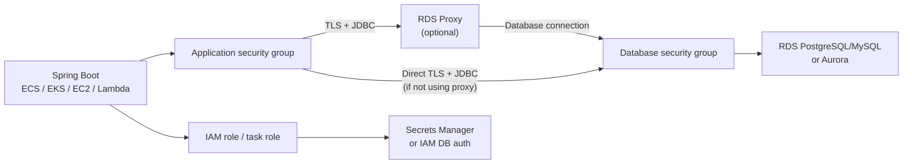
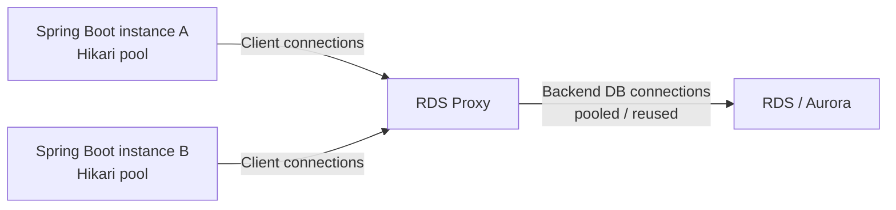

# Connecting Securely to RDS and Tuning Connection Pools

> **Chapter:** Java and Spring Boot Applications  
> **Module:** CLOUD_PROVIDERS_AWS  
> **Context:** Designing connections from Java/Spring Boot to Amazon RDS or Aurora on AWS, managing credentials, TLS, IAM database authentication, HikariCP, and Amazon RDS Proxy. The goal is to maintain secure connections, recover cleanly during failovers, and bound connections to protect the database.

## Learning objectives

After this lesson, you will be able to:

1. Describe the connection path from ECS/EKS/EC2/Lambda to RDS/Aurora across VPCs, DNS, security groups, and TLS.
2. Distinguish IAM control-plane permissions, IAM database authentication, database users/roles, and SQL privileges.
3. Configure PostgreSQL JDBC or MySQL Connector/J to verify CAs and hostnames.
4. Retrieve credentials from AWS Secrets Manager or use IAM authentication without hardcoding passwords/AWS access keys.
5. Explain why an IAM DB authentication token is valid for 15 minutes and why a fresh token must be generated when opening new physical connections.
6. Calculate connection budgets based on DB capacity, application replica count, background jobs, migrations, and admin sessions.
7. Tune HikariCP: maximum/minimum pool size, connection timeout, validation timeout, idle timeout, max lifetime, keepalive, and leak detection.
8. Understand RDS Proxy client/backend connections, multiplexing, session pinning, and IAM authentication modes.
9. Handle reconnects, DNS failover, safe transaction retries, and idempotency.
10. Read HikariCP, RDS, RDS Proxy, and SQL engine metrics to diagnose pool exhaustion or database saturation.
11. Verify configurations using Java, Spring Boot, AWS CLI, IAM policies, and CloudFormation.
12. Build runbooks for credential rotation, connection storms, failover, and TLS/network errors.

## 1. Architecture for connecting Spring Boot to RDS

A Spring Boot application should never connect to a database using a static IP address or expose database ports to the Internet. Common flow:



All layers must align simultaneously:

- **Network:** application and database reside in VPCs with proper routes/subnets; security groups permit only required sources.
- **DNS:** the application uses the DNS-based RDS/Aurora/Proxy endpoint, never hardcoded IPs.
- **TLS:** encrypts traffic in transit and verifies server certificates/hostnames.
- **Authentication:** SQL passwords from Secrets Manager or IAM database authentication.
- **Authorization:** database users hold only required SQL privileges.
- **Pooling:** HikariCP bounds connections per application process.
- **Resilience:** handles timeouts, stale connections, failovers, and transaction-boundary retries.

**A successful describe-DB-instance command does not prove the application can log in via SQL.** IAM control plane, VPC connectivity, TLS, database authentication, and SQL grants are separate permission layers.

## 2. Placing RDS in a private network

### 2.1 Database subnet group and public accessibility

For Java backends running in AWS:

- Place RDS/Aurora inside **private DB subnets** per supported topology; production HA typically spans at least two Availability Zones.
- Set **PubliclyAccessible=false** unless an approved, exceptional architecture requires otherwise.
- ECS/EKS/EC2 applications need routes to private subnets and VPC DNS resolution.
- When using RDS Proxy, deploy the proxy in appropriate subnets with its own security group.
- Never use public IPs or NAT gateways to turn a database into a public service.

### 2.2 Security groups by connection source

PostgreSQL port 5432 example:

| Security group | Inbound | Source |
|---|---|---|
| `sg-orders-app` | No inbound database port needed | Per application ingress |
| `sg-orders-proxy` | TCP 5432 | `sg-orders-app` |
| `sg-orders-db` | TCP 5432 | `sg-orders-proxy` if using Proxy; otherwise `sg-orders-app` |

For MySQL, the port is typically 3306. Open ports only from the **application security group** or **proxy security group**, never `0.0.0.0/0`.

When using RDS Proxy, the database security group should accept connections only from the Proxy security group. Applications connect to the Proxy endpoint, not directly to the database endpoint in normal runtime traffic.

### 2.3 Network ACLs, routing, and DNS

When TCP times out despite seemingly valid security groups, check:

1. Subnet route tables and VPC peering/Transit Gateway if the app sits in another VPC.
2. Network ACL inbound/outbound rules and ephemeral ports.
3. VPC DNS resolution/hostnames.
4. Security groups on the application, proxy, and DB.
5. Actual port and engine.
6. VPC endpoints/NAT if the application must call Secrets Manager, STS, or KMS APIs.

Never use ping to verify database port reachability. ICMP may be blocked even while TCP 5432/3306 works. Test TCP from the actual runtime subnet/SG.

### 2.4 Never rely on static IPs

An RDS endpoint is a DNS name. During failover, the backing IP address can change. If the app stores IPs in config, caches DNS indefinitely, constructs JDBC URLs with IPs, or uses unsupported custom DNS aliases with TLS hostname validation, it may keep trying to reach the old address after failover. Use official endpoints and configure JVM/driver DNS behavior per AWS guidance.

## 3. TLS: encryption and verifying database identity

**TLS encryption does not automatically imply certificate verification.** With JDBC, default settings on some drivers prefer TLS without full hostname/certificate verification. Use the proper verification mode for your engine and driver.

### 3.1 PostgreSQL JDBC

Example connecting directly or via RDS Proxy with the PostgreSQL JDBC driver:

```text
jdbc:postgresql://orders-db.example.ap-southeast-1.rds.amazonaws.com:5432/ordersdb
  ?sslmode=verify-full
  &sslrootcert=/app/certs/global-bundle.pem
```

- **sslmode=verify-full** requires TLS and verifies both the certificate chain and hostname.
- **sslrootcert** points to the RDS CA bundle securely provisioned inside the container/host.
- Use the real RDS/Proxy endpoint hostname so hostname verification matches.
- Never use `sslmode=disable` in production.
- `sslmode=require` encrypts the wire yet does not replace `verify-full` when server identity verification is required.

AWS publishes per-Region CA bundles and maintains a certificate rotation process. Include only **root CA certificates** in your truststore per AWS documentation; do not manually import intermediate certificates unless instructed, as doing so can break connections when server certificates rotate automatically.

### 3.2 MySQL Connector/J

With MySQL Connector/J, use identity verification mode:

```text
jdbc:mysql://orders-db.example.ap-southeast-1.rds.amazonaws.com:3306/ordersdb
  ?sslMode=VERIFY_IDENTITY
  &trustCertificateKeyStoreUrl=file:/app/certs/rds-truststore.jks
```

`VERIFY_IDENTITY` verifies both the certificate and hostname. The truststore must hold the appropriate CA, built and updated through your organization/AWS certificate management process. Verify exact property names for your Connector/J version.

| Setting | Meaning |
|---|---|
| TLS enabled / `useSSL=true` | Enables TLS per driver |
| `VERIFY_CA` | Verifies certificate chain |
| `VERIFY_IDENTITY` | Verifies certificate chain and hostname |
| PostgreSQL `sslmode=verify-full` | Verifies chain and hostname |

### 3.3 Managing RDS CA rotation

- Download the CA bundle from the official AWS page inside a controlled build/deploy pipeline.
- Package the truststore into the container image or an appropriate secret/config distribution.
- Update the CA bundle ahead of scheduled certificate rotations.
- Verify the application validates hostnames and connects cleanly with the new certificate.
- Avoid pinning a single DB instance's leaf certificate because certificates rotate.
- Never disable verification as a “quick fix” for certificate errors in production.

### 3.4 TLS to RDS Proxy

When an application uses IAM authentication to RDS Proxy, AWS requires TLS/SSL. Use the Proxy endpoint and configure hostname verification with appropriate certificate trust. RDS Proxy uses certificates managed by AWS Certificate Manager; the application must still verify the endpoint.

## 4. Credentials: Secrets Manager and database users

### 4.1 Never use the master user in applications

Create separate users per application or bounded context:

- `orders_app`: only permissions required for the `orders` schema.
- `orders_readonly`: read-only for reporting.
- `migration_user`: DDL permissions, used solely in the deployment pipeline.
- `db_admin`: administrative, never embedded in applications.

Never grant `rds_superuser`, schema ownership, or DDL permissions to the runtime application unless genuinely required.

### 4.2 Storing passwords in AWS Secrets Manager

Illustrative JSON secret:

```json
{
  "engine": "postgres",
  "host": "orders-db.example.ap-southeast-1.rds.amazonaws.com",
  "port": 5432,
  "dbname": "ordersdb",
  "username": "orders_app",
  "password": "REDACTED"
}
```

In production, the secret is KMS-encrypted and only the application role receives `secretsmanager:GetSecretValue` on the exact secret ARN. If using a customer-managed KMS key, both the IAM role and key policy must permit scoped decryption.

### 4.3 Secrets Manager rotation

Rotation updates credentials in both the database and the secret. When the app connects directly with a password:

- Already-authenticated connections may keep working.
- New physical connections require the current password.
- If the pool keeps opening new connections with the old password after rotation, new connections fail.
- You need a mechanism to refresh secrets and safely rotate/replace the pool; never assume an existing `HikariDataSource` reloads secrets automatically.

RDS Proxy can decouple app-side authentication from backend database credentials: Proxy reads the secret and manages backend connections. Still, design client authentication and backend authentication modes explicitly.

**RDS-managed master password secrets** simplify master credential management, but do not mean applications should log in as the master user. Create a dedicated application database user and manage its secret separately per policy.

### 4.4 Java: reading secrets with AWS SDK for Java v2

Dependencies require AWS SDK v2 `secretsmanager`, Jackson, and the PostgreSQL/MySQL JDBC driver. The app obtains credentials from its task role/instance role/Pod Identity; never place AWS access keys in source code.

```java
package example.orders;

import com.fasterxml.jackson.databind.JsonNode;
import com.fasterxml.jackson.databind.ObjectMapper;
import software.amazon.awssdk.regions.Region;
import software.amazon.awssdk.services.secretsmanager.SecretsManagerClient;
import software.amazon.awssdk.services.secretsmanager.model.GetSecretValueRequest;

public record DbCredentials(
        String host,
        int port,
        String database,
        String username,
        String password) {}

public final class DbSecretLoader {
    private static final ObjectMapper JSON = new ObjectMapper();

    private DbSecretLoader() {}

    public static DbCredentials load(
            String secretArn,
            Region region) throws Exception {

        try (SecretsManagerClient client =
                 SecretsManagerClient.builder()
                     .region(region)
                     .build()) {

            var response = client.getSecretValue(
                GetSecretValueRequest.builder()
                    .secretId(secretArn)
                    .build());

            JsonNode secret = JSON.readTree(response.secretString());

            return new DbCredentials(
                secret.path("host").asText(),
                secret.path("port").asInt(),
                secret.path("dbname").asText(),
                secret.path("username").asText(),
                secret.path("password").asText()
            );
        }
    }
}
```

This code illustrates reading a JSON secret. Production code must validate required fields, handle `SecretBinary` if used by your organization, cache with bounded TTL, and never log passwords or response bodies.

### 4.5 Creating a HikariDataSource from credentials

```java
package example.orders;

import com.zaxxer.hikari.HikariConfig;
import com.zaxxer.hikari.HikariDataSource;

public final class OrdersDataSourceFactory {
    private OrdersDataSourceFactory() {}

    public static HikariDataSource create(
            DbCredentials credentials,
            String caBundlePath) {

        String jdbcUrl = "jdbc:postgresql://"
            + credentials.host()
            + ":" + credentials.port()
            + "/" + credentials.database()
            + "?sslmode=verify-full"
            + "&sslrootcert=" + caBundlePath;

        HikariConfig config = new HikariConfig();
        config.setPoolName("orders-db-pool");
        config.setJdbcUrl(jdbcUrl);
        config.setUsername(credentials.username());
        config.setPassword(credentials.password());

        config.setMaximumPoolSize(8);
        config.setMinimumIdle(2);
        config.setConnectionTimeout(3_000);
        config.setValidationTimeout(2_000);
        config.setIdleTimeout(300_000);
        config.setMaxLifetime(1_500_000);

        return new HikariDataSource(config);
    }
}
```

This shows initializing a pool with credentials valid at creation time. **It does not handle secret rotation automatically.** When passwords rotate, the app must refresh credentials and replace the pool using a thread-safe drain/replace strategy, or use an integration/proxy designed for rotation. Never create a new `HikariDataSource` per request.

## 5. IAM database authentication

IAM DB authentication lets applications use an IAM-signed authentication token instead of a database password when **establishing a new connection**. AWS supports this feature for RDS MariaDB, MySQL, PostgreSQL, and compatible Aurora configurations; verify engine/version/Region before enabling.

### 5.1 What does the 15-minute token lifetime mean?

- The token is generated using AWS Signature Version 4.
- The token is valid for **15 minutes** from creation.
- The token is used during the authentication handshake when opening a connection.
- Once a connection is authenticated and established, the token is not continuously rechecked during the connection's lifetime.
- New physical connections require a currently valid token.
- Never store tokens in config files or cache them longer than 15 minutes.

With HikariCP, the pool holds open physical connections. Never generate a token once at application startup and reuse it as a static password forever: new connections opened after the token expires will be rejected.

### 5.2 IAM action and resource ARN

The IAM permission required to open a DB connection is:

```json
{
  "Version": "2012-10-17",
  "Statement": [
    {
      "Sid": "ConnectAsOrdersApp",
      "Effect": "Allow",
      "Action": "rds-db:connect",
      "Resource": "arn:aws:rds-db:ap-southeast-1:111122223333:dbuser:db-RESOURCE-ID/orders_app"
    }
  ]
}
```

Note:

- The action is **rds-db:connect**, not `rds:Connect`.
- The resource uses the **DB resource ID**, not the DB instance identifier or `arn:aws:rds:...`.
- For an RDS DB instance, use `DbiResourceId` formatted as `db-...`.
- For Aurora, use `DbClusterResourceId`.
- For RDS Proxy, use the proxy resource ID formatted as `prx-...`.
- Scope explicitly to the exact Region, Account, and database username.

### 5.3 Creating a database user for IAM authentication

PostgreSQL example, executed in a DBA/admin session:

```sql
CREATE ROLE orders_app LOGIN;

GRANT rds_iam TO orders_app;

GRANT CONNECT ON DATABASE ordersdb TO orders_app;
GRANT USAGE ON SCHEMA orders TO orders_app;

GRANT SELECT, INSERT, UPDATE, DELETE
ON ALL TABLES IN SCHEMA orders
TO orders_app;

GRANT USAGE, SELECT, UPDATE
ON ALL SEQUENCES IN SCHEMA orders
TO orders_app;
```

To grant permissions on newly created tables, DBAs can configure `ALTER DEFAULT PRIVILEGES` for the appropriate schema and owner. Do not grant permissions across the whole database if the app only needs the `orders` schema.

IAM authentication **does not replace SQL authorization**. The role still requires `CONNECT`, schema usage, and corresponding table/sequence privileges.

### 5.4 Generating a token with AWS SDK for Java v2

PostgreSQL direct connection example:

```java
import software.amazon.awssdk.regions.Region;
import software.amazon.awssdk.services.rds.RdsUtilities;
import software.amazon.awssdk.services.rds.model.GenerateAuthenticationTokenRequest;

String host = "orders-db.example.ap-southeast-1.rds.amazonaws.com";
int port = 5432;
String username = "orders_app";

RdsUtilities utilities = RdsUtilities.builder()
    .region(Region.AP_SOUTHEAST_1)
    .build();

String token = utilities.generateAuthenticationToken(
    GenerateAuthenticationTokenRequest.builder()
        .hostname(host)
        .port(port)
        .username(username)
        .build()
);
```

The token is supplied as the password when opening the connection:

```java
import java.sql.Connection;
import java.sql.DriverManager;
import java.util.Properties;

Properties properties = new Properties();
properties.setProperty("user", username);
properties.setProperty("password", token);
properties.setProperty("sslmode", "verify-full");
properties.setProperty("sslrootcert", "/app/certs/global-bundle.pem");

try (Connection connection = DriverManager.getConnection(
        "jdbc:postgresql://" + host + ":" + port + "/ordersdb",
        properties)) {
    // Run SQL on this connection.
}
```

This single-connection snippet demonstrates the token handshake. In production, use the **AWS Advanced JDBC Wrapper IAM plugin** or a `DataSource` capable of generating a fresh token whenever Hikari opens a new physical connection. The wrapper provides the `iam` plugin, reads the AWS credentials provider chain, and automatically refreshes tokens under a cache window shorter than 15 minutes.

### 5.5 IAM plugin in AWS Advanced JDBC Wrapper

For PostgreSQL, the JDBC URL takes the form:

```text
jdbc:aws-wrapper:postgresql://orders-db.example.ap-southeast-1.rds.amazonaws.com:5432/ordersdb
```

Properties example:

```java
import java.sql.Connection;
import java.sql.DriverManager;
import java.util.Properties;

Properties properties = new Properties();
properties.setProperty("wrapperPlugins", "iam");
properties.setProperty("iamRegion", "ap-southeast-1");
properties.setProperty("user", "orders_app");

try (Connection connection = DriverManager.getConnection(
        "jdbc:aws-wrapper:postgresql://orders-db.example.ap-southeast-1.rds.amazonaws.com:5432/ordersdb",
        properties)) {
    // IAM token is generated by the plugin when opening a connection.
}
```

In Spring Boot/Hikari, configure the wrapper driver and pass `wrapperPlugins=iam`, `iamRegion`, `user`, and the AWS credential provider per the documentation for your wrapper version. Test pool-created connections, health checks, schema migrations, and monitoring connections.

The AWS SDK credential provider must automatically refresh STS credentials when using an ECS task role, EC2 instance profile, EKS Pod Identity/IRSA, or SSO. An IAM DB token cannot be generated if the underlying AWS credentials have expired.

### 5.6 When should you choose IAM auth?

| Case | Recommended approach |
|---|---|
| AWS workload with IAM role, wanting to avoid static passwords | Evaluate IAM DB auth |
| Many app instances frequently opening connections | Combine pooling and consider RDS Proxy |
| Engine does not support IAM DB auth | Secrets Manager/password auth |
| App needs simple built-in password rotation | Secrets Manager with pool refresh or RDS Proxy |
| Complex SQL grant requirements | Still manage DB roles/grants even with IAM |

IAM DB authentication has limits/throttling and adds overhead when opening connections continuously. Pooling reuses established connections; RDS Proxy reduces connection churn. Never use IAM auth as an excuse to skip connection pooling.

## 6. Configuring DataSource and HikariCP in Spring Boot

Spring Boot automatically configures HikariCP when Hikari and a JDBC driver are on the classpath. Hikari manages the pool; Spring manages transaction lifecycles via `DataSourceTransactionManager`/JPA transaction integration.

### 6.1 Configuring a direct PostgreSQL connection

Example `application.yml`:

```yaml
spring:
  datasource:
    url: jdbc:postgresql://orders-db.example.ap-southeast-1.rds.amazonaws.com:5432/ordersdb?sslmode=verify-full&sslrootcert=/app/certs/global-bundle.pem
    username: orders_app
    # Password is injected from secret provider / environment.
    hikari:
      pool-name: orders-db-pool
      maximum-pool-size: 8
      minimum-idle: 2
      connection-timeout: 3000
      validation-timeout: 2000
      idle-timeout: 300000
      max-lifetime: 1500000
      leak-detection-threshold: 0
```

Never commit passwords to Git. Supply them via Secrets Manager integration, deployment platform secret injection, or a dedicated `DataSource` factory. Never put database master passwords in manifests or plaintext environment variables when secret references are available.

### 6.2 Configuring via RDS Proxy

Change the hostname to the Proxy endpoint:

```yaml
spring:
  datasource:
    url: jdbc:postgresql://orders-proxy.proxy-abc123.ap-southeast-1.rds.amazonaws.com:5432/ordersdb?sslmode=verify-full&sslrootcert=/app/certs/global-bundle.pem
    username: orders_app
    hikari:
      pool-name: orders-proxy-pool
      maximum-pool-size: 12
      minimum-idle: 2
      connection-timeout: 3000
      validation-timeout: 2000
      idle-timeout: 300000
      max-lifetime: 1500000
      keepalive-time: 0
```

These numbers are starting points for benchmarking, not optimal defaults for every DB. Explicitly verify the authentication mode:

- **Password client → Proxy:** app uses DB username/password; Proxy uses Secrets Manager to authenticate to the DB.
- **Standard IAM client → Proxy:** app generates an IAM token to authenticate to Proxy; Proxy uses a Secrets Manager secret to connect to the DB.
- **End-to-end IAM:** both app and Proxy use IAM authentication; database users and IAM permissions must be configured accordingly.

Do not change only the JDBC URL and assume every auth mode works automatically. Credentials, IAM policies, database users, and Proxy settings must align.

### 6.3 MySQL Connector/J

Example JDBC URL with hostname verification:

```yaml
spring:
  datasource:
    url: jdbc:mysql://orders-db.example.ap-southeast-1.rds.amazonaws.com:3306/ordersdb?sslMode=VERIFY_IDENTITY&trustCertificateKeyStoreUrl=file:/app/certs/rds-truststore.jks
    username: orders_app
    hikari:
      maximum-pool-size: 8
      minimum-idle: 2
      connection-timeout: 3000
      validation-timeout: 2000
      max-lifetime: 1500000
```

The truststore must match the Connector/J version and RDS CA bundle. Test real TLS connections using the production driver and runtime rather than standalone certificate tools alone.

## 7. Calculating the connection budget before setting pool size

### 7.1 Pools are created per process

Each Spring Boot process typically creates its own Hikari pool per `DataSource`. As Kubernetes/ECS autoscaling adds replicas, total DB client connections multiply accordingly.

Example:

```text
24 application replicas
× 10 maximumPoolSize per replica
= 240 potential application connections

Plus:
- scheduled jobs
- async workers
- migration process
- reporting services
- monitoring/admin connections
```

Never look at `maximumPoolSize=10` on a single pod and conclude the database sees only 10 connections.

### 7.2 Budget formula

Planning formula:

```text
pool_max_per_replica <=
  floor(
    (DB_connection_budget
      - reserved_admin_connections
      - other_application_connections
      - safety_buffer)
    / max_application_replicas
  )
```

Example:

```text
Database max_connections                  = 300
Reserved for admin/maintenance/monitoring = 30
Other services/jobs                      = 50
Safety buffer                             = 60
Remaining for orders-api                 = 160
Maximum replicas                          = 20

Pool maximum per replica <= floor(160 / 20)
                           = 8
```

Start benchmarking at 6–8 connections/replica while watching pool pending counts, DB CPU, lock waits, and query latency. **The formula only defines a budget ceiling**, not proof that 8 connections yields peak speed. A database can saturate CPU/IO long before hitting `max_connections`.

This calculation applies directly when the app **connects straight to RDS/Aurora**. With RDS Proxy, Hikari-side client connections do not strictly have to stay below the database's `max_connections`, as Proxy can multiplex many client sessions onto a smaller backend pool. In that case, size the client-side pool for app concurrency and size the backend pool separately according to `MaxConnectionsPercent`, headroom, workload pinning, and database limits.

### 7.3 During autoscaling

Size for **maximum replicas**, not average replicas. If HPA/ECS autoscaling adds tasks, pool sizing must fit maximum replicas or concurrency must be bounded.

Control mechanisms:

- Cap max replicas.
- Lower `maximumPoolSize` per pod.
- Use RDS Proxy when appropriate.
- Shorten connection/transaction hold times.
- Isolate reporting/batch workloads.
- Use queues to smooth bursts.
- Limit concurrent migration jobs.

### 7.4 Never blindly raise max_connections to cure pool exhaustion

More connections consume memory and increase context switching. If pools are pending because of slow queries or transactions holding connections too long, raising `max_connections` can make the database even slower.

Before increasing it:

1. Check active/idle/pending counts in Hikari.
2. Check `DatabaseConnections`, CPU, `FreeableMemory`, and DB waits.
3. Inspect slow queries/locks/long transactions.
4. Measure connection borrow time and hold time.
5. Check whether replicas or background workers spiked unexpectedly.
6. Only adjust DB capacity or pool size after load testing.

## 8. HikariCP parameters and how to tune them

### 8.1 Parameter table

| Property | Effect | How to reason about it |
|---|---|---|
| `maximumPoolSize` | Maximum total connections in the pool | Derived from DB budget and maximum replicas |
| `minimumIdle` | Idle connections the pool tries to maintain | Set below max for bursty workloads; equal to max creates a fixed-size pool |
| `connectionTimeout` | Wait time to borrow a connection from the pool | Pool wait timeout, not SQL query timeout |
| `validationTimeout` | Max time to check whether a connection is alive | Must be less than `connectionTimeout` |
| `idleTimeout` | Idle duration before the pool retires excess connections | Applies only when `minimumIdle` is less than `maximumPoolSize` |
| `maxLifetime` | Maximum age of a connection | Set shorter than DB/network/proxy timeouts; active connections are not cut mid-use |
| `keepaliveTime` | Pings idle connections to avoid network/DB disconnects | Applies only to idle connections; must be less than `maxLifetime` |
| `leakDetectionThreshold` | Logs warnings when a connection is held too long | Temporary diagnostic; does not close the connection |
| `autoCommit` | Default auto-commit behavior | Spring's transaction manager usually manages transactions; do not alter casually |
| `connectionTestQuery` | SQL used to test connections | With JDBC4 drivers, Hikari uses `Connection.isValid()`; omit unless required |

### 8.2 maximumPoolSize

Base it on:

- Maximum replica count.
- Database max connections and reserves.
- True query concurrency.
- DB CPU/memory/IOPS.
- Connection hold time.
- Other consumers sharing the database.

An oversized pool raises concurrent SQL execution and worsens contention. A smaller pool applies useful backpressure, provided timeouts/queues meet SLOs.

### 8.3 minimumIdle

- When set below `maximumPoolSize`, Hikari grows and shrinks idle connections with load.
- If left unset, Hikari defaults `minimumIdle` to `maximumPoolSize`.
- Steady, latency-sensitive workloads can keep a baseline of warm connections.
- Autoscaling/bursty workloads can use a smaller `minimumIdle` to cut idle connections.

Never set `minimumIdle=maximumPoolSize=100` on every pod when replica counts can surge.

### 8.4 connectionTimeout is not query timeout

`connectionTimeout` is how long the app waits for the pool to hand out a connection. On expiration, Hikari throws a connection acquisition exception.

It does **not** cap SQL query execution time. Query timeouts must be configured at the JDBC/statement/ORM/transaction layer per engine and driver.

Example:

- Pool wait: `connectionTimeout=3000` ms.
- Driver connect timeout: time to open TCP/auth connection.
- Socket/read timeout: time waiting for response bytes.
- SQL query timeout: limits query execution.
- Transaction timeout: limits overall transaction/business operation.

Do not set every timeout equal without understanding their ordering. Typically pool wait fits the request deadline, while query/socket timeouts prevent requests from blocking beyond the API's total budget.

### 8.5 validationTimeout and connection validation

HikariCP uses JDBC4 `Connection.isValid()` with supporting drivers. `validationTimeout` should be smaller than `connectionTimeout`. There is no need to set `connectionTestQuery=SELECT 1` when the driver properly implements JDBC4 validation.

Connection validation does not guarantee the next query won't hit a failover; failures can still occur between validation and SQL execution.

### 8.6 idleTimeout and minimumIdle

`idleTimeout` only retires connections exceeding `minimumIdle`. When `minimumIdle` equals `maximumPoolSize`, no excess connections exist to retire.

With RDS Proxy, the default `IdleClientTimeout` is **30 minutes**. If you want Proxy to close idle client connections, set Hikari `idleTimeout` below Proxy's timeout and ensure `minimumIdle` permits retirement. Hikari keepalive/pings can make Proxy see traffic and consider the connection active.

### 8.7 maxLifetime

- Hikari marks aged connections and retires them upon return to the pool; it never kills an active transaction mid-flight.
- Set it shorter than network/DB/proxy connection limits.
- With RDS Proxy, client connections have a **24-hour** max lifetime; configure Hikari shorter than this limit.
- Hikari's default is typically 30 minutes; verify your exact version.
- Never set lifetime so low that the pool constantly reopens connections and triggers a connection storm.

### 8.8 keepaliveTime

Hikari keepalive pings only idle connections; its value must be less than `maxLifetime` and satisfy the minimum allowed by your Hikari version.

With RDS Proxy, client health checks/pings can prevent Proxy from detecting idle client connections, stopping `IdleClientTimeout` from reclaiming them. Consider `keepaliveTime=0` if client connections do not need ping keepalives. If direct DB connections sit behind networks with short idle timeouts, evaluate keepalive after measuring its effect.

### 8.9 leakDetectionThreshold

Enable leak detection in staging or during investigations when suspecting unclosed connections. Hikari logs a stack trace whenever a connection is held beyond the threshold.

It **does not close** connections automatically, and warnings also appear on legitimately long queries/transactions. Avoid setting the threshold too low in production if it creates noisy logs.

### 8.10 Never hold connections across non-DB work

Poor pattern:

- Open transaction.
- Read order.
- Make an HTTP call to a payment provider taking 8 seconds.
- Call a message broker.
- Update DB and commit.

The transaction pins a database connection across the entire external call. Under load, the pool exhausts even though SQL queries are fast.

Split into steps:

1. Read/write DB in a short transaction.
2. Commit.
3. Invoke external services via outbox/event workflows.
4. Persist results in a fresh transaction.
5. Use idempotency keys to handle retries.

## 9. Spring transactions and connection lifecycles

### 9.1 Use @Transactional at business boundaries

```java
@Service
public class OrderService {
    private final OrderRepository orders;

    public OrderService(OrderRepository orders) {
        this.orders = orders;
    }

    @Transactional
    public Order createOrder(CreateOrderCommand command) {
        Order order = Order.pending(command);
        return orders.save(order);
    }
}
```

Transactions should encompass only DB operations that must commit/roll back together. Never call payment providers, HTTP APIs, email services, or sleep inside a transaction unless strictly justified.

### 9.2 Never store Connection in a singleton field

Avoid:

```java
@Component
public class BadDao {
    private Connection connection; // Wrong: shared, stale, not thread-safe
}
```

Use Spring Data/`JdbcTemplate`/JPA or borrow connections from `DataSource` per operation scope:

```java
try (Connection connection = dataSource.getConnection();
     PreparedStatement statement =
         connection.prepareStatement(
             "SELECT id, status FROM orders WHERE id = ?")) {

    statement.setString(1, orderId);

    try (ResultSet result = statement.executeQuery()) {
        if (result.next()) {
            return result.getString("status");
        }
    }
}
```

Closing a connection borrowed from Hikari returns it to the pool without necessarily closing the underlying TCP socket immediately.

### 9.3 Avoid long transactions and lock contention

- Never wait for user interaction inside a transaction.
- Never process thousands of records in one giant transaction if batching is possible.
- Pick isolation levels matching consistency requirements.
- Update rows in consistent order to reduce deadlocks.
- Use optimistic locking/versioning where appropriate.
- Set statement/transaction timeouts aligned with business SLOs.
- Never hold a connection during CPU-heavy mapping or external calls.

### 9.4 Async and thread boundaries

Spring transaction contexts are thread-bound. Never pass a JDBC `Connection` across threads or hold a connection inside a `CompletableFuture` carelessly. Each async task needs its own transaction/connection lifecycle and must be counted in the connection budget.

## 10. Amazon RDS Proxy: when is it needed?

RDS Proxy is a managed database proxy offering connection pooling and backend connection management. It reduces connection churn and improves application resilience across certain database failures and failovers.

### 10.1 Two types of connections



- **Client connection:** from the application/Hikari to the Proxy.
- **Database connection:** from the Proxy to the DB instance/cluster.

The Proxy can reuse backend connections across many client sessions when sessions are not pinned and protocol/transaction states permit. App-side Hikari remains valuable to avoid continuously opening TCP/TLS/auth connections to the Proxy.

### 10.2 RDS Proxy helps when

- Many Lambda invocations or application replicas create connection bursts.
- The backend database is constrained by connection count/memory.
- You want Proxy to manage backend pools and reconnect during certain failovers.
- You want client-side IAM authentication or backend credential management via Secrets Manager.
- Workloads use many short-lived client connections and transactions amenable to multiplexing.

### 10.3 RDS Proxy does not solve every bottleneck

Proxy does not:

- Optimize slow SQL queries.
- Add CPU/RAM/IOPS to the database.
- Eliminate lock contention.
- Turn long transactions into short ones.
- Guarantee every client connection can be multiplexed.
- Replace HikariCP sizing or application concurrency controls.
- Turn a transaction disconnected mid-commit into a guaranteed rollback.

If the backend DB is already CPU-bound, adding Proxy will not make the database execute queries faster.

### 10.4 Connection pinning

RDS Proxy may **pin** a client session to a specific backend DB connection when it detects session state that cannot be safely shared. While pinned, that backend connection cannot be reused by other clients until the client session closes.

Situations that can trigger pinning (depending on engine):

- Modifying session variables or session settings.
- Creating temporary tables/sequences/views.
- Session state relying on prior statements.
- Specific statements or large payloads; for example, statements exceeding Proxy text size limits can cause pinning.
- Driver/ORM behaviors that create session state.

Do not assume every `SET` or prepared statement pins on every engine/version. Consult engine-specific pinning documentation.

### 10.5 Reducing pinning

- Move static settings into the DB parameter group instead of altering sessions per request where suitable.
- Avoid unnecessary temporary objects.
- Keep transactions short.
- Never use connection session state as business storage.
- Check whether your ORM/JDBC driver runs initialization SQL.
- Monitor `DatabaseConnectionsCurrentlySessionPinned`.

If the workload inherently requires persistent session state, Proxy still functions, yet multiplexing gains shrink. Benchmark with realistic traffic.

### 10.6 Proxy timeouts and Hikari

Key RDS Proxy defaults/references:

| Setting | Reference value | Meaning |
|---|---|---|
| `IdleClientTimeout` | 1,800 seconds (30 minutes) | Proxy closes idle client connections |
| Client connection max lifetime | 24 hours | Client connection age limit; do not configure past this |
| `ConnectionBorrowTimeout` | 120 seconds default | How long Proxy waits for a backend connection |
| `MaxConnectionsPercent` | Per target group | Caps backend connections as a percentage of DB `max_connections` |

AWS recommends keeping roughly **30% headroom** between expected peak backend connections and the Proxy's allocated limit. `MaxDatabaseConnectionsAllowed` reflects connections available for workloads and excludes certain internal connections reserved for monitoring/failover. Never set `MaxConnectionsPercent` solely from `max_connections` while ignoring other connections and headroom.

Set Hikari `idleTimeout` below Proxy's idle timeout if you want the pool to proactively retire excess client connections. Set `maxLifetime` under 24 hours. Avoid unnecessary health-check pings that keep Proxy from seeing clients as idle.

### 10.7 IAM modes with RDS Proxy

**Standard IAM authentication:**

- Application uses an IAM token to authenticate to the Proxy.
- Proxy retrieves the database username/password from AWS Secrets Manager.
- Proxy uses that password to authenticate to the database.
- Proxy's IAM role needs `secretsmanager:GetSecretValue` and KMS decrypt if the secret uses a customer-managed key.
- The app's IAM policy grants `rds-db:connect` for the proxy resource ID and DB username.

**End-to-end IAM authentication:**

- Application authenticates to Proxy with IAM.
- Proxy authenticates to the database with IAM.
- No database password secret is needed for this flow.
- Requires IAM database authentication enabled on the DB, matching database users/plugins, and `rds-db:connect` on the Proxy's role.

Do not mix IAM authentication and password authentication on the same database user if AWS docs warn that engine/proxy disconnects or reconnect anomalies may occur. Keep users/modes distinct and test in staging.

## 11. Retries, DNS, and failover

### 11.1 Connection pools cannot keep every connection alive forever

During failovers, maintenance, reboots, or network interruptions:

- Existing TCP sessions can drop.
- In-flight transactions can fail.
- Hikari may hold stale connections.
- Drivers may need to re-resolve DNS and open new connections.
- RDS Proxy can reconnect backends, yet cannot guarantee all in-flight transactions succeed.

Applications must treat connection failures as a normal part of database operations.

### 11.2 Retries at the transaction boundary

Principles:

1. Identify likely transient errors (connection reset, failover, deadlocks/serialization failures per policy).
2. Close/discard the broken connection; never reuse a failed connection.
3. Retry the entire transaction at the business boundary when safe.
4. Cap retry attempts and use exponential backoff + jitter.
5. Enforce an overall request deadline.
6. Never retry infinitely.

### 11.3 Never blindly retry writes

Suppose the app sends an `INSERT` order and the connection drops after the DB commits yet before the client receives a response. The client does not know whether the commit succeeded. Retrying without idempotency can create duplicate orders.

Use:

- Business idempotency keys with unique constraints.
- Request IDs persisted inside the same transaction.
- `INSERT ... ON CONFLICT` or engine-equivalent patterns.
- Outbox patterns for event side effects.
- Reconciliation when commit outcomes are ambiguous.

### 11.4 Distinguishing timeouts

| Timeout | Layer | Question |
|---|---|---|
| Hikari `connectionTimeout` | Pool | How long to wait for a connection? |
| Driver `connectTimeout` | TCP/auth | Max time to open a new connection? |
| JDBC `socketTimeout` / read timeout | Network/driver | How long to wait for a response from the DB? |
| Statement/query timeout | SQL engine/driver | Max duration for a single SQL query? |
| Transaction timeout | Spring/business | Max duration allowed for the entire transaction? |
| HTTP request deadline | API | How long will the user wait for a result? |

Combined layer timeouts must fit within the deadline. Never allow a SQL query to keep holding connections/locks after the client has already timed out the HTTP request.

### 11.5 Hikari maxLifetime does not replace failover handling

Hikari retires aged connections when they return to the pool. It cannot predict a failover mid-query. You still need driver validation, error handling, retries/idempotency, and real failover testing.

## 12. AWS CLI: inspecting endpoints, IAM auth, and Proxy

> The commands below are primarily read-only inventory checks. Replace identifiers/Region with your authorized environment. Never print secret values to terminals/logs.

### 12.1 Inspect RDS endpoint, port, and TLS/IAM settings

```bash
aws rds describe-db-instances \
  --db-instance-identifier orders-db-prod \
  --region ap-southeast-1 \
  --query 'DBInstances[].{
    DB:DBInstanceIdentifier,
    Engine:Engine,
    Version:EngineVersion,
    Endpoint:Endpoint.Address,
    Port:Endpoint.Port,
    Public:PubliclyAccessible,
    IAMAuth:IAMDatabaseAuthenticationEnabled,
    ResourceId:DbiResourceId,
    MultiAZ:MultiAZ,
    SecurityGroups:VpcSecurityGroups,
    Subnets:DBSubnetGroup.Subnets
  }' \
  --output json
```

For Aurora, inspect cluster endpoints, reader endpoints, and cluster resource IDs via `describe-db-clusters`.

### 12.2 Inspect RDS Proxy

```bash
aws rds describe-db-proxies \
  --region ap-southeast-1 \
  --query 'DBProxies[].{
    Name:DBProxyName,
    Endpoint:Endpoint,
    Status:Status,
    EngineFamily:EngineFamily,
    Auth:Auth,
    RequireTLS:RequireTLS,
    RoleArn:RoleArn,
    IdleTimeout:IdleClientTimeout
  }' \
  --output json
```

Check target health:

```bash
aws rds describe-db-proxy-targets \
  --db-proxy-name orders-db-proxy \
  --region ap-southeast-1 \
  --output json
```

### 12.3 Inspect Secrets Manager metadata without dumping secrets

```bash
aws secretsmanager describe-secret \
  --secret-id arn:aws:secretsmanager:ap-southeast-1:111122223333:secret:orders-db-app-abc123 \
  --region ap-southeast-1 \
  --query '{Name:Name,ARN:ARN,RotationEnabled:RotationEnabled,LastRotated:LastRotatedDate,LastChanged:LastChangedDate}' \
  --output json
```

`get-secret-value` returns credentials. Never run it in CI logs or shared terminals where output may be stored or shared.

### 12.4 Generate an IAM DB auth token with AWS CLI

```bash
aws rds generate-db-auth-token \
  --hostname orders-db.example.ap-southeast-1.rds.amazonaws.com \
  --port 5432 \
  --region ap-southeast-1 \
  --username orders_app
```

The token is printed to the terminal for client authentication; keep it out of shell history and CI logs. The token must be generated for the exact hostname/port the client connects to. When connecting through Proxy, use the **Proxy endpoint**, not the DB endpoint, to generate the token.

## 13. IAM permissions and database grants

### 13.1 Application role

For the Secrets Manager password flow, the application role needs access only to the specific secret and KMS decrypt if needed:

```json
{
  "Version": "2012-10-17",
  "Statement": [
    {
      "Sid": "ReadOrdersDbSecret",
      "Effect": "Allow",
      "Action": ["secretsmanager:GetSecretValue"],
      "Resource": "arn:aws:secretsmanager:ap-southeast-1:111122223333:secret:orders-db-app-*"
    }
  ]
}
```

If the secret uses a customer-managed KMS key, add `kms:Decrypt` scoped to the key ARN and appropriate organizational conditions. Never grant `secretsmanager:*` across all secrets.

### 13.2 IAM DB authentication role

The IAM auth policy requires `rds-db:connect` for the exact DB resource ID and DB username:

```json
{
  "Version": "2012-10-17",
  "Statement": [
    {
      "Sid": "ConnectOrdersDatabase",
      "Effect": "Allow",
      "Action": ["rds-db:connect"],
      "Resource": "arn:aws:rds-db:ap-southeast-1:111122223333:dbuser:db-EXAMPLE123456789/orders_app"
    }
  ]
}
```

When using Proxy, the resource ID in the ARN starts with `prx-...`. With Aurora, use `DbClusterResourceId`. Never copy an example ARN into production; retrieve actual resource IDs from the API/Console.

### 13.3 SQL grants are still required

PostgreSQL example:

```sql
GRANT CONNECT ON DATABASE ordersdb TO orders_app;
GRANT USAGE ON SCHEMA orders TO orders_app;

GRANT SELECT, INSERT, UPDATE, DELETE
ON ALL TABLES IN SCHEMA orders
TO orders_app;
```

If the app uses sequences, views, functions, or other schemas, grant matching privileges. IAM auth only proves the AWS principal may open a connection as that DB username; it does not grant `SELECT`/`INSERT` on tables.

## 14. CloudFormation: private DB and security groups

The snippet below illustrates networking principles. The DB subnet group and application SG are assumed to already exist.

```yaml
Resources:
  OrdersDbSecurityGroup:
    Type: AWS::EC2::SecurityGroup
    Properties:
      GroupDescription: Allow PostgreSQL only from orders application
      VpcId: vpc-0123456789abcdef0
      SecurityGroupIngress:
        - IpProtocol: tcp
          FromPort: 5432
          ToPort: 5432
          SourceSecurityGroupId: sg-orders-app
      Tags:
        - Key: Name
          Value: orders-db-sg

  OrdersDb:
    Type: AWS::RDS::DBInstance
    Properties:
      DBInstanceIdentifier: orders-db-staging
      Engine: postgres
      DBInstanceClass: db.m7g.large
      AllocatedStorage: "100"
      StorageEncrypted: true
      PubliclyAccessible: false
      DBSubnetGroupName: orders-private-db-subnets
      VPCSecurityGroups:
        - !GetAtt OrdersDbSecurityGroup.GroupId
      EnableIAMDatabaseAuthentication: true
      BackupRetentionPeriod: 7
      DeletionProtection: true
```

This is a learning fragment, not a complete stack: you still need an orderable engine version/class/storage, parameter group, credentials strategy, KMS key, monitoring, maintenance window, deletion policy, subnet group, and environment tags. With RDS Proxy, separate security groups: Proxy accepts traffic from the app SG; the DB SG accepts traffic only from the Proxy SG.

## 15. Monitoring: pool, proxy, and database in one picture

### 15.1 HikariCP metrics

When using Spring Boot Actuator/Micrometer, track:

- Active connections.
- Idle connections.
- Total connections.
- Pending threads waiting on the pool.
- Connection acquisition time.
- Connection usage/hold time.
- Connection timeout exceptions.
- Leak detection warnings.

Exact Micrometer metric names depend on registry/version, typically prefixed with `hikaricp.connections`. Verify your app's metrics endpoint before hardcoding metric names into alerts.

### 15.2 RDS CloudWatch metrics

| Metric | Meaning |
|---|---|
| `DatabaseConnections` | Number of database connections |
| `CPUUtilization` | CPU utilization |
| `FreeableMemory` | Available/reclaimable memory |
| `FreeStorageSpace` | Remaining free storage |
| `ReadLatency` / `WriteLatency` | Storage I/O latency |
| `ReadIOPS` / `WriteIOPS` | I/O operations |
| `Deadlocks` (supported engines) | Deadlock count |

### 15.3 RDS Proxy metrics

Track key metrics:

- `ClientConnections`: connections from application to Proxy.
- `DatabaseConnections`: backend connections from Proxy to DB.
- `MaxDatabaseConnectionsAllowed`: limit of backend connections Proxy can use.
- `DatabaseConnectionsCurrentlySessionPinned`: count of currently pinned connections.
- `DatabaseConnectionsSetupFailed`: backend connection setup failures where emitted for the engine/config.
- `DatabaseConnectionsBorrowLatency`: time Proxy takes to borrow a backend connection from its pool or open a new DB connection.

Metric names/availability vary by engine/Region and service updates. Cross-check the `AWS/RDS` CloudWatch namespace and live dashboards.

### 15.4 Signals that warrant alerts

| Signal | Possible meaning | Action |
|---|---|---|
| Sustained rise in Hikari pending | Pool not returning connections fast enough | Check query times/transactions/DB capacity |
| Hikari active consistently near max | Pool saturation or high request concurrency | Measure hold times and replica counts |
| Hikari connection timeouts | Cannot acquire connection before deadline | Check DB, Proxy, networking, pool budget |
| High DB CPU + high connections | Excessive concurrency/query load | Profile SQL, cap pool size |
| Rising Proxy pinned connections | Multiplexing efficiency dropping | Hunt down session state/temp objects |
| Rising Proxy borrow latency | Backend connections scarce or DB overloaded | Inspect `MaxDatabaseConnectionsAllowed`/DB metrics |
| RDS failover events | Existing connections may go stale | Check reconnects/error rates |
| TLS/auth errors spike after rotation | CA/secret/token/IAM policy mismatch | Check cert bundle, secret version, token age |

### 15.5 SQL: inspecting PostgreSQL sessions

```sql
SELECT
    state,
    wait_event_type,
    wait_event,
    count(*) AS sessions
FROM pg_stat_activity
WHERE datname = current_database()
GROUP BY state, wait_event_type, wait_event
ORDER BY sessions DESC;
```

Find long-running transactions:

```sql
SELECT
    pid,
    usename,
    application_name,
    state,
    now() - xact_start AS transaction_age,
    wait_event_type,
    wait_event
FROM pg_stat_activity
WHERE xact_start IS NOT NULL
ORDER BY xact_start;
```

Never kill sessions merely because a query runs long; identify the owner, business operation, and lock impact first.

### 15.6 SQL: inspecting MySQL connections

```sql
SHOW GLOBAL STATUS LIKE 'Threads_connected';
SHOW GLOBAL STATUS LIKE 'Threads_running';
SHOW VARIABLES LIKE 'max_connections';
SHOW FULL PROCESSLIST;
```

`Threads_connected` is open sessions; `Threads_running` reflects actively executing threads. Analyze processlists/slow queries before raising connection limits.

## 16. Troubleshooting by symptom

| Symptom | Possible cause | Check first |
|---|---|---|
| Connection timed out | SG, route, NACL, DNS, wrong endpoint | Test TCP from exact subnet/SG |
| Connection refused | Wrong port, DB/proxy not ready, wrong endpoint | Engine/port/status/target health |
| PostgreSQL PKIX/certificate error | Wrong or missing CA bundle/truststore | Root CA, `sslmode`, hostname |
| TLS handshake succeeds yet wrong hostname | Using `require` instead of `verify-full` | Enable hostname verification |
| Password authentication failed | Stale secret, wrong username/database, rotation race | Secret version, DB user, rotation status |
| IAM `NotAuthorized` | Missing `rds-db:connect` or wrong resource ID | DBI/cluster/proxy resource ID |
| IAM token expired | Reusing old token when opening physical connection | Generate fresh token; wrapper plugin |
| IAM throttling | Opening too many new connections rapidly | Hikari pooling/RDS Proxy |
| Hikari `Connection is not available` | Pool exhausted, long-held queries/transactions | Active/idle/pending/hold time |
| DB connections exceed expectations | Replicas × pool size or multiple DataSources | Deployment max replicas and all clients |
| High active pool yet low DB CPU | Connections held waiting on external calls/locks | Transaction age, thread dumps, SQL waits |
| High DB CPU after raising pool | Excessive concurrency | Lower pool, optimize queries |
| High RDS Proxy borrow latency | Undersized backend pool or pinning | Proxy metrics, pinning, DB `max_connections` |
| Proxy not multiplexing effectively | Session pinning | `DatabaseConnectionsCurrentlySessionPinned`, session SQL |
| App fails to recover after failover | Stale connections/DNS/driver retries | RDS events, pool validation, reconnects |
| Duplicate orders after retry | Ambiguous commit outcome, missing idempotency | Unique idempotency key/outbox |
| Connection leak warning | Unclosed connections or long transactions | Stack trace, try-with-resources, transaction boundary |
| Excessive connection churn | `maxLifetime`/`idleTimeout`/pool settings too low | Pool creation/close rate, Hikari config |
| App errors after secret rotation | Pool still uses old password for new connections | Refresh secret/rebuild pool or Proxy |
| Database `max_connections` ceiling hit | Unbudgeted pools/jobs/admin connections | System-wide total connections |

### 16.1 Runbook: application cannot connect

1. Confirm Account/Region and hostname/port are correct.
2. Check RDS instance/cluster/proxy status.
3. Check private subnets, routes, SGs, and NACLs.
4. Check DNS resolution from the runtime.
5. Check TLS verification and CA bundle.
6. Check auth mode: password, direct IAM, Proxy standard IAM, or end-to-end IAM.
7. Check DB user, `rds-db:connect`, secret permissions, and SQL grants.
8. Inspect Hikari pool metrics and driver exceptions.
9. Run a connection test from an authorized pod/task—never open the DB publicly to debug.
10. After fixing, measure connection establishment rate and verify no connection storm occurs.

### 16.2 Runbook: Hikari pool exhaustion

1. Read active/idle/pending/max counts.
2. Measure connection acquisition time and usage/hold time.
3. Inspect leak-detection stack traces if enabled.
4. Identify long-running transactions/queries in the DB.
5. Find code holding connections during HTTP/API calls or async tasks.
6. Compare total pool size at max replicas against the DB budget.
7. Check Proxy pinning/borrow latency if using Proxy.
8. Reduce concurrency or fix transactions before increasing pool size.
9. Load test again at peak replicas.

### 16.3 Runbook: password rotation causes errors

1. Confirm current secret version and rotation status.
2. Confirm the database user password was updated.
3. Check whether the app fetches the new secret or holds a cached old password.
4. Verify whether new connections use the new password.
5. For direct Hikari pools, refresh credentials and replace/drain the pool in a thread-safe way.
6. For RDS Proxy standard mode, verify the Proxy role has secret/KMS permissions and secret association.
7. Test opening a new physical connection post-rotation.
8. Avoid restarting all replicas simultaneously if doing so could trigger a connection storm.

## 17. Security and operations under least privilege

### 17.1 Separating roles

| Principal | Permissions needed |
|---|---|
| ECS task role / EKS workload role | `secretsmanager:GetSecretValue` or `rds-db:connect` per auth mode |
| RDS Proxy service role | Read secret/KMS or `rds-db:connect` for end-to-end IAM |
| DBA/deployment role | Describe/modify DB, create parameter groups, manage secrets per change process |
| SQL runtime user | `SELECT`/`INSERT`/`UPDATE`/`DELETE` on required schema |
| Migration user | DDL/schema migrations, used only in controlled pipelines |

Never grant `AdministratorAccess` to a Java service just so it can connect to a database.

### 17.2 Keep secrets out of logs

Avoid logging:

- Database passwords.
- IAM auth tokens.
- AWS access/secret keys.
- Full JDBC URLs if they contain credentials.
- Secret JSON responses.
- SQL literals containing PII.

When logging errors, record only error categories, `SQLState`, request correlation IDs, and sanitized endpoints.

### 17.3 Never log raw JDBC properties

Frameworks can log effective configuration at startup. Audit logger levels, Actuator config endpoints, heap dumps, and crash dumps to avoid exposing credentials.

### 17.4 Database user privileges

Runtime apps typically need CRUD on only a few schemas/tables. Separate read-only/reporting users and migration users. On PostgreSQL, check default privileges for newly created objects; on MySQL, grant at the exact schema/table level. Never switch to the master user to resolve permission errors.

## 18. Performance: pool size, queries, and transactions form one system

### 18.1 Throughput does not scale linearly with pool size

If a DB has 8 vCPUs and a CPU-bound query workload, increasing the pool from 20 to 200 can:

- Increase concurrent SQL execution.
- Increase context switching.
- Increase per-connection memory consumption.
- Increase lock contention.
- Worsen p95/p99 latency.

A larger pool helps only when requests are waiting on connections and the DB still has spare capacity to execute them.

### 18.2 Little's Law for understanding concurrency

A basic estimate:

```text
Concurrent DB operations
≈ request rate × average connection hold time
```

Example:

```text
200 requests/second
× 0.025 seconds connection hold time
≈ 5 concurrent DB operations (average)
```

If connection hold time climbs to 200 ms:

```text
200 requests/second × 0.2 seconds
≈ 40 concurrent DB operations
```

This is an average estimate excluding bursts, variance, and transaction patterns. Use it to see why shortening query/transaction duration reduces pool demand far more effectively than enlarging the pool.

### 18.3 Optimize queries before enlarging the pool

- Index access patterns properly.
- Eliminate N+1 queries.
- Select only needed columns.
- Use pagination/keyset pagination where appropriate.
- Reduce round trips with batch operations.
- Minimize long transactions and lock waits.
- Inspect execution plans and DB waits.
- Consider read replicas/reader endpoints for read scaling when consistency allows.

### 18.4 Pooling does not replace application backpressure

When the pool runs out of connections, Hikari queues waiters. If request rates keep climbing, pending threads pile up and trigger API timeouts. Bound concurrency, queue depths, request deadlines, and overload behavior at the application layer.

Never let thousands of HTTP requests queue up on the pool while the DB cannot keep pace.

## 19. Synthesis scenario: Spring Boot orders-api on ECS

Suppose:

```text
Service: orders-api
Database: RDS PostgreSQL Multi-AZ
Replicas: 12 normal, up to 24 ECS tasks max
Other consumers: reporting 20 connections, jobs 10
DB max_connections: 300
Reserved admin/monitoring: 30
Safety buffer: 60
```

Connection budget for `orders-api`:

```text
300 - 20 - 10 - 30 - 60 = 180

Max replicas = 24
180 / 24 = 7.5

Initial maximumPoolSize = 7 connections per task
Potential app connections = 24 × 7 = 168
```

This is a **starting point**, not a final performance conclusion. Benchmark under peak traffic and query latencies to tune further.

This calculation assumes `orders-api` connects directly to RDS. If placing RDS Proxy in between, calculate the backend connection budget on the Proxy target group and monitor session pinning; the Hikari pool then bounds client connections to the Proxy.

### 19.1 If using RDS Proxy

- App Hikari pools maintain client connections to the Proxy.
- Proxy backend pool is capped via `MaxConnectionsPercent`.
- Set Hikari `idleTimeout` below `IdleClientTimeout` if idle client connections should be reclaimed.
- Set `maxLifetime` under 24h.
- Consider `keepaliveTime=0` so Proxy detects idle clients.
- Monitor `DatabaseConnectionsCurrentlySessionPinned`.
- If many connections are pinned, eliminate session state/temp objects before raising backend limits.

### 19.2 When ECS autoscaling doubles

If max tasks increase from 24 to 48, potential application connections jump from 168 to 336. Then:

- A pool size of 7 no longer fits the 180 DB budget.
- Either lower pool size per task or cap max tasks.
- Use RDS Proxy to multiplex if the workload avoids pinning.
- Separate worker/batch concurrency.
- Base scaling policies on DB capacity as well, not solely container CPU.

### 19.3 When failover happens

- Some active SQL transactions may fail.
- Hikari discards failed connections via validation/exception paths and creates fresh ones.
- RDS Proxy can reconnect backends and shorten disruption for certain flows.
- The application retries transactions when operations are safe.
- Order creation uses idempotency keys to avoid duplicates when commit outcomes are uncertain.
- Health checks should not trigger a connection storm against the DB during recovery.

## 20. Lab exercise: configuring a secure RDS connection

**Environment:** AWS sandbox, a staging RDS PostgreSQL DB in private subnets, an ECS task/service or EC2 app host, the RDS CA bundle, a Secrets Manager secret, and optional RDS Proxy. Never use production master credentials.

### 20.1 Prepare the DB

1. Create an RDS PostgreSQL instance in a private DB subnet group.
2. Set `PubliclyAccessible=false`.
3. Create a DB security group allowing 5432 only from the application SG.
4. Enable encryption at rest and backup retention.
5. Create database `ordersdb` and schema `orders`.
6. Create user `orders_app` with least privileges.
7. Create the JSON secret in Secrets Manager.
8. Grant the task role read access to that exact secret.

### 20.2 Connect directly with a password secret

1. Package the CA bundle into the container/host.
2. Configure JDBC `sslmode=verify-full` and `sslrootcert`.
3. Fetch the secret from Secrets Manager via AWS SDK v2.
4. Initialize a reusable `HikariDataSource`.
5. Run a lightweight SQL health check.
6. Verify the database sees a TLS connection.
7. Verify the SQL user lacks out-of-scope DDL privileges.
8. Trigger secret rotation in staging.
9. Confirm the application opens new physical connections using the new credentials.

### 20.3 Enable IAM DB authentication

1. Enable IAM database authentication on a supported engine.
2. Create an IAM-enabled database user and grants.
3. Attach the `rds-db:connect` policy with the exact resource ID.
4. Run token generation from the ECS task role/EC2 role.
5. Connect using the AWS Advanced JDBC Wrapper IAM plugin.
6. Open fresh connections after 15 minutes to verify token refresh.
7. Check for IAM auth failures/throttling.
8. Never print tokens to logs.

### 20.4 Add RDS Proxy

1. Create a Proxy in private subnets with a Proxy SG.
2. Allow DB SG inbound only from the Proxy SG.
3. Pick standard IAM or end-to-end IAM mode.
4. If standard mode, associate the Secrets Manager secret and Proxy IAM role.
5. If end-to-end, configure the DB IAM user and Proxy role `rds-db:connect`.
6. Update the JDBC hostname to the Proxy endpoint.
7. Verify TLS hostname validation.
8. Load test and monitor client/backend connections alongside pinning.

### 20.5 Pool stress test

Simulate a workload:

- 100 requests/second, then 300 requests/second.
- Short 20 ms queries and slower 200 ms queries.
- 12 replicas scaling up to 24.
- Transactions containing external HTTP delays to demonstrate pool hold time.
- Staging DB failover/restart during a maintenance window.
- Compare direct RDS against RDS Proxy.

Measure:

- API p95/p99.
- Hikari active/idle/pending.
- DB connections, CPU, memory, locks.
- Proxy client/backend/pinned metrics.
- Connection timeouts and SQL error rates.

### 20.6 Expected outcomes

| Check | Outcome |
|---|---|
| Private networking | App reaches DB/Proxy over private routes |
| Security groups | Only authorized source SGs reach the DB port |
| TLS | Certificate chain and hostname are verified |
| Secrets | No passwords appear in source or logs |
| IAM auth | Fresh tokens are generated when opening new connections |
| Hikari | Pool max fits maximum replicas |
| RDS Proxy | Client/backend connections observed; pinning measured |
| Rotation | New physical connections use current credentials |
| Failover | App reconnects and retries transactions safely |
| Idempotency | No duplicate business records created after retries |
| Monitoring | Alerts cover pool pending, DB saturation, proxy borrow/pinning |

## 21. Self-check exercises

**Exercise 1 — Network.** An ECS task cannot reach a private RDS PostgreSQL instance. Which VPC/SG/DNS components should be checked in order?

**Exercise 2 — TLS.** Why is `sslmode=require` insufficient when RDS server identity verification is required? Which mode and CA bundle should be used?

**Exercise 3 — Secrets Manager.** An application starts with a password from Secrets Manager. After rotation, why might the connection pool start failing when opening new physical connections?

**Exercise 4 — IAM authentication.** How long is an IAM token valid? Does token expiration immediately close an already-established connection?

**Exercise 5 — IAM policy.** Why doesn't `rds:DescribeDBInstances` allow connecting to PostgreSQL? Which action does IAM DB auth require?

**Exercise 6 — Resource ID.** When does the IAM `rds-db:connect` ARN use `DbiResourceId`, `DbClusterResourceId`, or the Proxy resource ID?

**Exercise 7 — SQL authorization.** A user is authorized for `rds-db:connect` yet still gets permission denied on `SELECT`. Which permission layer is missing?

**Exercise 8 — Hikari pool.** With 30 pods and `maximumPoolSize=10` each, what are the potential application connections? What happens if autoscaling reaches 60 pods?

**Exercise 9 — Connection budget.** Given DB `max_connections=400`, reserve 40, other workloads 80, safety buffer 80, and maximum replicas 40, what is the preliminary max pool size per replica?

**Exercise 10 — Timeout.** Does `connectionTimeout=3000` cap a SQL query at 3 seconds? At which layer do query timeouts belong?

**Exercise 11 — maxLifetime.** A connection hits `maxLifetime` while executing a transaction. Does Hikari close it mid-transaction?

**Exercise 12 — keepalive.** Why can Hikari pings prevent RDS Proxy from seeing a client connection as idle?

**Exercise 13 — RDS Proxy.** How does Proxy multiplexing differ from client-side Hikari pooling? Can both layers coexist?

**Exercise 14 — Session pinning.** An app creates temporary tables and `SET`s session variables on every request. What happens to RDS Proxy multiplexing?

**Exercise 15 — Proxy IAM.** Distinguish standard IAM authentication from end-to-end IAM authentication for RDS Proxy.

**Exercise 16 — IAM token and Hikari.** Why shouldn't a token generated at startup be configured as a static password on a Hikari pool?

**Exercise 17 — Failover.** RDS fails over mid-transaction. Can you retry only the last SQL statement on a new connection? Why or why not?

**Exercise 18 — Idempotency.** An `INSERT` may have committed yet the client lost the response. What design prevents duplicates when the application retries?

**Exercise 19 — Pool leak.** Hikari logs a leak detection warning while a real DB query takes 15 seconds. Does the warning prove code forgot to close the connection?

**Exercise 20 — Performance.** Hikari pending is high while DB CPU is also at 95%. Will raising pool size necessarily improve latency? What should be checked first?

<details>
<summary>Answer hints</summary>

1. Endpoint/port → DNS → route/subnet → NACL → app/proxy/DB SGs → DB status/TLS.
2. `require` encrypts yet skips full hostname verification; use PostgreSQL `verify-full` + the RDS root CA bundle.
3. Hikari keeps the initially loaded password; new physical connections still use the old password unless the app refreshes secrets/replaces the pool.
4. 15 minutes; the token is checked only at handshake, so established connections are not dropped on token expiry.
5. `rds:DescribeDBInstances` is control plane; IAM DB auth requires `rds-db:connect`.
6. RDS instance uses `DbiResourceId`, Aurora uses `DbClusterResourceId`, Proxy uses `prx-...`.
7. SQL user/schema/table privileges such as `CONNECT`, `USAGE`, `SELECT`; IAM does not grant SQL privileges.
8. 300; at 60 pods, 600 potential connections.
9. `(400-40-80-80)/40 = 5` connections/pod.
10. No; `connectionTimeout` is pool wait. Query timeouts sit at the JDBC statement/driver/database/application layer.
11. No; active connections are retired only upon return to the pool.
12. Proxy treats pings/`SELECT 1` as activity, preventing the idle timer from expiring.
13. Hikari pools app-side client connections; Proxy manages backend DB connections and multiplexing. Both work together.
14. Session state pins the client to a backend connection, reducing reuse.
15. Standard: app IAM to Proxy, Proxy uses Secrets Manager password to DB. End-to-end: IAM for both app-to-Proxy and Proxy-to-DB.
16. Tokens live only 15 minutes; new connections after expiry fail unless fresh tokens are generated.
17. No; transactions may span multiple statements with uncertain commit state. Retry the entire business transaction when safe.
18. Idempotency keys/unique constraints/outbox and logic to detect prior commits.
19. No; the threshold may simply be below legitimate query/transaction duration. Leak detection only logs warnings.
20. Not necessarily; DB CPU is saturated. Profile SQL/locks, reduce concurrency, tune queries, and benchmark before increasing.

</details>

## 22. Production checklist

- [ ] RDS/Aurora resides in private DB subnets with `PubliclyAccessible=false` where appropriate.
- [ ] DB security group accepts ports only from the application SG or Proxy SG.
- [ ] Application uses the official DNS endpoint, never hardcoded IPs.
- [ ] PostgreSQL uses `sslmode=verify-full` or MySQL uses `sslMode=VERIFY_IDENTITY` with valid CA trust.
- [ ] A process exists to update/rotate the RDS CA bundle.
- [ ] Application uses a dedicated, least-privilege DB user; never the master user.
- [ ] Passwords never appear in Git, images, plaintext manifests, or logs.
- [ ] Secrets Manager access is scoped to the exact secret ARN and KMS key.
- [ ] Secret rotation includes a pool refresh/recreate strategy or Proxy backend secrets.
- [ ] IAM DB auth is enabled only on supported engines/versions; fresh tokens are generated on new physical connections.
- [ ] IAM policies use `rds-db:connect` with the exact DBI/cluster/proxy resource ID and DB username.
- [ ] SQL grants are configured separately; IAM permissions are not confused with SQL authorization.
- [ ] Hikari `maximumPoolSize` is sized for maximum replicas and all other consumers.
- [ ] `minimumIdle`, `connectionTimeout`, `validationTimeout`, `idleTimeout`, and `maxLifetime` are benchmarked.
- [ ] `keepaliveTime` aligns with network and RDS Proxy idle behavior.
- [ ] Leak detection is enabled only diagnostically and warnings are interpreted accurately.
- [ ] Connections return to the pool promptly; transactions never span external network calls.
- [ ] RDS Proxy is chosen based on workload, auth mode, engine compatibility, and cost.
- [ ] Session pinning is monitored; session state and temp objects are controlled.
- [ ] Retries apply only to transient failures at transaction boundaries with idempotency.
- [ ] Failover, secret rotation, certificate rotation, and connection storms have been tested.
- [ ] Hikari/CloudWatch/Proxy/SQL metrics have dashboards and alerts.
- [ ] Runbooks exist for network, TLS, auth, pool exhaustion, failover, and rotation.
- [ ] Budget/cost reviews cover DB connections, Proxy, monitoring, secrets, and data transfer.

## Official AWS and HikariCP Documentation

### Amazon RDS, IAM, and TLS

- [Amazon RDS — IAM database authentication](https://docs.aws.amazon.com/AmazonRDS/latest/UserGuide/UsingWithRDS.IAMDBAuth.html)
- [Amazon RDS — Connecting with IAM database authentication](https://docs.aws.amazon.com/AmazonRDS/latest/UserGuide/UsingWithRDS.IAMDBAuth.Connecting.html)
- [Amazon RDS — IAM database access policy](https://docs.aws.amazon.com/AmazonRDS/latest/UserGuide/UsingWithRDS.IAMDBAuth.IAMPolicy.html)
- [Amazon RDS — IAM DB authentication troubleshooting](https://docs.aws.amazon.com/AmazonRDS/latest/UserGuide/UsingWithRDS.IAMDBAuth.Troubleshooting.html)
- [Amazon RDS — SSL/TLS connections and CA bundles](https://docs.aws.amazon.com/AmazonRDS/latest/UserGuide/UsingWithRDS.SSL.html)
- [Amazon RDS for PostgreSQL — SSL connection settings](https://docs.aws.amazon.com/AmazonRDS/latest/UserGuide/PostgreSQL.Concepts.General.SSL.html)
- [Amazon RDS — Password management with Secrets Manager](https://docs.aws.amazon.com/AmazonRDS/latest/UserGuide/rds-secrets-manager.html)
- [AWS Secrets Manager — Rotate RDS database secrets](https://docs.aws.amazon.com/secretsmanager/latest/userguide/rotate-secrets_turn-on-for-db.html)

### RDS Proxy

- [Amazon RDS Proxy — Overview](https://docs.aws.amazon.com/AmazonRDS/latest/UserGuide/rds-proxy.html)
- [Amazon RDS Proxy — How it works](https://docs.aws.amazon.com/AmazonRDS/latest/UserGuide/rds-proxy.howitworks.html)
- [Amazon RDS Proxy — Connection considerations](https://docs.aws.amazon.com/AmazonRDS/latest/UserGuide/rds-proxy-connections.html)
- [Amazon RDS Proxy — CloudWatch metrics](https://docs.aws.amazon.com/AmazonRDS/latest/UserGuide/rds-proxy.monitoring.html)
- [Amazon RDS Proxy — Configuration guidelines](https://docs.aws.amazon.com/AmazonRDS/latest/UserGuide/rds-proxy-best-practices.configuration.html)
- [Amazon RDS Proxy — Avoiding session pinning](https://docs.aws.amazon.com/AmazonRDS/latest/UserGuide/rds-proxy-pinning.html)
- [Amazon RDS Proxy — Connecting with IAM authentication](https://docs.aws.amazon.com/AmazonRDS/latest/UserGuide/rds-proxy-connecting.html)
- [Amazon RDS Proxy — Configuring IAM authentication](https://docs.aws.amazon.com/AmazonRDS/latest/UserGuide/rds-proxy-iam-setup.html)

### Java, JDBC, and HikariCP

- [AWS SDK for Java 2.x — RDS utilities](https://sdk.amazonaws.com/java/api/latest/software/amazon/awssdk/services/rds/RdsUtilities.html)
- [AWS Advanced JDBC Wrapper — IAM authentication plugin](https://github.com/aws/aws-advanced-jdbc-wrapper/blob/main/docs/using-the-jdbc-driver/using-plugins/UsingTheIamAuthenticationPlugin.md)
- [AWS Advanced JDBC Wrapper — Driver configuration](https://github.com/aws/aws-advanced-jdbc-wrapper/blob/main/docs/using-the-jdbc-driver/UsingTheJdbcDriver.md)
- [HikariCP — Configuration and pool properties](https://github.com/brettwooldridge/HikariCP)
- [Spring Boot — Configure a DataSource](https://docs.spring.io/spring-boot/reference/data/sql.html)

### AWS CLI

- [AWS CLI — RDS describe-db-instances](https://docs.aws.amazon.com/cli/latest/reference/rds/describe-db-instances.html)
- [AWS CLI — RDS generate-db-auth-token](https://docs.aws.amazon.com/cli/latest/reference/rds/generate-db-auth-token.html)
- [AWS CLI — RDS describe-db-proxies](https://docs.aws.amazon.com/cli/latest/reference/rds/describe-db-proxies.html)
- [AWS CLI — Secrets Manager describe-secret](https://docs.aws.amazon.com/cli/latest/reference/secretsmanager/describe-secret.html)

**Key takeaway:** A secure RDS connection requires **private networking, TLS with hostname verification, proper credentials/IAM, least-privilege SQL grants, and a connection pool sized for maximum replicas** all at once. HikariCP governs client connections per process; RDS Proxy manages and can multiplex backend connections when sessions are not pinned. IAM tokens live for only 15 minutes for opening connections, so fresh tokens must be generated for new physical connections. After failover or credential rotation, applications must reconnect and safely retry transactions using idempotency; enlarging the pool never substitutes for optimizing queries, transactions, and database capacity.
