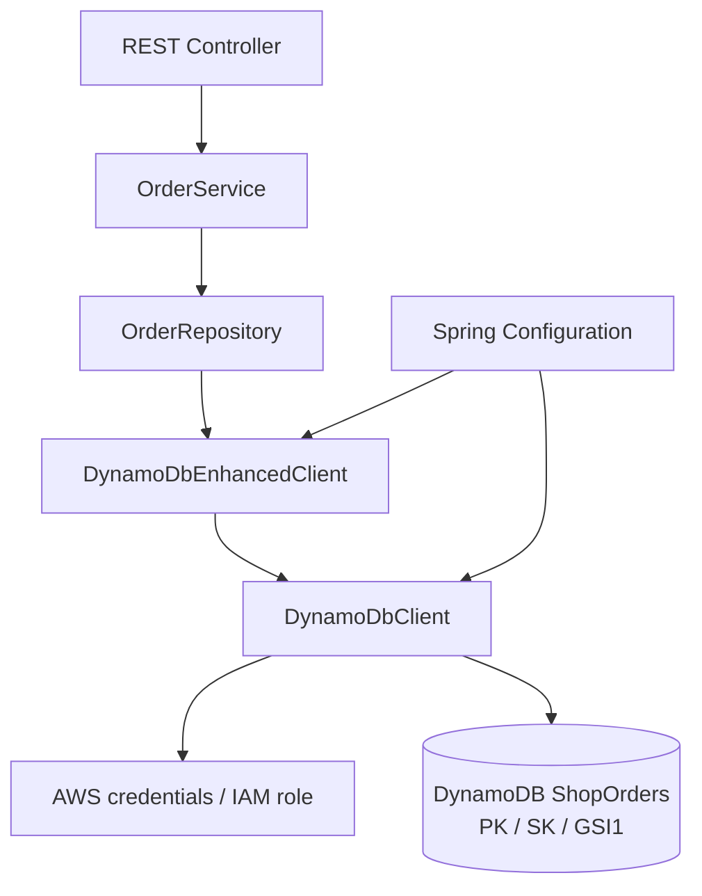
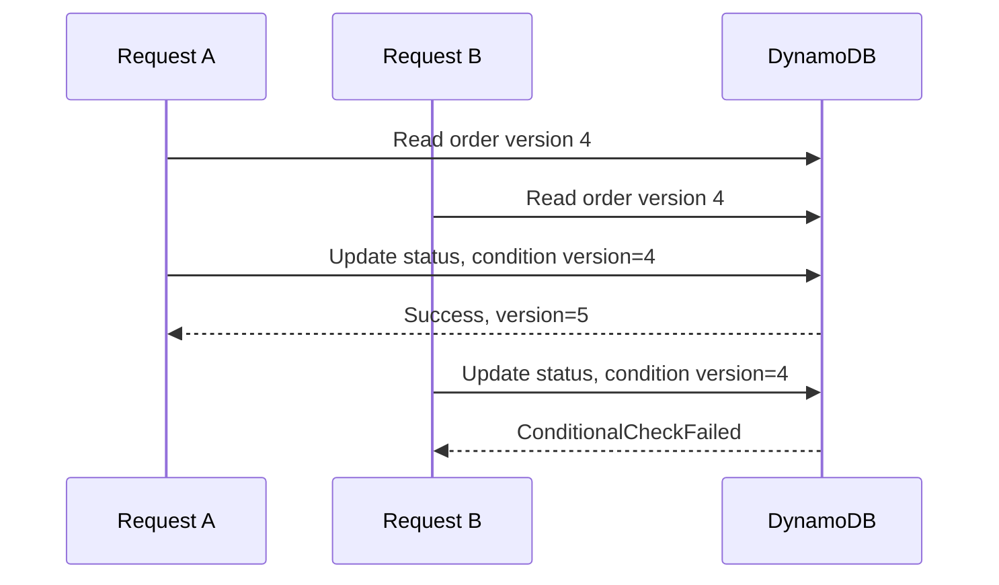
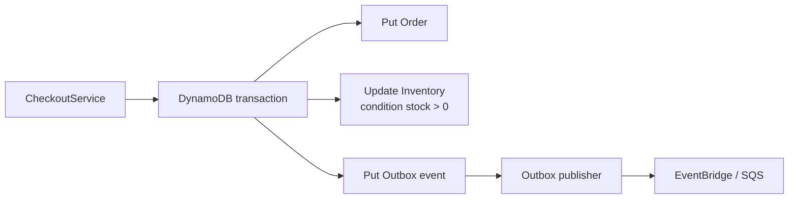

# Using DynamoDB for Access-Pattern-Driven Repositories

When a Spring Boot application uses DynamoDB, **the repository must mirror how the business reads and writes data**. DynamoDB is not a relational database where you can arbitrarily add finders on any column or JOIN multiple tables. Efficient lookups require knowing the partition key, often paired with a sort key or index. Therefore, a solid repository begins with designed access patterns and only then chooses corresponding methods and queries.

In this lesson, we build a repository for a Shop application using the **AWS SDK for Java v2 DynamoDB Enhanced Client**. The repository supports fetching an order by customer and order key, listing a customer's most recent orders, looking up an order by order ID via a GSI, and transitioning order status with version checks. Spring Boot manages clients/repositories via dependency injection; an IAM role supplies credentials when running on AWS.

This lesson belongs to the **Java and Spring Boot Applications** chapter of the **CLOUD_PROVIDERS_AWS** module. The module explores Regions/AZs, IAM, VPCs, compute, storage, databases, integration, and serverless so learners can select, design, and deploy secure, observable, resilient, and cost-controlled applications. The repository here serves as the Java data access layer; it must respect DynamoDB key schemas, consistency, pagination, retries, and service limits.

## 1. Learning objectives

After this lesson, you will be able to:

1. Explain why DynamoDB repositories must be designed around access patterns.
2. Translate business requirements into table primary keys and secondary indexes.
3. Distinguish `GetItem`, `Query`, `Scan`, and GSI lookups.
4. Configure AWS SDK for Java v2 Enhanced Client in Spring Boot.
5. Map Java beans to DynamoDB with annotations and `TableSchema`.
6. Build repository interfaces/implementations with business-meaningful methods.
7. Use `DynamoDbTable`, `DynamoDbIndex`, `QueryConditional`, and `QueryEnhancedRequest`.
8. Implement create/read/update operations with conditional expressions and optimistic locking.
9. Return multi-page data via cursors without loading the entire table into memory.
10. Distinguish single-item repository CRUD from multi-item transactions.
11. Secure connections with IAM roles, VPCs, and least privilege.
12. Test repositories, handle errors, and operate observable applications.

## 2. Why must repositories follow access patterns?

With SQL, repositories can often query across many columns thanks to optimizers and indexes. DynamoDB requires designing critical access paths upfront. `GetItem` requires the full primary key; `Query` requires partition key equality and optionally filters by sort key; `Scan` reads far more broadly.

Suppose Shop needs to:

- Fetch an order given a customer ID and order key.
- List a customer's orders sorted by most recent.
- Find an order given only the order ID.
- Transition an order from `PLACED` to `PAID` without overwriting concurrent updates.

Avoid building generic repositories like:

```java
findByAnyField(String fieldName, Object value);
findAll();
search(String expression);
```

These methods conceal cost and tempt code into calling `Scan` when no matching key/index exists. Instead, repositories should expose **the exact queries the domain requires**:

```java
findByCustomerAndOrderKey(customerId, orderKey);
findRecentOrdersByCustomer(customerId, pageSize, cursor);
findByOrderId(orderId);
transitionStatus(orderKey, expectedStatus, newStatus);
```

### 2.1. What is an access pattern?

An access pattern describes a real request the application must execute, including:

- Which identifiers does the caller already have?
- Does it fetch one item or a collection of items?
- Which field determines sort order?
- Are there filter/range conditions?
- Should results be paginated?
- Is a strong read required, or is eventual consistency acceptable?
- Do writes require conditions, uniqueness, or atomicity?

### 2.2. From requirement to DynamoDB operation

| Business requirement | Known keys | DynamoDB operation |
|---|---|---|
| Fetch a customer's single order | PK and SK | `GetItem` |
| List orders by customer | PK, optional SK prefix/range | `Query` |
| Find an order by order ID | GSI partition key | `Query` on GSI |
| Find all orders with any status | No matching key | Consider GSI/stream projection; avoid online Scan |
| Update an order's status | PK and SK | `UpdateItem` with condition/version |
| Delete a specific order | PK and SK | `DeleteItem` with condition when needed |

### 2.3. Repositories do not create indexes automatically

A method named `findByOrderId` does not teach DynamoDB how to look up order IDs. If the primary key is customer + time, the repository requires a **GSI** or a data model with matching keys. Java method names do not synthesize indexes the way some relational ORMs might imply.

## 3. Spring Boot application architecture

The application separates responsibilities:



- **Controller**: receives HTTP requests, validates DTOs, and returns responses.
- **Service**: enforces business rules, authorization, and state transitions.
- **Repository**: translates access patterns into DynamoDB operations.
- **Enhanced Client**: maps Java objects and supports queries/CRUD.
- **DynamoDbClient**: low-level service client handling HTTP requests, credentials, and retries.
- **DynamoDB**: stores items by primary key and indexes.

Never place DynamoDB queries directly inside controllers. Likewise, never omit business authorization in services assuming IAM already enforces end-user permissions.

## 4. Designing access patterns for ShopOrders

We choose a `ShopOrders` table with a composite primary key and one GSI.

### 4.1. Primary key

| Attribute | Key role | Example | Purpose |
|---|---|---|---|
| `PK` | Partition key | `CUSTOMER#C42` | Groups orders by customer |
| `SK` | Sort key | `ORDER#2026-11-20T08:00:00Z#O1001` | Sorts chronologically and distinguishes orders |

### 4.2. GSI1

| Attribute | Index role | Example | Purpose |
|---|---|---|---|
| `GSI1PK` | GSI partition key | `ORDER#O1001` | Lookup by order ID |
| `GSI1SK` | GSI sort key | `META` | Extensible for additional record types in the same index partition |

Index name: `GSI1`.

### 4.3. Sample item

```json
{
  "PK": "CUSTOMER#C42",
  "SK": "ORDER#2026-11-20T08:00:00Z#O1001",
  "GSI1PK": "ORDER#O1001",
  "GSI1SK": "META",
  "customerId": "C42",
  "orderId": "O1001",
  "createdAt": "2026-11-20T08:00:00Z",
  "status": "PLACED",
  "totalMinorUnits": 125000,
  "version": 1
}
```

The JSON above is a human-readable representation. In DynamoDB, `totalMinorUnits` and `version` are Numbers; key attributes are Strings.

### 4.4. Key conventions

```text
PK = CUSTOMER#<customerId>
SK = ORDER#<UTC timestamp>#<orderId>

GSI1PK = ORDER#<orderId>
GSI1SK = META
```

Timestamps use fixed-format UTC ISO-8601 so lexicographical order matches chronological order. `orderId` acts as a suffix so two orders created at the exact same timestamp still receive distinct SKs. Prefixes help distinguish entity types if the table later holds additional item types.

### 4.5. Access pattern mapping

| Repository method | Key condition | Operation |
|---|---|---|
| `findByCustomerAndOrderKey` | `PK` + `SK` | Base table `GetItem` |
| `findRecentOrdersByCustomer` | `PK = customer`, `begins_with(SK, ORDER#)` | Base table `Query` descending |
| `findByOrderId` | `GSI1PK = ORDER#id` | GSI1 `Query` |
| `transitionStatus` | `PK` + `SK` + version/status condition | `UpdateItem` |

**GSIs do not enforce uniqueness** for order IDs. If business rules require globally unique order IDs, the application must enforce uniqueness at creation time or use an appropriate primary key/conditional write/transaction. Never treat a GSI that usually returns one item as a uniqueness constraint.

## 5. Provisioning the table and GSI

Enhanced Client maps objects; it does not auto-create production schemas/indexes simply because a bean has annotations. Tables and GSIs must be provisioned via IaC/deployment pipelines or approved administrative workflows.

Logical schema:

```text
Table: ShopOrders
  PK: String (HASH)
  SK: String (RANGE)

GSI: GSI1
  GSI1PK: String (HASH)
  GSI1SK: String (RANGE)
  Projection: INCLUDE/ALL per fields needed by repository
```

Choose the right projection:

- `KEYS_ONLY`: index contains only index keys and base table keys.
- `INCLUDE`: adds specified non-key attributes.
- `ALL`: copies all item attributes into the index.

GSI projections affect storage, write amplification, and read patterns. If `findByOrderId` needs `status`, `createdAt`, and `totalMinorUnits`, projecting those fields avoids an extra `GetItem`; weigh cost against data freshness.

### 5.1. Attribute definitions are for keys only

When creating a DynamoDB table/index, `AttributeDefinitions` declares only attributes used as keys in the table/index schema. Do not declare non-key attributes such as `status`, `totalMinorUnits`, or `createdAt`.

### 5.2. Never create tables on every Spring Boot startup

Production deployments should manage tables/GSIs through CloudFormation, CDK, Terraform, or organizational IaC processes. The application runtime should connect and verify required configuration—never auto-create, alter, or delete production schemas every time a pod boots.

## 6. Choosing AWS SDK for Java v2 Enhanced Client

There are two API levels:

| API | Role | When to use |
|---|---|---|
| `DynamoDbClient` | Low-level API using `AttributeValue` maps | Need fine-grained control over requests/responses, expressions, or APIs uncovered by Enhanced Client |
| `DynamoDbEnhancedClient` | Object mapper and table/index abstractions | Java repositories working with model objects |

Enhanced Client still invokes the DynamoDB service API underneath. It is not a SQL ORM and does not provide joins, arbitrary finder methods, or a relational-style transaction manager.

### 6.1. Maven dependencies

Example dependencies for Spring Boot and AWS SDK v2:

```xml
<dependencyManagement>
  <dependencies>
    <dependency>
      <groupId>software.amazon.awssdk</groupId>
      <artifactId>bom</artifactId>
      <version>2.x.y</version>
      <type>pom</type>
      <scope>import</scope>
    </dependency>
  </dependencies>
</dependencyManagement>

<dependencies>
  <dependency>
    <groupId>org.springframework.boot</groupId>
    <artifactId>spring-boot-starter-web</artifactId>
  </dependency>
  <dependency>
    <groupId>software.amazon.awssdk</groupId>
    <artifactId>dynamodb</artifactId>
  </dependency>
  <dependency>
    <groupId>software.amazon.awssdk</groupId>
    <artifactId>dynamodb-enhanced</artifactId>
  </dependency>
  <dependency>
    <groupId>org.springframework.boot</groupId>
    <artifactId>spring-boot-starter-test</artifactId>
    <scope>test</scope>
  </dependency>
</dependencies>
```

`2.x.y` is a placeholder for an SDK v2 release chosen by your project. Use the BOM to align AWS SDK module versions; never mix arbitrary versions.

## 7. Configuring DynamoDbClient in Spring Boot

Create a shared client tied to the application lifecycle. AWS SDK clients are thread-safe and meant for reuse; never create a `DynamoDbClient` per HTTP request.

### 7.1. application.yml

```yaml
app:
  aws:
    region: ap-southeast-1
    dynamodb:
      orders-table: ShopOrders
```

### 7.2. Spring configuration

```java
package example.shop.config;

import org.springframework.beans.factory.annotation.Value;
import org.springframework.context.annotation.Bean;
import org.springframework.context.annotation.Configuration;

import software.amazon.awssdk.enhanced.dynamodb.DynamoDbEnhancedClient;
import software.amazon.awssdk.enhanced.dynamodb.DynamoDbTable;
import software.amazon.awssdk.enhanced.dynamodb.TableSchema;
import software.amazon.awssdk.regions.Region;
import software.amazon.awssdk.services.dynamodb.DynamoDbClient;

import example.shop.persistence.OrderItem;

@Configuration
public class DynamoDbConfiguration {

    @Bean(destroyMethod = "close")
    DynamoDbClient dynamoDbClient(
            @Value("${app.aws.region}") String region) {
        return DynamoDbClient.builder()
                .region(Region.of(region))
                .build();
    }

    @Bean
    DynamoDbEnhancedClient dynamoDbEnhancedClient(
            DynamoDbClient dynamoDbClient) {
        return DynamoDbEnhancedClient.builder()
                .dynamoDbClient(dynamoDbClient)
                .build();
    }

    @Bean
    DynamoDbTable<OrderItem> orderTable(
            DynamoDbEnhancedClient enhancedClient,
            @Value("${app.aws.dynamodb.orders-table}") String tableName) {
        return enhancedClient.table(
                tableName,
                TableSchema.fromBean(OrderItem.class));
    }
}
```

`DefaultCredentialsProvider` is used via the SDK's default credential provider chain since no other provider is specified. On AWS, workloads should use their respective IAM roles; local development can use a configured profile/SSO. Never hardcode access keys/secrets in `application.yml`.

Enhanced Client loads the optimistic-lock version extension by default. If you supply a custom extensions list, the default list is replaced; be sure to re-register `VersionedRecordExtension` if optimistic locking is still needed. `AtomicCounterExtension` is a separate extension you can register when using atomic counters. With default version settings, the initial version is 1 (`startAt` 0, `incrementBy` 1) and increments on each successful write; you can customize `startAt`/`incrementBy` if required by the domain.

When running DynamoDB Local/LocalStack, configure `endpointOverride` and dummy credentials strictly in local/test profiles. Production uses default AWS endpoints and IAM workload roles; never let local endpoints or dummy credentials leak into production config.

### 7.3. Why not create a client inside repository methods?

Avoid:

```java
public OrderItem find(String pk, String sk) {
    try (DynamoDbClient client = DynamoDbClient.create()) {
        // ...
    }
}
```

Every request would construct and tear down HTTP clients and connection pools, causing unnecessary overhead, latency, and resource churn. Spring manages a singleton client over the application's lifecycle.

## 8. Mapping Java beans to DynamoDB

Enhanced Client can generate a `TableSchema` from annotations. With `@DynamoDbBean`, the class requires a no-argument constructor and JavaBean-style getters/setters.

### 8.1. OrderItem persistence model

```java
package example.shop.persistence;

import software.amazon.awssdk.enhanced.dynamodb.mapper.annotations.DynamoDbAttribute;
import software.amazon.awssdk.enhanced.dynamodb.mapper.annotations.DynamoDbBean;
import software.amazon.awssdk.enhanced.dynamodb.mapper.annotations.DynamoDbPartitionKey;
import software.amazon.awssdk.enhanced.dynamodb.mapper.annotations.DynamoDbSortKey;
import software.amazon.awssdk.enhanced.dynamodb.mapper.annotations.DynamoDbSecondaryPartitionKey;
import software.amazon.awssdk.enhanced.dynamodb.mapper.annotations.DynamoDbSecondarySortKey;
import software.amazon.awssdk.enhanced.dynamodb.extensions.annotations.DynamoDbVersionAttribute;

@DynamoDbBean
public class OrderItem {
    private String pk;
    private String sk;
    private String gsi1pk;
    private String gsi1sk;
    private String customerId;
    private String orderId;
    private String createdAt;
    private String status;
    private Long totalMinorUnits;
    private Long version;

    public OrderItem() {
    }

    @DynamoDbPartitionKey
    @DynamoDbAttribute("PK")
    public String getPk() { return pk; }
    public void setPk(String pk) { this.pk = pk; }

    @DynamoDbSortKey
    @DynamoDbAttribute("SK")
    public String getSk() { return sk; }
    public void setSk(String sk) { this.sk = sk; }

    @DynamoDbSecondaryPartitionKey(indexNames = "GSI1")
    @DynamoDbAttribute("GSI1PK")
    public String getGsi1pk() { return gsi1pk; }
    public void setGsi1pk(String gsi1pk) { this.gsi1pk = gsi1pk; }

    @DynamoDbSecondarySortKey(indexNames = "GSI1")
    @DynamoDbAttribute("GSI1SK")
    public String getGsi1sk() { return gsi1sk; }
    public void setGsi1sk(String gsi1sk) { this.gsi1sk = gsi1sk; }

    @DynamoDbAttribute("customerId")
    public String getCustomerId() { return customerId; }
    public void setCustomerId(String customerId) {
        this.customerId = customerId;
    }

    @DynamoDbAttribute("orderId")
    public String getOrderId() { return orderId; }
    public void setOrderId(String orderId) { this.orderId = orderId; }

    @DynamoDbAttribute("createdAt")
    public String getCreatedAt() { return createdAt; }
    public void setCreatedAt(String createdAt) {
        this.createdAt = createdAt;
    }

    @DynamoDbAttribute("status")
    public String getStatus() { return status; }
    public void setStatus(String status) { this.status = status; }

    @DynamoDbAttribute("totalMinorUnits")
    public Long getTotalMinorUnits() { return totalMinorUnits; }
    public void setTotalMinorUnits(Long totalMinorUnits) {
        this.totalMinorUnits = totalMinorUnits;
    }

    @DynamoDbVersionAttribute
    @DynamoDbAttribute("version")
    public Long getVersion() { return version; }
    public void setVersion(Long version) { this.version = version; }
}
```

### 8.2. Key factory

Extract key formatting into a helper so strings are not duplicated across controllers, services, and repositories:

```java
package example.shop.persistence;

public final class OrderKeys {
    private OrderKeys() {
    }

    public static String customerPk(String customerId) {
        return "CUSTOMER#" + requireValue(customerId);
    }

    public static String orderSk(String createdAt, String orderId) {
        return "ORDER#" + requireValue(createdAt)
                + "#" + requireValue(orderId);
    }

    public static String orderIndexPk(String orderId) {
        return "ORDER#" + requireValue(orderId);
    }

    private static String requireValue(String value) {
        if (value == null || value.isBlank()) {
            throw new IllegalArgumentException("Key component is required");
        }
        return value;
    }
}
```

`OrderKeys` builds keys only from validated identifiers. Never accept raw PK/SK values from browsers; the server must construct keys from trusted identity and domain data.

The separator convention is part of the key contract: if business IDs could contain `#`, encode/escape them before assembling keys or pick an unambiguous encoding. Otherwise, two distinct component combinations could collide onto the same key string.

### 8.3. A DynamoDB bean does not have to be the domain entity

The persistence model mirrors key attributes and GSIs. The domain model can maintain invariants, value objects, and domain methods. In complex applications, map `OrderItem` to an `Order` domain object to keep DynamoDB details like `PK`, `SK`, and `GSI1PK` out of the business layer.

## 9. Defining a business-focused repository

The repository interface expresses application use cases rather than exposing the full DynamoDB API to services and controllers.

### 9.1. OrderPage

Paginated results bundle one page's items plus the key to fetch the next page:

```java
package example.shop.persistence;

import java.util.List;
import java.util.Map;

import software.amazon.awssdk.services.dynamodb.model.AttributeValue;

public record OrderPage(
        List<OrderItem> items,
        Map<String, AttributeValue> nextKey) {
}
```

`nextKey` is the key map returned by DynamoDB. In REST APIs, never return this raw map to browsers as an access token; the service can encode/sign it into an opaque cursor bound to the customer, filter, and page size.

### 9.2. OrderRepository interface

```java
package example.shop.persistence;

import java.util.Map;
import java.util.Optional;

import software.amazon.awssdk.services.dynamodb.model.AttributeValue;

public interface OrderRepository {
    void create(OrderItem order);

    Optional<OrderItem> findByCustomerAndOrderKey(
            String customerId,
            String createdAt,
            String orderId);

    Optional<OrderItem> findByOrderId(String orderId);

    OrderPage findRecentOrdersByCustomer(
            String customerId,
            int pageSize,
            Map<String, AttributeValue> startKey);

    OrderItem transitionStatus(
            String customerId,
            String createdAt,
            String orderId,
            String expectedStatus,
            String newStatus);
}
```

These methods reflect the exact designed access patterns. Whenever a new use case arises, first evaluate whether existing keys/indexes can serve it or if the data model must evolve.

## 10. Implementing the repository with DynamoDbEnhancedClient

### 10.1. Repository implementation

```java
package example.shop.persistence;

import java.util.Iterator;
import java.util.List;
import java.util.Map;
import java.util.Optional;

import org.springframework.stereotype.Repository;

import software.amazon.awssdk.enhanced.dynamodb.DynamoDbIndex;
import software.amazon.awssdk.enhanced.dynamodb.DynamoDbTable;
import software.amazon.awssdk.enhanced.dynamodb.Key;
import software.amazon.awssdk.enhanced.dynamodb.model.Page;
import software.amazon.awssdk.enhanced.dynamodb.model.PageIterable;
import software.amazon.awssdk.enhanced.dynamodb.model.QueryConditional;
import software.amazon.awssdk.enhanced.dynamodb.model.QueryEnhancedRequest;
import software.amazon.awssdk.enhanced.dynamodb.model.PutItemEnhancedRequest;
import software.amazon.awssdk.enhanced.dynamodb.Expression;
import software.amazon.awssdk.services.dynamodb.model.AttributeValue;
import software.amazon.awssdk.services.dynamodb.model.ConditionalCheckFailedException;

@Repository
public class DynamoDbOrderRepository implements OrderRepository {
    private static final String ORDER_INDEX = "GSI1";
    private final DynamoDbTable<OrderItem> table;

    public DynamoDbOrderRepository(DynamoDbTable<OrderItem> table) {
        this.table = table;
    }

    @Override
    public void create(OrderItem order) {
        Expression condition = Expression.builder()
                .expression("attribute_not_exists(PK)")
                .build();

        PutItemEnhancedRequest<OrderItem> request =
                PutItemEnhancedRequest.builder(OrderItem.class)
                        .item(order)
                        .conditionExpression(condition)
                        .build();

        try {
            table.putItem(request);
        } catch (ConditionalCheckFailedException exception) {
            throw new OrderConflictException(
                    "Order key already exists", exception);
        }
    }

    @Override
    public Optional<OrderItem> findByCustomerAndOrderKey(
            String customerId,
            String createdAt,
            String orderId) {

        Key key = Key.builder()
                .partitionValue(OrderKeys.customerPk(customerId))
                .sortValue(OrderKeys.orderSk(createdAt, orderId))
                .build();

        return Optional.ofNullable(table.getItem(key));
    }

    @Override
    public Optional<OrderItem> findByOrderId(String orderId) {
        DynamoDbIndex<OrderItem> index = table.index(ORDER_INDEX);
        String indexPk = OrderKeys.orderIndexPk(orderId);

        PageIterable<OrderItem> pages = index.query(request ->
                request.queryConditional(
                        QueryConditional.keyEqualTo(
                                Key.builder()
                                        .partitionValue(indexPk)
                                        .build()))
                        .limit(2));

        Iterator<OrderItem> items = pages.items().iterator();
        if (!items.hasNext()) {
            return Optional.empty();
        }

        OrderItem result = items.next();
        if (items.hasNext()) {
            throw new IllegalStateException(
                    "More than one order uses orderId " + orderId);
        }
        return Optional.of(result);
    }

    @Override
    public OrderPage findRecentOrdersByCustomer(
            String customerId,
            int pageSize,
            Map<String, AttributeValue> startKey) {

        if (pageSize < 1 || pageSize > 100) {
            throw new IllegalArgumentException(
                    "pageSize must be between 1 and 100");
        }

        Key prefix = Key.builder()
                .partitionValue(OrderKeys.customerPk(customerId))
                .sortValue("ORDER#")
                .build();

        QueryEnhancedRequest.Builder request =
                QueryEnhancedRequest.builder()
                        .queryConditional(QueryConditional.sortBeginsWith(prefix))
                        .scanIndexForward(false)
                        .limit(pageSize);

        if (startKey != null && !startKey.isEmpty()) {
            request.exclusiveStartKey(startKey);
        }

        Iterator<Page<OrderItem>> pages =
                table.query(request.build()).iterator();

        if (!pages.hasNext()) {
            return new OrderPage(List.of(), Map.of());
        }

        Page<OrderItem> page = pages.next();
        Map<String, AttributeValue> nextKey = page.lastEvaluatedKey();
        return new OrderPage(
                page.items(),
                nextKey == null ? Map.of() : nextKey);
    }

    @Override
    public OrderItem transitionStatus(
            String customerId,
            String createdAt,
            String orderId,
            String expectedStatus,
            String newStatus) {

        OrderItem current = findByCustomerAndOrderKey(
                customerId, createdAt, orderId)
                .orElseThrow(() -> new OrderNotFoundException(orderId));

        if (!expectedStatus.equals(current.getStatus())) {
            throw new OrderConflictException(
                    "Expected status " + expectedStatus
                            + " but found " + current.getStatus());
        }

        current.setStatus(newStatus);
        try {
            // VersionedRecordExtension adds an optimistic-lock condition.
            return table.updateItem(current);
        } catch (ConditionalCheckFailedException exception) {
            throw new OrderConflictException(
                    "Order changed concurrently; reload and retry", exception);
        }
    }
}
```

This example uses `VersionedRecordExtension` and `@DynamoDbVersionAttribute` to validate versions on update. In real applications, define `OrderNotFoundException`/`OrderConflictException` per your project conventions; the snippet focuses on illustrating repository flow.

### 10.2. Domain exceptions

```java
package example.shop.persistence;

public class OrderNotFoundException extends RuntimeException {
    public OrderNotFoundException(String orderId) {
        super("Order not found: " + orderId);
    }
}
```

```java
package example.shop.persistence;

public class OrderConflictException extends RuntimeException {
    public OrderConflictException(String message) {
        super(message);
    }

    public OrderConflictException(String message, Throwable cause) {
        super(message, cause);
    }
}
```

Do not map every `DynamoDbException` to not-found. `ResourceNotFoundException` may indicate a missing table or index; `ConditionalCheckFailedException` is a conditional conflict; `AccessDeniedException` is a permission error.

## 11. Reading a single item with GetItem

`GetItem` is the right choice when the **entire primary key** is known:

```java
Key key = Key.builder()
        .partitionValue("CUSTOMER#C42")
        .sortValue("ORDER#2026-11-20T08:00:00Z#O1001")
        .build();

OrderItem item = orderTable.getItem(key);
```

If the item does not exist, Enhanced Client returns `null`; the repository wraps it into `Optional.empty()`. With a composite key, you cannot pass only the customer PK and expect `GetItem` to return all orders.

### 11.1. Strongly consistent reads

The base table supports strongly consistent reads when supported by the API. Enhanced Client supports setting consistent reads via `GetItemEnhancedRequest`:

```java
var request = GetItemEnhancedRequest.builder()
        .key(key)
        .consistentRead(true)
        .build();

OrderItem item = orderTable.getItem(request);
```

Enable strong reads only when business requirements demand read-after-write and accept the corresponding cost/latency. Strong reads on the base table do not make GSIs strongly consistent.

## 12. Querying by customer and sort key

To retrieve C42's latest orders, the repository queries on PK with a sort key prefix:

```java
Key condition = Key.builder()
        .partitionValue("CUSTOMER#C42")
        .sortValue("ORDER#")
        .build();

var pages = orderTable.query(request -> request
        .queryConditional(QueryConditional.sortBeginsWith(condition))
        .scanIndexForward(false)
        .limit(20));
```

- `partitionValue` selects the customer's item collection.
- `sortBeginsWith` matches only SKs starting with `ORDER#`.
- `scanIndexForward(false)` reads in descending sort key order.
- `limit(20)` caps items evaluated/returned per Query request semantics; pagination may yield additional pages.

### 12.1. Query with FilterExpression

To filter by status, add a filter expression:

```java
import java.util.Map;

import software.amazon.awssdk.enhanced.dynamodb.Expression;
import software.amazon.awssdk.enhanced.dynamodb.Key;
import software.amazon.awssdk.enhanced.dynamodb.model.QueryConditional;
import software.amazon.awssdk.enhanced.dynamodb.model.QueryEnhancedRequest;
import software.amazon.awssdk.services.dynamodb.model.AttributeValue;

Key condition = Key.builder()
        .partitionValue("CUSTOMER#C42")
        .sortValue("ORDER#")
        .build();

Expression statusFilter = Expression.builder()
        .expression("#status = :paid")
        .expressionNames(Map.of("#status", "status"))
        .expressionValues(Map.of(
                ":paid", AttributeValue.builder().s("PAID").build()))
        .build();

var request = QueryEnhancedRequest.builder()
        .queryConditional(QueryConditional.sortBeginsWith(condition))
        .filterExpression(statusFilter)
        .scanIndexForward(false)
        .limit(20)
        .build();

var pages = orderTable.query(request);
```

`FilterExpression` runs after DynamoDB reads and evaluates items. If most orders are not `PAID`, the filter still consumes capacity reading them. If querying by status is a hot access pattern, consider a GSI or dedicated projection rather than filtering every request.

## 13. Lookup via GSI

When only `orderId` is known, the repository queries `GSI1`:

```java
var orderIndex = orderTable.index("GSI1");

var pages = orderIndex.query(request -> request
        .queryConditional(QueryConditional.keyEqualTo(
                Key.builder()
                        .partitionValue("ORDER#O1001")
                        .build()))
        .limit(2));
```

GSIs are eventually consistent. A newly created order may not appear immediately in a GSI query. If an order-creation request must return the newly persisted data, return the created object directly or read the base table using the full key instead of querying the GSI for immediate confirmation.

### 13.1. A GSI is not a uniqueness constraint

A GSI partition key can hold multiple items. If the repository expects exactly one order, it should detect duplicates as shown in `findByOrderId`; meanwhile, the application must enforce uniqueness at creation time. If order IDs must be globally unique, evaluate table/key design or conditional transactions to serialize claiming IDs.

## 14. Updating items and optimistic locking

`@DynamoDbVersionAttribute` lets Enhanced Client track item versions. On read, the version maps onto the bean. On update, the extension adds a condition requiring the database version to match the read version, then increments the version.



### 14.1. State transitions

The repository/service enforces business state transitions:

```java
OrderItem saved = repository.transitionStatus(
        customerId,
        createdAt,
        orderId,
        "PLACED",
        "PAID");
```

The repository reads the item, validates the business status, and updates with a version condition. If another request modifies the item after it was read, optimistic locking catches the stale version and raises a conflict.

### 14.2. All writers must obey the version contract

Optimistic locking works only when every write path maintains the version attribute. A separate script/worker issuing a low-level `UpdateItem` without checking/incrementing `version` can break the guarantee. Document the version attribute as part of the persistence contract and enforce it across all writers.

### 14.3. Conditional writes for creation

`PutItem` with an existing key overwrites the existing item. The repository's `create` uses `attribute_not_exists(PK)` to reject overwrites:

```text
ConditionExpression:
  attribute_not_exists(PK)

If the item already exists:
  ConditionalCheckFailedException
```

If creating multiple items as one business unit, a single conditional `PutItem` is insufficient; consider `TransactWriteItems` and an idempotency key.

## 15. Transactions when a business operation updates multiple items

One repository method may call one API, yet a use case may need several items updated together. For instance, checkout creates an Order, decrements Inventory, and writes an Outbox event. Issuing three separate writes risks the third failing after the first two succeeded.

### 15.1. DynamoDB transactions

`TransactWriteItems` groups multiple puts/updates/deletes/condition checks into a single transaction within DynamoDB limits. Enhanced Client offers `transactWriteItems` and corresponding request builders for mapped tables.



Inside the transaction:

- Put Order only if the order key does not yet exist.
- Update Inventory only if sufficient stock remains.
- Put Outbox event with a stable event ID.
- If any condition fails, the entire transaction fails.

Once the transaction commits, the publisher reads the Outbox and emits events. Consumers still need idempotency because events can be redelivered.

### 15.2. Illustrative Enhanced Client transaction

```java
import java.util.Map;

import software.amazon.awssdk.enhanced.dynamodb.Expression;
import software.amazon.awssdk.enhanced.dynamodb.model.TransactWriteItemsEnhancedRequest;
import software.amazon.awssdk.services.dynamodb.model.AttributeValue;

Expression stockCondition = Expression.builder()
        .expression("availableQuantity >= :required")
        .expressionValues(Map.of(
                ":required", AttributeValue.builder().n("2").build()))
        .build();

var request = TransactWriteItemsEnhancedRequest.builder()
        .addPutItem(orderTable, orderItem)
        .addUpdateItem(inventoryTable, update -> update
                .item(updatedInventory)
                .conditionExpression(stockCondition))
        .addPutItem(outboxTable, outboxItem)
        .build();

enhancedClient.transactWriteItems(request);
```

This is a condensed example: mapped tables and items must be properly configured, the transaction must stay within service limits, and inventory update conditions must be attached to the matching request. For complex condition checks, build transaction requests with condition expressions per the Enhanced Client/low-level API.

### 15.3. Spring @Transactional does not automatically manage DynamoDB

Do not assume:

```java
@Transactional
public void checkout(...) {
    orderRepository.create(order);
    inventoryRepository.decreaseStock(...);
}
```

Spring's `@Transactional` applies only when a transaction manager governs the participating resources. A standard `DynamoDbClient` does not automatically enlist in JDBC/JPA transactions. Use the DynamoDB transaction API for writes inside DynamoDB; across DynamoDB and SQS/EventBridge/payment services, design outboxes, sagas, or compensating actions.

## 16. Pagination in repositories

Repositories should return bounded pages rather than loading all of a customer's orders. `OrderPage` from Section 9 carries both `items` and `nextKey`.

### 16.1. Why not return an unbounded List?

A single customer might have hundreds of thousands of orders. A method like:

```java
List<OrderItem> findAllByCustomer(String customerId);
```

can force the service to iterate across many Query pages and hold everything on the heap. APIs should cap page sizes and return cursors so clients fetch subsequent pages on demand.

### 16.2. Cursors must be bound to the access pattern

A public cursor should carry enough context for the server to resume the exact query:

```text
cursor payload (logical):
  version
  customerId / tenantId
  sortOrder
  pageSize
  filter
  lastEvaluatedKey
  expiresAt
```

The server serializes the payload, HMAC-signs or encrypts it as required, and returns an opaque cursor. When receiving a cursor:

1. Verify signature/expiry and cursor version.
2. Match `customerId`/`tenantId` against the authenticated principal.
3. Verify filter, sort order, and page size have not been altered outside policy.
4. Decode the key map and pass it to `exclusiveStartKey`.
5. Return a new cursor built from the newly read page's `lastEvaluatedKey`.

Never trust a `customerId` or raw key map sent directly by a browser. A cursor is not an authorization token; every request must still authenticate and authorize.

### 16.3. GSI pagination

GSI queries can also span multiple pages. `LastEvaluatedKey` may include both base table keys and index keys needed to resume. Preserve the entire map returned by the service; never construct a partial map containing only `GSI1PK`.

### 16.4. Empty pages can still have a cursor

When a `Query` uses a `FilterExpression`, a page can return zero matching items yet still return a `lastEvaluatedKey`. The repository must return the cursor whenever a key remains, even if `items` is empty. Never halt pagination solely because the current page's items list is empty.

## 17. Integrating repositories into Spring Services and REST Controllers

Controllers should have no knowledge of `PK`, `SK`, GSIs, or `AttributeValue`. Services authenticate users, enforce business rules, and invoke repositories.

### 17.1. Service layer

```java
package example.shop.order;

import java.util.List;
import java.util.Map;

import org.springframework.stereotype.Service;

import example.shop.persistence.OrderPage;
import example.shop.persistence.OrderRepository;
import software.amazon.awssdk.services.dynamodb.model.AttributeValue;

@Service
public class OrderService {
    private final OrderRepository repository;
    private final OrderCursorCodec cursorCodec;

    public OrderService(
            OrderRepository repository,
            OrderCursorCodec cursorCodec) {
        this.repository = repository;
        this.cursorCodec = cursorCodec;
    }

    public OrderPageResponse recentOrders(
            String authenticatedCustomerId,
            int pageSize,
            String cursor) {
        Map<String, AttributeValue> startKey = cursorCodec.decode(
                cursor, authenticatedCustomerId, pageSize);

        OrderPage page = repository.findRecentOrdersByCustomer(
                authenticatedCustomerId, pageSize, startKey);

        String nextCursor = page.nextKey().isEmpty()
                ? null
                : cursorCodec.encode(
                        page.nextKey(), authenticatedCustomerId, pageSize);

        List<OrderSummary> items = page.items().stream()
                .map(OrderSummary::from)
                .toList();
        return new OrderPageResponse(items, nextCursor);
    }

    public OrderSummary payOrder(
            String customerId,
            String createdAt,
            String orderId) {
        return OrderSummary.from(repository.transitionStatus(
                customerId, createdAt, orderId, "PLACED", "PAID"));
    }
}
```

To decouple responses from the persistence model, define DTOs and a cursor contract:

```java
package example.shop.order;

import java.util.List;
import java.util.Map;

import example.shop.persistence.OrderItem;
import software.amazon.awssdk.services.dynamodb.model.AttributeValue;

public record OrderSummary(
        String orderId,
        String createdAt,
        String status,
        Long totalMinorUnits) {

    public static OrderSummary from(OrderItem item) {
        return new OrderSummary(
                item.getOrderId(),
                item.getCreatedAt(),
                item.getStatus(),
                item.getTotalMinorUnits());
    }
}

public record OrderPageResponse(
        List<OrderSummary> items,
        String nextCursor) {
}

public interface OrderCursorCodec {
    Map<String, AttributeValue> decode(
            String cursor, String customerId, int pageSize);

    String encode(
            Map<String, AttributeValue> lastKey,
            String customerId,
            int pageSize);
}
```

In a real project, place each public top-level type in its own Java file (`OrderSummary.java`, `OrderPageResponse.java`, and `OrderCursorCodec.java`). When no input cursor is provided, the codec returns an empty key map; when a cursor is present, the codec verifies signature/expiry and customer context before decoding.

`OrderCursorCodec` must verify signature/expiry and bind the cursor to the customer, page size, and sort order of the current access pattern. If the API adds optional filters/sorts, include them in the cursor payload and validate them on decode. `authenticatedCustomerId` must come from a verified authentication context, never directly from a query parameter treated as caller authority.

### 17.2. Controller returning DTOs

```java
package example.shop.order;

import org.springframework.web.bind.annotation.GetMapping;
import org.springframework.web.bind.annotation.RequestParam;
import org.springframework.web.bind.annotation.RestController;

@RestController
public class OrderController {
    private final OrderService service;

    public OrderController(OrderService service) {
        this.service = service;
    }

    @GetMapping("/api/orders")
    public OrderPageResponse recentOrders(
            @RequestParam(defaultValue = "20") int limit,
            @RequestParam(required = false) String cursor) {

        // Resolve customerId from authenticated principal in real application.
        String authenticatedCustomerId = currentCustomerId();

        return service.recentOrders(
                authenticatedCustomerId,
                Math.min(Math.max(limit, 1), 100),
                cursor);
    }
}
```

`currentCustomerId` is a placeholder for your application's authentication infrastructure. Never ship this condensed snippet without implementing customer ID extraction from an authenticated principal.

### 17.3. Error mapping

| Exception/domain result | Suggested HTTP mapping |
|---|---|
| `OrderNotFoundException` | `404 Not Found` |
| `OrderConflictException` | `409 Conflict` |
| Invalid page size/cursor | `400 Bad Request` |
| `AccessDeniedException` from AWS | `500`/`503` per boundary and log; never expose IAM details |
| Throttling/temporary service failure | `503 Service Unavailable` or internal retry policy |
| `ValidationException` from malformed request code | `500` + alert; fix implementation |

Never return raw AWS exception messages, internal ARNs, or request internals to browsers. Log correlation IDs and exception types server-side.

## 18. IAM, VPC, and data access permissions

### 18.1. Workload IAM role

Spring Boot on ECS should use a **task role**; on EC2 an instance profile; on EKS the appropriate workload identity mechanism; on Lambda an execution role. The SDK default credentials provider chain discovers credentials from the runtime environment.

The policy must grant only the actions used by the repository, scoped to the table/index:

```json
{
  "Version": "2012-10-17",
  "Statement": [
    {
      "Effect": "Allow",
      "Action": [
        "dynamodb:GetItem",
        "dynamodb:PutItem",
        "dynamodb:UpdateItem",
        "dynamodb:Query",
        "dynamodb:TransactWriteItems"
      ],
      "Resource": [
        "arn:aws:dynamodb:ap-southeast-1:111122223333:table/ShopOrders",
        "arn:aws:dynamodb:ap-southeast-1:111122223333:table/ShopOrders/index/GSI1"
      ]
    }
  ]
}
```

This policy is illustrative. Adjust actions/index ARNs to match actual operations; never grant `dynamodb:*` or `Scan` if the repository does not need them. Check SCPs, permissions boundaries, resource/endpoint policies, and KMS if applicable.

### 18.2. IAM does not replace business authorization

The task role can read the entire `ShopOrders` table. That does not mean every customer is allowed to view every order. The backend must:

- Authenticate the user.
- Obtain the customer/tenant ID from verified identity claims or trusted membership records.
- Construct `PK` from the authenticated customer ID.
- Verify resource ownership before returning data.
- Never trust order/customer IDs simply because they appear in URLs.

### 18.3. VPC gateway endpoint for DynamoDB

If the application runs in private subnets and needs DynamoDB access, use a **DynamoDB gateway VPC endpoint**. Route tables direct DynamoDB traffic through the endpoint per design, avoiding NAT gateway traversal for that traffic.

Endpoint policies and IAM policies are independent layers. An Allow in one does not override a Deny in the other. Check Region, route tables, endpoint policies, and DNS/network paths when requests time out or fail with `AccessDenied`.

### 18.4. Encryption and sensitive data

DynamoDB supports encryption at rest; the SDK communicates over HTTPS/TLS. Never store credentials, session tokens, or unnecessary sensitive payment details inside items. Avoid logging full items or cursors containing customer data.

## 19. Consistency, GSIs, and data decisions

### 19.1. Base table vs. GSI

| Read source | Consistency |
|---|---|
| Base table | Eventual or strongly consistent reads where supported by API |
| GSI | Eventual consistency |

If an order was just created and must be displayed immediately:

- Return the created object from the service response.
- Or read the base table using the full PK/SK.
- Never rely on a GSI query as a synchronous uniqueness or confirmation check.

### 19.2. Do not use Scan as a general finder

A method like `findByStatus("PAID")` without a supporting key/index triggers a Scan. On large tables, Scans read huge amounts of data and burn capacity and latency. If this is a frequent access pattern, design a GSI or dedicated read model.

### 19.3. Hot partitions

If all writes target one PK like `STATUS#PAID`, that partition can run hot. In `ShopOrders`, customer PKs distribute better, yet a massive tenant/customer can still create a hot key. Monitor traffic distribution and design sharding if workloads truly require it.

### 19.4. GSI changes are data contract changes

When adding a GSI:

1. Update IaC/table deployment.
2. Backfill key attributes for existing items if needed.
3. Wait until the index reaches `ACTIVE`.
4. Verify projection and IAM index ARNs.
5. Deploy repository code only after the index is ready.
6. Measure latency/cost and consistency behavior.

Never deploy code querying an index before the index is provisioned and active.
## 20. Testing the repository

The repository translates access patterns into service calls. Test both business logic and request semantics; mocking `DynamoDbTable` alone never proves key schemas, GSIs, or queries work correctly.

### 20.1. Unit testing the service

Mock `OrderRepository` to test business rules:

```java
import example.shop.persistence.OrderItem;
import example.shop.persistence.OrderRepository;
import org.junit.jupiter.api.Test;
import org.junit.jupiter.api.extension.ExtendWith;
import org.mockito.InjectMocks;
import org.mockito.Mock;
import org.mockito.junit.jupiter.MockitoExtension;

import static org.junit.jupiter.api.Assertions.assertEquals;
import static org.mockito.Mockito.verify;
import static org.mockito.Mockito.when;

@ExtendWith(MockitoExtension.class)
class OrderServiceTest {
    @Mock
    OrderRepository repository;

    @Mock
    OrderCursorCodec cursorCodec;

    @InjectMocks
    OrderService service;

    @Test
    void payOrderRequestsExpectedStateTransition() {
        var item = new OrderItem();
        item.setOrderId("O1001");
        item.setStatus("PAID");

        when(repository.transitionStatus(
                "C42",
                "2026-11-20T08:00:00Z",
                "O1001",
                "PLACED",
                "PAID"))
                .thenReturn(item);

        var result = service.payOrder(
                "C42", "2026-11-20T08:00:00Z", "O1001");

        assertEquals("PAID", result.status());
        verify(repository).transitionStatus(
                "C42",
                "2026-11-20T08:00:00Z",
                "O1001",
                "PLACED",
                "PAID");
    }
}
```

This unit test verifies that the service calls the repository with the expected transition. It does not test DynamoDB expressions, indexes, or version behavior.

### 20.2. Repository integration tests

Run integration tests against DynamoDB Local, LocalStack, or an isolated AWS sandbox. Configure dedicated test endpoints and credentials; never let automated tests point to production.

Steps:

1. Create the table with PK/SK and GSI1.
2. Wait for the table/index to become ready if needed by the environment.
3. Instantiate the repository using a real Enhanced Client.
4. Seed sample `OrderItem`s.
5. Invoke each method and assert results.
6. Clean up test data/resources per fixture lifecycle.

### 20.3. Essential test cases

| Test | Expectation |
|---|---|
| `GetItem` with valid PK/SK | Returns matching order |
| `GetItem` with nonexistent key | `Optional.empty()` |
| Create duplicate key a second time | Conditional failure, no overwrite |
| Query customer descending | Newest orders first |
| Multi-page Query | Cursor continues without duplicates or gaps on static test dataset |
| GSI lookup | Finds order by `orderId` after index updates |
| Immediate post-write GSI read | Test allows eventual propagation; does not assume instant visibility |
| Two writers on same version | One update succeeds; stale writer receives conflict |
| Page size 0 or over max | Repository rejects input |
| Customer A submits B's cursor | Service/controller rejects before querying |

### 20.4. Do not mock only the AWS SDK in integration tests

Mocking helps test service orchestration, yet fails to validate mapper annotations, query conditions, index names, pagination tokens, or the optimistic-lock extension. Validate those against a DynamoDB-compatible environment or controlled AWS sandbox.

## 21. Error handling, retries, and observability

### 21.1. Error classification

| AWS error | Common meaning | Action |
|---|---|---|
| `ConditionalCheckFailedException` | Condition/version no longer holds | Business conflict; reload and decide |
| `ResourceNotFoundException` | Wrong table/index/Region or resource missing | Check IaC, account, Region, and deployment order |
| `AccessDeniedException` | Disallowed by IAM/SCP/endpoint policy | Check principal/action/resource and explicit Denies |
| `ValidationException` | Invalid key/expression/request | Fix code/schema/input; do not retry blindly |
| Throttling / `ProvisionedThroughputExceededException` | Capacity/quota/hot key or burst | Backoff, bound concurrency, inspect access patterns |
| Service 5xx/network timeout | Transient error or uncertain outcome | SDK retry; for writes, check idempotency before retrying |

AWS SDK v2 includes retry strategies for transient errors. Never wrap every exception in infinite retry loops; validation, access-denied, and conditional conflicts demand distinct handling.

### 21.2. Optimistic lock conflicts

When `VersionedRecordExtension` detects a stale version, the application should:

1. Return conflict to the caller or reload the item.
2. Verify whether the new state still permits the operation.
3. Retry only if business rules allow it.
4. Cap retry attempts and track conflict rates.

Never automatically retry transitioning `PLACED → PAID` after an order has already become `CANCELLED`.

### 21.3. Metrics and logs

Monitor:

- Request counts/latencies per repository method.
- `ConsumedReadCapacityUnits` and `ConsumedWriteCapacityUnits`.
- `ReadThrottleEvents`, `WriteThrottleEvents`, `ThrottledRequests`.
- GSI query latency and propagation behavior under workload.
- Conditional check failures/version conflicts.
- Page counts, page sizes, cursor age, and returned item counts.
- Application errors, retries, and downstream lag.

Log correlation ID, operation name, duration, table/index, and error type. Never log full customer items, payment data, credentials, or raw cursor payloads.

### 21.4. Health checks

Never run a full-table Scan in a liveness probe. Liveness/readiness checks should be lightweight and time-bounded; when checking DynamoDB dependency health, use a small controlled request and separate application liveness from dependency readiness.

## 22. Lab: building OrderRepository for Spring Boot

The lab uses DynamoDB Local/LocalStack or an AWS sandbox. Real resources can incur charges; create only dedicated lab tables and never touch production.

### 22.1. Preparation

| Component | Lab value |
|---|---|
| Java | JDK 17+ |
| Framework | Spring Boot |
| SDK | AWS SDK for Java v2 + DynamoDB Enhanced Client |
| Region | `ap-southeast-1` |
| Table | `ShopOrdersLab` |
| Primary key | `PK` String + `SK` String |
| GSI | `GSI1` with `GSI1PK` + `GSI1SK` |
| Data | `C42/O1001`, `C42/O1002`, `C89/O2001` |

### 22.2. Step 1 — Provision table/index

Create the table following the schema in Section 4 using IaC or DynamoDB Local. `GSI1` needs the right key schema and a projection covering lookup attributes. Wait for the table and index to reach `ACTIVE` before running repository integration tests.

### 22.3. Step 2 — Configure Spring

Add dependencies from Section 6, `application.yml` from Section 7, and beans `DynamoDbClient`, `DynamoDbEnhancedClient`, `DynamoDbTable<OrderItem>`. Confirm the app uses the expected Region and credentials profile/role.

### 22.4. Step 3 — Create model and key factory

Add `OrderItem` and `OrderKeys`. Verify:

- PK getter is annotated as partition key.
- SK getter is annotated as sort key.
- `GSI1PK`/`GSI1SK` target index `GSI1`.
- Version attribute is mapped.
- Bean has a no-argument constructor and setters.

### 22.5. Step 4 — Implement repository

Add `OrderPage`, `OrderRepository`, `DynamoDbOrderRepository`, and domain exceptions. Implement:

- Create order with conditional expression.
- Get order by customer + timestamp + orderId.
- Query recent orders descending.
- Query GSI by orderId.
- Transition status with version checking.

### 22.6. Step 5 — Seed test data

```text
Customer C42
  O1001 at 2026-11-20T08:00:00Z, status PLACED
  O1002 at 2026-11-21T09:30:00Z, status PAID

Customer C89
  O2001 at 2026-11-20T10:30:00Z, status PLACED
```

Build keys per convention:

```text
O1001:
  PK=CUSTOMER#C42
  SK=ORDER#2026-11-20T08:00:00Z#O1001
  GSI1PK=ORDER#O1001
  GSI1SK=META
```

Repeat similarly for `O1002` and `O2001`. Never hardcode these values in production code; use test fixtures/factories.

### 22.7. Step 6 — Test each access pattern

1. `findByCustomerAndOrderKey("C42", ..., "O1001")` returns `O1001`.
2. `findRecentOrdersByCustomer("C42", 1, emptyCursor)` returns `O1002` first.
3. Use `nextKey` to fetch the next page and receive `O1001`.
4. `findByOrderId("O2001")` queries `GSI1` and returns the matching order once the index updates.
5. `transitionStatus` transitions `O1001` from `PLACED` to `PAID`.
6. Retry the transition expecting `PLACED` and confirm a conflict is raised.

### 22.8. Step 7 — Test pagination and cursors

Set page size to 1 to force multiple pages. Verify:

- Page 1 holds the newest order.
- Cursor advances to page 2.
- Cursor ends when `lastEvaluatedKey` is empty.
- Another customer cannot use C42's cursor.
- Empty filtered pages continue while a key remains.

### 22.9. Step 8 — Test concurrency

Read the same order twice in two separate request contexts. Both hold the initial version. Update Request A first; Request B using the stale version must receive a conflict. Record the results and explain how optimistic locking prevents lost updates.

### 22.10. Step 9 — Cleanup

Delete the fixture items or lab table you created after confirming the target account/Region and ensuring no needed data remains. Never delete shared tables or production resources.

## 23. Self-check exercises and suggested answers

### Exercise A — Choosing an operation

The app knows `customerId`, `createdAt`, and `orderId` and needs to fetch a single order.

**Answer:** construct PK/SK and use `GetItem`; never use `Scan` or `Query` when the full key is known.

### Exercise B — Finding an order by orderId alone

The base key is customer + timestamp, and the caller only has `orderId`.

**Answer:** use a GSI/lookup designed for `orderId`. Never assume DynamoDB searches non-key attributes automatically.

### Exercise C — Why is there no automatic findByStatus?

A developer wants to call `findByStatus("PAID")`.

**Answer:** DynamoDB does not generate secondary indexes from method names. You need a matching access pattern/index or another read model; avoid `Scan` for hot online queries.

### Exercise D — GSI returns empty right after create

An order was just `PutItem`med, yet querying the GSI does not find it yet.

**Answer:** GSI eventual consistency. Return the object from the write result or read the base table by PK/SK; do not create duplicate orders.

### Exercise E — Why aren't GSIs unique?

Two items sharing `GSI1PK=ORDER#O1001` get written to the table.

**Answer:** GSIs do not enforce uniqueness constraints. The application must enforce uniqueness via key design, conditional writes, or transactions and detect duplicates on read.

### Exercise F — Does page size 20 cap total orders?

The repository calls `Query` with `limit(20)` and receives `lastEvaluatedKey`.

**Answer:** `limit` applies to the single page request per `Query` semantics; more pages may remain. The API must return a cursor or continue paging as needed.

### Exercise G — Another customer's cursor

User C89 submits a cursor generated for C42.

**Answer:** verify the cursor signature and bind tenant/customer to the verified identity; reject before calling DynamoDB.

### Exercise H — Stale version update

Two requests read version 3; Request A updates to version 4; Request B tries to update with version 3.

**Answer:** B receives a conditional check failure from optimistic locking. Reload and re-evaluate business state; do not retry blindly.

### Exercise I — Does @Transactional roll back DynamoDB?

A method annotated with `@Transactional` executes two DynamoDB repository writes.

**Answer:** not automatically. Spring's transaction manager does not enlist `DynamoDbClient`; use the DynamoDB transaction API for writes within one service or outbox/saga across services.

### Exercise J — Does FilterExpression save capacity?

Query by customer, then apply a `FilterExpression` keeping only `status = PAID`.

**Answer:** filters run after items are evaluated; they do not reduce read capacity consumed. If querying by status is frequent, design a GSI/access pattern.

### Exercise K — When is Scan acceptable?

An admin batch job periodically audits the entire table.

**Answer:** `Scan` can fit batch/admin jobs with controlled throughput, pagination, checkpointing, and off-peak scheduling. Never use `Scan` for per-request API lookups.

### Exercise L — IAM task role can read the table

Customer C42 guesses C89's order URL.

**Answer:** the IAM task role only authorizes the workload to access DynamoDB; the backend must still enforce ownership/tenant authorization before returning the order.

### Exercise M — Does Enhanced Client auto-create GSIs?

A bean carries `@DynamoDbSecondaryPartitionKey(indexNames="GSI1")`, yet the table has no index yet.

**Answer:** annotations only describe mapping. The index must be provisioned separately via IaC/management workflows.

### Exercise N — Changing a sort key

A developer wants to edit an order's `createdAt` after saving, even though it forms part of `SK`.

**Answer:** primary keys are immutable under `UpdateItem`; you must create a new item with the new key and delete the old item inside a transaction or controlled migration. Prefer immutable keys from the outset.

## 24. Production checklist for DynamoDB repositories

### Access patterns and schema

- [ ] Access patterns listed before defining the repository.
- [ ] Every method explicitly maps to a table/index and key condition.
- [ ] Primary keys have suitable cardinality and distribution.
- [ ] Sort key encoding supports required range/prefix/sort behavior.
- [ ] GSI projections include only needed fields.
- [ ] GSIs are provisioned before deploying code that queries them.
- [ ] GSIs are never treated as uniqueness constraints.
- [ ] Backfill plan exists when adding new key/index attributes.

### Spring Boot and SDK

- [ ] AWS SDK v2 BOM aligns versions.
- [ ] `DynamoDbClient` and Enhanced Client are instantiated once and reused.
- [ ] Bean schemas carry exact key/index annotations.
- [ ] Version extension is registered whenever `@DynamoDbVersionAttribute` is used.
- [ ] Persistence models do not leak key details into domain/API layers.
- [ ] Table/index names and Region are configured via environment/properties.
- [ ] No hardcoded access keys or secrets.

### Repository behavior

- [ ] `GetItem` always supplies the full primary key.
- [ ] `Query` always uses partition key equality.
- [ ] `Scan` is restricted to controlled batch/admin jobs.
- [ ] Pagination uses cursors and bounded page sizes.
- [ ] Cursors bind to query/tenant context and are signed/encrypted when public.
- [ ] Empty filtered pages still propagate `lastEvaluatedKey`.
- [ ] Creates use conditional writes when preventing overwrites.
- [ ] Updates enforce conditions/state transitions/optimistic locking as needed.
- [ ] All writers obey the version contract.
- [ ] Multi-item atomicity uses DynamoDB transactions appropriately.
- [ ] Never assume Spring `@Transactional` rolls back DynamoDB.

### Security and operations

- [ ] ECS task role/EC2 profile/EKS workload identity/Lambda role matches the runtime.
- [ ] IAM follows least privilege scoped to table and index ARNs.
- [ ] Tenant authorization is enforced in the application.
- [ ] VPC endpoints/routes/security policies configured where required.
- [ ] GSI eventual consistency is reflected in API behavior.
- [ ] SDK retries do not loop over validation, authorization, or business conflicts.
- [ ] Metrics track consumed capacity, throttling, latency, page counts, and conflicts.
- [ ] Logs contain no PII, secrets, or raw cursor payloads.
- [ ] Backups/PITR and restore drills meet system requirements.
- [ ] Integration tests verify table schema, GSIs, pagination, and version conflicts.

## 25. Summary

A well-designed DynamoDB repository **models application access patterns through domain-meaningful methods**:

```text
ShopOrders
  PK = CUSTOMER#C42
  SK = ORDER#<UTC timestamp>#O1001
  GSI1PK = ORDER#O1001
  GSI1SK = META

GetItem -> customer + full order key
Query   -> customer PK + sort key prefix
GSI     -> lookup by orderId
Update  -> condition + version
```

**Five essential principles:**

1. **Design access patterns before the repository.** DynamoDB does not synthesize indexes from finder method names.
2. **Choose the right operation.** `GetItem` for single items with full keys; `Query` for item collections/indexes; `Scan` only for controlled workloads.
3. **Encapsulate the SDK inside the repository.** Controllers and services should not build `PK`/`SK` or invoke DynamoDB directly.
4. **Protect data correctness.** Conditional writes, versioning, transactions, cursors, and idempotency prevent overwrites, lost updates, and skipped pages.
5. **Build in security and observability from the start.** IAM workload roles do not replace tenant authorization; monitor capacity, throttling, latency, and consistency.

Within **CLOUD_PROVIDERS_AWS**, building DynamoDB repositories around access patterns enables Java/Spring Boot applications to access data efficiently, enforce proper authorization, scale under load, recover cleanly from failures, and control AWS costs.

### Official AWS references

- [AWS SDK for Java 2.x — DynamoDB Enhanced Client](https://docs.aws.amazon.com/sdk-for-java/latest/developer-guide/ddb-en-client.html)
- [AWS SDK for Java 2.x — Mapping items with annotations](https://docs.aws.amazon.com/sdk-for-java/latest/developer-guide/ddb-en-client-anno-index.html)
- [AWS SDK for Java 2.x — Querying tables](https://docs.aws.amazon.com/sdk-for-java/latest/developer-guide/ddb-en-client-use.html)
- [AWS SDK for Java 2.x — Optimistic locking](https://docs.aws.amazon.com/sdk-for-java/latest/developer-guide/ddb-en-client-extensions.html)
- [Amazon DynamoDB — Core components](https://docs.aws.amazon.com/amazondynamodb/latest/developerguide/HowItWorks.CoreComponents.html)
- [Amazon DynamoDB — Query](https://docs.aws.amazon.com/amazondynamodb/latest/developerguide/Query.html)
- [Amazon DynamoDB — Global secondary indexes](https://docs.aws.amazon.com/amazondynamodb/latest/developerguide/GSI.html)
- [Amazon DynamoDB — Read consistency](https://docs.aws.amazon.com/amazondynamodb/latest/developerguide/HowItWorks.ReadConsistency.html)
- [Amazon DynamoDB — Condition expressions](https://docs.aws.amazon.com/amazondynamodb/latest/developerguide/Expressions.ConditionExpressions.html)
- [Amazon DynamoDB — Transactions](https://docs.aws.amazon.com/amazondynamodb/latest/developerguide/transaction-apis.html)
- [Amazon DynamoDB — IAM identity-based policies](https://docs.aws.amazon.com/amazondynamodb/latest/developerguide/security_iam_id-based-policy-examples.html)
- [Amazon DynamoDB — VPC endpoints](https://docs.aws.amazon.com/amazondynamodb/latest/developerguide/vpc-endpoints.html)
- [Amazon DynamoDB pricing](https://aws.amazon.com/dynamodb/pricing/)
- [Spring Boot reference documentation](https://docs.spring.io/spring-boot/reference/)
