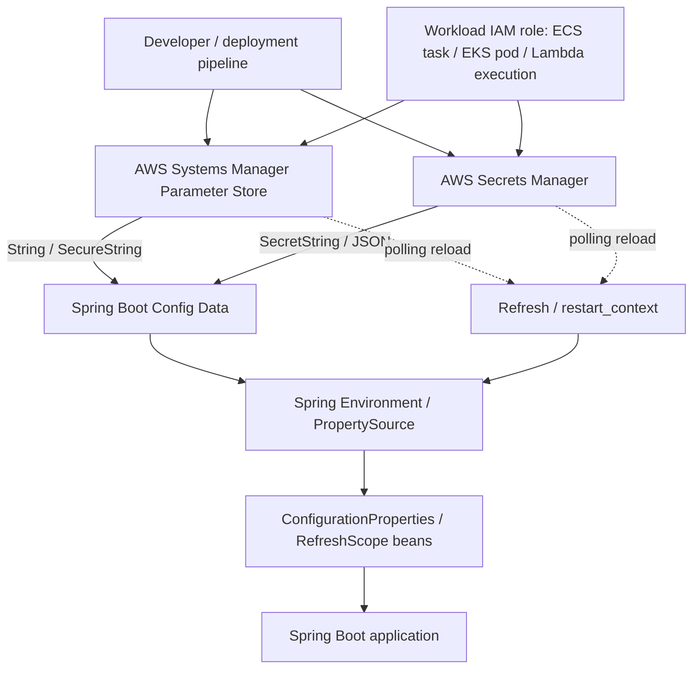
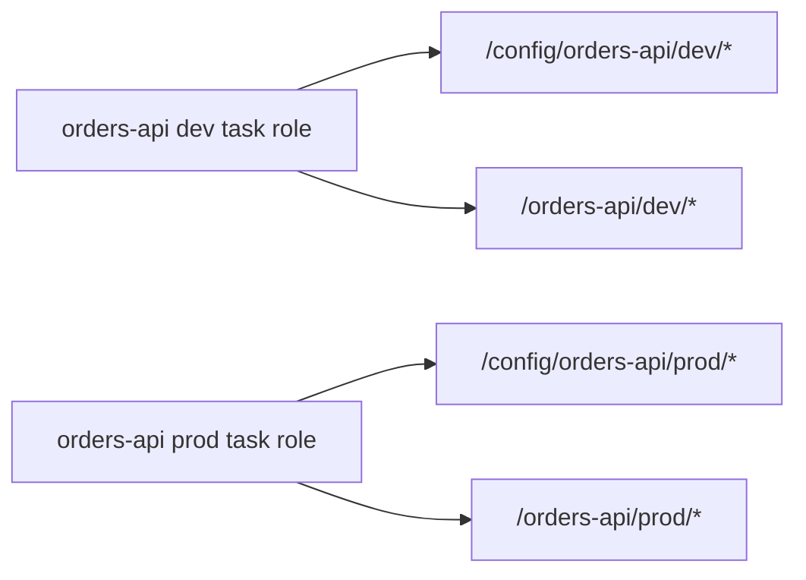
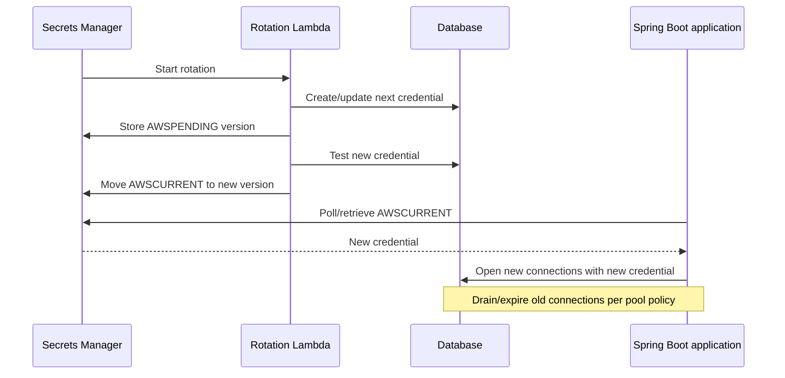
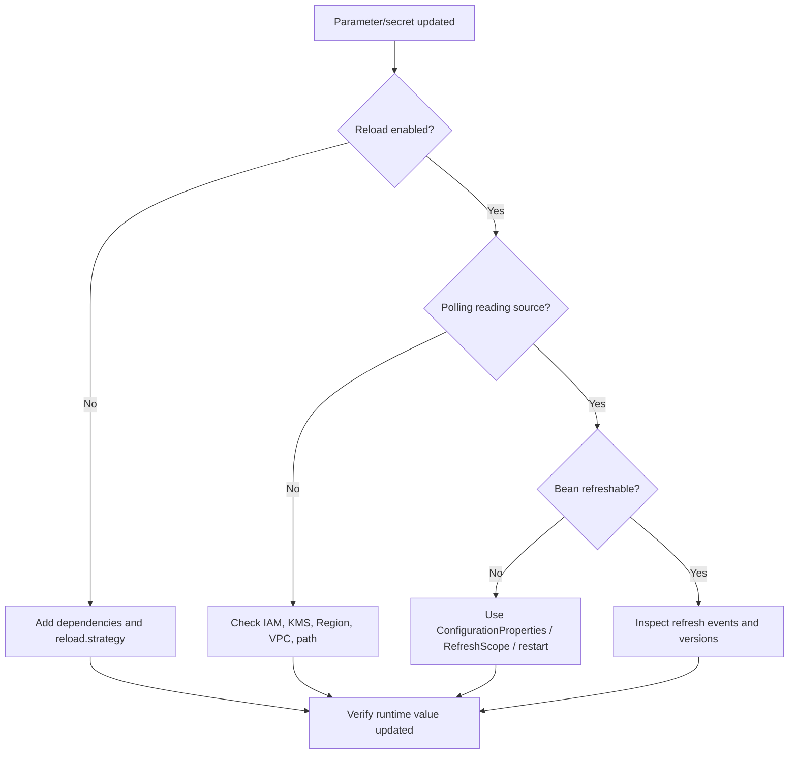

# Loading and Refreshing Configuration from Parameter Store and Secrets Manager

> **Chapter:** Java and Spring Boot Applications · **Module:** `CLOUD_PROVIDERS_AWS`

## 1. The problem: centralized configuration across multiple environments

A Spring Boot application running on Amazon ECS holds settings such as payment service endpoints, feature settings, database URLs, usernames/passwords, and third-party API tokens. Keeping these values inside `application.yml`, Docker images, or environment variables makes multi-environment deployments hard to manage, risks leaking secrets, and forces rebuilds/redeploys whenever configuration changes.

AWS offers two services commonly used to externalize configuration:

- **AWS Systems Manager Parameter Store** stores hierarchical configuration by name; supports `String`, `StringList`, and `SecureString` encrypted with AWS KMS.
- **AWS Secrets Manager** specializes in managing secrets such as database credentials, API keys, and tokens; supports versioning, rotation, and replication.

Spring Cloud AWS (AWSpring) integrates both services into **Spring Boot Config Data**. At startup, values are loaded into the Spring `Environment` and can then bind to `@ConfigurationProperties` or be injected via `@Value`.



**Lesson objectives:**

1. Choose properly among Parameter Store, Secrets Manager, and AWS AppConfig by data type.
2. Design parameter paths and secret names by application/environment.
3. Configure Spring Cloud AWS 3.x to load Parameter Store and Secrets Manager via `spring.config.import`.
4. Bind strongly typed configuration into `@ConfigurationProperties`.
5. Grant least-privilege IAM/KMS permissions for ECS, EKS, Lambda, and EC2.
6. Enable reload and distinguish `refresh` from `restart_context`.
7. Handle caching, rotation, connection pools, and secret consistency.
8. Troubleshoot startup errors, permissions, decryption, polling, logging, and costs.

## 2. Choosing the right service: Parameter Store, Secrets Manager, or AppConfig?

### 2.1. Comparison by use case

| Criterion | Parameter Store | Secrets Manager | AWS AppConfig |
| --- | --- | --- | --- |
| Typical data | App config, endpoints, simple feature settings, reference IDs. | Database credentials, API keys, tokens, third-party credentials. | Feature flags, runtime configuration needing safe rollouts. |
| Data types | `String`, `StringList`, `SecureString`. | `SecretString`, `SecretBinary`; may contain JSON. | Configuration profiles by format/content type. |
| Encryption | `SecureString` uses AWS KMS. | Secrets are encrypted with AWS KMS. | Can store encrypted/source-controlled configuration. |
| Versioning | Parameter versions and labels. | Secret versions and staging labels such as `AWSCURRENT`, `AWSPREVIOUS`. | Versions/hosted configuration versions and deployment strategies. |
| Rotation | No dedicated secret rotation workflow equivalent to Secrets Manager. | Rotation workflows, Lambda rotation templates, and supported DB integrations. | Not a password rotation management service. |
| Dynamic rollout | Can poll/reload in the application. | Can poll/reload the secret source. | Built-in validation, gradual deployment, bake time, and rollback on CloudWatch alarms. |
| Spring integration | AWSpring Parameter Store starter / SDK `SsmClient`. | AWSpring Secrets Manager starter / SDK `SecretsManagerClient`. | AppConfig starter/integration or SDK depending on release line. |

**Selection rules:**

- Use **Parameter Store `String`** for log levels, URLs, timeouts, and non-sensitive feature settings.
- Use **Parameter Store `SecureString`** for values needing encryption without complex rotation workflows—for example, an account identifier or private endpoint value.
- Use **Secrets Manager** for database usernames/passwords, API tokens, signing secrets, and credentials needing rotation/auditing/replication.
- Use **AWS AppConfig** when you need feature flags, schema validation, gradual rollouts, and automatic alarm-driven rollbacks.

AWS recommends Secrets Manager for secrets such as database credentials, API keys, and tokens even though Parameter Store offers `SecureString`. Do not pick Parameter Store merely to avoid designing rotation.

### 2.2. Parameter Store `SecureString` vs. Secrets Manager

`SecureString` encrypts only the **parameter value** with KMS. Parameter names, descriptions, and metadata are unencrypted. When reading with `WithDecryption=true`, the principal needs permission to read the parameter plus `kms:Decrypt` on the corresponding key.

Secrets Manager is built for the secret lifecycle: version stages, rotation, cross-Region replication, auditing, and dedicated secret retrieval APIs. Use one JSON secret for related fields like username/password, but never lump all secrets from every service into a single secret.

### 2.3. Configuration classification examples

| Property | Example | Recommended storage |
| --- | --- | --- |
| `logging.level.com.example` | `INFO` | Parameter Store `String` |
| `payment.provider-url` | `https://payments.example/api` | Parameter Store `String` |
| `feature.checkout-v2-enabled` | `true` | Parameter Store or AppConfig depending on rollout |
| `spring.datasource.username` | Database username | Secrets Manager |
| `spring.datasource.password` | Database password | Secrets Manager |
| `vendor.api-token` | Vendor token | Secrets Manager |
| `db.connection-timeout` | `3s` | Parameter Store `String` |

Never store passwords/tokens in `String` or `StringList`. Likewise, never place secrets in parameter names, secret names, tags, descriptions, or log messages.

## 3. Designing configuration names and hierarchies

### 3.1. Parameter hierarchy

Parameter Store supports hierarchical paths, for example:

```text
/config/orders-api/dev/spring.datasource.url
/config/orders-api/dev/app.payment-provider-url
/config/orders-api/dev/app.feature.checkout-v2-enabled
/config/orders-api/prod/spring.datasource.url
/config/orders-api/prod/app.payment-provider-url
/config/orders-api/prod/app.feature.checkout-v2-enabled

/restricted/orders-api/prod/vendor-api-token
```

A clean naming convention helps:

- Separate applications, environments, and configuration groups.
- Scope IAM policies to read only the exact path.
- Distinguish general config from sensitive values.
- Provision parameters cleanly via IaC and detect drift.

Do not grant read access on `/config/` to a service if that path also contains data for other applications. Isolate sensitive values under a dedicated path and review `GetParametersByPath` behavior carefully (see the IAM section).

### 3.2. Secret naming

Secrets Manager secret names should describe the application, environment, and purpose:

```text
/orders-api/dev/database
/orders-api/prod/database
/orders-api/prod/payment-provider
/orders-api/prod/webhook-signing
```

Secret names and tags remain visible metadata to principals with describe/list permissions. Never embed passwords or tokens in names.

### 3.3. Isolating environments and accounts

Prefer separate resources and IAM roles per environment/account:



Do not use one task role that can read all dev/staging/prod secrets just to simplify deployment. When cross-account access is required, use resource policies/assume-role per approved architecture; importing Secrets Manager by ARN works when the secret resides in another account and policies permit it.

## 4. AWSpring and Spring Boot Config Data

### 4.1. Choosing the right integration version

This lesson uses **Spring Cloud AWS 3.x** and Spring Boot Config Data. The specific reference version is **Spring Cloud AWS 3.4.1**; always verify the compatibility matrix against your Spring Boot/Spring Cloud release train.

Spring Cloud AWS 3.x uses:

- `spring.config.import=aws-parameterstore:...`
- `spring.config.import=aws-secretsmanager:...`

Do not mix this syntax with legacy Spring Cloud AWS 2.x bootstrap settings such as `aws.paramstore.prefix`, `aws.paramstore.name`, or `bootstrap.yml`. When upgrading from 2.x to 3.x, migrate to Config Data imports.

### 4.2. Maven BOM and starter dependencies

The Spring Cloud AWS BOM manages compatible starter versions:

```xml
<dependencyManagement>
    <dependencies>
        <dependency>
            <groupId>io.awspring.cloud</groupId>
            <artifactId>spring-cloud-aws-dependencies</artifactId>
            <version>3.4.1</version>
            <type>pom</type>
            <scope>import</scope>
        </dependency>
    </dependencies>
</dependencyManagement>

<dependencies>
    <dependency>
        <groupId>io.awspring.cloud</groupId>
        <artifactId>spring-cloud-aws-starter-parameter-store</artifactId>
    </dependency>
    <dependency>
        <groupId>io.awspring.cloud</groupId>
        <artifactId>spring-cloud-aws-starter-secrets-manager</artifactId>
    </dependency>
</dependencies>
```

If an application uses only one service, add only that starter. Do not add both starters just because the example shows both Parameter Store and Secrets Manager. If you need to upgrade the AWS SDK for Java independently of the version managed by the AWSpring BOM, declare the AWS SDK BOM per official guidance and test compatibility; never let SDK modules drift across mismatched versions.

### 4.3. Gradle Kotlin DSL

```kotlin
dependencies {
    implementation(platform("io.awspring.cloud:spring-cloud-aws-dependencies:3.4.1"))

    implementation("io.awspring.cloud:spring-cloud-aws-starter-parameter-store")
    implementation("io.awspring.cloud:spring-cloud-aws-starter-secrets-manager")
}
```

Versions shown here follow the 3.4.1 documentation. Standardize on a single AWSpring version, verify Java/Spring Boot requirements, and test upgrades thoroughly.

## 5. Loading configuration from Parameter Store

### 5.1. Using `spring.config.import`

Suppose Parameter Store contains:

| Parameter name | Type | Illustrative value |
| --- | --- | --- |
| `/config/orders-api/prod/app.payment-provider-url` | `String` | `https://payments.example/api` |
| `/config/orders-api/prod/app.checkout-enabled` | `String` | `true` |
| `/config/orders-api/prod/app.http-timeout` | `String` | `3s` |

In `application.properties`:

```properties
spring.application.name=orders-api
spring.config.import=aws-parameterstore:/config/orders-api/prod/
```

AWSpring reads parameters under the path and adds key/value pairs to the Spring `Environment`. Property names derive from the parameter suffix following the imported path. If `/config/orders-api/prod/app.checkout-enabled` has value `true`, the application can bind it as `app.checkout-enabled`.

If the path does not exist or cannot be read, startup fails. Use `optional:` only when the entire configuration from that path is genuinely optional:

```properties
spring.config.import=optional:aws-parameterstore:/config/orders-api/dev-overrides/
```

Never mark a database endpoint or startup-critical config optional just to keep containers passing health checks. That can cause the app to run with incorrect defaults.

### 5.2. Importing multiple paths and prefixes

Multiple paths can be imported:

```properties
spring.config.import=aws-parameterstore:/config/common/;/config/orders-api/prod/
```

To avoid key collisions, use `?prefix=`:

```properties
spring.config.import=aws-parameterstore:/config/orders-api/prod/?prefix=app.
```

With prefix `app.`, parameter key `checkout-enabled` enters the Environment as `app.checkout-enabled`. The prefix is prepended literally; to place a dot between the prefix and key, end the prefix with a dot.

If combining required and optional paths, declare them as separate entries:

```properties
spring.config.import[0]=aws-parameterstore=/config/orders-api/prod/
spring.config.import[1]=optional:aws-parameterstore=/config/orders-api/prod/overrides/
```

### 5.3. Parameter arrays and structured values

AWSpring supports indexed parameter names for binding into Spring arrays/lists. Example:

```text
/config/orders-api/prod/app.allowed-origins_0_ = https://app.example
/config/orders-api/prod/app.allowed-origins_1_ = https://admin.example
```

Spring can bind these as `app.allowed-origins[0]` and `[1]`. Verify conventions and binder behavior for your exact AWSpring version; for complex structures, consider storing JSON in a Parameter/Secret and parsing it into a typed object.

### 5.4. Using the starter-managed `SsmClient` bean

The Parameter Store starter auto-configures an `SsmClient` bean in the Spring context. You can inject this bean to read/write parameters in the service layer:

```java
import org.springframework.stereotype.Service;
import software.amazon.awssdk.services.ssm.SsmClient;
import software.amazon.awssdk.services.ssm.model.GetParameterRequest;

@Service
public class RuntimeParameterReader {
    private final SsmClient ssm;

    public RuntimeParameterReader(SsmClient ssm) {
        this.ssm = ssm;
    }

    public String read(String name) {
        return ssm.getParameter(GetParameterRequest.builder()
                        .name(name)
                        .withDecryption(true)
                        .build())
                .parameter()
                .value();
    }
}
```

Use `withDecryption(true)` only when the caller is authorized to read plaintext `SecureString` values. Never expose a method reading arbitrary parameter names to external HTTP requests; validate against an allowlist/path in the service layer.

## 6. Loading secrets from Secrets Manager

### 6.1. JSON SecretString

A secret named `/orders-api/prod/database` might contain:

```json
{
  "username": "orders_app",
  "password": "<managed-by-secrets-manager>",
  "engine": "postgres",
  "host": "orders-db.example.internal",
  "port": 5432,
  "dbname": "orders"
}
```

In `application.properties`:

```properties
spring.config.import=aws-secretsmanager:/orders-api/prod/database?prefix=db.
```

When `SecretString` is a JSON object, AWSpring adds its top-level keys to the Spring Environment. With prefix `db.`, they become `db.username`, `db.password`, `db.engine`, `db.host`, `db.port`, and `db.dbname`.

If no prefix is needed, import directly:

```properties
spring.config.import=aws-secretsmanager:/orders-api/prod/database
```

If the secret does not exist, startup fails by default. Use `optional:aws-secretsmanager:` only when the secret is genuinely optional:

```properties
spring.config.import=optional:aws-secretsmanager:/orders-api/dev/noncritical-integration
```

### 6.2. Plain-text or binary secrets

If a secret holds plain text, AWSpring can expose its value in the Environment under the secret name. For `SecretBinary`, handle it per API and agreed byte encoding; do not assume every secret is a JSON string.

### 6.3. Importing multiple secrets or cross-account secrets

You can load multiple secrets via Config Data imports, or specify an ARN when reading a secret in another account/Region:

```properties
spring.config.import[0]=aws-secretsmanager=/orders-api/prod/database?prefix=db.
spring.config.import[1]=aws-secretsmanager=/orders-api/prod/payment-provider?prefix=payment.
```

An example ARN looks like:

```text
arn:aws:secretsmanager:ap-southeast-1:111122223333:secret:orders-api/prod/database-AbCdEf
```

Cross-account access requires a resource policy on the secret, IAM permissions on the workload role, and a matching KMS key policy. Use the exact ARN from AWS; never guess the random suffix of a secret ARN.

### 6.4. Using the `SecretsManagerClient` bean

The AWSpring starter auto-configures a `SecretsManagerClient` bean:

```java
import org.springframework.stereotype.Service;
import software.amazon.awssdk.services.secretsmanager.SecretsManagerClient;
import software.amazon.awssdk.services.secretsmanager.model.GetSecretValueRequest;

@Service
public class RuntimeSecretReader {
    private final SecretsManagerClient secrets;

    public RuntimeSecretReader(SecretsManagerClient secrets) {
        this.secrets = secrets;
    }

    public String readSecretString(String secretId) {
        return secrets.getSecretValue(GetSecretValueRequest.builder()
                        .secretId(secretId)
                        .build())
                .secretString();
    }
}
```

If a secret uses `SecretBinary`, read `secretBinary()` and decode per the producer's agreed encoding/format. Never log the returned value, even at DEBUG level.

## 7. Binding configuration into Java types

### 7.1. Using `@ConfigurationProperties`

When configuration has multiple fields, group them into a typed configuration object instead of scattering `@Value` injections:

```java
import java.net.URI;
import java.time.Duration;
import org.springframework.boot.context.properties.ConfigurationProperties;

@ConfigurationProperties(prefix = "app")
public record AppProperties(
        URI paymentProviderUrl,
        boolean checkoutEnabled,
        Duration httpTimeout) {
}
```

Enable scanning on the application:

```java
import org.springframework.boot.SpringApplication;
import org.springframework.boot.autoconfigure.SpringBootApplication;
import org.springframework.boot.context.properties.ConfigurationPropertiesScan;

@SpringBootApplication
@ConfigurationPropertiesScan
public class OrdersApplication {
    public static void main(String[] args) {
        SpringApplication.run(OrdersApplication.class, args);
    }
}
```

Example Parameter Store entries:

```text
/config/orders-api/prod/app.payment-provider-url = https://payments.example/api
/config/orders-api/prod/app.checkout-enabled = true
/config/orders-api/prod/app.http-timeout = 3s
```

The Spring Boot binder converts strings into `URI`, `boolean`, and `Duration`. For required settings, add validation annotations such as `@NotNull`, `@NotBlank`, and `@Min` alongside the matching Bean Validation dependency so startup fails on invalid config.

### 7.2. Binding JSON secrets into a credentials type

If Secrets Manager contains JSON keys `username`, `password`, `host`, `port`, AWSpring prefix `db.` lets you bind:

```java
import org.springframework.boot.context.properties.ConfigurationProperties;

@ConfigurationProperties(prefix = "db")
public record DatabaseCredentials(
        String username,
        String password,
        String host,
        int port,
        String dbname) {
}
```

Never log this record: a Java record's default `toString()` exposes the password. For debugging, log a redacted status such as `credentialsLoaded=true`, never the object itself.

### 7.3. `@Value` and simple settings

For a single standalone property, you can use:

```java
import java.net.URI;
import org.springframework.beans.factory.annotation.Value;
import org.springframework.stereotype.Component;

@Component
public class PaymentEndpoint {
    private final URI baseUri;

    public PaymentEndpoint(@Value("${app.payment-provider-url}") URI baseUri) {
        this.baseUri = baseUri;
    }
}
```

`@Value` suits a few isolated values. When you have related properties, validation, or refresh needs, prefer `@ConfigurationProperties` for testability and maintainability.

### 7.4. Never assume all beans update automatically when properties change

The Spring Environment may receive a refreshed property source, yet objects constructed from startup config can retain old values:

- A singleton bean that copied a password into a `final` field does not update automatically.
- `DataSource`/Hikari pools may continue holding old connections even after `DatabaseCredentials` refreshes.
- AWS SDK clients, HTTP clients, TLS contexts, and connection pools typically capture settings when their builder runs.
- `@Value` fields inside regular beans are generally not re-injected solely because the Environment changed.

To refresh at runtime, use refresh-capable beans, build factories that swap underlying resources, or restart the context per a tested policy. Sections 11–13 detail how to choose.

## 8. IAM, KMS, and data protection

### 8.1. Using the right workload role

Applications should receive temporary credentials from their runtime role:

| Runtime | Role used by the AWS SDK in the app |
| --- | --- |
| Amazon ECS | Container **task role**. The task execution role is primarily for the agent pulling images/writing logs. |
| Amazon EKS | EKS Pod Identity or IRSA per configuration. |
| AWS Lambda | Lambda execution role. |
| Amazon EC2 | Instance profile role. |
| Local development | AWS IAM Identity Center/SSO or an authorized profile. |

Never embed access keys/secret keys in `application.yml`, Dockerfiles, images, source code, or CI logs. Region must point to where the Parameter/Secret resides; cross-Region secrets require matching endpoints/ARNs and permissions.

### 8.2. IAM policy to read a Parameter Store path

Example role for `orders-api-prod` needing read access only to `/config/orders-api/prod/`:

```json
{
  "Version": "2012-10-17",
  "Statement": [
    {
      "Sid": "ReadOrdersApiProductionConfig",
      "Effect": "Allow",
      "Action": [
        "ssm:GetParametersByPath"
      ],
      "Resource": "arn:aws:ssm:ap-southeast-1:111122223333:parameter/config/orders-api/prod/*"
    }
  ]
}
```

This matches AWSpring's Parameter Store Config Data integration. If your code calls `GetParameter`, `GetParameters`, or `GetParameterHistory` directly, grant those specific actions; never grant `ssm:*` out of convenience.

### 8.3. Special risk with `GetParametersByPath`

Parameter Store authorizes `GetParametersByPath` against the **requested path**, rather than re-evaluating each child parameter as an independent boundary. If a principal can read `/config/orders-api/`, it may receive `/config/orders-api/restricted/...` beneath it. A Deny on `ssm:GetParameter` for a child does not automatically block an `ssm:GetParametersByPath` request against an ancestor path.

Therefore:

- Place sensitive parameters under a separate path such as `/restricted/orders-api/prod/`.
- Never place secrets beside general config expecting a child-ARN Deny to always block `GetParametersByPath`.
- If denying `ssm:GetParametersByPath`, evaluate every ancestor path that could encompass that parameter.
- Verify with the IAM Policy Simulator and real tests under the actual task role.

### 8.4. `SecureString` requires KMS decrypt

Reading a `SecureString` with decryption requires `ssm:GetParameter`/`ssm:GetParametersByPath` plus `kms:Decrypt` on the encrypting key. With customer-managed KMS keys, scope `kms:Decrypt` to the exact key and appropriate policy/key conditions.

Parameter Store's default AWS managed key is often unsuitable when fine-grained decrypt separation is needed among principals in the same account. Use a customer-managed key for sensitive paths and govern both the key policy and IAM policy.

### 8.5. IAM policy to read a Secrets Manager secret

Example role reading only the database secret:

```json
{
  "Version": "2012-10-17",
  "Statement": [
    {
      "Sid": "ReadOrdersDatabaseSecret",
      "Effect": "Allow",
      "Action": [
        "secretsmanager:GetSecretValue"
      ],
      "Resource": "arn:aws:secretsmanager:ap-southeast-1:111122223333:secret:orders-api/prod/database-AbCdEf"
    }
  ]
}
```

If the secret is encrypted with a customer-managed KMS key, the role also needs `kms:Decrypt` on that key and the key policy must allow it. Secret ARNs include a random suffix; use the real ARN from AWS. AWSpring's Secrets Manager integration requires `secretsmanager:GetSecretValue`; some caching/client components also require `DescribeSecret`.

### 8.6. Network paths and VPC endpoints

If ECS/EKS/EC2 runs in private subnets, the app needs a network path to AWS APIs:

- An appropriate NAT Gateway/egress path, or
- Interface VPC endpoints for Systems Manager (`ssm`) and Secrets Manager (`secretsmanager`), plus a KMS endpoint if the architecture accesses KMS APIs directly.

Security groups, private DNS, and endpoint policies must permit the workload. If config import fails with connection timeouts, inspect networking before altering IAM policies.

### 8.7. Protecting Spring Actuator and logs

Secrets can leak through the Spring Environment, binding errors, exception messages, or Actuator endpoints if misconfigured:

- Never expose `/actuator/env`, `/actuator/configprops`, or restart endpoints publicly without authentication/authorization.
- Keep default sanitization enabled and add custom secret-key patterns where needed.
- Never log the full `Environment`, `ConfigurationProperties` objects containing passwords, or `GetSecretValue` responses.
- Restrict access to CloudWatch Logs, CI artifacts, and heap dumps.
- Avoid passing secrets via command-line arguments or environment variables when the runtime can fetch them directly from a provider more securely.

## 9. Reading directly with AWS SDK for Java 2.x and caching secrets

### 9.1. When to use the SDK directly?

AWSpring Config Data fits configuration loaded into the Spring Environment at startup and optionally reloaded via configured mechanisms. Use the AWS SDK directly when:

- A service reads secrets per tenant or per authenticated request context.
- A specific secret version/stage must be selected.
- You need custom caching/refresh policies.
- The application does not use Spring Cloud AWS.
- Parameters/secrets are queried dynamically as runtime business data rather than application config.

Never call the Secrets Manager API on every HTTP request if secrets change only on a rotation schedule; cache with appropriate TTL/refresh policies to lower latency and API costs.

### 9.2. Maven dependencies for the AWS SDK

If not using an AWSpring starter, add the AWS SDK BOM and service modules:

```xml
<dependencyManagement>
    <dependencies>
        <dependency>
            <groupId>software.amazon.awssdk</groupId>
            <artifactId>bom</artifactId>
            <version>2.x.y</version>
            <type>pom</type>
            <scope>import</scope>
        </dependency>
    </dependencies>
</dependencyManagement>

<dependencies>
    <dependency>
        <groupId>software.amazon.awssdk</groupId>
        <artifactId>ssm</artifactId>
    </dependency>
    <dependency>
        <groupId>software.amazon.awssdk</groupId>
        <artifactId>secretsmanager</artifactId>
    </dependency>
</dependencies>
```

`2.x.y` is a placeholder for an organization-approved AWS SDK 2.x release. When using AWSpring, let the AWSpring BOM manage SDK modules unless there is a clear reason and compatibility test for overriding.

### 9.3. Reading a SecureString with SsmClient

```java
import software.amazon.awssdk.regions.Region;
import software.amazon.awssdk.services.ssm.SsmClient;
import software.amazon.awssdk.services.ssm.model.GetParameterRequest;

try (SsmClient ssm = SsmClient.builder()
        .region(Region.AP_SOUTHEAST_1)
        .build()) {

    String value = ssm.getParameter(GetParameterRequest.builder()
                    .name("/restricted/orders-api/prod/vendor-account-id")
                    .withDecryption(true)
                    .build())
            .parameter()
            .value();

    // Use value in memory; never log or return in HTTP responses.
}
```

The SDK uses the default credentials provider chain when no provider is specified; on ECS, applications should use a **task role**. For `SecureString`, `withDecryption(true)` requires KMS key decrypt permissions. Close clients when the resource scope ends; in Spring services, register a singleton client bean instead of building a new client per call.

### 9.4. Reading multiple parameters by path

```java
import software.amazon.awssdk.services.ssm.model.GetParametersByPathRequest;

var response = ssm.getParametersByPath(GetParametersByPathRequest.builder()
        .path("/config/orders-api/prod/")
        .recursive(true)
        .withDecryption(true)
        .build());

response.parameters().forEach(parameter -> {
    // Process in memory only; avoid logging parameter.value().
});
```

This retrieves one page of results. When using the SDK directly for paths with many parameters, paginate with `nextToken()` to read subsequent pages. `GetParametersByPath` authorizes by the requested path; never pass a path broader than what the application actually needs.

### 9.5. Reading secrets with SecretsManagerClient

```java
import software.amazon.awssdk.regions.Region;
import software.amazon.awssdk.services.secretsmanager.SecretsManagerClient;
import software.amazon.awssdk.services.secretsmanager.model.GetSecretValueRequest;

try (SecretsManagerClient client = SecretsManagerClient.builder()
        .region(Region.AP_SOUTHEAST_1)
        .build()) {

    String secretJson = client.getSecretValue(GetSecretValueRequest.builder()
                    .secretId("/orders-api/prod/database")
                    .build())
            .secretString();

    // Parse JSON with ObjectMapper and retain only needed fields.
    // Never write secretJson to logs.
}
```

`GetSecretValue` returns `SecretString` or `SecretBinary` depending on the secret. You can target a version stage such as `AWSCURRENT` or `AWSPREVIOUS` during controlled investigation/rollback. Minimum permission is `secretsmanager:GetSecretValue`; customer-managed KMS keys also require `kms:Decrypt`.

### 9.6. Caching secrets: reducing latency and API costs

AWS recommends client-side caching of secret values. Options include:

- The AWS Secrets Manager Java caching component.
- An internal cache with TTL, single-flight refresh, and bounded size.
- AWSpring property source reload for Spring config needing refresh.

The Secrets Manager Java caching component uses LRU and refreshes hourly by default. However, AWS documentation notes it **lacks cache invalidation**, does not force garbage collection when references are dropped, and is **not designed as a security-hardened cache**. If using it, evaluate TTL, in-memory secret exposure, rotation detection, invalidation, and cache shutdown/refresh behavior yourself.

Cache design:

1. Align TTL with rotation cadence and staleness tolerance.
2. Refresh ahead of TTL expiry when possible using single-flight coordination so concurrent threads don't stampede the API.
3. Define whether refresh failures fall back to the cached value or fail closed.
4. After rotation, refresh the secret and recreate connections/resources that depend on the new credential.
5. Never expose cached values via Actuator, metric labels, logs, or exception messages.

**No TTL alone guarantees successful rotation.** If the database already invalidated the old password while a connection pool still tries to open connections with the old credential, the application fails even if the secret cache refreshes later.

## 10. Loading config at startup and handling property source precedence

### 10.1. Config import runs during bootstrap

Spring Boot Config Data is processed before the application context finishes initializing. Consequently:

- IAM credentials, Region, and network paths must be ready as soon as the process starts.
- `SsmClient`/`SecretsManagerClient` instances used for import are created by AWSpring's bootstrap/config-data infrastructure; normal application beans are not yet ready for injection at this phase.
- To customize clients used by `spring.config.import`, AWSpring offers matching bootstrap customizers/`BootstrapRegistryInitializer` hooks.
- Failing to read a required path/secret prevents startup; orchestrators need restart policies and alerts.

### 10.2. Do not mix conflicting read mechanisms

Distinguish:

| Mechanism | Timing | Suitable for |
| --- | --- | --- |
| `spring.config.import` | Startup, optionally paired with AWSpring reload | Application-level configuration |
| Inject `SsmClient`/`SecretsManagerClient` | Runtime per service logic | Dynamic lookups, per-tenant access, explicit version/stage |
| Environment variables | Startup/deployment | Non-secret runtime wiring and overrides |
| `@RefreshScope`/`@ConfigurationProperties` | When Spring refresh events fire | Beans needing updated configuration |

Never read the same key from multiple sources with unclear precedence. Establish one authoritative source per property and verify Spring Environment/property source precedence under actual profiles.

### 10.3. Optional vs. required configuration

Use `optional:` only for settings genuinely unnecessary for the service to function. For example, an endpoint for an integration disabled in dev may be optional; database passwords, encryption key references, and essential endpoints must not be optional.

When required configuration is missing:

1. Fail startup cleanly.
2. Log the redacted parameter/secret identifier (never the value).
3. Alert on startup failures/restart loops.
4. Check IAM, Region, path/secret ARN, KMS key policy, and networking.

Never fall back to hardcoded passwords or stale defaults just to make containers look healthy.

## 11. Refreshing property sources when Parameter Store or secrets change

### 11.1. Reload is not enabled automatically

In Spring Cloud AWS 3.4.1, **PropertySource reload is disabled by default**. Adding only `spring.config.import` loads configuration at startup; editing a parameter/secret in AWS does not automatically update Spring beans.

To enable reload, add the dependencies required for Spring refresh:

```xml
<dependency>
    <groupId>org.springframework.boot</groupId>
    <artifactId>spring-boot-starter-actuator</artifactId>
</dependency>
<dependency>
    <groupId>org.springframework.cloud</groupId>
    <artifactId>spring-cloud-commons</artifactId>
</dependency>
<dependency>
    <groupId>org.springframework.cloud</groupId>
    <artifactId>spring-cloud-context</artifactId>
</dependency>
```

Manage Spring Cloud dependency versions using the release train compatible with your Spring Boot version. Never copy arbitrary versions from unrelated examples and mix them with the Spring Boot/AWSpring BOM.

### 11.2. Configuring reload for Parameter Store and Secrets Manager

Example polling every 60 seconds:

```yaml
spring:
  cloud:
    aws:
      parameterstore:
        reload:
          strategy: refresh
          period: 60s
      secretsmanager:
        reload:
          strategy: refresh
          period: 60s
```

Or in `application.properties`:

```properties
spring.cloud.aws.parameterstore.reload.strategy=refresh
spring.cloud.aws.parameterstore.reload.period=60s

spring.cloud.aws.secretsmanager.reload.strategy=refresh
spring.cloud.aws.secretsmanager.reload.period=60s
```

**Note on 3.4.1 documentation:** The configuration reference table lists the Parameter Store property as `spring.cloud.aws.parameterstore.reload.period` with default `15s`, while the reload prose on the same page mentions `spring.cloud.aws.parameter.reload.period` and a one-minute default. The Secrets Manager reference similarly has discrepancies between prose and table defaults. To avoid relying on default/documentation mismatches, set `reload.period` explicitly as shown, inspect the property metadata for your exact artifact version, and test polling in your environment.

### 11.3. Two reload strategies

AWSpring supports two strategies:

| Strategy | Behavior | When suitable |
| --- | --- | --- |
| `refresh` | Refreshes configuration beans annotated with `@ConfigurationProperties` or `@RefreshScope` via Spring Cloud Context. | Settings can update without rebuilding the entire application context. |
| `restart_context` | Gracefully restarts the entire Spring `ApplicationContext`; beans are recreated with fresh config. | Changes require reconstructing numerous config-dependent singletons/resources. |

Choose the strategy via:

```properties
spring.cloud.aws.parameterstore.reload.strategy=refresh
spring.cloud.aws.secretsmanager.reload.strategy=refresh
```

`refresh` does not mean every singleton bean automatically picks up new values. Refreshable beans must be bound/annotated properly and downstream resources must support updates.

### 11.4. Refreshable beans

`@ConfigurationProperties` example:

```java
@ConfigurationProperties(prefix = "app")
public record AppProperties(
        URI paymentProviderUrl,
        boolean checkoutEnabled,
        Duration httpTimeout) {
}
```

For a bean holding values injected via `@Value`, use `@RefreshScope`:

```java
import org.springframework.cloud.context.config.annotation.RefreshScope;
import org.springframework.stereotype.Component;
import org.springframework.beans.factory.annotation.Value;

@Component
@RefreshScope
public class PaymentGatewaySettings {
    private final String apiToken;

    public PaymentGatewaySettings(
            @Value("${payment.api-token}") String apiToken) {
        this.apiToken = apiToken;
    }

    public String apiToken() {
        return apiToken;
    }
}
```

This illustrates a refresh-scoped bean. Never log `apiToken()` or return tokens via controllers/Actuator. If another bean holds long-lived references to resources built from the old token, those resources must also be refreshed or recreated.

### 11.5. Restarting the entire ApplicationContext

When using `restart_context`, AWSpring requires enabling and exposing the Actuator restart endpoint:

```yaml
management:
  endpoint:
    restart:
      enabled: true
  endpoints:
    web:
      exposure:
        include: restart
```

This endpoint restarts the application context. **Never expose it publicly or unauthenticated**. Permit access only from a controlled management network/role with authentication/authorization and auditing enabled. Prefer `refresh` whenever a full context restart is unnecessary.

### 11.6. Polling, consistency, and cost

Reload works by periodically re-reading external property sources for changes. Therefore:

- Minimum detection latency roughly equals the polling period plus API/network latency.
- Every replica/task polls independently; 50 ECS tasks with a short interval generate substantial API traffic.
- During config rollouts, replicas may pick up new values at staggered times.
- API errors or network blips can delay refreshes; never assume config updates propagate instantaneously across all instances.
- Pick intervals aligned with freshness needs, quotas, and cost; avoid overly aggressive polling.

For feature flags requiring gradual rollouts, validation, and automatic rollbacks, use AppConfig instead of trying to turn Parameter Store polling into a deployment controller.

## 12. Secret rotation and updating credential-holding resources

### 12.1. Secret versions and staging labels

Secrets Manager tracks secret versions. Common staging labels:

- `AWSCURRENT`: the active version applications normally read.
- `AWSPREVIOUS`: the prior version, helpful for controlled investigation/rollback.
- `AWSPENDING`: the version currently being prepared by a rotation workflow.

When rotation finishes, `AWSCURRENT` moves to the new version. When an app reads a secret without specifying a version stage, Secrets Manager returns `AWSCURRENT` by default.

Parameter Store also supports parameter versions/labels, yet lacks dedicated database/API credential rotation workflows like Secrets Manager.

### 12.2. Rotation does not mean connection pools swap passwords automatically

Suppose a database secret rotates from password A to password B:

1. Secrets Manager's rotation workflow creates/updates the new credential and moves `AWSCURRENT`.
2. AWSpring polling or an application cache detects the new secret.
3. Spring configuration beans receive the new value if properly refreshable.
4. Connection pools must use the new credential when opening **new connections**.
5. Already-open connections may keep working under previously authenticated sessions until closed by the database or pool policy.

If a Hikari pool still holds password A while only a properties bean updated to B, the pool does not automatically replace its datasource or credentials. Design pool lifecycle/recreation, max connection lifetime, graceful draining, and retries per database engine.

### 12.3. Using an engine-appropriate rotation strategy

Secrets Manager offers rotation templates/Lambda workflows for supported database services. Rotation can use **alternating users** to minimize disruption:



Exact steps depend on the engine and rotation template. Never assume every database rotation is zero-downtime; test upfront against your real database engine, user model, pool, and connection lifetime.

### 12.4. Refreshing DataSource and client beans

For credentials used to construct a `DataSource`, options include:

- Using an integration/driver designed to fetch credentials from Secrets Manager when opening connections.
- Building a factory that manages the datasource and swaps the pool when credentials change.
- Using a refresh-scoped datasource/resource if lifecycle and shutdown semantics have been thoroughly tested.
- Using `restart_context` or an ECS rolling restart when all singleton beans must be recreated.

Never annotate `DatabaseCredentials` alone and assume the datasource updated. Test existing connections, new connections, pool exhaustion, DB rotation, task restarts, and rollbacks.

### 12.5. Rolling back after rotation

`AWSPREVIOUS` helps with investigation or restoring a version label, yet **does not guarantee the old credential remains valid in the database**. If the rotation Lambda already disabled the old user/password, moving the label back will not automatically restore the database account.

A rollback runbook must coordinate:

1. Inspect database user/password state.
2. Identify secret versions and staging labels.
3. Restore credentials in the database per the rotation procedure.
4. Update secret versions/labels safely.
5. Refresh/recreate application pools.
6. Verify connection success and audit logs.

Never print plaintext secrets in incident channels to compare them; use version IDs/staging labels and safe connection checks.

## 13. Operations, monitoring, and troubleshooting

### 13.1. Metrics and events to monitor

| Metric / event | Purpose |
| --- | --- |
| Config import startup success/failure | Detect apps failing to start due to missing config or permissions. |
| Last successful refresh timestamp | Know how stale runtime configuration is. |
| Reload attempts/success/failure | Track polling health and refresh errors. |
| `AccessDenied` / `DecryptionFailure` | Catch misconfigured IAM/KMS policies. |
| `ParameterNotFound` / `ResourceNotFoundException` | Catch wrong paths, secret names, or Regions. |
| Secrets Manager rotation status | Detect failed or overdue rotation workflows. |
| Database pool connection errors | Detect pools still holding stale credentials. |
| API call count/latency/throttling | Monitor polling load, quotas, and service availability. |
| CloudTrail API events | Audit which principals read or modified parameters/secrets. |

Log **identifiers, version IDs, refresh status, and error codes** where needed; never log secret values. Avoid using full parameter names/secret ARNs as high-cardinality metric labels if they can embed tenant names or internal details.

### 13.2. Troubleshooting by symptom

| Symptom | Causes to check | Resolution |
| --- | --- | --- |
| App fails startup with `ConfigDataLocationNotFoundException`/import error. | Missing starter, wrong prefix, missing path/secret, or required import marked wrong. | Check dependencies, `spring.config.import`, paths, and Region. |
| `AccessDeniedException` from SSM. | Task role missing `ssm:GetParametersByPath` or wrong resource ARN/path scope. | Check the exact ECS task role and IAM policy. |
| `AccessDeniedException` from Secrets Manager. | Missing `secretsmanager:GetSecretValue` or wrong secret resource ARN. | Scope policy to the real secret ARN. |
| `DecryptionFailure` / KMS access denied. | Missing `kms:Decrypt`, key policy blocks access, or wrong key. | Check KMS key ARN, IAM policy, and key policy. |
| `ParameterNotFound`. | Wrong parameter path, environment, or Region. | Check path, account, and Region. |
| `ResourceNotFoundException` from Secrets Manager. | Wrong secret name/ARN, suffix, or Region. | Use exact secret ARN and verify resource. |
| `SecureString` returns ciphertext/unreadable plaintext. | `WithDecryption` disabled or missing KMS decrypt. | Enable decryption where authorized and grant scoped KMS permission. |
| Config import works yet values never change after update. | Reload disabled, missing dependencies, or non-refreshable bean. | Enable PropertySource reload and use `@ConfigurationProperties`/`@RefreshScope`. |
| `@Value` keeps stale value. | Singleton bean is not refreshed. | Switch to refresh-scoped bean or restart context. |
| New secret entered Environment yet DB connections fail. | `DataSource`/pool holds old credential or DB rotation incomplete. | Recreate/drain pool per rotation runbook. |
| Some ECS tasks see new config, others keep old config. | Independent polling, network/API failure, or staggered deploy. | Monitor last refresh per task, retries, and controlled rollouts. |
| Polling triggers excessive API calls/throttling. | Short interval, many replicas, or overly broad import path. | Increase polling interval, narrow paths, consider caching/AppConfig. |
| Parameter Store path returns unintended secrets. | `GetParametersByPath` granted on overly broad ancestor path. | Isolate restricted paths, narrow Allows, and audit ancestor access. |
| Secret value appears in logs/Actuator. | Logging objects, debug wire logs, or exposed env/configprops. | Redact, lock endpoints, and rotate the exposed secret. |
| Spring Cloud AWS 2.x config ignored after 3.x upgrade. | Still using legacy bootstrap properties. | Migrate to `spring.config.import` and 3.x starters. |

### 13.3. Runbook when configuration fails to refresh



1. Confirm the parameter version or secret version ID/stage changed.
2. Verify account, Region, path/secret ARN, and task role.
3. Check reload dependencies, strategy, and period.
4. Check refresh success/failure logs; never log plaintext.
5. Confirm beans use `@ConfigurationProperties` or `@RefreshScope`.
6. If resources were built from old config, replace the resource/pool or restart context.
7. Verify all replicas/tasks and record the last refresh timestamp.

### 13.4. Security incident: exposed secret

If a secret appears in logs, CI artifacts, heap dumps, or responses:

1. Treat the secret as compromised; do not merely delete the log line.
2. Rotate/revoke the credential at the target system and update Secrets Manager.
3. Refresh/recreate application resources holding the credential.
4. Determine log/artifact access scope and exposure window.
5. Audit CloudTrail, redacted application logs, and downstream access.
6. Fix the leak source, add regression tests, and purge copies per retention policy.

## 14. Safe AWS CLI practices

> The commands below use AWS CLI v2. Resource names/Regions/accounts are examples; substitute your authorized lab values. `put`, `update`, or `rotate` commands mutate AWS resources and can incur costs. Never run them in production without change approval.

### 14.1. Creating and updating non-sensitive parameters

```bash
aws ssm put-parameter \
  --region ap-southeast-1 \
  --name "/config/orders-api/dev/app.checkout-enabled" \
  --type String \
  --value "true" \
  --overwrite
```

Inspect metadata/version without printing values:

```bash
aws ssm get-parameter \
  --region ap-southeast-1 \
  --name "/config/orders-api/dev/app.checkout-enabled" \
  --query "Parameter.{Name:Name,Type:Type,Version:Version,LastModified:LastModifiedDate}" \
  --output table
```

### 14.2. Creating a SecureString

Store plaintext in a permission-restricted file, e.g., `parameter-value.txt`, then run:

```bash
aws ssm put-parameter \
  --region ap-southeast-1 \
  --name "/restricted/orders-api/dev/vendor-account-id" \
  --type SecureString \
  --key-id "arn:aws:kms:ap-southeast-1:111122223333:key/EXAMPLE-KEY-ID" \
  --value "file://parameter-value.txt" \
  --overwrite
```

Protect and securely delete the plaintext file per policy afterward. Never put real values into shell history, CI output, or command transcripts. Inspect version metadata without printing the parameter value:

```bash
aws ssm get-parameter \
  --region ap-southeast-1 \
  --name "/restricted/orders-api/dev/vendor-account-id" \
  --with-decryption \
  --query "Parameter.Version" \
  --output text
```

### 14.3. Creating a Secrets Manager secret from a JSON file

Example `database-secret.json` created in a lab directory with restricted read permissions:

```json
{
  "username": "orders_app",
  "password": "<insert-lab-password-locally>",
  "host": "orders-db.example.internal",
  "port": 5432,
  "dbname": "orders"
}
```

Create the secret:

```bash
aws secretsmanager create-secret \
  --region ap-southeast-1 \
  --name "/orders-api/dev/database" \
  --description "Database credentials for orders-api dev" \
  --secret-string "file://database-secret.json"
```

If the secret already exists, update it with `put-secret-value` following a version/rotation-reviewed workflow; never create duplicate secrets or overwrite production secrets for experiments.

### 14.4. Inspecting version stages without reading plaintext

```bash
aws secretsmanager describe-secret \
  --region ap-southeast-1 \
  --secret-id "/orders-api/dev/database" \
  --query "VersionIdsToStages" \
  --output json
```

Output shows version IDs and labels such as `AWSCURRENT`/`AWSPREVIOUS` without printing `SecretString`. When testing real retrieval, use the actual workload role and never capture plaintext output in logs or shell transcripts.

### 14.5. Inspecting a parameter path

```bash
aws ssm get-parameters-by-path \
  --region ap-southeast-1 \
  --path "/config/orders-api/dev/" \
  --recursive \
  --query "Parameters[].{Name:Name,Type:Type,Version:Version}" \
  --output table
```

This command displays only names/metadata. If testing `SecureString` decryption, use an authorized principal and never emit plaintext to log-persisting outputs.

## 15. Practice exercises and assessment scenarios

> **Lab rules:** Use only authorized AWS accounts, Regions, and IAM roles. Commands creating or updating parameters or secrets alter application configuration and can incur charges. Without a lab environment, work through designs, policies, and expected outputs on paper.

### Exercise 1 — Choosing a configuration storage service

An e-commerce app has:

1. Log level and HTTP timeout.
2. Payment provider URL endpoint.
3. Database username/password requiring rotation.
4. Feature flag enabling checkout v2 for 5% of users and ramping up gradually.
5. Shipping system API token.

For each item:

- Select Parameter Store `String`, `SecureString`, Secrets Manager, or AppConfig.
- Explain encryption, rotation, audit, and rollout requirements.
- State the minimal IAM action.
- Determine whether runtime reload or simple redeployment is needed.

**Pass criteria:** Database/API credentials are managed in Secrets Manager; feature rollouts requiring gradual deployment are evaluated with AppConfig.

### Exercise 2 — Designing parameter hierarchy

Design paths for `orders-api` across dev/staging/prod, including common config, datasource URL, payment endpoint, and a restricted merchant identifier.

- Define the naming convention.
- Choose `String` vs. `SecureString` per parameter.
- Isolate restricted paths so the prod task role cannot read dev config.
- Write the `GetParametersByPath` policy.
- Explain why restricted children must not sit beneath a broadly readable path.

### Exercise 3 — Configuring AWSpring Config Data

A Spring Boot app needs:

- Parameter Store path `/config/orders-api/prod/`.
- JSON secret `/orders-api/prod/database` with prefix `db.`.
- An optional integration present only in staging.

Write:

1. Maven BOM and the two starter dependencies.
2. `spring.config.import` as an indexed list.
3. Prefixes for parameter keys and JSON secret keys.
4. `optional:` import strictly for the non-mandatory integration.
5. Required IAM permissions for the task role.

### Exercise 4 — Typed configuration and validation

Parameter Store has:

```text
app.payment-provider-url = https://payments.example/api
app.checkout-enabled = true
app.http-timeout = 3s
```

Tasks:

1. Write the `AppProperties` record using `URI`, `boolean`, and `Duration`.
2. Enable `@ConfigurationPropertiesScan`.
3. Add validation for required URL and positive timeout.
4. Write unit tests covering valid/invalid configurations.
5. Explain why `@Value` should not be used for dozens of properties.

### Exercise 5 — Binding a JSON secret to a datasource

Secret `/orders-api/prod/database` contains `username`, `password`, `host`, `port`, and `dbname`.

- Write the JSON schema/contract for the secret.
- Import with prefix `db.`.
- Bind to `DatabaseCredentials`.
- Configure the datasource from typed properties.
- Identify which objects need refreshing when the secret changes.
- Explain why updating a password field does not automatically update the connection pool.

### Exercise 6 — Enabling Parameter Store/Secrets Manager reload

An app loads config at startup yet misses subsequent changes.

1. Add Actuator, Spring Cloud Commons, and Spring Cloud Context dependencies.
2. Enable `spring.cloud.aws.parameterstore.reload.strategy=refresh`.
3. Enable `spring.cloud.aws.secretsmanager.reload.strategy=refresh`.
4. Set an explicit 60-second period.
5. Use `@ConfigurationProperties`/`@RefreshScope`.
6. Write a test updating a property and verifying runtime beans receive the new value.
7. Explain polling delay and API call volume across 30 ECS tasks.

### Exercise 7 — Rotating database credentials

A database credential in Secrets Manager rotates every 30 days. Some new requests still fail authentication after the secret receives a new `AWSCURRENT` version.

Tasks:

- Check whether `DatabaseCredentials` refreshed.
- Check whether `DataSource`/Hikari holds the old password.
- Design connection pool recycling/draining.
- Evaluate alternating users and rotation Lambdas.
- Write a rollback plan using database state + secret version stages.
- Prove no plaintext passwords appear in logs.

### Exercise 8 — Least privilege and KMS

An ECS task only needs `/config/orders-api/prod/*` and secret `/orders-api/prod/database`.

1. Write the IAM identity policy for `ssm:GetParametersByPath`.
2. Write the policy for `secretsmanager:GetSecretValue`.
3. Add scoped KMS decrypt permissions if using customer-managed keys.
4. Explain the difference between ECS task role and task execution role.
5. Assess ancestor path access risks.
6. Recommend VPC endpoints for private subnets.

### Exercise 9 — Incident: secret leaked via Actuator

A team exposed `/actuator/env` to the public network, and a response contained `db.password`.

Draft an incident response:

1. Identify which secrets were exposed and the exposure window.
2. Rotate/revoke credentials in the database.
3. Update Secrets Manager and refresh/recreate pools.
4. Inspect CloudTrail and access logs.
5. Lock down the endpoint, enable auth/authorization and sanitization.
6. Audit CI logs, heap dumps, and support bundles.
7. Add a regression test preventing secrets from appearing in Actuator outputs.

### Exercise 10 — Designing dynamic config for many replicas

An ECS service runs 40 tasks, polling Parameter Store every 5 seconds and Secrets Manager every 5 seconds. After scaling out, API calls and throttling surge.

- Estimate polling calls per task/hour.
- Re-select reload periods aligned with freshness SLOs.
- Separate settings needing immediate refresh from settings that can wait for deployments.
- Evaluate client-side caching and AWS AppConfig.
- Define metrics for last-refresh-age, refresh failures, and API throttling.
- Propose rollout/rollback steps if only a subset of replicas picks up new config.

### Self-check questions

1. Which parameter types does Parameter Store support?
2. Why doesn't `SecureString` completely replace Secrets Manager?
3. When should AWS AppConfig be chosen over polling Parameter Store?
4. Which property does Spring Cloud AWS 3.x use to import Parameter Store?
5. Which prefix does Spring Cloud AWS 3.x use to import Secrets Manager?
6. How does `optional:` alter startup behavior?
7. How are JSON secret top-level keys placed into the Spring Environment?
8. What does `?prefix=db.` do?
9. Why use a BOM for AWSpring starters?
10. Does an ECS app use the task role or task execution role to read secrets?
11. Which KMS permission is needed to read a `SecureString`?
12. Does `GetParametersByPath` authorize by requested path or per child?
13. Why must restricted parameters live under a separate path?
14. What do Secrets Manager's `AWSCURRENT` and `AWSPREVIOUS` labels mean?
15. Is AWSpring PropertySource reload enabled or disabled by default?
16. Which bean types does the AWSpring `refresh` strategy refresh?
17. How does `restart_context` differ from `refresh`?
18. Why must the Actuator restart endpoint be protected?
19. How does polling period affect latency and API costs?
20. Why doesn't a `@Value` singleton automatically update when a secret changes?
21. Why can a datasource pool keep using old credentials?
22. Does a successful secret rotation mean all database connections have switched?
23. Does the AWS Secrets Manager Java caching component include default invalidation?
24. Why must `DatabaseCredentials` objects never be logged?
25. When should you use the SDK directly instead of `spring.config.import`?
26. Which network paths does a VPC private subnet need to call SSM/Secrets Manager?
27. Why doesn't rolling back a secret via `AWSPREVIOUS` always restore database login?
28. Why should dynamic feature rollouts evaluate AppConfig?

## 16. Official AWS documentation and production checklist

### 16.1. Spring Cloud AWS / AWSpring

- [Spring Cloud AWS 3.4.1 Reference Guide](https://docs.awspring.io/spring-cloud-aws/docs/3.4.1/reference/html/index.html)
- [Spring Cloud AWS — Parameter Store Integration](https://docs.awspring.io/spring-cloud-aws/docs/3.4.1/reference/html/index.html)
- [Spring Cloud AWS — Secrets Manager Integration](https://docs.awspring.io/spring-cloud-aws/docs/3.4.1/reference/html/index.html)
- [Spring Cloud AWS — BOM and Starter Dependencies](https://docs.awspring.io/spring-cloud-aws/docs/3.4.1/reference/html/index.html)
- [Spring Boot Externalized Configuration / Config Data Imports](https://docs.spring.io/spring-boot/reference/features/external-config.html)

### 16.2. Systems Manager Parameter Store

- [Getting started with Parameter Store](https://docs.aws.amazon.com/systems-manager/latest/userguide/parameter-store-how-to-retrieve.html)
- [Parameter Store parameter types and reference](https://docs.aws.amazon.com/systems-manager/latest/userguide/what-is-a-parameter.html)
- [Parameter Store hierarchy and naming](https://docs.aws.amazon.com/systems-manager/latest/userguide/sysman-paramstore-hierarchies.html)
- [Restricting access to specific parameters and paths](https://docs.aws.amazon.com/systems-manager/latest/userguide/ps-restrict-parameter-access.html)
- [Setting up Parameter Store and KMS encryption](https://docs.aws.amazon.com/systems-manager/latest/userguide/parameter-store-setting-up.html)
- [AWS CLI — get-parameters-by-path](https://docs.aws.amazon.com/cli/latest/reference/ssm/get-parameters-by-path.html)
- [AWS CLI — put-parameter](https://docs.aws.amazon.com/cli/latest/reference/ssm/put-parameter.html)

### 16.3. Secrets Manager

- [Get a secret value using the Java AWS SDK](https://docs.aws.amazon.com/secretsmanager/latest/userguide/retrieving-secrets-java-sdk.html)
- [Get a secret value using Java with client-side caching](https://docs.aws.amazon.com/secretsmanager/latest/userguide/retrieving-secrets_cache-java.html)
- [Secrets Manager caching best practices](https://docs.aws.amazon.com/secretsmanager/latest/userguide/best-practices.html)
- [Rotate AWS Secrets Manager secrets](https://docs.aws.amazon.com/secretsmanager/latest/userguide/rotating-secrets.html)
- [GetSecretValue API reference](https://docs.aws.amazon.com/secretsmanager/latest/apireference/API_GetSecretValue.html)
- [AWS CLI — describe-secret](https://docs.aws.amazon.com/cli/latest/reference/secretsmanager/describe-secret.html)
- [AWS CLI — create-secret](https://docs.aws.amazon.com/cli/latest/reference/secretsmanager/create-secret.html)

### 16.4. AWS AppConfig and AWS SDK for Java

- [AWS AppConfig User Guide](https://docs.aws.amazon.com/appconfig/latest/userguide/what-is-appconfig.html)
- [AWS SDK for Java 2.x — Developer Guide](https://docs.aws.amazon.com/sdk-for-java/latest/developer-guide/home.html)
- [AWS SDK for Java 2.x — Credentials provider chain](https://docs.aws.amazon.com/sdk-for-java/latest/developer-guide/credentials-chain.html)
- [SSM Java SDK API reference](https://sdk.amazonaws.com/java/api/latest/software/amazon/awssdk/services/ssm/SsmClient.html)
- [Secrets Manager Java SDK API reference](https://sdk.amazonaws.com/java/api/latest/software/amazon/awssdk/services/secretsmanager/SecretsManagerClient.html)

### 16.5. Pre-production checklist

| Item | Evidence required |
| --- | --- |
| **Right service** | Parameter Store for app config, Secrets Manager for rotating secrets, AppConfig for validated/rollback rollouts. |
| **Naming convention** | Paths/secret names separate applications, environments, and restricted values. |
| **Spring version compatibility** | Compatible AWSpring/Spring Boot/Spring Cloud BOMs; never mix 2.x bootstrap with 3.x Config Data. |
| **Config import** | Required/optional paths distinguished; prefixes and key mappings tested. |
| **Typed binding** | `@ConfigurationProperties` includes type conversion and validation. |
| **IAM least privilege** | ECS task role/EKS pod role/Lambda execution role reads only exact parameter paths/secret ARNs. |
| **KMS** | `kms:Decrypt` scoped to matching customer-managed keys; key policy verified. |
| **Path authorization** | `GetParametersByPath` cannot read restricted children through broad ancestor paths. |
| **Network** | Private subnets have NAT or VPC endpoints, DNS, and proper SGs. |
| **Refresh behavior** | Reload enabled explicitly, interval tuned, beans/resources support refresh lifecycle. |
| **Rotation** | End-to-end rotation tested, connection pools swap credentials, rollback rehearsed. |
| **Cache policy** | TTL, stale fallback, refresh failures, and memory exposure evaluated. |
| **Actuator/logging** | Env/configprops/restart endpoints secured; zero plaintext secrets in logs. |
| **Observability** | Alerts on startup/import errors, refresh age, API errors, rotation status, and DB connection errors. |
| **Cost/quota** | Polling period, replicas, API call volume, and caching strategy budgeted. |
| **Runbook** | IAM/KMS/network troubleshooting, refresh/restart, secret rotation, and incident response documented. |

**Key takeaway:** **Parameter Store** fits hierarchical application configuration; **Secrets Manager** manages credentials and rotation; **AppConfig** is designed for runtime configuration requiring safe rollouts. AWSpring 3.x loads these sources into the Spring `Environment` via `spring.config.import`, while runtime updates require enabling reload and designing refreshable beans/resources. Crucially, a refreshed secret in the Spring Environment does not automatically swap credentials inside running connection pools. Test the full lifecycle from IAM/KMS, startup, polling, refresh, and rotation through database reconnection before going to production.
