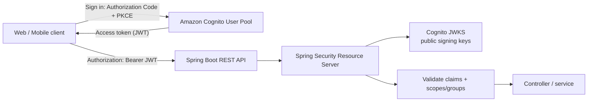
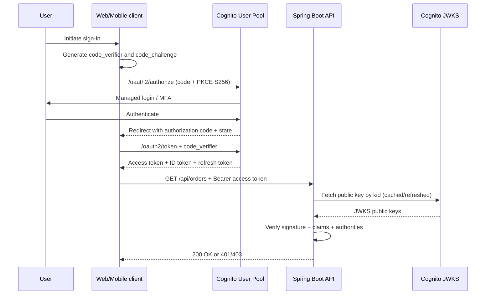
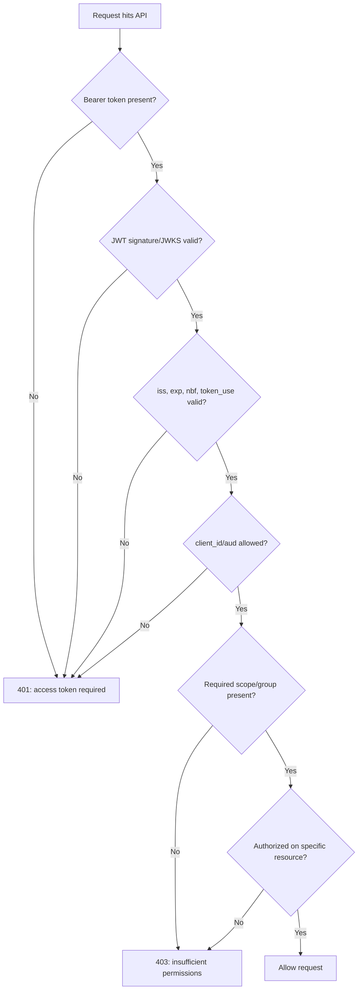

# Securing Spring Security APIs with Cognito JWT

## Learning objectives

After this lesson, you will be able to:

1. Explain the roles of **Amazon Cognito User Pools**, OAuth 2.0, OpenID Connect (OIDC), JWTs, and Spring Security Resource Server in protecting REST APIs.
2. Distinguish **access tokens, ID tokens, and refresh tokens**, and understand why business APIs must accept access tokens instead of using ID tokens as bearer credentials.
3. Describe the **Authorization Code Grant with PKCE** flow from a client application to Cognito and a Spring Boot API.
4. Identify key Cognito JWT claims: **iss, sub, exp, nbf, iat, kid, token_use, client_id, aud, scope**, and **cognito:groups**.
5. Configure Spring Security as an **OAuth2 Resource Server**, using JWKS to verify RS256 signatures and validate issuer/expiration.
6. Add Cognito-specific validators to accept only access tokens, allowlisted app clients, and the API audience when resource binding is enabled.
7. Map custom scopes and Cognito groups into Spring authorities, protecting endpoints with `hasAuthority`, `@PreAuthorize`, and least privilege.
8. Test authentication/authorization, distinguish HTTP 401 from 403, and handle key rotation, token expiration, and revocation.
9. Deploy secure configurations across local, AWS, and CI/CD environments; avoid common pitfalls such as trusting JWTs merely because they decode, using ID tokens, disabling TLS verification, or logging bearer tokens.
10. Create a test Cognito resource server/app client using the AWS CLI, obtain an access token via Authorization Code + PKCE, and call the Spring Boot API.

## 1. The problem: APIs need to know who is calling and what they may do

An e-commerce system has Java/Spring Boot services:

- `catalog-api`: reads product catalogs.
- `orders-api`: views and creates orders.
- `admin-api`: administers products, users, and settings.
- `web-app` and `mobile-app`: customer-facing frontends.

If every API stored usernames/passwords, issued sessions, or implemented its own authentication logic, keeping security policies consistent would be difficult. We need an **Identity Provider (IdP)** responsible for login and token issuance, plus a standard mechanism for APIs to validate tokens.

Amazon Cognito User Pool serves as the IdP. After a user signs in, Cognito issues JWTs. The client sends the access token in an HTTP header:

```http
GET /api/orders HTTP/1.1
Host: api.example.com
Authorization: Bearer <access-token>
```

Spring Security Resource Server verifies the token, converts claims into an `Authentication`/authorities, and decides whether the request is permitted to access the endpoint.



**Cognito authenticates identity; the API must still enforce authorization.** A validly signed JWT only proves the token was issued by a trusted issuer and its claims were not tampered with. It does not prove the caller is allowed to read all orders or modify any resource.

## 2. Components to distinguish

### 2.1. Cognito User Pool vs. Identity Pool

| Component | Role | When to use |
| --- | --- | --- |
| **Cognito User Pool** | User directory and OIDC/OAuth 2.0 authorization server; supports sign-in, federation, MFA, and issuing ID/access/refresh tokens. | Authenticating users for web/mobile/APIs. |
| **Cognito Identity Pool** | Exchanges identities from identity providers for temporary AWS credentials via IAM roles. | Clients need direct access to AWS resources with scoped IAM permissions. |

In this lesson, the **User Pool issues JWTs for the Spring Boot API**. Identity Pools are not required for an API to validate JWTs.

### 2.2. What is a Resource Server?

OAuth 2.0 separates responsibilities:

- **Authorization Server:** Cognito authenticates users/clients, issues access tokens, and manages scopes.
- **Resource Server:** Spring Boot API receives bearer tokens, verifies them, and enforces resource access permissions.
- **Client:** Web/mobile app or another service that obtains tokens and calls the API.

Spring Boot does not store Cognito user passwords. Nor does the API need a Cognito client secret merely to verify JWT signatures. The API needs the issuer, JWKS URI, and policy for accepted claims/scopes.

### 2.3. Access token, ID token, and refresh token

| Token | Purpose | Should it be sent to business REST APIs? |
| --- | --- | --- |
| **Access token** | Carries API access permissions, scopes, user groups, and client metadata. | **Yes.** This is the bearer token APIs should accept. |
| **ID token** | Contains user authentication/identity claims for the client, with `aud` set to the app client ID. | **Do not use in place of an access token.** |
| **Refresh token** | Used with Cognito's token endpoint to obtain fresh tokens; not a JWT access credential for APIs. | **No.** Never send refresh tokens to resource servers. |

Cognito signs ID tokens and access tokens with **two separate signing keys**. Therefore, checking only signature and issuer is insufficient: the API must enforce `token_use` equal to `access`. AWS specifies that access tokens authorize API operations, whereas ID tokens carry client identity claims.

### 2.4. What is inside a JWT?

A JWT typically has three dot-separated parts:

```text
base64url(header).base64url(payload).signature
```

- **Header:** signing algorithm `alg` and key identifier `kid`.
- **Payload:** claims such as issuer, subject, expiration, scopes, and groups.
- **Signature:** cryptographic signature protecting header and payload integrity.

Condensed illustrative access token payload:

```json
{
  "sub": "user-subject-id",
  "iss": "https://cognito-idp.ap-southeast-1.amazonaws.com/ap-southeast-1_example",
  "client_id": "example-app-client-id",
  "token_use": "access",
  "scope": "openid orders-api/orders/read orders-api/orders/write",
  "cognito:groups": ["customers"],
  "iat": 1760000000,
  "exp": 1760000900,
  "jti": "unique-token-id"
}
```

This is a structural example, not a real token. Never trust claims simply because Base64URL decoding succeeds. An attacker can tamper with payloads; the API must verify the signature against the public key matching `kid` from JWKS.

## 3. Sign-in and API call flow

### 3.1. Authorization Code Grant with PKCE

For public web/mobile clients, prefer **Authorization Code Grant + PKCE with S256**:

1. Client generates a strong random `code_verifier`.
2. Client hashes the verifier with SHA-256 and Base64URL-encodes it to create `code_challenge`.
3. Browser navigates to Cognito `/oauth2/authorize` with `response_type=code`, `client_id`, `redirect_uri`, `scope`, `state`, `code_challenge`, and `code_challenge_method=S256`.
4. User signs in / completes MFA / federates per User Pool policy.
5. Cognito redirects back to the registered callback with an authorization code and `state`.
6. Client sends the authorization code alongside `code_verifier` to `/oauth2/token`.
7. Cognito verifies PKCE and issues access token, ID token, and refresh token (if allowed by grant/client policy).
8. Client sends the **access token** to the Spring API in `Authorization: Bearer`.

PKCE prevents an attacker from exchanging an intercepted authorization code without the original verifier. Cognito supports `S256`; never use `plain`.



### 3.2. Why not use Implicit Grant?

Implicit Grant returns tokens directly in the redirect URL/browser fragment, exposing tokens to browser history, extensions, telemetry, or URL-handling components. AWS recommends Authorization Code Grant for obtaining tokens and supporting refresh tokens; for public clients, pair it with PKCE.

### 3.3. Where are scopes requested?

Clients request scopes when calling the authorization endpoint. Cognito issues only valid scopes enabled on the app client. If `openid` is omitted, Cognito does not return an ID token in the OAuth authorization endpoint flow; access tokens can still be issued depending on scopes and configuration.

Example resource server:

- Identifier: `orders-api`
- Custom scope: `orders/read`
- Custom scope: `orders/write`

Inside access tokens, Cognito formats custom scopes as:

```text
orders-api/orders/read
orders-api/orders/write
```

Spring Security maps scopes into authorities prefixed with `SCOPE_`, e.g., `SCOPE_orders-api/orders/read`.

## 4. Cognito claims the API must understand

| Claim | Meaning | How to use |
| --- | --- | --- |
| **iss** | Issuer URL of the User Pool. | Must match the configured issuer exactly. |
| **sub** | Subject identifier inside the User Pool. | Use as a stable user ID; avoid relying on `username`, which may change or lack expected uniqueness. |
| **exp** | Token expiration timestamp (Unix time). | Reject expired tokens. |
| **nbf** | Not-before timestamp if present. | Reject tokens not yet valid. |
| **iat** | Token issuance timestamp. | Audit/risk policies; never replaces `exp` validation. |
| **kid** | Signing key ID in the JWT header. | Selects the matching public key in JWKS. |
| **alg** | Signing algorithm; Cognito User Pools use RS256. | Allowlist permitted algorithms only; never accept `none` or arbitrary algorithms. |
| **token_use** | Token type: `access` or `id`. | This API accepts only `access`. |
| **client_id** | App client that requested the access token. | Accept only allowlisted app client IDs. |
| **aud** | Target resource server for access tokens using resource binding; ID tokens carry the app client ID as audience. | When resource binding is enabled, validate the exact API audience. |
| **scope** | Granted OAuth 2.0 permissions. | Used for functional API authorization. |
| **cognito:groups** | List of user's Cognito User Pool groups. | Map to authorities/roles if business rules require it. |
| **jti** | Unique JWT ID. | Useful for auditing or policy denylists. |
| **origin_jti** | ID linked to the refresh-token family for token revocation. | Can support revocation checks per architecture. |

### 4.1. `client_id` and `aud` are not always identical

This is a frequent misconfiguration:

- **Access token without resource binding:** Cognito populates `client_id` and typically omits `aud`. The API should verify `client_id` belongs to an allowlisted app client.
- **Access token with resource binding:** Cognito adds `aud` containing the API's resource identifier; the API should validate this audience while still enforcing client policies if restricting app clients.
- **ID token:** `aud` equals the app client ID, yet `token_use=id`, so this API must reject it.

Spring Boot's `audiences` property validates the `aud` claim; it does not substitute for a `client_id` allowlist on Cognito access tokens without resource binding. Pick an explicit audience model and validate the corresponding claim.

Cognito resource binding is distinct from custom scopes: the client passes a `resource` parameter to `/oauth2/authorize`, formatted as a URL identifier, and Cognito places that value into `aud`. This applies to user authorization flows via Managed Login/OAuth authorization server; it is not supported for Client Credentials M2M flows or SDK authentication models. The `orders-api` resource server identifier in Section 6 serves as a custom scope namespace, not a resource-binding audience URL. For resource binding, create a URL identifier such as `https://api.example.com` and pass `resource=https://api.example.com` in the authorization request.

### 4.2. User tokens vs. machine-to-machine tokens

With the Client Credentials flow, Cognito issues an access token for an **application/service**, not a human user:

- `sub` may be the app client ID.
- The token contains `client_id`, `scope`, `iss`, `token_use=access`, `exp`, etc.
- Do not expect `username`, `cognito:groups`, or `origin_jti` as in user tokens.

Never write an authority converter or business logic assuming every access token includes `cognito:groups`. For M2M, authorize using custom scopes and service identity.

## 5. Signature verification with JWKS

### 5.1. Issuer and JWKS URI

For a User Pool in Region `ap-southeast-1`, the issuer format is:

```text
https://cognito-idp.ap-southeast-1.amazonaws.com/<userPoolId>
```

JWKS URI:

```text
https://cognito-idp.ap-southeast-1.amazonaws.com/<userPoolId>/.well-known/jwks.json
```

JWKS contains public keys, never private signing keys. The JWT header carries `kid`; the verifier selects the key with the matching `kid` and validates the RSA-SHA256 signature. Public keys can be cached, provided a refresh mechanism handles Cognito signing key rotation.

### 5.2. Minimum validations

An API accepting only Cognito access tokens should verify:

1. The JWT is structurally valid.
2. `alg` is allowlisted (`RS256` for Cognito User Pools).
3. The signature validates against the matching `kid` public key in JWKS.
4. `iss` matches the configured User Pool.
5. `exp` has not passed and `nbf` (if present) is active.
6. `token_use` equals `access`.
7. `client_id` belongs to the allowlisted app clients.
8. If using resource binding, `aud` contains the configured resource identifier.
9. Scopes/authorities suffice for the requested action.

**Decoding a JWT is not verifying a JWT.** Never write custom string-splitting code and trust the payload, never hardcode public keys in source code, and never skip issuer or expiration checks.

### 5.3. Key rotation

Cognito can rotate signing keys. The verifier needs:

- JWKS caching by `kid`, avoiding fetching JWKS on every request.
- When receiving a JWT with a valid issuer yet an unknown `kid`, refreshing JWKS and retrying verification per library behavior.
- Timeouts, retries, and observability on the JWKS endpoint.
- Never pinning a single fixed public key in production configuration.

Spring Security Resource Server supports JWK Set URIs and automatically rotates public keys when the authorization server publishes new keys. Ensure workloads have outbound HTTPS reachability to the JWKS endpoint or an appropriate caching/egress design.

### 5.4. Self-contained JWTs and token revocation

JWTs let APIs verify signatures and expiration offline without calling Cognito on every request. However, **offline signature + `exp` checks cannot detect tokens revoked** prior to expiration.

Options:

- Keep access token lifetimes short relative to UX and risk.
- Handle refresh token rotation/revocation cleanly on the client.
- When instant revocation is required, implement a denylist/token-state check or online verification while weighing latency and availability.
- Use `jti`/`origin_jti` as lookup keys if designing a revocation store.

Do not assume signing out of Cognito immediately makes every Spring API reject unexpired JWTs if the API validates solely offline.

## 6. Creating a Cognito Resource Server and App Client

### 6.1. Creating custom scopes

In the Cognito Console, open User Pool → Domain (under Branding) → Resource servers. Create:

- Resource server identifier: `orders-api`
- Scope `orders/read`: Read orders.
- Scope `orders/write`: Create and update orders.

Or via AWS CLI:

```bash
export AWS_REGION=ap-southeast-1
export USER_POOL_ID=ap-southeast-1_Example

aws cognito-idp create-resource-server \
  --region "$AWS_REGION" \
  --user-pool-id "$USER_POOL_ID" \
  --identifier orders-api \
  --name "Orders API" \
  --scopes ScopeName=orders/read,ScopeDescription="Read orders" \
          ScopeName=orders/write,ScopeDescription="Create and update orders"
```

`orders-api/orders/read` and `orders-api/orders/write` are the scope strings that appear inside access tokens. The identifier is the resource server namespace, not a Spring role name.

This example intentionally uses `orders-api` to illustrate custom scopes; the API checks `client_id` without requiring `aud`. If you want access tokens bound specifically to one API, create a resource server with a URL identifier (such as `https://api.example.com`), enable resource binding, and send `resource=https://api.example.com` in the authorization request. Access tokens will then carry that URL in `aud`; set `COGNITO_API_AUDIENCE` to match. Custom scopes still follow `identifier/scope-name`.

Note: `InitiateAuth`/`AdminInitiateAuth` only issue access tokens with the reserved `aws.cognito.signin.user.admin` scope; they do not grant custom API scopes. To obtain access tokens with custom scopes, start at the OAuth authorization endpoint and exchange the authorization code at the token endpoint as shown in the lab below.

### 6.2. Creating a public app client using Authorization Code + PKCE

Example client for an SPA/mobile app. Do not generate a client secret for a public client:

```bash
aws cognito-idp create-user-pool-client \
  --region "$AWS_REGION" \
  --user-pool-id "$USER_POOL_ID" \
  --client-name orders-public-client \
  --no-generate-secret \
  --allowed-o-auth-flows-user-pool-client \
  --allowed-o-auth-flows code \
  --allowed-o-auth-scopes openid profile \
      orders-api/orders/read orders-api/orders/write \
  --callback-urls http://localhost:8080/callback \
  --supported-identity-providers COGNITO \
  --enable-token-revocation \
  --prevent-user-existence-errors ENABLED
```

`http://localhost` is only for local development; production callbacks must use HTTPS and match registered URIs exactly. Configure a domain/Managed Login on the User Pool before calling the authorization endpoint. Note that app clients created via the AWS CLI do not automatically receive a branding style; assign a branding style if using Managed Login. If using a confidential server-side web client, keep the client secret strictly on the backend—never embed it in JavaScript or mobile apps.

### 6.3. Creating a Cognito group (optional)

If the API requires roles/groups, create a group and add users with appropriate administrative permissions:

```bash
aws cognito-idp create-group \
  --region "$AWS_REGION" \
  --user-pool-id "$USER_POOL_ID" \
  --group-name api-admins \
  --description "Administrators for Orders API"

aws cognito-idp admin-add-user-to-group \
  --region "$AWS_REGION" \
  --user-pool-id "$USER_POOL_ID" \
  --username "<cognito-username>" \
  --group-name api-admins
```

Cognito embeds membership in the `cognito:groups` claim of newly issued tokens. Users must sign in again or obtain fresh tokens after group changes for access tokens to reflect updated membership.

### 6.4. Identifying issuer and JWKS

```bash
aws cognito-idp describe-user-pool \
  --region "$AWS_REGION" \
  --user-pool-id "$USER_POOL_ID" \
  --query 'UserPool.{Id:Id,Status:Status,Domain:Domain}'
```

Export variables:

```bash
export COGNITO_ISSUER="https://cognito-idp.$AWS_REGION.amazonaws.com/$USER_POOL_ID"
export COGNITO_JWKS_URI="$COGNITO_ISSUER/.well-known/jwks.json"

curl -sS "$COGNITO_JWKS_URI"
```

`curl` returns JSON listing the public signing keys. Never copy private keys or real tokens into documentation, tickets, or source control.

## 7. Configuring Spring Boot Resource Server

### 7.1. Dependencies

With Maven and Spring Boot dependency management, add:

```xml
<dependencies>
    <dependency>
        <groupId>org.springframework.boot</groupId>
        <artifactId>spring-boot-starter-web</artifactId>
    </dependency>

    <dependency>
        <groupId>org.springframework.boot</groupId>
        <artifactId>spring-boot-starter-security</artifactId>
    </dependency>

    <dependency>
        <groupId>org.springframework.boot</groupId>
        <artifactId>spring-boot-starter-oauth2-resource-server</artifactId>
    </dependency>

    <dependency>
        <groupId>org.springframework.boot</groupId>
        <artifactId>spring-boot-starter-test</artifactId>
        <scope>test</scope>
    </dependency>

    <dependency>
        <groupId>org.springframework.security</groupId>
        <artifactId>spring-security-test</artifactId>
        <scope>test</scope>
    </dependency>
</dependencies>
```

JWT Resource Server requires both `spring-security-oauth2-resource-server` and `spring-security-oauth2-jose`; the Resource Server starter brings the necessary components into the dependency graph.

### 7.2. Configuring application.yml

```yaml
server:
  port: 8080

app:
  security:
    cognito:
      issuer: ${COGNITO_ISSUER}
      jwk-set-uri: ${COGNITO_JWKS_URI}
      allowed-client-ids:
        - ${COGNITO_APP_CLIENT_ID}
      # Set only when Cognito access tokens use resource binding (aud).
      # If not using resource binding, leave empty and validate client_id.
      audience: ${COGNITO_API_AUDIENCE:}
```

These values are not passwords:

- `issuer`: URL of the issuing User Pool.
- `jwk-set-uri`: public JWKS URL.
- `allowed-client-ids`: app client IDs permitted to call the API.
- `audience`: resource identifier if Cognito resource binding is enabled.

In deployment environments, inject them via environment/config management. Never put client secrets, access tokens, or refresh tokens in the repository.

### 7.3. Why declaring only `issuer-uri` is sometimes insufficient

Spring Security Resource Server by default verifies JWT signatures, `iss`, `exp`, `nbf`, and maps `scope` to `SCOPE_` authorities. However, Cognito APIs need extra rules:

- Accept only `token_use=access`.
- Validate `client_id` on access tokens.
- Validate `aud` when resource binding is configured.

Hence, this lesson creates a custom `JwtDecoder`/`OAuth2TokenValidator`. We specify the JWKS URI directly so Spring does not need to hit the discovery metadata endpoint at startup, while still enforcing `iss` in the validator.

### 7.4. Custom Cognito JwtDecoder

```java
package com.example.orders.security;

import java.util.List;

import org.springframework.boot.context.properties.bind.Bindable;
import org.springframework.boot.context.properties.bind.Binder;
import org.springframework.context.annotation.Bean;
import org.springframework.context.annotation.Configuration;
import org.springframework.core.env.Environment;
import org.springframework.security.oauth2.core.OAuth2Error;
import org.springframework.security.oauth2.core.OAuth2TokenValidator;
import org.springframework.security.oauth2.core.OAuth2TokenValidatorResult;
import org.springframework.security.oauth2.jose.jws.SignatureAlgorithm;
import org.springframework.security.oauth2.jwt.DelegatingOAuth2TokenValidator;
import org.springframework.security.oauth2.jwt.Jwt;
import org.springframework.security.oauth2.jwt.JwtDecoder;
import org.springframework.security.oauth2.jwt.JwtValidators;
import org.springframework.security.oauth2.jwt.NimbusJwtDecoder;
import org.springframework.util.StringUtils;

@Configuration
public class CognitoJwtDecoderConfig {

    @Bean
    JwtDecoder cognitoJwtDecoder(Environment environment) {
        String issuer = environment.getRequiredProperty("app.security.cognito.issuer");
        String jwkSetUri = environment.getRequiredProperty("app.security.cognito.jwk-set-uri");
        List<String> allowedClientIds = Binder.get(environment)
                .bind("app.security.cognito.allowed-client-ids", Bindable.listOf(String.class))
                .orElse(List.of());
        if (allowedClientIds.isEmpty()) {
            throw new IllegalStateException("At least one Cognito app client ID must be configured");
        }
        String expectedAudience = environment.getProperty("app.security.cognito.audience", "");

        NimbusJwtDecoder decoder = NimbusJwtDecoder
                .withJwkSetUri(jwkSetUri)
                .jwsAlgorithm(SignatureAlgorithm.RS256)
                .build();

        OAuth2TokenValidator<Jwt> issuerAndTimeValidator =
                JwtValidators.createDefaultWithIssuer(issuer);

        OAuth2TokenValidator<Jwt> cognitoAccessTokenValidator = jwt -> {
            if (!"access".equals(jwt.getClaimAsString("token_use"))) {
                return invalidToken("Only Cognito access tokens are accepted");
            }

            String clientId = jwt.getClaimAsString("client_id");
            if (!StringUtils.hasText(clientId) || !allowedClientIds.contains(clientId)) {
                return invalidToken("Untrusted Cognito app client");
            }

            if (StringUtils.hasText(expectedAudience)) {
                List<String> audiences = jwt.getAudience();
                if (audiences == null || !audiences.contains(expectedAudience)) {
                    return invalidToken("Unexpected access-token audience");
                }
            }

            return OAuth2TokenValidatorResult.success();
        };

        decoder.setJwtValidator(new DelegatingOAuth2TokenValidator<>(
                issuerAndTimeValidator,
                cognitoAccessTokenValidator
        ));

        return decoder;
    }

    private static OAuth2TokenValidatorResult invalidToken(String description) {
        OAuth2Error error = new OAuth2Error("invalid_token", description, null);
        return OAuth2TokenValidatorResult.failure(error);
    }
}
```

This validator binds the full list of app client IDs from configuration. When `audience` is non-blank, the API requires the access token's `aud` to contain the configured resource identifier. When resource binding is off, leave `audience` blank and rely on the `client_id` allowlist.

`JwtValidators.createDefaultWithIssuer` checks issuer and timestamps. `NimbusJwtDecoder` fetches public keys from JWKS, verifies RS256 signatures, and selects keys by `kid`. Never decode payloads manually while bypassing the decoder.

**Version note:** builder/validator APIs in this example belong to modern Spring Security (Spring Boot 3.x / Spring Security 6.x and later). Use the Spring Boot BOM to keep versions aligned; never bump an individual Spring Security module outside dependency management.

## 8. Converting Cognito scopes/groups to authorities

### 8.1. Spring Security default scopes

Spring Security's `JwtGrantedAuthoritiesConverter` reads the `scope` (or `scp`) claim and converts each scope into an authority prefixed with `SCOPE_`.

Example:

```text
scope = "orders-api/orders/read orders-api/orders/write"

Authorities:
SCOPE_orders-api/orders/read
SCOPE_orders-api/orders/write
```

### 8.2. Mapping `cognito:groups`

A user's Cognito access token may contain `cognito:groups` as an array. Convert each group into `GROUP_<group-name>`:

```java
package com.example.orders.security;

import java.util.ArrayList;
import java.util.Collection;
import java.util.List;

import org.springframework.context.annotation.Bean;
import org.springframework.context.annotation.Configuration;
import org.springframework.core.convert.converter.Converter;
import org.springframework.security.core.GrantedAuthority;
import org.springframework.security.core.authority.SimpleGrantedAuthority;
import org.springframework.security.oauth2.jwt.Jwt;
import org.springframework.security.oauth2.server.resource.authentication.JwtAuthenticationConverter;
import org.springframework.security.oauth2.server.resource.authentication.JwtGrantedAuthoritiesConverter;

@Configuration
public class CognitoAuthoritiesConfig {

    @Bean
    JwtAuthenticationConverter cognitoJwtAuthenticationConverter() {
        JwtGrantedAuthoritiesConverter scopes = new JwtGrantedAuthoritiesConverter();
        scopes.setAuthoritiesClaimName("scope");
        scopes.setAuthorityPrefix("SCOPE_");

        Converter<Jwt, Collection<GrantedAuthority>> combinedAuthorities = jwt -> {
            Collection<GrantedAuthority> authorities = new ArrayList<>();

            Collection<GrantedAuthority> scopeAuthorities = scopes.convert(jwt);
            if (scopeAuthorities != null) {
                authorities.addAll(scopeAuthorities);
            }

            List<String> groups = jwt.getClaimAsStringList("cognito:groups");
            if (groups != null) {
                groups.stream()
                        .map(group -> new SimpleGrantedAuthority("GROUP_" + group))
                        .forEach(authorities::add);
            }

            return authorities;
        };

        JwtAuthenticationConverter converter = new JwtAuthenticationConverter();
        converter.setJwtGrantedAuthoritiesConverter(combinedAuthorities);
        return converter;
    }
}
```

With M2M tokens, `cognito:groups` may be absent; this converter handles that cleanly by retaining only scopes.

Do not conflate groups and scopes into one concept:

- **Scope** represents an OAuth client/token permission granted for the API, e.g., `orders-api/orders/read`.
- **Group** represents User Pool membership, e.g., `api-admins`.
- **Business authorization** may also need to check tenant, ownership, or resource state in the database.

## 9. Declaring SecurityFilterChain

### 9.1. Stateless API configuration

```java
package com.example.orders.security;

import org.springframework.context.annotation.Bean;
import org.springframework.context.annotation.Configuration;
import org.springframework.http.HttpMethod;
import org.springframework.security.config.annotation.method.configuration.EnableMethodSecurity;
import org.springframework.security.config.annotation.web.builders.HttpSecurity;
import org.springframework.security.config.annotation.web.configurers.AbstractHttpConfigurer;
import org.springframework.security.config.http.SessionCreationPolicy;
import org.springframework.security.oauth2.server.resource.authentication.JwtAuthenticationConverter;
import org.springframework.security.web.SecurityFilterChain;

@Configuration
@EnableMethodSecurity
public class SecurityConfig {

    @Bean
    SecurityFilterChain apiSecurity(
            HttpSecurity http,
            JwtAuthenticationConverter cognitoJwtAuthenticationConverter) throws Exception {

        http
            .csrf(AbstractHttpConfigurer::disable)
            .sessionManagement(session -> session
                    .sessionCreationPolicy(SessionCreationPolicy.STATELESS))
            .authorizeHttpRequests(authorize -> authorize
                    .requestMatchers("/actuator/health").permitAll()
                    .requestMatchers("/api/admin/**").hasAuthority("GROUP_api-admins")
                    .requestMatchers(HttpMethod.GET, "/api/orders/**")
                        .hasAuthority("SCOPE_orders-api/orders/read")
                    .requestMatchers(HttpMethod.POST, "/api/orders/**")
                        .hasAuthority("SCOPE_orders-api/orders/write")
                    .requestMatchers(HttpMethod.PUT, "/api/orders/**")
                        .hasAuthority("SCOPE_orders-api/orders/write")
                    .anyRequest().authenticated()
            )
            .oauth2ResourceServer(oauth2 -> oauth2
                    .jwt(jwt -> jwt
                            .jwtAuthenticationConverter(cognitoJwtAuthenticationConverter))
            );

        return http.build();
    }
}
```

This configuration is strictly for **APIs authenticating via Bearer tokens in the Authorization header**, without browser cookies or sessions. Only in this stateless context is disabling CSRF acceptable. If an application uses cookie authentication, session login, or credentials automatically sent by browsers via cookies, never blindly copy this CSRF-disable setting.

`SessionCreationPolicy.STATELESS` instructs Spring not to create HTTP sessions to store the security context. CORS still needs explicit configuration for actual origins/methods/headers; CORS never replaces authentication or authorization.

### 9.2. Permissions in controllers/services

```java
package com.example.orders.api;

import java.util.List;

import org.springframework.security.access.prepost.PreAuthorize;
import org.springframework.security.core.annotation.AuthenticationPrincipal;
import org.springframework.security.oauth2.jwt.Jwt;
import org.springframework.web.bind.annotation.GetMapping;
import org.springframework.web.bind.annotation.PostMapping;
import org.springframework.web.bind.annotation.RequestMapping;
import org.springframework.web.bind.annotation.RestController;

@RestController
@RequestMapping("/api/orders")
public class OrderController {

    @GetMapping
    @PreAuthorize("hasAuthority('SCOPE_orders-api/orders/read')")
    public List<String> getOrders(@AuthenticationPrincipal Jwt jwt) {
        String cognitoSubject = jwt.getSubject();
        return List.of("orders-for-subject-" + cognitoSubject);
    }

    @PostMapping
    @PreAuthorize("hasAuthority('SCOPE_orders-api/orders/write')")
    public String createOrder(@AuthenticationPrincipal Jwt jwt) {
        return "created-for-" + jwt.getSubject();
    }
}
```

This example only shows extracting `sub`. Production code must query data scoped to the verified `sub`, enforce ownership/tenant checks in the service layer, and never trust a client-submitted `userId` to read another user's orders.

### 9.3. Authentication vs. authorization

| Request | Typical response | Reason |
| --- | --- | --- |
| No bearer token sent to protected endpoint | `401 Unauthorized` | Unauthenticated. |
| Invalid signature, wrong issuer, expired, or `token_use=id` | `401 Unauthorized` | Token invalid for the API. |
| Valid token yet missing required scope/group | `403 Forbidden` | Authenticated yet lacks permission. |
| Valid token, right scope, and business ownership | `200 OK`/`201 Created` | Request authorized. |

Do not return 200 and manually filter permissions inside controllers on every endpoint; declare authorization rules clearly in the filter chain/method security and still enforce per-resource ownership checks.

## 10. Testing Spring Security

### 10.1. Testing endpoints with MockMvc

Spring Security Test provides the `jwt()` request post-processor to construct a simulated `JwtAuthenticationToken`. It lets you test authorization without calling live Cognito:

```java
import static org.springframework.security.test.web.servlet.request.SecurityMockMvcRequestPostProcessors.jwt;
import static org.springframework.test.web.servlet.request.MockMvcRequestBuilders.get;
import static org.springframework.test.web.servlet.result.MockMvcResultMatchers.status;

import org.junit.jupiter.api.Test;
import org.springframework.beans.factory.annotation.Autowired;
import org.springframework.boot.test.autoconfigure.web.servlet.AutoConfigureMockMvc;
import org.springframework.boot.test.context.SpringBootTest;
import org.springframework.test.web.servlet.MockMvc;

@SpringBootTest(properties = {
        "app.security.cognito.issuer=https://cognito-idp.us-east-1.amazonaws.com/us-east-1_test",
        "app.security.cognito.jwk-set-uri=https://cognito-idp.us-east-1.amazonaws.com/us-east-1_test/.well-known/jwks.json",
        "app.security.cognito.allowed-client-ids[0]=test-client",
        "app.security.cognito.audience="
})
@AutoConfigureMockMvc
class OrderSecurityTest {

    @Autowired
    MockMvc mockMvc;

    @Test
    void readScopeCanAccessOrders() throws Exception {
        mockMvc.perform(get("/api/orders")
                .with(jwt().jwt(jwt -> jwt
                        .claim("token_use", "access")
                        .claim("scope", "orders-api/orders/read"))))
                .andExpect(status().isOk());
    }

    @Test
    void missingReadScopeIsForbidden() throws Exception {
        mockMvc.perform(get("/api/orders")
                .with(jwt().jwt(jwt -> jwt
                        .claim("token_use", "access")
                        .claim("scope", "orders-api/orders/write"))))
                .andExpect(status().isForbidden());
    }
}
```

`jwt()` tests inject a mocked authentication and **do not exercise RS256 signature verification, JWKS fetching, or the custom `JwtDecoder`**. Therefore, add unit tests for claim validators and integration tests using JWTs signed with test keys/mocked JWKS or a Cognito test User Pool.

### 10.2. Required test matrix

| Test case | Expected status |
| --- | --- |
| Missing `Authorization` header | `401` |
| Bearer token is not a valid JWT | `401` |
| Signature does not match JWKS | `401` |
| `kid` absent even after JWKS refresh | `401` |
| `iss` from a different User Pool | `401` |
| Expired `exp` or future `nbf` | `401` |
| `token_use=id` | `401` |
| `client_id` not on allowlist | `401` |
| Wrong `aud` when resource binding is enabled | `401` |
| Valid access token missing required scope | `403` |
| Valid access token with required scope | `200`/`201` per endpoint |
| User outside `api-admins` calls admin endpoint | `403` |
| M2M token lacking groups yet holding matching scope | Allowed per scope policy |
| User holds scope yet does not own order | `403` or non-disclosing response per policy |

## 11. Lab: calling the Spring Boot API with a Cognito access token

This lab uses an existing User Pool. Never create resources in production or unauthorized accounts. Replace all `Example` values with real IDs/domains from your lab environment.

### 11.1. Preparing Spring Boot

Set environment variables:

```bash
export AWS_REGION=ap-southeast-1
export USER_POOL_ID=ap-southeast-1_Example
export COGNITO_APP_CLIENT_ID=exampleclientid
export COGNITO_ISSUER="https://cognito-idp.$AWS_REGION.amazonaws.com/$USER_POOL_ID"
export COGNITO_JWKS_URI="$COGNITO_ISSUER/.well-known/jwks.json"
export COGNITO_API_AUDIENCE=""
```

If not using resource binding, leave `COGNITO_API_AUDIENCE` empty. If resource binding is configured, set it to the exact URL/URI identifier appearing in `aud`.

### 11.2. Creating the resource server and app client

Run the custom scope and public app client commands from Section 6. The app client must allow Authorization Code Grant, the custom scopes, and your local callback URI. Ensure the User Pool domain/Managed Login is configured.

Verify app client configuration:

```bash
aws cognito-idp describe-user-pool-client \
  --region "$AWS_REGION" \
  --user-pool-id "$USER_POOL_ID" \
  --client-id "$COGNITO_APP_CLIENT_ID"
```

Verify `AllowedOAuthFlows` includes `code`, `AllowedOAuthFlowsUserPoolClient` is `true`, and `AllowedOAuthScopes` contains `orders-api/orders/read` and `orders-api/orders/write`.

### 11.3. Obtaining tokens via Authorization Code + PKCE

The client generates verifier/challenge pairs per RFC 7636. Condensed authorization URL example:

```text
https://<cognito-domain>/oauth2/authorize
  ?response_type=code
  &client_id=<app-client-id>
  &redirect_uri=http%3A%2F%2Flocalhost%3A8080%2Fcallback
  &scope=openid%20orders-api%2Forders%2Fread%20orders-api%2Forders%2Fwrite
  &state=<random-state>
  &code_challenge=<base64url-sha256-code-verifier>
  &code_challenge_method=S256
```

Open the URL in a browser, sign in, verify `state` at the callback, and extract the authorization code. Exchange the code at `/oauth2/token` using the original `code_verifier`:

If using resource binding, append the `resource` parameter with your configured URL identifier, e.g., `resource=https%3A%2F%2Fapi.example.com`; Cognito will place that URL in the access token's `aud` claim. Do not include this parameter for the default `orders-api` example unless the resource server identifier is defined as a URL.

```bash
curl -X POST "https://<cognito-domain>/oauth2/token" \
  -H "Content-Type: application/x-www-form-urlencoded" \
  --data-urlencode "grant_type=authorization_code" \
  --data-urlencode "client_id=$COGNITO_APP_CLIENT_ID" \
  --data-urlencode "code=<authorization-code>" \
  --data-urlencode "redirect_uri=http://localhost:8080/callback" \
  --data-urlencode "code_verifier=<original-code-verifier>"
```

For a public app client without a client secret, omit `client_secret`. Confidential clients may require client authentication per configuration; secrets must reside strictly server-side.

Do not substitute `InitiateAuth` for this OAuth step when testing custom scopes: access tokens returned by Cognito User Pool API sign-in carry only the reserved `aws.cognito.signin.user.admin` scope.

### 11.4. Running the API and sending requests

Start Spring Boot with the configured environment variables:

```bash
./mvnw spring-boot:run
```

Send the access token:

```bash
export ACCESS_TOKEN="<access-token-from-cognito>"

curl -i http://localhost:8080/api/orders \
  -H "Authorization: Bearer $ACCESS_TOKEN"
```

If the token includes `orders-api/orders/read`, the request returns `200`. Try calling an endpoint requiring the write scope using a read-only token; the API must return `403`.

### 11.5. Inspecting tokens and claims in the lab

You may use an offline JWT decoder to inspect headers/payloads, keeping in mind decoding only reads data without verifying signatures. Confirm:

- `iss` matches the configured issuer.
- `token_use` is `access`.
- `client_id` is an allowlisted app client.
- `scope` includes the requested custom scopes.
- `cognito:groups` appears if the user belongs to groups.
- `exp` exceeds the current timestamp.
- If using resource binding, `aud` equals the API resource identifier.

Never paste real access tokens into public decoder websites. Anyone holding a bearer token can use it until it expires or is rejected.

## 12. Production operations and hardening

### 12.1. Token lifetime and refresh

Cognito allows configuring access token lifetimes per app client (currently from 5 minutes to 1 day). Choose TTLs based on API sensitivity, refresh frequency, and user experience. Never assume longer TTLs are better.

When using Managed Login, browser cookies carry their own expiration (defaulting to one hour); setting an access token shorter than one hour does not shorten the Managed Login session cookie. Evaluate both mechanisms when designing login/logout.

Clients should use an SDK/OIDC library to manage refresh tokens safely; avoid storing refresh tokens in `localStorage` unless permitted by your threat model. Never send refresh tokens to the Spring Resource Server.

### 12.2. Revocation and logout

When Cognito revokes a refresh token/token family, APIs performing purely offline JWT verification continue accepting already-issued access tokens until they expire unless revocation state is checked. When instant logout is required:

- Keep access token lifetimes short.
- Optionally maintain a denylist keyed on `jti` or `origin_jti` until token expiration.
- For sensitive endpoints, verify session/revocation state via an appropriate online strategy.
- Weigh latency, availability, and cost if every request queries an external service.

Never call Cognito `GetUser` on every request simply to replace signature/expiration verification; it is no substitute for JWT verification.

### 12.3. TLS, CORS, and CSRF

- Enforce HTTPS between clients and the API, and protect transport to Cognito.
- Restrict CORS to required origins/methods/headers; never use wildcard origins with credentialed requests.
- CORS is not authorization: requests still need valid tokens and sufficient permissions.
- Disable CSRF only when the API uses header bearer tokens and never relies on automatically sent browser cookies/sessions.
- If a web app uses cookie sessions, retain CSRF protection for that flow or split security filter chains by client type.

### 12.4. Secrets, logs, and observability

- The API resource server does not need a Cognito app client secret to verify JWTs.
- Never log `Authorization` headers, access tokens, refresh tokens, or client secrets.
- Never return sensitive raw JWT claims in error responses.
- Log correlation IDs, verified subject (if policy allows), endpoint, authorization outcome, and safe reason codes.
- Monitor 401/403 rates, JWKS fetch errors, key refreshes, token expirations, latency, and anomalous requests.
- Keep clocks synchronized (NTP); allow only minimal clock skew if truly needed.

### 12.5. Object-level authorization

The `orders/read` scope only indicates the client may invoke the read-orders capability. It **does not** mean the user can view every customer's orders.

Ownership check example:

```java
import org.springframework.security.access.AccessDeniedException;
import org.springframework.security.access.prepost.PreAuthorize;
import org.springframework.security.oauth2.jwt.Jwt;
import org.springframework.stereotype.Service;

@Service
public class OrderService {

    @PreAuthorize("hasAuthority('SCOPE_orders-api/orders/read')")
    public Order getOrder(String orderId, Jwt jwt) {
        Order order = orderRepository.findById(orderId)
                .orElseThrow(OrderNotFoundException::new);

        if (!order.getCustomerSubject().equals(jwt.getSubject())) {
            throw new AccessDeniedException("Not allowed to access this order");
        }

        return order;
    }
}
```

The controller extracts `Jwt` via `@AuthenticationPrincipal` and passes it to the service. This is an illustrative snippet; repositories and exceptions are application components. In production, enforce ownership/tenant rules inside services or policy components so every entry point enforces identical checks. Prevent IDOR (Insecure Direct Object Reference) caused by trusting `orderId` or `userId` from requests.

### 12.6. API Gateway vs. Spring Resource Server?

| Model | Advantages | Considerations |
| --- | --- | --- |
| Spring Boot verifies Cognito JWT directly | API governs claims, scopes, groups, and business authorization in one place. | Each service must maintain consistent verifier and policy config. |
| API Gateway JWT/Cognito authorizer in front of backend | Rejects invalid tokens at the edge; centralizes routing/throttling. | Backend must still enforce business authorization; never trust client-injected headers. |
| Both API Gateway and Spring Resource Server | Defense in depth: edge blocks early while services verify independently. | Keep policies and error semantics aligned across both layers. |

With an API Gateway HTTP API JWT authorizer, configure issuer and audience to match the token. Non-resource-bound Cognito access tokens typically carry `client_id`; resource-bound access tokens carry `aud` as the resource identifier. Never configure the app client ID as audience expecting it to match a resource-bound token carrying a different `aud`.

## 13. Troubleshooting by symptom

| Symptom | Common cause | Resolution |
| --- | --- | --- |
| All requests return 401 | Wrong issuer/Region/User Pool ID or token from another pool. | Compare `iss` against config; verify User Pool ID. |
| Invalid signature | Wrong JWKS, unrefreshed `kid`, or tampered token. | Verify JWKS URI, `kid`, key rotation, and source token. |
| 401 on unexpired JWT | `token_use=id`, non-allowlisted `client_id`, or wrong `aud`. | Inspect claims safely; inspect custom validator logic. |
| 401 right after deploy | JWKS endpoint unreachable, wrong URL, or decoder misconfig. | Check egress/DNS/TLS/JWKS responses and logs. |
| 403 on GET orders | Valid token lacking `orders-api/orders/read`. | Check app client allowed scopes and authorization request. |
| 403 on admin endpoint | User not in `api-admins` group or converter not mapping groups. | Check `cognito:groups` in access token and authority prefix. |
| Scope does not become `SCOPE_...` | Converter reading wrong claim or token lacks custom scope. | Check `scope`, `JwtGrantedAuthoritiesConverter`, and requested scopes. |
| `aud` validation fails | API configured resource binding yet token lacks matching audience. | Verify `resource` parameter and `aud`; avoid confusing with app client ID. |
| ID token accepted at API | `token_use` not checked. | Add `token_use=access` validator. |
| Revoked token still calls API | API performs only offline signature/exp verification. | Shorten TTL or implement revocation state/denylist. |
| M2M token fails in group converter | Code assumes `cognito:groups` is always present. | Handle null claim; authorize M2M using scopes. |
| Token works on one service, fails on another | Mismatched issuer, client allowlist, audience, or clock. | Align configurations and check system clock sync. |
| Browser hits CORS error calling API | Origin/method/header not allowed. | Configure CORS explicitly and allow `Authorization` when needed. |
| API returns 401 after signing key rotation | Stale JWK cache failing to fetch new keys. | Ensure decoder refreshes on unknown `kid`/JWKS updates. |
| API vulnerable to IDOR despite right scope | Checked scope only without resource ownership. | Verify `sub`, tenant, and per-object permissions. |

### 401/403 investigation flow



Never fix issues by disabling JWT verification, accepting any issuer, turning off authorization, or logging bearer tokens. Investigate step by step from token type, issuer, and signature through authorities and business ownership.

## 14. Common misconceptions

**Misconception 1: “If a JWT decodes, the token is valid.”**

False. Decoding only reads the payload; you must verify the signature via JWKS and validate claims.

**Misconception 2: “ID tokens and access tokens are both JWTs, so they are interchangeable.”**

False. ID tokens serve client identity, carry the app client as `aud`, and have `token_use=id`; business APIs must require access tokens.

**Misconception 3: “Checking `exp` alone is enough.”**

False. You must validate signature, issuer, `token_use`, `client_id`, audience (when applicable), scopes, and resource-level permissions.

**Misconception 4: “Spring Resource Server automatically enforces all Cognito rules.”**

False. Spring verifies standard JWT/OIDC properties and maps scopes, yet APIs still need Cognito-specific validators for `token_use` and `client_id`.

**Misconception 5: “Access tokens always have `aud` equal to the app client ID.”**

False. Standard access tokens carry `client_id`; `aud` appears with resource binding and holds the resource identifier. ID tokens carry the app client ID in `aud`.

**Misconception 6: “Groups and scopes are the same thing.”**

False. `cognito:groups` represents pool membership; `scope` represents OAuth permissions. Map them into distinct authority prefixes.

**Misconception 7: “Every access token has `username` and `cognito:groups`.”**

False. M2M tokens represent client applications, not human users, so those claims may be absent.

**Misconception 8: “Logout/revocation immediately makes every API reject offline JWTs.”**

False. Offline APIs do not know revocation state unless explicitly checked; unexpired tokens may still be accepted.

**Misconception 9: “The Cognito client secret must be placed in the Spring API to verify JWTs.”**

False. Resource Servers need only public JWKS and claim policies. Client secrets belong to confidential OAuth client flows, not signature verification.

**Misconception 10: “CSRF must always be disabled with Spring Security JWT.”**

False. Disable CSRF only for stateless APIs using `Authorization` bearer headers that do not rely on automatically sent cookies.

**Misconception 11: “Holding the `orders/read` scope means a user can view every order.”**

False. Scopes authorize calling the endpoint; the API must still verify tenant, ownership, and per-resource permissions.

**Misconception 12: “If CORS permits the API call, the caller is authenticated.”**

False. CORS is a browser policy; it never replaces token validation or authorization.

## 15. Self-check questions

**Question 1.** How do a Cognito User Pool and Identity Pool differ?

**Answer:** A User Pool manages users and issues OIDC/OAuth tokens; an Identity Pool exchanges identities for temporary AWS credentials via IAM roles.

**Question 2.** Which token should be sent to a Spring Boot REST API?

**Answer:** The access token, with `token_use=access`.

**Question 3.** Why shouldn't ID tokens serve as API bearer tokens?

**Answer:** ID tokens are meant for client identity, carry the app client as audience, and have `token_use=id`; APIs must validate access tokens.

**Question 4.** What is the format of a Cognito JWKS URI?

**Answer:** `https://cognito-idp.<region>.amazonaws.com/<userPoolId>/.well-known/jwks.json`

**Question 5.** What is the `kid` claim used for?

**Answer:** Identifying the matching public key in JWKS to verify the JWT signature.

**Question 6.** What does Spring Resource Server validate on a JWT by default?

**Answer:** Signature, issuer, `exp`/`nbf` timestamps, and mapping scopes to authorities; Cognito APIs must add `token_use` and `client_id` validation.

**Question 7.** How do `client_id` and `aud` differ in a Cognito access token?

**Answer:** `client_id` identifies the app client issued the access token; `aud` appears with resource binding and identifies the API resource identifier.

**Question 8.** How does the `orders/read` custom scope of resource server `orders-api` appear in a token?

**Answer:** `orders-api/orders/read`.

**Question 9.** What authority does Spring Security map a scope to?

**Answer:** `SCOPE_` + scope name, e.g., `SCOPE_orders-api/orders/read`.

**Question 10.** Which claim represents Cognito groups?

**Answer:** `cognito:groups`, typically an array of group names in user access tokens.

**Question 11.** Why shouldn't M2M tokens rely on `cognito:groups`?

**Answer:** M2M tokens represent an app client, not a human user; group/username claims may be absent.

**Question 12.** What does Authorization Code + PKCE protect against?

**Answer:** Prevents an attacker from exchanging an intercepted authorization code without the `code_verifier` matching `code_challenge`.

**Question 13.** When does an API return `401` vs. `403`?

**Answer:** `401` when the token is missing or invalid; `403` when the token is valid yet lacks the required scope, group, or resource permission.

**Question 14.** Why doesn't token revocation take immediate effect on APIs verifying JWTs offline?

**Answer:** Signature and `exp` do not indicate revocation; online revocation checks or short TTLs are required.

**Question 15.** Is the `orders/read` scope enough to let a user read any order?

**Answer:** No. Ownership, tenant, and per-resource permissions must be enforced to prevent IDOR.

## Official documentation

- [Amazon Cognito — Verifying JSON web tokens](https://docs.aws.amazon.com/cognito/latest/developerguide/amazon-cognito-user-pools-using-tokens-verifying-a-jwt.html)
- [Amazon Cognito — Understanding the access token](https://docs.aws.amazon.com/cognito/latest/developerguide/amazon-cognito-user-pools-using-the-access-token.html)
- [Amazon Cognito — Scopes, M2M, and resource servers](https://docs.aws.amazon.com/cognito/latest/developerguide/cognito-user-pools-define-resource-servers.html)
- [Amazon Cognito — Authorization endpoint](https://docs.aws.amazon.com/cognito/latest/developerguide/authorization-endpoint.html)
- [Amazon Cognito — Authorization Code Grant with PKCE](https://docs.aws.amazon.com/cognito/latest/developerguide/using-pkce-in-authorization-code.html)
- [Amazon Cognito — OAuth 2.0 grants](https://docs.aws.amazon.com/cognito/latest/developerguide/federation-endpoints-oauth-grants.html)
- [Amazon Cognito — Create resource server (AWS CLI)](https://docs.aws.amazon.com/cli/latest/reference/cognito-idp/create-resource-server.html)
- [Amazon Cognito — Create user pool client (AWS CLI)](https://docs.aws.amazon.com/cli/latest/reference/cognito-idp/create-user-pool-client.html)
- [Amazon Cognito — Create group](https://docs.aws.amazon.com/cognito-user-identity-pools/latest/APIReference/API_CreateGroup.html)
- [Amazon Cognito — Add user to group](https://docs.aws.amazon.com/cognito-user-identity-pools/latest/APIReference/API_AdminAddUserToGroup.html)
- [Spring Security — OAuth 2.0 Resource Server JWT](https://docs.spring.io/spring-security/reference/servlet/oauth2/resource-server/jwt.html)
- [Spring Security — Testing OAuth 2.0](https://docs.spring.io/spring-security/reference/servlet/test/mockmvc/oauth2.html)
- [Spring Security — Testing setup with MockMvc](https://docs.spring.io/spring-security/reference/servlet/test/mockmvc/setup.html)
- [Spring Boot — OAuth2 Resource Server](https://docs.spring.io/spring-boot/reference/security/oauth2.html)
- [OAuth 2.0 Security Best Current Practice (RFC 9700)](https://www.rfc-editor.org/rfc/rfc9700.html)
- [Proof Key for Code Exchange (PKCE, RFC 7636)](https://www.rfc-editor.org/rfc/rfc7636.html)
- [JSON Web Token (JWT, RFC 7519)](https://www.rfc-editor.org/rfc/rfc7519.html)

**Key takeaway:** Securing a Spring API with Cognito JWTs goes beyond reading payloads. Accept **access tokens**, verify RS256 signatures via JWKS, validate `iss`/`exp`/`nbf`/`token_use`/`client_id` (plus `aud` when resource binding is enabled). Then map scopes/groups to authorities, enforce least privilege, and check per-resource ownership. Use Authorization Code + PKCE for public clients, manage key rotation and revocation deliberately, and test both `401` and `403` paths before production deployment.
