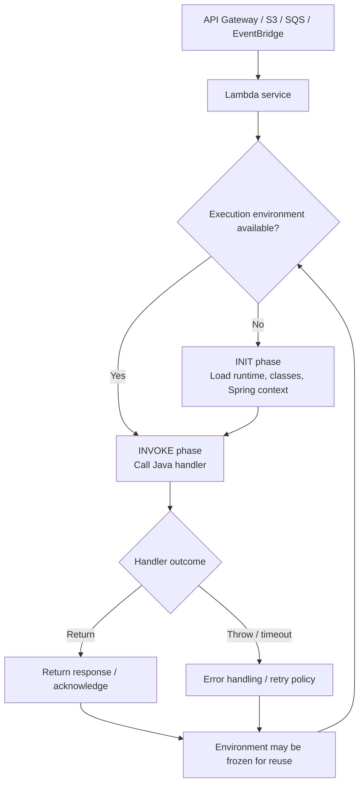
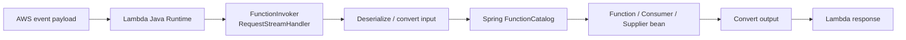
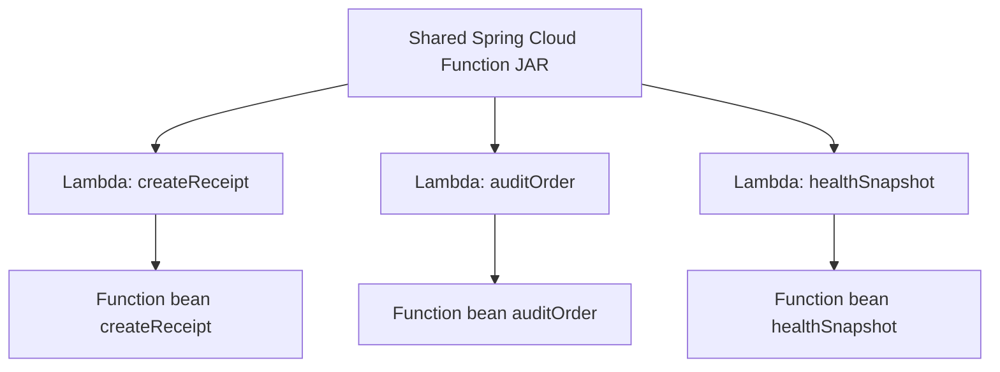
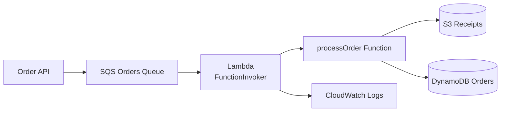

# Implementing Java Lambda Handlers and Spring Cloud Function

**AWS Lambda** executes Java code when it receives an invocation from an event source such as API Gateway, S3, SQS, EventBridge, or another AWS service. The entry point is the **handler**: Lambda passes the event and context to the handler, awaits the result, and handles the response or error according to the invocation model.

You can write handlers directly using **AWS Lambda Java Core** with **RequestHandler**/**RequestStreamHandler**, or write business functions with **Spring Cloud Function** and let the **FunctionInvoker** adapter bridge to the Lambda runtime. Both approaches share Lambda's execution model, yet differ in abstraction, dependency injection, event conversion, routing, and startup time.

This lesson belongs to the **Java and Spring Boot Applications** chapter of the **CLOUD_PROVIDERS_AWS** module. It connects Java, Spring Boot, IAM, Regions, VPCs, AWS SDK for Java 2.x, API Gateway, S3, SQS, EventBridge, DynamoDB, CloudWatch, and deployments with AWS SAM/IaC.

> **Deployment approach principle:** Direct Java handlers fit small entry points with few dependencies and strict control over events/context. Spring Cloud Function fits when reusing business functions, dependency injection, and a consistent function model across multiple environments. For existing Spring MVC apps, also evaluate **AWS Serverless Java Container**—a different adapter, not Spring Cloud Function.

## 1. Learning objectives

After this lesson, you will be able to:

1. Explain Lambda invocations, execution environments, and the role of Java handlers.
2. Distinguish `RequestHandler`, `RequestStreamHandler`, and plain handler methods.
3. Configure handler strings, runtimes, event inputs, outputs, and the Lambda `Context`.
4. Use Java records/POJOs and AWS Lambda Java Events to handle payloads from AWS services.
5. Write Java handlers using AWS SDK for Java 2.x and least-privilege execution roles.
6. Distinguish synchronous API Gateway invocations from asynchronous/event-source processing (SQS/S3/EventBridge).
7. Build Spring Cloud Functions using `Supplier`, `Function`, `Consumer`, and dependency injection.
8. Integrate `spring-cloud-function-adapter-aws` and configure `FunctionInvoker`.
9. Choose function definitions, routing, and Lambda function boundaries aligned with permission/scaling isolation.
10. Package JAR/ZIP artifacts properly, preserving Spring metadata and service files.
11. Deploy with AWS SAM and verify Lambda configuration.
12. Manage cold starts, memory, CPU, timeouts, concurrency, and Lambda SnapStart.
13. Design idempotency, retries, partial batch responses, and dead-letter handling.
14. Secure environment variables, IAM roles, VPC access, and secret retrieval.
15. Test handlers, function beans, event payloads, and sandbox deployments.
16. Monitor logs, metrics, traces, costs, and establish rollback plans.

## 2. Lambda invocations and execution environments

Lambda does not keep an HTTP Java server running continuously like a traditional Spring Boot web app. AWS manages execution environments and invokes the entry point when events arrive.



One execution environment can process multiple invocations sequentially over its lifetime. As Lambda needs higher concurrency, the service spins up additional environments. Never assume a single Java instance handles every request.

### 2.1. INIT phase

During environment initialization, Lambda:

- Starts the managed runtime.
- Loads the deployment package and libraries.
- Initializes static fields and class-level resources.
- With Spring, creates the `ApplicationContext`, scans components, and initializes configured beans.
- Prepares the handler for invocations.

Time-consuming initialization contributes to **cold starts**. A Spring Boot app loaded with starters/auto-configuration typically incurs longer INIT times than a lean Java handler.

### 2.2. INVOKE phase

On each invocation, Lambda:

1. Receives the event payload.
2. Deserializes the payload per the handler contract.
3. Builds the invocation context.
4. Calls the handler/function.
5. Serializes the result or records the error.
6. Returns the result to the caller or follows event-source semantics.

### 2.3. Execution environment reuse

After an invocation, Lambda may retain the environment for reuse:

- Static clients such as `S3Client`/`DynamoDbClient` can be reused.
- Immutable configuration and connection pools can persist.
- Never store user/session/request-specific state in static fields.
- Never treat local memory as durable storage.
- Network connections can expire/reset; clients must support reconnecting.
- Background threads must never be relied upon to continue work after the handler returns.

**Creating AWS SDK clients outside the handler method** avoids client initialization overhead on every invocation. However, durable business data must reside in DynamoDB, S3, or an appropriate store.

## 3. Choosing a Java runtime for Lambda

Lambda provides managed Java runtimes. Per the current AWS runtime list at the time of writing:

| Java | Runtime identifier | Operating system |
| --- | --- | --- |
| Java 25 | `java25` | Amazon Linux 2023 |
| Java 21 | `java21` | Amazon Linux 2023 |
| Java 17 | `java17.al2023` | Amazon Linux 2023 |
| Java 11 | `java11.al2023` | Amazon Linux 2023 |
| Java 8 | `java8.al2023` | Amazon Linux 2023 |
| Java 17 (legacy) | `java17` | Amazon Linux 2 |
| Java 11 (legacy) | `java11` | Amazon Linux 2 |
| Java 8 (legacy) | `java8.al2` | Amazon Linux 2 |

Runtime identifiers and deprecation dates change over time. Before creating a new function, verify the runtime list in the AWS Lambda Developer Guide and your target Region.

### 3.1. Runtime and Java compile target must match

When targeting the Java 21 runtime, compile bytecode for Java 21 or an older supported target. Maven example:

```xml
<properties>
    <maven.compiler.release>21</maven.compiler.release>
    <project.build.sourceEncoding>UTF-8</project.build.sourceEncoding>
</properties>
```

Never compile targeting Java 25 and deploy to a Java 21 runtime. Newer bytecode will not run on an older JVM.

### 3.2. Which runtime to choose?

- Pick an LTS runtime supported by your organization with a suitable lifecycle.
- For new projects, evaluate Java 21 or Java 25 if dependencies and frameworks are compatible.
- Verify compatibility of the AWS SDK, Spring Boot, Spring Cloud release train, logging, and native libraries.
- Run integration tests on the exact target runtime and architecture.
- Track deprecation timelines and plan upgrades before AWS blocks function creation/updates.

## 4. Java handler contracts

AWS Lambda Java Core provides two standard interfaces:

- **RequestHandler<I,O>**: the Lambda runtime deserializes the JSON event into type `I`, invokes the handler, and serializes result `O`.
- **RequestStreamHandler**: receives `InputStream`, `OutputStream`, and `Context`; the application controls reading/writing JSON or binary payloads directly.

### 4.1. RequestHandler

```java
package example.lambda;

import com.amazonaws.services.lambda.runtime.Context;
import com.amazonaws.services.lambda.runtime.RequestHandler;

public class UppercaseHandler implements RequestHandler<String, String> {

    @Override
    public String handleRequest(String input, Context context) {
        String requestId = context.getAwsRequestId();

        context.getLogger().log(
            "Processing invocation requestId=" + requestId + "\n"
        );

        if (input == null) {
            throw new IllegalArgumentException("input must not be null");
        }

        return input.toUpperCase();
    }
}
```

Handler configuration:

```text
example.lambda.UppercaseHandler
```

Because the class implements `RequestHandler`, the runtime invokes `handleRequest`. With `String` input, the payload must be a valid JSON string, e.g.:

```json
"hello aws"
```

Response:

```json
"HELLO AWS"
```

### 4.2. RequestHandler with POJOs/records

With Java 17+, records can model event data:

```java
package example.lambda;

import com.amazonaws.services.lambda.runtime.Context;
import com.amazonaws.services.lambda.runtime.RequestHandler;

public class OrderHandler
        implements RequestHandler<OrderHandler.OrderCommand, OrderHandler.OrderResult> {

    public record OrderCommand(
        String orderId,
        String customerId,
        long amountInCents
    ) {}

    public record OrderResult(
        String orderId,
        String status
    ) {}

    @Override
    public OrderResult handleRequest(OrderCommand event, Context context) {
        if (event == null || event.orderId() == null || event.orderId().isBlank()) {
            throw new IllegalArgumentException("orderId is required");
        }

        context.getLogger().log(
            "Accepted order requestId=" + context.getAwsRequestId() + "\n"
        );

        // Business logic goes here.
        return new OrderResult(event.orderId(), "ACCEPTED");
    }
}
```

Sample event:

```json
{
  "orderId": "ORD-10042",
  "customerId": "CUS-018",
  "amountInCents": 259900
}
```

The runtime converts JSON into `OrderCommand` when the serializer supports that type. On Java 8/11 or complex models, use POJO classes and a compatible serializer such as Jackson. Always test serialization with real payloads.

### 4.3. RequestStreamHandler

Use a stream handler when explicit control over serialization or payloads is required:

```java
package example.lambda;

import com.amazonaws.services.lambda.runtime.Context;
import com.amazonaws.services.lambda.runtime.RequestStreamHandler;
import com.fasterxml.jackson.databind.ObjectMapper;

import java.io.InputStream;
import java.io.OutputStream;
import java.util.Map;

public class StreamHandler implements RequestStreamHandler {
    private static final ObjectMapper MAPPER = new ObjectMapper();

    @Override
    public void handleRequest(
            InputStream input,
            OutputStream output,
            Context context) throws java.io.IOException {

        Map<?, ?> event = MAPPER.readValue(input, Map.class);
        Object rawName = event.get("name");
        String name = rawName == null ? "World" : rawName.toString();

        Map<String, Object> response = Map.of(
            "message", "Hello " + name,
            "requestId", context.getAwsRequestId()
        );

        MAPPER.writeValue(output, response);
    }
}
```

Handler configuration remains the class name:

```text
example.lambda.StreamHandler
```

`RequestStreamHandler` returns `void`; the runtime reads the response from the output stream. Choose stream handlers for custom JSON handling, large payloads, or streaming. For standard business events, `RequestHandler` is simpler.

### 4.4. Handler methods without implementing an interface

Lambda Java also supports classes with methods following a naming convention:

```java
package example.lambda;

import com.amazonaws.services.lambda.runtime.Context;
import java.util.Map;

public class SimpleHandler {
    public String handle(Map<String, Object> event, Context context) {
        return "received=" + event.size();
    }
}
```

The handler string takes the form:

```text
example.lambda.SimpleHandler::handle
```

Although supported, `RequestHandler` is generally clearer because the compiler enforces the contract.

## 5. Lambda Context

Lambda passes `Context` to the handler, exposing function and invocation metadata.

| Method | Purpose |
| --- | --- |
| `getAwsRequestId()` | Request ID of the current invocation |
| `getFunctionName()` | Lambda function name |
| `getFunctionVersion()` | Running version |
| `getInvokedFunctionArn()` | Invoked ARN, possibly including alias/version |
| `getMemoryLimitInMB()` | Configured memory |
| `getRemainingTimeInMillis()` | Remaining execution time for this invocation |
| `getLogger()` | Logs through the Lambda runtime |
| `getIdentity()` | Cognito identity if present |
| `getClientContext()` | Client context for certain mobile-style invocations |

### 5.1. Using remaining time to stop safely

Never start a long operation if insufficient time remains:

```java
int remaining = context.getRemainingTimeInMillis();

if (remaining < 2_000) {
    throw new IllegalStateException("Not enough time to start downstream operation");
}
```

This is illustrative. For multi-step work, reserve time for cleanup, checkpointing, or throwing an error so the event source retries per policy. Never wait for Lambda to hit timeout.

### 5.2. Lambda Request ID differs from AWS service request IDs

`context.getAwsRequestId()` identifies the Lambda invocation. When the handler calls S3/DynamoDB/SQS, each service call returns its own AWS request ID in response metadata. Log them in separate fields to correlate invocations with downstream requests.

## 6. Event payloads: the trigger determines the input shape

A Lambda handler does not receive the same JSON schema from every trigger. Payloads depend on the calling service or event source mapping.

| Source | Invocation | Typical input | Failure behavior |
| --- | --- | --- | --- |
| API Gateway | Synchronous | HTTP method, path, headers, body, request context | Caller receives response/error |
| Application Load Balancer | Synchronous | ALB request event | ALB receives response |
| S3 notification | Asynchronous | Bucket, object key, event name, sequencer | Lambda async retries/DLQ per config |
| EventBridge | Asynchronous | Event envelope: source, detail-type, detail | Retry policy/event bus DLQ |
| SQS | Event source mapping | Batch records, message IDs, bodies | Batch retry or partial batch response |
| DynamoDB Streams | Event source mapping | Batch stream records | Retry/age/partial failure per config |
| Kinesis | Event source mapping | Batch records, partition/shard metadata | Retry, bisect batch, destination per config |

### 6.1. API Gateway payload

With API Gateway HTTP API payload format 2.0, events typically include:

```json
{
  "version": "2.0",
  "routeKey": "POST /orders",
  "rawPath": "/orders",
  "headers": {
    "content-type": "application/json"
  },
  "body": "{\"orderId\":\"ORD-10042\"}",
  "isBase64Encoded": false
}
```

Never assume `body` is already a Java object. API Gateway passes `body` as a string; the handler must parse and validate it per the configured payload format. REST API 1.0 and HTTP API 2.0 payloads differ across headers, cookies, paths, and request context.

### 6.2. AWS Lambda Java Events

AWS provides **com.amazonaws:aws-lambda-java-events** with models for common events such as:

- `APIGatewayProxyRequestEvent`.
- `APIGatewayV2HTTPEvent`.
- `SQSEvent`.
- `S3Event`.
- `SNSEvent`.
- `DynamodbEvent`.
- Additional event models per library version.

Maven dependency example:

```xml
<dependency>
    <groupId>com.amazonaws</groupId>
    <artifactId>aws-lambda-java-core</artifactId>
    <version>1.2.3</version>
</dependency>
<dependency>
    <groupId>com.amazonaws</groupId>
    <artifactId>aws-lambda-java-events</artifactId>
    <version>3.11.1</version>
</dependency>
```

These versions follow AWS documentation examples; verify Maven Central and compatibility before upgrading.

### 6.3. API Gateway responses follow a dedicated contract

With Lambda proxy integrations, responses typically require `statusCode`, `headers`, and `body`. Returning an arbitrary Java object does not automatically turn it into an HTTP response with your desired status.

Conceptual example:

```json
{
  "statusCode": 201,
  "headers": {
    "content-type": "application/json"
  },
  "body": "{\"orderId\":\"ORD-10042\",\"status\":\"CREATED\"}",
  "isBase64Encoded": false
}
```

Choose event/response classes matching your API Gateway integration and payload format. Never confuse direct Lambda invocation payloads with API Gateway proxy events.

## 7. Example Java handler calling AWS SDK for Java 2.x

A handler can use AWS SDK v2 to write a receipt to S3. Instantiate the client at class scope for reuse:

```java
package example.lambda;

import com.amazonaws.services.lambda.runtime.Context;
import com.amazonaws.services.lambda.runtime.RequestHandler;
import software.amazon.awssdk.core.sync.RequestBody;
import software.amazon.awssdk.services.s3.S3Client;
import software.amazon.awssdk.services.s3.model.PutObjectRequest;

import java.nio.charset.StandardCharsets;

public class ReceiptHandler
        implements RequestHandler<ReceiptHandler.Order, ReceiptHandler.Result> {

    private static final S3Client S3 = S3Client.builder().build();

    public record Order(String orderId, String item, long amountInCents) {}
    public record Result(String orderId, String receiptKey, String status) {}

    @Override
    public Result handleRequest(Order event, Context context) {
        if (event == null || event.orderId() == null || event.orderId().isBlank()) {
            throw new IllegalArgumentException("orderId is required");
        }

        String bucket = requiredEnv("RECEIPT_BUCKET");
        String key = "receipts/" + event.orderId() + ".txt";

        String receipt = "Order: " + event.orderId()
            + "\nItem: " + event.item()
            + "\nAmount (cents): " + event.amountInCents();

        PutObjectRequest request = PutObjectRequest.builder()
            .bucket(bucket)
            .key(key)
            .contentType("text/plain; charset=utf-8")
            .build();

        S3.putObject(
            request,
            RequestBody.fromBytes(receipt.getBytes(StandardCharsets.UTF_8))
        );

        context.getLogger().log(
            "Receipt stored requestId=" + context.getAwsRequestId() + "\n"
        );

        return new Result(event.orderId(), key, "STORED");
    }

    private static String requiredEnv(String name) {
        String value = System.getenv(name);
        if (value == null || value.isBlank()) {
            throw new IllegalStateException("Missing environment variable: " + name);
        }
        return value;
    }
}
```

Key takeaways:

- `S3Client` uses the default credentials provider chain; in Lambda, credentials come from the execution role.
- Never hardcode access keys/secrets in source code or environment variables.
- Never close the static client at the end of every invocation; keep it open for reuse across the execution environment.
- The IAM role needs `s3:PutObject` on the target bucket/prefix.
- If object keys derive from user data, validate/normalize keys and prevent writes outside business boundaries.
- If the handler can receive the same event twice, design keys/conditions/idempotency to prevent unintended side effects.

Manage AWS SDK v2 dependencies with the AWS SDK BOM so all modules stay on the same version:

```xml
<dependencyManagement>
    <dependencies>
        <dependency>
            <groupId>software.amazon.awssdk</groupId>
            <artifactId>bom</artifactId>
            <version>SET_AWS_SDK_V2_BOM_VERSION</version>
            <type>pom</type>
            <scope>import</scope>
        </dependency>
    </dependencies>
</dependencyManagement>

<dependencies>
    <dependency>
        <groupId>software.amazon.awssdk</groupId>
        <artifactId>s3</artifactId>
    </dependency>
</dependencies>
```

Replace the placeholder with a tested, centrally managed SDK BOM version.

## 8. What is Spring Cloud Function?

Spring Cloud Function provides a programming model built on standard Java functional interfaces:

| Interface | Meaning | Input/Output |
| --- | --- | --- |
| `Supplier<T>` | Produces data | No input, returns `T` |
| `Function<I,O>` | Accepts and transforms data | `I → O` |
| `Consumer<I>` | Accepts and processes data | `I →` no return value |

Spring Cloud Function decouples business logic from the AWS Lambda handler contract. The AWS adapter turns function beans into Lambda entry points.

### 8.1. Adapter architecture



The AWS adapter provides the handler:

```text
org.springframework.cloud.function.adapter.aws.FunctionInvoker::handleRequest
```

`FunctionInvoker` handles Lambda integration—reading events, converting types, and selecting functions via configuration/routing. The application focuses on function beans.

## 9. Creating Spring Cloud Function beans

Example function creating a receipt:

```java
package example.functions;

import org.springframework.boot.SpringApplication;
import org.springframework.boot.autoconfigure.SpringBootApplication;
import org.springframework.context.annotation.Bean;

import java.util.function.Function;

@SpringBootApplication
public class OrderFunctionsApplication {

    public static void main(String[] args) {
        SpringApplication.run(OrderFunctionsApplication.class, args);
    }

    public record OrderCreated(
        String orderId,
        String customerId,
        long amountInCents
    ) {}

    public record Receipt(
        String orderId,
        String status,
        long amountInCents
    ) {}

    @Bean
    public Function<OrderCreated, Receipt> createReceipt() {
        return order -> new Receipt(
            order.orderId(),
            "CREATED",
            order.amountInCents()
        );
    }
}
```

In Lambda, the Spring Cloud Function AWS adapter converts input JSON into `OrderCreated`, invokes `createReceipt`, and serializes `Receipt` into the output.

### 9.1. Using dependency injection

Avoid stuffing all business logic directly into the bean:

```java
@Bean
public Function<OrderCreated, Receipt> createReceipt(ReceiptService service) {
    return service::create;
}
```

`ReceiptService` can use constructor injection to receive repositories, AWS SDK clients, or domain services. Initialize AWS SDK clients in singleton beans/managed components and reuse them across invocations.

### 9.2. Consumer and Supplier

Example `Consumer` processing events without a response:

```java
@Bean
public Consumer<OrderCreated> auditOrder(AuditService auditService) {
    return auditService::record;
}
```

Example `Supplier` generating data on invocation:

```java
@Bean
public Supplier<HealthSnapshot> healthSnapshot(HealthService service) {
    return service::snapshot;
}
```

With asynchronous event sources, never swallow errors and return fake success. On failure, throw an exception or return a contract-compliant partial batch response so the event source retries.

## 10. Installing the Spring Cloud Function AWS adapter

Primary dependency:

```xml
<dependency>
    <groupId>org.springframework.cloud</groupId>
    <artifactId>spring-cloud-function-adapter-aws</artifactId>
</dependency>
```

Manage versions with the Spring Cloud BOM matching your project's Spring Boot version. Never arbitrarily mix Spring Boot, Spring Cloud Function, and Spring Cloud release trains; consult the compatibility matrix and official samples.

Conceptual dependency management example:

```xml
<dependencyManagement>
    <dependencies>
        <dependency>
            <groupId>org.springframework.cloud</groupId>
            <artifactId>spring-cloud-dependencies</artifactId>
            <version>SET_COMPATIBLE_SPRING_CLOUD_RELEASE_TRAIN</version>
            <type>pom</type>
            <scope>import</scope>
        </dependency>
    </dependencies>
</dependencyManagement>
```

When building the adapter, the Lambda deployment artifact must bundle dependencies and Spring metadata properly. Current Spring Cloud Function reference docs provide Maven/Gradle samples for building a shaded JAR. Use the sample matching your release train; avoid uploading a thin JAR or a standard Spring Boot executable JAR unprepared for Lambda.

## 11. FunctionInvoker and function definition

If an application defines a single function bean, the adapter can locate it by default. When multiple `Function`/`Consumer`/`Supplier` beans exist, explicitly declare which function to run.

Example environment variable:

```text
spring_cloud_function_definition=createReceipt
```

AWS Lambda environment variable keys do not permit dots. Spring Boot relaxed binding maps:

```text
spring.cloud.function.definition
```

to:

```text
spring_cloud_function_definition
```

### 11.1. One JAR, multiple Lambda functions

You can build one Spring Cloud Function JAR and deploy it as multiple Lambda functions, each selecting a different bean:



| Lambda | Function definition | IAM permission |
| --- | --- | --- |
| `orders-create` | `createReceipt` | `s3:PutObject` |
| `orders-audit` | `auditOrder` | `dynamodb:PutItem` |
| `orders-health` | `healthSnapshot` | Read-only permissions as needed |

Splitting functions helps when functions have distinct permissions, scaling profiles, timeouts, or event sources. Sharing one JAR does not mean sharing one execution role.

### 11.2. One Lambda, multiple function beans

A single Lambda can route across multiple function beans when they share the same trust boundary and permission set. However:

- Define explicit routing rules.
- Never let unauthenticated user-supplied headers invoke sensitive functions without authorization.
- Monitor errors and latency per function/operation.
- If functions require distinct IAM permissions, separate the Lambda functions and execution roles.

### 11.3. Function composition

Spring Cloud Function supports composition, chaining functions sequentially. Compose only steps sharing compatible input/output contracts and error semantics. For long workflows, complex retries, compensation, or checkpoints, evaluate Step Functions instead of cramming every step into one Lambda.

## 12. Handling S3, SQS, and EventBridge events with Spring

Spring Cloud Function can accept AWS-specific event classes when native metadata access is needed.

Add `aws-lambda-java-events` when using event models such as `S3Event`, `SQSEvent`, or `SQSBatchResponse`:

```xml
<dependency>
    <groupId>com.amazonaws</groupId>
    <artifactId>aws-lambda-java-events</artifactId>
    <version>3.11.1</version>
</dependency>
```

The version above is illustrative; verify a release compatible with Lambda Java Core and your build.

### 12.1. S3 events

```java
import com.amazonaws.services.lambda.runtime.events.S3Event;
import org.springframework.context.annotation.Bean;

import java.util.function.Function;

@Bean
public Function<S3Event, String> processS3Event(FileProcessor processor) {
    return event -> {
        var records = event.getRecords();
        if (records == null || records.isEmpty()) {
            throw new IllegalArgumentException("S3 event has no records");
        }

        var record = records.get(0);
        String bucket = record.getS3().getBucket().getName();
        String key = record.getS3().getObject().getUrlDecodedKey();

        processor.process(bucket, key);
        return "PROCESSED";
    };
}
```

An S3 event can contain multiple records; production code should iterate through all records and process each with an appropriate idempotency key.

### 12.2. SQS events and partial batch responses

With SQS, Lambda typically receives a batch of records. If one record fails, the entire batch may be retried depending on the event source mapping. Enable **ReportBatchItemFailures** and return **SQSBatchResponse** to report the exact messages needing retry.

Function signature:

```java
import com.amazonaws.services.lambda.runtime.events.SQSEvent;
import com.amazonaws.services.lambda.runtime.events.SQSBatchResponse;

import java.util.ArrayList;
import java.util.function.Function;

@Bean
public Function<SQSEvent, SQSBatchResponse> processQueue(OrderQueueService service) {
    return event -> {
        var failures = new ArrayList<SQSBatchResponse.BatchItemFailure>();

        for (SQSEvent.SQSMessage message : event.getRecords()) {
            try {
                service.process(message.getBody());
            } catch (Exception error) {
                failures.add(
                    SQSBatchResponse.BatchItemFailure.builder()
                        .itemIdentifier(message.getMessageId())
                        .build()
                );
            }
        }

        return SQSBatchResponse.builder()
            .batchItemFailures(failures)
            .build();
    };
}
```

Enable `ReportBatchItemFailures` on the event source mapping. Otherwise, Lambda will not interpret partial responses as expected. Consumers must still be idempotent because SQS Standard can deliver messages multiple times.

### 12.3. EventBridge

EventBridge events include an envelope with `source`, `detail-type`, `time`, `region`, and `detail`. Functions can accept the matching event model or `Map`/POJO. Validate `source`/`detail-type`, schema version, and `detail` contents before processing.

### 12.4. Choosing typed AWS events vs. business POJOs

| Approach | When to use |
| --- | --- |
| AWS event types (`S3Event`, `SQSEvent`) | Need AWS metadata, message IDs, bucket/key, or batch responses |
| Business POJO (`OrderCreated`) | Want functions decoupled from AWS event schemas |
| `Map<String,Object>` | Unstable payloads or unknown schemas |
| `InputStream` | Need raw input or custom serialization |

When using POJOs, ensure the adapter converts event envelopes properly. For S3/SQS, events do not simply place business JSON at the root.

## 13. Packaging JAR/ZIP artifacts for Lambda

Lambda requires a deployment artifact containing compiled classes and runtime dependencies. For Java, you can use a ZIP archive or a JAR package per supported deployment options.

### 13.1. Direct Java handler

A typical ZIP archive looks like:

```text
function.zip
├── example/
│   └── lambda/
│       └── OrderHandler.class
└── lib/
    ├── aws-lambda-java-core.jar
    ├── aws-lambda-java-events.jar
    ├── dynamodb-2.x.jar
    └── other-runtime-dependencies.jar
```

Build via Maven/Gradle plugins or a tested packaging workflow. Ensure:

- The handler class is on the classpath.
- Runtime dependencies are packaged or supplied via a configured Lambda Layer.
- Unnecessary build/test-only dependencies are excluded.
- Local credentials, `.env` files, IDE files, or private configs are never packaged.
- Builds are reproducible and carry versions/hashes for traceability.

### 13.2. Spring Cloud Function JAR

For Spring Cloud Function, the Lambda artifact is typically a **shaded JAR** bundling dependencies. Preserve metadata and service files Spring needs to discover auto-configuration and components.

Resources to watch depending on version:

- `META-INF/services/*` — merge service provider files.
- `META-INF/spring.handlers`.
- `META-INF/spring.schemas`.
- `META-INF/spring.factories`.
- `META-INF/spring/org.springframework.boot.autoconfigure.AutoConfiguration.imports`.
- Manifest attributes such as `Start-Class`.

If the Shade plugin overwrites these resources instead of merging them, Spring can fail to detect auto-configuration or adapters. Follow the Spring Cloud Function sample matching your release train and inspect the built JAR contents.

### 13.3. Distinguishing artifact types

| Artifact | Purpose |
| --- | --- |
| Plain JAR | Only project classes/resources; usually missing dependencies |
| Spring Boot executable JAR | Uses Spring Boot's launcher/nested layout; not a Lambda shaded artifact by default |
| Shaded Lambda JAR | JAR merging runtime dependencies and required metadata |
| ZIP with `lib/` | Code and dependency JARs in Lambda Java's standard layout |
| Container image | Runtime/dependencies packaged in an image per Lambda container contract |

Never upload an arbitrary JAR assuming Lambda will automatically locate all dependencies.

## 14. Deploying with AWS SAM

AWS SAM defines Lambda functions, roles, event sources, and infrastructure resources in a template. Spring Cloud Function example:

```yaml
AWSTemplateFormatVersion: '2010-09-09'
Transform: AWS::Serverless-2016-10-31
Description: Spring Cloud Function on AWS Lambda

Resources:
  CreateReceiptFunction:
    Type: AWS::Serverless::Function
    Properties:
      FunctionName: orders-create-receipt
      Runtime: java21
      Handler: org.springframework.cloud.function.adapter.aws.FunctionInvoker::handleRequest
      CodeUri: target/order-functions-aws.jar
      MemorySize: 1024
      Timeout: 30
      Environment:
        Variables:
          spring_cloud_function_definition: createReceipt
          RECEIPT_BUCKET: !Ref ReceiptBucket
      Policies:
        - S3WritePolicy:
            BucketName: !Ref ReceiptBucket

  ReceiptBucket:
    Type: AWS::S3::Bucket
```

This is an illustrative template. Artifact paths, policy templates, and function beans must match your project. For Java 25, update `Runtime` according to verified compatibility and dependencies.

### 14.1. SAM build/deploy flow

```bash
# Validate template and build deployment artifacts.
sam validate
sam build

# Deploy to sandbox; guided mode prompts for stack/bucket/permissions.
sam deploy --guided
```

After deploying:

1. Confirm function runtime, handler, architecture, and package type.
2. Verify environment variables and execution role.
3. Check the CloudWatch log group.
4. Invoke using a prepared event fixture.
5. Inspect response, duration, errors, and request IDs.
6. Run integration tests against sandbox AWS resources.

### 14.2. Direct Java handler SAM config

When using a direct handler, set `Handler` to the class name:

```yaml
Resources:
  OrderHandlerFunction:
    Type: AWS::Serverless::Function
    Properties:
      Runtime: java21
      Handler: example.lambda.OrderHandler
      CodeUri: target/order-handler.zip
      MemorySize: 512
      Timeout: 20
      Environment:
        Variables:
          ORDER_TABLE: !Ref OrdersTable
      Policies:
        - DynamoDBCrudPolicy:
            TableName: !Ref OrdersTable
```

Match `Handler` to your interface/handler style. Never specify `FunctionInvoker` if the artifact is a direct Java handler.

## 15. IAM execution roles and the AWS SDK

Every Lambda function has an **execution role**. AWS Lambda assumes this role when running the function. The AWS SDK for Java retrieves temporary credentials from the runtime credential provider chain.

### 15.1. Least privilege

Example function writing receipts only to one bucket/prefix:

```json
{
  "Version": "2012-10-17",
  "Statement": [
    {
      "Effect": "Allow",
      "Action": [
        "s3:PutObject"
      ],
      "Resource": "arn:aws:s3:::company-receipts/receipts/*"
    }
  ]
}
```

Never grant `s3:*` across all buckets just to get code working. If using customer-managed KMS keys, add matching policies for the key and service actions.

### 15.2. Never use IAM user access keys

Never store static `AWS_ACCESS_KEY_ID` and `AWS_SECRET_ACCESS_KEY` values in Lambda environment variables. Use the execution role. During local development, the AWS SDK can use a profile/SSO; inside Lambda, it uses runtime-supplied credentials.

### 15.3. Secrets Manager and Parameter Store

- Environment variables suit non-secret config like table names, feature flags, and function definitions.
- Secrets such as API tokens/passwords belong in Secrets Manager or Parameter Store `SecureString`.
- Scope `secretsmanager:GetSecretValue`/`ssm:GetParameter` to the exact required ARNs.
- Cache secrets in memory with an appropriate TTL; refresh as needed and never log secrets.
- Encryption of Lambda environment variables does not replace secret lifecycle/rotation management.

## 16. VPC networking for Lambda

Lambda does not need to attach to a VPC just to call public AWS service endpoints. Attach a function to a VPC only when it must access private resources such as RDS, ElastiCache, or internal services.

When a function resides in private subnets:

- Provide routes to reach services outside the VPC.
- NAT Gateways/egress paths may be required for public internet endpoints.
- VPC endpoints allow calling AWS services over private networking.
- The Lambda security group must be allowed by the target resource's security group/port.
- VPC DNS, route tables, and NACLs must align.
- Never assume private subnets automatically have Internet egress.

For example, Lambda accessing private RDS on TCP 5432 needs an SG rule from the Lambda SG to the DB SG. Lambda calling DynamoDB can use a DynamoDB gateway endpoint, avoiding NAT for traffic traversing that endpoint.

## 17. API Gateway, synchronous, and asynchronous invocations

### 17.1. Synchronous invocation

API Gateway invokes Lambda synchronously and waits for the result. The handler must finish within the timeout and return a response matching the integration contract.

Used for:

- HTTP APIs.
- Direct SDK `Invoke` requests with `RequestResponse`.
- ALB Lambda targets.

When a handler throws an exception, the caller receives an error; status/body mapping depends on the integration. With API Gateway proxy integrations, return a schema-compliant response object to control HTTP status and body.

### 17.2. Asynchronous invocation

S3, EventBridge, and several sources invoke Lambda asynchronously. Lambda queues the event and processes it; callers do not wait for the final business outcome.

On function failure, Lambda retries according to its async invocation policy and routes failed events to configured destinations/DLQs. Since events can be redelivered, business operations must be idempotent.

### 17.3. Event source mappings

SQS, Kinesis, and DynamoDB Streams use event source mappings. Lambda polls the source, batches records, and invokes the function. Key settings:

- Batch size and batching window.
- Maximum concurrency/parallelization factor per source.
- Retry/record age limits.
- Bisect batch on function error where applicable.
- Partial batch responses.
- On-failure destinations or DLQs per source type.

Do not assume all triggers share identical retry semantics.

## 18. SQS batch failures and idempotency

SQS Standard provides at-least-once delivery. A message can arrive multiple times, even when the function succeeded yet acknowledgment/response handling did not complete as expected.

For batches:

- Without partial batch responses enabled, a single failed record can trigger retries of the entire batch.
- With `ReportBatchItemFailures`, the function returns only the message IDs needing retry.
- Configure the event source mapping accordingly.
- Never mark a record successful before durable business side effects commit.
- Use idempotency keys/message IDs/business keys to prevent duplicate writes.
- Set the SQS visibility timeout to at least **6 times the Lambda timeout**, plus any batching window above 0; this is AWS's recommendation to allow retries if the function is throttled.
- Configure redrive policies/DLQs and alarms for messages landing in the DLQ.

### 18.1. Idempotent consumers

Example consumer recording order IDs in a processing table:

```text
messageId / orderId
       |
       v
Check idempotency record
       |
   +---+---+
   |       |
 Already  New
 processed |
   |       v
 Return   Process business action
 success  + write idempotency record
```

Both the business write and the idempotency marker should be protected by a transaction or conditional write. Writing the marker first before a failing business action causes retried messages to be falsely skipped.

## 19. Cold starts and startup optimization

Cold start is the time Lambda needs to provision a new environment, boot the runtime, and run initialization code before the handler. In Java, overhead stems from:

- JVM startup and class loading.
- Dependency count.
- Spring component scanning/auto-configuration.
- Static initialization.
- DNS/TLS/SDK client initialization.
- Database/service connections opened during startup.
- Deployment package size.

### 19.1. Reducing work in INIT

- Include only necessary dependencies.
- For simple handlers, consider a direct Java handler instead of Spring.
- With Spring, omit `spring-boot-starter-web` if the function needs no web server.
- Narrow component scanning and auto-configuration.
- Instantiate SDK clients once, avoiding heavy network calls in static initializers.
- Never run large database queries or load entire datasets inside constructors.
- Measure `Init Duration` in `REPORT`/`INIT_REPORT` logs or via the Telemetry API; Lambda Insights also exposes `init_duration` if enabled. Never infer cold starts solely from handler `Duration`.

### 19.2. Memory and CPU

Lambda allocates CPU proportionally to configured memory. Raising memory can shorten both execution and startup time, while per-millisecond pricing scales with memory. Use benchmarks/Power Tuning to find the optimal cost/latency balance.

### 19.3. SnapStart

SnapStart snapshots an initialized execution environment when publishing a function version, then restores new environments from that snapshot to cut cold starts.

Key points:

- Supported on managed Java runtimes from Java 11 onward.
- Applies only to published versions/aliases; not to `$LATEST`.
- Cannot be combined with Provisioned Concurrency.
- Random values/IDs/secrets generated during INIT may repeat across restored snapshots; generate uniqueness after restore/at invocation.
- Network connections opened during INIT must be validated/reconnected on restore.
- Use appropriate lifecycle hooks when actions are needed before/after snapshotting.
- Test cryptographic libraries, random generators, pools, and background threads.

SnapStart cuts initialization latency in many cases, yet never replaces benchmarking. When strict latency SLAs remain unmet by SnapStart, evaluate Provisioned Concurrency.

### 19.4. Provisioned Concurrency and reserved concurrency

| Configuration | Purpose |
| --- | --- |
| Reserved concurrency | Caps max concurrency and reserves a concurrency slice for the function |
| Provisioned concurrency | Keeps pre-initialized execution environments warm |
| SnapStart | Restores environments from snapshots created at version publish |

Reserved concurrency **does not keep JVMs warm**. Provisioned concurrency keeps environments ready at an additional continuous cost. SnapStart cannot be combined with Provisioned Concurrency under current service limits.

## 20. Timeouts and downstream protection

Lambda timeouts cap at 15 minutes. Size timeouts to the workload rather than defaulting to the maximum.

- API handlers need short deadlines aligned with HTTP callers.
- SQS consumers must align with visibility timeouts.
- Event source mappings need matching batch processing times.
- Database/query/client timeouts must be shorter than Lambda's remaining time.
- Use `Context.getRemainingTimeInMillis()` to avoid starting steps that cannot finish.
- Retries/backoff must not exceed the overall deadline.
- Enforce concurrency limits to protect databases and downstream APIs.

Rapidly scaling Lambda functions can open hundreds or thousands of concurrent connections if each invocation opens a fresh DB connection. Use connection reuse, RDS Proxy where suitable, queue buffering, and concurrency controls to protect downstreams.

## 21. Error handling and response semantics

### 21.1. Synchronous APIs

With API Gateway, handlers should return clear responses:

- `2xx` for successful outcomes.
- `4xx` for client input/auth/business errors.
- `5xx` for system/transient errors.
- Avoid returning HTTP `200` with an error body unless explicitly dictated by contract.

Exceptions do not automatically convert into well-formatted business JSON responses. Map domain errors to API responses at the adapter/boundary layer.

### 21.2. Asynchronous and event sources

- For S3/EventBridge async invokes, throw exceptions on failure so Lambda executes retries/destinations per policy.
- For SQS, return a partial batch response or throw according to the event source mapping config.
- For Kinesis/DynamoDB Streams, account for checkpoints, retries, batch bisection, and record age.
- Never catch all exceptions, log them, and return success; doing so silently drops failed events.

### 21.3. Classifying retryable errors

| Error | Action |
| --- | --- |
| Invalid JSON/schema | Emit clear error; quarantine/DLQ where appropriate |
| IAM `AccessDenied` | Fix role/policy; retrying will not help |
| Throttling/transient 5xx | Retry with backoff; throttle concurrency or increase capacity |
| Business validation failure | Mark permanent failure per business rules |
| Duplicate event | Return success if already handled idempotently |
| Timeout after side effect | Check idempotency state before repeating |

## 22. Observability: CloudWatch Logs, metrics, and traces

### 22.1. CloudWatch Logs

Lambda automatically ships runtime logs and stdout/stderr to CloudWatch Logs when the execution role grants logging permissions.

Structured logs should include:

- `timestamp`.
- `level`.
- `functionName` and `functionVersion`.
- `awsRequestId` (Lambda invocation ID).
- `correlationId` or trace ID.
- Redacted operation/business keys.
- `duration` and outcome.
- Error class/code on failure.

Never log access keys, bearer tokens, secrets, raw PII, or sensitive payloads.

### 22.2. Key metrics

| Metric | Meaning |
| --- | --- |
| `Invocations` | Number of function invocations |
| `Duration` | Invocation execution time |
| `Errors` | Invocations ending in error |
| `Throttles` | Invocations rejected due to concurrency limits |
| `ConcurrentExecutions` | Simultaneously running execution environments |
| `Init Duration` in `REPORT`/`INIT_REPORT` logs; `init_duration` in Lambda Insights if enabled | Initialization/cold start duration; not a default `AWS/Lambda` namespace metric |
| `IteratorAge` | Record lag in stream event sources |
| `AsyncEventAge` | Age of async events before processing |
| `AsyncEventsDropped` | Async events dropped under service conditions |
| `ProvisionedConcurrencyUtilization` | Utilization of provisioned concurrency |

Metric names and availability depend on invocation type and event source. Track p50/p95/p99 `Duration`, error rate, and concurrency together.

### 22.3. Tracing

AWS X-Ray or OpenTelemetry links API Gateway → Lambda → downstream services. Record Lambda request IDs and trace IDs in dedicated fields. With AWS SDK v2, enable instrumentation compatible with your chosen runtime and framework.

### 22.4. Recommended alarms

- `Errors` rising above baseline.
- Non-zero `Throttles` during SLA windows.
- p95/p99 `Duration` approaching `Timeout`.
- `ConcurrentExecutions` hitting reserved concurrency.
- Continuously climbing `IteratorAge`/`AsyncEventAge`.
- New messages landing in DLQs.
- `InitDuration`/cold starts spiking after a deployment.
- Abnormal surges in cost/invocations.

## 23. Testing Java Lambdas and Spring Cloud Function

Test across multiple layers.

### 23.1. Unit testing business logic

Test domain services/function beans without calling real AWS. Inject fake repositories/clients or mock dependencies. Cover validation, idempotency, domain errors, and output mapping.

### 23.2. Handler contract tests

- Test JSON input → Java event object deserialization.
- Test Java response → JSON output serialization.
- Test null/missing/invalid fields.
- Test `Context` metadata assumptions.
- Test API Gateway response schemas.
- Test SQS batch responses and message identifiers.

### 23.3. Event fixture tests

Maintain JSON event fixtures per source:

```text
src/test/resources/events/
├── api-gateway-v2.json
├── s3-object-created.json
├── sqs-batch.json
└── eventbridge-order-created.json
```

Fixtures must mirror the exact payload format configured in AWS. Never test an HTTP API 2.0 function using an API Gateway REST API 1.0 payload.

### 23.4. SAM local

Use the AWS SAM CLI to build and invoke locally:

```bash
sam validate
sam build
sam local invoke CreateReceiptFunction \
  --event src/test/resources/events/order-created.json
```

Local invocations work well for serialization/handler smoke tests, yet do not fully emulate IAM, VPCs, concurrency, retries, SnapStart, or live service integrations. Always run integration tests in a sandbox.

### 23.5. Spring Cloud Function tests

Test function beans directly as plain Java functions. Also test adapter conversion against event fixtures and verify function definitions/routing. Never test only business methods and assume the JAR/handler config is wired properly.

## 24. Troubleshooting

| Symptom | Common cause | What to check |
| --- | --- | --- |
| Class not found on invoke | Wrong handler string or class missing from package | Handler config, JAR/ZIP contents |
| `NoSuchMethodException` | Method signature violates Lambda handler contract | `RequestHandler`/`RequestStreamHandler`, method name |
| `ClassNotFoundException` on dependency | Artifact missing runtime dependency | Shaded JAR or `lib/` layout |
| Spring cannot find function bean | Function bean not scanned/declared | `@Bean`, component scan, `Start-Class` |
| `FunctionInvoker` picks wrong function | Missing/wrong function definition | `spring_cloud_function_definition` |
| Spring auto-configuration not running | Shade plugin overwrote `META-INF` metadata | Merge service files/Spring resources |
| JSON conversion failure | Event schema/type mismatch | Event fixtures, Jackson config, API payload version |
| API Gateway returns 502 | Lambda error or malformed proxy response | CloudWatch logs, `statusCode`/`body`/`headers` |
| Duplicate SQS messages | At-least-once delivery or visibility timeout | Idempotency, partial batch response, DLQ |
| Duplicate S3 event processing | Async retries/duplicate notifications | Idempotent object processing |
| High cold starts | Spring context/dependencies/INIT work | `InitDuration`, package size, SnapStart |
| Lambda timeout | Slow downstream, oversized batch, or low timeout | Remaining time, client timeouts, metrics |
| `AccessDenied` | Execution role lacks permission or policy boundary | IAM role, resource policies, KMS |
| Connection timeout to RDS | Wrong VPC/SG/route/DNS | Lambda VPC config, DB SG, subnets |
| Lambda cannot reach Internet | Private subnet lacks egress | NAT or appropriate VPC endpoints |
| Rising throttles | Reserved concurrency/account limit/downstream pressure | Concurrency, event source max concurrency |
| Native library fails to load | Architecture/OS mismatch | `x86_64` vs `arm64`, runtime base image |

### 24.1. Investigation runbook

1. Confirm account, Region, function ARN, and alias/version.
2. Check runtime, architecture, handler string, and package type.
3. Verify the artifact file contains expected classes, dependencies, and metadata.
4. Read CloudWatch logs filtered by Lambda request ID.
5. Inspect IAM execution role and resource policies.
6. Check environment variables and Secrets Manager/Parameter Store access.
7. Check VPC/subnets/SGs/NAT/endpoints if VPC-attached.
8. Check event source mapping, batch size, retries, DLQ, and partial batch response.
9. Check timeout, memory, `InitDuration`, `Duration`, and concurrency.
10. Reproduce with an event fixture in a sandbox.
11. Roll back alias/version if errors began after a release.

## 25. Cost and sizing

Lambda charges per request and execution duration multiplied by configured memory; optional concurrency, SnapStart snapshots, data transfer, CloudWatch Logs, and downstream services add further costs.

| Component | Impact |
| --- | --- |
| Requests | Number of invocations |
| Duration | Billed execution duration |
| Memory | Determines GB-seconds and CPU allocation |
| Provisioned Concurrency | Charges for keeping execution environments warm |
| SnapStart | Snapshot caching/maintenance may incur per-version charges |
| CloudWatch Logs | Ingestion and retention |
| VPC/NAT | NAT Gateway data processing and transfer |
| Downstream services | S3, DynamoDB, RDS, SQS, EventBridge, KMS |
| Architecture | ARM/x86 pricing and performance vary by runtime/Region |

### 25.1. Workload-based optimization

- Benchmark memory rather than defaulting to the lowest setting.
- Trim dependencies/startup work if cold starts hurt latency.
- Choose SnapStart or Provisioned Concurrency based on SLAs and compatibility.
- Size event source batches sensibly without unduly extending processing/visibility timeouts.
- Cap concurrency to protect databases.
- Avoid verbose debug logging in production.
- Configure retention on CloudWatch log groups.
- Clean up unused versions/snapshots and resources per lifecycle policies.

## 26. Hands-on lab: Order Processor with Spring Cloud Function

### 26.1. Context

An application receives order-created events from SQS. The function validates each event, saves a receipt to S3, and writes status to DynamoDB. The app runs on Lambda Java 21 in a sandbox.

Architecture:



### 26.2. Task A — Create the function bean

Create:

```java
public record OrderCreated(
    String orderId,
    String customerId,
    long amountInCents
) {}

@Bean
public Function<OrderCreated, OrderResult> processOrder(OrderService service) {
    return service::process;
}
```

`OrderService` owns validation/idempotency and calls repositories. Avoid burying all AWS integration inside a lambda expression.

### 26.3. Task B — Configure the adapter

Add `spring-cloud-function-adapter-aws`, import the compatible Spring Cloud BOM, build the shaded Lambda artifact, and configure the handler:

```text
Handler:
org.springframework.cloud.function.adapter.aws.FunctionInvoker::handleRequest

Environment:
spring_cloud_function_definition=processOrder
```

### 26.4. Task C — Design IAM

The execution role needs:

- `s3:PutObject` on the exact receipt bucket prefix.
- `dynamodb:GetItem`, `PutItem`, or `UpdateItem` matching actual operations.
- `logs:CreateLogGroup`, `logs:CreateLogStream`, `logs:PutLogEvents` per logging policy.
- KMS permissions if the bucket/table uses customer-managed keys.

For SQS event source mappings, Lambda's execution role needs permissions to poll the queue—typically `sqs:ReceiveMessage`, `sqs:DeleteMessage`, and `sqs:GetQueueAttributes`. Scope the resource to the exact queue ARN. If the queue uses a customer-managed AWS KMS key, also check required KMS permissions. These belong to Lambda's event source mapping; the function itself should still receive only the business S3/DynamoDB permissions the handler actually uses.

### 26.5. Task D — Configure SQS partial batch responses

SAM event mapping:

```yaml
Events:
  OrdersQueue:
    Type: SQS
    Properties:
      Queue: !GetAtt OrdersQueue.Arn
      BatchSize: 10
      FunctionResponseTypes:
        - ReportBatchItemFailures
```

Write the function accepting `SQSEvent`, returning `SQSBatchResponse`, and reporting failed messages by `messageId`. Test a batch containing one valid message and one failing message.

### 26.6. Task E — Test and observe

1. Unit test `OrderService`.
2. Create fixture `sqs-batch.json`.
3. Test function conversion and partial batch responses.
4. Run `sam validate` and `sam build`.
5. Deploy to sandbox with `sam deploy --guided`.
6. Send a test SQS batch.
7. Verify the S3 object, DynamoDB item, and CloudWatch logs.
8. Re-send the same message to verify idempotency.
9. Inject a controlled error in sandbox and confirm retries/DLQ routing.
10. Measure `Duration`, `Errors`, `Throttles`, and `ConcurrentExecutions`.

### 26.7. Task F — Evaluate cold starts

Compare:

- A minimal direct Java handler.
- Spring Cloud Function with identical business logic.
- Spring Cloud Function with SnapStart if supported by runtime/Region/versions.

Record p50/p95/p99 `InitDuration`/`Duration`, memory, package size, and cost. Never draw conclusions from a single isolated cold start.

## 27. Self-check questions

1. What is a Lambda handler?
2. How do Lambda's `INIT` and `INVOKE` phases differ?
3. Why can execution environments be reused?
4. What serialization does `RequestHandler<I,O>` handle?
5. When should you choose `RequestStreamHandler`?
6. What does the handler string look like for a class implementing `RequestHandler`?
7. Which `Context` methods provide the request ID and remaining time?
8. Why should request-specific data never be stored in static fields?
9. How do API Gateway events differ from S3/SQS events?
10. What is `aws-lambda-java-events` used for?
11. Which fields does an API Gateway proxy response require?
12. Which functional bean types does Spring Cloud Function support?
13. What is the Maven artifact for the AWS adapter?
14. What role does `FunctionInvoker` play?
15. Which environment variable maps to `spring.cloud.function.definition`?
16. When should you split multiple Lambda functions even when sharing one JAR?
17. Why shouldn't sensitive functions be routed via unauthenticated headers?
18. Why does a Spring Cloud Function Lambda artifact require a shaded JAR?
19. Which `META-INF` resources must be merged during shading?
20. When should you evaluate AWS Serverless Java Container?
21. How does a Lambda execution role differ from developer IAM user credentials?
22. When does Lambda need VPC attachment?
23. Why do private subnets need NAT or VPC endpoints for appropriate outbound paths?
24. What problem does SQS partial batch response solve?
25. Why do SQS consumers require idempotency?
26. Which tasks happen during a cold start?
27. How does memory configuration affect CPU?
28. Which function versions support SnapStart?
29. What issues can SnapStart cause with random IDs and network connections?
30. How does Reserved Concurrency differ from Provisioned Concurrency?
31. Why must downstream timeouts be shorter than Lambda's remaining time?
32. Which CloudWatch metrics/log fields help detect cold starts, throttling, and stream lag?
33. Why can catching an error and returning success drop events?
34. What simulation limitations does `sam local invoke` have?
35. How does rolling back a Lambda alias/version reduce risk?

## 28. Official AWS and Spring documentation

1. [Building Lambda functions with Java](https://docs.aws.amazon.com/lambda/latest/dg/lambda-java.html).
2. [Define Lambda handler in Java](https://docs.aws.amazon.com/lambda/latest/dg/java-handler.html).
3. [Deploy Java Lambda functions with ZIP/JAR archives](https://docs.aws.amazon.com/lambda/latest/dg/java-package.html).
4. [Deploy Java Lambda functions with container images](https://docs.aws.amazon.com/lambda/latest/dg/java-image.html).
5. [Java Lambda Context object](https://docs.aws.amazon.com/lambda/latest/dg/java-context.html).
6. [Using AWS SDK for Java 2.x in Lambda](https://docs.aws.amazon.com/lambda/latest/dg/java-handler.html).
7. [Lambda Java best practices](https://docs.aws.amazon.com/lambda/latest/dg/java-handler.html).
8. [Lambda execution environment lifecycle](https://docs.aws.amazon.com/lambda/latest/dg/lambda-runtime-environment.html).
9. [Lambda SnapStart](https://docs.aws.amazon.com/lambda/latest/dg/snapstart.html).
10. [Handling uniqueness with SnapStart](https://docs.aws.amazon.com/lambda/latest/dg/snapstart-uniqueness.html).
11. [Lambda concurrency](https://docs.aws.amazon.com/lambda/latest/dg/lambda-concurrency.html).
12. [Lambda provisioned concurrency](https://docs.aws.amazon.com/lambda/latest/dg/provisioned-concurrency.html).
13. [Lambda with SQS](https://docs.aws.amazon.com/lambda/latest/dg/with-sqs.html).
14. [Partial batch responses for SQS](https://docs.aws.amazon.com/lambda/latest/dg/services-sqs-errorhandling.html).
15. [Lambda with S3](https://docs.aws.amazon.com/lambda/latest/dg/with-s3.html).
16. [Lambda with EventBridge](https://docs.aws.amazon.com/lambda/latest/dg/with-eventbridge.html).
17. [Lambda VPC networking](https://docs.aws.amazon.com/lambda/latest/dg/configuration-vpc.html).
18. [Monitoring Lambda functions](https://docs.aws.amazon.com/lambda/latest/dg/monitoring-functions.html).
19. [AWS Serverless Application Model](https://docs.aws.amazon.com/serverless-application-model/latest/developerguide/what-is-sam.html).
20. [Spring Cloud Function — AWS Lambda adapter](https://docs.spring.io/spring-cloud-function/reference/adapters/aws-intro.html).
21. [Spring Cloud Function — Notes on JAR layout](https://docs.spring.io/spring-cloud-function/reference/adapters/aws-intro.html).
22. [Spring Cloud Function reference documentation](https://docs.spring.io/spring-cloud-function/reference/index.html).
23. [AWS Serverless Java Container for Spring Boot](https://github.com/aws/serverless-java-container).
24. [AWS Lambda pricing](https://aws.amazon.com/lambda/pricing/).
25. [Java runtimes for Lambda](https://docs.aws.amazon.com/lambda/latest/dg/lambda-java.html).
26. [Creating and configuring an SQS event source mapping](https://docs.aws.amazon.com/lambda/latest/dg/services-sqs-configure.html).
27. [Viewing Lambda CloudWatch logs and REPORT fields](https://docs.aws.amazon.com/lambda/latest/dg/monitoring-cloudwatchlogs-view.html).

> **Key takeaway:** Direct Java handlers implement `RequestHandler`/`RequestStreamHandler` to receive events and context. Spring Cloud Function uses `Supplier`/`Function`/`Consumer` beans and the `FunctionInvoker` adapter to integrate with Lambda. Choose the right event contract, package artifacts with complete dependencies and metadata, grant least-privilege execution roles, design retries and idempotency per trigger, measure cold starts and concurrency, and deploy via SAM/IaC with reliable rollback.
