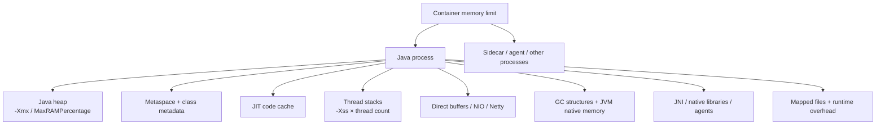
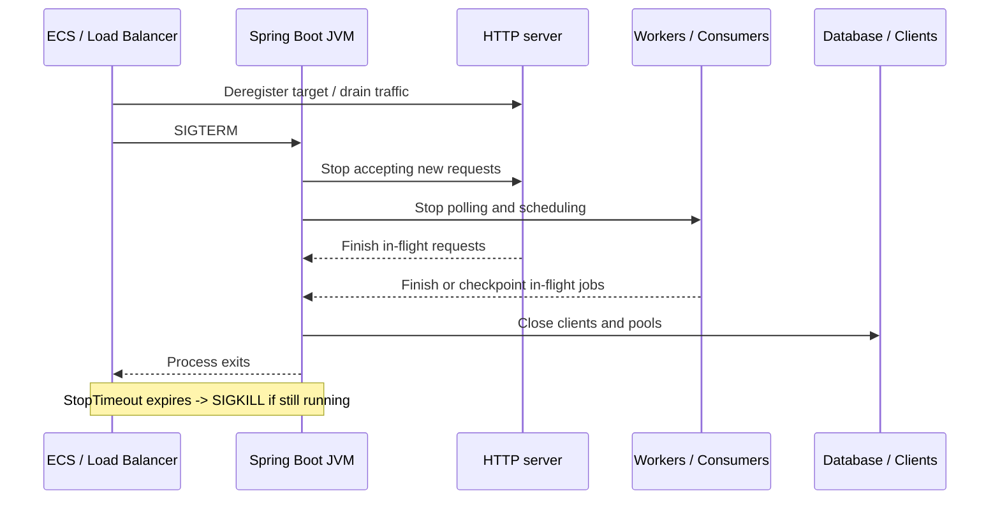

# Optimizing the JVM, Container Memory, and Graceful Shutdown

> **Module:** CLOUD_PROVIDERS_AWS  
> **Chapter:** Java and Spring Boot Applications  
> **Lesson:** Optimizing the JVM, Container Memory, and Graceful Shutdown  
> **Context:** Operating Java 17+/Spring Boot on Amazon ECS/Fargate, ECS/EC2, or Amazon EKS; governing CPU/memory, GC, rolling deployments, and safe application shutdown.

## 1. The problem: why do apps run fine on a dev machine yet fail inside containers?

A Spring Boot Course API runs reliably on a laptop with 16 GB of RAM. Once deployed to ECS Fargate with a 1–2 GiB limit, the application starts experiencing:

- Sudden container termination with Out Of Memory even though the heap chart never reached `Xmx`.
- The JVM spawning too many GC threads or worker threads when the container only receives one vCPU.
- Rising GC pauses during traffic spikes, pushing p95/p99 latency past SLOs.
- Tasks replaced during rolling deployments causing in-flight requests to reset.
- Consumers processing SQS/Kafka messages killed mid-flight, causing duplicate processing or lost state.
- ECS sending `SIGTERM` yet the Java process never receiving it because a shell script is PID 1.
- Spring Boot beginning shutdown while JVM drain time exceeds `stopTimeout`; ECS sends `SIGKILL` before completion.

These issues typically stem from three layers that must be coordinated:

1. **JVM:** respecting container limits, partitioning heap/native memory, choosing GC, and sizing threads.
2. **Application:** governing requests, background workers, connections, queues, and shutdown lifecycles.
3. **Platform:** allocating CPU/memory, health checks, target deregistration, signals, and stop timeouts.

A JVM with a huge heap does not automatically run faster. Nor does a Spring Boot app with graceful shutdown automatically stop safely if the container fails to forward signals or the platform timeout expires.

### Learning objectives

After this lesson, you will be able to:

1. Explain container memory limits, JVM heap, and native/off-heap memory.
2. Configure container-aware JVMs on Java 17+.
3. Estimate `MaxRAMPercentage` from a memory budget.
4. Read GC logs, thread counts, heap metrics, and container metrics.
5. Diagnose Java `OutOfMemoryError` versus container OOM kills.
6. Configure G1GC, CPU-aware thread sizing, and JVM diagnostics.
7. Enable graceful shutdown in Spring Boot.
8. Design shutdown flows for HTTP requests, schedulers, SQS/Kafka consumers, and DB clients.
9. Align Spring lifecycle timeouts with ECS `stopTimeout` or Kubernetes termination grace periods.
10. Test shutdown under rolling deployments, scale-in, and task interruptions.

## 2. Container memory is more than just the Java heap

The container memory limit budgets for **the entire process and every component inside the container**. For Java, the heap is only one piece.



### 2.1. Key memory regions

| Component | Contents | Symptoms when exhausted |
|---|---|---|
| **Heap** | Objects, arrays, collections, application caches | `Java heap space`, continuous GC |
| **Metaspace** | Class metadata, proxies/generated classes | Metaspace OOM, classloader leaks |
| **Code cache** | JIT-compiled code | Code cache full, degraded JIT |
| **Thread stacks** | Stack per platform thread | Native memory grows with thread count |
| **Direct memory** | `ByteBuffer.allocateDirect`, Netty buffers | Direct buffer OOM or rising RSS |
| **GC/JVM native** | GC tables, compilers, VM internal structures | Container memory grows while heap stays flat |
| **JNI/native libraries** | Native SDKs, compression, TLS, agents | RSS grows outside the heap |
| **Mapped files/runtime** | Memory mappings, libc, allocator, and overhead | Container breaches limit |

Mental formula:

```text
Container memory
  >= Java heap
   + Metaspace
   + Code cache
   + Thread stacks
   + Direct buffers
   + GC/JVM native memory
   + JNI/native libraries
   + Runtime and process overhead
   + Other containers/processes in the task
```

Never set `Xmx` to 100% of container memory. If the heap approaches the limit, native memory pushes the container past the cgroup limit before the JVM can even throw `OutOfMemoryError`.

### 2.2. RSS, heap committed, and heap used are distinct numbers

- **Heap used:** bytes currently occupied by live/uncollected objects on the Java heap.
- **Heap committed:** heap memory currently committed by the JVM.
- **Heap max:** maximum allowed heap ceiling.
- **RSS/container memory:** physical/cgroup memory actively held by the process/container as measured by the OS/cgroup.

Example:

```text
Container memory limit: 1,024 MiB
Heap max (-Xmx):          614 MiB
Heap used:                420 MiB
Container memory used:    930 MiB
Remaining headroom:        94 MiB
```

The heap still has roughly 194 MiB before hitting max, yet the container has only 94 MiB of headroom left. If direct buffers, thread stacks, or native allocations grow further, the container will still be OOM-killed.

## 3. Java 17+ and container awareness

HotSpot JVMs on supported Linux platforms detect CPU and memory limits from the container runtime. On compliant JDK 17 builds, container support is enabled by default on supported platforms.

- The JVM reads the environment's memory limit to compute `MaxRAM` and heap ergonomics.
- The JVM detects available CPU quota/count to size GC threads and certain thread pools.
- `UseContainerSupport` can be disabled via `-XX:-UseContainerSupport`; do not disable it casually.
- Container awareness does not automatically tune all application thread pools, Netty event loops, or custom executors.

### 3.1. Checking how much CPU and memory the JVM sees

Print the CPU count detected by the JVM:

```java
public final class RuntimeInfo {
    public static void main(String[] args) {
        Runtime runtime = Runtime.getRuntime();

        System.out.println("Available processors: " +
            runtime.availableProcessors());

        System.out.println("Heap max bytes: " +
            runtime.maxMemory());

        System.out.println("Heap total bytes: " +
            runtime.totalMemory());

        System.out.println("Heap free bytes: " +
            runtime.freeMemory());
    }
}
```

To diagnose container detection, start the JVM with:

```bash
java -Xlog:os+container=trace -jar app.jar
```

This log shows exactly how the JVM reads container/cgroup limits on the active runtime. Test using the exact production image, JDK vendor, version, CPU architecture, and platform.

### 3.2. Inspecting cgroups from a Linux container

Under cgroup v2, typical files are:

```bash
cat /sys/fs/cgroup/memory.max
cat /sys/fs/cgroup/memory.current
cat /sys/fs/cgroup/cpu.max
```

Meaning:

- `memory.max`: memory limit; `max` means no hard limit is imposed at that cgroup.
- `memory.current`: memory currently charged to the cgroup.
- `cpu.max`: CPU quota/period.

Under cgroup v1, paths may be:

```bash
cat /sys/fs/cgroup/memory/memory.limit_in_bytes
cat /sys/fs/cgroup/memory/memory.usage_in_bytes
cat /sys/fs/cgroup/cpu/cpu.cfs_quota_us
cat /sys/fs/cgroup/cpu/cpu.cfs_period_us
```

Exact paths depend on runtime and mount layout. Never hardcode cgroup v1 paths across images.

### 3.3. CPU quotas and ActiveProcessorCount

`Runtime.availableProcessors()` influences GC thread ergonomics and several libraries/executors. If the JVM sees more CPUs than the workload actually receives, it can spawn excessive threads, causing context switching or CPU contention.

`-XX:ActiveProcessorCount=1` overrides the CPU count used by internal JVM calculations. Use it only after verifying container CPU quotas and measuring the workload; forcing it to 1 in a 2-vCPU task can bottleneck throughput.

## 4. Calculating a memory budget for Spring Boot containers

Suppose an ECS Fargate task has 2 GiB memory and runs a single Java container:

| Item | Example budget |
|---|---:|
| Container/task limit | 2,048 MiB |
| Heap max | 1,229 MiB (60%) |
| Native/off-heap + metaspace + stacks + code cache | 500 MiB |
| Headroom for peaks/runtime variance | 319 MiB |

This is an **illustrative budget**, not a universal ratio for every Spring Boot application. Workloads using Netty, compression, TLS, large thread pools, JDBC drivers, agents, or native libraries may need a larger off-heap share.

### 4.1. MaxRAMPercentage and InitialRAMPercentage

Key JVM flags:

| Flag | Meaning |
|---|---|
| `-XX:MaxRAMPercentage` | Maximum percentage of JVM-detected memory allocated to the heap |
| `-XX:InitialRAMPercentage` | Initial percentage used to size the heap |
| `-Xms` | Explicit initial/minimum heap size |
| `-Xmx` | Explicit maximum heap size |
| `-XX:ActiveProcessorCount` | Overrides CPU count used for internal JVM sizing |

Per Java 17 launcher docs, default `MaxRAMPercentage` is **25%**. An explicit `-Xmx` takes precedence for max heap; do not mix multiple sizing flags without understanding precedence.

Starting example for a 1 GiB container:

```text
Container limit = 1,024 MiB
MaxRAMPercentage = 60
Approx. heap max = 614 MiB
Remaining = 410 MiB
```

The remainder covers native memory, metaspace, stacks, code cache, direct buffers, and headroom. Always measure actual RSS under realistic load afterward.

### 4.2. A baseline configuration for benchmarking

```bash
JAVA_TOOL_OPTIONS="-XX:InitialRAMPercentage=25.0 -XX:MaxRAMPercentage=60.0 -XX:+ExitOnOutOfMemoryError"
```

This is purely a starting baseline. For apps needing a larger heap, raise the percentage only after confirming native memory remains sufficient. For Netty apps or large file processing, measure direct memory and concurrency before raising heap size.

Never set `Xmx` larger than the container memory limit. Never blindly shrink `Xss` or cap `MaxDirectMemorySize`; those limits can trade one failure for `StackOverflowError` or direct-buffer OOMs.

### 4.3. Heap dumps and OOM exit behavior

```bash
JAVA_TOOL_OPTIONS="-XX:MaxRAMPercentage=60.0 -XX:+ExitOnOutOfMemoryError -XX:+HeapDumpOnOutOfMemoryError -XX:HeapDumpPath=/tmp"
```

- `ExitOnOutOfMemoryError` terminates the JVM when an OOME is thrown so the ECS service can replace the task.
- `HeapDumpOnOutOfMemoryError` writes a heap dump when the JVM catches an OOME.
- Heap dumps can be huge, contain sensitive data, and require adequate ephemeral storage.
- A kernel/container OOM kill sends `SIGKILL` before the JVM can write a heap dump; never rely on OOME hooks if the container itself is being killed.

Write heap dumps only to a volume with enough capacity and restricted permissions, and delete them after analysis. Never write heap dumps to a small, nearly full filesystem.

## 5. Garbage collection: starting from G1 defaults

On Java 17 server-class machines, **G1GC is the default garbage collector**. G1 balances throughput and pause times, yet still requires adequate CPU and memory to operate smoothly.

- Do not add `UseG1GC` just because online snippets show it; the JVM usually selects G1 already.
- Measure allocation rate, live set, GC pauses, full GCs, and CPU before switching collectors.
- `MaxGCPauseMillis` is a soft heuristic target, not a hard real-time guarantee.
- Enlarging the heap can reduce GC frequency while increasing container memory pressure and potentially lengthening some pauses.
- Shrinking the heap too aggressively triggers GC churn and CPU saturation.

### 5.1. Enabling GC logs on Java 17

```bash
JAVA_TOOL_OPTIONS="-Xlog:gc*,safepoint:stdout:time,uptime,level,tags"
```

In ECS, forward stdout/stderr via `awslogs` or a configured log driver. Avoid writing logs to the container filesystem without rotation and disk budgeting.

### 5.2. What to look for in GC logs

| Sign | Likely indication |
|---|---|
| Very frequent Young GCs | High allocation rate or young generation sizing needs evaluation |
| Old generation rising steadily post-GC | Growing live set, retained cache objects, or memory leak |
| Repeated Full GCs | Heap pressure, humongous allocations, or promotion pressure |
| Long pause times | Large heap/live set, CPU contention, memory pressure, or GC behavior |
| Concurrent GC falling behind | Allocation outpaces reclamation or insufficient CPU |
| High GC CPU yet low request throughput | Workload spending excessive time collecting garbage |

Do not tweak `NewRatio`, `Xmn`, survivor ratios, and G1 internals all at once from the start. With G1, hardcoding generation sizes disables adaptive sizing. Change one variable at a time, re-run the same load test, and compare p95/p99, CPU, allocation, and memory.

## 6. Container images and JVM options

Example Dockerfile for a Spring Boot executable JAR:

```dockerfile
FROM eclipse-temurin:17-jre

WORKDIR /app

COPY target/course-api.jar /app/app.jar

ENV JAVA_TOOL_OPTIONS="-XX:InitialRAMPercentage=25.0 -XX:MaxRAMPercentage=60.0 -XX:+ExitOnOutOfMemoryError -Xlog:gc*,safepoint:stdout:time,uptime,level,tags"

USER 10001:10001

ENTRYPOINT ["java", "-jar", "/app/app.jar"]
```

### 6.1. Why use exec-form ENTRYPOINT?

Use:

```dockerfile
ENTRYPOINT ["java", "-jar", "/app/app.jar"]
```

The JVM runs as the primary process (PID 1) inside the container. When ECS/Docker sends `SIGTERM`, the JVM receives the signal directly and Spring's shutdown hook runs.

Avoid shell-form such as:

```dockerfile
ENTRYPOINT java -jar /app/app.jar
```

A shell becomes PID 1 and swallows signals; if a wrapper shell script is unavoidable, end it with `exec java -jar ...` so the JVM replaces the shell process.

Never set a custom `STOPSIGNAL` other than `SIGTERM` for Spring Boot without a clear reason. `SIGKILL` cannot be intercepted by shutdown hooks.

### 6.2. JAVA_TOOL_OPTIONS vs. JDK_JAVA_OPTIONS

- `JAVA_TOOL_OPTIONS` is read by the JVM at initialization; convenient for passing options via container environment.
- `JDK_JAVA_OPTIONS` is prepended by the `java` launcher to the command line.
- Standardize on one approach to avoid duplicating or overriding flags across image, task definition, and entrypoint.
- Never place credentials or secrets inside JVM options; command lines and process diagnostics can expose them.

## 7. Allocating CPU and memory in Amazon ECS Fargate

ECS Fargate requires task-level CPU and memory from supported combinations. For example, a Linux task of **1 vCPU / 2 GiB** is a valid configuration.

```json
{
  "family": "course-api",
  "requiresCompatibilities": ["FARGATE"],
  "networkMode": "awsvpc",
  "cpu": "1024",
  "memory": "2048",
  "containerDefinitions": [
    {
      "name": "app",
      "image": "123456789012.dkr.ecr.ap-southeast-1.amazonaws.com/course-api:1.0.0",
      "essential": true,
      "stopTimeout": 60,
      "portMappings": [
        {
          "containerPort": 8080,
          "protocol": "tcp"
        }
      ],
      "environment": [
        {
          "name": "JAVA_TOOL_OPTIONS",
          "value": "-XX:InitialRAMPercentage=25.0 -XX:MaxRAMPercentage=60.0 -XX:+ExitOnOutOfMemoryError"
        }
      ]
    }
  ]
}
```

This is an illustrative task definition fragment; substitute your environment's account, image, Region, and task settings. On Fargate, task-level memory is a hard ceiling for the task. If sidecars exist, total container memory plus overhead must fit within the task budget.

### 7.1. stopTimeout on Fargate

- Default: **30 seconds**.
- Configurable up to **120 seconds** on supported Fargate platforms.
- Once the timeout expires, the container is forcibly terminated with `SIGKILL`.
- Linux containers receive `SIGTERM` by default unless the image specifies a different stop signal.

For example, `stopTimeout: 60` gives the app one minute to finish shutting down. That does not fix a hung worker; measure real shutdown duration and keep timeouts bounded.

### 7.2. ECS EC2 and Fargate are not identical

On ECS EC2, `stopTimeout` depends on the task definition and ECS container agent configuration; if omitted, it typically defaults to 30 seconds. ECS Managed Instances have their own limits. Do not assume Fargate's 120-second cap applies identically across every launch type.

## 8. Monitoring JVM and containers with Spring Boot Actuator

Spring Boot Actuator uses Micrometer to expose JVM, process, system, and application metrics.

Commonly needed metrics:

| Metric | What it tracks |
|---|---|
| `jvm.memory.used` | Current heap/non-heap memory usage |
| `jvm.memory.max` | Maximum heap/non-heap capacity per pool |
| `jvm.buffer.memory.used` | Direct/mapped buffer memory |
| `jvm.gc.pause` | GC pause duration |
| `jvm.threads.live` | Current live thread count |
| `jvm.classes.loaded` | Loaded class count |
| `process.memory.usage` | Process memory per instrumentation |
| `process.cpu.usage` | Process CPU usage |
| `system.cpu.usage` | Host/container environment CPU per instrumentation |
| `disk.free` | Remaining filesystem space |

Enable Actuator and an appropriate metrics registry such as Prometheus or OTLP. Expose only necessary endpoints behind network/security controls; never expose all Actuator endpoints to the Internet.

### 8.1. CloudWatch Container Insights for ECS

Container Insights reports CPU, memory, network, and storage at cluster/service/task/container levels depending on observability settings. Pair them with JVM metrics to distinguish:

- Heap rising alongside container memory: likely heap growth/live set expansion.
- Heap flat while container memory climbs: inspect direct buffers, thread stacks, native libraries, agents, or file caches.
- High container memory yet low JVM process metrics: inspect sidecars and other processes in the task.
- Rising CPU paired with GC pauses: correlate GC logs with CPU quotas.

ECS `MemoryUtilization`/Container Insights metrics do not replace heap metrics; they measure different layers.

### 8.2. Health endpoints

Example Spring Boot Actuator configuration:

```yaml
management:
  endpoint:
    health:
      probes:
        enabled: true
  endpoints:
    web:
      exposure:
        include: health,info,prometheus
```

Readiness signals whether the application can accept traffic; liveness signals whether the process is still healthy. Never tie every external dependency into liveness checks: during a brief database outage, restarting all apps simultaneously triggers a restart storm.

## 9. Diagnosing OOMs and native memory

Distinguish these scenarios:

| Scenario | Symptom | Where to investigate |
|---|---|---|
| Java heap OOM | `java.lang.OutOfMemoryError: Java heap space` | Heap dump, heap histogram, object retention, cache growth |
| Metaspace OOM | `OutOfMemoryError: Metaspace` | Classloader leaks, dynamic proxies, generated classes |
| Direct buffer OOM | `OutOfMemoryError: Direct buffer memory` | Netty/NIO pools, direct memory limits |
| Unable to create native thread | Native thread creation failure | Thread count, `Xss`, process/thread limits, memory |
| Container OOM kill | Task/container killed, often `SIGKILL` or exit code 137 | cgroup memory, ECS stopped reason, Container Insights, RSS |
| CPU throttling | High CPU, rising latency, slow concurrent GC | CPU quota, thread count, service utilization |

**Exit code 137 typically indicates the process received `SIGKILL`, yet does not by itself prove OOM.** Always inspect ECS stopped reasons, task/container events, and memory metrics.

### 9.1. Native Memory Tracking

Enable Native Memory Tracking (NMT) when investigating JVM native allocations:

```bash
JAVA_TOOL_OPTIONS="-XX:NativeMemoryTracking=summary"
```

Once the JVM is running, if the image includes JDK tools and attaching is permitted:

```bash
jcmd 1 VM.native_memory summary scale=MB
jcmd 1 GC.heap_info
jcmd 1 Thread.print
```

- NMT must be enabled at JVM startup.
- `summary` categorizes JVM native memory; `detail` adds extra overhead and should be reserved for deep investigations.
- NMT does not replace RSS/cgroup metrics and does not track arbitrary third-party native allocations.
- Many JRE/distroless images omit `jcmd`; prepare a diagnostic image or a controlled ECS Exec workflow.

### 9.2. Procedure when a container is OOM-killed

1. Identify which container/task stopped and its exit reason.
2. Compare memory limit, memory utilization, and peak over time.
3. Inspect heap used/max, non-heap, direct buffers, and thread count.
4. Check GC logs leading up to task termination.
5. If a heap dump exists, analyze retained objects and the dominator tree.
6. If the heap remained stable, inspect native memory, Netty/direct buffers, thread counts, and agents.
7. Adjust heap/threads/native allocations based on measurements, then re-run load tests.

Never raise task memory or lower heap blindly just to mask symptoms without identifying the source of memory growth.

## 10. What is graceful shutdown?

Graceful shutdown is an orderly application stop sequence to:

1. Stop accepting new work.
2. Allow in-flight requests to finish within a bounded time limit.
3. Stop pollers, consumers, and schedulers.
4. Complete or checkpoint in-progress work.
5. Flush logs, traces, and metrics.
6. Close database connections, HTTP clients, and executors.
7. Exit the process before the platform sends `SIGKILL`.



Graceful shutdown cannot guarantee infinite jobs finish. Every operation needs deadlines, idempotency, and checkpoints so work can resume safely once replacement tasks start.

## 11. Spring Boot graceful shutdown

Spring Boot supports graceful shutdown for embedded Tomcat, Jetty, and Reactor Netty; exact behavior varies by server and version. Configure it explicitly so timeouts align with your platform.

Example `application.yml`:

```yaml
server:
  shutdown: graceful

spring:
  lifecycle:
    timeout-per-shutdown-phase: 25s
  task:
    execution:
      shutdown:
        await-termination: true
        await-termination-period: 20s
    scheduling:
      shutdown:
        await-termination: true
        await-termination-period: 20s

management:
  endpoint:
    health:
      probes:
        enabled: true
      group:
        readiness:
          include: readinessState
        liveness:
          include: livenessState
```

- `server.shutdown=graceful`: the embedded server stops accepting new requests and gives in-flight requests time to finish.
- `spring.lifecycle.timeout-per-shutdown-phase`: wait budget for each lifecycle phase.
- `spring.task.execution.shutdown.await-termination`: waits for task executors to finish running/queued tasks per executor behavior.
- `spring.task.scheduling.shutdown.await-termination`: waits for schedulers to finish active tasks as configured.
- Readiness and liveness are separate signals; readiness can shift to refusing traffic as the app shuts down.

Some Spring Boot versions enable web graceful shutdown by default. Declaring it explicitly avoids depending on version defaults and keeps timeouts auditable.

### 11.1. Readiness and liveness do not replace each other

| Probe | Question | When it fails |
|---|---|---|
| Liveness | Is the process alive and capable of recovering? | JVM deadlock/hang or unresponsive process |
| Readiness | Can this instance accept new traffic? | App starting up, draining, or required dependency unavailable |
| Startup | Has the app finished starting? | Not ready within allowed startup window |

When terminating a task, remove it from traffic routing before or alongside starting drain. On ALB, verify target deregistration delay and health check paths. Never use liveness to restart apps simply because a shared dependency has an outage.

## 12. Stopping background workers, queues, and schedulers

Web graceful shutdown covers only the HTTP server. Background workers have their own lifecycles.

### 12.1. Worker shutdown order

1. Mark the application as not accepting new jobs.
2. Stop pollers/consumers from fetching additional messages.
3. Wait for in-flight tasks to finish within budget.
4. Commit offsets or delete/ack messages after successful processing.
5. For unfinished work, save checkpoints or let queues redeliver per queue semantics.
6. Close executors and downstream clients.

With Amazon SQS, visibility timeout must cover processing time. During shutdown, never delete messages before business operations commit. With Kafka, commit offsets after successful processing and account for rebalance/consumer group behavior.

### 12.2. Example worker with bounded wait time

```java
package example.course.worker;

import jakarta.annotation.PreDestroy;
import org.springframework.stereotype.Component;

import java.util.concurrent.ExecutorService;
import java.util.concurrent.TimeUnit;
import java.util.concurrent.atomic.AtomicBoolean;

@Component
public class ReportWorker {
    private final AtomicBoolean accepting = new AtomicBoolean(true);
    private final ExecutorService executor =
        java.util.concurrent.Executors.newFixedThreadPool(4);

    public void submit(Runnable task) {
        if (!accepting.get()) {
            throw new IllegalStateException("Worker is stopping");
        }
        executor.submit(task);
    }

    @PreDestroy
    public void shutdown() {
        accepting.set(false);

        // If a separate message poller exists, stop polling before draining the executor.
        executor.shutdown();

        try {
            if (!executor.awaitTermination(20, TimeUnit.SECONDS)) {
                executor.shutdownNow();
            }
        } catch (InterruptedException interrupted) {
            executor.shutdownNow();
            Thread.currentThread().interrupt();
        }
    }
}
```

This is a minimal executor example. Production systems must coordinate with queue listener lifecycles, cap queued jobs, and define how interrupted work is persisted or retried. Do not rely solely on `@PreDestroy` if your consumer framework offers its own lifecycle API.

### 12.3. Spring-managed executors

When using `ThreadPoolTaskExecutor` or `ThreadPoolTaskScheduler`, configure shutdown behavior through Spring Boot rather than spawning unmanaged thread pools.

- Cap pool sizes and queue capacities.
- Set a finite `await-termination` period.
- Reject new jobs once the application starts draining.
- Prevent schedulers from launching long jobs right as shutdown begins.
- Ensure every task has a deadline/cancellation strategy.

## 13. Shutting down database clients and AWS SDK clients

Spring manages many clients as beans:

- JDBC `DataSource`/HikariCP.
- MongoDB `MongoClient`.
- AWS SDK v2 `S3Client`, `S3AsyncClient`, DynamoDB clients.
- HTTP clients, Redis connections, and Kafka/SQS consumers.

Instantiate clients per application lifecycle, never per HTTP request. On shutdown:

- Stop accepting requests and background work first.
- Wait for in-flight operations to complete or cancel cleanly.
- Close clients/pools afterward so committing transactions are not severed mid-flight.
- For async clients, await futures within a deadline and close event loops/clients by clear ownership.
- Never wait indefinitely on a disconnected dependency.

A client-side timeout does not prove the database rolled back. Use idempotency keys, transaction boundaries, and business states to prevent duplicate writes when retrying after restarts.

## 14. ECS task lifecycle and signal handling

An ECS task transitions through states such as `RUNNING`, `DEACTIVATING`, `STOPPING`, `DEPROVISIONING`, and `STOPPED`.

- During `DEACTIVATING`, ECS deregisters targets from the load balancer.
- During `STOPPING`, Linux containers receive the stop signal defined in the image (`SIGTERM` by default).
- When `stopTimeout` expires, ECS sends `SIGKILL`.
- `SIGKILL` cannot be caught by Java shutdown hooks or Spring callbacks.

```text
ECS service scale-in / deployment / StopTask
                 |
                 v
          DEACTIVATING
      Deregister load balancer target
                 |
                 v
             STOPPING
           Send SIGTERM
                 |
        Spring Boot shutdown
                 |
       Wait up to stopTimeout
                 |
          +------+------+
          |             |
       Exits         Still running
          |             |
          v             v
       STOPPED        SIGKILL
```

### 14.1. Aligning timeouts

Fargate example:

| Layer | Sample timeout |
|---|---|
| Spring web/lifecycle phase | 25 seconds |
| Worker/executor drain | up to 20 seconds |
| ECS `stopTimeout` | 60 seconds |
| Safety margin | remainder |

This configuration is illustrative. `spring.lifecycle.timeout-per-shutdown-phase` applies per lifecycle phase, so total shutdown can exceed a single phase. Measure worst-case drain time with concurrent workers and active requests.

If Fargate `stopTimeout` is only 30 seconds while Spring needs 45 seconds, the platform kills the process before shutdown completes. If the app needs longer, raise `stopTimeout` within Fargate limits and reduce/bound in-flight work.

### 14.2. ECS EC2 and Fargate are not identical

On ECS EC2, `stopTimeout` depends on the task definition and ECS container agent configuration; if unset, it commonly defaults to 30 seconds. ECS Managed Instances have separate limits. Do not apply Fargate's 120-second cap across all launch types.

### 14.3. Custom stop signals

ECS Fargate supports custom stop signals declared in Linux container images; if omitted, the default remains `SIGTERM`. Spring Boot should normally use `SIGTERM`. Use another signal only after testing the full runtime, entrypoint, and application shutdown stack.

## 15. Amazon EKS and Kubernetes termination

When Spring Boot runs on EKS, Kubernetes likewise sends a termination signal and waits for a grace period before force killing:

```yaml
apiVersion: apps/v1
kind: Deployment
metadata:
  name: course-api
spec:
  replicas: 3
  selector:
    matchLabels:
      app: course-api
  template:
    metadata:
      labels:
        app: course-api
    spec:
      terminationGracePeriodSeconds: 60
      containers:
        - name: app
          image: example/course-api:1.0.0
          ports:
            - containerPort: 8080
          env:
            - name: JAVA_TOOL_OPTIONS
              value: "-XX:MaxRAMPercentage=60.0 -XX:InitialRAMPercentage=25.0"
          readinessProbe:
            httpGet:
              path: /actuator/health/readiness
              port: 8080
            periodSeconds: 5
          livenessProbe:
            httpGet:
              path: /actuator/health/liveness
              port: 8080
            periodSeconds: 10
```

- Default Pod `terminationGracePeriodSeconds` is 30 seconds; this example raises it to 60 seconds.
- Any `preStop` hook shares the same grace period; hook runtime does not receive a separate budget.
- Kubelet sends `SIGTERM` to the main process; when the grace period expires, it sends `SIGKILL`.
- Terminating Pods are marked not ready for normal traffic; the app must still finish in-flight requests and long-lived connections.
- When sidecars are present, container stop ordering can affect drain; verify each sidecar's lifecycle behavior.

Never treat `preStop: sleep 30` as a universal fix. Hooks help only when performing a concrete drain step while leaving sufficient time for the app to exit cleanly.

## 16. Testing graceful shutdown

### 16.1. Local container test

Run the image and send a stop signal with a timeout:

```bash
docker run --name course-api -p 8080:8080 course-api:local
```

In another terminal:

```bash
docker stop --time 60 course-api
```

Inspect logs to verify:

- The JVM received `SIGTERM`.
- Spring initiated context shutdown.
- The HTTP server stopped accepting new requests.
- In-flight requests finished or timed out within budget.
- Background workers stopped polling and drained.
- Clients/executors closed cleanly.
- The process exited before 60 seconds elapsed.

Never test only `kill -9`; that is a forced kill, not graceful shutdown.

### 16.2. Testing in an ECS sandbox

1. Deploy at least two tasks behind an ALB.
2. Send a request with a known processing duration.
3. While the request is in flight, update the service or scale desired count down.
4. Watch target deregistration, ECS task states, and container logs.
5. Verify the request is not unexpectedly reset.
6. Verify SQS/Kafka messages are neither lost nor prematurely acked.
7. Repeat with a Fargate Spot interruption test in sandbox if the workload uses Spot.
8. Compare observed shutdown duration against `stopTimeout`.

### 16.3. Testing memory and GC

- Ramp load up to peak concurrency.
- Record heap used/max, RSS/container memory, direct buffers, and thread count.
- Track GC pause p95/p99 and allocation rate.
- Check container memory headroom at peak.
- Test restarts/rolling deployments while heap sits near peak.
- Test with the exact JDK vendor/version and CPU architecture used in production.

Never rely on laptop benchmarks to declare container sizing correct.

## 17. Troubleshooting: JVM and containers

| Symptom | Common cause | Resolution |
|---|---|---|
| Container OOM yet heap not full | Native/direct memory, thread stacks, sidecars, or oversized heap budget | Compare RSS/cgroup against heap, NMT, and thread counts |
| `Java heap space` | Undersized heap or growing object retention | Heap dump, dominator tree, inspect caches/collections |
| Metaspace OOM | Classloader leak or proliferating generated classes | Analyze class loading/unloading and classloaders |
| Direct buffer OOM | Growing direct `ByteBuffer`/Netty buffers | Inspect buffer pools, request concurrency, and memory limits |
| Unable to create native thread | Oversized thread pool, `Xss`, process limits, or low native memory | Measure thread count, pool sizing, stack memory |
| Rising GC pauses | Heap/live set/allocation rate or CPU contention | Read GC logs, measure allocation and CPU throttling |
| Low CPU yet high latency | Blocked threads, DB/network waits, or pool starvation | Thread dumps, connection pool metrics, downstream latency |
| 100% CPU in small container | JVM sees low CPU quota or excessive workload concurrency | Verify CPU quota, `availableProcessors`, executor sizing |
| Task exit 137 | `SIGKILL`; could be timeout or OOM kill | Check ECS stopped reason, memory, and `stopTimeout` |
| Requests reset during deploy | Target drain/connection handling or app exits too early | Check ALB deregistration, Spring shutdown, and `stopTimeout` |
| Duplicate SQS message processing | Worker died before ack/delete or visibility timeout expired | Idempotency, visibility timeout, checkpoints, retry policy |
| JVM ignores ECS stop | Shell holds PID 1 or shutdown hook blocks | Exec-form `ENTRYPOINT`, `SIGTERM`, bounded waits |
| ECS kills app before stop finishes | Spring/worker timeouts exceed `stopTimeout` | Measure total shutdown, raise budget, or reduce in-flight work |
| Health check flapping | Liveness depends on DB or timeout too short | Separate readiness/liveness, adjust probes |
| Heap dump not created | Container killed with `SIGKILL`, read-only path, or full disk | Use writable volume, check exit reason and disk budget |

## 18. Production JVM optimization runbook

Follow in sequence:

1. **Confirm limits:** task/container memory, CPU, container count, and sidecars.
2. **Confirm runtime:** Java vendor/version, architecture, container support, and cgroup version.
3. **Capture baseline:** heap max/used, RSS, direct memory, thread count, GC pauses, CPU, and request latency.
4. **Set heap budget:** choose `MaxRAMPercentage` based on observed native/off-heap usage.
5. **Bound concurrency:** web worker threads, async pools, DB pools, message consumers, and schedulers.
6. **Inspect GC logs:** allocation rate, old-gen growth, full GCs, and pause distribution.
7. **Diagnose native memory:** NMT, `jcmd`, cgroup metrics, and process RSS.
8. **Verify OOM path:** heap dumps, disk capacity, exit behavior, and task replacement.
9. **Design shutdown:** readiness, request draining, worker stopping, client closing, and bounded timeouts.
10. **Platform testing:** ECS scale-in, rolling deployments, Spot interruptions, or EKS Pod terminations.
11. **Configure alarms:** memory headroom, OOM/restarts, GC pauses, CPU throttling, task stop reasons, and shutdown duration.
12. **Document configuration:** image digest, JDK version, task size, JVM flags, Spring Boot version, and benchmark evidence.

Change only one group of variables at a time so improvements or regressions can be attributed accurately.

## 19. Lab: deploying a Spring Boot API on ECS Fargate

**Scenario:** A Course API runs Java 17/Spring Boot on ECS Fargate, 1 vCPU / 2 GiB. The API serves HTTP requests and runs a background reporting worker.

### 19.1. Preparation

1. Create a Spring Boot application with Actuator.
2. Add readiness/liveness health groups.
3. Configure graceful shutdown and bounded worker shutdown.
4. Build a Docker image with exec-form `ENTRYPOINT`.
5. Configure `JAVA_TOOL_OPTIONS` with an initial `MaxRAMPercentage`.
6. Create an ECS task definition with valid Fargate CPU/memory and `stopTimeout`.
7. Create an ECS service attached to an ALB target group and readiness health check.
8. Enable CloudWatch Container Insights or equivalent metrics collection.
9. Stream logs to CloudWatch Logs.

### 19.2. Practice steps

- Print `Runtime.availableProcessors()` and max heap inside the running container.
- Enable `-Xlog:os+container=trace` during a debug run.
- Load test with increasing concurrency; observe heap/RSS/direct memory.
- Compare `MaxRAMPercentage=50`, `60`, and `70` in the sandbox.
- Enable GC logs and compare pause times, CPU, and p99.
- Create a simulated worker running 10–20 seconds; send `SIGTERM` mid-job.
- Scale the ECS service down while HTTP requests and workers are active.
- Temporarily lower `stopTimeout` to 10 seconds to observe a forced stop, then restore the proper setting.
- Test differing readiness/liveness configurations and watch ALB/ECS health.
- Record elapsed time from `SIGTERM` to process exit.

### 19.3. Results table

| Experiment | Task memory | Heap max | Peak container memory | GC pause p99 | Shutdown duration | Result |
|---|---:|---:|---:|---:|---:|---|
| Baseline | 2 GiB | Measure | Measure | Measure | Measure | Pass/Fail |
| MaxRAM 50% | 2 GiB | Measure | Measure | Measure | Measure | Pass/Fail |
| MaxRAM 60% | 2 GiB | Measure | Measure | Measure | Measure | Pass/Fail |
| MaxRAM 70% | 2 GiB | Measure | Measure | Measure | Measure | Pass/Fail |
| Scale-in with request | 2 GiB | Measure | Measure | Measure | Measure | Pass/Fail |
| Scale-in with worker | 2 GiB | Measure | Measure | Measure | Measure | Pass/Fail |

Never fabricate benchmark numbers. Run with the exact same image, JDK, traffic pattern, and Region; record task CPU/memory and flags.

### 19.4. Negative tests

| Test | Condition | Expected outcome |
|---|---|---|
| T1 | `MaxRAMPercentage` set near 100% | Load test reveals insufficient native headroom or task OOM; never use as production default |
| T2 | Shell-form `ENTRYPOINT` not forwarding `SIGTERM` | JVM fails to shut down cleanly; verify via logs/process tree |
| T3 | Spring timeouts exceed ECS `stopTimeout` | Task gets `SIGKILL`ed before shutdown completes |
| T4 | Liveness check depends on DB | DB outage triggers a restart storm |
| T5 | Worker keeps polling after app starts stopping | Picks up new jobs during shutdown |
| T6 | SQS message deleted before business commit | Test reveals lost work on process stop |
| T7 | Direct memory grows while monitoring heap only | Container memory climbs outside the heap chart |
| T8 | Unbounded thread pool | Thread count/native memory climbs linearly with load |
| T9 | Read-only heap dump path | JVM fails to write dump on OOME |
| T10 | `docker kill`/`SIGKILL` mid-request | No graceful cleanup; clients must retry safely |

Never run OOM or force-kill tests in production or against real data.

## 20. Self-check questions

**1. Is container memory equal to the Java heap?**  
No. Containers also need metaspace, code cache, thread stacks, direct buffers, GC/JVM native memory, JNI libraries, and other processes.

**2. Why can a container OOM even when the heap is not full?**  
Native/off-heap memory or sidecars/other processes can push RSS past the cgroup limit.

**3. What is the default `MaxRAMPercentage` in Java 17?**  
25% per Java 17 launcher documentation.

**4. Does `MaxRAMPercentage=60` mean container memory always stays at 60%?**  
No. It sets the ratio for computing maximum Java heap from JVM-detected memory; native memory sits outside the heap.

**5. Does Java 17 have container awareness?**  
HotSpot detects cgroup memory/CPU limits on supported platforms; verify via runtime logs and `availableProcessors()`.

**6. Must G1GC always be enabled manually?**  
No. G1 is the default collector on Java 17 server-class configurations.

**7. What is `ActiveProcessorCount` used for?**  
Overrides the CPU count the JVM uses for internal calculations such as GC and `ForkJoinPool`.

**8. How does `OutOfMemoryError` differ from a container OOM kill?**  
OOME is an exception thrown by the JVM; a container OOM kill can make the kernel send `SIGKILL` before the JVM reacts.

**9. What does Spring Boot graceful shutdown do?**  
The embedded web server stops accepting new requests and allows in-flight requests to complete within the lifecycle timeout.

**10. Is `timeout-per-shutdown-phase` the total application timeout?**  
No. It applies per lifecycle phase; total shutdown time can span multiple phases.

**11. How long does ECS Fargate wait after `SIGTERM` by default?**  
30 seconds if `stopTimeout` is unset; configurable up to 120 seconds.

**12. Which signal does ECS send to Linux containers by default?**  
`SIGTERM`, unless the container image defines another stop signal.

**13. Can `SIGKILL` be handled in a Java shutdown hook?**  
No. `SIGKILL` cannot be caught or blocked.

**14. Why use exec-form `ENTRYPOINT`?**  
So the JVM runs as the primary container process (PID 1) and receives signals directly.

**15. Should an SQS consumer keep polling while the app is shutting down?**  
No. Stop intake, complete/checkpoint in-flight work, and only then close clients.

**16. How do readiness and liveness differ?**  
Readiness controls whether to receive traffic; liveness indicates whether the process needs a restart.

## 21. Summary and references

Optimizing Java in containers begins with **memory budgets and CPU quotas**, not by cranking up `Xmx`. The Java heap is only part of container memory; measure RSS, direct buffers, thread stacks, metaspace, GC, and native allocations too. Java 17 provides container awareness on supported platforms, yet you must verify the real runtime and size the heap via `MaxRAMPercentage` with headroom.

Graceful shutdown requires coordinating **Spring Boot lifecycles, HTTP readiness/draining, background workers, and platform stop timeouts**. ECS Fargate sends `SIGTERM` by default and waits for `stopTimeout` before sending `SIGKILL`; Kubernetes provides `terminationGracePeriodSeconds` similarly. All jobs need bounded execution, checkpoints/idempotency, and retry strategies so systems resume safely when tasks are replaced.

### Official references

- [Oracle Java 17 — java launcher options](https://docs.oracle.com/en/java/javase/17/docs/specs/man/java.html)
- [Oracle Java 17 — JVM ergonomics](https://docs.oracle.com/en/java/javase/17/gctuning/ergonomics.html)
- [Oracle Java 17 — G1 garbage collector](https://docs.oracle.com/en/java/javase/17/gctuning/garbage-first-g1-garbage-collector1.html)
- [Oracle Java 17 — G1 tuning recommendations](https://docs.oracle.com/en/java/javase/17/gctuning/garbage-first-garbage-collector-tuning.html)
- [Spring Boot — Graceful shutdown](https://docs.spring.io/spring-boot/reference/web/graceful-shutdown.html)
- [Spring Boot — Common application properties](https://docs.spring.io/spring-boot/appendix/application-properties/)
- [Spring Boot Actuator — Metrics and JVM metrics](https://docs.spring.io/spring-boot/reference/actuator/metrics.html)
- [Amazon ECS — Fargate task definition parameters](https://docs.aws.amazon.com/AmazonECS/latest/developerguide/task_definition_parameters.html)
- [Amazon ECS — Task lifecycle](https://docs.aws.amazon.com/AmazonECS/latest/developerguide/task-lifecycle-explanation.html)
- [Amazon ECS — Graceful shutdown best practices](https://aws.amazon.com/blogs/containers/graceful-shutdowns-with-ecs/)
- [Amazon ECS — Container Insights metrics](https://docs.aws.amazon.com/AmazonCloudWatch/latest/monitoring/Container-Insights-metrics-ECS.html)
- [Amazon ECS — Service utilization metrics](https://docs.aws.amazon.com/AmazonECS/latest/developerguide/service_utilization.html)
- [Kubernetes — Pod termination](https://kubernetes.io/docs/concepts/workloads/pods/pod-termination/)

> **Practice note:** Heap ratios, timeouts, task sizes, and CPU values in this lesson are illustrative examples. Benchmark workloads on the exact JDK vendor/version, architecture, ECS launch type, and traffic profile before applying in production.
