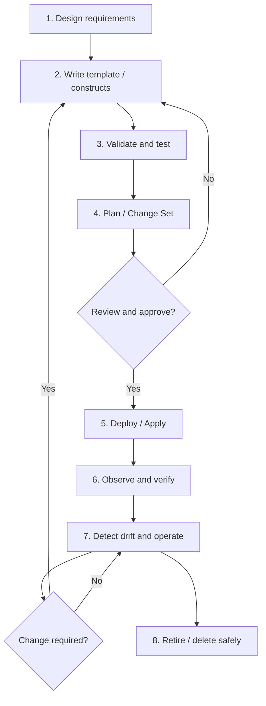
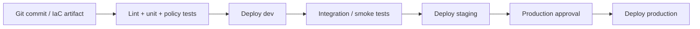

# Infrastructure as Code Principles and Stack Lifecycle

## 1. Why Do We Need Infrastructure as Code?

A Java application needs a VPC, subnets, security groups, IAM roles, an ECS service, a load balancer, a DynamoDB table, and CloudWatch alarms. If each environment is created manually through the console, dev, staging, and production configurations can easily diverge. Operators might forget to enable encryption, open a security group too broadly, or create a resource in the wrong Region. When recovering an environment after an incident, the team has to recall every manual step that was performed.

**Infrastructure as Code (IaC)** is the practice of describing infrastructure in files that can be stored in version control, reviewed, tested, and deployed with automated tools. Instead of memorizing a sequence of console clicks, the team defines resources, configurations, dependencies, and desired policies in code.

On AWS, IaC is commonly implemented using:

- **AWS CloudFormation:** an AWS service that manages resources using templates and stacks.
- **AWS Cloud Development Kit (CDK):** describes infrastructure using programming languages; CDK synthesizes into CloudFormation templates.
- **Terraform:** a HashiCorp IaC tool that uses providers and state to manage multiple types of infrastructure, including AWS.
- Other tools such as AWS SAM, eksctl, or specialized frameworks can complement workflows for specific workload types.

This lesson belongs to the **Infrastructure as Code** chapter of the **CLOUD_PROVIDERS_AWS** module. The module explores Regions/AZs, IAM, VPC, compute, storage, database, integration, and serverless; learners need to know how to choose services, design, and deploy applications that are secure, observable, recoverable, and cost-controlled. IaC connects these components into a system that can be reproduced and managed across its lifecycle.

After this lesson, you will be able to:

- Explain the principles of desired state, repeatability, idempotency, versioning, and review.
- Distinguish between imperative and declarative infrastructure.
- Split infrastructure into modules/stacks by ownership and lifecycle.
- Describe the stack lifecycle from design, deployment, updates, and drift detection to rollback/deletion.
- Choose CloudFormation, CDK, or Terraform for an AWS use case.
- Use change sets, plans, outputs, dependencies, and state safely.
- Design an IaC pipeline with testing, approvals, least privilege, and an audit trail.

## 2. What Is IaC?

IaC turns infrastructure configuration into a **reviewable and reusable artifact**. That artifact can be a YAML/JSON template, HCL, Java/TypeScript/Python code, or a structure defined by a specialized framework.

For example, instead of going into the console to create an S3 bucket and then enabling versioning and blocking public access, you declare those properties in a template. A pipeline can create the same configuration across multiple accounts/Regions using controlled parameters.

### 2.1. What Should Be Managed by Code

IaC is not just about creating an EC2 instance. It can manage:

| Category | Example AWS Resources |
| --- | --- |
| Network | VPC, subnet, route table, NAT gateway, VPC endpoint |
| Identity & security | IAM roles/policies, KMS keys, security groups |
| Compute | EC2, Auto Scaling, ECS, EKS, Lambda |
| Storage | S3 buckets, EBS volumes, EFS |
| Data | DynamoDB tables, RDS/Aurora resources |
| Integration | SQS, SNS, EventBridge, API Gateway |
| Observability | CloudWatch alarms, dashboards, log groups |
| Delivery | CodePipeline, CodeBuild, deployment roles |

Not all business data should be managed as infrastructure. IaC primarily manages **platform resources and configurations**; user data, runtime secrets, and transactional data require separate lifecycle, backup, and retention mechanisms.

### 2.2. Infrastructure as Code vs. Application Configuration

| Infrastructure configuration | Application configuration |
| --- | --- |
| VPC CIDR, subnet, route table | Service API endpoint |
| ECS task/service, desired count | Feature flags, business rules |
| IAM role/policy | Java application properties |
| DynamoDB table/index | Mapping classes and repository code |
| KMS key, S3 encryption | How the application encrypts payloads before storing |

The two layers can connect: IaC creates the DynamoDB table and grants IAM permissions; the Java application uses the provisioned table name/role. Do not embed credentials in application config simply because a resource was created by IaC.

## 3. Core Principles

### 3.1. Desired State: Describing the Target State

In the declarative model, the author describes the **expected outcome**: a bucket named according to convention, versioning enabled, encryption using a specified key, and public access blocked. The tool compares the desired configuration against the current state and decides whether to create, modify, or replace the resource.

Example desired state for an S3 bucket:

```yaml
Resources:
  ArtifactBucket:
    Type: AWS::S3::Bucket
    Properties:
      VersioningConfiguration:
        Status: Enabled
      PublicAccessBlockConfiguration:
        BlockPublicAcls: true
        IgnorePublicAcls: true
        BlockPublicPolicy: true
        RestrictPublicBuckets: true
      BucketEncryption:
        ServerSideEncryptionConfiguration:
          - ServerSideEncryptionByDefault:
              SSEAlgorithm: AES256
```

The template describes the resource's properties. CloudFormation is responsible for creating/updating resources according to the dependency graph and service APIs.

### 3.2. Declarative vs. Imperative

**Declarative** answers "what should the final infrastructure look like?". **Imperative** describes "what steps should be run to create the infrastructure?".

| Criterion | Declarative | Imperative |
| --- | --- | --- |
| Description | Desired state | Sequence of operations |
| Examples | CloudFormation, Terraform, most CDK workflows after synth | AWS CLI/SDK scripts calling Create/Update/Delete directly |
| Dependency | Tool analyzes the graph from declarations | Author usually has to order steps manually |
| Reconciliation | Can compare desired/current state | Script must check state itself |
| Best suited for | Long-lived infrastructure needing review/repeatability | Bootstrapping, one-off tasks, or specialized automation |

Imperative is not always wrong. A script can be appropriate for migrations or operations not supported by an IaC tool. However, the script must handle retries, partial failures, idempotency, and cleanup; otherwise, re-running it may create duplicates or leave orphaned resources.

### 3.3. Repeatability and Consistency

A deployment is considered repeatable when the same source, parameters, tool versions, and assumptions produce equivalent infrastructure. To achieve this:

- Pin tool/provider/library versions.
- Store templates and modules in version control.
- Manage environment-specific values through controlled parameters/context.
- Avoid depending on local machine state or undocumented console actions.
- Separate resource names/IDs by account, Region, and environment.
- Document intentional changes and upgrade paths.

Repeatability does not mean every environment must have the same size or account ID; they need the **same rules and structure**, with reviewed parameter differences.

### 3.4. Idempotency

An idempotent operation can be executed repeatedly without changing the final outcome after the first successful run. Declarative IaC aims for this property: deploying the same desired state should not create a new bucket on every run.

However, not every API/construct/script is idempotent in the same way. Some resources have unique physical names, replacement semantics, or custom resources with side effects. Check behavior on retries and avoid injecting new random values on every synth unless intentional.

### 3.5. Version Control and Review

IaC code is production code. Every change requires:

- A clear pull request/diff.
- Review of security, networking, data retention, and cost.
- Linter checks, static analysis, policy checks, and tests.
- Change set/plan before applying.
- Approval for production environments and changes with a large blast radius.
- Auditability of who made the change, who approved it, and which deployment created the resource.

Do not modify production directly in the console and forget to update IaC. Out-of-band changes create **configuration drift** and make the source of truth unreliable.

### 3.6. Reuse, Modularity, and Separation of Concerns

Split infrastructure into modules/stacks along meaningful boundaries:

- Ownership: which team is responsible?
- Lifecycle: are resources created/updated/deleted together?
- Security boundary: can permissions and blast radius be isolated?
- Dependency: which module needs outputs from which module?
- Change frequency: does foundational networking change less often than application services?

Avoid both extremes: a monolithic stack that is hard to update, and hundreds of tiny stacks that create complex dependencies. A good module has a clear interface, stable parameters/outputs, and does not depend on internal resource names of other modules.

### 3.7. Immutable Infrastructure and Controlled Replacement

**Immutable infrastructure** favors replacing instances/containers/resources with newly tested versions instead of SSHing into production machines and editing them by hand. For example, ECS deploys a new task definition revision, and Auto Scaling replaces EC2 instances from a new launch template.

Not every resource can be safely replaced. Databases, S3 buckets, and KMS keys hold long-lived data with special lifecycles. You must check `Update requires: Replacement`, deletion policies, snapshots, retention, and migration strategies before changing properties that can replace a physical resource.

## 4. IaC Lifecycle and Stack Lifecycle

A stack is typically a collection of resources managed together. In CloudFormation, a **stack** is the unit of resource management from a template. In Terraform, the term stack is not the default state unit like in CloudFormation; a **root module/workspace and state** usually defines the management scope. In CDK, a stack is a construct synthesized into a CloudFormation stack.

General lifecycle:



### 4.1. Design

Before writing a template, define:

1. Business requirements and SLOs.
2. Account, Region, environment, and ownership.
3. Resource types, dependencies, and network topology.
4. Security boundaries, IAM roles, encryption, and secret handling.
5. Availability, backup, recovery, and data retention.
6. Cost model, scaling, and limits.
7. Migration, rollback, and deletion behavior.

A template can deploy cleanly from a technical standpoint yet still be architecturally flawed if CIDRs overlap, resources are publicly exposed, IAM uses wildcards, databases lack backups, or NAT gateways exceed budget.

### 4.2. Author

Write templates/constructs/modules with meaningful parameters, mappings, conditions, outputs, dependencies, and tags. Logical IDs and module interfaces should be stable because they can affect resource identity/state tracking.

### 4.3. Validate and Test

Before creating resources:

- Format/lint the template or HCL.
- Validate syntax/schema.
- Unit test helper functions/constructs.
- Synthesize CDK and review the CloudFormation template.
- Run static security/policy checks.
- Run plan/change set and review replacements/deletions.
- Test in a sandbox for resource/API behaviors that need verification.

Syntax validation does not prove that the configuration has the right IAM permissions, meets SLOs, or avoids unexpected costs.

### 4.4. Plan and Approval

A plan/change set shows the difference between the desired state and the current state. Reviewers should check:

- Which resources will be created, updated, replaced, or deleted.
- Which properties are changing.
- Whether there will be downtime or data loss.
- Whether public exposure, IAM trust, routes, or encryption are changing.
- Whether cost will increase significantly.
- Whether a maintenance window, backup, or migration is required.

If the tool cannot predict the exact impact (for example, custom providers/APIs or runtime conditions), document the uncertainty and test in a production-like environment.

### 4.5. Deploy and Observe

Deploy in dependency order; wait for completion status; check health and application integration. Verify actual resources via CloudFormation events, Terraform output/state, and AWS service APIs. A stack in `CREATE_COMPLETE` does not guarantee the application works properly: an ECS task might crash, a target group might be unhealthy, or an IAM role might lack runtime permissions.

### 4.6. Update, Rollback, and Retire

Update the template, generate a new plan/change set, review, deploy, and verify. When an update fails, identify which resources were modified and check the rollback state. Before deleting a stack, distinguish ephemeral resources from resources holding data/keys that must be preserved; apply retention/snapshot/migration according to policy.

## 5. Stack, Resource, Logical ID, and Physical ID

In CloudFormation:

- **Template:** the specification of resources and desired configuration.
- **Stack:** an instance deployed from a template in a specific account/Region.
- **Resource:** an AWS resource managed by the stack.
- **Logical ID:** the resource identifier within the template.
- **Physical ID:** the actual resource identifier assigned by AWS or specified by the user.
- **Parameters:** input values provided when creating/updating a stack.
- **Outputs:** output values such as VPC ID, bucket name, or load balancer DNS.
- **Events:** history of create/update/delete progress and errors.

For example, the same template `network.yaml` can be deployed as stacks `dev-network` and `prod-network` in different accounts/Regions. The logical ID `AppVpc` is the same, while the physical VPC IDs differ.

### 5.1. Stable Logical IDs

Changing a logical ID can cause CloudFormation to treat the old resource as deleted and the new resource as needing creation, rather than updating the existing resource. For stateful resources, this can cause replacement or accidental data deletion if no deletion policy protects it. Refactoring templates must inspect resource identity and use resource import/migration when needed.

### 5.2. Stack Boundaries

For example, a platform might be split into:

| Stack | Contents | Lifecycle |
| --- | --- | --- |
| `network` | VPC, subnets, routes, endpoints | Long-lived, infrequent changes |
| `security` | Shared KMS/IAM baseline | Long-lived, security ownership |
| `data` | DynamoDB/RDS/S3 data resources | Long-lived, strict retention |
| `application` | ECS/Lambda/API Gateway | Follows application releases |
| `observability` | Alarms, dashboards, log configuration | Follows platform/service |

This is only an organizational example; the number of stacks and boundaries depend on ownership, coupling, and deployment frequency.

## 6. Dependencies and Outputs

The IaC engine needs to know which resources must exist before others. For example, an ECS service needs a cluster, task definition, and network; a route table association needs a subnet and route table.

### 6.1. Dependency Graph

CloudFormation infers many dependencies from `Ref`, `Fn::GetAtt`, and other intrinsic functions. You can declare `DependsOn` when a specific ordering is needed that template references do not express. Terraform builds the graph from references between resources/data sources.

Do not add unnecessary manual dependencies: they can reduce parallel deployment capability and increase coupling.

### 6.2. Outputs and Cross-Stack References

CloudFormation Outputs expose values for operators or other stacks to consume:

```yaml
Outputs:
  VpcId:
    Description: VPC identifier for application stacks
    Value: !Ref AppVpc
    Export:
      Name: platform-network-vpc-id
```

Consumer stacks can import exported values using `Fn::ImportValue`. This creates a dependency between stacks: the exporting stack cannot be deleted or have its export name changed while another stack is importing it. For large systems, consider clear interfaces, parameter passing, or a registry instead of creating too many rigid cross-stack exports.

### 6.3. Parameters, Mappings, and Conditions

- **Parameters:** input values such as environment, CIDR, instance type.
- **Mappings:** static lookups, such as AMI IDs by Region/architecture (when the update workflow is appropriate).
- **Conditions:** enable/disable resources or properties based on environment/parameters.
- **Outputs:** publish required IDs/ARNs/endpoints.

Do not use parameters to pass plaintext secrets into a template if you can securely reference Secrets Manager/SSM Parameter Store instead.

## 7. CloudFormation Stack Lifecycle

CloudFormation manages resources in a stack using a template. Each stack belongs to a single AWS account and Region; to deploy across other Regions/accounts, create corresponding stacks or use StackSets.

### 7.1. Creating a Stack

Basic workflow:

1. Prepare the YAML/JSON template.
2. Validate the template.
3. Choose the account, Region, stack name, and parameters.
4. Select required capabilities (e.g., IAM resources with custom names).
5. Create the stack and monitor events.
6. Verify resources and outputs after the stack completes.

CLI example:

```bash
aws cloudformation validate-template \
  --template-body file://network.yaml \
  --region ap-southeast-1

aws cloudformation create-stack \
  --stack-name dev-network \
  --template-body file://network.yaml \
  --parameters ParameterKey=Environment,ParameterValue=dev \
  --region ap-southeast-1

aws cloudformation describe-stacks \
  --stack-name dev-network \
  --region ap-southeast-1
```

If the template contains IAM resources, you must specify the appropriate capability such as `CAPABILITY_IAM` or `CAPABILITY_NAMED_IAM` depending on the resource types. Large templates can be uploaded to S3 and passed via `--template-url`. Do not run `create-stack` on a production account without reviewing the template/parameters.

### 7.2. Common Stack Statuses

| Status | Meaning |
| --- | --- |
| `CREATE_IN_PROGRESS` | Creating stack/resources |
| `CREATE_COMPLETE` | Stack created successfully |
| `CREATE_FAILED` | Creation failed; may transition to rollback |
| `ROLLBACK_IN_PROGRESS` | Reverting changes that can be rolled back |
| `ROLLBACK_COMPLETE` | New stack rolled back to an undeployed state |
| `UPDATE_IN_PROGRESS` | Updating stack |
| `UPDATE_COMPLETE` | Update succeeded |
| `UPDATE_ROLLBACK_IN_PROGRESS` | Rolling back a failed update |
| `UPDATE_ROLLBACK_COMPLETE` | Update failed, rollback completed |
| `UPDATE_ROLLBACK_FAILED` | Update rollback failed, intervention required |
| `DELETE_IN_PROGRESS` | Deleting stack/resources |
| `DELETE_COMPLETE` | Stack deleted |

Some statuses include suffixes such as `_CLEANUP_IN_PROGRESS`, `_CLEANUP_COMPLETE`, `_FAILED`, or other specialized statuses depending on the operation. Inspect `describe-stacks` and stack events to identify the exact failing resource; do not rely solely on the final status name.

### 7.3. Updating a Stack

Modify the template or parameters and invoke an update. CloudFormation computes resource actions, updates in dependency order, and emits events:

```bash
aws cloudformation update-stack \
  --stack-name dev-network \
  --template-body file://network.yaml \
  --parameters ParameterKey=Environment,UsePreviousValue=true \
  --region ap-southeast-1
```

If there are no changes, CloudFormation may report that no updates are to be performed. Updating certain properties can **modify in-place**, whereas other properties require **replacement**; check the resource specification and change set before running.

### 7.4. Change Sets

A **change set** lets you preview the impact of a stack update/create-import operation before executing it. It shows which resources will be Added/Modified/Removed and replacement behavior according to what CloudFormation can determine.

```bash
aws cloudformation create-change-set \
  --stack-name dev-network \
  --change-set-name review-network-update \
  --template-body file://network.yaml \
  --parameters ParameterKey=Environment,UsePreviousValue=true \
  --change-set-type UPDATE \
  --region ap-southeast-1

aws cloudformation describe-change-set \
  --stack-name dev-network \
  --change-set-name review-network-update \
  --region ap-southeast-1
```

After review and approval:

```bash
aws cloudformation execute-change-set \
  --stack-name dev-network \
  --change-set-name review-network-update \
  --region ap-southeast-1
```

A change set **does not guarantee that every runtime outcome will be predicted accurately**. Custom resources, replacement constraints, quotas, and external conditions can still cause the operation to fail.

### 7.5. Rollback and Failure Handling

When creation/update fails, CloudFormation can roll back resources that can be reverted. However:

- Some external side effects (emails, payments, custom resources) are not automatically reversed.
- Resource replacement may have already created a new resource before deleting the old one.
- Database migrations or data changes do not automatically roll back like a property.
- `UPDATE_ROLLBACK_FAILED` may require fixing the root cause, retrying rollback, or skipping resources per CloudFormation guidance.

Before deploying stateful changes, you must have backups, a migration/compatibility plan, and a data recovery strategy. **Rolling back a template does not mean rolling back data.**

## 8. Drift Detection and Managing Out-of-Band Changes

**Drift** occurs when a resource's actual configuration differs from the configuration desired by the stack/template. For example, someone edits security group ingress in the console, changes an S3 bucket policy, or disables logging without updating code.

### 8.1. Why Is Drift Dangerous?

- The template no longer reflects the running state.
- The next deployment may overwrite manual changes or cause conflicts.
- Security baselines are broken without code review visibility.
- Recovery/rebuilding from IaC produces an environment different from production.
- Incident investigation becomes harder because version control does not fully describe the actual state.

### 8.2. CloudFormation Drift Detection

CloudFormation supports drift detection for supported resource types/properties. You can run:

```bash
aws cloudformation detect-stack-drift \
  --stack-name dev-network \
  --region ap-southeast-1

aws cloudformation describe-stack-drift-detection-status \
  --stack-drift-detection-id DETECTION_ID \
  --region ap-southeast-1

aws cloudformation describe-stack-resource-drifts \
  --stack-name dev-network \
  --region ap-southeast-1
```

Results can be `IN_SYNC`, `MODIFIED`, `DELETED`, `NOT_CHECKED`, or other detection statuses. `NOT_CHECKED` does not mean the resource is definitely free of drift; the resource type/property may not be supported or may not have been checked yet.

### 8.3. Reconciling Drift

When drift is detected:

1. Identify who made the change, when, why, and the impact.
2. Evaluate whether the change is valid or an unauthorized change.
3. If the change is accepted, update the IaC source to reflect the new desired state.
4. If the change is not accepted, create a plan/change set to bring the resource back to the standard configuration.
5. Check data impact, replacement, outage, and security before reconciling.
6. Add guardrails to reduce out-of-pipeline changes.

Do not automatically run a deployment immediately after detecting drift without understanding the reason. A manual change might be an intentional hotfix during an incident; record it and bring it back into the source of truth through review.

### 8.4. Drift in Terraform

Terraform compares configuration with state, and the provider reads remote state during refresh/plan. `terraform plan` typically detects many out-of-band changes; however, providers cannot read or compare every attribute of every resource. Drift detection depends on provider schema, APIs, and refresh behavior.

Do not confuse drift with a resource modified in code that has not yet been applied: that is a **configuration change** awaiting plan/apply. Drift is the discrepancy between remote infrastructure and managed state/configuration.

## 9. Stack Deletion and Data Protection

Deleting a stack can delete the resources that the stack manages. For resources containing data, deletion/retention behavior must be defined before production.

### 9.1. DeletionPolicy

CloudFormation `DeletionPolicy` controls behavior when a resource is removed from a stack or the stack is deleted:

| Policy | Meaning |
| --- | --- |
| `Delete` | Deletes the resource (default behavior for many resource types) |
| `Retain` | Keeps the resource and does not delete it with the stack |
| `Snapshot` | Creates a snapshot before deletion for supported resource types |

Example of retaining an S3 bucket:

```yaml
Resources:
  DataBucket:
    Type: AWS::S3::Bucket
    DeletionPolicy: Retain
    UpdateReplacePolicy: Retain
    Properties:
      VersioningConfiguration:
        Status: Enabled
```

`DeletionPolicy` and `UpdateReplacePolicy` address two different scenarios: a resource being removed from a stack/stack deletion, and an old resource being replaced during an update. Both should be configured when old data must be preserved during replacement.

### 9.2. Retain Is Not Backup

`Retain` keeps the resource, but does not ensure its contents are protected against corruption, ransomware, accidental overwrites, or service-level deletion. Data requires appropriate backup/PITR/versioning/replication and restore drills.

For S3, retaining a bucket does not mean retaining every object if lifecycle rules or the application delete objects. For RDS, `Snapshot` must be evaluated alongside backup retention and restore capability. For KMS keys, scheduling deletion can render data undecryptable if the key is deleted.

### 9.3. Stack Deletion Protection and Termination Protection

CloudFormation **termination protection** can prevent accidental stack deletion. It does not replace `DeletionPolicy`, backups, or IAM permissions. Enable it for critical stacks and require a clear procedure when retirement is needed.

### 9.4. Safe Retirement Procedure

1. Identify resources holding data, keys, DNS, or shared networking.
2. Confirm consumers/dependencies have been migrated away.
3. Export/back up data according to policy and test restoring it.
4. Review the deletion plan/change set and Retain/Snapshot policies.
5. Obtain approval from data and platform owners.
6. Delete stacks in dependency order.
7. Check for orphaned resources, retained resources, cost, and access policies after deletion.

## 10. Nested Stacks, StackSets, and Multiple Environments

### 10.1. Nested Stacks

A nested stack allows a CloudFormation stack to invoke another template as an `AWS::CloudFormation::Stack` resource. This works well when reusing a group of resources whose lifecycle is tied to the parent stack or splitting large templates into more readable parts.

Do not overuse nested stacks to split every small resource: parent-child lifecycles and outputs can complicate troubleshooting. Child templates must be uploaded to a location accessible by CloudFormation (typically an S3 URL) in an appropriate workflow.

### 10.2. StackSets

**CloudFormation StackSets** deploy the same stack template across multiple accounts and Regions. Use them for baselines such as IAM roles, Config rules, CloudTrail organization setup, or shared security controls.

StackSets fit well when:

- Multiple accounts must share the same baseline.
- The organization/team wants controlled rollouts.
- Centralized management of deployment targets and operation preferences is needed.

Designing StackSets requires reviewing the permissions model (service-managed or self-managed), delegated administrator, concurrency/failure tolerance, and account enrollment. Do not deploy every application stack via StackSets simply because you have multiple accounts; application lifecycles can differ from baselines.

### 10.3. Environment Promotion

A pipeline can promote the same artifact across dev → test → staging → production:



Each environment has its own parameters/roles; artifact and tool versions are pinned to reduce discrepancies. Production approval should be based on the diff/change set, test evidence, security/cost review, and maintenance window.

## 11. AWS Cloud Development Kit (CDK)

AWS CDK lets you describe infrastructure using familiar languages such as TypeScript, Python, Java, C#, or Go. CDK code is **synthesized** into a CloudFormation template; CloudFormation performs the deployment and manages the stack lifecycle.

Basic flow:

1. Write the CDK application and constructs.
2. Select account/Region via environment/context.
3. Run synth to generate the CloudFormation template.
4. Review the template and diff.
5. Bootstrap the environment if needed.
6. Deploy the CDK stack; CloudFormation creates/updates resources.

### 11.1. App, Stack, and Construct

| Concept | Role |
| --- | --- |
| `App` | Root of the CDK application |
| `Stack` | Deployment unit corresponding to a CloudFormation stack |
| `Construct` | Building block describing one or more resources |
| L1 construct (`Cfn...`) | Nearly direct mapping to a CloudFormation resource |
| L2 construct | Abstraction with convenient defaults, methods, and validation |
| L3 pattern | Pattern combining multiple resources for a use case |

CDK abstractions reduce boilerplate, but authors still must understand CloudFormation resource properties and security implications. L2 defaults do not replace review.

### 11.2. Java CDK Example

Example creating an S3 bucket with versioning and block public access:

```java
import software.amazon.awscdk.App;
import software.amazon.awscdk.Stack;
import software.amazon.awscdk.StackProps;
import software.amazon.awscdk.services.s3.Bucket;
import software.amazon.awscdk.services.s3.BucketEncryption;
import software.amazon.awscdk.services.s3.BlockPublicAccess;

public class StorageStack extends Stack {
    public StorageStack(final App scope, final String id) {
        this(scope, id, null);
    }

    public StorageStack(
            final App scope,
            final String id,
            final StackProps props) {
        super(scope, id, props);

        Bucket.Builder.create(this, "Artifacts")
                .versioned(true)
                .blockPublicAccess(BlockPublicAccess.BLOCK_ALL)
                .encryption(BucketEncryption.S3_MANAGED)
                .build();
    }

    public static void main(String[] args) {
        App app = new App();
        new StorageStack(app, "StorageStack");
        app.synth();
    }
}
```

This is a minimal construct example; Java CDK dependencies and project bootstrap must be configured according to the CDK v2 version in use. `S3_MANAGED` corresponds to SSE-S3; if policy requires a customer-managed KMS key, choose the appropriate encryption mode and key policy. The bucket can be created with a CloudFormation-generated physical name if `bucketName` is not specified.

### 11.3. synth, diff, bootstrap, and deploy

Common CLI commands:

```bash
cdk synth
cdk diff StorageStack
cdk bootstrap aws://111122223333/ap-southeast-1
cdk deploy StorageStack
cdk destroy StorageStack
```

- `cdk synth`: generates the CloudFormation template from the CDK app.
- `cdk diff`: compares the synthesized template with the deployed stack.
- `cdk bootstrap`: provisions bootstrap resources in the account/Region for CDK deployment assets/roles according to the bootstrap template.
- `cdk deploy`: deploys the stack through CloudFormation.
- `cdk destroy`: requests stack deletion; review retention and deletion policies before using.

Bootstrapping creates resources that support deployments, which can include an S3 asset bucket and IAM roles. Review the bootstrap template, trust policy, and execution permissions; do not grant unbounded admin permissions just to run CDK.

### 11.4. CDK Context and Reproducibility

CDK uses context lookups for environment information such as VPCs, hosted zones, or availability zones. Context can be cached in `cdk.context.json`. Commit required context files to version control and review them when refreshing lookups; if synth depends on different data on each machine, templates may not reproduce consistently.

Pin CDK library/CLI versions and use the same toolchain in CI. Do not call external APIs or generate random physical IDs during synth without a deterministic rule.

## 12. Terraform on AWS

Terraform describes resources in HCL and uses the AWS provider to call AWS APIs. Unlike CloudFormation, Terraform manages the mapping between configuration and remote objects via **state**. State is critical data: it stores resource addresses, IDs, and attributes needed to compute plans/updates.

### 12.1. HCL Example Creating an S3 Bucket

```hcl
terraform {
  required_version = ">= 1.10.0"
  required_providers {
    aws = {
      source  = "hashicorp/aws"
      version = "~> 5.0"
    }
  }
}

provider "aws" {
  region = "ap-southeast-1"
}

resource "aws_s3_bucket" "artifacts" {
  bucket_prefix = "shop-artifacts-"
}

resource "aws_s3_bucket_versioning" "artifacts" {
  bucket = aws_s3_bucket.artifacts.id

  versioning_configuration {
    status = "Enabled"
  }
}

resource "aws_s3_bucket_server_side_encryption_configuration" "artifacts" {
  bucket = aws_s3_bucket.artifacts.id

  rule {
    apply_server_side_encryption_by_default {
      sse_algorithm = "AES256"
    }
  }
}

resource "aws_s3_bucket_public_access_block" "artifacts" {
  bucket                  = aws_s3_bucket.artifacts.id
  block_public_acls       = true
  ignore_public_acls      = true
  block_public_policy     = true
  restrict_public_buckets = true
}
```

The example pins the major provider version via constraints; in production, control exact versions in the lock file and an upgrade process. The bucket name is generated via prefix to avoid global name collisions; do not assume the actual name will be identical across every environment.

### 12.2. init, validate, plan, and apply Workflow

```bash
terraform init
terraform fmt -check
terraform validate
terraform plan -out=tfplan
terraform show tfplan
terraform apply tfplan
```

- `init`: downloads providers/modules and initializes the backend.
- `fmt`: standardizes formatting.
- `validate`: checks configuration structure/validity.
- `plan`: computes planned actions.
- `show`: reviews the saved plan.
- `apply`: executes the exact saved plan that was approved.

Do not run `terraform apply -auto-approve` in a production pipeline without an approval gate and policy checks. Saved plans can contain sensitive values; protect the artifact and delete it according to retention policy.

### 12.3. State and Backend

Terraform state must be stored securely and shared in a controlled manner when multiple people/pipelines manage an environment. A common remote backend on AWS is S3:

```hcl
terraform {
  backend "s3" {
    bucket       = "company-terraform-state"
    key          = "platform/network/terraform.tfstate"
    region       = "ap-southeast-1"
    encrypt      = true
    use_lockfile = true
  }
}
```

The backend bucket must be created/bootstrapped before Terraform uses it; do not make the state bucket depend on the very state it stores unless you have a bootstrap strategy. Enable versioning, encryption, Block Public Access, appropriate access logging/monitoring, and IAM least privilege. `use_lockfile` uses the S3 backend locking mechanism in supported Terraform versions; pin the tool version and follow current backend documentation.

**Do not commit state to Git.** State can contain sensitive resource attributes, connection strings, generated passwords, or internal metadata, even if outputs do not display them. Protect the backend like a critical secrets store.

### 12.4. State Locking and Concurrent Applies

Allow only one writer to modify the same state at a time. Locking prevents two pipelines from writing state concurrently and corrupting the mapping. If a lock remains held after a crash, check the owner/process and only force-unlock when certain the previous operation has stopped; reckless force-unlocking can cause corruption.

### 12.5. Drift and State Operations

Commands to understand:

```bash
terraform plan
terraform plan -refresh-only
terraform apply -refresh-only
terraform state list
terraform state show aws_s3_bucket.artifacts
terraform import aws_s3_bucket.artifacts example-existing-bucket
```

`terraform plan` refreshes remote objects according to provider behavior before proposing actions. `terraform plan -refresh-only` only creates a plan to review differences; run `terraform apply -refresh-only` if you want to record remote changes into state **without modifying infrastructure**. `terraform import` associates an existing resource with state; a matching resource block is needed, and the plan should be reviewed after import.

`terraform state` commands can affect critical mappings. Do not use `state rm`, `mv`, `replace-provider`, or force-unlock without understanding the impact and backing up state.

### 12.6. Modules and Workspaces

- **Module:** packages resources/variables/outputs for reuse.
- **Root module:** the configuration directory from which Terraform runs.
- **Workspace:** separates state instances for the same configuration within a backend.

Workspaces are useful for similar environments, but do not automatically provide security/account isolation. For production/dev with differing ownership, permissions, or lifecycles, separate root modules/backends/keys and separate pipeline roles can be used.

## 13. Comparing CloudFormation, CDK, and Terraform

| Criterion | CloudFormation | AWS CDK | Terraform |
| --- | --- | --- | --- |
| Description language | YAML/JSON | Java/TypeScript/Python/C#/Go | HCL |
| AWS deployment engine | CloudFormation | Synthesizes to CloudFormation | Terraform core + AWS provider |
| State tracking | CloudFormation stack/resource metadata | CloudFormation stack/resource metadata | Terraform state |
| Preview | Change sets | `cdk diff` and CloudFormation change set on deploy | `terraform plan` |
| Abstraction | Direct resource templates | Constructs/patterns | Modules/providers/resources |
| Multi-cloud | AWS-focused | Primarily AWS (can use other construct ecosystems) | Multiple providers |
| Drift | CloudFormation drift detection per resource support | Uses CloudFormation drift detection | Plan/refresh per provider |
| Best fit for | AWS-native stack lifecycle, governance | Teams preferring programming languages and constructs | Teams needing the provider ecosystem and state workflow |

There is no single best tool for every organization. The choice depends on:

- AWS-only or multi-cloud/multi-platform?
- Does the team already have skills in Java/TypeScript, YAML, or HCL?
- Does governance require CloudFormation-native deployment or a provider workflow?
- Who owns state, backends, credentials, and upgrades?
- What are the existing module ecosystem, policy checks, and CI/CD setup?
- How does the organization need to import/adopt existing resources?

Avoid managing **the same resource with two IaC engines** at the same time. CloudFormation and Terraform can coexist in an account if resource boundaries are clear; if both believe they own the same bucket/security group, updates/deletions can cause drift or data loss.

## 14. CI/CD Pipeline for IaC

An IaC pipeline turns infrastructure changes into a reviewable and auditable process. A good pipeline separates **code checks**, **plan generation**, **approval**, and **execution**; production deployments use a dedicated role with least privilege.

### 14.1. Pipeline Stages

| Stage | Purpose | Examples |
| --- | --- | --- |
| Source | Fetch reviewed commit/tag | Git repository |
| Format/lint | Standardize and catch syntax/style issues | cfn-lint, terraform fmt |
| Static policy | Detect risky configurations | IAM wildcards, public S3, unencrypted resources |
| Unit tests | Test constructs/helper functions | CDK assertions, module tests |
| Synthesize/validate | Generate template and validate schema | cdk synth, CloudFormation validate |
| Plan/change set | Inspect resource actions | terraform plan, CloudFormation change set |
| Approval | Review security/cost/blast radius | Pull request + production approval |
| Deploy | Execute saved plan/change set | CloudFormation/CDK/Terraform |
| Verify | Check stack status and app health | Smoke tests, CloudWatch, service APIs |
| Audit | Store evidence and results | Build logs, change set, commit SHA |

### 14.2. Separating Pipeline Permissions

Separate roles should exist for:

- **Plan/validation role:** reads resource state, reads state backend, synthesizes/validates; lacks permission to delete production resources unless needed.
- **Deploy role:** deploys stacks/resources only within the assigned account/Region/project scope.
- **Bootstrap/platform role:** manages bootstrap buckets, deployment roles, and shared infrastructure; broader permissions, used by fewer people, with approval.
- **Break-glass role:** used during incidents under a separate audit process, not for daily operations.

CI can obtain credentials via OIDC federation/STS instead of storing long-lived AWS access keys in repository secrets. Trust policies must restrict repository, branch, environment, and audience claims.

### 14.3. Reviewing Plans Like Code

A reviewer should check:

- Resource create/update/replace/delete actions.
- IAM policy changes, trust relationships, and public access.
- Network routes, ingress/egress, and endpoints.
- Encryption, backup, retention, and deletion behavior.
- Database replacement/migration and downtime.
- Estimated cost, quotas, and scaling limits.
- Whether changed outputs/exports affect consumer stacks.

Do not approve merely because the plan reports no errors. A plan shows what the tool intends to do; the reviewer still needs to verify the change matches requirements and is safe.

### 14.4. Promotion and Artifact Integrity

Ideally promote the **same source revision/artifact** across environments, changing parameters/credentials per environment. Record commit SHA, tool versions, provider lock file, plan/change set ID, and approval record. If CDK must be re-synthesized for a different context, review the synthesized template corresponding to each environment.

Do not let a developer laptop be the only place storing state/plans. Pipelines and backends need clear owners, backups, retention, and access controls.

## 15. Security and Policy as Code

IaC can build consistently secure infrastructure, yet a flawed template can replicate misconfigurations across many accounts. Security must be checked from design through runtime.

### 15.1. Secrets and Sensitive Values

- Never hardcode passwords, access keys, API tokens, or private keys in templates, HCL, CDK source, or Git.
- Use Secrets Manager or Systems Manager Parameter Store; templates reference dynamic references/secure parameters using supported mechanisms.
- Limit outputting sensitive values; CloudFormation outputs are not a secret store.
- Protect Terraform state, saved plans, CDK assets, and CI logs.
- Rotate credentials and audit access.

`NoEcho` on a CloudFormation parameter hides values in certain UIs/outputs, but **does not turn a template/parameter into a secret manager**; sensitive values can still appear in state, logs, or resource metadata if misused. Prefer runtime secret references.

### 15.2. Least Privilege and Role Separation

A deploy role might need `cloudformation:CreateStack`, `cloudformation:UpdateStack`, `Describe*`, `CreateChangeSet`, `ExecuteChangeSet`, along with service-specific permissions via a CloudFormation service role. Do not grant `AdministratorAccess` simply to avoid understanding required permissions. Review:

- Deployment role trust policy and source identity.
- CloudFormation service role (if used) and its permissions.
- IAM capabilities when templates create IAM resources.
- SCPs, permission boundaries, resource policies, and KMS key policies.
- Account/Region/resource ARN scope.

### 15.3. Guardrails

Guardrails can be enforced across multiple layers:

| Layer | Examples |
| --- | --- |
| Source review | PR review, CODEOWNERS, branch protection |
| Static policy | cfn-guard, Checkov, tfsec/Trivy, OPA policies |
| AWS governance | SCPs, AWS Config rules, CloudFormation Hooks |
| Runtime detection | CloudTrail, Security Hub, GuardDuty, Config |
| Preventive defaults | S3 Block Public Access, encryption, restricted SG rules |

Policy tools do not replace service-native controls. A linter may miss custom resources or lack business context; combine multiple layers and monitor false positives.

### 15.4. Region, Account, and Environment Safety

Before deploying, verify caller identity and target:

```bash
aws sts get-caller-identity
aws configure get region
```

In CI, role assumption and target account/Region should be passed explicitly. Deployment guards/approvals can be used to block commands targeting production by mistake. Do not trust profile names or environment variables without verifying the account ID and ARN.

## 16. Testing, Observability, and Cost Management

### 16.1. Multi-Layered Testing

| Test type | What to verify |
| --- | --- |
| Unit test | Helpers, naming, parameter validation, construct logic |
| Template/schema test | Valid template, correct resource properties/outputs |
| Policy test | No public buckets, no out-of-policy IAM wildcards |
| Integration test | Resources provision cleanly, endpoints/permissions work |
| Smoke test | Application is healthy after deployment |
| Drift check | Remote configuration does not diverge from desired state |
| Recovery test | Restore backups, redeploy, or roll back per runbook |

CDK provides assertions/testing utilities to verify synthesized CloudFormation templates. Terraform provides a test framework/module validation and supports policy-as-code in pipelines. CloudFormation template validation only checks structure; it does not replace deployment integration tests.

### 16.2. Stack Observability

Monitor:

- CloudFormation stack events, resource statuses, and rollback failures.
- Terraform pipeline exit codes, plan/apply logs, and backend lock errors.
- AWS CloudTrail to audit API calls.
- AWS Config/CloudFormation drift detection to find out-of-band changes.
- CloudWatch metrics/alarms for the health of provisioned resources.
- Deployment duration, failed change rate, rollback frequency, and recovery time.

Logs should include stack name, environment, Region, commit SHA, operation ID, and resource logical ID where possible; do not log secrets, state files, or full sensitive parameters.

### 16.3. Cost Controls

IaC is a cost-control checkpoint before resources are created:

- Review instance sizes, desired counts, and autoscaling min/max.
- Check NAT gateways, load balancers, VPC endpoints, and cross-AZ data transfer.
- Set retention/lifecycle rules for S3, logs, snapshots, and backups.
- Use standardized tags for owner, environment, application, and cost center.
- Set up budgets/alerts and review Cost Explorer after deployment.
- Limit long-running sandbox resources; clean up experimental resources per policy.

Plans/change sets generally do not provide an accurate billing forecast for the entire workload. Use pricing calculators, historical usage, and additional cost tooling; avoid assuming a small diff has no cost impact.

### 16.4. Recovery and Business Continuity

IaC can rebuild control plane resources, but it does not restore data on its own. A recovery plan must coordinate:

- IaC source and tool versions.
- State/backend backups and access recovery.
- Database backups/PITR, S3 versioning/replication, and KMS keys.
- DNS, certificates, secrets, and external dependencies.
- Deployment order, capacity/quotas, and Region availability.
- Runbooks, RTO/RPO, and restore tests.

Do not delete the state backend or key material when retiring a stack before confirming retention/recovery obligations.

## 17. Case Study: Deploying an Orders API with IaC

A team is building a Java Orders API on AWS. The system needs VPC private subnets, ECS Fargate, an Application Load Balancer, DynamoDB, an S3 invoice bucket, an IAM task role, and CloudWatch alarms.

### 17.1. Splitting Stacks by Lifecycle

| Stack | Resources | Rationale |
| --- | --- | --- |
| `network` | VPC, subnets, routes, VPC endpoints | Shared, changes infrequently |
| `data` | DynamoDB table, S3 bucket, KMS key | Stateful, separate retention/backup |
| `application` | ECS cluster/service, ALB, task definition | Changes with releases |
| `observability` | Log groups, alarms, dashboard | Service monitoring |

### 17.2. Deployment Flow

1. Platform team reviews CIDR, subnet layout, endpoints, and egress.
2. Security team reviews task role, execution role, KMS policy, bucket public access, and encryption.
3. CI runs lint, unit tests, template synth/validate, and policy checks.
4. Create a CloudFormation change set or Terraform plan; reviewers check replacement/deletion and cost.
5. Deploy network/data stacks first; retrieve outputs such as VPC ID, subnet IDs, and table name.
6. Deploy the application stack with validated references/parameters.
7. Run smoke tests: ALB health, ECS tasks, DynamoDB access, and S3 upload/download.
8. Record deployment evidence, commit SHA, and stack status.

### 17.3. A Risky Change

A developer changes the DynamoDB partition key design in IaC. The change set/plan reports resource replacement. Before approving, the team must:

- Identify existing data and the migration strategy.
- Create a backup/PITR restore point.
- Provision the new table, backfill, and verify records.
- Shift application traffic using a feature flag/dual-read or cutover plan.
- Retain the old table for the retention window before retiring it.

Do not let the tool delete the old table simply because a property changed. IaC manages resource lifecycles; data migration requires a separate controlled workflow.

### 17.4. Drift After a Hotfix

During an incident, an operator temporarily opens a security group rule to restore connectivity. After the incident, the IaC pipeline detects drift. The team verifies whether the rule is needed; if valid, they update the source and review it; if not, they create a change set/plan to restore the baseline. They also add alarms/policies to prevent similar rules from recurring.

## 18. Production IaC Deployment Checklist

1. **Desired state:** templates clearly express resource configuration and ownership.
2. **Repeatability:** pin tool/provider versions, parameters, and context.
3. **Idempotency:** verify retry behavior and avoid unintended random replacements.
4. **Modularity:** split stacks/modules by ownership, security boundary, and lifecycle.
5. **Dependencies:** declare clear references/outputs; avoid circular/cross-stack coupling.
6. **Preview:** always review change sets/plans, especially replacements/deletes.
7. **State:** protect Terraform backends, locking, versioning, and backups.
8. **Drift:** have detection, an owner, and a reconciliation process.
9. **Data protection:** Retain/Snapshot, backup/PITR, migration, and restore tests.
10. **Security:** least privilege, OIDC roles, secret references, policy checks.
11. **Multi-environment:** promote the same artifact with separate parameters and roles.
12. **Testing:** unit, template, policy, integration, smoke, and recovery tests.
13. **Observability:** stack events, CloudTrail, Config, metrics, and deployment audit.
14. **Cost:** tags, budgets, sizing, retention, and cost reviews.
15. **Retirement:** confirm dependencies, data owners, deletion policies, and orphan cleanup.

## 19. Self-Check Questions

**Question 1.** What problem does Infrastructure as Code solve?

**Hint:** Turns infrastructure configuration into a versioned/reviewed/tested artifact, making environments reproducible and reducing inconsistent manual changes.

**Question 2.** What is desired state?

**Hint:** The target infrastructure state described in a template/configuration; the tool computes actions to bring the current state to the desired state.

**Question 3.** How does declarative differ from imperative?

**Hint:** Declarative describes the outcome; imperative describes the step-by-step actions to take.

**Question 4.** Why does IaC need idempotency?

**Hint:** Retrying/redeploying the same configuration should not create duplicate resources or unintended side effects.

**Question 5.** What is a CloudFormation stack?

**Hint:** A template instance in an account/Region that manages a set of resources across their lifecycle.

**Question 6.** How do logical ID and physical ID differ?

**Hint:** The logical ID resides in the template; the physical ID is the actual resource identifier in AWS.

**Question 7.** Why can changing a logical ID be dangerous?

**Hint:** CloudFormation may treat the old resource as deleted and the new resource as needing creation, leading to replacement/data impact.

**Question 8.** Does a change set execute an update?

**Hint:** No. It previews actions; `execute-change-set` actually performs the execution.

**Question 9.** Does `CREATE_COMPLETE` prove the application is healthy?

**Hint:** No. Smoke/integration tests and workload health checks are still required.

**Question 10.** What is drift and how is it reconciled?

**Hint:** Remote resources differ from the desired state. Identify the cause, decide whether to accept or revert, update IaC, and review.

**Question 11.** Does `DeletionPolicy: Retain` replace backups?

**Hint:** No. Retain keeps the resource during stack deletion/replacement per policy, but does not protect against internal data corruption or deletion.

**Question 12.** How does `UpdateReplacePolicy` differ from `DeletionPolicy`?

**Hint:** One applies to the old resource during replacement; the other applies when a resource is removed from a stack or the stack is deleted.

**Question 13.** Which service actually deploys a `cdk deploy`?

**Hint:** CDK synthesizes a CloudFormation template; CloudFormation manages the deployment.

**Question 14.** What does Terraform state contain and why must it be protected?

**Hint:** Mapping of resource addresses/IDs/attributes; it can contain sensitive data and requires a remote backend, encryption, access control, and locking.

**Question 15.** How does `terraform plan` differ from `terraform apply`?

**Hint:** Plan computes proposed actions; apply executes the reviewed changes.

**Question 16.** Why should you not manage the same resource with both CloudFormation and Terraform?

**Hint:** Two engines can overwrite, delete, or drift each other's state; ownership must be clear.

**Question 17.** When are StackSets used?

**Hint:** Rolling out the same template to multiple accounts/Regions, typically for an organization-wide baseline.

**Question 18.** Why separate a data stack from an application stack?

**Hint:** Data lifecycles/retention differ from application releases; this reduces the risk of deleting or replacing data during app deployments.

**Question 19.** How does OIDC benefit an IaC pipeline?

**Hint:** Lets CI obtain temporary role credentials without storing long-lived access keys in the repository.

**Question 20.** Does rolling back a stack automatically roll back database data migrations?

**Hint:** No. Data migrations/side effects require separate backups, compatibility, compensation, and recovery workflows.

## 20. Key Takeaways

**Infrastructure as Code** describes infrastructure in code so it can be versioned, reviewed, tested, deployed, and recovered in a controlled way. Key principles include desired state, declarative management, repeatability, idempotency, modularity, least privilege, and immutable infrastructure where appropriate. IaC must manage resource dependencies, parameters, outputs, and lifecycles rather than merely creating resources.

**The stack lifecycle** moves from design → author → validate/test → plan/change set → approval → deploy → observe → drift detection/reconcile → update or retire. CloudFormation manages stack/resource lifecycles; CDK synthesizes into CloudFormation; Terraform uses providers and state. Change sets/plans preview actions but do not guarantee every runtime outcome.

**Protecting state and data is a production requirement.** Terraform state and saved plans can contain sensitive values; CloudFormation `DeletionPolicy`/`UpdateReplacePolicy` must be chosen based on data lifecycle; `Retain` does not replace backups. Drift must be investigated and reconciled back to the source of truth. Pipelines require OIDC/roles, least privilege, policy tests, approvals, auditing, observability, and cost reviews. IaC can recreate control plane resources, but data and side effects require separate backup, migration, idempotency, and recovery plans.

### AWS Documentation and Reference Tools

- [AWS CloudFormation — What is CloudFormation?](https://docs.aws.amazon.com/AWSCloudFormation/latest/UserGuide/Welcome.html)
- [AWS CloudFormation — Template anatomy](https://docs.aws.amazon.com/AWSCloudFormation/latest/UserGuide/template-anatomy.html)
- [AWS CloudFormation — Stack lifecycle and status codes](https://docs.aws.amazon.com/AWSCloudFormation/latest/UserGuide/using-cfn-describing-stacks.html)
- [AWS CloudFormation — Change sets](https://docs.aws.amazon.com/AWSCloudFormation/latest/UserGuide/using-cfn-updating-stacks-changesets.html)
- [AWS CloudFormation — Detect unmanaged configuration changes](https://docs.aws.amazon.com/AWSCloudFormation/latest/UserGuide/using-cfn-stack-drift.html)
- [AWS CloudFormation — DeletionPolicy attribute](https://docs.aws.amazon.com/AWSCloudFormation/latest/UserGuide/aws-attribute-deletionpolicy.html)
- [AWS CloudFormation — UpdateReplacePolicy attribute](https://docs.aws.amazon.com/AWSCloudFormation/latest/UserGuide/aws-attribute-updatereplacepolicy.html)
- [AWS CloudFormation — StackSets](https://docs.aws.amazon.com/AWSCloudFormation/latest/UserGuide/what-is-cfnstacksets.html)
- [AWS CDK — Developer Guide](https://docs.aws.amazon.com/cdk/v2/guide/home.html)
- [AWS CDK — Bootstrapping](https://docs.aws.amazon.com/cdk/v2/guide/bootstrapping.html)
- [AWS CDK — Testing constructs](https://docs.aws.amazon.com/cdk/v2/guide/testing.html)
- [AWS CDK — Environments](https://docs.aws.amazon.com/cdk/v2/guide/environments.html)
- [Terraform — AWS provider](https://registry.terraform.io/providers/hashicorp/aws/latest/docs)
- [Terraform — S3 backend](https://developer.hashicorp.com/terraform/language/backend/s3)
- [Terraform — State](https://developer.hashicorp.com/terraform/language/state)
- [Terraform — Plan and apply](https://developer.hashicorp.com/terraform/cli/run)
- [AWS Well-Architected Framework](https://docs.aws.amazon.com/wellarchitected/latest/framework/welcome.html)
- [AWS Prescriptive Guidance — Infrastructure as code](https://docs.aws.amazon.com/prescriptive-guidance/latest/choose-iac-tool/introduction.html)
