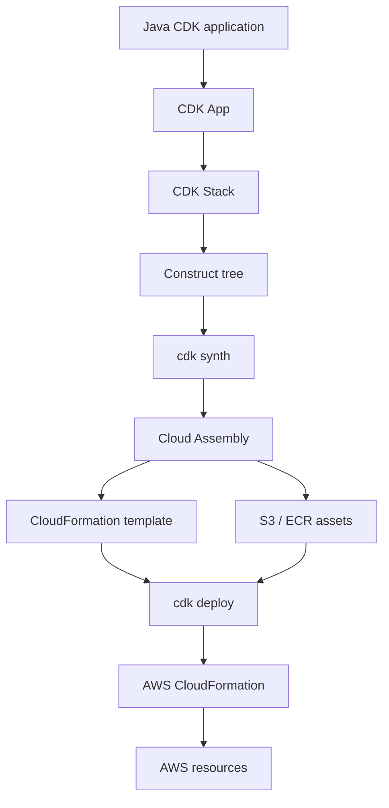
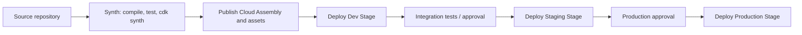
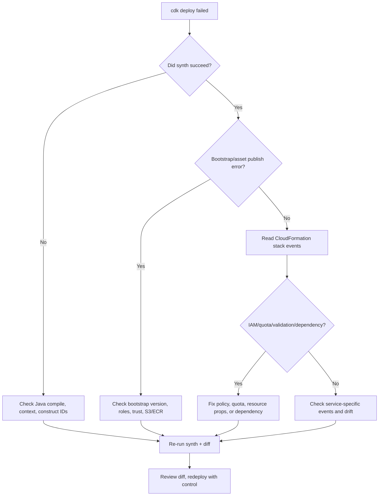

# AWS CDK Constructs, Stacks, Apps, and Deployment Environments

> **Chapter:** Infrastructure as Code · **Module:** `CLOUD_PROVIDERS_AWS`

## 1. From Source Code to AWS Infrastructure

A Java application on AWS might need a VPC, subnets, security groups, an ECS cluster, a load balancer, IAM roles, an S3 bucket, a database, and CloudWatch alarms. If each resource is created via the Console or ad-hoc commands, configurations easily drift across dev/staging/prod, changes are hard to review, and environments are difficult to rebuild after an incident.

**Infrastructure as Code (IaC)** describes infrastructure in files that can be version-controlled, reviewed, tested, and deployed repeatably. **AWS Cloud Development Kit (AWS CDK)** lets you describe infrastructure using programming languages such as Java, TypeScript, Python, C#, and Go. CDK compiles object/construct models into **CloudFormation templates**; CloudFormation creates, updates, and deletes AWS resources according to the dependency graph.

Basic flow:



CDK has three core concepts:

- **Construct:** a component describing one or more resources and related behavior.
- **Stack:** the CloudFormation deployment unit, defining the lifecycle boundary and most resource scoping.
- **App:** the root of the construct tree, grouping one or more stacks/stages and producing a Cloud Assembly when synthesized.

`cdk synth` only synthesizes the template/assembly; `cdk deploy` sends changes to AWS. Writing CDK code does not automatically provision resources in your account.

**Objectives after this lesson:**

1. Explain the Construct–Stack–App relationship and the construct tree.
2. Distinguish L1, L2, and L3 constructs.
3. Create a CDK application using Java and AWS CDK v2.
4. Split resources into stacks with sensible boundaries.
5. Specify account/Region and distinguish environment-specific from environment-agnostic stacks.
6. Understand context, tokens, assets, and Cloud Assembly.
7. Bootstrap accounts/Regions before deploying.
8. Organize stages for dev/staging/prod and deploy safely.
9. Use the CDK CLI to synth, diff, deploy, destroy, and troubleshoot.

## 2. AWS CDK v2 and Java Projects

### 2.1. What Is CDK v2?

AWS CDK v2 consolidates service constructs into the Java artifact `software.amazon.awscdk:aws-cdk-lib`; the constructs framework is provided via `software.constructs:constructs`. CDK v2 uses a single unified library version instead of managing numerous individual service packages like CDK v1.

Common components:

| Component | Role |
| --- | --- |
| AWS CDK CLI (`cdk`) | Initialize projects, list stacks, synth, diff, bootstrap, deploy, and destroy. |
| `aws-cdk-lib` | API constructs for AWS services and core CDK. |
| `constructs` | Base classes/interfaces for the construct tree. |
| Java JDK | Compile and run the CDK app. |
| Maven/Gradle | Manage dependencies and build the Java application. |
| CloudFormation | Provision and manage resources after CDK synthesizes templates. |

Use **AWS CDK v2** for new projects. Choose JDK and CDK CLI versions according to your project's release/support matrix; keep CLI/library versions compatible and pin versions in the build.

### 2.2. Initializing a Java CDK Project

Install AWS CDK CLI v2 per official instructions and verify:

```bash
cdk --version
java -version
mvn -version
```

Create a project:

```bash
mkdir orders-infrastructure
cd orders-infrastructure
cdk init app --language java
```

`cdk init` creates the skeleton, `pom.xml`, `cdk.json`, sample source code, and the Maven Exec Plugin configuration needed for the CLI to run the Java app. Keep the conventions generated by the template and adapt them to your repository structure.

### 2.3. Maven Dependencies

A Java CDK v2 project requires the library and constructs artifacts:

```xml
<properties>
    <maven.compiler.release>17</maven.compiler.release>
    <aws.cdk.version>2.x.y</aws.cdk.version>
</properties>

<dependencies>
    <dependency>
        <groupId>software.amazon.awscdk</groupId>
        <artifactId>aws-cdk-lib</artifactId>
        <version>${aws.cdk.version}</version>
    </dependency>
    <dependency>
        <groupId>software.constructs</groupId>
        <artifactId>constructs</artifactId>
        <version>10.x.y</version>
    </dependency>
</dependencies>
```

`2.x.y` and `10.x.y` are placeholders; use compatible versions pinned by your project or generated by `cdk init`. Never copy placeholders into a real build. The example uses Java 17; another JDK can be chosen if compatible with the CDK release and your organization's toolchain.

### 2.4. Typical Project Structure

```text
orders-infrastructure/
├── cdk.json
├── pom.xml
├── src/
│   ├── main/java/com/example/orders/
│   │   ├── CdkApp.java
│   │   ├── OrdersNetworkStack.java
│   │   └── OrdersApplicationStack.java
│   └── test/java/com/example/orders/
│       └── OrdersApplicationStackTest.java
└── cdk.out/                  # Cloud Assembly, usually not committed
```

Split code into constructs/stacks by domain and lifecycle. There is no need to create a separate class for every small resource; the goal is a model that is readable, reusable, and reviewable.

## 3. Constructs and the Construct Tree

### 3.1. A Construct Is the Unit of Composition

A construct is the building block in CDK. A construct can represent a single CloudFormation resource, a group of resources, or a complete pattern.

A construct takes:

- `scope`: the parent construct containing it.
- `id`: a unique identifier within the parent scope.
- `props`: input configuration (typically builder/immutable properties).

Example of an L2 `Bucket`:

```java
import software.amazon.awscdk.RemovalPolicy;
import software.amazon.awscdk.services.s3.Bucket;
import software.amazon.awscdk.services.s3.BucketEncryption;
import software.amazon.awscdk.services.s3.BlockPublicAccess;
import software.constructs.Construct;

Bucket bucket = Bucket.Builder.create(this, "OrdersDocuments")
        .versioned(true)
        .encryption(BucketEncryption.S3_MANAGED)
        .blockPublicAccess(BlockPublicAccess.BLOCK_ALL)
        .removalPolicy(RemovalPolicy.RETAIN)
        .build();
```

`this` is the current scope, and `OrdersDocuments` is the construct ID within that scope. CDK creates a construct node, adds it to the tree, and generates a CloudFormation resource upon synthesis.

### 3.2. Construct Tree

Suppose the App has one stack, and the stack contains network and storage constructs:

```text
App
└── OrdersProductionStack
    ├── Network
    │   ├── Vpc
    │   ├── PublicSubnetA
    │   └── PrivateSubnetA
    └── Storage
        └── OrdersDocuments
            └── Resource
```

Each construct has a unique path from the root. The path reflects code structure and is used by CDK when generating logical IDs/metadata. Refactoring construct IDs or positions in the tree can change CloudFormation resource logical IDs; this can cause CloudFormation to treat the resource as new or require replacement.

**Do not arbitrarily change the ID/path of stateful resources.** Before refactoring the construct tree, run `cdk diff`, read replacement/removal changes, and plan migration/retention.

### 3.3. IDs Must Be Unique Within a Scope

Two siblings cannot share the same construct ID:

```java
new Bucket(this, "Documents", BucketProps.builder().build());
new Bucket(this, "Documents", BucketProps.builder().build()); // Duplicate ID in the same scope.
```

If creating multiple resources in a loop, generate meaningful and stable IDs:

```java
for (String environment : List.of("dev", "staging", "prod")) {
    new Bucket(this, "Documents" + environment,
            BucketProps.builder().versioned(true).build());
}
```

Never use random UUIDs or timestamps as construct IDs. Unstable IDs cause diffs to change constantly and make preserving resource identity difficult.

### 3.4. Scope and Composition

You can encapsulate a group of resources into a custom construct:

```java
public class OrdersStorage extends Construct {
    private final Bucket documentsBucket;

    public OrdersStorage(Construct scope, String id) {
        super(scope, id);

        this.documentsBucket = Bucket.Builder.create(this, "Documents")
                .versioned(true)
                .blockPublicAccess(BlockPublicAccess.BLOCK_ALL)
                .encryption(BucketEncryption.S3_MANAGED)
                .removalPolicy(RemovalPolicy.RETAIN)
                .build();
    }

    public Bucket getDocumentsBucket() {
        return documentsBucket;
    }
}
```

A well-designed construct encapsulates invariants and exposes only the necessary interface. For example, `OrdersStorage` can ensure the bucket always blocks public access, enables versioning, and retains on stack deletion. Consumers do not need to know internal resource details.

## 4. Three Construct Levels: L1, L2, and L3

### 4.1. L1 — CloudFormation Resource Constructs

L1 constructs map nearly directly to CloudFormation resource types and carry the `Cfn` prefix, such as `CfnBucket`, `CfnVPC`, `CfnInstance`.

```java
import software.amazon.awscdk.services.s3.CfnBucket;

CfnBucket rawBucket = CfnBucket.Builder.create(this, "RawBucket")
        .bucketName("orders-documents-example-123")
        .versioningConfiguration(
                CfnBucket.VersioningConfigurationProperty.builder()
                        .status("Enabled")
                        .build())
        .build();
```

L1 provides direct access to CloudFormation properties. Use it when a new service/resource lacks an L2 abstraction yet, or when a property is not exposed by L2. Authors must understand CloudFormation resource defaults, property names, dependencies, and security settings themselves.

### 4.2. L2 — Service Constructs with Abstractions

L2 is the default choice for many use cases. They provide cleaner Java APIs, validation, sensible defaults, and convenience methods such as grants:

```java
Bucket bucket = Bucket.Builder.create(this, "Documents")
        .encryption(BucketEncryption.S3_MANAGED)
        .blockPublicAccess(BlockPublicAccess.BLOCK_ALL)
        .versioned(true)
        .build();

bucket.grantRead(applicationRole);
```

`grantRead` lets CDK generate appropriate policy statements for the resource. Even so, still review the synthesized IAM permissions; do not assume every grant is perfect least privilege for the entire business flow.

### 4.3. L3 — Patterns

L3 constructs typically encapsulate a multi-resource pattern, such as an application load-balanced Fargate service, Lambda event source mapping, or serverless API pattern. They help assemble common architectures with less code.

L3 fits well when the pattern matches the exact use case. When fine-grained control is required, use L2/L1 or create an internal construct wrapping the pattern and adding guardrails.

### 4.4. Which Level to Choose?

| Level | When to use | Trade-off |
| --- | --- | --- |
| L1 (`Cfn*`) | Need a new property, resource lacks L2, or tight CloudFormation control. | Low-level details, fewer guardrails. |
| L2 (`Bucket`, `Vpc`, `Function`) | Common use cases, clean API, and convenient defaults. | Must understand defaults and which properties L2 exposes. |
| L3 (Patterns) | Want to build a complete packaged architecture. | Less control; must inspect resources created inside. |

Prefer the highest abstraction that still meets requirements, while always reviewing synthesized templates and permissions.

## 5. Stack — The CloudFormation Deployment Unit

### 5.1. What Is a Stack?

A CDK `Stack` corresponds to a CloudFormation stack. A stack is a unit that owns:

- A template and parameters/outputs.
- Deployment account/Region.
- Create/update/delete lifecycle.
- Related IAM permissions and deployment policies.
- Logical IDs and resource dependencies inside the template.

Not every construct is a stack. Typically one stack contains many constructs; an app can contain multiple stacks.

### 5.2. Creating a Java Stack

```java
import software.amazon.awscdk.Stack;
import software.amazon.awscdk.StackProps;
import software.constructs.Construct;

public class OrdersStorageStack extends Stack {
    public OrdersStorageStack(Construct scope, String id, StackProps props) {
        super(scope, id, props);

        Bucket documents = Bucket.Builder.create(this, "Documents")
                .versioned(true)
                .blockPublicAccess(BlockPublicAccess.BLOCK_ALL)
                .encryption(BucketEncryption.S3_MANAGED)
                .removalPolicy(RemovalPolicy.RETAIN)
                .build();

        CfnOutput.Builder.create(this, "DocumentsBucketName")
                .value(documents.getBucketName())
                .description("Name of the orders documents bucket")
                .build();
    }
}
```

This snippet shows the stack body; add the corresponding imports for S3 constructs and `CfnOutput`. `StackProps` holds properties such as environment, description, and synthesizer.

### 5.3. Splitting Stacks by Lifecycle and Ownership

A system might be split into:

| Stack | Resources | Rationale |
| --- | --- | --- |
| `OrdersNetworkStack` | VPC, subnets, routes, endpoints | Networking has its own lifecycle and ownership. |
| `OrdersDataStack` | RDS/Aurora, subnet groups, DB security groups | Databases need strict permissions and retention. |
| `OrdersApplicationStack` | ECS service, ALB, task roles, autoscaling | Deploys more frequently than network/data. |
| `OrdersObservabilityStack` | Alarms, dashboards, log groups | Can be managed under monitoring ownership. |

Do not split stacks solely to keep source files short. Every stack adds dependencies, deployment ordering, and cross-stack references. Split when lifecycle, owner, security boundary, or deployment cadence differs.

### 5.4. Cross-Stack References

Within the same account/Region, CDK can generate CloudFormation exports/imports when one stack uses a resource attribute from another stack. For example, the application stack receives the VPC from the network stack.

These references create dependencies between stacks and affect deploy/delete ordering. While an application stack imports an output from the network stack, you cannot delete or arbitrarily change that export while consumers still use it.

For stacks in different accounts/Regions, do not use direct cross-stack references as if they shared an environment. Pass information through explicit mechanisms such as SSM parameters, pipeline-passed outputs, resource discovery, or resource policies.

### 5.5. Outputs and Exports

`CfnOutput` displays post-deployment values such as bucket name, load balancer DNS, or ARN:

```java
CfnOutput.Builder.create(this, "ServiceUrl")
        .value(loadBalancer.getLoadBalancerDnsName())
        .description("Public DNS name of the service load balancer")
        .build();
```

Outputs are useful for operators/pipelines, but are not a secret store. Never put passwords, tokens, or private keys into CloudFormation Outputs; outputs can be viewed in the CloudFormation console/API.

## 6. App — Root of the CDK Application

### 6.1. App Builds the Construct Tree

`App` is the root construct. It contains stacks or stages; each stack contains child constructs. Calling `app.synth()` walks the tree and generates the Cloud Assembly.

Minimal Java app example:

```java
import software.amazon.awscdk.App;
import software.amazon.awscdk.StackProps;

public class CdkApp {
    public static void main(String[] args) {
        App app = new App();

        new OrdersStorageStack(
                app,
                "OrdersStorage",
                StackProps.builder().build());

        app.synth();
    }
}
```

Stack ID `OrdersStorage` is the stack's logical identity in the App and usually becomes the default CloudFormation stack name (adjustable via stack name props/CLI). `app.synth()` does not call CloudFormation; it builds the template and assembly locally.

### 6.2. `cdk.json` Controls How the CLI Runs the App

The CDK CLI reads `cdk.json` to know the command for running the application:

```json
{
  "app": "mvn -e -q compile exec:java",
  "watch": {
    "include": ["src/main/**"],
    "exclude": ["target/**", "cdk.out/**"]
  }
}
```

This is an example configuration. `cdk init app --language java` configures the Maven Exec Plugin and `mainClass` matching the skeleton; if you rename packages or the main class, update the plugin configuration. `cdk.json` can also hold context feature flags/project settings.

### 6.3. An App with Multiple Stacks

```java
App app = new App();

new OrdersNetworkStack(app, "OrdersNetwork", commonProps);
new OrdersDataStack(app, "OrdersData", commonProps);
new OrdersApplicationStack(app, "OrdersApplication", commonProps);

app.synth();
```

The CLI can target individual stacks or deploy all of them. Stack names within an app must be stable and unique. If dependencies exist between stacks, CDK/CloudFormation can order deployments based on references.

## 7. Deployment Environments: Account and Region

### 7.1. Environment-Specific Stacks

A CDK deployment environment is an **AWS account + Region** pair. It can be specified explicitly using `Environment`:

```java
import software.amazon.awscdk.Environment;
import software.amazon.awscdk.StackProps;

Environment production = Environment.builder()
        .account("111122223333")
        .region("ap-southeast-1")
        .build();

StackProps props = StackProps.builder()
        .env(production)
        .description("Production resources for orders API")
        .build();

new OrdersApplicationStack(app, "OrdersProduction", props);
```

Account ID and Region here are examples. In CI/CD, pass them via environment variables or deployment configuration; do not hardcode production account IDs across many classes.

### 7.2. Getting Account/Region from Profile or Environment

You can pass a CDK CLI profile:

```bash
cdk synth OrdersApplication --profile orders-dev
cdk diff OrdersApplication --profile orders-dev
cdk deploy OrdersApplication --profile orders-dev
```

`--profile` selects the AWS credentials/config profile. For an environment-specific stack, the account/Region in `StackProps.env` determines the target; the profile provides an identity authorized to act on that account. Verify the account with `aws sts get-caller-identity` before deploying.

Inside the Java app, you can read values passed by the CDK CLI:

```java
import java.util.Objects;

String account = Objects.requireNonNull(
        System.getenv("CDK_DEFAULT_ACCOUNT"),
        "CDK_DEFAULT_ACCOUNT must be set");
String region = Objects.requireNonNull(
        System.getenv("CDK_DEFAULT_REGION"),
        "CDK_DEFAULT_REGION must be set");

Environment target = Environment.builder()
        .account(account)
        .region(region)
        .build();
```

If variables are missing, never default to production. Fail fast or require the deployer to supply explicit profile/account/Region values.

### 7.3. Environment-Agnostic Stacks

If `env` is omitted from `StackProps`, the stack is **environment-agnostic**:

```java
new OrdersApplicationStack(
        app,
        "OrdersGeneric",
        StackProps.builder().build());
```

This stack is not bound to a specific account/Region at synth time. CDK can use tokens for account, Region, and availability zones; certain operations needing a concrete environment will be restricted.

Environment-agnostic fits templates intended for deployment across multiple accounts/Regions without environment-specific context lookups. If you need `Vpc.fromLookup`, hosted zone lookups, or information only retrievable from a specific account, you must use an environment-specific stack.

### 7.4. Distinguishing Environment and Deployment Stage

`Environment` defines **where to deploy** (account + Region). `Stage` is a grouping/deployment boundary inside a CDK app, typically representing one application deployment into an environment such as dev, staging, or prod. A `Stage` name does not replace account/Region; each stage still needs an appropriate environment when deployed.

### 7.5. One Stack or Multiple Stacks for Multi-Region?

When deploying a system to Singapore and Tokyo, you typically create one stack instance per environment:

```text
App
├── OrdersSingaporeStack  -> account 1111..., ap-southeast-1
└── OrdersTokyoStack      -> account 1111..., ap-northeast-1
```

Do not treat two Regions as the same CloudFormation stack. Each stack has its own lifecycle, resources, exports, and deployment state. Verify service availability, quotas, data residency, and replication strategy for each Region.

## 8. Context, Lookups, and Feature Flags

### 8.1. Context Is Synth-Time Data

CDK context passes information into the App/construct tree during synthesis. Context can come from:

- `cdk.json` (project context).
- `~/.cdk.json` (user context).
- CLI `-c key=value`.
- Context lookups performed by the CDK CLI and cached in `cdk.context.json`.

Example reading context in Java:

```java
Object environment = app.getNode().tryGetContext("environment");
String envName = environment == null ? "dev" : environment.toString();
```

Context can be passed via:

```bash
cdk synth -c environment=staging
```

Context is synth-time data, not a secret manager or runtime configuration service.

### 8.2. Context Lookups

Some constructs can look up existing AWS information, such as importing a VPC by ID or finding a VPC by tags. The CDK CLI calls AWS APIs to fetch the result and caches it in `cdk.context.json`, so subsequent synths reuse cached data and stay reproducible.

Example:

```java
import software.amazon.awscdk.services.ec2.IVpc;
import software.amazon.awscdk.services.ec2.Vpc;

IVpc existingVpc = Vpc.fromLookup(this, "ExistingVpc",
        VpcLookupOptions.builder()
                .vpcId("vpc-0123456789abcdef0")
                .build());
```

`fromLookup` requires the stack to have a concrete environment because CDK must know the account/Region to call AWS. This is a synth-time lookup, not a resource created by the stack.

### 8.3. Committing Context Lookup Results

If a project uses context lookups:

- Commit `cdk.context.json` to source control so developers and CI synthesize identical outputs.
- Do not edit the lookup cache arbitrarily; use `cdk context` to inspect/reset context when needed.
- When refreshing lookups, review diffs of both context and the synthesized template.
- Never store credentials or secret values in context.

A context lookup cache can go stale if VPCs/subnets/tags change. Proactively refresh the cache and review changes before deploying.

### 8.4. Feature Flags

CDK includes feature flags to control default behaviors across releases. `cdk init` typically writes a set of flags in `cdk.json`. Keep these flags in source control and change them only after reviewing the template diff; enabling a new flag can alter the synthesized template even when construct code is unchanged.

Do not use CDK feature flags to toggle business features in a running application. Use AppConfig/Parameter Store or a runtime configuration mechanism for that.

## 9. Tokens, Assets, and Cloud Assembly

### 9.1. Tokens Represent Deploy-Time Values

When writing CDK code, a bucket name, VPC ID, or ARN may not exist yet. CDK returns a **token** representing a value CloudFormation will resolve at deploy time:

```java
String bucketName = bucket.getBucketName();

CfnOutput.Builder.create(this, "BucketName")
        .value(bucketName)
        .build();
```

`bucketName` may be a token rather than a literal string. You can pass tokens into properties of other resources to create dependencies; avoid parsing, comparing, or running Java string logic on values known only at deploy time.

### 9.2. Assets

CDK assets are files or Docker images referenced in the Cloud Assembly that must be published before deploying resources that consume them:

- **File asset:** Lambda code zip, static files, or files uploaded to S3.
- **Docker image asset:** container images built and published to ECR.

Lambda code asset example:

```java
import software.amazon.awscdk.services.lambda.Code;
import software.amazon.awscdk.services.lambda.Function;
import software.amazon.awscdk.services.lambda.Runtime;

Function handler = Function.Builder.create(this, "OrdersHandler")
        .runtime(Runtime.JAVA_17)
        .handler("com.example.orders.Handler::handleRequest")
        .code(Code.fromAsset("../orders-service/target/orders-service.jar"))
        .build();
```

The asset path must exist in the synth/build environment. When using Docker assets, a Docker daemon/build platform must be available in CI. Never embed secrets in Docker build args or asset files without appropriate protection.

### 9.3. Cloud Assembly

`cdk synth` outputs the `cdk.out` directory containing the Cloud Assembly: CloudFormation templates, asset manifests, and metadata needed for deployment. The Cloud Assembly is a build output; deployments can consume this assembly without re-running source synthesis if the artifact is properly packaged and integrity-protected.

Do not hand-edit templates in `cdk.out` as the source of truth. Edit the CDK source, re-synth, and review the changes.

## 10. Bootstrapping Accounts and Regions

### 10.1. Why Bootstrap?

Before the first deployment into an account/Region, CDK requires **bootstrapping the environment**. Bootstrapping creates resources supporting asset publishing and CloudFormation deployments, typically including:

- An S3 bucket for file assets.
- An ECR repository for Docker image assets.
- IAM roles for deployment/publishing/lookup per the bootstrap template.
- An SSM parameter storing the bootstrap version.

Bootstrapping is an environment-preparation operation, distinct from deploying application stacks. Each target account/Region must be bootstrapped per organizational workflow.

### 10.2. Bootstrapping with the CDK CLI

```bash
cdk bootstrap aws://111122223333/ap-southeast-1 --profile platform-admin
```

Replace the account ID and profile with real values. The bootstrapping principal needs permissions to create bootstrap resources and IAM roles. In organizations, this is usually executed by a platform/admin pipeline rather than every developer.

### 10.3. Bootstrap Trust and Cross-Account Deployment

The modern bootstrap template creates roles used by the CDK CLI to publish assets and deploy CloudFormation. Trusted accounts/qualifiers/customizations can be configured per organizational policy. If CI in a tooling account deploys into a workload account, the target account bootstrap must trust the deployment account/role properly.

Never pass `--trust '*'` or grant broad admin access merely to make deployments easier. Specify exact trusted accounts, deploy roles, and lookup roles; review trust policies and permission boundaries.

### 10.4. Checking Bootstrap Version

The CDK CLI checks bootstrap resources/versions during deployment. If the bootstrap stack is too old, upgrade it with `cdk bootstrap` using your pinned CDK CLI/library version. Do not delete the bootstrap stack as a routine troubleshooting step: multiple apps/stacks may depend on that asset bucket and those roles.

### 10.5. Bootstrap Is Foundational Infrastructure

Manage bootstrap resources as platform infrastructure:

- Restrict update/delete permissions.
- Monitor drift and version.
- Use standardized account/Region setups.
- Check S3 bucket encryption, access controls, and ECR lifecycle rules per the bootstrap template/policy.
- Document owners, trust relationships, and upgrade procedures.

## 11. Stage — Modeling Deployment Environments

### 11.1. What Is a Stage?

A `Stage` is a construct grouping one or more stacks to model a deployable unit of an application into an environment—for instance, deploying the same Orders architecture sequentially to dev, staging, and production.

A Stage:

- Is not a CloudFormation stack and does not create a separate stack resource.
- Can contain multiple stacks.
- Can accept account/Region in `StageProps`; child stacks inherit the environment unless overridden.
- Can serve as the deployment unit in CDK Pipelines.

### 11.2. Creating a Stage in Java

```java
import software.amazon.awscdk.StackProps;
import software.amazon.awscdk.Stage;
import software.amazon.awscdk.StageProps;
import software.constructs.Construct;

public class OrdersStage extends Stage {
    public OrdersStage(Construct scope, String id, StageProps props) {
        super(scope, id, props);

        OrdersNetworkStack network = new OrdersNetworkStack(
                this, "Network", StackProps.builder().build());

        new OrdersApplicationStack(
                this, "Application",
                StackProps.builder().build());
    }
}
```

This is an illustrative structure; if the application stack needs the VPC, pass construct interfaces/outputs from `network` into the application stack's constructor. Stacks within the same Stage can reference each other under cross-stack reference rules.

### 11.3. Using One Stage per Environment

```java
Environment dev = Environment.builder()
        .account("111122223333")
        .region("ap-southeast-1")
        .build();

Environment prod = Environment.builder()
        .account("444455556666")
        .region("ap-southeast-1")
        .build();

new OrdersStage(app, "Dev",
        StageProps.builder().env(dev).build());

new OrdersStage(app, "Prod",
        StageProps.builder().env(prod).build());
```

An App can contain multiple instances of the same Stage class with different environments. That keeps stack/construct structures consistent across different target accounts. Environment-specific configs such as CIDR, instance size, or desired count should be passed via strongly typed props/context, avoiding scattered `if (environment.equals("prod"))` checks across the construct tree.

### 11.4. Stages and CDK Pipelines

CDK Pipelines uses Stages as units for deploying applications across environments:



Stages can be added to a pipeline as deployment stages; the pipeline handles ordering and asset promotion. Distinguish pipeline infrastructure (the pipeline stack) from application stages (the stacks deployed by the pipeline).

## 12. End-to-End Java Example: App, Stack, and Environment

The example below focuses on an S3 bucket protecting document data. In a real project, place each public class in its own Java file with complete imports.

### 12.1. Stack

```java
import software.amazon.awscdk.CfnOutput;
import software.amazon.awscdk.RemovalPolicy;
import software.amazon.awscdk.Stack;
import software.amazon.awscdk.StackProps;
import software.amazon.awscdk.services.s3.BlockPublicAccess;
import software.amazon.awscdk.services.s3.Bucket;
import software.amazon.awscdk.services.s3.BucketEncryption;
import software.constructs.Construct;

public class OrdersStorageStack extends Stack {
    public OrdersStorageStack(
            Construct scope,
            String id,
            StackProps props) {
        super(scope, id, props);

        Bucket documents = Bucket.Builder.create(this, "Documents")
                .versioned(true)
                .encryption(BucketEncryption.S3_MANAGED)
                .blockPublicAccess(BlockPublicAccess.BLOCK_ALL)
                .enforceSSL(true)
                .removalPolicy(RemovalPolicy.RETAIN)
                .build();

        CfnOutput.Builder.create(this, "DocumentsBucketName")
                .value(documents.getBucketName())
                .build();
    }
}
```

This stack creates an L2 Bucket, enables versioning, server-side encryption, block public access, enforces SSL, and retains the bucket when the stack is deleted. `RETAIN` does not back up objects automatically; design lifecycle, replication, and backup/restore strategies per data requirements.

### 12.2. App with Explicit Environment

```java
import software.amazon.awscdk.App;
import software.amazon.awscdk.Environment;
import software.amazon.awscdk.StackProps;

public class CdkApp {
    public static void main(String[] args) {
        App app = new App();

        Environment target = Environment.builder()
                .account("111122223333")
                .region("ap-southeast-1")
                .build();

        new OrdersStorageStack(
                app,
                "OrdersStorageDev",
                StackProps.builder()
                        .env(target)
                        .description("Orders document storage - dev")
                        .build());

        app.synth();
    }
}
```

The account ID in the example is not a real account. In deployment pipelines, load the environment from controlled configuration and verify active credentials belong to the intended account.

### 12.3. Using Custom Constructs for Reuse

If multiple stacks need the same bucket standard, package it into an `OrdersStorage` construct as in section 3.4. If the construct needs account-specific lookups or creates resources, pass `scope` and `id`; never instantiate a new `App` inside a construct. Only the root `App` calls `synth()`.

## 13. CDK CLI: synth, diff, deploy, and destroy

### 13.1. Common Commands

| Command | Purpose |
| --- | --- |
| `cdk ls` | List stacks in the app. |
| `cdk tree` | Display the construct tree. |
| `cdk synth [stack]` | Synthesize CloudFormation templates and Cloud Assembly. |
| `cdk diff [stack]` | Compare current template against deployed stack. |
| `cdk bootstrap aws://ACCOUNT/REGION` | Provision bootstrap resources. |
| `cdk deploy [stack]` | Deploy stack to AWS. |
| `cdk destroy [stack]` | Delete stack per CloudFormation deletion behavior. |
| `cdk context` | Inspect context values/cache. |

### 13.2. Local Workflow

```bash
# 1. Verify active account
aws sts get-caller-identity --profile orders-dev

# 2. List stacks
cdk ls --profile orders-dev

# 3. View construct tree
cdk tree OrdersStorageDev --profile orders-dev

# 4. Generate local template
cdk synth OrdersStorageDev --profile orders-dev

# 5. Review changes against deployed stack
cdk diff OrdersStorageDev --profile orders-dev

# 6. Deploy after review
cdk deploy OrdersStorageDev --profile orders-dev
```

This is an illustrative workflow. `cdk synth` may require AWS credentials if the app uses context lookups; synth is not deployment.

### 13.3. Reading `cdk diff`

Diff can show:

- Added or removed resources.
- Property updates.
- Replacements or changes that may cause downtime/data loss.
- IAM policy broadening.
- Output/export changes.

Carefully read every replacement/removal, especially for RDS, EBS, S3, KMS keys, IAM roles, and network resources. Diff is an essential review tool, yet does not guarantee zero operational impact; CloudFormation change sets and service-specific behaviors must still be understood.

### 13.4. Approval During Deployment

You can require approval when CDK detects IAM permission broadening:

```bash
cdk deploy OrdersStorageDev \
  --profile orders-dev \
  --require-approval broadening
```

Approval modes include `never`, `any-change`, and `broadening`. Production pipelines should have gates aligned with risk, code review, and change-management policies; do not set `never` merely to run CI non-interactively when deployments modify permissions or data resources.

### 13.5. Hotswap and Watch

`cdk deploy --hotswap` or `cdk watch` can speed up development loops for certain resource types by updating services directly instead of waiting for a full CloudFormation deployment.

Hotswap is **development-only**:

- Does not replace CloudFormation deployments in production.
- Can introduce drift between live state and the CloudFormation stack.
- Supports only specific change/resource types.
- Requires full CloudFormation synth/redeploy to bring templates and state back in sync.

### 13.6. Destroy and Data Retention

`cdk destroy` requests deletion of the CloudFormation stack; whether resources are deleted or retained depends on `RemovalPolicy`, service behavior, and deletion protection. Non-empty S3 buckets usually cannot be deleted until emptied; databases have deletion protection/snapshot requirements.

For production data:

- Use `RemovalPolicy.RETAIN` or `SNAPSHOT` appropriate to the resource.
- Enable deletion protection on critical databases.
- Maintain independent backup/restore and retention policies.
- Protect stacks with termination protection where appropriate.
- Never run `cdk destroy --all` in routine pipelines.

## 14. Designing Safe Multi-Environment Deployments

### 14.1. Separating Configuration by Environment

Do not scatter hardcoded environment differences across construct classes. Create a typed props/config object:

```java
public record OrdersEnvironmentConfig(
        String environmentName,
        String account,
        String region,
        String vpcCidr,
        int desiredCount,
        boolean deletionProtection) {
}
```

App/Stage constructs configs for dev/staging/prod and passes them into stacks. Validate invariants in constructors/config factories—for instance, production must enable deletion protection, minimum desired counts, and private subnets.

### 14.2. Never Embed Secrets in CDK Source/Context

CDK source, context, and synthesized CloudFormation templates may be stored in Git, CI artifacts, or the Cloud Assembly. Never place passwords/API tokens into:

- Java literals or `cdk.json`.
- CLI `-c key=value`.
- `cdk.context.json`.
- CloudFormation parameters/outputs whenever avoidable.
- Docker build args or asset files.

Create IAM roles for workloads and read secrets at runtime from Secrets Manager/Parameter Store under least privilege. If CloudFormation must reference a secret, use appropriate dynamic references/secret ARNs and verify whether secret values get materialized in templates/logs.

### 14.3. IAM and Security Review

CDK can generate roles/policies through `grant*` methods and L2 defaults. Before deploying:

1. Review IAM policy statements and resource scopes in the synthesized template.
2. Restrict `Action: *` and `Resource: *` when unnecessary.
3. Verify trust policies on task/execution/Lambda roles.
4. Enable encryption, block public access, and network boundaries per service.
5. Inspect permission broadening in `cdk diff`.
6. Use policy validation tools/`cdk-nag` in CI to catch risky configurations.

`grantRead` or `grantWrite` only generates permissions needed per the construct abstraction; it does not replace threat modeling or reviewing business access boundaries.

### 14.4. CI/CD Pipeline

A practical pipeline may include:

1. Check out source and install pinned JDK/Maven/CDK CLI versions.
2. Compile Java, run unit tests and CDK assertions.
3. Run `cdk synth` and store the Cloud Assembly/templates as build artifacts.
4. Review `cdk diff` and security scans.
5. Assume deployment roles via OIDC or federation; never store long-lived access keys.
6. Deploy dev and run integration/smoke tests.
7. Promote the same artifact through staging/prod with appropriate approvals.
8. Monitor CloudFormation events, application health, and rollback procedures.

Do not build a different template for production by altering code between stages. Promoting the same source/assembly reduces drift; environment-specific configuration must still be explicitly defined.

### 14.5. Drift and Out-of-CDK Changes

If an operator edits a resource directly via Console/CLI, AWS state can diverge from the template. `cdk synth` only describes desired state from source; it does not immediately fix drift.

Handling workflow:

- Detect drift with CloudFormation drift detection where supported by resources.
- Determine whether the out-of-band change was intentional or accidental.
- If the change must be kept, update CDK source, then review/deploy.
- If the change is invalid, restore desired state via the pipeline.
- Avoid editing CDK-managed resources directly without a runbook.

## 15. Testing and Troubleshooting

### 15.1. Testing Synthesized Templates

CDK Assertions let you test CloudFormation templates in unit tests without deploying to AWS:

```java
import java.util.Map;
import org.junit.jupiter.api.Test;
import software.amazon.awscdk.App;
import software.amazon.awscdk.StackProps;
import software.amazon.awscdk.assertions.Template;

class OrdersStorageStackTest {
    @Test
    void createsVersionedBucket() {
        App app = new App();
        OrdersStorageStack stack = new OrdersStorageStack(
                app, "TestStack", StackProps.builder().build());

        Template template = Template.fromStack(stack);
        template.resourceCountIs("AWS::S3::Bucket", 1);
        template.hasResourceProperties(
                "AWS::S3::Bucket",
                Map.of("VersioningConfiguration",
                        Map.of("Status", "Enabled")));
    }
}
```

Illustrative example; add `App`, `StackProps`, JUnit, and assertions dependencies. Tests verify the template contract, not that resources deployed cleanly or runtime policies work.

### 15.2. Common Errors

| Symptom | Possible cause | How to resolve |
| --- | --- | --- |
| `cdk` command not found. | CLI not installed or PATH misconfigured. | Install CDK CLI v2 and check `cdk --version`. |
| Java app fails to run from CLI. | Wrong `cdk.json` app command/Maven Exec Plugin/main class. | Run Maven compile, check `mainClass` and app command. |
| `Cannot find module`/dependency error. | Mismatched Maven dependency versions or missing `aws-cdk-lib`/`constructs`. | Pin compatible versions, inspect dependency tree. |
| Duplicate construct ID. | Two constructs share an ID in the same scope. | Assign unique, stable IDs. |
| Unknown environment account/Region. | Stack lacks `env`, missing profile, or CLI uses wrong identity. | Specify env/profile and verify STS caller identity. |
| Context lookup requires concrete environment. | Environment-agnostic stack uses `fromLookup`. | Attach explicit account/Region. |
| Context lookup returns stale VPC/subnet. | Stale `cdk.context.json` cache. | Review/reset context cache, then re-synth/diff. |
| Bootstrap version mismatch. | Environment bootstrap older than required. | Upgrade with `cdk bootstrap` from pinned CDK version. |
| Asset publish access denied. | Misconfigured bootstrap roles/trust/S3/ECR permissions. | Check bootstrap stack, deploy role, and trusted accounts. |
| `cdk diff` shows replacement. | Logical ID/resource property changed or immutable property altered. | Read replacement, plan migration/retention and data backup. |
| CloudFormation export cannot be deleted. | Another stack still imports the output. | Remove consumer reference and deploy in order. |
| Bucket deletion failed. | Bucket contains objects or has `RemovalPolicy.RETAIN`. | Check data retention; empty only with approval. |
| Stack deploy rollback. | IAM, quota, dependency, network, or resource validation failure. | Read CloudFormation events and fix root cause. |
| Hotswap creates drift. | Resource updated outside CloudFormation. | Run full CloudFormation deploy to resync template/state. |
| Unit test cannot find resource property. | Test expects wrong CloudFormation shape/default. | Inspect `cdk synth`, assert against exact resource type/property. |

### 15.3. Runbook When Deployment Fails



1. Record the stack name, account, Region, CDK CLI version, and commit SHA.
2. Run synth and verify the Cloud Assembly has valid templates/asset manifests.
3. Check bootstrap version, deployment role, trust policy, and asset publishing.
4. Read CloudFormation events to find the earliest failing resource; final stack rollback errors are often mere consequences.
5. Check IAM, service quotas, resource naming, immutable properties, and dependencies.
6. If rollback occurred, verify retained/deleted/replaced resources before the next deployment.
7. Re-run tests, synth, diff; deploy only after reviewers understand the impact.

## 16. Practice Exercises and Evaluation Scenarios

> **Lab rule:** Only bootstrap/deploy into authorized AWS accounts and Regions. CDK commands can provision resources and incur costs. Without a lab account, complete the design, synth, and template assertions without deploying.

### Exercise 1 — Drawing a Construct Tree

An Orders system has a VPC, two private subnets, an ECS service, an ALB, an S3 bucket, and CloudWatch alarms.

- Draw the construct tree from App down to the resources.
- Identify which constructs are L1, L2, or L3.
- Propose an internal construct to encapsulate storage/network guardrails.
- Choose stable construct IDs and explain the impact of renaming IDs.

### Exercise 2 — Choosing L1, L2, or L3

A new service needs a Lambda reading SQS, writing DynamoDB, and emitting metrics:

1. Find L2 constructs that can satisfy the requirements.
2. Identify when L1 `Cfn*` is needed.
3. Check whether an L3 pattern fits.
4. Compare the synthesized CloudFormation templates and permissions.
5. Explain why L3 abstractions do not eliminate security review.

### Exercise 3 — Organizing Stack Boundaries

Design stacks for a system containing VPC, Aurora, ECS, ALB, S3, and monitoring:

- Split stacks by lifecycle, ownership, and deployment cadence.
- Identify references between network/data/application stacks.
- Specify deploy and destroy ordering.
- Analyze the risk of changing a CloudFormation export still imported by a consumer stack.
- Propose how to share information between two different accounts.

### Exercise 4 — Writing a Java CDK App

Initialize a Java CDK v2 app and create an S3 bucket:

1. Add `aws-cdk-lib` and `constructs` via Maven.
2. Write `CdkApp` creating `App`, `OrdersStorageStack`, and calling `synth()`.
3. Write the stack enabling versioning, encryption, block public access, and SSL.
4. Add a `CfnOutput` displaying the bucket name.
5. Run `cdk ls`, `cdk tree`, `cdk synth`.
6. Explain why synth does not create the bucket in AWS.

### Exercise 5 — Environment-Specific vs. Environment-Agnostic

An app must deploy to a dev account in Singapore and a prod account in Tokyo:

- Write an `Environment` for each target.
- Create two stack instances or Stage instances.
- Verify profiles/credentials with STS before deploying.
- Explain why `Vpc.fromLookup` requires a concrete environment.
- List the limitations of environment-agnostic stacks.

### Exercise 6 — Context Lookup and Reproducible Synth

A stack uses `Vpc.fromLookup` by VPC ID:

1. Synth the first time and inspect `cdk.context.json`.
2. Commit the context cache to Git.
3. Synth in CI using the same context.
4. Change subnet tags in a lab and describe how to refresh the lookup cache.
5. Review the diffs of context and the CloudFormation template.
6. Explain why credentials/secrets must not be stored in context.

### Exercise 7 — Bootstrap and Cross-Account Deployment

A CI account deploys an application to a workload account:

- Bootstrap the workload account/Region.
- Specify the appropriate trusted account/role.
- Inspect bootstrap roles, asset bucket, and ECR repository.
- Verify the CI role can assume the deployment role.
- Explain the risks of a wildcard trusted account.
- Define a procedure to upgrade the bootstrap version.

### Exercise 8 — Multi-Stage CDK App

Create `OrdersStage` containing network and application stacks, then instantiate it for dev/staging/prod:

1. Pass environments via `StageProps`.
2. Pass configuration via a typed record.
3. Ensure production enables deletion protection and retain policies.
4. Orchestrate deployment order via CDK Pipelines.
5. Add integration tests after staging deployment.
6. Propose an approval gate before production.

### Exercise 9 — Reviewing Diff and Protecting Data

A construct ID refactoring causes `cdk diff` to report deleting and recreating a database resource:

- Explain why the logical ID changed.
- Identify data loss/replacement risks.
- Design migration/retention/backups.
- Do not deploy until a plan is reviewed.
- Test in a lab stack and observe CloudFormation events.

### Exercise 10 — Incident Tabletop: Deployment Rollback

A production deployment fails while publishing a Docker image asset:

- Collect CDK CLI version, stack name, account, Region, and commit SHA.
- Check bootstrap version, trust relationships, deploy role, and ECR permissions.
- Read CloudFormation events to locate the first error.
- Verify created/retained/replaced resources.
- Propose remediation and rollback.
- Add CI tests to catch the issue before deployment.

### Self-Check Questions

1. How does AWS CDK convert Java code into CloudFormation?
2. How does a Construct differ from a Stack?
3. Which structure is App the root of?
4. How do L1, L2, and L3 constructs differ?
5. When should `Cfn*` be used instead of L2?
6. Within what scope must a Construct ID be unique?
7. Why can a construct path affect logical IDs?
8. Which CloudFormation unit does a CDK Stack correspond to?
9. Why split stacks by lifecycle and ownership?
10. What dependency do cross-stack references create?
11. Why can cross-account stacks not use direct cross-stack references like same-environment stacks?
12. Is `CfnOutput` a secret store?
13. What artifact does `App.synth()` produce?
14. What is `cdk.json` used for?
15. Which components make up a CDK Environment?
16. Does a profile supply credentials or override `StackProps.env`?
17. What limitations does an environment-agnostic stack have?
18. How does `Stage` differ from `Environment`?
19. When is context evaluated?
20. Why commit `cdk.context.json`?
21. Why does `fromLookup` require a concrete account/Region?
22. How does a token differ from a literal Java string?
23. Which services are CDK assets published to?
24. Which supporting resources does bootstrap create?
25. Why does each account/Region need bootstrapping?
26. Does `cdk diff` guarantee deployment will not cause replacement?
27. Is hotswap suitable for production?
28. Does `RemovalPolicy.RETAIN` automatically back up data?
29. Why are CDK Assertions needed in unit tests?
30. When deployment rolls back, which resource event should be read first?

## 17. Official AWS Documentation and Deployment Checklist

### 17.1. AWS CDK v2

- [AWS CDK v2 Developer Guide](https://docs.aws.amazon.com/cdk/v2/guide/home.html)
- [Constructs](https://docs.aws.amazon.com/cdk/v2/guide/constructs.html)
- [Stacks](https://docs.aws.amazon.com/cdk/v2/guide/stacks.html)
- [Environments](https://docs.aws.amazon.com/cdk/v2/guide/environments.html)
- [Stages](https://docs.aws.amazon.com/cdk/v2/guide/stages.html)
- [Context values and lookups](https://docs.aws.amazon.com/cdk/v2/guide/context.html)
- [Assets](https://docs.aws.amazon.com/cdk/v2/guide/assets.html)
- [Bootstrapping](https://docs.aws.amazon.com/cdk/v2/guide/bootstrapping.html)
- [CDK CLI reference](https://docs.aws.amazon.com/cdk/v2/guide/cli.html)
- [Testing CDK applications](https://docs.aws.amazon.com/cdk/v2/guide/testing.html)
- [CDK Pipelines](https://docs.aws.amazon.com/cdk/v2/guide/cdk_pipeline.html)

### 17.2. Java API and CloudFormation

- [AWS CDK Java API Reference](https://docs.aws.amazon.com/cdk/api/v2/java/index.html)
- [AWS CDK v2 Maven package](https://central.sonatype.com/artifact/software.amazon.awscdk/aws-cdk-lib)
- [Constructs library](https://central.sonatype.com/artifact/software.constructs/constructs)
- [AWS CloudFormation User Guide](https://docs.aws.amazon.com/AWSCloudFormation/latest/UserGuide/Welcome.html)
- [CloudFormation stack drift detection](https://docs.aws.amazon.com/AWSCloudFormation/latest/UserGuide/using-cfn-stack-drift.html)
- [CloudFormation change sets](https://docs.aws.amazon.com/AWSCloudFormation/latest/UserGuide/using-cfn-updating-stacks-changesets.html)
- [AWS CDK best practices](https://docs.aws.amazon.com/cdk/v2/guide/best-practices.html)

### 17.3. Pre-Production Deployment Checklist

| Item | Required evidence |
| --- | --- |
| **CDK version** | AWS CDK v2, CLI/library versions pinned and compatible. |
| **Construct tree** | Stable IDs, clear composition, no duplicate IDs. |
| **Abstraction level** | L1/L2/L3 chosen deliberately; defaults and synthesized resources reviewed. |
| **Stack boundary** | Lifecycle, ownership, deployment cadence, and references defined. |
| **Environment** | Explicit account/Region; credentials verified with STS. |
| **Context** | Lookup cache reviewed/committed; no secrets in context. |
| **Assets** | File/Docker assets build/publish cleanly from CI; no embedded secrets. |
| **Bootstrap** | Each target account/Region bootstrapped; least-privilege trust/deployment roles. |
| **Stages** | Dev/staging/prod share the same application structure and a clear promotion flow. |
| **Synthesis** | `cdk synth` succeeds; Cloud Assembly packaged and integrity-protected. |
| **Diff/approval** | Replacements/removals/IAM broadening reviewed and approved. |
| **Data safety** | Removal policies, deletion protection, snapshots, and backups designed. |
| **Security** | IAM least privilege, encryption, public access, and network boundaries verified. |
| **Testing** | Unit tests/CDK assertions, security checks, and integration tests have evidence. |
| **Operations** | CloudFormation events, drift detection, rollback, and bootstrap upgrade runbooks ready. |

**Key takeaway:** **App** is the root of the CDK construct tree; **Stack** is the CloudFormation deployment unit; **Construct** is the building block for composing resources and patterns. **Environment** defines the account/Region, while **Stage** groups stacks into an application deployment for dev/staging/prod. Keep IDs stable, pin CDK v2, bootstrap every target environment, review `cdk synth`/`cdk diff`, verify IAM, and protect stateful resources before deploying.
