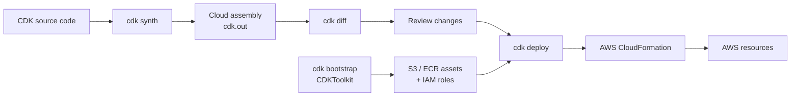
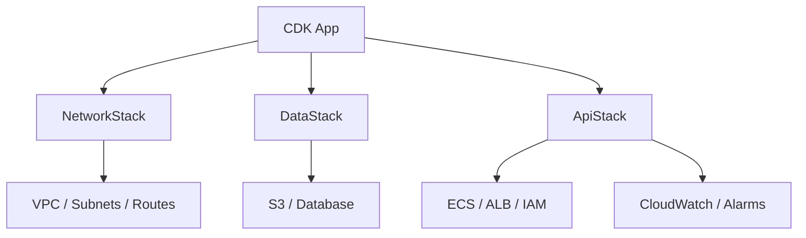
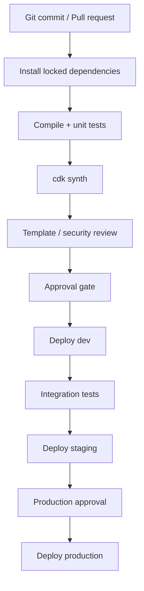

# CDK Bootstrap, Synth, Diff, and Deploy

> **Module:** CLOUD_PROVIDERS_AWS  
> **Chapter:** Infrastructure as Code  
> **Lesson:** CDK bootstrap, synth, diff, and deploy  
> **Context:** A Java/Spring Boot development team defines AWS infrastructure using the AWS Cloud Development Kit (AWS CDK), deploys via AWS CloudFormation, and manages development, staging, and production environments.

## 1. The Problem: Turning Infrastructure into Reviewable Source Code

A development team operates a Course API on AWS. The system comprises a VPC, private subnets, an ECS service, an Application Load Balancer, an S3 bucket, IAM roles, CloudWatch alarms, and a database. When creating a staging environment, the team has to repeat console steps, easily forgetting a security group rule, drifting from production settings, or losing track of what changes were applied.

Infrastructure as Code (IaC) solves this problem by describing infrastructure in files that can be stored in version control, reviewed, tested, and deployed repeatably.

**AWS Cloud Development Kit (AWS CDK)** lets you define AWS resources using programming languages such as TypeScript, Java, Python, C#, or Go. CDK compiles constructs into CloudFormation templates. AWS CloudFormation performs resource provisioning and updates.

The CDK v2 workflow typically consists of four steps:

1. **Bootstrap:** prepare an AWS account/Region for CDK deployments.
2. **Synth:** compile the CDK app into CloudFormation templates and deployment artifacts.
3. **Diff:** compare the configuration about to be deployed against the current stack.
4. **Deploy:** publish assets and instruct CloudFormation to create/update resources.



### Learning Objectives

After this lesson, you will be able to:

1. Explain the roles of CDK, constructs, stacks, and CloudFormation.
2. Distinguish CDK app synthesis from CloudFormation deployment.
3. Prepare CLI, credentials, account, and Region.
4. Properly bootstrap each AWS environment.
5. Understand the bootstrap stack, S3/ECR assets, IAM roles, trust, and execution policies.
6. Write a CDK app in Java or TypeScript.
7. Run `cdk synth`, `cdk diff`, `cdk deploy`, and verify results.
8. Manage context lookups, environment-specific stacks, and outputs.
9. Review security-sensitive changes, rollbacks, and resource retention.
10. Design CI/CD and cross-account deployment workflows with least privilege.

## 2. How Does AWS CDK v2 Work?

CDK provides reusable abstractions to define AWS resources in code. A CDK app can contain multiple stacks; each stack is a CloudFormation deployment unit. Inside a stack, you instantiate constructs from the AWS Construct Library or custom constructs built by your team.

### 2.1. Three Levels of Constructs

| Level | Name | Characteristics | Examples |
|---|---|---|---|
| L1 | CloudFormation resources | Nearly direct mapping to CloudFormation resource types; granular control | `CfnBucket`, `CfnVPC` |
| L2 | Curated constructs | Friendlier API, sensible defaults, and helper methods | `Bucket`, `Vpc`, `Function` |
| L3 | Patterns | Combines multiple resources into a purposeful architecture | Application Load Balanced Fargate Service |

Prefer L2/L3 when they meet requirements; use L1 when you need a CloudFormation property not yet exposed in L2 or need exact control. Even when using high-level constructs, always review the generated CloudFormation template.

### 2.2. CDK App, Stack, and Construct

- **App:** root of the CDK application; contains one or more stacks.
- **Stack:** CloudFormation deployment unit, bound to an account/Region if an environment is specified.
- **Construct:** component generating one or more CloudFormation resources.
- **Cloud assembly:** output of synthesis; includes templates, manifests, and assets in the `cdk.out` directory.
- **Bootstrap stack:** supporting infrastructure enabling the CDK CLI to publish assets and deploy stacks.



One stack can reference resources from another stack. When using cross-stack references, understand dependency order, CloudFormation exports/imports, and limitations when modifying or deleting referenced stacks.

### 2.3. CDK Does Not Replace CloudFormation

The CDK app runs during synthesis to produce CloudFormation templates. Then the CDK CLI uploads the cloud assembly and assets to AWS; CloudFormation performs the actual resource provisioning.

This means:

- TypeScript/Java errors, construct validations, or context lookups occur before deployment.
- CDK code does not run continuously while CloudFormation provisions resources.
- To run logic during the deployment lifecycle, mechanisms like CloudFormation custom resources or resource providers are needed; you cannot wait on the CDK app process to receive callbacks from CloudFormation.
- Post-deployment infrastructure state is managed by the CloudFormation stack.

## 3. Preparing Tools and AWS Credentials

### 3.1. Prerequisites

| Tool | Role |
|---|---|
| AWS CLI v2 | Verify identity, profile, Region, and manage credentials |
| Node.js/npm | Run the AWS CDK CLI |
| AWS CDK CLI v2 | `cdk init`, `bootstrap`, `synth`, `diff`, `deploy` |
| JDK 17+ | Compile Java CDK apps and Java applications |
| Maven | Resolve dependencies and run the Java CDK app |
| Git | Store source, review, and manage changes |
| AWS account/Region | Target environment |

The CDK CLI is distributed via npm even when the CDK application is written in Java. You do not need to write infrastructure in JavaScript merely because the CLI runs on Node.js.

Check versions:

```bash
node --version
npm --version
java -version
mvn --version
aws --version
npx aws-cdk --version
```

Pin CDK CLI and `aws-cdk-lib` versions in the project so builds/reviews are repeatable. Avoid relying on an unmanaged global CLI installation.

### 3.2. Verifying AWS Identity and Region

Use named profiles or IAM Identity Center/SSO per organizational policy:

```bash
aws configure list --profile dev
aws sts get-caller-identity --profile dev
aws configure get region --profile dev
```

If using IAM Identity Center:

```bash
aws sso login --profile dev
aws sts get-caller-identity --profile dev
```

Before bootstrapping/deploying, confirm:

- Does the Account ID match sandbox/dev/staging/prod?
- Is the Region where resources belong?
- Is the profile using the expected role?
- Are credentials unexpired?
- Does the operator have permission to bootstrap/deploy in that account?

Never copy access keys into source code, `cdk.json`, committed environment files, or task definitions.

## 4. AWS Environment: Account and Region

A CDK environment is typically identified by a pair:

```text
aws://ACCOUNT_ID/REGION

Example:
aws://123456789012/ap-southeast-1
```

A CDK stack can be configured as environment-specific with an account and Region. This enables CDK to perform context lookups such as AZs, VPC attributes, and AMI metadata in the right environment.

### 4.1. Declaring Environment in TypeScript

```typescript
import * as cdk from 'aws-cdk-lib';
import { CourseNetworkStack } from '../lib/course-network-stack';

const app = new cdk.App();

const env = {
  account: process.env.CDK_DEFAULT_ACCOUNT,
  region: process.env.CDK_DEFAULT_REGION,
};

new CourseNetworkStack(app, 'CourseNetworkStack', { env });

app.synth();
```

### 4.2. Declaring Environment in Java

```java
import software.amazon.awscdk.App;
import software.amazon.awscdk.Environment;
import software.amazon.awscdk.StackProps;

public final class CdkApp {
    public static void main(final String[] args) {
        App app = new App();

        Environment env = Environment.builder()
            .account(System.getenv("CDK_DEFAULT_ACCOUNT"))
            .region(System.getenv("CDK_DEFAULT_REGION"))
            .build();

        new CourseNetworkStack(
            app,
            "CourseNetworkStack",
            StackProps.builder().env(env).build()
        );

        app.synth();
    }
}
```

When running the CLI with a named profile, the CDK CLI can supply `CDK_DEFAULT_ACCOUNT` and `CDK_DEFAULT_REGION` for the chosen environment. In CI/CD, set account/Region explicitly or pass them from trusted deployment configuration.

### 4.3. Environment-Agnostic Stacks

If account/Region are omitted, a stack can be synthesized as environment-agnostic. This works for certain reusable templates, but has limitations:

- Cannot use every environment-dependent context lookup.
- Values like Availability Zone counts may only be resolved generically.
- Some ARN/account/Region attributes cannot be fully resolved at synthesis time.
- Do not assume an agnostic template deploys identically in every Region.

For applications needing VPCs, AZ lookups, account-specific policies, or cross-account deployments, configuring explicit environments is usually better.

## 5. What Is Bootstrapping?

**Bootstrapping** prepares an AWS account/Region for CDK deployments. The CDK CLI deploys a CloudFormation stack, named **`CDKToolkit`** by default, containing resources that support synthesis/deployment.

With the default modern bootstrap template, resources typically include:

| Resource | Role |
|---|---|
| S3 staging bucket | Stores file assets and deployment artifacts |
| ECR repository | Stores container image assets |
| IAM deployment role | Allows CDK CLI/CI to assume role to initiate deployments |
| CloudFormation execution role | Controls which resources CloudFormation is allowed to create/update |
| File publishing role | Allows publishing assets to the S3 staging bucket |
| Image publishing role | Allows publishing container images to ECR |
| Lookup role | Allows read-only context lookups |
| SSM parameter | Stores the bootstrap version for the synthesizer/CLI to check |

Default resource names include the qualifier `hnb659fds`, account ID, and Region, for example:

```text
cdk-hnb659fds-assets-123456789012-ap-southeast-1
cdk-hnb659fds-container-assets-123456789012-ap-southeast-1
/cdk-bootstrap/hnb659fds/version
```

The qualifier can change if bootstrap is customized. Do not hardcode example bucket/repository names into your application; the default synthesizer generates asset references matching the bootstrap contract.

### 5.1. Why Bootstrap Every Account/Region?

AWS environments are independent. If deploying the same CDK app to:

- Dev account in `ap-southeast-1`.
- Staging account in `ap-southeast-1`.
- Production account in `ap-southeast-2`.

Then each account/Region pair needs its own bootstrap before deploying into that environment.

Bootstrapping is repeatable. If the stack already exists, CDK can update the bootstrap stack when a newer template version requires it. Review bootstrap stack changes as significant infrastructure changes.

### 5.2. Bootstrapping Is Not Deploying the Application

`cdk bootstrap` creates or updates CDK supporting resources. It does not create VPC/ECS/S3 application stacks merely because those stacks exist in source code.

Application stacks are deployed afterward via `cdk deploy`.

## 6. Running cdk bootstrap

### 6.1. Verify Account/Region

```bash
aws sts get-caller-identity --profile dev
aws configure get region --profile dev
```

### 6.2. Bootstrap the Environment

```bash
npx aws-cdk bootstrap aws://123456789012/ap-southeast-1 \
  --profile dev
```

Or run from inside the CDK project directory:

```bash
npx aws-cdk bootstrap --profile dev
```

When no environment argument is passed, the CLI reads the environment from profile/default sources or stack configurations in the app. To avoid targeting the wrong account, pass the environment explicitly when bootstrapping critical environments.

### 6.3. Verify the Bootstrap Stack

```bash
aws cloudformation describe-stacks \
  --stack-name CDKToolkit \
  --profile dev \
  --region ap-southeast-1

aws ssm get-parameter \
  --name /cdk-bootstrap/hnb659fds/version \
  --profile dev \
  --region ap-southeast-1
```

If using a different qualifier, the SSM parameter path will differ. You can inspect the CloudFormation console, resources, and outputs of the `CDKToolkit` stack.

### 6.4. Bootstrap Permissions

The identity running bootstrap needs permissions to create/update the CloudFormation stack and bootstrap resources, including S3, ECR, SSM, and IAM. The exact list depends on the bootstrap template version.

Do not grant an `AdministratorAccess` policy to every developer merely to run bootstrap. Organizations should have a platform/admin role run bootstrap in a controlled manner, review the template, and scope CloudFormation execution role permissions to the resource types the pipeline is authorized to manage.

## 7. Bootstrap Trust and CloudFormation Execution Policies

Modern bootstrap supports cross-account deployments. This is a powerful feature, but trust boundaries must be clearly understood.

### 7.1. The --trust Option

`--trust` specifies account IDs permitted to assume the target environment's deployment role. The account executing bootstrap is always trusted.

Example where tooling account `111111111111` deploys to dev account `222222222222`:

```bash
npx aws-cdk bootstrap aws://222222222222/ap-southeast-1 \
  --profile dev-admin \
  --trust 111111111111 \
  --cloudformation-execution-policies arn:aws:iam::aws:policy/PowerUserAccess
```

The example above uses `PowerUserAccess` to illustrate the flag, not as a default production policy. Create execution policies tailored to the exact resources the CDK app needs to manage.

**Important note:** when updating `--trust` on an existing bootstrap stack, pass the entire list of accounts that should remain trusted. If you pass only a new account, previously trusted accounts will be removed from the trust list.

### 7.2. The --trust-for-lookup Option

`--trust-for-lookup` allows another account to perform read-only context lookups without granting deployment permissions:

```bash
npx aws-cdk bootstrap aws://222222222222/ap-southeast-1 \
  --profile dev-admin \
  --trust-for-lookup 111111111111
```

Lookup trust and deployment trust are two distinct permissions. Grant deployment trust only when the source pipeline/account genuinely needs to deploy into the target account.

### 7.3. CloudFormation Execution Policy

The CloudFormation execution role determines which API actions CloudFormation can execute in the target account. If you trust another account and attach an overly broad execution policy, CDK code from that account can deploy changes with that same privilege scope.

- Restrict the trust list.
- Use custom managed policies or workload-scoped policies.
- Review who has permission to edit the bootstrap stack and execution policy.
- Enable CloudTrail and audit deployment identities.
- Protect the production bootstrap stack with termination protection.
- Never delete `CDKToolkit` just to troubleshoot routine deployment errors.
## 8. CDK Project Structure

A CDK project typically has a structure like:

```text
course-infrastructure/
├── bin/
│   └── course-infrastructure.ts
├── lib/
│   ├── network-stack.ts
│   ├── storage-stack.ts
│   └── application-stack.ts
├── test/
│   └── application-stack.test.ts
├── cdk.json
├── cdk.context.json
├── package.json
├── package-lock.json
└── tsconfig.json
```

A Java project can follow a similar Maven structure:

```text
course-infrastructure-java/
├── src/main/java/com/example/cdk/
│   ├── CdkApp.java
│   └── CourseNetworkStack.java
├── src/test/java/com/example/cdk/
├── cdk.json
└── pom.xml
```

Split stacks by lifecycle/ownership and clear dependencies. Do not create one monolithic stack containing the entire system when parts have different lifecycles, owners, or blast radii.

## 9. Creating a CDK App with TypeScript

### 9.1. Initializing the Project

```bash
mkdir course-infrastructure
cd course-infrastructure

npx aws-cdk init app --language typescript
npm install
```

### 9.2. Defining an S3 Bucket

Example L2 construct for a bucket storing course assets:

```typescript
import * as cdk from 'aws-cdk-lib';
import { Construct } from 'constructs';
import * as s3 from 'aws-cdk-lib/aws-s3';

export class CourseStorageStack extends cdk.Stack {
  constructor(scope: Construct, id: string, props?: cdk.StackProps) {
    super(scope, id, props);

    const assetsBucket = new s3.Bucket(this, 'CourseAssets', {
      versioned: true,
      blockPublicAccess: s3.BlockPublicAccess.BLOCK_ALL,
      encryption: s3.BucketEncryption.S3_MANAGED,
      enforceSSL: true,
      removalPolicy: cdk.RemovalPolicy.RETAIN,
    });

    new cdk.CfnOutput(this, 'CourseAssetsBucketName', {
      value: assetsBucket.bucketName,
      description: 'Bucket for course assets',
    });
  }
}
```

Choices in the example:

- `versioned: true`: keeps object versions to support recovery.
- `BLOCK_ALL`: blocks public access at the bucket level.
- `S3_MANAGED`: uses SSE-S3 for encryption at rest.
- `enforceSSL: true`: adds a bucket policy requiring secure transport.
- `RETAIN`: preserves the bucket when the stack is deleted; data is not lost automatically with the stack lifecycle.

If a customer-managed KMS key is required, replace the encryption configuration with `BucketEncryption.KMS` and configure key policies/rotation per organizational standards.

### 9.3. Registering the Stack with App

```typescript
#!/usr/bin/env node
import * as cdk from 'aws-cdk-lib';
import { CourseStorageStack } from '../lib/course-storage-stack';

const app = new cdk.App();

new CourseStorageStack(app, 'CourseStorageStack', {
  env: {
    account: process.env.CDK_DEFAULT_ACCOUNT,
    region: process.env.CDK_DEFAULT_REGION,
  },
});

app.synth();
```

## 10. Creating a CDK App with Java

Java CDK uses the `software.amazon.awscdk` package and Construct Library. The Java app is still executed by the CDK CLI during synthesis.

### 10.1. Maven Dependencies

Use pinned `aws-cdk-lib` and `constructs` versions tested for compatibility. Example `pom.xml`:

```xml
<properties>
    <maven.compiler.release>17</maven.compiler.release>
    <aws.cdk.version>2.180.0</aws.cdk.version>
</properties>

<dependencies>
    <dependency>
        <groupId>software.amazon.awscdk</groupId>
        <artifactId>aws-cdk-lib</artifactId>
        <version>`{aws.cdk.version}</version>
    </dependency>
    <dependency>
        <groupId>software.constructs</groupId>
        <artifactId>constructs</artifactId>
        <version>10.4.2</version>
    </dependency>
</dependencies>

<build>
    <plugins>
        <plugin>
            <groupId>org.codehaus.mojo</groupId>
            <artifactId>exec-maven-plugin</artifactId>
            <version>3.5.0</version>
            <configuration>
                <mainClass>com.example.cdk.CdkApp</mainClass>
            </configuration>
        </plugin>
    </plugins>
</build>
```

The versions above are illustrative examples, not a blanket recommendation to use verbatim across every project. Choose a CDK v2 release currently supported by your organization, pin versions, and verify construct compatibility.

### 10.2. Java Stack Creating an S3 Bucket

```java
package com.example.cdk;

import software.amazon.awscdk.CfnOutput;
import software.amazon.awscdk.RemovalPolicy;
import software.amazon.awscdk.Stack;
import software.amazon.awscdk.StackProps;
import software.amazon.awscdk.services.s3.BlockPublicAccess;
import software.amazon.awscdk.services.s3.Bucket;
import software.amazon.awscdk.services.s3.BucketEncryption;
import software.constructs.Construct;

public final class CourseStorageStack extends Stack {
    public CourseStorageStack(
            final Construct scope,
            final String id,
            final StackProps props) {
        super(scope, id, props);

        Bucket assetsBucket = Bucket.Builder.create(this, "CourseAssets")
            .versioned(true)
            .blockPublicAccess(BlockPublicAccess.BLOCK_ALL)
            .encryption(BucketEncryption.S3_MANAGED)
            .enforceSSL(true)
            .removalPolicy(RemovalPolicy.RETAIN)
            .build();

        CfnOutput.Builder.create(this, "CourseAssetsBucketName")
            .value(assetsBucket.getBucketName())
            .description("Bucket for course assets")
            .build();
    }
}
```

### 10.3. Java App Entry Point

```java
package com.example.cdk;

import software.amazon.awscdk.App;
import software.amazon.awscdk.Environment;
import software.amazon.awscdk.StackProps;

public final class CdkApp {
    public static void main(final String[] args) {
        App app = new App();

        Environment env = Environment.builder()
            .account(System.getenv("CDK_DEFAULT_ACCOUNT"))
            .region(System.getenv("CDK_DEFAULT_REGION"))
            .build();

        new CourseStorageStack(
            app,
            "CourseStorageStack",
            StackProps.builder().env(env).build()
        );

        app.synth();
    }
}
```

### 10.4. Configuring cdk.json for Java

```json
{
  "app": "mvn -q compile exec:java"
}
```

In a Java project, the CDK CLI invokes the `app` command in `cdk.json` to run Java synthesis. Ensure Maven dependencies resolve cleanly and `mainClass` is correct.

## 11. Synthesis: The `cdk synth` Command

Synthesis runs the CDK app, evaluates constructs, resolves tokens, and generates the Cloud assembly. This step produces the CloudFormation template; it **does not create application resources in AWS**.

```bash
npx aws-cdk synth --profile dev
```

Specify a single stack:

```bash
npx aws-cdk synth CourseStorageStack --profile dev
```

Default output goes into the `cdk.out` directory, for example:

```text
cdk.out/
├── manifest.json
├── tree.json
├── CourseStorageStack.template.json
└── asset.<hash>/
```

### 11.1. Inspecting the CloudFormation Template

You can print the template to stdout:

```bash
npx aws-cdk synth CourseStorageStack --profile dev
```

Review key elements:

- Resource types and logical IDs.
- Generated IAM policies/roles.
- Security groups, ingress/egress rules, and network exposure.
- Encryption, public access, and retention policies.
- Parameters, outputs, conditions, and dependencies.
- Asset references pointing to the right bootstrap resources.

Do not review only CDK code. The template is the artifact CloudFormation receives to create infrastructure.

### 11.2. Synthesis May Call AWS Lookups

Some constructs require context lookups such as availability zones, hosted zones, VPCs, or AMIs. For environment-specific stacks, the CDK CLI may need read-only credentials to fetch data from AWS.

If lookups change between synthesis runs, output can change. Manage the context cache and profile/Region so builds remain reproducible.

## 12. Diff: Previewing Changes

`cdk diff` compares the currently deployed template with the template synthesized from source code. This command helps review changes before modifying the CloudFormation stack.

```bash
npx aws-cdk diff CourseStorageStack --profile dev
```

To diff the entire app:

```bash
npx aws-cdk diff --all --profile dev
```

### 12.1. How to Read Diff

| Change type | Meaning | Review priority |
|---|---|---|
| Add | Create a new resource | Check cost, permissions, network exposure |
| Modify | Update an existing resource | Check whether property triggers replacement |
| Remove | Delete a resource | Check data loss, dependencies, and retention |
| Replacement | Create a new resource then replace the old one | May cause downtime, change physical IDs, or lose data if not retained |
| IAM policy broadening | Expand permissions | Review principals, actions, resources, and conditions |
| Security group ingress | Open additional inbound paths | Check source CIDR/SG and port |

Diff may show that a resource will be replaced. For stateful resources such as databases, S3 buckets, KMS keys, or EFS, replacement is a high-risk change.

### 12.2. Security-Only Diff

To focus on security-relevant changes:

```bash
npx aws-cdk diff CourseStorageStack --security-only --profile dev
```

Depending on CLI version, different diff methods may compare against CloudFormation change sets. Check the CLI help/API version pinned in your project.

### 12.3. Diff Is Not an Absolute Guarantee

`cdk diff` is a review tool, but:

- Changes caused by drift outside CDK source may not appear fully without separate drift checks.
- Certain resource properties are handled by CloudFormation with special semantics.
- Dynamic references, tokens, and context lookups may defer final value resolution until deploy time.
- Custom resources have their own side effects.
- Diff does not replace change reviews, backup/restore plans, or production data checks.

## 13. Deploy: Deploying via CloudFormation

When running `cdk deploy`, the CDK CLI synthesizes the app if needed, publishes assets to the bootstrap S3/ECR repositories, and submits the CloudFormation template for deployment.

```bash
npx aws-cdk deploy CourseStorageStack --profile dev
```

Deploy all stacks:

```bash
npx aws-cdk deploy --all --profile dev
```

Write outputs to a file for pipelines or downstream steps:

```bash
npx aws-cdk deploy CourseStorageStack \
  --outputs-file cdk-outputs.json \
  --profile dev
```

### 13.1. Safe Pre-Deploy Workflow

1. Confirm AWS account, Region, and profile.
2. Run unit tests and compile the CDK app.
3. Run `cdk synth` and inspect templates.
4. Run `cdk diff` and review all Add/Modify/Remove/Replacement actions.
5. Verify IAM, security groups, encryption, and resource retention.
6. Verify bootstrap stack version/roles.
7. Confirm backups and rollback plans for stateful resources.
8. Only then deploy to the target environment.

### 13.2. Approval Prompts

The CDK CLI can prompt for approval when IAM permissions are added or broadened. You can choose the control level via:

```bash
npx aws-cdk deploy CourseStorageStack \
  --require-approval broadening \
  --profile dev
```

Common options:

- `never`: never prompt for approval; use only when the CI pipeline already has equivalent review gates.
- `any-change`: require approval for every change.
- `broadening`: require approval when IAM permissions expand.

Never set `--require-approval never` for production without an alternative approval gate and controlled deployment permissions.

### 13.3. CloudFormation Deployment Lifecycle

During deployment:

- CloudFormation creates change sets/provisions resources per the dependency graph.
- The CDK CLI prints deployment progress.
- If creating/updating a resource fails, CloudFormation may roll back the stack according to update behavior.
- Some custom resources or side effects outside CloudFormation may need separate handling.
- After deployment, inspect stack status, events, outputs, and resource health.

```bash
aws cloudformation describe-stacks \
  --stack-name CourseStorageStack \
  --profile dev \
  --region ap-southeast-1

aws cloudformation describe-stack-events \
  --stack-name CourseStorageStack \
  --profile dev \
  --region ap-southeast-1
```
## 14. Context Lookups and Reproducibility

CDK may need to read information from the AWS environment during synthesis, such as availability zones, VPCs, hosted zones, or AMIs. Lookup results are stored in the context cache, typically `cdk.context.json`.

Commit the context cache so developers and CI use identical lookup values, reducing unexpected changes between synthesis runs. When CDK requests a context refresh, review the diff of this file before committing. Do not wipe the cache arbitrarily in CI because each build might look up different data.

Example importing an existing VPC:

```typescript
import * as cdk from 'aws-cdk-lib';
import * as ec2 from 'aws-cdk-lib/aws-ec2';

export class CourseApplicationStack extends cdk.Stack {
  constructor(scope: cdk.App, id: string, props: cdk.StackProps) {
    super(scope, id, props);

    const vpc = ec2.Vpc.fromLookup(this, 'ExistingVpc', {
      vpcId: 'vpc-0123456789abcdef0',
    });

    // Create resources inside the looked-up VPC.
  }
}
```

`fromLookup` is a context lookup and typically requires a concrete environment along with credentials having permission to read VPC metadata. If VPC IDs differ between dev and prod, use environment-specific context/configuration rather than hardcoding a single shared ID.

Useful commands:

```bash
npx aws-cdk context --profile dev
npx aws-cdk context --reset 3 --profile dev
npx aws-cdk synth --profile dev
```

Reset only the specific context key that needs refreshing. After refreshing, check `cdk.context.json`, re-synth, and review the CloudFormation diff.

## 15. Stack Boundaries, Outputs, and Dependencies

### 15.1. Splitting Stacks by Lifecycle

| Stack | Resources | Lifecycle |
|---|---|---|
| NetworkStack | VPC, subnets, routes, endpoints | Foundational, changes infrequently |
| SecurityStack | Shared security groups, KMS keys, policies | Security/platform ownership |
| DataStack | S3, databases, backup policies | Stateful, requires retention |
| ApplicationStack | ECS service, ALB, task roles | Changes frequently |
| ObservabilityStack | Alarms, dashboards, log groups | Operational |

Splitting stacks reduces blast radius and helps teams assign ownership. Do not split too granularly if it creates excessive cross-stack references and complex dependencies.

### 15.2. Outputs

Use CloudFormation outputs for values needing visibility or passing to pipelines:

```typescript
new cdk.CfnOutput(this, 'ApiBucketName', {
  value: assetsBucket.bucketName,
  description: 'S3 bucket storing course assets',
});
```

Never output secrets, passwords, private keys, or tokens. Outputs can appear in the CloudFormation console, CLI output, or CI logs.

### 15.3. Cross-Stack References

If `ApplicationStack` needs a bucket from `DataStack`, you can pass constructs/references via stack props when they are in the same app and an appropriate deployment model. CDK may generate CloudFormation exports/imports to express the dependency.

- Deploy the resource-providing stack before the consuming stack.
- Do not delete an export currently imported by another stack.
- Changing physical resources or moving resources between stacks may require a multi-step migration.
- Cross-account/cross-Region references have limits; CloudFormation export/import does not work across accounts or Regions.
- For resources shared across accounts/Regions, use appropriate ARNs/configurations, resource policies, SSM parameters, or pipeline outputs.

## 16. Resource Lifecycle, Drift, and Rollback

### 16.1. RemovalPolicy and UpdateReplacePolicy

| Policy | Behavior |
|---|---|
| `DESTROY` | Deletes the resource when CloudFormation removes it from the stack |
| `RETAIN` | Keeps the resource after the stack deletes the resource |
| `SNAPSHOT` | Creates a snapshot before deletion, if supported by resource type |

For S3 buckets storing course data, databases, or KMS keys, do not use `DESTROY` by habit. `RETAIN` lowers the risk of deleting data when a stack is deleted, though retained resources can become orphans and keep incurring costs.

`RemovalPolicy` does not replace backups, versioning, or disaster recovery. Inspect `UpdateReplacePolicy` and `DeletionPolicy` in the generated CloudFormation template.

### 16.2. What Is Drift?

Drift occurs when live resources differ from the configuration managed by the CloudFormation stack—for example, someone edits security group ingress directly in the console while CDK source stays unchanged.

CDK synth/diff primarily compares the desired template against the current template/stack. To detect resource drift, use CloudFormation drift detection:

```bash
aws cloudformation detect-stack-drift \
  --stack-name CourseStorageStack \
  --profile dev \
  --region ap-southeast-1

aws cloudformation describe-stack-drift-detection-status \
  --stack-drift-detection-id <detection-id> \
  --profile dev \
  --region ap-southeast-1
```

Drift detection does not support every resource/property and may return `NOT_CHECKED` for uncomparable attributes. Investigate drift before deploying; do not assume deploying will automatically resolve all manual changes.

### 16.3. Rollback and Recovery

When a CloudFormation update fails, the stack may enter rollback. Investigation workflow:

1. Open stack events and identify the earliest failing resource.
2. Read the reason returned by the service: quota, IAM, dependency, immutable property, or resource conflict.
3. Check whether the stack is in rollback or rollback failed.
4. Fix the root cause in CDK source or the environment.
5. Re-run synth and diff.
6. Retry deployment only once the stack is in an updatable state.
7. For stateful resources, verify data and backups before proceeding.

CloudFormation rollback does not undo side effects outside CloudFormation, such as data written to databases, emails sent by custom resources, or external system calls.

### 16.4. Termination Protection

Enable termination protection on critical stacks to reduce accidental deletion risk:

```bash
aws cloudformation update-termination-protection \
  --stack-name CDKToolkit \
  --enable-termination-protection \
  --profile prod \
  --region ap-southeast-1
```

Termination protection prevents stack deletion, but does not block resource updates or data modifications.

## 17. Other CDK Commands and Operations Requiring Caution

| Command | Purpose | Notes |
|---|---|---|
| `cdk list` | List stacks in the app | Does not deploy |
| `cdk doctor` | Check CLI/project environment | Use when facing toolchain issues |
| `cdk watch` | Watch source and auto-deploy changes in dev workflow | Dev environments only |
| `cdk destroy` | Delete stack and resources per deletion policies | May cause data loss or downtime |
| `cdk import` | Import existing resources into CloudFormation management where supported | Requires planning and checking resource support |
| `cdk hotswap` | Update certain resources directly, bypassing CloudFormation for supported changes | Dev only; can create drift |

Hotswap can speed up feedback loops when developing Lambda/ECS or supported resource types. However, because it calls service APIs directly, actual state can diverge from the CloudFormation template. After experimenting, run a standard CloudFormation deployment to realign resource state with the desired template. Never use hotswap in a production pipeline without a dedicated design and approval.

Before destroying:

- Confirm exact account/Region and stack.
- Review resource deletion/retention policies.
- Check bucket objects, database snapshots, and KMS dependencies.
- Identify which resources will be retained and who owns managing orphaned resources.
- Never delete the bootstrap stack as a way to clean up an application stack.
## 18. CI/CD and CDK Pipelines

CDK deployments can run from a workstation or a CI/CD service. For production, pipelines standardize credentials, builds, approvals, and deployment roles.



### 18.1. Recommended Pipeline Steps

1. Check out an immutable commit.
2. Install dependencies from lockfiles.
3. Compile Java/TypeScript and run unit tests.
4. Run policy/security checks on synthesized templates.
5. Generate the Cloud assembly and store it as an artifact.
6. Review `cdk diff` or CloudFormation change sets.
7. Deploy dev/staging.
8. Run smoke/integration tests.
9. Require approval per production policy.
10. Deploy production using a scoped role.
11. Archive deployment metadata, outputs, commit SHA, and CloudFormation events.

Never run synth on one commit and deploy different source code. The reviewed artifact must match the deployed version identically.

### 18.2. CDK Pipelines

CDK Pipelines is a construct library for defining self-mutating CI/CD pipelines in CDK. Pipelines can create stages, waves, validation steps, and cross-account deployment actions.

For CDK Pipelines to deploy into target accounts/Regions:

- Bootstrap target environments with pipeline-supporting configurations.
- Configure `--trust` for the pipeline account.
- Attach appropriate `--cloudformation-execution-policies`.
- Ensure asset publishing roles and the CloudFormation execution role have required permissions.
- Use explicit accounts/Regions in stages.
- Protect production stages with manual approvals or policy gates.

Do not use `AdministratorAccess` as the default across all targets. If broader policies are used, restrict who can modify the pipeline/source and protect branches/release processes accordingly.

### 18.3. Cross-Account Bootstrap Example for Pipelines

```bash
npx aws-cdk bootstrap aws://222222222222/ap-southeast-1 \
  --profile target-admin \
  --trust 111111111111 \
  --cloudformation-execution-policies arn:aws:iam::222222222222:policy/CdkProductionExecutionPolicy
```

This example assumes tooling account `111111111111` and target `222222222222`. Policy names are illustrative; actual policies must be created and reviewed beforehand. When updating the trust list, pass all trusted accounts to retain.

## 19. Lab: Bootstrap, Synth, Diff, and Deploy an S3 Stack

**Scenario:** The Course API team needs to create a bucket storing course materials using Java CDK, with versioning enabled, public access blocked, encryption enabled, and data retained on stack deletion.

### 19.1. Preparation

1. Install AWS CLI v2, Node.js/npm, JDK 17, Maven, and Git.
2. Have an authorized sandbox account/Region and profile.
3. Create a Java CDK project.
4. Declare `aws-cdk-lib`, `constructs`, and the Maven exec plugin.
5. Write `CourseStorageStack` and `CdkApp`.
6. Verify account/Region with STS before bootstrapping.

### 19.2. Practice

```bash
aws sts get-caller-identity --profile dev

npx aws-cdk bootstrap aws://123456789012/ap-southeast-1 \
  --profile dev

npx aws-cdk list --profile dev

npx aws-cdk synth CourseStorageStack --profile dev

npx aws-cdk diff CourseStorageStack --profile dev

npx aws-cdk deploy CourseStorageStack \
  --require-approval broadening \
  --profile dev
```

After deploying:

- Check CloudFormation stack status.
- Read the `CourseAssetsBucketName` output.
- Verify bucket versioning, block public access, and encryption.
- Confirm the bucket policy requires SSL.
- Upload a test object and check its version ID.
- Run drift detection on the stack.
- Modify a property in CDK code, re-run synth/diff, and review.
- Trigger a failing deployment in the sandbox and read CloudFormation events.

### 19.3. Required Deliverables

Lab report containing the masked AWS account ID and Region; CDK CLI/JDK/Maven/CDK library versions; bootstrap stack status/version; synthesized CloudFormation template; pre-deployment diff; post-deployment stack status and outputs; evidence of bucket security settings; drift detection results; and risks of changing bucket encryption/removal policies.

### 19.4. Negative Tests

| Test | Condition | Expected result |
|---|---|---|
| T1 | Bootstrap wrong account/Region | Caught via STS/stack lookup; no staging resources created in intended environment |
| T2 | Deploy without bootstrapping | CDK reports missing bootstrap resources/version or fails to publish assets |
| T3 | Missing permission to assume deployment role | AccessDenied when assuming role |
| T4 | CloudFormation execution policy missing action | Resource deployment fails and stack events identify permission issue |
| T5 | Add account to trust while omitting old account | Old account loses trust after update |
| T6 | CDK code expands IAM permissions | `cdk diff`/approval flags policy broadening for review |
| T7 | Change property requiring resource replacement | Diff warns of replacement; verify downtime/data retention |
| T8 | Edit security group directly outside CDK | Drift detection reports `MODIFIED` |
| T9 | Run `cdk hotswap` in sandbox | Can create drift compared to CloudFormation template |
| T10 | Destroy stack containing `RETAIN` resource | Resource is kept and requires separate inventory/cleanup |

Never run negative tests that could delete data or alter a production account.

## 20. Self-Check Questions

**1. Does CDK create AWS resources directly?**  
CDK synthesis generates CloudFormation templates and assets; CloudFormation performs provisioning.

**2. What does bootstrap create?**  
Default modern bootstrap creates S3/ECR staging resources, IAM roles, and an SSM parameter to support CDK deployments.

**3. Must every Region be bootstrapped?**  
Yes. Each AWS account/Region environment must be bootstrapped before deploying into it.

**4. Does `cdk synth` deploy?**  
No. It generates the Cloud assembly/CloudFormation templates locally.

**5. What is `cdk diff` used for?**  
Compares the desired template with the currently deployed stack to review changes before deployment.

**6. Which service does `cdk deploy` use to provision resources?**  
AWS CloudFormation.

**7. How do `--trust` and `--trust-for-lookup` differ?**  
`--trust` grants permission to assume deployment roles; `--trust-for-lookup` allows read-only context lookups.

**8. What does the CloudFormation execution policy control?**  
Which AWS API actions CloudFormation is allowed to execute when deploying stacks.

**9. Why pin context in `cdk.context.json`?**  
So synthesis runs produce stable and reproducible lookup values.

**10. How do L1, L2, and L3 constructs differ?**  
L1 closely maps to CloudFormation resources, L2 provides curated APIs, and L3 packages multi-resource patterns.

**11. Does `RemovalPolicy.RETAIN` replace backups?**  
No. It keeps the resource when the stack deletes it, but does not protect against data corruption or internal data deletion.

**12. Does diff detect all drift?**  
No. Use CloudFormation drift detection to check direct out-of-stack changes.

**13. Should `AdministratorAccess` be used for pipelines?**  
Not by default. Use execution policies scoped to the resources/actions the pipeline needs.

**14. Should hotswap be used for production?**  
Generally no; it can update service resources directly and introduce drift relative to CloudFormation.

**15. Why review resource replacements?**  
Replacement can swap physical resources, cause downtime, or lose data if retention/backups are not designed.

**16. How do CDK Pipelines require target accounts to be bootstrapped?**  
Bootstrap each target account/Region, trust the pipeline account, and attach a reviewed execution policy.

## 21. Summary and Official AWS Documentation

AWS CDK v2 enables defining AWS infrastructure using Java, TypeScript, and other supported languages. The CDK app is synthesized into CloudFormation templates and deployment artifacts; CloudFormation executes resource creation/updates.

Remember the deployment sequence as:

- **Bootstrap:** prepare S3/ECR asset stores, IAM roles, and bootstrap version per account/Region.
- **Synth:** generate the Cloud assembly and inspect the CloudFormation template.
- **Diff:** review resource changes, IAM broadening, and replacement risks.
- **Deploy:** publish assets and deploy stacks via CloudFormation.

Production deployments require verifying account/Region, bootstrap trust, CloudFormation execution policies, context caches, resource retention, drift, rollbacks, and CI/CD approvals. Never treat a successful deploy command as proof that infrastructure satisfies all security, availability, or data recovery requirements.

### Official AWS Documentation

- [AWS CDK v2 — Getting started](https://docs.aws.amazon.com/cdk/v2/guide/getting_started.html)
- [AWS CDK v2 — Bootstrapping](https://docs.aws.amazon.com/cdk/v2/guide/bootstrapping.html)
- [AWS CDK v2 — Bootstrap your environment](https://docs.aws.amazon.com/cdk/v2/guide/bootstrapping-env.html)
- [AWS CDK v2 — Bootstrap CLI reference](https://docs.aws.amazon.com/cdk/v2/guide/ref-cli-cmd-bootstrap.html)
- [AWS CDK v2 — Deploying CDK applications](https://docs.aws.amazon.com/cdk/v2/guide/deploy.html)
- [AWS CDK v2 — Synth command](https://docs.aws.amazon.com/cdk/v2/guide/ref-cli-cmd-synth.html)
- [AWS CDK v2 — Diff command](https://docs.aws.amazon.com/cdk/v2/guide/ref-cli-cmd-diff.html)
- [AWS CDK v2 — Deploy command](https://docs.aws.amazon.com/cdk/v2/guide/ref-cli-cmd-deploy.html)
- [AWS CDK v2 — Configure environments](https://docs.aws.amazon.com/cdk/v2/guide/environments.html)
- [AWS CDK v2 — Customize stack synthesis](https://docs.aws.amazon.com/cdk/v2/guide/customize-synth.html)
- [AWS CDK v2 — CDK Pipelines](https://docs.aws.amazon.com/cdk/v2/guide/cdk-pipeline.html)
- [AWS CloudFormation — Detect stack drift](https://docs.aws.amazon.com/AWSCloudFormation/latest/UserGuide/using-cfn-stack-drift.html)
- [AWS CloudFormation — Stack updates](https://docs.aws.amazon.com/AWSCloudFormation/latest/UserGuide/using-cfn-updating-stacks.html)

> **Practice note:** Account IDs, Regions, bucket names, policy names, and version dependencies in this lesson are examples. Verify CDK CLI/library compatibility, bootstrap versions, trusted accounts, CloudFormation execution policies, and resource replacements before deploying to production.
