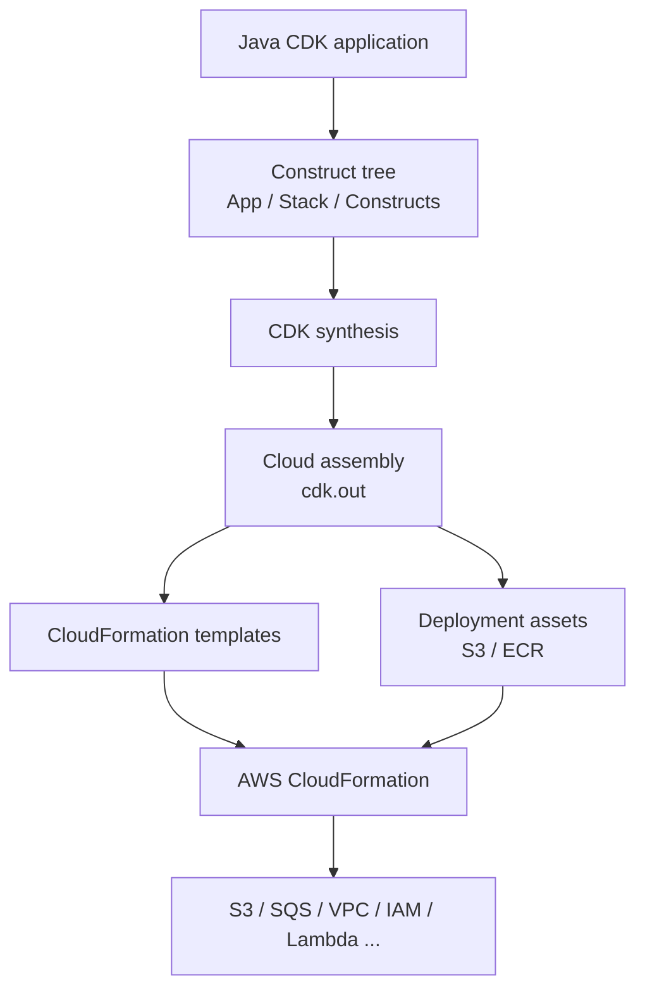
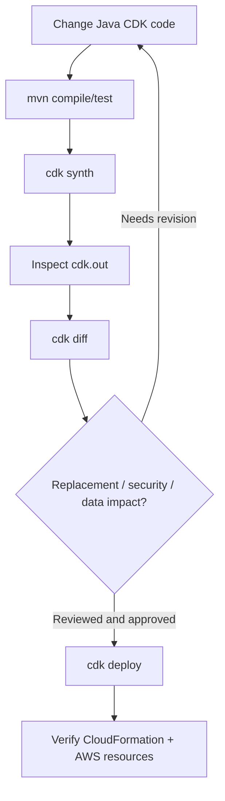

# Writing AWS Infrastructure with CDK in Java

**AWS Cloud Development Kit (AWS CDK)** lets you describe AWS infrastructure using a familiar programming language. In Java, you instantiate **App**, **Stack**, and **Construct** objects, configure resources via the AWS Construct Library, and then use the CDK CLI to synthesize code into **AWS CloudFormation** templates. CloudFormation creates, updates, and deletes resources in AWS.

CDK brings infrastructure into the software development workflow: type checking, class reuse, modularization, template testing, change reviews via Git, and CI/CD deployment. However, Java CDK code does not run as a production Java application on AWS. It runs on a developer workstation or CI runner to **synthesize** CloudFormation templates and deployment assets; CloudFormation is the service that executes the deployment.

This lesson belongs to the **Infrastructure as Code** chapter of the **CLOUD_PROVIDERS_AWS** module. It connects Java, Maven, IAM, Regions/AZs, VPC, S3, SQS, Lambda, CloudFormation, CloudWatch, security, testing, and repeatable infrastructure deployment.

> **Principle:** CDK is a way of authoring CloudFormation in code. Review templates and diffs before deploying, keep construct IDs stable, commit the context cache, restrict bootstrap/deploy permissions, and configure retention for resources holding critical data.

## 1. Learning Objectives

After this lesson, you will be able to:

1. Explain the relationship between AWS CDK, the Construct Library, the CDK CLI, and CloudFormation.
2. Distinguish App, Stack, Construct, the construct tree, and CloudFormation logical IDs.
3. Distinguish L1, L2, and L3 constructs and choose the right abstraction.
4. Initialize a CDK v2 project with Java, JDK, Maven, and Node.js/CDK CLI.
5. Manage Java CDK dependencies and keep CLI and library versions synchronized.
6. Write a Stack using the Java Builder pattern to create S3 buckets, SQS queues, and related resources.
7. Configure accounts, Regions, environments, and multi-account/multi-Region deployments.
8. Understand synthesis, cloud assemblies, assets, bootstrapping, and the role of CDKToolkit.
9. Properly use context, lookups, tokens, parameters, and outputs.
10. Manage cross-stack dependencies and reuse custom constructs.
11. Apply IAM least privilege, encryption, network isolation, tags, and removal policies.
12. Test CloudFormation templates using CDK Assertions and JUnit.
13. Use the CLI to synth, diff, deploy, hotswap, and destroy in a controlled manner.
14. Organize CI/CD with CDK Pipelines or existing pipelines.
15. Identify drift, replacements, rollbacks, and data loss risks.
16. Design an IaC workflow that is reviewable, reproducible, testable, and reversible.

## 2. AWS CDK and CloudFormation

Without CDK, operations teams can write CloudFormation YAML/JSON directly. With CDK, you write Java to describe resources, and CDK translates that structure into a CloudFormation template.



The workflow has two phases:

- **Synthesis:** the CDK app runs locally/in CI, producing CloudFormation templates and metadata/assets inside the cloud assembly.
- **Deployment:** the CDK CLI submits templates to CloudFormation, publishes assets to bootstrap resources, and CloudFormation calls AWS APIs to create/update resources.

Once CloudFormation starts deploying, the Java CDK process has already finished. Java CDK does not keep running to wait for each resource to be created. To run logic during CloudFormation deployment, use mechanisms such as custom resources or an appropriate service.

### 2.1. CDK Does Not Replace CloudFormation

| Component | Role |
| --- | --- |
| Java CDK app | Describes architecture and resource configuration |
| AWS Construct Library | Provides classes/abstractions for AWS resources |
| CDK CLI | Builds/synthesizes, diffs, and orchestrates deployments |
| Cloud assembly | Synthesized templates and assets |
| AWS CloudFormation | Creates, updates, rolls back, and manages stacks |
| AWS resources | Live resources inside an account/Region |

CDK remains subject to CloudFormation rules: logical IDs, dependency graphs, replacement, stack limits, rollbacks, and resource lifecycles. If a code change causes CloudFormation to replace a database or bucket, writing it in Java does not eliminate that risk.

### 2.2. CDK v2

This lesson uses **AWS CDK v2**:

- Stable AWS Construct Library modules are bundled into the Maven artifact **aws-cdk-lib**.
- The **constructs** package provides the construct programming model.
- Experimental constructs may live in separate artifacts with an alpha suffix.
- The CDK CLI is a separate tool, installed via npm and running on Node.js.
- Pin exact versions and upgrade in a controlled manner; do not use dependency version ranges for infrastructure builds.

CDK v1 has reached end of support. For new projects, choose CDK v2 and review release notes before upgrading versions.

## 3. Core Concepts

### 3.1. App

**App** is the root of the construct tree. An App can contain multiple stacks. App is the entry point when the CDK CLI runs the Java application.

### 3.2. Stack

**Stack** is the CloudFormation deployment unit. A stack typically holds resources sharing a lifecycle or operational boundary.

Examples:

- NetworkStack: VPC, subnets, route tables, and endpoints.
- DataStack: S3, DynamoDB, RDS, or SQS.
- ApplicationStack: Lambda, API Gateway, and permissions.
- ObservabilityStack: alarms, dashboards, and log groups.

Do not split stacks solely by resource count. Choose boundaries by lifecycle, ownership, permissions, blast radius, and dependency relationships.

### 3.3. Construct

**Construct** is the building block in CDK. A construct can represent a single resource or a group of related resources.

For example, an Application API construct might contain:

- A Lambda function.
- An execution role.
- A log group.
- API Gateway integration.
- Permission for API Gateway to invoke the function.
- Alarms and outputs.

The construct tree enables organizing resources across abstraction layers. Every construct has a **scope**, **id**, and **props**.

### 3.4. Scope, ID, and Props

In Java, a construct is typically instantiated with three arguments:

- **scope:** parent construct.
- **id:** unique identifier within that scope.
- **props:** construct configuration, usually via the Builder pattern.

Example:

```java
Bucket bucket = Bucket.Builder.create(this, "ArtifactsBucket")
    .versioned(true)
    .build();
```

**this** is the Stack scope; **ArtifactsBucket** is the construct ID; **versioned(true)** configures the bucket.

The ID must be unique within the same scope. Two constructs in different scopes can share the same ID.

### 3.5. Construct Tree and Logical IDs

CDK generates CloudFormation logical IDs based on the construct path in the tree. CloudFormation uses logical IDs to identify resources belonging to a stack.

Example:

```text
PlatformStack
  ├── ArtifactsBucket
  ├── WorkQueue
  └── DeadLetterQueue
```

If you rename an ID or move a construct, its logical ID can change. CloudFormation may interpret it as a new resource and delete the old resource after creating the new one. For stateful resources, this can cause downtime or data loss if the removal policy is inappropriate.

**Keep construct IDs stable after deployment.** Before refactoring the construct tree, run **cdk diff** and inspect which resources face replacement.

## 4. Three Construct Levels: L1, L2, and L3

The AWS Construct Library has three abstraction levels. These are design conventions, not three distinct Java interfaces.

| Level | Common name | Characteristics | When to use |
| --- | --- | --- | --- |
| **L1** | CloudFormation resource | Direct mapping to CloudFormation resource; class names usually start with Cfn | Need a new property or granular control |
| **L2** | Curated construct | Intent-driven API with defaults, helper methods, and grant methods | Default choice for most resources |
| **L3** | Pattern | Combines multiple L1/L2 constructs into a complete architecture | Need to deploy a common use case quickly |

### 4.1. L1 Constructs

L1 classes map directly to CloudFormation resources—for example, **CfnBucket** represents **AWS::S3::Bucket**. You configure properties almost identically to the CloudFormation schema.

Advantages:

- Can use resources/properties as soon as CloudFormation supports them.
- Close control over the CloudFormation template.
- Useful when L2 does not yet expose a needed API.

Limitations:

- Requires declaring many low-level details manually.
- Few helper methods and defaults.
- Easy to miss security settings without deep knowledge of the resource.

### 4.2. L2 Constructs

L2 constructs such as **Bucket**, **Queue**, **Function**, and **Vpc** provide friendlier APIs. They can automatically generate IAM policies, resource dependencies, and sensible defaults.

Example:

```java
Bucket bucket = Bucket.Builder.create(this, "PrivateBucket")
    .blockPublicAccess(BlockPublicAccess.BLOCK_ALL)
    .encryption(BucketEncryption.S3_MANAGED)
    .enforceSSL(true)
    .versioned(true)
    .build();
```

This expresses intent: a versioned, encrypted bucket with public access blocked. CDK generates the corresponding CloudFormation resources.

### 4.3. L3 Constructs

L3 patterns combine multiple resources to deploy an architecture. Examples:

- ApplicationLoadBalancedFargateService.
- ScheduledFargateTask.
- LambdaRestApi.
- Patterns for event-driven applications.

L3 saves time but carries opinionated defaults. Read the API docs and inspect the generated template before using in production.

### 4.4. Choosing an Abstraction

Practical rule of thumb:

1. Look for a suitable L2 first.
2. Use L3 when the pattern fits requirements and defaults are acceptable.
3. Use L1 when you need a property missing from L2 or exact CloudFormation mapping.
4. L1/L2/L3 can be combined in the same stack.

Do not force L2 if it cannot express a service requirement. Likewise, do not drop an entire stack to L1 when L2 already provides helpful abstractions and security defaults.

## 5. Preparing the Java CDK Development Environment

Java AWS CDK requires:

- A JDK suited to the project; Java 17 or 21 is a practical choice for many new projects.
- Apache Maven; the project skeleton generated by CDK defaults to Maven.
- Node.js to run the CDK CLI.
- AWS CDK CLI v2.
- AWS CLI and credentials for an authorized account/Region.
- An IDE capable of importing Maven projects such as IntelliJ IDEA, Eclipse, or VS Code.

Java is a stably supported CDK language. Java CDK uses JSII to interact with CDK libraries, so Node.js is still required even though application code is written in Java.

### 5.1. Checking the Toolchain

```bash
java -version
mvn -version
node --version
npm --version
cdk --version
aws --version
```

If the CLI is not installed yet:

```bash
npm install -g aws-cdk
cdk --version
```

In CI or projects needing pinned versions, use a local CLI dependency and invoke via npm/npx or your organization's chosen version manager. Never let each developer run an uncontrolled CDK CLI version.

### 5.2. Creating a Java CDK App

Create a dedicated project directory, then:

```bash
mkdir orders-infrastructure
cd orders-infrastructure
cdk init app --language java
```

The CDK Toolkit generates a Maven project, source tree, **cdk.json**, build configuration, and a sample stack.

The directory name influences generated package/class names. Choose a name compatible with Java identifiers, with no spaces and not starting with a digit.

### 5.3. Project Structure

A Java CDK project typically looks like:

```text
orders-infrastructure/
├── cdk.json
├── cdk.context.json
├── pom.xml
├── src/
│   ├── main/
│   │   └── java/
│   │       └── com/example/orders/
│   │           ├── OrdersInfrastructureApp.java
│   │           ├── OrdersStack.java
│   │           └── constructs/
│   └── test/
│       └── java/
│           └── com/example/orders/
│               └── OrdersStackTest.java
└── cdk.out/
```

**cdk.out** is the synthesis output directory and is usually not committed because it can be regenerated. **cdk.context.json** can hold cached environment lookups and should be committed alongside the app so synthesis stays repeatable.

## 6. Managing Maven Dependencies

Java CDK v2 uses two main Maven artifacts:

- **software.amazon.awscdk:aws-cdk-lib**
- **software.constructs:constructs**

Dependency example:

```xml
<properties>
    <maven.compiler.release>21</maven.compiler.release>
    <cdk.version>APPROVED_EXACT_CDK_V2_VERSION</cdk.version>
    <constructs.version>COMPATIBLE_CONSTRUCTS_VERSION</constructs.version>
</properties>

<dependencies>
    <dependency>
        <groupId>software.amazon.awscdk</groupId>
        <artifactId>aws-cdk-lib</artifactId>
        <version>APPROVED_EXACT_CDK_V2_VERSION</version>
    </dependency>

    <dependency>
        <groupId>software.constructs</groupId>
        <artifactId>constructs</artifactId>
        <version>COMPATIBLE_CONSTRUCTS_VERSION</version>
    </dependency>
</dependencies>
```

The version values are intentional placeholders. Select exact versions from Maven Central matching the compatibility of your CDK release. Do not copy an old version from a blog post without checking.

### 6.1. Dependency Rules

- Pin the exact version of `aws-cdk-lib`.
- Choose a `constructs` version compatible with the CDK library.
- Keep the CDK CLI and library on compatible releases; upgrade in a controlled way.
- Experimental modules must use alpha versions compatible with the CDK release.
- Commit `pom.xml` and any lock/verification configuration supported by the build system.
- Avoid version ranges because Maven could resolve different dependencies across builds.

### 6.2. Importing Construct Library Modules

In CDK v2, most stable constructs are already included in **aws-cdk-lib**. Java namespaces live under:

```text
software.amazon.awscdk
software.amazon.awscdk.services.s3
software.amazon.awscdk.services.sqs
software.amazon.awscdk.services.lambda
software.amazon.awscdk.services.ec2
software.amazon.awscdk.assertions
```

Use explicit imports for each class to keep code readable and avoid class name collisions across modules.

## 7. CDK CLI and cdk.json

The CDK CLI needs to know how to run the Java application to synthesize. The **cdk.json** file generated by **cdk init** contains the **app** command.

A common Java configuration:

```json
{
  "app": "mvn -e -q compile exec:java"
}
```

Exact commands may vary depending on skeleton/Maven plugin setup. Keep the configuration generated by **cdk init** or adjust it in sync with the project build.

### 7.1. Key Commands

| Command | Effect |
| --- | --- |
| **cdk ls** | List stacks in the app |
| **cdk synth** | Synthesize CloudFormation templates |
| **cdk diff** | Compare local template against deployed stack |
| **cdk deploy** | Deploy stack via CloudFormation |
| **cdk destroy** | Delete stack and resources per lifecycle policies |
| **cdk context** | View and manage cached context values |
| **cdk doctor** | Gather diagnostic information for troubleshooting |
| **cdk docs** | Open corresponding API documentation |

### 7.2. Building Java Before Synthesis

You can compile to catch Java errors before running CDK:

```bash
mvn clean test
mvn package
cdk ls
cdk synth
```

The CDK CLI can invoke the app command and build automatically as configured. However, running compile/test separately in CI distinguishes Java compilation errors, unit test failures, and synthesis errors.

## 8. Writing an App and Stack in Java

A CDK app can contain multiple stacks. The example below defines a concrete deployment environment using account and Region.

### 8.1. App Entry Point

```java
package com.example.orders;

import software.amazon.awscdk.App;
import software.amazon.awscdk.Environment;
import software.amazon.awscdk.StackProps;

public final class OrdersInfrastructureApp {

    private OrdersInfrastructureApp() {}

    public static void main(String[] args) {
        App app = new App();

        String account = System.getenv("CDK_DEFAULT_ACCOUNT");
        String region = System.getenv("CDK_DEFAULT_REGION");

        if (account == null || account.isBlank()
                || region == null || region.isBlank()) {
            throw new IllegalStateException(
                "Configure AWS credentials and a default account/Region"
            );
        }

        Environment environment = Environment.builder()
            .account(account)
            .region(region)
            .build();

        new OrdersStack(
            app,
            "OrdersStack",
            StackProps.builder()
                .env(environment)
                .build()
        );

        app.synth();
    }
}
```

The CDK CLI can supply these environment variables based on the active AWS profile/credentials. You can specify fixed accounts and Regions in deployment configuration if required by your organization. Do not hardcode production account/Region inside code shared across environments; load them from controlled deployment configuration.

### 8.2. Stack Creating S3 and SQS

Example creating an artifact bucket, a work queue, and a dead-letter queue.

```java
package com.example.orders;

import software.constructs.Construct;
import software.amazon.awscdk.CfnOutput;
import software.amazon.awscdk.Duration;
import software.amazon.awscdk.RemovalPolicy;
import software.amazon.awscdk.Stack;
import software.amazon.awscdk.StackProps;
import software.amazon.awscdk.services.s3.BlockPublicAccess;
import software.amazon.awscdk.services.s3.Bucket;
import software.amazon.awscdk.services.s3.BucketEncryption;
import software.amazon.awscdk.services.sqs.DeadLetterQueue;
import software.amazon.awscdk.services.sqs.Queue;
import software.amazon.awscdk.services.sqs.QueueEncryption;

public class OrdersStack extends Stack {

    public OrdersStack(
            Construct scope,
            String id,
            StackProps props) {

        super(scope, id, props);

        Bucket artifactsBucket = Bucket.Builder.create(
                this,
                "ArtifactsBucket")
            .blockPublicAccess(BlockPublicAccess.BLOCK_ALL)
            .encryption(BucketEncryption.S3_MANAGED)
            .enforceSSL(true)
            .versioned(true)
            .removalPolicy(RemovalPolicy.RETAIN)
            .build();

        Queue deadLetterQueue = Queue.Builder.create(
                this,
                "OrdersDeadLetterQueue")
            .encryption(QueueEncryption.SQS_MANAGED)
            .retentionPeriod(Duration.days(14))
            .build();

        Queue ordersQueue = Queue.Builder.create(
                this,
                "OrdersQueue")
            .encryption(QueueEncryption.SQS_MANAGED)
            .retentionPeriod(Duration.days(4))
            .visibilityTimeout(Duration.seconds(60))
            .deadLetterQueue(
                DeadLetterQueue.builder()
                    .queue(deadLetterQueue)
                    .maxReceiveCount(5)
                    .build()
            )
            .build();

        CfnOutput.Builder.create(this, "ArtifactsBucketName")
            .value(artifactsBucket.getBucketName())
            .build();

        CfnOutput.Builder.create(this, "OrdersQueueUrl")
            .value(ordersQueue.getQueueUrl())
            .build();
    }
}
```

This stack embodies several decisions:

- The bucket blocks public access, enables encryption, enforces TLS-only access, and enables versioning.
- The bucket has RemovalPolicy RETAIN to preserve data if the stack is deleted.
- Queues are encrypted with SQS-managed encryption.
- The queue has a DLQ and max receive count.
- CfnOutput exports the bucket name and queue URL for stack/operator reference.

This is an illustrative configuration. Production needs lifecycle policies, logging/access monitoring, customer-managed KMS keys if required by policy, queue alarms, retention, and ownership tags.

### 8.3. Builder Pattern in Java

Java CDK uses the Builder pattern for props. Example:

```java
Bucket bucket = Bucket.Builder.create(this, "DataBucket")
    .versioned(true)
    .enforceSSL(true)
    .build();
```

Builders clarify each property, support default values, and stay readable when constructs have many properties. Avoid creating overly long Builders packed with complex conditionals; extract helper methods or custom constructs as logic grows.

### 8.4. Connecting SQS to a Lambda Worker

CDK can create the event source mapping and permissions needed between the queue and Lambda. The following example assumes the stack already defines `ordersQueue` and `artifactsBucket` from the previous section, and the worker JAR has already been built:

```java
import java.util.Map;
import software.amazon.awscdk.Duration;
import software.amazon.awscdk.services.lambda.Code;
import software.amazon.awscdk.services.lambda.Function;
import software.amazon.awscdk.services.lambda.Runtime;
import software.amazon.awscdk.services.lambda.eventsources.SqsEventSource;

Function workerFunction = Function.Builder.create(this, "OrdersWorker")
    .runtime(Runtime.JAVA_21)
    .handler("com.example.orders.Handler")
    .code(Code.fromAsset("../orders-service/target/orders-service.jar"))
    .memorySize(1024)
    .timeout(Duration.seconds(10))
    .environment(Map.of(
        "ARTIFACTS_BUCKET", artifactsBucket.getBucketName()
    ))
    .build();

artifactsBucket.grantRead(workerFunction);
ordersQueue.grantConsumeMessages(workerFunction);

workerFunction.addEventSource(
    SqsEventSource.Builder.create(ordersQueue)
        .batchSize(10)
        .build()
);
```

CDK generates the Lambda execution role, policy to read the bucket/consume the queue, and the SQS event source mapping. With a 10-second Lambda timeout, the 60-second queue visibility timeout from the previous example provides at least six times the function timeout. In production, configure batch size, partial batch responses (ReportBatchItemFailures), DLQ, concurrency, and idempotency per workload. Build the JAR prior to synthesis so the asset path exists in CI.

## 9. Creating Reusable Custom Constructs

When multiple stacks need the same bucket standard, encapsulate the configuration into a custom construct.

```java
package com.example.orders.constructs;

import software.constructs.Construct;
import software.amazon.awscdk.RemovalPolicy;
import software.amazon.awscdk.services.s3.BlockPublicAccess;
import software.amazon.awscdk.services.s3.Bucket;
import software.amazon.awscdk.services.s3.BucketEncryption;

public class SecureArtifactsBucket extends Construct {

    private final Bucket bucket;

    public SecureArtifactsBucket(Construct scope, String id) {
        super(scope, id);

        this.bucket = Bucket.Builder.create(this, "Bucket")
            .blockPublicAccess(BlockPublicAccess.BLOCK_ALL)
            .encryption(BucketEncryption.S3_MANAGED)
            .enforceSSL(true)
            .versioned(true)
            .removalPolicy(RemovalPolicy.RETAIN)
            .build();
    }

    public Bucket getBucket() {
        return bucket;
    }
}
```

Usage in a Stack:

```java
SecureArtifactsBucket storage =
    new SecureArtifactsBucket(this, "Artifacts");

storage.getBucket().grantRead(processorFunction);
```

The construct can expose an interface such as `IBucket` instead of the concrete `Bucket` to support both newly created and externally imported resources. Keep the API small with clear ownership, and avoid exposing full implementation details when callers do not need them.

## 10. Using IAM Grant Methods

L2 constructs commonly provide helper methods to grant permissions between resources.

Examples:

```java
artifactsBucket.grantRead(processorFunction);
ordersQueue.grantSendMessages(orderApiFunction);
ordersQueue.grantConsumeMessages(workerFunction);
```

CDK generates policies tailored to the corresponding resource/role. This reduces hand-writing ARNs and policy statements.

### 10.1. Grants Do Not Replace Security Review

- Inspect which actions are generated.
- Verify resource scope matches the exact bucket, prefix, queue, or table.
- Avoid granting wildcard permissions unnecessarily.
- Verify the role is used by the intended workload.
- Also review permission boundaries, SCPs, and resource policies.
- For KMS, verify key policies and required grants.

CDK helps generate IAM policies, yet does not inherently understand business authorization. Review synthesized templates and policy documents.

## 11. Synthesis and Cloud Assembly

The **cdk synth** command runs the Java app and generates templates.

```bash
cdk synth
```

Default output resides in the **cdk.out** directory. The cloud assembly can contain:

- CloudFormation templates for each stack.
- Asset manifests.
- File assets and metadata.
- Stack metadata and deployment instructions.

### 11.1. Inspecting the Template

You can ask CDK to print the template for a single stack:

```bash
cdk synth OrdersStack
```

Read the template to verify:

- Resource types and properties.
- IAM roles/policies.
- Security groups and network rules.
- Encryption and public access.
- Outputs and references.
- Removal/update policies.
- Dependencies and generated logical IDs.

Do not treat Java code as the sole evidence. The template is the actual CloudFormation artifact deployed.

### 11.2. Tokens and Unresolved Values

CDK has values known only when CloudFormation deploys, such as an AWS-generated bucket name. These values are represented as **tokens** during synthesis.

Example:

```java
String bucketName = artifactsBucket.getBucketName();
```

This value may be a CloudFormation intrinsic expression rather than a literal bucket name while Java executes.

Do not treat a token as an ordinary Java string to:

- Compare against runtime values that do not exist yet.
- Parse with string methods assuming the result is an actual resource name.
- Build logic depending on values resolved only by AWS at deploy time.

When combining tokens, use CDK helpers such as `Fn`, `CfnParameter`, `CfnOutput`, or appropriate construct APIs.

### 11.3. CDK Apps Must Be Deterministic

Identical source code, context, and configuration should produce the exact same CloudFormation template for the same environment. Do not call the AWS SDK or external APIs arbitrarily during synthesis to fetch values that change on every run.

If you need to look up existing resources, use cached context providers/lookups or prepare controlled external inputs.

## 12. Bootstrapping the AWS Environment

Before the first deployment, CDK must **bootstrap** the target account and Region. Bootstrapping creates resources supporting deployments.

Default resources typically include:

- An S3 bucket to store deployment file assets/templates.
- An ECR repository to store container assets when needed.
- IAM roles for lookup, file publishing, image publishing, and CloudFormation deployment.
- Resources/parameters for the CDK CLI to verify bootstrap version and capabilities.

The bootstrap stack is usually named **CDKToolkit**.

### 12.1. Bootstrap Command

Verify account/Region and profile:

```bash
aws sts get-caller-identity --profile dev
aws configure get region --profile dev

cdk bootstrap aws://123456789012/ap-southeast-1 --profile dev
```

Replace the account ID with an approved real account. Bootstrap each environment CDK will deploy to: account and Region form a bootstrap boundary.

### 12.2. Bootstrap Is Not a Harmless Local Command

Bootstrapping creates or updates resources and IAM roles in the account. Before running in production:

- Review the bootstrap template/version.
- Define who is permitted to assume deployment roles.
- Review the CloudFormation execution policy.
- Apply permission boundaries/SCPs per organizational guardrails.
- Restrict trust across accounts/pipelines.
- Track bootstrap stack changes and tags.

### 12.3. Default Permissions and Least Privilege

The default bootstrap template can grant the CloudFormation execution role very broad permissions, often `AdministratorAccess` if uncustomized. This enables deploying many resource types but may violate organizational policy.

In tightly controlled environments:

- Customize the bootstrap template and execution policy.
- Restrict principals allowed to assume roles.
- Use permission boundaries or SCPs to prevent bypassing controls.
- Separate bootstrap, asset publishing, and deployment permissions.
- Never grant admin rights to developers merely to fix deploy errors.

Scoping down CDK deployment permissions must be designed alongside guardrails. An overly narrow policy can leave CloudFormation unable to roll back or replace resources, leaving the stack needing manual intervention.

## 13. Configuring Environments: Account and Region

A CDK Stack can be:

- **Environment-specific:** bound to a concrete account/Region.
- **Environment-agnostic:** not bound to a fixed account/Region at synthesis time; certain lookups/behaviors require a concrete environment.

Example:

```java
Environment production = Environment.builder()
    .account("123456789012")
    .region("ap-southeast-1")
    .build();

StackProps props = StackProps.builder()
    .env(production)
    .build();
```

In production, take account/Region from pipeline configuration or a controlled environment mapping. Avoid accidentally deploying the same stack to the wrong account because a developer has a different default profile.

### 13.1. Multi-Account, Multi-Region

Example deploying the same application to dev and prod:

```java
Environment dev = Environment.builder()
    .account("111111111111")
    .region("ap-southeast-1")
    .build();

Environment prod = Environment.builder()
    .account("222222222222")
    .region("ap-southeast-1")
    .build();

new OrdersStack(app, "OrdersDevStack",
    StackProps.builder().env(dev).build());

new OrdersStack(app, "OrdersProdStack",
    StackProps.builder().env(prod).build());
```

Both stacks can share the same class while differing in environment/configuration. In CI/CD, use separate approval gates and role assumptions for each account.

### 13.2. Do Not Confuse CDK's Region with Referenced Resource Regions

Resources created in a stack typically live in the stack's Region, yet certain global services/resources or imported ARNs have distinct semantics. Check service-specific constraints when referencing cross-Region or cross-account resources.

## 14. Context and Looking Up Existing Resources

CDK context is key-value configuration provided to App/Stack/Construct. Context can come from:

- **cdk.json**.
- **cdk.context.json**.
- CLI option **--context**.
- User-level CDK config.
- **node.setContext()** inside the construct tree.

Context lookups can query the environment to find VPCs, hosted zones, AMIs, or availability zones.

Example commands:

```bash
cdk synth --context environment=dev
cdk context
```

In Java, read context from a construct:

```java
Object environment = getNode().tryGetContext("environment");
```

The exact API depends on the scope object; inside a Construct you can call **getNode().tryGetContext(...)**.

### 14.1. Why Commit cdk.context.json?

CDK caches lookup values in **cdk.context.json**. For example, AZ lists or AMI IDs can change over time/by account.

If every synthesis looked up fresh values automatically, templates could change even when code did not. Commit the context file to keep synthesis stable; only reset/refresh lookups when intentionally accepting new values.

### 14.2. Looking Up an Existing VPC

When a VPC was created outside the CDK app, use `Vpc.fromLookup` to import VPC details by account/Region and search criteria:

```java
import software.amazon.awscdk.services.ec2.IVpc;
import software.amazon.awscdk.services.ec2.Vpc;
import software.amazon.awscdk.services.ec2.VpcLookupOptions;

IVpc existingVpc = Vpc.fromLookup(
    this,
    "ExistingVpc",
    VpcLookupOptions.builder()
        .isDefault(true)
        .build()
);
```

Lookups execute when the CDK CLI synthesizes, so the stack must declare a concrete account/Region and the synthesizing machine/CI must have permission to read VPC metadata. Results are cached in `cdk.context.json`. `fromLookup` only imports details for reference; it does not turn the existing VPC into a resource managed by the current stack.

### 14.2. Controlled Context Refresh

```bash
cdk context
cdk context --reset 2
cdk synth
cdk diff
```

The number **2** is only an example index shown by **cdk context**. Check the actual key before resetting. Do not wipe the entire context just to fix one broken lookup.

## 15. Cross-Stack References and Dependency Graph

When stack A creates a resource and stack B needs that resource, CDK can create a cross-stack reference within the same environment.

Example:

```java
NetworkStack network = new NetworkStack(app, "NetworkStack", props);

ApplicationStack application = new ApplicationStack(
    app,
    "ApplicationStack",
    ApplicationStackProps.builder()
        .vpc(network.getVpc())
        .build()
);
```

CDK/CloudFormation can generate exports/imports to pass VPC IDs, subnet IDs, or resource ARNs between stacks.

### 15.1. Key Notes

- Both stacks must have compatible environments for standard cross-stack references.
- CDK can determine deployment order from the dependency graph.
- Avoid circular dependencies.
- Modifying or deleting exported values can be blocked by CloudFormation while another stack still imports them.
- Do not arbitrarily move a resource into a new stack while logical IDs/exports are in use.
- Cross-account/cross-Region references require separate mechanisms; do not assume direct references always work.

### 15.2. When to Split Stacks?

Split when any of these reasons apply:

- Different lifecycles.
- Different security/ownership boundaries.
- Different teams owning them.
- Need to deploy independently.
- Need to reduce blast radius.
- Stateful resources needing long-term stability.

Do not split merely because a stack file is long. Use custom constructs to modularize code while keeping resources in the same stack.

## 16. Resource Lifecycle: Retain, Destroy, and Replacement

Destroying a stack does not mean every resource must be deleted. CDK maps **RemovalPolicy** to CloudFormation deletion/update policies.

| Policy | Behavior |
| --- | --- |
| **RemovalPolicy.DESTROY** | Deletes the resource when the stack is deleted if allowed by service |
| **RemovalPolicy.RETAIN** | Keeps the resource when the stack is deleted |
| **RemovalPolicy.SNAPSHOT** | Creates a snapshot before deletion for supported resources |

Example:

```java
Bucket bucket = Bucket.Builder.create(this, "DataBucket")
    .removalPolicy(RemovalPolicy.RETAIN)
    .versioned(true)
    .build();
```

### 16.1. Stateful Resources Need Dedicated Policies

Pay special attention to lifecycle reviews for:

- S3 buckets containing objects that must be preserved.
- RDS databases and snapshots.
- DynamoDB tables.
- EFS file systems.
- SQS queues holding critical messages.
- Secrets and KMS keys.
- OpenSearch/ElastiCache data stores.

**RETAIN is not a backup.** It keeps the resource after stack deletion, yet does not guarantee data recoverability. Configure backup/PITR/snapshot/lifecycle policies per service.

### 16.2. Replacement and Logical IDs

Certain property changes force CloudFormation to replace a resource. Construct ID changes can also generate new logical IDs.

Before deploying:

1. Run **cdk diff**.
2. Look for any resources showing replacement or deletion.
3. Check data and retention.
4. Determine migration/maintenance windows.
5. Prepare backups and a rollback plan.
6. Deploy only once the impact is understood.

## 17. Security When Defining Infrastructure

CDK code can create any resource and IAM policy the developer has permission to deploy. Consequently, security reviews must cover both **deploy permissions** and **runtime permissions**.

### 17.1. IAM

- Use L2 grant methods where appropriate.
- Restrict resource ARNs and actions.
- Separate execution roles by workload/trust boundary.
- Do not create one shared role across too many services merely to reduce role count.
- Review wildcard actions/resources.
- Apply permission boundaries/SCPs/Control Tower guardrails.
- Prevent deployment pipelines from disabling controls.

### 17.2. S3

Settings to verify:

- Block public access.
- Encryption at rest.
- Enforce SSL.
- Versioning.
- Lifecycle rules.
- Access logging/CloudTrail data events when required.
- Bucket policies and access points.
- RemovalPolicy/auto-delete behavior.

Never enable public access merely for quick testing. For website hosting, design CloudFront/OAC and dedicated bucket policies per architecture.

### 17.3. VPC and Networking

- Select public/private/isolated subnets matching needs.
- Restrict Security Group inbound/outbound rules.
- Use VPC endpoints where appropriate.
- Avoid public IPs for databases/private services.
- Evaluate NAT Gateway costs and egress controls.
- Never open `0.0.0.0/0` for management ports.
- Check route tables, NACLs, and DNS.

### 17.4. Encryption and Secrets

- Choose AWS-managed or customer-managed KMS keys per policy.
- Inspect key policies and grants.
- Never hardcode secrets in CDK source/context.
- Never put secrets into CloudFormation Outputs or plaintext parameters.
- Use Secrets Manager/SSM SecureString and runtime retrieval.
- Avoid logging environment variables that may hold secrets.

### 17.5. Tags and Governance

Attach tags to support ownership, billing, and policy:

```java
Tags.of(this).add("Application", "Orders");
Tags.of(this).add("Environment", "dev");
Tags.of(this).add("Owner", "platform-team");
Tags.of(this).add("CostCenter", "engineering");
```

Tags should follow organizational standards. Never put PII, credentials, or sensitive information into tag values.

## 18. Assets and Bootstrap Publishing

Some CDK constructs require deploying file/container assets. Examples:

- Lambda code assets.
- Docker image assets.
- File assets referenced by CloudFormation/custom resources.

The CDK CLI prepares and publishes assets to the bootstrap S3 bucket/ECR repository before CloudFormation consumes the template.

### 18.1. Asset Paths

Asset paths are typically resolved during synthesis. The path must exist in the CI workspace and must not depend on a developer's local directory.

Conceptual example:

```java
Code.fromAsset("../orders-service/target/orders-service.jar")
```

Ensure Maven build produces the JAR before CDK synth/deploy. In CI, declare explicit build dependencies and avoid file paths existing only on personal workstations.

### 18.2. Container Assets

When using Docker image assets:

- Build context must contain a Dockerfile.
- Pin base images per policy.
- Never inject secrets into build args/layers.
- Verify target architecture and runtime.
- The bootstrap environment must have the required ECR repository/permissions.
- Scan images prior to deployment.

## 19. Testing Java CDK

CDK assertions verify synthesized CloudFormation templates. This enables testing infrastructure before deploying.

Two common categories:

- **Fine-grained assertions:** check resource counts, properties, IAM permissions, encryption, and network rules.
- **Snapshot tests:** compare the template against a baseline; useful for managing large changes, though prone to noise when templates change intentionally.

### 19.1. Maven Test Dependency

JUnit 5 example:

```xml
<dependency>
    <groupId>org.junit.jupiter</groupId>
    <artifactId>junit-jupiter</artifactId>
    <version>APPROVED_JUNIT_VERSION</version>
    <scope>test</scope>
</dependency>
```

AWS CDK Assertions live inside the CDK library. Choose a test framework version supported by your project and run tests during the Maven lifecycle.

### 19.2. Fine-Grained Assertions in Java

```java
package com.example.orders;

import org.junit.jupiter.api.Test;
import software.amazon.awscdk.App;
import software.amazon.awscdk.Stack;
import software.amazon.awscdk.StackProps;
import software.amazon.awscdk.assertions.Template;

import java.util.Map;

class OrdersStackTest {

    @Test
    void bucketMustBeVersioned() {
        App app = new App();
        Stack stack = new OrdersStack(
            app,
            "TestOrdersStack",
            StackProps.builder().build()
        );

        Template template = Template.fromStack(stack);

        template.resourceCountIs("AWS::S3::Bucket", 1);

        template.hasResourceProperties(
            "AWS::S3::Bucket",
            Map.of(
                "VersioningConfiguration",
                Map.of("Status", "Enabled")
            )
        );
    }
}
```

### 19.3. Testing Security Properties

You can assert:

- Bucket versioning and block public access.
- Encryption configuration.
- SQS redrive policy.
- Lambda runtime/timeout/memory.
- IAM policy action/resource scope.
- Security Group ingress.
- RemovalPolicy/delete/update policies.
- Tags and outputs.

Do not only test resource existence. A public bucket or a role with wildcard permissions would still pass a test that only counts resources.

### 19.4. Testing Custom Constructs

Custom constructs should have tests for their behavior contract. For instance, `SecureArtifactsBucket` must always enable versioning, encryption, and block public access. These tests prevent construct users from accidentally stripping security properties during refactoring.

## 20. CLI Workflow: synth, diff, deploy

A safe workflow:



### 20.1. Synthesize

```bash
mvn test
cdk synth OrdersStack
```

### 20.2. Diff

```bash
cdk diff OrdersStack
```

Common symbols:

- **[+]**: resource/property added.
- **[-]**: resource/property removed.
- **[~]**: resource/property modified.

A **[~]** change is not always an in-place update. Certain properties force CloudFormation to replace the resource. Use change-set-backed diff when accurate replacement details are needed.

The CDK CLI uses an automatic diff method by default: it attempts to create a read-only CloudFormation change set to detect replacements, then falls back to template-only diff if creating a change set fails. When exact results are required and the command should fail if a change set cannot be created, run:

```bash
cdk diff OrdersStack --method=change-set
```

Template-only diff is faster but less accurate for evaluating replacements. Ensure the deploy role has permissions needed to create change sets.

### 20.3. Deploy

```bash
cdk deploy OrdersStack --profile dev --require-approval broadening
```

The CDK CLI synthesizes the app, publishes assets, and requests CloudFormation to deploy. **--require-approval broadening** prompts for approval when the diff expands security permissions per CLI rules.

Before deploying to production, use a dedicated pipeline/role, review change sets, verify backups, and require appropriate approvals.

### 20.4. Destroy

```bash
cdk destroy OrdersStack --profile sandbox
```

Destroy only disposable stacks or those with an approved decommissioning plan. Resources with **RemovalPolicy.RETAIN** may remain and continue incurring charges. **DESTROY** resources can lose data.

## 21. Hotswap and Drift

The CDK CLI supports hotswap to directly update certain resources during development, such as Lambda code, Step Functions, and ECS container images.

```bash
cdk deploy OrdersStack --hotswap
```

Hotswap can be fast, yet it **introduces drift** because it modifies resources directly via service APIs instead of CloudFormation. Hotswap is not recommended for production. After using hotswap, run a normal CloudFormation deployment and reconcile drift according to CDK workflows.

### 21.1. What Is Drift?

Drift occurs when live resource state differs from the configuration managed by CloudFormation. Causes can include:

- Hotswap.
- Manual Console/CLI edits.
- Another system modifying the resource.
- Service-adjusted resource properties.
- A template that no longer reflects running configuration.

Use CloudFormation drift detection and `cdk diff` appropriately to investigate. Do not assume `cdk synth` automatically reads all live state and detects every drift.

### 21.2. No Rollback

The CDK CLI has an option to disable rollback in certain development workflows. When deployment fails, previously created resources may remain. Do not use no-rollback as a production default because the stack can be left half-deployed.

## 22. CI/CD with CDK

An IaC pipeline should execute:

1. Check out source and install JDK/Node/Maven.
2. Resolve pinned dependencies.
3. Run unit tests and CDK assertions.
4. Compile the Java CDK app.
5. Synthesize CloudFormation templates.
6. Run policy/security/lint checks and inspect template changes.
7. Generate diffs/change sets.
8. Require approval for production or permission broadening.
9. Deploy using the pipeline's IAM role.
10. Verify stack outputs, events, and health checks.
11. Archive artifacts/templates, commit SHA, and deployment metadata.

### 22.1. CDK Pipelines

CDK Pipelines is a construct library for defining continuous delivery for CDK applications. A pipeline can:

- Build/synthesize the app.
- Create deployment stages.
- Deploy stacks across multiple accounts/Regions.
- Add pre/post deployment validations.
- Self-mutate when the pipeline app changes.

Each target environment requires appropriate bootstrapping. Separate dev/test/prod accounts and approvals according to blast radius.

### 22.2. Never Embed Credentials in Pipeline Source

- Use service roles/OIDC/federation per your CI platform.
- Store provider tokens in a secret manager.
- Restrict role trust policies.
- Never pass access keys via command lines/logs.
- Scope deployment permissions to account/stack boundaries.
- Record an audit trail with CloudTrail.

## 23. Cost and Operations

CDK charges no separate fee for writing code or running synthesis. Costs come from resources provisioned by CloudFormation and supporting deployment/operational services.

| Component | Cost impact |
| --- | --- |
| S3 bootstrap bucket | Storage and requests/transfers |
| ECR bootstrap repository | Image storage and transfers |
| CloudFormation | Per current service pricing; certain stack/registry features have associated fees |
| NAT Gateway | Hourly + data processing |
| VPC endpoints | Endpoint/service fees by type |
| KMS | Keys and API requests |
| CloudWatch | Metrics, logs, alarms, retention |
| Resources in stacks | S3, RDS, DynamoDB, EC2, Lambda, SQS, etc. |

### 23.1. Managing Cost with IaC

- Attach owner/environment/cost-center tags.
- Configure budgets/alarms per account/project.
- Choose retention/backups aligned with business requirements.
- Review NAT Gateways and endpoints.
- Delete sandbox stacks after practice labs.
- Use lifecycle policies for S3 and log groups.
- Review resource replacements to avoid unintended parallel resources.

### 23.2. Monitoring Deployments

After deploying, verify:

- CloudFormation stack status.
- Stack events and failed resource reasons.
- Resource physical IDs.
- Outputs.
- CloudTrail changes.
- Service metrics/logs.
- Drift and alarms.

`cdk diff` is a review step, not a substitute for post-deployment status verification.

## 24. Troubleshooting

| Symptom | Possible cause | How to resolve |
| --- | --- | --- |
| cdk: command not found | CLI not installed or wrong PATH | Check global/local npm installation |
| --app is required | Running outside project or missing cdk.json | Run from project root, check app command |
| Maven compile error | Incompatible JDK/version/dependency | Check pom, JDK, and constructs version |
| JSII runtime error | Incompatible Node.js or runtime error | Check Node/CDK CLI and Java runtime |
| NoSuchMethodError/Class conflict | Mismatched CDK module versions | Align exact CDK/alpha versions |
| NoSuchStack | Stack ID differs from expected name | Run cdk ls |
| Lookup context missing | Not synthesized with right credentials/Region | Check account, Region, profile, and lookups |
| Bootstrap version too old | CDKToolkit not upgraded | Review and run bootstrap upgrade |
| Asset publish AccessDenied | Deploy role cannot assume/publish | Check bootstrap roles and trust |
| forbidden: null on publish | Lacks permission to bootstrap bucket | Check file publishing role |
| CloudFormation AccessDenied | Execution role missing permissions | Review policy/boundary/SCP |
| Stack stuck rollback | Resource or rollback permission error | Read CloudFormation events, fix root cause |
| Unexpected resource replacement | Logical ID or replacement property changed | Review cdk diff and resource lifecycle |
| Export cannot be deleted | Another stack still imports it | Remove dependency in order |
| Hotswap drift | Resource changed outside CloudFormation | Redeploy via CloudFormation/reconcile |
| Bucket name conflict | Globally unique physical name already taken | Let CDK generate names or pick unique namespace |
| Context lookup differs CI/local | cdk.context.json uncommitted or different env | Commit context, pin environment |
| Stack creates resources yet data deleted on destroy | RemovalPolicy DESTROY | Choose RETAIN/snapshot and proper backups |

### 24.1. Basic Runbook

1. Confirm working directory and `cdk.json`.
2. Verify Java, Maven, Node.js, and CDK CLI versions.
3. Inspect the Maven dependency tree.
4. Run `mvn test` and `cdk ls`.
5. Run `cdk synth` to reproduce synthesis errors.
6. Confirm account/Region/profile with the AWS CLI.
7. Check the bootstrap stack and bootstrap roles.
8. Read CloudFormation stack events.
9. Check asset publishing and IAM errors.
10. Review `cdk diff`, context cache, and logical IDs.
11. Check resource state, drift, and removal policies.
12. Retry deployment only after identifying the root cause.

## 25. Practice Lab: Building Orders Infrastructure with Java CDK

### 25.1. Context

An order-processing application needs:

- An S3 bucket to store artifacts/receipts.
- An SQS queue to receive jobs.
- A dead-letter queue for failed messages.
- An IAM policy for a Lambda worker to read objects and consume the queue.
- Outputs so applications/pipelines can retrieve resource identifiers.

You will define the storage and messaging components in Java CDK, then test the template.

### 25.2. Task A — Create the Project

1. Install JDK, Maven, Node.js, and CDK CLI v2.
2. Create the project via `cdk init app --language java`.
3. Confirm `cdk.json` runs the Maven Java app.
4. Pin exact versions for `aws-cdk-lib` and `constructs`.
5. Commit `pom.xml`, `cdk.json`, and the context file when lookups exist.

### 25.3. Task B — Write the Stack

Use the example in section 8 to create:

- A versioned private S3 bucket.
- An SQS work queue.
- An SQS dead-letter queue.
- A queue redrive policy.
- CloudFormation outputs.

Add tags for Application, Environment, Owner, and CostCenter.

### 25.4. Task C — Add Worker Role

Create a Lambda worker function or import a suitable function construct. Use grant methods to assign permissions:

```java
artifactsBucket.grantRead(workerFunction);
ordersQueue.grantConsumeMessages(workerFunction);
```

Verify the synthesized policy includes only necessary actions/resources. If the worker writes receipts, grant write permission scoped to the exact prefix.

### 25.5. Task D — Write Assertions

Write tests verifying:

- Exactly one bucket exists.
- The bucket has versioning enabled.
- The bucket blocks public access.
- The bucket enables encryption and enforces SSL.
- The queue has encryption enabled.
- The queue has a redrive policy pointing to the right DLQ.
- The worker role has only the required permissions.

Do not merely count resources; assert security-sensitive properties as well.

### 25.6. Task E — Synthesize and Review

```bash
mvn clean test
cdk ls
cdk synth OrdersStack
cdk diff OrdersStack
```

Inspect the template in `cdk.out`, recording:

- Logical IDs.
- Resource types.
- IAM actions/resources.
- Encryption/public access.
- Queue redrive/visibility timeout.
- Outputs.
- Removal/update policies.

### 25.7. Task F — Controlled Sandbox Deployment

Deploy only to an authorized sandbox/account:

```bash
aws sts get-caller-identity --profile sandbox
cdk bootstrap aws://SANDBOX_ACCOUNT/ap-southeast-1 --profile sandbox
cdk diff OrdersStack --profile sandbox
cdk deploy OrdersStack --profile sandbox --require-approval broadening
```

After deploying:

1. Confirm the CloudFormation stack reaches `CREATE_COMPLETE`/`UPDATE_COMPLETE`.
2. Inspect the bucket/queue/DLQ in the right account/Region.
3. Verify encryption and public access.
4. Verify queue redrive configuration.
5. Inspect outputs.
6. Check CloudTrail and tags.
7. Record owner and cost estimate.

Never run `cdk destroy` if the bucket holds data that must be kept or the stack is not a disposable sandbox.

### 25.8. Task G — Refactor Construct

Create a `SecureArtifactsBucket extends Construct` class and move bucket configuration into the construct. Run tests and diff. Verify the bucket's logical ID did not change unexpectedly; if the construct path changed, review replacement risks before deploying.

## 26. Self-Check Questions

1. What is AWS CDK?
2. Why does CDK still use CloudFormation to deploy?
3. Where does the Java CDK app run in the lifecycle?
4. How do App, Stack, and Construct differ?
5. What roles do Scope, ID, and props play?
6. How does a Construct ID affect logical IDs?
7. At what abstraction levels do L1, L2, and L3 constructs differ?
8. When should a `Cfn` resource be used?
9. Why are L2 grant methods useful for IAM?
10. Which main Maven artifacts does CDK v2 use?
11. Why does the CDK CLI need Node.js even when the app is written in Java?
12. Why pin exact versions?
13. What is `cdk.json` used for?
14. Which artifacts does `cdk synth` generate?
15. Which directory stores the Cloud assembly by default?
16. What resources does bootstrap create?
17. Why must bootstrapping be performed per account and Region?
18. What risk arises if the bootstrap CloudFormation execution role is too broad?
19. How does an environment-specific Stack differ from an environment-agnostic Stack?
20. What is a context lookup?
21. Why commit `cdk.context.json`?
22. How does a Token differ from a Java literal string?
23. What dependency do cross-stack references create?
24. When should a Stack be split?
25. How does `RemovalPolicy.RETAIN` differ from `DESTROY`?
26. Why can changing a construct ID cause resource replacement?
27. How does asset publishing use the bootstrap bucket/ECR?
28. What do CDK Assertions check?
29. How do fine-grained assertions differ from snapshot tests?
30. How does `cdk diff` help review deployments?
31. Why can hotswap create drift?
32. Why is hotswap not recommended in production?
33. Which steps should a CI/CD pipeline run before deploying?
34. Why must IAM deploy permissions and runtime permissions be reviewed separately?
35. How do you verify a bucket is not public in the synthesized template?
36. Why does CloudFormation rollback not replace backups?
37. Which resources require special removal policies?
38. When does CDK context need refreshing?
39. How do you diagnose asset publishing `AccessDenied`?
40. Why check CloudFormation events after deploying?

## 27. Official AWS Documentation

1. [AWS CDK v2 Developer Guide](https://docs.aws.amazon.com/cdk/v2/guide/home.html).
2. [Working with the AWS CDK in Java](https://docs.aws.amazon.com/cdk/v2/guide/work-with-cdk-java.html).
3. [AWS CDK prerequisites](https://docs.aws.amazon.com/cdk/v2/guide/prerequisites.html).
4. [Getting started with the AWS CDK](https://docs.aws.amazon.com/cdk/v2/guide/getting-started.html).
5. [Create your first AWS CDK app](https://docs.aws.amazon.com/cdk/v2/guide/hello-world.html).
6. [AWS CDK constructs](https://docs.aws.amazon.com/cdk/v2/guide/constructs.html).
7. [AWS Construct Library and construct levels](https://docs.aws.amazon.com/cdk/api/v2/).
8. [Bootstrap your environment](https://docs.aws.amazon.com/cdk/v2/guide/bootstrapping-env.html).
9. [Configure AWS environments](https://docs.aws.amazon.com/cdk/v2/guide/environments.html).
10. [Context values and lookups](https://docs.aws.amazon.com/cdk/v2/guide/context.html).
11. [Identifiers and logical IDs](https://docs.aws.amazon.com/cdk/v2/guide/identifiers.html).
12. [Best practices for AWS CDK](https://docs.aws.amazon.com/cdk/v2/guide/best-practices.html).
13. [CDK security best practices](https://docs.aws.amazon.com/cdk/v2/guide/best-practices-security.html).
14. [Synthesize and deploy CDK applications](https://docs.aws.amazon.com/cdk/v2/guide/deploy.html).
15. [AWS CDK CLI reference](https://docs.aws.amazon.com/cdk/v2/guide/cli.html).
16. [cdk diff command](https://docs.aws.amazon.com/cdk/v2/guide/ref-cli-cmd-diff.html).
17. [cdk deploy command](https://docs.aws.amazon.com/cdk/v2/guide/ref-cli-cmd-deploy.html).
18. [Testing AWS CDK applications](https://docs.aws.amazon.com/cdk/v2/guide/testing.html).
19. [AWS CDK Assertions API for Java](https://docs.aws.amazon.com/cdk/api/v2/java/software/amazon/awscdk/assertions/Template.html).
20. [CDK Pipelines](https://docs.aws.amazon.com/cdk/v2/guide/cdk-pipeline.html).
21. [AWS CloudFormation resource lifecycle and deletion policies](https://docs.aws.amazon.com/AWSCloudFormation/latest/UserGuide/aws-attribute-deletionpolicy.html).
22. [AWS CloudFormation drift detection](https://docs.aws.amazon.com/AWSCloudFormation/latest/UserGuide/using-cfn-stack-drift.html).
23. [AWS CDK Java Lambda Function API](https://docs.aws.amazon.com/cdk/api/v2/java/software/amazon/awscdk/services/lambda/Function.html).
24. [AWS CDK Java SQS event source API](https://docs.aws.amazon.com/cdk/api/v2/java/software/amazon/awscdk/services/lambda/eventsources/SqsEventSource.html).
25. [AWS CDK Java VPC lookup API](https://docs.aws.amazon.com/cdk/api/v2/java/software/amazon/awscdk/services/ec2/Vpc.html).

> **Key takeaway:** Java CDK describes infrastructure using App, Stack, and Constructs, then synthesizes into CloudFormation templates. Use L2 constructs and grant methods when appropriate, keep context and IDs stable, review `cdk diff`, test templates, bootstrap with IAM guardrails, and protect stateful resources with backups and removal policies.
