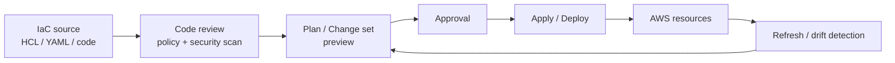
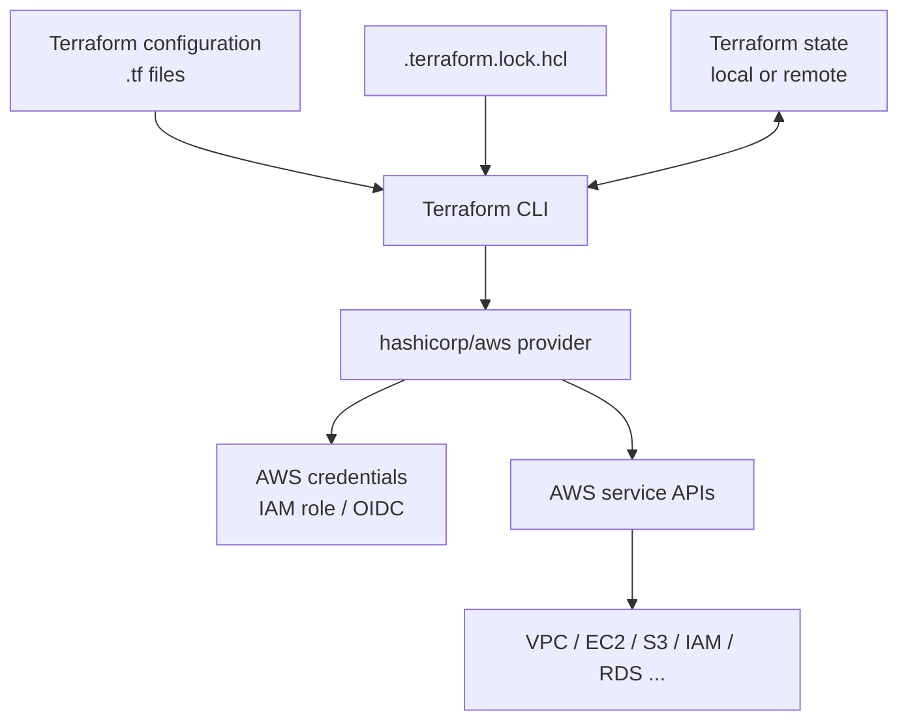
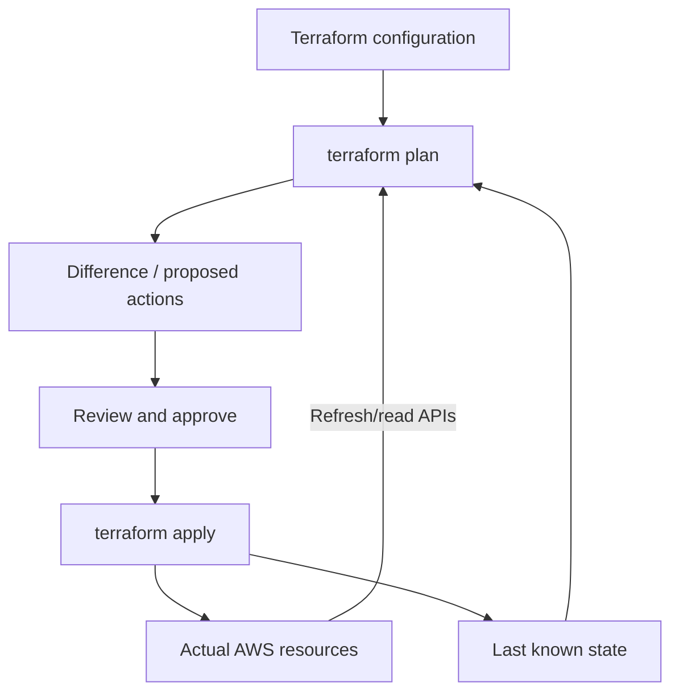
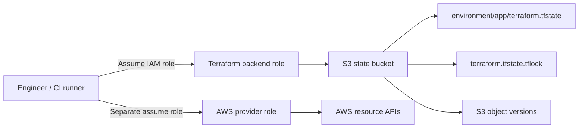
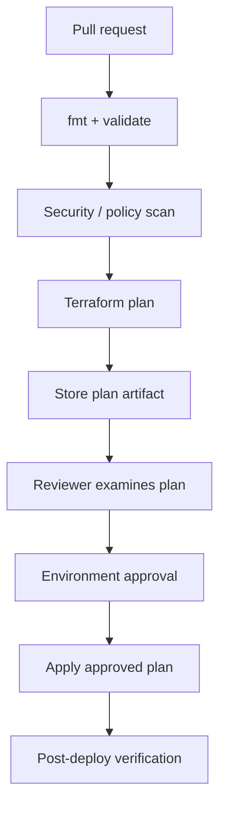
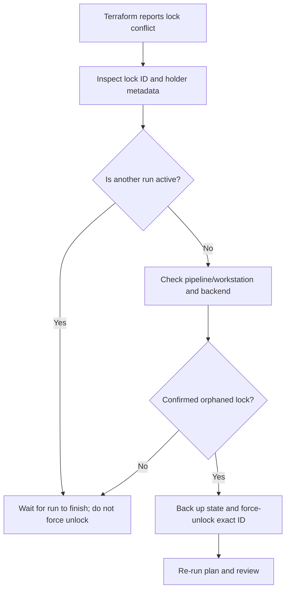

# Terraform AWS Provider, Remote State, and Choosing an IaC Tool

## Learning Objectives

After this lesson, you will be able to:

1. Explain Infrastructure as Code (IaC), Terraform's declarative model, and the lifecycle from configuration to AWS resources.
2. Distinguish the Terraform CLI, AWS provider, resource, data source, module, state, and backend.
3. Declare `required_providers`, Terraform/provider version constraints, and use `.terraform.lock.hcl` for reproducible environments.
4. Configure the AWS provider by Region, profile, IAM role, assume role, OIDC, and provider aliases for multiple accounts/Regions.
5. Understand why Terraform needs state, how state maps resource addresses to AWS resource IDs, and how drift is detected.
6. Design remote state on Amazon S3 with versioning, encryption, IAM least privilege, and native S3 state locking.
7. Distinguish S3 backend access permissions from provider permissions used to create/modify AWS resources.
8. Organize state by application, environment, account, and team; understand the limitations of Terraform workspaces.
9. Migrate state from local/DynamoDB backends, recover state from S3 object versions, and handle locks safely.
10. Compare Terraform, OpenTofu, CloudFormation, AWS CDK, AWS SAM, Pulumi, and Ansible against project requirements.
11. Build an IaC pipeline with plan review, approvals, OIDC credentials, security checks, and apply controls.
12. Practice creating AWS provider configurations, an S3 remote backend, resources, and a plan/apply/destroy workflow in a lab environment.

## 1. What Problem Does Infrastructure as Code Solve?

A Spring Boot application needs a VPC, subnets, security groups, IAM roles, a load balancer, a database, and an S3 bucket. If an engineer creates each resource manually in the AWS Console, configurations across development, staging, and production easily diverge. When rebuilding an environment or investigating a change, the team struggles to know who created a resource, what its initial configuration was, and how to reproduce it accurately.

**Infrastructure as Code (IaC)** describes infrastructure in files that can be read, reviewed, stored in Git, automatically checked, and deployed repeatably. Infrastructure becomes part of the software development lifecycle.



### 1.1. Benefits of IaC

- **Repeatability:** spin up multiple environments from the exact same configuration.
- **Version control:** inspect change history, review diffs, and roll back through structured workflows.
- **Consistency:** reduce discrepancies caused by manual operations.
- **Automation:** integrate with CI/CD pipelines and approval workflows.
- **Auditability:** link commits, reviewers, pipeline runs, and infrastructure changes.
- **Governance:** check policies, encryption, network exposure, tags, and IAM before applying.
- **Disaster recovery:** recreate resources from code, state, and appropriate data backups.

IaC does not automatically make infrastructure secure or error-free. A misconfiguration automated in code deploys faster than a manual mistake. Therefore, reviews, policy checks, access controls, drift monitoring, and recovery plans remain essential.

### 1.2. Imperative vs. Declarative

| Approach | How it describes | Example |
| --- | --- | --- |
| **Imperative** | Lists each step to execute in order. | Create VPC, then create subnet, then create route table using separate API commands. |
| **Declarative** | Describes the desired state; the engine determines required changes. | Declare a VPC with CIDR 10.20.0.0/16, two subnets, and the desired route table. |

Terraform is primarily a **declarative** tool. You describe the outcome; Terraform builds the dependency graph and calls providers to bring infrastructure to the desired state.

### 1.3. How Does Terraform Work with AWS?

The Terraform CLI reads HCL, loads the AWS provider plugin, resolves current state, and calls AWS APIs through the provider. The provider translates resource blocks like `aws_vpc` or `aws_s3_bucket` into corresponding API operations.



The Terraform AWS provider calls AWS service APIs to read, create, update, and delete resources. CloudFormation and CDK use different deployment models, which are compared later.

## 2. Core Concepts in Terraform

| Concept | Role | Example |
| --- | --- | --- |
| **Terraform CLI** | Reads configuration, initializes providers/backends, generates plans, and executes changes. | terraform init, plan, apply. |
| **Provider** | Plugin communicating with a platform or service API. | hashicorp/aws. |
| **Resource** | Infrastructure object whose lifecycle Terraform manages. | aws_vpc, aws_s3_bucket. |
| **Data source** | Reads details about an existing object without managing its create/delete lifecycle. | aws_caller_identity, aws_availability_zones. |
| **Variable** | Configuration input that can vary by environment. | aws_region, environment. |
| **Local** | Reusable expression internal to a module. | Standardized resource name. |
| **Output** | Value published by a module for calling modules or operators. | VPC ID, subnet IDs. |
| **Module** | Groups resources/data/variables/outputs into a reusable unit. | Network module. |
| **State** | Maps resource addresses to real objects and stores metadata. | aws_vpc.main ↔ VPC ID. |
| **Backend** | Where state is stored and locking mechanism if supported. | S3 backend, HCP Terraform. |
| **Workspace** | Multiple independent states sharing one root module configuration. | dev, test, prod. |

### 2.1. Resources vs. Data Sources

A resource represents infrastructure that Terraform is responsible for managing:

```hcl
resource "aws_s3_bucket" "artifacts" {
  bucket = var.artifact_bucket_name
}
```

A data source reads details of an already-existing resource:

```hcl
data "aws_caller_identity" "current" {}

data "aws_availability_zones" "available" {
  state = "available"
}

output "account_id" {
  value = data.aws_caller_identity.current.account_id
}
```

Do not declare an existing bucket as a `resource` solely to read its details. If Terraform needs to manage that bucket's lifecycle, import it into state through the proper workflow.

### 2.2. Resource Address

A resource address identifies an instance within the configuration:

```text
aws_vpc.main
aws_subnet.private["ap-southeast-1a"]
module.network.aws_vpc.this
module.application[0].aws_s3_bucket.artifacts
```

The address is the identity on Terraform's side. An AWS resource ID such as `vpc-0123456789abcdef0` is the object identity on AWS's side. State maintains the binding between both sides.

### 2.3. Terraform Command Lifecycle

| Command | Purpose | Modifies infrastructure? |
| --- | --- | --- |
| terraform init | Downloads providers/modules, initializes backend and dependency lock file. | Does not create workload resources. |
| terraform fmt | Standardizes HCL formatting. | No. |
| terraform validate | Checks syntax and internal consistency. | No. |
| terraform plan | Generates a change preview. | No, though it may read/refresh AWS and state. |
| terraform apply | Executes the change plan. | Yes. |
| terraform destroy | Deletes resources managed by the configuration. | Yes, typically destructive. |
| terraform output | Displays state outputs. | No. |
| terraform state | Inspects/modifies state bindings via dedicated commands. | May modify state; does not necessarily change AWS resources. |

A typical safe workflow is:

```bash
terraform init
terraform fmt -recursive
terraform validate
terraform plan -out=tfplan
terraform show tfplan
# Review and approve before apply
terraform apply tfplan
```

`terraform plan` is a critical review step. Do not use `terraform apply -auto-approve` as the default for production changes unless the pipeline enforces an equivalent approval/policy gate.

## 3. Terraform AWS Provider

### 3.1. Declaring Provider Dependencies

Terraform needs to know the provider's source and version. For the official AWS provider:

```hcl
terraform {
  required_version = ">= 1.11.0, < 2.0.0"

  required_providers {
    aws = {
      source  = "hashicorp/aws"
      version = "~> 6.0"
    }
  }
}
```

- `source = hashicorp/aws` identifies the provider on the Terraform Registry.
- `version = ~> 6.0` permits compatible releases in the 6.x branch under the pessimistic constraint rule.
- `required_version` sets the Terraform CLI version range supported by the configuration.

This is an example constraint for a root module using AWS provider 6.x. In real projects, choose a tested provider version, review changelogs/upgrade guides, and upgrade intentionally. Never pull unbounded `latest` in production.

### 3.2. Dependency Lock File

After `terraform init`, Terraform generates `.terraform.lock.hcl` to pin selected provider versions and package checksums. This file should be committed to Git alongside the root module configuration.

| File/directory | Commit to Git? | Reason |
| --- | --- | --- |
| *.tf | Yes | Desired infrastructure. |
| .terraform.lock.hcl | Yes | Pins provider versions and checksums. |
| terraform.tfvars with sensitive data | No | May contain secrets or environment-specific info. |
| *.tfstate, *.tfstate.backup | No | May contain secrets/infrastructure metadata; store in secure backend. |
| .terraform/ | No | Local cache/plugins/backend metadata. |
| tfplan | Do not commit | Plan may contain sensitive data and reflects a point-in-time state. |

Run `terraform init -upgrade` only when intentionally upgrading providers/modules. Review the lock file diff, run validation/tests, and inspect the plan before applying.

### 3.3. Configuring the AWS Provider

The provider block configures the Region, default tags, and account guardrails:

```hcl
variable "aws_region" {
  description = "Deployment AWS Region"
  type        = string
  default     = "ap-southeast-1"
}

variable "expected_account_id" {
  description = "AWS account ID that the root module is allowed to modify"
  type        = string
}

provider "aws" {
  region              = var.aws_region
  allowed_account_ids = [var.expected_account_id]

  default_tags {
    tags = {
      ManagedBy   = "Terraform"
      Application = "orders-platform"
      Environment = var.environment
    }
  }
}
```

- `region` sets the default Region for resources belonging to this provider instance.
- `allowed_account_ids` causes the provider to refuse operations if active credentials point to an account outside the allowlist.
- `default_tags` attaches common tags to tag-supporting resources; individual resources can override tags per provider rules.

The provider block uses `var.environment` for tagging. That variable is declared alongside other inputs in section 4.2 in the complete root module.

Never place access keys or secret keys directly inside a provider block. Terraform should use the AWS credential chain and temporary credentials.

### 3.4. AWS Authentication Chain

The AWS provider can obtain credentials from multiple sources:

- Environment variables, when configured.
- AWS shared config/credentials files and named profiles.
- AWS IAM Identity Center (SSO).
- Web identity/OIDC.
- ECS task role or container credentials.
- EC2 instance profile.
- Explicit assume role from an already-authenticated identity.

The provider uses the AWS SDK credential chain to locate credentials; the exact mechanism depends on the runtime environment. Always check the active identity with `aws sts get-caller-identity` before running Terraform. Avoid configuring conflicting credential sources simultaneously and never store long-lived access keys in HCL.

On a developer workstation, IAM Identity Center can be used:

```bash
aws configure sso --profile platform-dev
aws sso login --profile platform-dev
aws sts get-caller-identity --profile platform-dev

$env:AWS_PROFILE = "platform-dev"
terraform plan
```

The example above uses PowerShell syntax for setting the environment variable; in Bash use `export AWS_PROFILE=platform-dev`. Select the profile and verify the account before running plan/apply.

### 3.5. Assume Role

Typically an operator or pipeline starts with an initial identity (SSO/OIDC/instance role) and then assumes a least-privilege deployment role:

```hcl
variable "deployment_role_arn" {
  type        = string
  description = "ARN of the role assumed to manage AWS resources"
}

provider "aws" {
  region              = var.aws_region
  allowed_account_ids = [var.expected_account_id]

  assume_role {
    role_arn     = var.deployment_role_arn
    session_name = "terraform-network-dev"
  }
}
```

The provider uses this role to call AWS service APIs. The role needs a trust policy permitting the calling identity to assume it and IAM permissions for the operations Terraform performs. `external_id` can be added when cross-account trust designs require an external ID.

### 3.6. Provider Aliases for Multiple Regions/Accounts

A configuration can define multiple provider instances:

```hcl
variable "dr_deployment_role_arn" {
  type        = string
  description = "ARN of the role in the disaster recovery account"
}

provider "aws" {
  region = "ap-southeast-1"
}

provider "aws" {
  alias  = "dr"
  region = "ap-southeast-2"

  assume_role {
    role_arn     = var.dr_deployment_role_arn
    session_name = "terraform-dr"
  }
}

resource "aws_s3_bucket" "primary" {
  bucket = "example-primary-artifacts"
}

resource "aws_s3_bucket" "disaster_recovery" {
  provider = aws.dr
  bucket   = "example-dr-artifacts"
}
```

`aws` is the default provider; `aws.dr` is an aliased provider instance. If every provider block has an alias, Terraform creates an implied empty default configuration; resources without an explicit `provider` argument could unintentionally use that empty configuration. Always declare a default provider or specify `provider` explicitly.

Child modules can declare the aliases they require:

```hcl
terraform {
  required_providers {
    aws = {
      source = "hashicorp/aws"
      configuration_aliases = [aws.primary, aws.dr]
    }
  }
}
```

The root module passes provider instances into the module:

```hcl
module "replicated_storage" {
  source = "./modules/replicated-storage"

  providers = {
    aws.primary = aws
    aws.dr      = aws.dr
  }
}
```

Provider aliases are useful for multi-Region setups, cross-account networking, and deploying resources across distinct accounts. Separate roles per account/environment to limit blast radius.

## 4. HCL: Describing AWS Infrastructure

### 4.1. Simple Directory Structure

```text
infrastructure/
├── versions.tf
├── providers.tf
├── backend.tf
├── variables.tf
├── main.tf
├── outputs.tf
├── terraform.tfvars.example
└── modules/
    └── network/
        ├── main.tf
        ├── variables.tf
        └── outputs.tf
```

The root module is the directory where the Terraform CLI runs. `.tf` files in the same directory are combined into a single module; splitting files organizes code rather than creating separate modules.

### 4.2. Variables, Locals, and Outputs

```hcl
variable "environment" {
  description = "Environment name"
  type        = string

  validation {
    condition     = contains(["dev", "test", "prod"], var.environment)
    error_message = "environment must be dev, test, or prod."
  }
}

variable "vpc_cidr" {
  description = "CIDR block for the VPC"
  type        = string
  default     = "10.40.0.0/16"
}

locals {
  name_prefix = "orders-${var.environment}"
  common_tags = {
    Application = "orders-platform"
    Environment = var.environment
    ManagedBy   = "Terraform"
  }
}

output "name_prefix" {
  description = "Standardized environment prefix"
  value       = local.name_prefix
}
```

Variables enable reusing the same module across environments. Validation blocks catch invalid inputs before calling AWS APIs. Do not pass secrets via variables in a way that stores them in state.

### 4.3. Resources and Dependency Graph

Example creating a VPC, subnet, and internet gateway:

```hcl
resource "aws_vpc" "main" {
  cidr_block           = var.vpc_cidr
  enable_dns_support   = true
  enable_dns_hostnames = true

  tags = merge(local.common_tags, {
    Name = "${local.name_prefix}-vpc"
  })
}

resource "aws_subnet" "public_a" {
  vpc_id                  = aws_vpc.main.id
  cidr_block              = "10.40.1.0/24"
  availability_zone       = "ap-southeast-1a"
  map_public_ip_on_launch = true

  tags = merge(local.common_tags, {
    Name = "${local.name_prefix}-public-a"
    Tier = "public"
  })
}

resource "aws_internet_gateway" "main" {
  vpc_id = aws_vpc.main.id

  tags = merge(local.common_tags, {
    Name = "${local.name_prefix}-igw"
  })
}
```

Terraform infers the dependency from the `aws_vpc.main.id` reference. It creates the VPC before creating the subnet/IGW. Use `depends_on` only when a real dependency exists that Terraform cannot infer through attribute references.

### 4.4. Data Sources

Reading current account context for verification:

```hcl
data "aws_caller_identity" "current" {}

data "aws_region" "current" {}

output "deployment_context" {
  value = {
    account_id = data.aws_caller_identity.current.account_id
    region     = data.aws_region.current.name
  }
}
```

Data sources help configurations adapt to the target environment, but do not replace account guardrails. For production, still enforce `allowed_account_ids` or equivalent pipeline checks.

### 4.5. count and for_each

`count` fits when instances are nearly identical and can be identified by numeric index. `for_each` fits when each instance has a stable key:

```hcl
variable "private_subnets" {
  type = map(object({
    cidr = string
    az   = string
  }))
}

resource "aws_subnet" "private" {
  for_each = var.private_subnets

  vpc_id            = aws_vpc.main.id
  cidr_block        = each.value.cidr
  availability_zone = each.value.az

  tags = merge(local.common_tags, {
    Name = "${local.name_prefix}-private-${each.key}"
    Tier = "private"
  })
}
```

Example `terraform.tfvars`:

```hcl
private_subnets = {
  apse1a = {
    cidr = "10.40.11.0/24"
    az   = "ap-southeast-1a"
  }
  apse1b = {
    cidr = "10.40.12.0/24"
    az   = "ap-southeast-1b"
  }
}
```

Stable keys reduce the risk of Terraform misidentifying instances when the collection changes. Avoid `count` indices for lists whose ordering may change frequently.

### 4.6. Reusable Modules

A network module can accept a CIDR, subnet map, and tags, then output VPC ID and subnet IDs. The root module calls the module:

```hcl
module "network" {
  source = "./modules/network"

  name_prefix = local.name_prefix
  vpc_cidr    = var.vpc_cidr

  private_subnets = var.private_subnets
  tags            = local.common_tags
}

output "vpc_id" {
  value = module.network.vpc_id
}
```

Modules standardize network creation, though you should not wrap every tiny resource in a module. A good module represents a capability with clear input/output interfaces that multiple root modules can consume.

When calling a module from the Terraform Registry, pin its version:

```hcl
module "vpc" {
  source  = "terraform-aws-modules/vpc/aws"
  version = "~> 6.0"

  name = "orders-dev"
  cidr = "10.50.0.0/16"

  azs             = ["ap-southeast-1a", "ap-southeast-1b"]
  private_subnets = ["10.50.1.0/24", "10.50.2.0/24"]
  public_subnets  = ["10.50.101.0/24", "10.50.102.0/24"]
}
```

This illustrates pinning a module version; before using one, verify module version, inputs/outputs, resource behavior, and compatibility with your project's locked AWS provider.

## 5. Terraform State: Why It Is Needed and What Is Inside

### 5.1. State Is the Map Between Code and AWS

Terraform needs state to know which resource address corresponds to which AWS object, which attributes were read, and metadata needed for the next plan.

Example:

```text
HCL address: aws_vpc.main
AWS object:  vpc-0123456789abcdef0
State:       stores the binding between these two identities
```

State is not just a disposable cache. If state is lost, Terraform may not know which existing AWS resources belong to the configuration; the next plan could propose creating duplicate resources or fail to manage lifecycles properly.

### 5.2. What Does State Store?

- Resource addresses and AWS resource IDs.
- Read/written resource attributes.
- Provider metadata and dependencies.
- Outputs.
- Sensitive values appearing in configurations or provider responses.
- Lineage and serial to track state history.

**State can contain passwords, connection strings, secret values, private endpoints, and sensitive data.** Marking a variable/output as `sensitive` only redacts CLI display; it does not remove values from state.

Never commit state to Git, send state via chat/tickets, or grant broad read permissions to state. Use an encrypted remote backend with access control, auditing, and backups.

### 5.3. What Is Drift?

Drift occurs when live AWS resources differ from Terraform's desired state/recorded state—for example, an engineer changes a security group rule in the Console. Terraform refresh reads live state; a plan may propose reverting the resource back to code configuration.

To inspect post-refresh differences without asking Terraform to force resources back to HCL, run `terraform plan -refresh-only` and review. If the out-of-band change was intentional, update HCL or import/adopt per workflow; never automatically apply a plan containing unexplained changes.



If a Console change was intentional, update code or import/adopt properly so code and reality align. Do not immediately apply a plan with unexpected changes before understanding the drift.

### 5.4. Local State vs. Remote State

| Criterion | Local backend | Remote backend |
| --- | --- | --- |
| Storage location | `terraform.tfstate` file on the machine running Terraform. | Backend service such as S3 or HCP Terraform. |
| Collaboration | Hard to share, state easily diverges across machines. | Multiple engineers/pipelines share a single state. |
| Locking | Depends on local/backend mechanism. | Backend can support distributed locking. |
| Backup/recovery | Depends on personal workstation backups. | Can use S3 Versioning/backups or managed services. |
| Production suitability | Generally unsuitable for teams/prod. | Use a backend with access control and locking. |

When using a remote backend, Terraform does not routinely keep state on local disk. On certain errors where state cannot be written back to the backend, Terraform may save a local fallback file to prevent data loss; follow CLI instructions and recovery procedures rather than deleting that file arbitrarily.

## 6. Remote State on Amazon S3

### 6.1. Recommended Architecture

S3 is a common choice for Terraform state on AWS because it integrates with IAM, encryption, versioning, and CloudTrail. In modern Terraform, the S3 backend supports native state locking via a lock file object.



Separating the backend role and provider role distinguishes:

- **Backend role:** reads/writes state and lock objects in S3, using KMS if a customer-managed key is enabled.
- **Provider role:** reads/creates/modifies AWS resources such as VPC, IAM, EC2, S3, and RDS.

Both roles may be assumed from the same OIDC/SSO identity, yet should carry distinct policies and trust scopes. State access is often more sensitive than reading individual resources because state can hold secrets.

### 6.2. Create the S3 State Bucket First

The backend must exist before Terraform initializes it. Therefore, maintain a dedicated **bootstrap stack** to create the bucket, KMS key/policy, and guardrails. The bootstrap stack can use controlled, backed-up local state or a pre-existing management backend; it must not depend on the very bucket it creates.

Bootstrap stack example:

```hcl
variable "state_bucket_name" {
  type        = string
  description = "Globally unique S3 bucket name for Terraform state"
}

variable "state_kms_key_arn" {
  type        = string
  description = "ARN of the KMS key used to encrypt state"
}

resource "aws_s3_bucket" "terraform_state" {
  bucket = var.state_bucket_name

  lifecycle {
    prevent_destroy = true
  }

  tags = {
    Name      = "terraform-state"
    ManagedBy = "Terraform"
  }
}

resource "aws_s3_bucket_versioning" "terraform_state" {
  bucket = aws_s3_bucket.terraform_state.id

  versioning_configuration {
    status = "Enabled"
  }
}

resource "aws_s3_bucket_server_side_encryption_configuration" "terraform_state" {
  bucket = aws_s3_bucket.terraform_state.id

  rule {
    apply_server_side_encryption_by_default {
      sse_algorithm     = "aws:kms"
      kms_master_key_id = var.state_kms_key_arn
    }
    bucket_key_enabled = true
  }
}

resource "aws_s3_bucket_public_access_block" "terraform_state" {
  bucket = aws_s3_bucket.terraform_state.id

  block_public_acls       = true
  block_public_policy     = true
  ignore_public_acls      = true
  restrict_public_buckets = true
}

resource "aws_s3_bucket_ownership_controls" "terraform_state" {
  bucket = aws_s3_bucket.terraform_state.id

  rule {
    object_ownership = "BucketOwnerEnforced"
  }
}

resource "aws_s3_bucket_policy" "terraform_state_tls_only" {
  bucket = aws_s3_bucket.terraform_state.id

  policy = jsonencode({
    Version = "2012-10-17"
    Statement = [{
      Sid       = "DenyInsecureTransport"
      Effect    = "Deny"
      Principal = "*"
      Action    = "s3:*"
      Resource = [
        aws_s3_bucket.terraform_state.arn,
        "${aws_s3_bucket.terraform_state.arn}/*"
      ]
      Condition = {
        Bool = {
          "aws:SecureTransport" = "false"
        }
      }
    }]
  })
}
```

This example assumes an existing KMS key. The KMS key policy and IAM policies must grant the backend role the required encrypt/decrypt actions. `prevent_destroy` is a Terraform-level guardrail; someone with direct AWS permissions can still delete the resource if IAM/SCPs permit it. Protect the bucket with IAM, bucket policies, SCPs, and governance workflows.

Also consider:

- S3 Versioning and drills to verify object version recovery.
- CloudTrail data events on the state bucket/prefix to audit object reads/writes.
- S3 lifecycle policies aligned with retention and audit requirements.
- AWS Backup for S3 if organizational policy requires centrally managed backups.
- Bucket policies enforcing TLS, encryption, and blocking public access.
- KMS key policies, rotation, and separation of duties.

Never configure lifecycle rules to automatically expire state versions still needed for recovery/audit.

### 6.3. Configuring the S3 Backend

Once the bootstrap bucket is ready, configure the backend in the root module:

```hcl
terraform {
  required_version = ">= 1.11.0, < 2.0.0"

  required_providers {
    aws = {
      source  = "hashicorp/aws"
      version = "~> 6.0"
    }
  }

  backend "s3" {
    bucket       = "company-terraform-state-123456789012"
    key          = "orders-platform/dev/network/terraform.tfstate"
    region       = "ap-southeast-1"
    encrypt      = true
    kms_key_id   = "arn:aws:kms:ap-southeast-1:123456789012:key/11111111-2222-3333-4444-555555555555"
    use_lockfile = true
  }
}
```

Bucket/key/region values are examples; substitute your organization's real resources and accounts. Backend config is initialized during `terraform init`, so you cannot use input variables, locals, data sources, or resource attributes inside the `backend` block. Also never place credentials in the backend file.

`use_lockfile = true` enables native S3 state locking. Terraform 1.11 or newer is recommended per AWS Prescriptive Guidance; HashiCorp docs currently document `use_lockfile` and mark DynamoDB locking as deprecated.

### 6.4. How Does the Lock File Work?

When a plan/apply needs to write state:

1. Terraform requests a lock on the state.
2. The S3 backend creates `<key>.tflock` using a conditional write.
3. If another process already holds the lock, the subsequent run cannot acquire it and stops.
4. When the operation finishes, Terraform deletes the lock object.

State locking prevents multiple writers from updating the same state concurrently. Locking does not replace code review or approval.

For example, if the state key is:

```text
orders-platform/prod/network/terraform.tfstate
```

The corresponding lock object is:

```text
orders-platform/prod/network/terraform.tfstate.tflock
```

### 6.5. Why Not Start New Projects with DynamoDB Locking?

Previously, the S3 backend paired with a DynamoDB table using partition key `LockID` for state locking. HashiCorp now marks `dynamodb_table` locking as deprecated and recommends the native S3 lock file. New projects should use `use_lockfile = true` and do not need a DynamoDB table just to lock Terraform state.

For legacy systems still using DynamoDB locking, migration can proceed in phases:

1. Inventory all workstations and pipelines accessing that state.
2. Upgrade the Terraform CLI to a version supporting S3 native locking per organizational standards.
3. Add `use_lockfile = true`, temporarily keeping `dynamodb_table` for compatibility during transition.
4. Run `terraform init -reconfigure` per runbook and verify the new lock works.
5. Ensure every client has switched to the new configuration/version.
6. Remove `dynamodb_table` from the backend config and re-initialize the backend.
7. Delete the DynamoDB table only after confirming no state or client still uses it.

Never delete the DynamoDB lock table while older runners can still access the state. Never run the migration concurrently with an active apply.

### 6.6. IAM Permissions for the Backend

For the default workspace on the S3 backend, the backend role typically needs:

| Permission | Resource | Purpose |
| --- | --- | --- |
| s3:ListBucket | Bucket ARN, prefix-scoped if possible | List state paths. |
| s3:GetObject | State object ARN | Read state. |
| s3:PutObject | State object ARN | Write state. |
| s3:GetObject | Lock object ARN | Check lock. |
| s3:PutObject | Lock object ARN | Create lock. |
| s3:DeleteObject | Lock object ARN | Release lock when operation ends. |
| kms:Encrypt, kms:Decrypt, kms:GenerateDataKey | KMS key ARN (when using CMK) | Encrypt/decrypt state. |

Terraform does not need `s3:DeleteObject` on the state object in standard S3 backend operations; delete permission is needed for the lock object. Non-default workspaces require matching permissions: additional workspaces use distinct key paths, and policies must cover those prefixes.

Example illustrative policy for a single state key:

```json
{
  "Version": "2012-10-17",
  "Statement": [
    {
      "Sid": "ListTerraformStatePrefix",
      "Effect": "Allow",
      "Action": "s3:ListBucket",
      "Resource": "arn:aws:s3:::company-terraform-state-123456789012",
      "Condition": {
        "StringLike": {
          "s3:prefix": [
            "orders-platform/dev/network/terraform.tfstate",
            "orders-platform/dev/network/terraform.tfstate.tflock"
          ]
        }
      }
    },
    {
      "Sid": "ReadWriteTerraformState",
      "Effect": "Allow",
      "Action": [
        "s3:GetObject",
        "s3:PutObject"
      ],
      "Resource": "arn:aws:s3:::company-terraform-state-123456789012/orders-platform/dev/network/terraform.tfstate"
    },
    {
      "Sid": "ManageTerraformStateLock",
      "Effect": "Allow",
      "Action": [
        "s3:GetObject",
        "s3:PutObject",
        "s3:DeleteObject"
      ],
      "Resource": "arn:aws:s3:::company-terraform-state-123456789012/orders-platform/dev/network/terraform.tfstate.tflock"
    }
  ]
}
```

This policy illustrates a single key and default workspace. When using workspaces, prefixes, multiple state keys, or additional bucket policies, adjust the `s3:ListBucket` condition and object ARNs to match actual paths. The KMS key policy must also permit the corresponding principal.

### 6.7. Backend Credentials Differ from Provider Credentials

Keep this in mind for cross-account configurations:

- The Terraform backend is initialized before provider resources are fully configured.
- The `s3` backend has its own credential/assume-role settings.
- The `aws` provider has its own credential/assume-role settings.
- `assume_role` in the provider does not automatically grant permissions to the backend.
- The backend role can be restricted solely to the state bucket; the provider role holds permissions to manage resources in the target account.

Even if both use the same role, understand backend vs. provider permissions to avoid accidentally granting state read access to unnecessary pipelines/workloads.

The S3 backend has its own `assume_role` configuration. Example:

```hcl
terraform {
  backend "s3" {
    bucket       = "company-terraform-state-123456789012"
    key          = "orders-platform/dev/network/terraform.tfstate"
    region       = "ap-southeast-1"
    use_lockfile = true

    assume_role = {
      role_arn     = "arn:aws:iam::123456789012:role/TerraformStateAccess"
      session_name = "terraform-backend-state"
    }
  }
}
```

The initial identity needs `sts:AssumeRole`, and the target role needs a matching trust policy. The provider role can be a separate role authorized to manage VPC/application resources. Never put access keys, secrets, or session tokens in the backend block.

### 6.8. Backend Partial Configuration

You can keep the backend block free of environment details:

```hcl
terraform {
  backend "s3" {}
}
```

Pass non-sensitive configuration via a backend config file:

```hcl
bucket       = "company-terraform-state-123456789012"
key          = "orders-platform/dev/network/terraform.tfstate"
region       = "ap-southeast-1"
encrypt      = true
use_lockfile = true
```

Initialize:

```bash
terraform init -backend-config=backend-dev.hcl
```

Never place access keys/secrets/session tokens in backend config files or on the command line. Backend configuration may be cached in Terraform's local metadata; credentials should come from the environment/profile/OIDC/role chain.

## 7. Organizing State by Environment and Team

### 7.1. State Key Strategy

One way to structure state keys:

```text
company-terraform-state/
└── aws/
    ├── dev/
    │   ├── network/terraform.tfstate
    │   ├── data/terraform.tfstate
    │   └── application/terraform.tfstate
    ├── staging/
    │   ├── network/terraform.tfstate
    │   └── application/terraform.tfstate
    └── prod/
        ├── network/terraform.tfstate
        ├── data/terraform.tfstate
        └── application/terraform.tfstate
```

Splitting state by domain reduces blast radius and lock contention. If every resource in an organization shares one state, a minor change creates a huge plan and everyone contends for the same lock.

### 7.2. Splitting by Account and Environment

For production, consider:

- Separate AWS accounts for dev/staging/prod per account strategy.
- Separate S3 state buckets or prefix/key isolation matching security boundaries.
- Separate IAM roles for plan/apply and per account.
- Separate state keys for network, data, application, or platform layers.
- KMS keys/policies and access auditing per organizational requirements.

State separation also limits blast radius if a pipeline or credential is compromised.

### 7.3. Terraform Workspaces

Workspaces allow one root module configuration to maintain multiple states:

```bash
terraform workspace list
terraform workspace new dev
terraform workspace new staging
terraform workspace select dev
terraform workspace show
```

With the S3 backend, the `default` workspace stores state at the configured `key`; other workspaces use `workspace_key_prefix` (default `env:`), the workspace name, and the key.

Workspaces work well when environments are structurally similar and share a trust boundary. However, workspaces **are not a security boundary**:

- Workspaces typically share the same configuration and the caller's AWS permissions.
- Anyone with backend access can often access multiple states.
- It is easy to apply in the wrong workspace if context is not checked.
- They do not replace account separation, IAM roles, and separate production approvals.

For tightly controlled production environments, many organizations choose separate root modules/state keys/accounts per environment rather than relying solely on workspaces.

### 7.4. Sharing Outputs Between States

Terraform can read outputs from another state using `terraform_remote_state`:

```hcl
data "terraform_remote_state" "network" {
  backend = "s3"

  config = {
    bucket = "company-terraform-state-123456789012"
    key    = "orders-platform/dev/network/terraform.tfstate"
    region = "ap-southeast-1"
  }
}

locals {
  application_vpc_id = data.terraform_remote_state.network.outputs.vpc_id
}
```

Reading outputs via remote state requires read access to the entire state object, meaning the consumer can read the whole state snapshot rather than just one output. If state contains secrets or sensitive metadata, consider sharing required values via SSM Parameter Store, AWS Secrets Manager, service discovery, or another narrower-privilege interface.

## 8. Migrating, Refactoring, and Restoring State

### 8.1. Migrating Local State to an S3 Backend

General workflow:

1. Create the S3 bucket, versioning, encryption, access policy, and lockfile permissions.
2. Back up local state and verify account/resource ownership.
3. Add the S3 `backend` block to the root module.
4. Ensure no other processes are running against the same state.
5. Run `terraform init -migrate-state` and confirm Terraform copies local state to the backend.
6. Run `terraform plan` to verify there are no unexpected changes.
7. Secure or remove the local backup per policy; never commit it to Git.

```bash
terraform state pull > state-before-migration.json
terraform init -migrate-state
terraform state list
terraform plan
```

`state pull` prints state to stdout; redirecting creates a local file holding sensitive data. Store backup files in a secured directory with restricted permissions and delete them per procedure once the backup is verified safe.

### 8.2. Switching Backends Without Migrating State

`terraform init -reconfigure` instructs Terraform to reinitialize the backend with the new configuration without automatically migrating state from the old backend. Use it only when you know exactly where state lives and have a matching state-handling plan. Do not pick `-reconfigure` out of habit instead of `-migrate-state`.

### 8.3. Importing Existing AWS Resources

If a VPC was created manually and you want Terraform to manage it, declare the resource block and import it:

```hcl
import {
  to = aws_vpc.imported
  id = "vpc-0123456789abcdef0"
}

resource "aws_vpc" "imported" {
  cidr_block = "10.60.0.0/16"
}
```

Run `plan` to inspect the import and configuration differences. You can use the `terraform import` CLI in suitable workflows, yet import only creates a binding in state; you still must complete the HCL configuration so it matches the actual resource.

### 8.4. Refactoring Resource Addresses

When renaming a resource or moving it into a module, use a `moved` block so Terraform knows the old resource address moved to the new address:

```hcl
moved {
  from = aws_s3_bucket.artifacts
  to   = module.storage.aws_s3_bucket.artifacts
}
```

This provides a reviewable, repeatable way to declare refactorings. Keep `moved` blocks around long enough per policy so upgrading workspaces/environments can apply the transition.

### 8.5. State Backup and Restore

Before risky state operations:

```bash
terraform state pull > state-backup.json
terraform state list
```

S3 Versioning retains previous object versions. When restoration is needed:

1. Stop pipelines/workstations that could write to state.
2. Identify the state key and a known-good version ID.
3. Verify the timestamp, serial, and lineage of the state version to restore.
4. Use an approved S3 restore/version-copy procedure to recover the object.
5. Run `terraform state pull`, `state list`, and `plan` to verify.
6. Re-enable applies only after confirming state matches AWS resources.

Never edit JSON state directly in an editor. Never upload an older state file over a newer state without evaluating lineage/serial and resource changes.

### 8.6. Force Unlock

If Terraform terminates abnormally and a lock remains, first verify:

- No Terraform process is still running against that state.
- The lock ID belongs to your own operation.
- No other pipeline is holding a valid lock.
- Backend objects/permissions/networking have recovered.

Only then consider:

```bash
terraform force-unlock <LOCK_ID>
```

`force-unlock` can cause multiple writers to corrupt state if used with the wrong lock ID or while another process is still running. Do not delete `.tflock` manually as a default fix and do not pass `-lock=false` to bypass lock conflicts.

## 9. Choosing an IaC Tool

There is no single best tool for every organization. The choice depends on cloud footprint, team languages, state model, governance, portability, ecosystem, operational overhead, and supportability.

### 9.1. Comparing Popular Tools

| Tool | Language/format | State/deployment model | Strengths | Considerations |
| --- | --- | --- | --- | --- |
| **Terraform** | HCL | Terraform state + backend like S3/HCP Terraform. | Rich providers, multi-cloud, Registry modules, and clear plan/apply workflow. | Must operate state/backends, provider upgrades, and governance. |
| **OpenTofu** | HCL, compatible with many Terraform configs | State/backend similar to Terraform ecosystem, depending on version/provider. | Community fork, open-source option under OpenTofu governance. | Verify provider/module compatibility, lock files, registry, and version features. |
| **AWS CloudFormation** | JSON/YAML | AWS manages stack state and lifecycle. | AWS-native, change sets, drift detection, StackSets, and AWS service integration. | AWS-focused; templates can grow verbose without abstraction. |
| **AWS CDK** | TypeScript, Python, Java, C#, and Go per current support | Synths into CloudFormation templates and deploys as stacks. | Construct abstractions, code reuse, great for programming teams. | Requires understanding both CDK and CloudFormation; synth output needs review. |
| **AWS SAM** | YAML/JSON template extending CloudFormation | CloudFormation stack, serverless-focused. | Simplifies Lambda/API Gateway/event sources and local testing. | Specialized scope for serverless on AWS. |
| **Pulumi** | TypeScript, Python, Go, C#, Java, and YAML per runtime support | Pulumi state backend such as Pulumi Cloud or self-managed backend. | Uses programming languages, multi-cloud, flexible abstractions. | Requires standardizing state/service management, policies, and runtime/tooling. |
| **Ansible** | YAML playbooks | Task execution/configuration management; no IaC state graph like Terraform. | OS configuration, packages, application deployment, and orchestration. | Usually complements provisioning tools rather than replacing full IaC lifecycles. |

### 9.2. Terraform vs. OpenTofu

OpenTofu is a community fork of Terraform. Both tools share much HCL syntax and provider/state concepts, yet you should not assume every version, provider binary, lock file, registry, backend feature, and workflow is directly interchangeable.

Before choosing:

- Check your organization's licensing/governance policies.
- Verify providers/modules support the intended CLI version.
- Test init, plan, apply, and state migration in a test environment.
- Standardize on one CLI/toolchain per state; avoid letting Terraform and OpenTofu both write to the same state without verifying compatibility.
- Pin versions and manage lock files per toolchain.

### 9.3. Terraform or CloudFormation?

Choose Terraform when you need:

- One consistent workflow across AWS and other providers.
- A broad module/provider ecosystem.
- HCL and plan/apply fitting the team's workflow.
- Organizational willingness to operate remote state and provider lifecycles.

Choose CloudFormation when:

- Infrastructure is primarily or exclusively on AWS.
- You want AWS to manage stack state, rollbacks, and deployment lifecycles.
- You need StackSets or native AWS resource support.
- Your organization prefers AWS-native managed services.

### 9.4. Terraform or AWS CDK?

AWS CDK fits when the team favors TypeScript/Java/Python and wants constructs, high-level abstractions, programming logic, and internal libraries. CDK synths into CloudFormation templates; CloudFormation remains the stack deployment engine.

Terraform fits when you want declarative HCL, multi-platform providers, and an independent state/backend workflow. Do not pick CDK solely because the team knows Java; likewise, do not pick Terraform solely because it is popular. Evaluate who reviews code, who operates state, how testing works, and how drift/rollbacks are handled.

### 9.5. Terraform or AWS SAM?

SAM targets serverless applications such as Lambda, API Gateway, event sources, and local testing. When describing an entire platform—VPC, IAM, RDS, shared networking, and diverse resources—Terraform/CDK/CloudFormation generally cover broader ground; SAM can still deploy dedicated serverless stacks.

### 9.6. Terraform or Pulumi?

Pulumi fits when programming-language abstractions, typed APIs, and code reuse are top priorities. Terraform fits when HCL, the provider registry, and module ecosystem meet needs well. Compare state backends, preview semantics, secrets handling, policy engines, CI/CD, and support models.

### 9.7. When to Use Ansible?

Ansible excels at OS configuration, package installation, application deployment, and orchestration after VMs/networks exist. Terraform excels at managing cloud resource lifecycles via providers and a state graph. The two can work together: Terraform provisions EC2/VPC, and Ansible configures the OS and deploys software.

### 9.8. Quick Selection Matrix

| Primary requirement | First option to evaluate |
| --- | --- |
| Multi-cloud and multiple providers | Terraform or Pulumi |
| AWS-only, native stack lifecycle | CloudFormation |
| AWS-only, code-based abstractions | AWS CDK |
| Lambda/API/event-driven serverless | AWS SAM or CDK |
| HCL with preference for community fork | OpenTofu |
| OS configuration and package orchestration | Ansible |

This is a starting point for evaluation, not a rigid rule. AWS Prescriptive Guidance also emphasizes that selection depends on operating model and organizational requirements.

## 10. IaC in CI/CD and Security

### 10.1. Recommended Pipeline



The pipeline should:

- Run `terraform fmt -check -recursive`.
- Run `terraform init` with the committed provider lock file.
- Run `terraform validate`.
- Run security scanning/policy checks for misconfigurations.
- Generate a plan and store the artifact securely.
- Require review/approval before production apply.
- Apply the exact reviewed plan if the pipeline model preserves the artifact and state serial unchanged.
- Record commit SHA, actor, run ID, and role ARN for auditing.

Plan artifacts can contain sensitive data. Restrict download access, set short retention, and never publish publicly.

### 10.2. OIDC Instead of Long-Lived Access Keys

CI providers like GitHub Actions, GitLab CI, or HCP Terraform can issue OIDC identity tokens. An AWS IAM role trust policy verifies issuer, audience, and subject claims; the pipeline exchanges the token for temporary AWS credentials via STS.

Benefits:

- No long-lived IAM access keys/secrets stored in CI variables.
- Credentials are valid only for a short duration.
- Trust policies can restrict repository, branch, environment, workspace, or run phase.
- Plan and apply roles can be separated.

Example trust policy illustrating a GitHub OIDC environment:

```json
{
  "Version": "2012-10-17",
  "Statement": [{
    "Effect": "Allow",
    "Principal": {
      "Federated": "arn:aws:iam::123456789012:oidc-provider/token.actions.githubusercontent.com"
    },
    "Action": "sts:AssumeRoleWithWebIdentity",
    "Condition": {
      "StringEquals": {
        "token.actions.githubusercontent.com:aud": "sts.amazonaws.com",
        "token.actions.githubusercontent.com:sub": "repo:example-org/infrastructure:environment:production"
      }
    }
  }]
}
```

This trust policy must match the exact registered OIDC provider and claims issued by the CI runner. For GitHub environments, you can add `ref` conditions or environment protection rules; never copy example repository/subject values into production without verifying actual claims.

### 10.3. Separating Plan Role and Apply Role

One possible model:

- **Plan role:** reads resource APIs, reads state, and creates lock objects. Some data sources/plan-time APIs require additional read permissions.
- **Apply role:** scoped permissions to create/modify/delete resources.
- **Backend role:** dedicated S3 state/KMS permissions.

Do not assume the plan role only needs strict read-only permissions: state locking requires writing/deleting the lock object. However, the plan role should not hold permission to mutate application infrastructure unnecessarily.

With HCP Terraform, AWS Prescriptive Guidance recommends dynamic credentials via OIDC and separating roles by run phase (plan/apply). With self-managed CI runners, the pipeline must separate jobs/roles and approvals itself.

### 10.4. Policy as Code and Security Scanning

Checks can cover:

- S3 bucket public access, encryption, and versioning.
- Security groups opening SSH/RDP/DB ports to the entire Internet.
- IAM policies with overly broad wildcard actions/resources.
- RDS public accessibility, backups, and encryption.
- KMS key usage/rotation per policy.
- Tags, naming, and Region/account restrictions.
- Resources at risk of destruction/replacement.

Tools include Checkov, Trivy config, OPA/Conftest, Sentinel, or AWS-native controls depending on your ecosystem. Scanner findings require contextual review; passing a few checks does not guarantee overall system security.

### 10.5. Guard Against Wrong Account

Before applying, check:

```bash
aws sts get-caller-identity
terraform workspace show
terraform plan
```

Combine:

- Provider `allowed_account_ids`.
- IAM role trust policies restricting callers.
- AWS Organizations SCPs/permission boundaries.
- Environment approvals for production.
- Dedicated state keys and backend roles.
- Pipelines displaying account ID/Region in plan summaries.

Never rely solely on a workspace name like `prod` to protect production.

## 11. Lab: Creating an Application S3 Bucket with Terraform and Remote State

This lab demonstrates the AWS provider, resources, variables, outputs, and the S3 backend. To keep the lesson focused, the state bucket is assumed to be bootstrapped beforehand per section 6.2.

> Execute only in an authorized test AWS account. S3 bucket names must be globally unique. Verify account/Region and costs before applying. Do not use this example as an unreviewed production configuration.

### 11.1. Preparation

Requirements:

- Terraform CLI version 1.11 or newer for the S3 native lockfile example.
- AWS CLI and authenticated AWS profile/SSO/OIDC.
- An S3 state bucket with versioning, encryption, and public access block enabled.
- IAM role(s) with backend permissions and permission to create/manage the lab bucket.

Log in and verify:

```bash
aws sso login --profile platform-dev
aws sts get-caller-identity --profile platform-dev
export AWS_PROFILE=platform-dev
export ARTIFACT_BUCKET=orders-artifacts-learning-123456789012-unique
```

Setting `AWS_PROFILE` and `ARTIFACT_BUCKET` above uses Bash; in PowerShell use `$env:AWS_PROFILE = "platform-dev"` and `$env:ARTIFACT_BUCKET = "orders-artifacts-learning-123456789012-unique"`. Confirm the returned account ID matches the lab account and the bucket name matches `terraform.tfvars`.

### 11.2. Create the Lab Directory

```text
terraform-s3-lab/
├── versions.tf
├── providers.tf
├── variables.tf
├── main.tf
├── outputs.tf
└── terraform.tfvars
```

### 11.3. versions.tf

```hcl
terraform {
  required_version = ">= 1.11.0, < 2.0.0"

  required_providers {
    aws = {
      source  = "hashicorp/aws"
      version = "~> 6.0"
    }
  }

  backend "s3" {
    bucket       = "replace-with-existing-state-bucket"
    key          = "learning/terraform-s3-lab/dev/terraform.tfstate"
    region       = "ap-southeast-1"
    encrypt      = true
    use_lockfile = true
  }
}
```

Replace `bucket` with the real bootstrapped state bucket. If using a KMS CMK, add `kms_key_id` and grant matching KMS permissions.

### 11.4. providers.tf

```hcl
provider "aws" {
  region              = var.aws_region
  allowed_account_ids = [var.expected_account_id]

  default_tags {
    tags = {
      ManagedBy   = "Terraform"
      Environment = var.environment
      Project     = "terraform-s3-lab"
    }
  }
}
```

### 11.5. variables.tf

```hcl
variable "aws_region" {
  type    = string
  default = "ap-southeast-1"
}

variable "expected_account_id" {
  type        = string
  description = "Lab account ID"
}

variable "environment" {
  type    = string
  default = "dev"
}

variable "artifact_bucket_name" {
  type        = string
  description = "Globally unique lab bucket name"
}
```

### 11.6. main.tf

```hcl
resource "aws_s3_bucket" "artifacts" {
  bucket = var.artifact_bucket_name

  tags = {
    Name = "terraform-lab-artifacts"
  }
}

resource "aws_s3_bucket_versioning" "artifacts" {
  bucket = aws_s3_bucket.artifacts.id

  versioning_configuration {
    status = "Enabled"
  }
}

resource "aws_s3_bucket_server_side_encryption_configuration" "artifacts" {
  bucket = aws_s3_bucket.artifacts.id

  rule {
    apply_server_side_encryption_by_default {
      sse_algorithm = "AES256"
    }
  }
}

resource "aws_s3_bucket_public_access_block" "artifacts" {
  bucket = aws_s3_bucket.artifacts.id

  block_public_acls       = true
  block_public_policy     = true
  ignore_public_acls      = true
  restrict_public_buckets = true
}
```

### 11.7. outputs.tf

```hcl
output "artifact_bucket_name" {
  value = aws_s3_bucket.artifacts.bucket
}

output "artifact_bucket_arn" {
  value = aws_s3_bucket.artifacts.arn
}
```

### 11.8. terraform.tfvars

```hcl
expected_account_id  = "123456789012"
environment          = "dev"
artifact_bucket_name = "orders-artifacts-learning-123456789012-unique"
```

Replace the account ID and bucket name with valid values. Never commit `terraform.tfvars` if it contains private environment data or secrets; you may commit a non-sensitive `terraform.tfvars.example`.

### 11.9. Initialize and Inspect Plan

```bash
terraform init
terraform fmt -recursive
terraform validate
terraform plan -out=tfplan
terraform show tfplan
```

Verify:

- Terraform initialized the S3 backend and native lockfile.
- Provider `hashicorp/aws` was downloaded per the lock file.
- `allowed_account_ids` matches the lab account.
- Plan proposes only the expected bucket/versioning/encryption/public access block resources.
- No production resources or out-of-scope resources appear.

### 11.10. Apply and Verify on AWS

After reviewing the plan:

```bash
terraform apply tfplan

aws s3api get-bucket-versioning \
  --bucket "$ARTIFACT_BUCKET"

aws s3api get-public-access-block \
  --bucket "$ARTIFACT_BUCKET"
```

Check outputs:

```bash
terraform output
terraform state list
terraform state pull
```

Do not print `terraform state pull` to a terminal in environments containing sensitive data unnecessarily; state can contain secrets.

### 11.11. Observing Remote State and Lock

While a plan/apply is running, the S3 bucket may hold:

```text
learning/terraform-s3-lab/dev/terraform.tfstate
learning/terraform-s3-lab/dev/terraform.tfstate.tflock
```

The lock file exists only while the operation holds the lock. Once complete, the lock object is deleted; the state object is updated and S3 Versioning preserves prior versions.

### 11.12. Cleanup

Delete lab resources only after confirming the bucket holds no data that must be retained:

```bash
terraform plan -destroy -out=destroy.tfplan
terraform apply destroy.tfplan
```

Because the bucket has versioning enabled, object versions and delete markers may remain; Terraform does not purge full version history by default. Check the bucket after cleanup and handle object versions per retention policy. **Never delete a shared state bucket** or another project's state objects.

## 12. Troubleshooting

| Symptom | Common cause | Resolution |
| --- | --- | --- |
| No valid credential sources found | SSO not logged in, wrong profile, or runner lacks OIDC role. | Check profile, `aws sts get-caller-identity`, environment, and trust policy. |
| AccessDenied on terraform init | Backend role lacks S3/KMS permissions. | Check backend role, bucket policy, key ARN, and lock object permissions. |
| AccessDenied on terraform plan | Provider role lacks read permissions for resources/data sources. | Distinguish provider role from backend role; grant least privilege for exact APIs. |
| Error acquiring the state lock | Another run holds the lock or a stale lock object remains after failure. | Inspect run/lock ID; force-unlock only when certain no writer remains. |
| S3 backend bucket not found | Bucket not bootstrapped, wrong account/Region/name, or wrong profile. | Verify bucket exists, Region, and backend credentials. |
| Backend configuration changed | Backend block/key/region modified. | Decide between `-migrate-state` and `-reconfigure`; back up state first. |
| Provider version mismatch | Constraint mismatch or stale lock file. | Review constraint, intentionally run `terraform init -upgrade`, and commit lock file. |
| Wrong AWS account | Profile/role assumed into wrong account. | Check STS identity, `allowed_account_ids`, and role trust. |
| Plan proposes recreating many resources | Lost/wrong state binding, provider/schema change, or resource drift. | Do not apply hastily; inspect state, provider version, import/moved mappings, and plan details. |
| Resource exists yet Terraform wants to create new | Resource not imported into state or address mismatch. | Import resource, verify address and config. |
| State serial/lineage conflict | Operating against stale or mismatched state. | Stop writes, compare lineage/serial, back up, and recover per runbook. |
| KMS AccessDenied | Role lacks `kms:Decrypt`, `kms:Encrypt`, `kms:GenerateDataKey`, or key policy denies. | Check IAM policy and KMS key policy. |
| Lock object not deleted | Missing `s3:DeleteObject` on `.tflock` or network error. | Check lock object permissions; confirm no active writer before intervening. |
| Terraform reports drift | Out-of-Terraform change or resource config mismatches reality. | Review plan, confirm whether change was intentional, then update code/import/reconcile. |

### 12.1. Lock Error: Safe Handling Procedure



Never run `terraform force-unlock` merely to make a pipeline proceed faster. State locking protects the integrity of shared state.

## 13. Common Misconceptions

**Misconception 1: "Terraform only needs HCL files, not state."**

False. State maps resource addresses to AWS objects and stores metadata required for plans/updates.

**Misconception 2: "Remote state is a complete backup."**

False. A remote backend provides shared storage and locking; you still need S3 Versioning, backup/restore runbooks, and recovery drills.

**Misconception 3: "The S3 backend automatically enables lock files."**

False. Native S3 locking is opt-in; you must configure `use_lockfile = true`.

**Misconception 4: "DynamoDB locking is the default choice for new projects."**

False. `dynamodb_table` locking in the S3 backend is deprecated; prefer native S3 lockfiles for new Terraform setups.

**Misconception 5: "Sensitive variables do not appear in state."**

False. `sensitive` primarily redacts CLI display output; values can still be stored inside state.

**Misconception 6: "Provider assume role also grants permission to read the S3 backend."**

False. The backend and provider have separate authentication configurations.

**Misconception 7: "Workspaces are a security boundary between dev and prod."**

False. Workspaces only separate states; you still need IAM roles, account separation, and backend access controls.

**Misconception 8: "With terraform_remote_state, consumers can only read outputs."**

False. Consumers must have permission to read the state snapshot containing outputs and other metadata.

**Misconception 9: "Importing a resource means Terraform now has complete configuration."**

False. Import creates the state binding; HCL must still accurately describe the resource so plans do not propose unexpected changes.

**Misconception 10: "Force unlock always solves lock conflicts."**

False. Force-unlocking while a writer is active can corrupt state due to concurrent writes.

**Misconception 11: "Terraform is the only tool needed for all AWS infrastructure."**

False. CloudFormation, CDK, SAM, OpenTofu, Pulumi, and Ansible each carry different trade-offs.

**Misconception 12: "terraform plan requires no AWS permissions."**

False. Planning typically needs to read state and refresh resources/data sources from AWS APIs; the backend also needs lock permissions if locking is enabled.

## 14. Self-Check Questions

**Question 1.** What is IaC?

**Answer:** The practice of describing and managing infrastructure using code/configurations with version control, review, and automation.

**Question 2.** What is the role of a Terraform provider?

**Answer:** It is a plugin that communicates with a platform's API—for example, the AWS provider calls AWS service APIs.

**Question 3.** How do a resource and a data source differ?

**Answer:** A resource manages an object's lifecycle; a data source reads information about an existing object.

**Question 4.** Why is `.terraform.lock.hcl` needed?

**Answer:** Pins provider versions and checksums so workstations and pipelines install the exact tested dependencies.

**Question 5.** What information does Terraform state hold?

**Answer:** Resource addresses, bindings to AWS resource IDs, metadata, attributes, and outputs; it can contain sensitive data.

**Question 6.** Why is remote state needed?

**Answer:** Enables teams/pipelines to share a single state with locking, access control, backups, and recovery.

**Question 7.** Which parameter enables native locking on the S3 backend?

**Answer:** `use_lockfile = true`.

**Question 8.** Why should new projects not start with DynamoDB state locking?

**Answer:** `dynamodb_table` locking is deprecated; native S3 lockfiles are the recommended path.

**Question 9.** How do the state object and lock object differ?

**Answer:** The state object stores the state snapshot; the `.tflock` lock object exists while an operation holds the lock.

**Question 10.** Which permissions are needed on the S3 lock object?

**Answer:** `s3:GetObject`, `s3:PutObject`, `s3:DeleteObject` on the lock object; the state object needs `GetObject`/`PutObject`, plus prefix-scoped `ListBucket`.

**Question 11.** Must the provider role and backend role be identical?

**Answer:** No. They have separate credential configurations and should separate permissions to restrict state access.

**Question 12.** Why is a workspace not a security boundary?

**Answer:** Workspaces separate state, yet do not automatically isolate IAM, accounts, backend access, or operator permissions.

**Question 13.** When is `terraform init -migrate-state` used?

**Answer:** When migrating state from an old backend to a new backend per a migration procedure.

**Question 14.** Does `terraform import` automatically generate complete HCL?

**Answer:** No. Import only creates the binding in state; operators must still complete the configuration.

**Question 15.** When should you consider CloudFormation/CDK instead of Terraform?

**Answer:** When AWS-only, needing native stack lifecycle/state, or wanting CDK constructs and programming languages on top of CloudFormation.

## Official Documentation

- [Terraform — AWS Provider](https://registry.terraform.io/providers/hashicorp/aws/latest/docs)
- [Terraform — Provider requirements](https://developer.hashicorp.com/terraform/language/providers/requirements)
- [Terraform — Dependency lock file](https://developer.hashicorp.com/terraform/language/files/dependency-lock)
- [Terraform — AWS S3 backend](https://developer.hashicorp.com/terraform/language/backend/s3)
- [Terraform — State](https://developer.hashicorp.com/terraform/language/state)
- [Terraform — State locking](https://developer.hashicorp.com/terraform/language/state/locking)
- [Terraform — Remote state](https://developer.hashicorp.com/terraform/language/state/remote)
- [Terraform — State backends](https://developer.hashicorp.com/terraform/language/state/backends)
- [Terraform — Provider configuration](https://developer.hashicorp.com/terraform/language/providers/configuration)
- [Terraform — Modules](https://developer.hashicorp.com/terraform/language/modules)
- [AWS Prescriptive Guidance — Terraform AWS Provider best practices](https://docs.aws.amazon.com/prescriptive-guidance/latest/terraform-aws-provider-best-practices/introduction.html)
- [AWS Prescriptive Guidance — Backend best practices](https://docs.aws.amazon.com/prescriptive-guidance/latest/terraform-aws-provider-best-practices/backend.html)
- [AWS Prescriptive Guidance — Security best practices](https://docs.aws.amazon.com/prescriptive-guidance/latest/terraform-aws-provider-best-practices/security.html)
- [AWS Prescriptive Guidance — Choosing an IaC tool](https://docs.aws.amazon.com/prescriptive-guidance/latest/choose-iac-tool/choose-tool.html)
- [AWS CloudFormation](https://docs.aws.amazon.com/AWSCloudFormation/latest/UserGuide/Welcome.html)
- [AWS Cloud Development Kit](https://docs.aws.amazon.com/cdk/v2/guide/home.html)
- [AWS Serverless Application Model](https://docs.aws.amazon.com/serverless-application-model/latest/developerguide/what-is-sam.html)
- [OpenTofu documentation](https://opentofu.org/docs/)
- [Pulumi documentation](https://www.pulumi.com/docs/)
- [Ansible documentation](https://docs.ansible.com/)

**Key takeaway:** The Terraform AWS provider communicates with AWS APIs; Terraform state records resource bindings and metadata. For AWS teams, use an S3 remote backend with Versioning, encryption, least-privilege IAM, and `use_lockfile = true`; keep the backend role separate from the provider role. Pin Terraform/provider versions, commit the lock file, review plans before applying, and protect state as sensitive data. Choose Terraform, OpenTofu, CloudFormation, CDK, SAM, Pulumi, or Ansible based on cloud footprint, team skills, state model, governance, and long-term operations.
