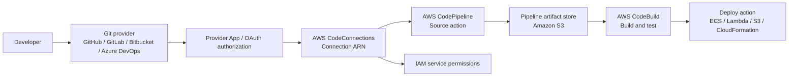
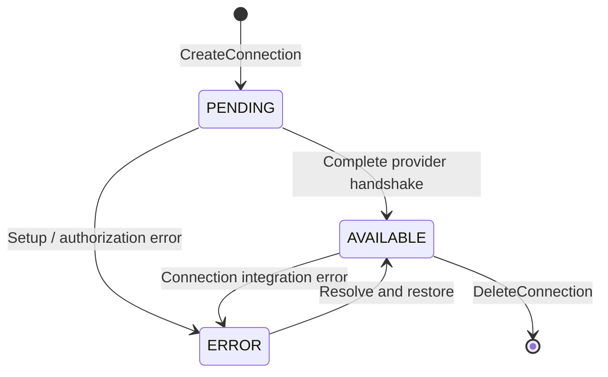
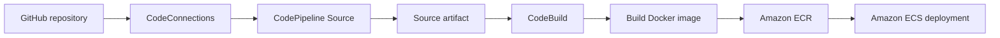
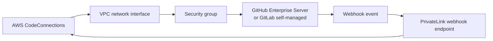
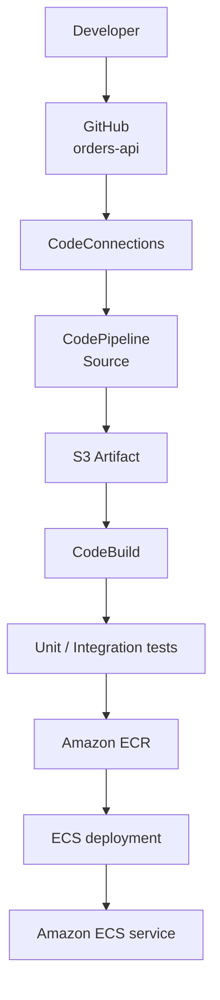

# Connecting Source Repositories with AWS CodeConnections

> **Chapter:** CI/CD on AWS  
> **Module:** CLOUD_PROVIDERS_AWS  
> **Scope:** Integrating third-party source code repositories with AWS via AWS CodeConnections, from authorizing the Git provider, creating and completing a connection, to using the connection in AWS CodePipeline and AWS CodeBuild. The lesson focuses on lifecycle, IAM, source actions, event triggers, operations, and troubleshooting.

## Learning Objectives

After this lesson, learners can:

1. Explain the role of AWS CodeConnections in an AWS CI/CD architecture.
2. Distinguish between connection, host, provider installation, repository, and source action.
3. Recognize common providers: GitHub, GitHub Enterprise, Bitbucket Cloud, GitLab, and Azure DevOps.
4. Distinguish between cloud providers and self-managed providers requiring a host resource.
5. Create a connection via AWS Console and AWS CLI.
6. Explain the PENDING, AVAILABLE, and ERROR states.
7. Complete the GitHub App/OAuth handshake and restrict repository access permissions.
8. Distinguish the `codeconnections` service prefix from `codestar-connections` in ARNs and IAM policies.
9. Grant least-privilege permissions for CodePipeline and CodeBuild to use a connection.
10. Configure the `CodeStarSourceConnection` source action in CodePipeline.
11. Distinguish between `CODE_ZIP` and `CODEBUILD_CLONE_REF`.
12. Configure triggers by push, branch, tag, pull request, and file path.
13. Use AWS CloudFormation to declare a connection.
14. Connect GitHub Enterprise Server or self-managed GitLab via a host and VPC.
15. Troubleshoot Pending, AccessDenied, repository visibility, webhook, host, and Region errors.
16. Practice integrating a GitHub repository with a deployment pipeline on AWS.

## 1. What Is AWS CodeConnections?

AWS CodeConnections is a service that manages connections between AWS resources and source code repositories hosted on third-party platforms.

Example:

- Application Java source code resides in GitHub.
- The development team wants to use AWS CodePipeline to automate builds and deployments.
- AWS needs an authentication mechanism to access the repository without embedding a username/password or personal access token in the pipeline.
- CodeConnections provides a connection resource to establish and manage that access.

CodeConnections is the source integration layer. It is not a Git server, does not store a replacement copy of the repository, and is not a build/deploy service.

### 1.1 Overview Architecture



Workflow:

1. A developer commits and pushes code to the repository.
2. The provider emits a source code change event.
3. The authorized connection allows AWS to detect the event and access the repository.
4. The CodePipeline source action retrieves the corresponding revision.
5. The source action produces an artifact or a Git clone reference.
6. CodeBuild builds and tests the application.
7. Subsequent actions deploy the artifact to the target environment.

### 1.2 What Problems Does CodeConnections Solve?

Without a managed integration mechanism:

- Pipelines might have to hold repository access tokens.
- Every token expiration would require a rotation procedure.
- Repository permissions are difficult to control centrally.
- Webhook registration and event handling might have to be implemented manually.
- Granting access across multiple pipelines becomes complex.

CodeConnections centrally manages connections and provider authorization, then lets authorized AWS services use those connections.

### 1.3 Comparing CodeConnections with Other CI/CD Services

| Component | Responsibility |
|---|---|
| AWS CodeConnections | Connect and authorize external source providers |
| AWS CodePipeline | Orchestrate CI/CD steps |
| AWS CodeBuild | Build and test source code |
| Amazon S3 | Store pipeline artifacts |
| AWS CodeDeploy | Orchestrate deployments per supported models |
| AWS IAM | Control who can create, manage, and use connections |
| GitHub/GitLab/Bitbucket | Host source code and emit Git events |

**CodeConnections does not replace CodePipeline or CodeBuild.** It provides repository integration capabilities for those services to use.

## 2. Key Concepts

### 2.1 Connection

A connection is an AWS resource representing a configured link between AWS and a third-party source provider.

A connection has:

- Connection name.
- Connection ARN.
- Provider type.
- Connection status.
- Provider owner information.
- Host ARN if the connection uses a self-managed provider with a host.

Connection names must be unique within an AWS account and have a maximum length of 32 characters. The ARN is the identifier used to reference the resource across AWS services.

Example ARN:

```text
arn:aws:codeconnections:ap-southeast-1:111122223333:connection/abc12345-6789-0000-1111-example
```

The ARN above is only an illustrative example, not a real connection.

The Connection ARN is referenced in CodePipeline configurations, IAM policies, and corresponding AWS integrations.

### 2.2 Provider

A provider is a repository hosting platform external to AWS.

Examples:

- GitHub.
- GitHub Enterprise Server.
- Bitbucket Cloud.
- GitLab.com.
- GitLab self-managed.
- Azure DevOps.

Provider names in the API may differ from display names in the Console.

| Provider on Console | Provider type commonly used in API/CLI |
|---|---|
| GitHub | GitHub |
| GitHub Enterprise Server | GitHubEnterpriseServer |
| Bitbucket | Bitbucket |
| GitLab | GitLab |
| GitLab self-managed | GitLabSelfManaged |
| Azure DevOps | AzureDevOps |

Do not assume every provider type appearing in the API has the exact same capabilities across all AWS services. Verify the consuming service's integration and per-Region limitations.

### 2.3 Host

A host is a resource representing a third-party provider installed on private infrastructure, such as:

- GitHub Enterprise Server running on EC2.
- GitLab Enterprise Edition running in a private VPC.
- Self-managed GitLab Community Edition.

A host provides endpoint details and network connectivity configuration to the provider system.

Host vs. connection:

- A host describes where the provider is installed.
- A connection describes the established access to the provider/repository.

For standard cloud providers like GitHub.com, Bitbucket Cloud, or GitLab.com, no host is needed.

### 2.4 Provider App / Installation

Some providers use an integration app to authorize AWS:

- GitHub uses AWS Connector for GitHub.
- Bitbucket uses the AWS connection app.
- GitLab uses the corresponding integration application.
- Azure DevOps uses connector authorization.

App installation grants AWS permissions scoped to what the provider administrator approves.

For example, with a GitHub App, an organization can restrict which repositories the AWS Connector can access instead of allowing all repositories in the account.

### 2.5 Repository

A repository stores source code, branches, tags, commits, and Git metadata.

Having a connection does not mean a pipeline can access every repository in the organization.

Actual access depends on:

1. Provider account or organization.
2. App installation.
3. Granted repository permissions.
4. Connection being used.
5. IAM policy of the AWS principal using the connection.

### 2.6 Distinguishing Connection, Host, and Repository Link

AWS CodeConnections also has resources for Git sync and other integrations.

| Resource | Role |
|---|---|
| Connection | Authorize and connect to a third-party provider |
| Host | Represent self-managed provider infrastructure |
| Repository Link | Link a repository to a resource or workflow supporting Git sync |
| Sync Configuration | Configure synchronization of a repository with supported AWS resources |

In this lesson, the focus is on Connection and Host. Repository Link and Sync Configuration are not required components for creating a typical CodePipeline source action.

## 3. Which Providers Are Supported?

AWS CodeConnections supports providers per specific integration and feature set.

### 3.1 GitHub and GitHub Enterprise Cloud

**Type:** Cloud provider

```text
GitHub.com
GitHub Enterprise Cloud
```

Characteristics:

- Uses a GitHub App.
- Repository access can be restricted when installing AWS Connector.
- The connection must be authorized by a GitHub account with appropriate permissions.
- For repositories belonging to an organization, an organization owner must perform or approve the app installation as required by AWS.
- Non-organization repositories require appropriate owner permissions.

A single GitHub App installation can be reused for multiple applicable connections within the same GitHub account/organization.

Note: AWS CodeConnections currently does not support GitHub Enterprise Cloud with data residency using custom domains of the form `*.ghe.com` per provider compatibility documentation.

### 3.2 Bitbucket Cloud

**Type:** Cloud provider

Supports repositories on Bitbucket Cloud.

Does not imply support for all Bitbucket products:

- Bitbucket Cloud: supported.
- Self-hosted Bitbucket Server/Data Center: not treated as a Bitbucket Cloud connection.

For a Bitbucket workspace, the person creating the connection needs administrator permissions as required by the provider.

### 3.3 GitLab.com

**Type:** Cloud provider

Supports GitLab.com.

Key notes:

- The account must have appropriate Owner permissions on the repository.
- Group repositories can be accessed according to the corresponding repository and installation permissions.
- AWS CodeConnections supports GitLab version 15.x and later per provider compatibility documentation.

### 3.4 GitHub Enterprise Server

**Type:** Self-managed provider

GitHub Enterprise Server runs on infrastructure managed by the organization.

Example:

```text
https://github.enterprise.example.com
```

The connection requires a host to represent the installed server.

The host may require:

- VPC ID.
- Subnet IDs.
- Security group IDs.
- Provider endpoint.
- TLS certificate if using a private CA.
- Network connectivity between AWS CodeConnections and GitHub Enterprise Server.

### 3.5 GitLab Self-Managed

**Type:** Self-managed provider

Supports self-managed GitLab Enterprise Edition or Community Edition.

Example:

```text
https://gitlab.internal.example.com
```

Preparation items:

- An operational GitLab instance.
- An administrator can create a Personal Access Token with the `api` scope to register the host. If GitLab Admin Mode is enabled, the PAT also needs the `admin_mode` scope.
- The PAT is used during host setup; it should not be treated as a runtime token embedded in an application.
- A temporary PAT can be used to register the host and revoked/deleted after the host reaches `AVAILABLE` if organizational processes allow.
- Network connectivity and TLS must be configured if GitLab resides in a private network.

### 3.6 Azure DevOps

Azure DevOps can also be used as a provider for CodeConnections and CodePipeline per the corresponding integration guide.

Characteristics:

- Connects to an Azure DevOps account.
- Project and repository must be created beforehand.
- Requires Administrator permissions on the Azure account to install the connection app per guidance.
- The connection only accesses repositories belonging to the account used to create and authorize the connection.

Distinguish Azure DevOps Services from other self-hosted Azure provider types. Do not assume any arbitrary Azure-hosted server is supported.

### 3.7 Provider Comparison Table

| Provider | Type | Host | Notes |
|---|---|---|---|
| GitHub.com | Cloud | No | GitHub App |
| GitHub Enterprise Cloud | Cloud | No | Custom data residency domains `*.ghe.com` not supported |
| Bitbucket Cloud | Cloud | No | Does not include Bitbucket Server |
| GitLab.com | Cloud | No | GitLab 15.x and later |
| GitHub Enterprise Server | Self-managed | Yes | May require VPC |
| GitLab self-managed | Self-managed | Yes | EE or CE |
| Azure DevOps | Cloud service | No | Requires appropriate Administrator permissions |

**Important:** The AWS CodeConnections API, AWS CloudFormation resource schema, and CodePipeline provider integration may not have identical lists of values. Check the documentation for the specific service and deployment method being used before choosing a provider.

## 4. Connection Lifecycle

A connection does not automatically become `AVAILABLE` immediately after creation via CLI or CloudFormation.

### 4.1 Three Main States

| State | Meaning |
|---|---|
| **PENDING** | The resource has been created but requires completing the handshake or provider installation. |
| **AVAILABLE** | The connection has completed authorization and can be used by AWS services if IAM permissions are valid. |
| **ERROR** | The connection encountered an issue during setup or integration; check provider authorization, installation state, and configuration. |

### 4.2 Lifecycle Diagram



The diagram illustrates the main operational states, not every internal service transition.

### 4.3 Why Does the CLI Create Connections in the PENDING State?

The CLI/API can create the resource, but cannot perform interactive authentication on the provider's web page on the user's behalf.

Example:

1. AWS CLI creates the connection.
2. AWS returns the Connection ARN.
3. The connection has status `PENDING`.
4. An administrator opens the AWS Developer Tools Console.
5. Selects the connection to complete.
6. Performs the OAuth/App installation handshake.
7. Authorizes access permissions.
8. The connection transitions to `AVAILABLE`.

**The AWS CLI cannot replace the console handshake step for a pending connection under the current workflow.**

### 4.4 Checking Connection Status

Using AWS CLI:

```bash
aws codeconnections list-connections \
  --region ap-southeast-1 \
  --provider-type-filter GitHub
```

Inspect a single connection:

```bash
aws codeconnections get-connection \
  --connection-arn arn:aws:codeconnections:ap-southeast-1:111122223333:connection/example-id \
  --region ap-southeast-1
```

Check the `ConnectionStatus` field.

Do not put illustrative Connection ARNs into production. Use the actual ARN from the connection creation output or the AWS Console.

## 5. Creating a Connection via AWS Console

This method is suitable when an administrator wants to perform both authorization and provider installation through a visual interface.

### 5.1 Preparation

Before creating a GitHub connection:

- Have an AWS account with permissions to manage CodeConnections.
- Choose an AWS Region that supports the service.
- Have a GitHub account.
- Have a repository already created.
- Have appropriate owner/admin permissions to install AWS Connector.
- Identify which repositories AWS should be allowed to access.

### 5.2 Steps to Create a GitHub Connection

1. Sign in to the AWS Management Console.
2. Open the Developer Tools Console, go to Settings → Connections.
3. Choose Create connection.
4. Choose the GitHub provider.
5. Enter a Connection name, for example `orders-github-connection`.
6. Choose Connect to GitHub.
7. Choose Authorize AWS Connector for GitHub.
8. Choose the GitHub account or organization where the App will be installed.
9. Choose appropriate repository access.
10. Confirm Install or Accept new permissions if GitHub prompts.
11. Return to the AWS Console.
12. Select the newly created installation.
13. Choose Connect to finish.

Once completed, the connection appears in the list with status `AVAILABLE`.

### 5.3 Selecting Least-Privilege Repository Permissions

Suppose an organization has:

- `orders-api`
- `payments-api`
- `customer-service`
- `internal-tools`
- `infrastructure-live`

The `orders-api` pipeline only needs to read `orders-api`.

Restrict the GitHub App installation to only the required repositories instead of granting access to all repositories.

This reduces the access scope if the connection or pipeline role is misconfigured.

### 5.4 Permissions of the Connection Creator

Some providers require higher privileges than a typical developer:

| Provider | Permissions to note |
|---|---|
| GitHub organization | Organization owner to install/authorize the app |
| Personal GitHub repository | Repository owner |
| Bitbucket workspace | Workspace administrator |
| GitLab | Repository owner |
| Azure DevOps | Administrator on the Azure account per guidance |
| GitLab self-managed | Administrator to create PAT/set up host |

Do not grant broad admin permissions to every developer just so they can create connections. Organizations can have a platform team or administrator manage the authorization step, then share the connection using AWS-supported mechanisms.

## 6. Creating a Connection with AWS CLI

The CLI is suitable when creating resources in a controlled way, recording them in provisioning scripts, or preparing infrastructure before completing authorization.

### 6.1 Creating a GitHub Connection

```bash
aws codeconnections create-connection \
  --provider-type GitHub \
  --connection-name orders-github-connection \
  --region ap-southeast-1
```

Example output:

```json
{
  "ConnectionArn": "arn:aws:codeconnections:ap-southeast-1:111122223333:connection/abcd1234-example"
}
```

Save the Connection ARN as an output or parameter for pipeline configuration.

Do not store provider access tokens in script files.

### 6.2 Completing the Connection

After CLI creation:

1. Open the AWS Developer Tools Console.
2. Select the corresponding Region.
3. Open Settings → Connections.
4. Select the connection in `PENDING` state.
5. Choose Update a pending connection.
6. Complete provider authorization.
7. Choose Connect/Complete connection.
8. Verify the `AVAILABLE` status.

### 6.3 Creating a GitLab Connection

```bash
aws codeconnections create-connection \
  --provider-type GitLab \
  --connection-name orders-gitlab-connection \
  --region ap-southeast-1
```

Then complete authorization in the AWS Console.

### 6.4 Creating an Azure DevOps Connection

```bash
aws codeconnections create-connection \
  --provider-type AzureDevOps \
  --connection-name orders-azure-connection \
  --region ap-southeast-1
```

The connection only accesses repositories belonging to the Azure DevOps account used to authorize it.

### 6.5 Listing All Connections

```bash
aws codeconnections list-connections \
  --region ap-southeast-1 \
  --output table
```

You can filter by provider:

```bash
aws codeconnections list-connections \
  --provider-type-filter GitHub \
  --region ap-southeast-1 \
  --output json
```

### 6.6 Deleting a Connection

```bash
aws codeconnections delete-connection \
  --connection-arn arn:aws:codeconnections:ap-southeast-1:111122223333:connection/example-id \
  --region ap-southeast-1
```

Deleting a connection can cause pipelines referencing that ARN to lose access to the repository.

Before deleting:

- Identify pipelines using the connection.
- Identify other projects or integrations referencing it.
- Prepare a replacement connection if needed.
- Check impacts on triggers and pending releases.

A deleted Connection ARN cannot be reused for a new connection.

## 7. Integrating with AWS CodePipeline

This is the most common use case for CodeConnections.

CodePipeline uses a connection via the source action to:

- Access the repository.
- Identify the branch and commit.
- Detect source changes.
- Create the source artifact.
- Trigger subsequent actions.

### 7.1 Action Provider and Service Name

One distinction to note:

- Current service name: **AWS CodeConnections**.
- New IAM service prefix: **codeconnections**.
- CodePipeline source action provider: **CodeStarSourceConnection**.

Do not arbitrarily change the `Provider` value in `ActionTypeId` to `CodeConnections`.

### 7.2 Source Action Configuration Fields

| Field | Meaning |
|---|---|
| `ConnectionArn` | ARN of an `AVAILABLE` connection |
| `FullRepositoryId` | Owner/repository or provider-specific repository identifier |
| `BranchName` | Branch used as source |
| `OutputArtifactFormat` | Source artifact format |
| `DetectChanges` | Enable or disable automatic change detection |

`FullRepositoryId` must preserve exact upper/lower case matching the repository name on the provider.

Example:

```text
Repository owner: my-company
Repository name: Orders-API

FullRepositoryId:
my-company/Orders-API
```

Do not change it to `my-company/orders-api` if the actual name has uppercase letters.

### 7.3 Example CodePipeline Source Action in YAML

```yaml
Name: Source
Actions:
  - Name: GitHubSource
    ActionTypeId:
      Category: Source
      Owner: AWS
      Provider: CodeStarSourceConnection
      Version: "1"
    Configuration:
      ConnectionArn: arn:aws:codeconnections:ap-southeast-1:111122223333:connection/example-id
      FullRepositoryId: my-company/orders-api
      BranchName: main
      OutputArtifactFormat: CODE_ZIP
    OutputArtifacts:
      - Name: SourceArtifact
    RunOrder: 1
```

This is a source stage fragment, not a complete pipeline definition. The ARN and repository must be replaced with actual details.

### 7.4 What Data Does the Source Action Return?

Typically, the source action produces an output artifact containing the source code of the corresponding revision.

Output variables can provide:

- `BranchName`.
- `CommitId`.
- `CommitMessage`.
- `ConnectionArn`.
- `FullRepositoryName`.
- `AuthorDate`.

These variables can be used in subsequent actions if an appropriate namespace is configured.

Examples:

- Tagging a Docker image with the commit ID.
- Including the commit message in deployment notifications.
- Recording the source revision in release metadata.

### 7.5 CODE_ZIP vs. CODEBUILD_CLONE_REF

Two ways to pass source code:

| Format | Content | When to use |
|---|---|---|
| `CODE_ZIP` | ZIP containing a source code snapshot | Standard builds/tests |
| `CODEBUILD_CLONE_REF` | Git URL reference for downstream repository cloning | When Git metadata and Git operations are needed in CodeBuild |

**`CODEBUILD_CLONE_REF` is only for downstream CodeBuild actions.**

When using full clone:

- CodeBuild can work with a real Git repository.
- Git history and Git metadata can be used appropriately.
- The CodeBuild service role must be granted permission to use the connection.
- You cannot pass a Git URL reference to an action that does not support this artifact type.

If the build only needs source files, `CODE_ZIP` is usually simpler.

### 7.6 Azure DevOps Source Action

Azure DevOps has dedicated integration guidance in CodePipeline. The Console allows choosing Azure DevOps as a source provider.

For Azure DevOps:

- Create a connection with provider type `AzureDevOps`.
- Complete account authorization.
- Select the repository.
- Select the artifact format.
- Configure the pipeline trigger.

Do not blindly copy a GitHub source action configuration to Azure DevOps without checking the corresponding provider configuration.

## 8. Integrating with AWS CodeBuild

CodeBuild can use CodeConnections to fetch source from supported providers.

There are two common approaches:

### 8.1 CodeBuild Connects Directly to the Git Provider

In a CodeBuild project:

1. Create or open a Build project.
2. Select the appropriate Source provider.
3. Select the credential type supporting GitHub App/connection.
4. Select an `AVAILABLE` connection.
5. Select the repository and branch.
6. Configure the buildspec.
7. Attach a service role with required permissions.
8. Run a test build.

CodeBuild can use the connection as an account-level credential or a custom source credential depending on project configuration.

### 8.2 CodePipeline Invokes CodeBuild

Common architecture:



In this model:

- The CodePipeline role needs permission to use the connection in the source action.
- The CodeBuild role needs permission to access resources used during the build.
- If using `CODEBUILD_CLONE_REF`, the CodeBuild role also needs permission to clone from the connection.

### 8.3 Permissions for CodeBuild Full Clone

Example policy scoped to a repository:

```json
{
  "Version": "2012-10-17",
  "Statement": [
    {
      "Effect": "Allow",
      "Action": [
        "codeconnections:UseConnection"
      ],
      "Resource": "arn:aws:codeconnections:ap-southeast-1:111122223333:connection/example-id",
      "Condition": {
        "StringEquals": {
          "codeconnections:FullRepositoryId": "my-company/orders-api"
        }
      }
    }
  ]
}
```

This example is for CodeBuild Git clone using a new connection ARN. If using an older ARN or an integration with a different service prefix, adjust the policy to match the exact ARN and corresponding IAM guidance.

Do not grant permissions across all connections if the project only needs a single repository.

## 9. IAM and Authorization

IAM is the most critical part for controlling who is allowed to create connections, complete authorization, and use connections.

Distinguish three principal groups.

### 9.1 Connection Administrator

This principal manages connections:

- Create connections.
- List connections.
- View status.
- Complete the handshake.
- Update or delete connections.
- Manage hosts if using a self-managed provider.

Commonly related permissions:

```text
codeconnections:CreateConnection
codeconnections:DeleteConnection
codeconnections:GetConnection
codeconnections:ListConnections
```

Completing the handshake in the Console also requires IAM policy permissions supporting the browser-based authorization flow, such as:

```text
codeconnections:GetIndividualAccessToken
codeconnections:GetInstallationUrl
codeconnections:ListInstallationTargets
codeconnections:StartOAuthHandshake
codeconnections:UpdateConnectionInstallation
```

The handshake permissions listed above are IAM permissions supporting the Console flow; not all of them are API operations that can be called directly via CLI.

This is an example permission group to illustrate the role, not a complete policy for every provider.

### 9.2 CodePipeline Service Role

The CodePipeline service role needs permission to use the connection configured in the source action.

Example policy:

```json
{
  "Version": "2012-10-17",
  "Statement": [
    {
      "Sid": "UseOrdersSourceConnection",
      "Effect": "Allow",
      "Action": [
        "codeconnections:UseConnection",
        "codestar-connections:UseConnection"
      ],
      "Resource": "arn:aws:codeconnections:ap-southeast-1:111122223333:connection/example-id"
    }
  ]
}
```

Why are there two actions?

AWS maintains both service prefixes:

- `codeconnections`.
- `codestar-connections`.

Some operations execute through code paths using the legacy prefix, while others use the new prefix. AWS recommends granting both `UseConnection` actions so the service role works with connection ARNs under either prefix.

Important point: **the service prefix in the Resource ARN must match the actual resource.**

If the actual ARN starts with `arn:aws:codestar-connections`, the Resource policy must specify that exact ARN, not replace it with `arn:aws:codeconnections`.

### 9.3 CodeBuild Service Role

The CodeBuild service role may need permissions to:

- Use the connection when performing a full clone.
- Read the source repository.
- Retrieve required Git metadata.
- Read artifacts and write build outputs.
- Read ECR credentials or call other services per the buildspec.

CodeBuild permissions do not replace CodePipeline source action permissions.

### 9.4 Do Not Confuse Connection Creation Permissions with Connection Usage Permissions

| Permission | Principal typically needing it |
|---|---|
| `CreateConnection` | Connection administrator |
| `DeleteConnection` | Connection administrator |
| `GetConnection` | Administrator or role needing to view the connection |
| `UseConnection` | Service role using the connection |
| IAM provider handshake permissions | Person performing authorization via Console |
| CodeBuild clone permission | CodeBuild project service role when using full clone |

### 9.5 Least Privilege

Do not:

- Grant `codeconnections:*` to all developers.
- Grant `UseConnection` on `Resource: "*"`.
- Allow the app to access all repositories when only one repository is needed.
- Use the AWS account root user for routine CI/CD management.
- Use a single admin role with production deploy permissions for every build.

Do:

1. Separate the administrator role and pipeline role.
2. Scope `Resource` to the specific connection ARN.
3. Scope repositories with condition keys when appropriate.
4. Separate development/staging/production.
5. Monitor permissions of the Git provider App installation.

## 10. Service Prefix and ARN: CodeConnections vs. CodeStar Connections

This is a common source of errors during migrations or when mixing old and new documentation.

AWS renamed the service from CodeStar Connections to CodeConnections.

Current service name:

```text
AWS CodeConnections
```

New IAM service prefix:

```text
codeconnections
```

Legacy service prefix:

```text
codestar-connections
```

Both prefixes can still appear in resources and compatibility policies.

### 10.1 New ARN

```text
arn:aws:codeconnections:region:account-id:connection/connection-id
```

### 10.2 Legacy ARN

```text
arn:aws:codestar-connections:region:account-id:connection/connection-id
```

Starting July 1, 2024, new connections created in the Console use the `codeconnections` service prefix in the ARN per AWS documentation. Resources using the legacy prefix remain supported and may continue to appear.

### 10.3 Rules When Writing IAM Policies

Do not do the following:

- Copy an old ARN from documentation when creating a new resource that has the new ARN prefix.
- Grant only `codeconnections:UseConnection` while the service role still needs operations on the legacy code path.
- Use a host ARN in a policy meant for a connection.
- Use a connection ARN from a different Region.

Always obtain the real ARN from the Console or CLI and verify the policy `Resource`.

## 11. Using Hosts with Self-Managed Providers

For GitHub Enterprise Server or self-managed GitLab, AWS needs to know the endpoint and how to reach the provider system.

### 11.1 Host Architecture



For private providers, the host can be configured with a VPC to connect to internal systems.

### 11.2 Required Information

- Provider endpoint.
- VPC ID.
- Subnet IDs.
- Security group IDs.
- TLS certificate if using a private CA.
- Network route from the host to the provider.
- Administrator permissions on the provider.

If the provider runs in a separate VPC or data center, connectivity is needed via VPC routing, VPN, or Direct Connect depending on the architecture.

Each VPC can only be associated with one host at a time. For GitHub Enterprise Server or self-managed GitLab using organizations, you may need to create a separate host per connection and keep VPC, subnet, and security group settings consistent across those hosts per AWS guidance.

### 11.3 Creating a Self-Managed GitLab Host with CLI

```bash
aws codeconnections create-host \
  --name orders-gitlab-host \
  --provider-type GitLabSelfManaged \
  --provider-endpoint https://gitlab.internal.example.com \
  --region ap-southeast-1
```

Illustrative output:

```json
{
  "HostArn": "arn:aws:codeconnections:ap-southeast-1:111122223333:host/example-host-id"
}
```

A newly created host starts in the `PENDING` state.

### 11.4 Completing the Host

1. Open the Developer Tools Console.
2. Choose Hosts.
3. Select the `PENDING` host.
4. Choose Set up host.
5. Enter authentication details for the provider.
6. Complete registration.
7. Verify the host transitions to `AVAILABLE`.

Only then create a connection using that host.

### 11.5 Creating a Connection Attached to a Host

```bash
aws codeconnections create-connection \
  --host-arn arn:aws:codeconnections:ap-southeast-1:111122223333:host/example-host-id \
  --connection-name orders-gitlab-self-managed \
  --region ap-southeast-1
```

The connection must complete the provider handshake per AWS guidance.

### 11.6 VPC and Security Groups

For a private host:

- The VPC must have a route to the provider server.
- Subnets must fit the network topology.
- The security group of the host network interface must allow outbound connectivity to the provider.
- The provider server must allow inbound connections from the created network interfaces.
- Webhook events need a route back to the endpoint provisioned by AWS.
- If using a private CA, configure a valid TLS certificate.

AWS CodeConnections can create network resources such as network interfaces and VPC endpoints to support host integration.

The role creating a host with a VPC configuration also needs appropriate EC2 permissions to create/describe/delete network interfaces and VPC endpoints. Without these permissions, the host may fail to complete provisioning even when the provider endpoint and credentials are correct.

Do not expose the entire provider server to the Internet just to connect CI/CD when a private network can be used.

## 12. CloudFormation: Managing Connections with IaC

Connections can be declared using CloudFormation.

### 12.1 Resource Type

Current resource:

```text
AWS::CodeConnections::Connection
```

Legacy resource:

```text
AWS::CodeStarConnections::Connection
```

When creating new stacks, prefer the current resource type supported in the Region and CloudFormation schema.

### 12.2 CloudFormation YAML Example

```yaml
AWSTemplateFormatVersion: "2010-09-09"

Description: GitHub connection for orders CI/CD pipeline

Resources:
  OrdersGitHubConnection:
    Type: AWS::CodeConnections::Connection
    Properties:
      ConnectionName: orders-github-connection
      ProviderType: GitHub
      Tags:
        - Key: Project
          Value: orders-api
        - Key: Environment
          Value: staging
        - Key: ManagedBy
          Value: cloudformation

Outputs:
  OrdersGitHubConnectionArn:
    Description: ARN of the GitHub source connection
    Value: !GetAtt OrdersGitHubConnection.ConnectionArn

  OrdersGitHubConnectionStatus:
    Description: Current connection status
    Value: !GetAtt OrdersGitHubConnection.ConnectionStatus
```

This template illustrates the connection resource. The stack can create the connection, but it cannot replace the administrator's provider authorization handshake.

### 12.3 Things to Remember When Using CloudFormation

A connection created via CloudFormation starts in the `PENDING` state.

After deploying the stack:

1. Retrieve the Connection ARN from the outputs.
2. Open the Developer Tools Console in the right Region.
3. Complete the pending connection.
4. Verify `AVAILABLE`.
5. Use that ARN in CodePipeline.

### 12.4 CloudFormation Replacement

Properties such as `ConnectionName` and `ProviderType` can require resource replacement when changed.

Therefore:

- Do not arbitrarily change the provider type on a connection used in production.
- Check for resource replacement before updating a stack.
- Identify pipelines referencing the old ARN.
- Have a migration plan to the new connection.
- Do not delete the old connection before pipelines have been switched and tested.

### 12.5 Provider Limitations in CloudFormation

Keep these distinctions in mind:

- The AWS CodeConnections API has the `AzureDevOps` provider type.
- The AWS CodeConnections CLI can create an `AzureDevOps` connection.
- The CloudFormation resource schema must be checked separately; `Allowed` values in the resource reference may not exactly match the API provider enum.

Therefore, do not assume a provider value accepted by the API is guaranteed to be accepted by the CloudFormation schema in every version.

If an `AzureDevOps` connection is needed while the Region/stack resource schema does not yet support it, consider creating the connection via CLI/API in a controlled provisioning step and passing the ARN into the stack/pipeline.

## 13. Regions and Endpoints

CodeConnections is a Regional service.

Example Singapore endpoint:

```text
codeconnections.ap-southeast-1.amazonaws.com
```

Points to note:

1. The Connection ARN includes the Region.
2. The connection must be created in a Region matching the pipeline/integration.
3. Do not take an ARN from another Region and assume every service can use it.
4. Some integrations have different Regional limits than CodeBuild or CodePipeline.
5. Cross-region connections follow specific rules depending on the consuming service.

Example Regions:

| Region | Region code | CodeConnections endpoint |
|---|---|---|
| Singapore | ap-southeast-1 | codeconnections.ap-southeast-1.amazonaws.com |
| Tokyo | ap-northeast-1 | codeconnections.ap-northeast-1.amazonaws.com |
| Sydney | ap-southeast-2 | codeconnections.ap-southeast-2.amazonaws.com |
| Mumbai | ap-south-1 | codeconnections.ap-south-1.amazonaws.com |
| N. Virginia | us-east-1 | codeconnections.us-east-1.amazonaws.com |

These are example Regions, not an exhaustive list.

### 13.1 Pre-Design Checks

- Does CodeConnections have an endpoint in the Region?
- Is the required CodePipeline source action supported in the Region?
- Does the provider app installation have Region-specific installation requirements?
- Are there data residency restrictions or opt-in Regions involved?
- If using a CodeBuild cross-region connection, which Region was the connection created in, and is it an opt-in Region?

Do not infer CodeConnections availability from another service's Region list.

## 14. Source Change Detection and Triggers

One of the key benefits of CodeConnections is helping pipelines detect source changes from the provider.

### 14.1 Push Events

Example:

```text
Developer commits
       |
       v
git push origin main
       |
       v
Git provider event
       |
       v
CodeConnections integration
       |
       v
CodePipeline source action
       |
       v
Pipeline execution
```

With a connection-based source action, CodePipeline manages source change detection. There is no need to set up manual webhooks or fall back to legacy polling for this source action.

### 14.2 Triggers by Branch

Example:

- `main`: deploy to production.
- `develop`: deploy to development.
- `release/*`: deploy to staging.
- `feature/*`: run checks only if configured.

Trigger filters can be used to restrict branches.

### 14.3 Triggers by File Path

Monorepo example:

```text
orders-api/
payments-api/
customer-ui/
infrastructure/
```

The `orders-api` pipeline can run only when changes occur in:

```text
orders-api/**
```

This reduces unnecessary builds in a monorepo.

### 14.4 Triggers by Tag

Example:

```text
release-v1.0.0
release-v1.1.0
release-v2.0.0
```

The pipeline can be configured to run only when a matching tag appears.

### 14.5 Triggers by Pull Request

Triggers can support pull request events depending on the provider and event type:

- Open.
- Update.
- Closed.

Use cases:

- PR opened → run tests.
- PR updated → re-run checks.
- PR merged/closed → execute the next step per policy.

Note that how each provider represents Git events may differ. For instance, merging a pull request and closing a PR do not always emit the exact same event type across all providers.

### 14.6 Disabling Automatic Change Detection

If you only want to run the pipeline manually:

```json
{
  "DetectChanges": "false"
}
```

Do not disable `DetectChanges` if the goal is to run the pipeline automatically on every commit.

### 14.7 Considerations When Using Multiple Triggers

- Each source action can configure at most one trigger; one trigger can contain multiple filters.
- Push and PR filters can generate multiple executions when events overlap.
- When a new branch is created for the first time, file-path-filtered triggers may not run because there is no diff file list yet to compare against.
- CodePipeline only inspects up to the first 100 files in some file path filter flows; if the diff is larger, a matching file might not be included in the evaluated list.
- Pipelines with multiple source actions referencing different branches of the same repository can exhibit unexpected trigger behavior.

Trigger designs must be tested with real events before going into production.

## 15. Integrating GitHub with a Java Spring Boot Pipeline: Complete Example

Assume:

- Repository: `my-company/orders-api`.
- Branch: `main`.
- Runtime: Amazon ECS.
- Build: AWS CodeBuild.
- Source integration: AWS CodeConnections.
- Pipeline: AWS CodePipeline.

### 15.1 Architecture



### 15.2 Preparing the Repository

The repository needs source code and build files.

Example:

```text
orders-api/
├── src/
├── pom.xml
├── Dockerfile
├── buildspec.yml
└── README.md
```

### 15.3 Creating the Connection

Create the GitHub connection following the Console or CLI steps above.

Verify:

- `ConnectionStatus = AVAILABLE`.
- GitHub App installation belongs to the right organization.
- The `orders-api` repository has been granted access.
- AWS Region is correct.

### 15.4 Configuring the Source Action

```yaml
Name: Source
Actions:
  - Name: OrdersGitHubSource
    ActionTypeId:
      Category: Source
      Owner: AWS
      Provider: CodeStarSourceConnection
      Version: "1"
    Configuration:
      ConnectionArn: arn:aws:codeconnections:ap-southeast-1:111122223333:connection/example-id
      FullRepositoryId: my-company/orders-api
      BranchName: main
      OutputArtifactFormat: CODE_ZIP
    OutputArtifacts:
      - Name: OrdersSource
    RunOrder: 1
```

### 15.5 Illustrative Buildspec

```yaml
version: 0.2

phases:
  install:
    runtime-versions:
      java: corretto21
  pre_build:
    commands:
      - echo "Preparing build"
      - java -version
  build:
    commands:
      - mvn -B clean verify
  post_build:
    commands:
      - echo "Build completed"

artifacts:
  files:
    - target/*.jar
```

The buildspec above only illustrates the Java build portion. A production pipeline can add Docker build, ECR push, test reports, artifact packaging, and deploy actions.

### 15.6 Verifying Operation

1. Push a new commit to `main`.
2. Check the CodePipeline execution.
3. Verify the Source action succeeds.
4. Confirm the source artifact contains the corresponding revision.
5. Check that CodeBuild receives the right artifact.
6. View build logs.
7. Confirm tests and build complete.
8. Monitor the deployment action if the pipeline deploys.

## 16. Troubleshooting

### 16.1 Connection Remains in PENDING

Causes:

- Provider authorization not completed.
- Provider App not installed.
- Wrong provider account selected.
- Operator lacks owner/admin permissions.
- Webhook/installation handshake did not reach AWS.

Resolution:

1. Open the Developer Tools Console.
2. Select the right Region.
3. Open the `PENDING` connection.
4. Choose Update a pending connection.
5. Check the provider App installation.
6. Re-authorize as prompted.
7. Confirm `AVAILABLE`.

Do not try to use CodePipeline with a `PENDING` connection.

### 16.2 AccessDenied When Pipeline Fetches Source

Error messages may relate to permissions for using the connection.

Check:

- CodePipeline service role.
- `codeconnections:UseConnection`.
- `codestar-connections:UseConnection`.
- Whether the Resource ARN matches the prefix and connection ID.
- Whether the connection is `AVAILABLE`.
- Whether the repository has been granted access to the provider App.

### 16.3 GitHub Repository Does Not Appear

Causes:

- Wrong GitHub account selected.
- App installation not installed in the organization.
- Repository access not granted.
- Organization owner has not authorized it.
- Connection is using a different installation.

Resolution:

1. Check the GitHub account/organization.
2. Check the AWS Connector installation.
3. Check Repository Access.
4. Check the permissions of the connection creator.
5. If needed, update installation permissions and retry.

### 16.4 Incorrect Repository Name

Example:

```text
Correct: my-company/Orders-API
Wrong:   my-company/orders-api
```

Check that `FullRepositoryId` uses the exact case-sensitive `owner/repository`.

### 16.5 Pipeline Does Not Auto-Trigger After Commit

Check:

- `DetectChanges`.
- Trigger configuration.
- Provider webhook installation.
- Branch filter.
- File path filter.
- Connection status.
- Pipeline source action.

With a connection source action, do not configure polling or manual webhooks as a first workaround. Verify event detection and filters first.

### 16.6 Full Clone Fails

If the source action uses `CODEBUILD_CLONE_REF`:

- The downstream CodeBuild action must be a supported service.
- The CodeBuild service role must have permission to use the connection.
- The Resource ARN must be accurate.
- The `FullRepositoryId` condition must be accurate.
- Do not use a Git clone reference with an unsupported action.

### 16.7 Host Does Not Transition to AVAILABLE

For GitHub Enterprise Server or self-managed GitLab:

- Check the provider endpoint.
- Check the VPC ID.
- Check subnets and security groups.
- Check network routing/VPN/Direct Connect.
- Check the TLS certificate.
- Check PAT scope and administrator permissions.
- Check the host registration webhook.

### 16.8 Webhook Does Not Work

For self-managed hosts:

- Verify the provider can send webhooks to the created endpoint.
- Check firewalls/proxies.
- Check VPC endpoints and PrivateLink.
- Check security groups.
- Check DNS and TLS.
- Check the provider app installation.

If a connection is stuck in `PENDING` because it did not receive the installation webhook, AWS provides recovery instructions for certain situations without needing to delete the host or connection. Check the troubleshooting guide before recreating resources.

### 16.9 Unsupported Region

Connections or CodePipeline source actions may not be available in some Regions.

Check:

1. CodeConnections endpoint.
2. CodePipeline source action availability.
3. Provider support.
4. Region-specific app requirements.
5. Opt-in Regions and data residency.

Do not arbitrarily move a connection's Region when pipelines already use the existing ARN.

## 17. Security and Production Operations

### 17.1 Environment Separation

Example:

| Environment | Connection / Access |
|---|---|
| Development | Repository or development branch |
| Staging | Release branch |
| Production | Main/release branch with approval |
| Shared infrastructure | Dedicated IaC repository |

A connection can be shared across authorized pipelines, but permissions and access scope must be properly managed.

### 17.2 Restricting Repository Access

- Only grant the necessary repositories to the App installation.
- Avoid installing the app with organization-wide access if unnecessary.
- Separate application and infrastructure repositories if required by security policy.
- Periodically review app installation permissions.

### 17.3 Managing IAM

- Use roles instead of long-lived access keys.
- The connection administrator should not also be the default deployment role.
- The CodePipeline service role should only have permission to use the necessary connections.
- The CodeBuild role should only have permissions for source/build tasks.
- Scope `Resource` to specific ARNs.
- Use condition keys to restrict repositories when appropriate.

### 17.4 Tracking Changes

Monitor:

- Who creates connections.
- Who updates connections.
- Who deletes connections.
- When connections change status.
- Who modifies provider App permissions.
- Which pipelines use each ARN.
- Changes to service role permissions.

AWS CloudTrail supports auditing AWS service management activities. Combine CloudTrail with IAM policy reviews and change management processes.

### 17.5 Handling Employee Offboarding

- Identify connections created or authorized by that person.
- Check whether the provider App installation is tied to a personal account.
- Transfer administrative ownership to an appropriate owner/team.
- Verify pipelines do not depend on a personal account.
- Revoke permissions that are no longer needed.
- Verify source change detection after modifying the installation.

Do not delete an App installation or connection currently used by production pipelines without a replacement plan.

## 18. Lab: Connecting a GitHub Repository to AWS CodePipeline

**Objective:** Create a GitHub connection and configure a CodePipeline source action to automatically fetch source code on new commits.

**Environment:** AWS sandbox, test GitHub repository, IAM role with required permissions, and an AWS Region supporting CodeConnections. Do not use repositories containing secrets or production data.

### 18.1 Preparing GitHub

1. Create a GitHub account or use a test organization.
2. Create a repository `orders-api-lab`.
3. Create the `main` branch.
4. Commit a `README.md`.
5. Verify the repository works normally.

### 18.2 Creating the AWS Connection

1. Open the AWS Developer Tools Console.
2. Select Region `ap-southeast-1`.
3. Choose Settings → Connections.
4. Choose Create connection.
5. Select GitHub.
6. Name it `orders-api-lab-connection`.
7. Choose Connect to GitHub.
8. Authorize AWS Connector.
9. Select the GitHub account.
10. Grant access to the `orders-api-lab` repository.
11. Choose Connect.
12. Verify the connection is `AVAILABLE`.

### 18.3 Creating the CodePipeline

1. Open AWS CodePipeline.
2. Choose Create pipeline.
3. Name it `orders-api-lab-pipeline`.
4. Choose a service role according to the provided policy.
5. Choose source provider GitHub (via GitHub App).
6. Select connection `orders-api-lab-connection`.
7. Select repository `orders-api-lab`.
8. Select branch `main`.
9. Keep the default output artifact format.
10. Save the source stage.

If there is no build stage yet, you can finish the source stage first and add CodeBuild in the next step.

### 18.4 Verifying the Source Action

1. Run the pipeline.
2. Open the pipeline execution.
3. Verify the Source action succeeds.
4. Check the commit ID.
5. Confirm the artifact is created.
6. Open execution history and inspect the source revision.

### 18.5 Verifying Automatic Triggers

1. Edit `README.md`.
2. Commit the change.
3. Push to `main`.
4. Watch the new CodePipeline execution.
5. Confirm the new commit is fetched correctly.

### 18.6 Verifying IAM

Temporarily verify in the sandbox:

- The connection administrator has permission to manage connections.
- The CodePipeline role has `UseConnection` on the exact ARN.
- Provider admin permissions are not granted to the CodePipeline role.
- Full CodeConnections permissions are not granted unnecessarily.

Do not intentionally break a production pipeline to test `AccessDenied`.

### 18.7 Expected Results

| Check | Result |
|---|---|
| GitHub repository | Created with `main` branch |
| AWS connection | `AVAILABLE` |
| Provider authorization | GitHub App authorized |
| Repository access | Only the test repository granted |
| IAM service role | Permitted `UseConnection` |
| Source action | Succeeded |
| Artifact | Generated in the pipeline |
| Commit trigger | New commit triggers an execution |
| Security | No access tokens in source code |

## 19. Self-Check Exercises

**Exercise 1 — Concept.** What problem does AWS CodeConnections solve in a CI/CD architecture? How does it differ from CodePipeline?

**Exercise 2 — Resources.** Distinguish between Connection, Host, and Repository.

**Exercise 3 — Providers.** Does supporting Bitbucket Cloud mean Bitbucket Server is supported? Explain.

**Exercise 4 — Self-managed.** When do you need to create a Host resource? Give two examples.

**Exercise 5 — Lifecycle.** Why does a connection created via AWS CLI usually start in the `PENDING` state?

**Exercise 6 — Handshake.** Can AWS CLI be used to complete the provider handshake and transition a pending connection to `AVAILABLE` under the standard workflow?

**Exercise 7 — ARNs.** Distinguish between the `codeconnections` and `codestar-connections` service prefixes.

**Exercise 8 — IAM.** Why does the CodePipeline service role need `UseConnection`?

**Exercise 9 — Least privilege.** A pipeline only uses the `orders-api` repository. How do you restrict the permission scope?

**Exercise 10 — Source action.** What main configuration fields does CodePipeline need to read a GitHub repository?

**Exercise 11 — Artifacts.** How does `CODE_ZIP` differ from `CODEBUILD_CLONE_REF`?

**Exercise 12 — CodeBuild.** Why does full clone require extra permissions for the CodeBuild service role?

**Exercise 13 — Triggers.** How do you make a pipeline run only when changes occur in the `orders-api` directory of a monorepo?

**Exercise 14 — Regions.** Why must you check Region availability before creating a connection?

**Exercise 15 — Troubleshooting.** The connection is `AVAILABLE` but the pipeline receives `AccessDenied`. Which components should be checked?

**Exercise 16 — GitHub.** A repository does not appear in the connection list. What are the possible causes?

**Exercise 17 — Host.** Self-managed GitLab does not transition to `AVAILABLE`. Which network and authorization components need checking?

**Exercise 18 — IaC.** CloudFormation creates a connection successfully, but CodePipeline does not trigger. What could be the cause?

**Exercise 19 — Production.** Why shouldn't a single connection administrator role be used as the service role for all pipelines?

**Exercise 20 — Migration.** When replacing an old connection ARN with a new connection ARN, what should be checked before deleting the old connection?

<details>
<summary>Answer Hints</summary>

1. CodeConnections manages provider authorization and connection resources; CodePipeline orchestrates CI/CD steps.
2. Connection is the authorized link; Host describes self-managed provider infrastructure; Repository is the source code store.
3. No. Bitbucket Cloud is supported, whereas Bitbucket Server is not part of the same provider integration.
4. For GitHub Enterprise Server or self-managed GitLab.
5. The CLI/API creates the resource but does not perform the browser-based provider handshake.
6. No. Use the AWS Developer Tools Console to complete a pending connection.
7. `codeconnections` is the new prefix; `codestar-connections` is the legacy prefix that remains supported.
8. To allow the pipeline to use the connection when the source action accesses the repository.
9. Restrict `Resource` to the connection ARN and use the `FullRepositoryId` condition key when appropriate.
10. `ConnectionArn`, `FullRepositoryId`, and `BranchName`; `OutputArtifactFormat` is optional.
11. `CODE_ZIP` passes a ZIP source snapshot; `CODEBUILD_CLONE_REF` passes a Git reference for downstream CodeBuild.
12. CodeBuild needs permission to use the connection to perform a Git clone.
13. Configure a trigger with an appropriate branch/file path filter.
14. Connections and source actions may have Regional availability limits.
15. Check the service role, `UseConnection`, ARN prefix, Resource ARN, and connection status.
16. Wrong provider account, app installation, repository access, or owner/admin permissions.
17. Check host status, VPC, subnets, security groups, DNS, TLS, endpoint, and PAT scope.
18. The connection may still be `PENDING` because the handshake has not been completed.
19. Because it violates least privilege and expands the blast radius if the role is misused.
20. Check pipeline references, IAM policies, source triggers, CodeBuild full clone, and other integrations.

</details>

## 20. Production Checklist

### Connection and Provider

- [ ] Provider type is supported by the integrated service.
- [ ] Repository already exists and has the required branch.
- [ ] Provider account/organization is correct.
- [ ] The person authorizing has appropriate owner/admin permissions.
- [ ] App installation is granted only necessary permissions.
- [ ] Connection status is `AVAILABLE`.
- [ ] Host status is `AVAILABLE` if using a self-managed provider.
- [ ] Region supports CodeConnections and the corresponding source action.

### IAM and Security

- [ ] Connection administrator and pipeline service role are separated.
- [ ] CodePipeline service role has `UseConnection` for the exact ARN.
- [ ] Both `codeconnections:UseConnection` and `codestar-connections:UseConnection` are considered per AWS guidance.
- [ ] Resource ARN has the exact service prefix.
- [ ] CodeBuild role has Git clone permissions if using `CODEBUILD_CLONE_REF`.
- [ ] Repository access is restricted.
- [ ] Provider access tokens are not hardcoded in source code/buildspec.
- [ ] IAM permissions follow least privilege.
- [ ] CloudTrail and auditing procedures are established.

### Pipeline and Triggers

- [ ] `FullRepositoryId` matches exact upper/lower case.
- [ ] `BranchName` is accurate.
- [ ] `OutputArtifactFormat` is appropriate.
- [ ] `CODEBUILD_CLONE_REF` is used only with downstream CodeBuild.
- [ ] `DetectChanges` is configured appropriately.
- [ ] Push/PR/tag/file path triggers have been tested.
- [ ] Pipeline does not trigger duplicate unwanted executions.
- [ ] Source artifact contains the accurate commit ID.

### Operations

- [ ] A clear owner is responsible for the connection.
- [ ] A process exists to rotate/re-authorize the provider App when needed.
- [ ] A procedure exists to handle `PENDING` and `ERROR` states.
- [ ] A connection replacement plan exists before deleting resources in use.
- [ ] Runbooks exist for webhook issues, repository permissions, and IAM `AccessDenied`.
- [ ] Changes to provider App installations are reviewed.
- [ ] A handover process exists for employee offboarding.

## 21. Official AWS Documentation

### AWS CodeConnections

- [AWS CodeConnections — Working with connections](https://docs.aws.amazon.com/dtconsole/latest/userguide/connections.html)
- [AWS CodeConnections — How connections work](https://docs.aws.amazon.com/dtconsole/latest/userguide/welcome-connections-how-it-works.html)
- [AWS CodeConnections — Supported providers and versions](https://docs.aws.amazon.com/dtconsole/latest/userguide/supported-versions-connections.html)
- [AWS CodeConnections — Create a connection](https://docs.aws.amazon.com/dtconsole/latest/userguide/connections-create.html)
- [AWS CodeConnections — Create GitHub connection](https://docs.aws.amazon.com/dtconsole/latest/userguide/connections-create-github.html)
- [AWS CodeConnections — Create Azure DevOps connection](https://docs.aws.amazon.com/dtconsole/latest/userguide/connections-create-azure.html)
- [AWS CodeConnections — Update a pending connection](https://docs.aws.amazon.com/dtconsole/latest/userguide/connections-update.html)
- [AWS CodeConnections — Create a host](https://docs.aws.amazon.com/dtconsole/latest/userguide/connections-host-create.html)
- [AWS CodeConnections — IAM permissions](https://docs.aws.amazon.com/dtconsole/latest/userguide/security-iam.html)
- [AWS CodeConnections — Troubleshooting](https://docs.aws.amazon.com/dtconsole/latest/userguide/troubleshooting-connections.html)
- [AWS CodeConnections — Endpoints and quotas](https://docs.aws.amazon.com/general/latest/gr/codeconnections.html)
- [AWS CodeConnections — CreateConnection API](https://docs.aws.amazon.com/codeconnections/latest/APIReference/API_CreateConnection.html)

### AWS CodePipeline

- [AWS CodePipeline — Add third-party source providers using CodeConnections](https://docs.aws.amazon.com/codepipeline/latest/userguide/pipelines-connections.html)
- [AWS CodePipeline — CodeStarSourceConnection action reference](https://docs.aws.amazon.com/codepipeline/latest/userguide/action-reference-CodestarConnectionSource.html)
- [AWS CodePipeline — GitHub connections](https://docs.aws.amazon.com/codepipeline/latest/userguide/connections-github.html)
- [AWS CodePipeline — Azure DevOps connections](https://docs.aws.amazon.com/codepipeline/latest/userguide/connections-azure.html)
- [AWS CodePipeline — Pipeline triggers](https://docs.aws.amazon.com/codepipeline/latest/userguide/pipelines-triggers.html)
- [AWS CodePipeline — Troubleshooting](https://docs.aws.amazon.com/codepipeline/latest/userguide/troubleshooting.html)

### AWS CodeBuild and CloudFormation

- [AWS CodeBuild — GitHub App connections](https://docs.aws.amazon.com/codebuild/latest/userguide/connections-github-app.html)
- [AWS CloudFormation — AWS::CodeConnections::Connection](https://docs.aws.amazon.com/AWSCloudFormation/latest/TemplateReference/aws-resource-codeconnections-connection.html)
- [AWS CLI — codeconnections create-connection](https://docs.aws.amazon.com/cli/latest/reference/codeconnections/create-connection.html)
- [AWS CLI — codeconnections create-host](https://docs.aws.amazon.com/cli/latest/reference/codeconnections/create-host.html)

## Summary

AWS CodeConnections provides an integration and access management layer for third-party source repositories so AWS services such as CodePipeline, CodeBuild, and supported integrations can use those repositories.

Key points to remember during implementation:

1. A Connection manages authorization; a Host represents a self-managed provider.
2. Connections created via CLI/API or CloudFormation typically start in `PENDING` and require completing the handshake through the Console.
3. AWS CodeConnections is the current service name, while CodePipeline source actions still use the `CodeStarSourceConnection` provider in corresponding configurations.
4. The IAM service role must have permission to use the exact Connection ARN; pay attention to both `codeconnections` and `codestar-connections` service prefixes.
5. `CODE_ZIP` suits standard source artifacts; `CODEBUILD_CLONE_REF` is for downstream CodeBuild and requires additional permissions.
6. Repository access, IAM permissions, provider installation, and Region must all be verified together.
7. In production operations, monitor connection status, source triggers, access permissions, and changes to provider App installations.

**Core principle:** Successfully connecting a repository is more than generating a Connection ARN. The connection must be authorized, reach the `AVAILABLE` state, be permitted by IAM, and be configured accurately in the CI/CD service's source action.
