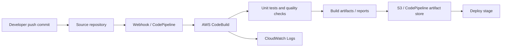

# CodeBuild Projects, Buildspecs, and Build Environments

## 1. The Role of AWS CodeBuild in CI/CD

A Java Spring Boot development team needs to automatically fetch source code, install JDK and Maven, run unit tests, package a JAR, run quality checks, and store build artifacts. If every developer runs commands on their own laptop, results can vary due to JDK versions, dependency caches, environment variables, or machine configuration.

**AWS CodeBuild** is a managed build service from AWS. CodeBuild provisions ephemeral compute environments to download source code, execute build/test commands per configuration, and output artifacts/reports/logs. You do not need to maintain long-lived build servers; a build is launched on demand, from a webhook/source event, or from a pipeline.

This lesson belongs to the **CI/CD on AWS** chapter of the **CLOUD_PROVIDERS_AWS** module. The module explores Region/AZ, IAM, VPC, compute, storage, database, integration, and serverless; learners must select services, design, and deploy applications securely with monitoring, recovery, and cost control. CodeBuild is the CI execution component in that ecosystem: it turns a source revision into artifacts that can be tested, signed, stored, and deployed onward.

After this lesson, you will be able to:

- Explain the structure of a CodeBuild project and the build lifecycle.
- Choose source, build environment, compute type, image, artifacts, and service role.
- Write a `buildspec.yml` with phases, runtime versions, environment variables, artifacts, and reports.
- Manage secrets using Parameter Store/Secrets Manager and IAM.
- Configure caching, VPC connectivity, CloudWatch Logs, and S3 artifacts.
- Integrate CodeBuild with CodePipeline, Git webhooks, and batch builds.
- Build a Java/Maven pipeline, Docker image build, and troubleshooting workflow.

## 2. What Is a CodeBuild Project?

A **project** is a reusable configuration for launching builds. A project defines the source, environment, buildspec, service role, artifacts, cache, logs, network settings, timeouts, and other policies.

A project can be triggered manually via API/CLI, through CodePipeline, via webhooks, or by other automation. Each run creates a **build execution** with its own source version, environment, phases, logs, result, and artifacts.

### 2.1. Core Components

| Component | Responsibility | Example |
| --- | --- | --- |
| Source | Where CodeBuild retrieves input | CodePipeline, GitHub, Bitbucket, S3 |
| Environment | Runtime and compute to execute the build | Linux container, Windows, ARM, custom image |
| Buildspec | Commands and how results are handled | `buildspec.yml` |
| Service role | IAM role CodeBuild assumes to call AWS APIs | Read S3 source, fetch secrets, push to ECR |
| Artifacts | Outputs after the build | JAR, ZIP, reports, Docker image in ECR |
| Cache | Data reusable across builds | Maven dependencies, package cache |
| Logs | Log output and diagnostics | CloudWatch Logs, S3 logs |
| VPC configuration | Network interfaces/subnets/security groups | Connect to private dependencies |
| Triggers | How builds are started | Manual, webhook, CodePipeline |

### 2.2. Project vs. Build Execution

A project is a **configuration definition**; a build is **a single execution** of that configuration. The same project can run multiple builds for different source revisions. If the project allows concurrent builds, multiple build executions can run simultaneously, subject to account/service quotas and compute capacity.

Each build must be traceable by build ID, project name, source version, start/end time, status, and logs. Do not infer a build succeeded just because the project exists or the pipeline started.

### 2.3. CodeBuild in a CI/CD Workflow



CodeBuild focuses on building and testing. CodePipeline orchestrates stages and approvals; CodeDeploy, CloudFormation, ECS, Lambda, or another deployment tool performs the release. CodePipeline is not mandatory: CodeBuild can also run standalone or be invoked by another CI system.

## 3. Configuring a CodeBuild Project

### 3.1. Source

Source defines how CodeBuild receives input. Common source types:

| Source type | Meaning |
| --- | --- |
| `CODEPIPELINE` | Source/artifact passed in by CodePipeline |
| `GITHUB` | GitHub repository |
| `BITBUCKET` | Bitbucket repository |
| `CODECOMMIT` | AWS CodeCommit repository if the account already has permission to use the service |
| `S3` | Source archive in S3 |
| `GITHUB_ENTERPRISE` | GitHub Enterprise Server |
| `GITLAB` / `GITLAB_SELF_MANAGED` | GitLab SaaS or self-managed |
| `NO_SOURCE` | Build downloads no source; commands/buildspec can be provided in the project |

Supported source integrations and authentication methods may vary by Region/service. For GitHub/GitLab/Bitbucket, configure connections/credentials using an AWS-supported mechanism and grant access only to necessary repositories.

### 3.2. Source Version

A build should be tied to a reproducible revision:

- A Git commit SHA is an exact source identifier.
- A branch/tag is a reference name; its contents can change over time if the branch keeps receiving commits.
- An S3 source version can be specified via appropriate object/version configuration.
- CodePipeline passes source artifact/version metadata to the build action.

In a release pipeline, record the commit SHA and build ID in metadata so you know which source produced an artifact. Avoid deploying artifacts built from a mutable branch without recording the specific revision.

### 3.3. Environment

The build environment determines the operating system, CPU architecture, runtime image, compute resources, and capabilities available to build commands. You can choose an AWS-maintained managed image or an organization-managed custom image.

### 3.4. Buildspec

The buildspec describes commands, variables, artifacts, caching, and reports. By default, CodeBuild looks for `buildspec.yml` in the root of the source directory; you can specify a different path or configure an inline buildspec in the project/API. The buildspec can be supplied in the source artifact or a supported location.

### 3.5. Artifacts

Artifacts are outputs passed to the next step or stored for later use. Examples:

- Java JAR/WAR in S3 or the CodePipeline artifact store.
- ZIP deployment package for Lambda.
- Static web assets.
- Test reports and coverage reports.
- Docker image pushed to Amazon ECR (the image does not have to be an S3 artifact).

### 3.6. Service Role

CodeBuild assumes an IAM service role to access AWS resources during the build. This role must have the exact permissions for source, secrets, cache, artifacts, logs, KMS, ECR, and the services the build actually uses. **The CodeBuild service role is distinct from the deployed application's IAM role**; do not share production runtime permissions if the build does not need them.

## 4. Build Environment: Image, Compute, and Platform

### 4.1. Managed Images and Custom Images

**Managed images** are provided and maintained by AWS across image versions. They include a set of runtimes/tooling such as Java, Node.js, Python, Docker client, or AWS CLI depending on the image version. The advantage is ease of setup and reduced base-image maintenance.

**Custom images** are suitable when builds need:

- Internal compilers or SDKs.
- Tool versions not included in managed images.
- Custom CA certificates, package mirrors, or approved binaries.
- Specialized runtimes or pre-packaged dependencies.

Custom images can be stored in ECR or a supported registry. The team is responsible for updating OS packages, patching vulnerabilities, checking provenance, pinning image digests/versions, and controlling pull permissions.

If a custom image resides in private ECR, check the project's `ImagePullCredentialsType`. `CODEBUILD` uses CodeBuild-managed credentials; `SERVICE_ROLE` uses the project service role. When choosing `SERVICE_ROLE`, the role needs ECR permissions to read the corresponding image/layers; image pull permissions are separate from image push permissions executed inside build commands.

### 4.2. Choosing a Compute Type

The compute type determines CPU/memory resources and sometimes storage/network characteristics for the build. Choose based on the workload:

| Workload | Considerations |
| --- | --- |
| Java unit tests, small Maven build | Small/medium compute if build time and memory are stable |
| Multi-module Maven/Gradle | More memory/CPU, dependency caching |
| Large Docker image build | CPU, memory, disk, and privileged mode when needed |
| Frontend bundle | CPU, memory, and dependency cache |
| Multi-container integration tests | Sufficient compute/network for test dependencies |
| Parallel multi-module builds | Increase compute or split into batch/build matrix |

Start with the smallest compute type that runs reliably, then measure duration, peak memory, disk usage, and failure rate. Larger compute can reduce duration but increases cost per minute; choose based on total cost per build and pipeline throughput.

### 4.3. OS and CPU Architecture

CodeBuild supports environments based on Linux, Windows, and certain ARM/Graviton options depending on image/compute type. Building native dependencies requires architecture compatibility; do not assume an artifact built on x86_64 will behave identically on ARM64.

With pure Java bytecode, builds may depend less on CPU architecture, but Docker base images, JNI, native Maven plugins, and integration test containers can still be architecture-dependent.

### 4.4. Privileged Mode and Docker Builds

If a build needs to run the Docker daemon for `docker build` inside a Linux container, `privilegedMode` may need to be enabled per CodeBuild guidance for that environment. Enable it only when genuinely needed. Privileged mode increases access to the host/container runtime and enlarges the blast radius if the buildspec or a dependency is controlled by an untrusted source.

If you only need to build/push images under another model, evaluate alternatives such as an appropriate managed build environment, BuildKit/build service, or a dedicated image build service. Do not enable privileged mode on every project via a generic template.

### 4.5. Build Timeout and Queued Timeout

Projects can configure a build timeout and a queued timeout. Choose limits based on normal build duration and a well-grounded worst case. Too long a timeout holds compute for hung jobs; too short causes false failures during integration tests or dependency downloads.

## 5. Buildspec: Structure and Version

The buildspec is a YAML file describing how CodeBuild executes a build. The standard version is `0.2`; version `0.1` has different shell behavior where shell state/working directory is not preserved across individual commands like in version `0.2`.

Basic structure:

```yaml
version: 0.2

env:
  variables:
    APP_NAME: orders-api

phases:
  install:
    runtime-versions:
      java: corretto21
    commands:
      - java -version
      - mvn -version
  pre_build:
    commands:
      - echo "Preparing build"
  build:
    commands:
      - mvn -B clean verify
  post_build:
    commands:
      - echo "Build finished"

artifacts:
  files:
    - target/*.jar
```

This illustrates a Java Maven example; the runtime identifier must exist in the selected managed image. When using a custom image, `runtime-versions` is not always supported; the image is responsible for providing the required runtime.

### 5.1. Top-Level Sections

| Section | Purpose |
| --- | --- |
| `version` | Buildspec syntax version |
| `env` | Environment variables and exported variables |
| `proxy` | Proxy configuration for the build when needed |
| `phases` | Command execution stages |
| `artifacts` | Files to output |
| `cache` | Paths to cache |
| `reports` | Test/coverage reports |
| `batch` | Batch build configuration |

Not every project needs all sections. Keep the buildspec short and clear; move complex logic into versioned scripts in the repository if that makes testing easier.

### 5.2. Buildspec Path

By default, CodeBuild looks for `buildspec.yml` at the source root. You can use a path like `ci/buildspec.yml` in the project configuration or build override. The path is resolved relative to the downloaded source directory; in a monorepo, ensure the build action runs against the right project folder and artifact paths.

### 5.3. Working Directory and Shell Behavior

In buildspec `0.2`, commands within the same phase run in the same shell instance per CodeBuild semantics, so `cd`, variable exports, and shell state persist across commands in that phase. Different phases are managed separately by CodeBuild; do not assume all shell state persists across phases. If a variable is needed in a later stage or action, use `env.exported-variables` or write a small controlled file in the workspace.

## 6. Build Phases and Command Execution

A CodeBuild buildspec typically has four main phases:

1. `install`: prepare runtimes/tools.
2. `pre_build`: log into registries, fetch metadata, or prepare configuration.
3. `build`: compile, test, package.
4. `post_build`: publish images, upload metadata, or report status.

CodeBuild also runs managed steps for source download, artifact upload, and finalization outside the phases you declare in the buildspec.

### 6.1. install

Use `install` to select a runtime version, install helper packages, or verify the toolchain. Prefer a managed image that already includes the runtime instead of running a package manager to reinstall the entire JDK on every build. If custom tools are required, pin versions and verify checksums/signatures.

### 6.2. pre_build

Common tasks:

- Print Java/Maven versions for auditing.
- Validate required variables and target environment.
- Retrieve dependency metadata.
- Log into ECR using the service role and `aws ecr get-login-password`.
- Prepare test database/service endpoints.

Do not print access keys, session tokens, or secrets in logs. If a build only runs unit tests, do not add an unnecessary ECR login step.

### 6.3. build

This phase executes compile/test/package steps. Maven example:

```bash
mvn -B -ntp clean verify
```

`verify` runs the Maven lifecycle up to the verify phase, including compile/test/package per the Maven project configuration. If tests fail, the command returns a non-zero exit code and the build normally transitions to failure; do not append `|| true` to mask test failures.

### 6.4. post_build

`post_build` can be used to:

- Print build metadata.
- Push a Docker image after a successful build.
- Generate a manifest containing commit SHA and artifact version.
- Perform required publishing steps.

`post_build` should not be used to turn a test failure into a success. If a command must run even when a phase fails, consider `finally` with proper semantics while preserving the failure state.

### 6.5. on-failure and finally

Buildspec `0.2` supports `on-failure` for phase/command behavior in supported environments, with options such as `ABORT`, `CONTINUE`, `RETRY`, `RETRY-count`, or `RETRY-regex` depending on syntax. Use retries for transient recoverable failures such as a flaky dependency endpoint; do not blindly retry deterministic failures like compile errors or test assertions.

`finally` contains commands that run after the normal commands of a phase, even if a command in the phase fails. It can be used to generate a diagnostic summary or perform temporary cleanup. If cleanup is required to protect credentials/files, design it to run in the failure path as well.

## 7. Environment Variables, Parameter Store, and Secrets Manager

Environment variables pass configuration into the build without modifying source code. CodeBuild supports values configured at the project level, in the buildspec, or at `StartBuild` time, alongside mechanisms to pull values from Parameter Store/Secrets Manager.

### 7.1. Precedence Order

When the same variable name is defined in multiple places, values set at **StartBuild** have highest precedence, followed by **project configuration**, and then **buildspec**. Keep this in mind while debugging, because pipeline overrides can change values visible in the buildspec.

### 7.2. Plain Variables

```yaml
env:
  variables:
    APP_ENV: test
    APP_REGION: ap-southeast-1
```

Use plain variables only for non-sensitive values. Do not place passwords, tokens, or access keys directly in YAML or plaintext project environment variables.

### 7.3. Parameter Store

```yaml
env:
  parameter-store:
    DB_HOST: /orders/test/database/host
    FEATURE_FLAG: /orders/test/feature-flag
```

The CodeBuild service role needs `ssm:GetParameters` and KMS decrypt permissions if a parameter uses a customer-managed key. Grant access only to the required parameter paths; do not grant read access to the entire namespace.

### 7.4. Secrets Manager

```yaml
env:
  secrets-manager:
    DB_PASSWORD: "orders/test/database:password"
    SIGNING_KEY: "orders/test/signing:private-key"
```

The syntax allows specifying a secret name/ARN and JSON key/version selector per buildspec format. The service role needs `secretsmanager:GetSecretValue` and `kms:Decrypt` permissions when the secret is encrypted with a customer-managed key.

### 7.5. Secret Hygiene

- Do not echo the entire environment or dump `env`/`printenv`.
- Do not put secrets into artifacts, caches, test reports, or Docker layers.
- Avoid passing secrets via command-line arguments that may appear in process/debug logs.
- Restrict which buildspecs/PRs can access production secrets.
- Rotate secrets and use identity-based access instead of static AWS keys.
- Do not rely completely on log masking: transformed/encoded secrets may not be recognized for redaction.

## 8. Runtime Versions and Dependency Management

### 8.1. Managed Runtime Versions

Some managed images allow selecting runtimes via `runtime-versions`, such as Java Corretto, Node.js, or Python versions preinstalled in the image. Valid runtime identifiers/versions depend on the image version; check the supported runtimes list before pinning.

```yaml
phases:
  install:
    runtime-versions:
      java: corretto21
```

Pinning both the image tag and runtime version makes builds more reproducible. If a managed image is updated, toolchains inside can change with the image tag; pick a specific image version, monitor deprecations, and upgrade proactively.

### 8.2. Maven/Gradle Dependencies

Maven:

```bash
mvn -B -ntp -DskipTests dependency:go-offline
mvn -B -ntp clean verify
```

Gradle:

```bash
./gradlew --no-daemon dependencies
./gradlew --no-daemon clean test build
```

You do not need to run `dependency:go-offline` in every project; it can increase build time if caching is already sufficient. The Gradle wrapper and Maven wrapper should be committed to pin the tool version per repository policy.

### 8.3. Reproducible Builds

- Pin JDK, Maven/Gradle, plugins, and dependency versions.
- Use dependency locking/verification when supported by the ecosystem.
- Do not download binaries without verifying checksums.
- Restrict version ranges and snapshot dependencies for release builds.
- Record source commit, build ID, tool versions, and artifact checksums.
- Separate trusted dependency repositories/mirrors and restrict publish permissions.

## 9. Artifacts and Test Reports

Build outputs typically include binaries/packages to deploy, along with reports to evaluate quality. CodeBuild can upload artifacts to S3 or pass artifacts directly between CodePipeline actions.

### 9.1. Artifacts in Buildspec

Maven JAR example:

```yaml
artifacts:
  base-directory: target
  files:
    - "*.jar"
  discard-paths: yes
  name: orders-api-$CODEBUILD_BUILD_NUMBER
```

`base-directory` sets the root directory relative to the source workspace; `files` selects files to upload. `discard-paths` strips directory hierarchy if needed. Tune globs to exclude source/Javadoc/test JARs if the project produces multiple JARs. Artifact names should include version/commit/build metadata when the pipeline requires traceability; do not use a bare timestamp as a release identifier.

If the project is invoked from CodePipeline, configure artifact type `CODEPIPELINE` so CodeBuild returns output to the pipeline action. If the project runs standalone and saves outputs to S3, configure artifact type `S3` in the project; bucket/key/encryption/packaging must match the target.

### 9.2. Secondary Artifacts

A build can produce multiple output groups, such as a deployable JAR, generated API docs, and an SBOM. `secondary-artifacts` allows declaring multiple artifact identifiers and separate paths; the project must declare corresponding secondary artifact destinations. Keep only necessary outputs and avoid uploading the entire workspace or temporary files.

### 9.3. Test Reports

A buildspec can declare reports so CodeBuild collects test/coverage results:

```yaml
reports:
  unit-tests:
    files:
      - "TEST-*.xml"
    base-directory: target/surefire-reports
    file-format: JUNITXML
  integration-tests:
    files:
      - "TEST-*.xml"
    base-directory: target/failsafe-reports
    file-format: JUNITXML
```

Report groups can be stored in CodeBuild and viewed via console/API. Verify that report files are actually generated; if the build stops before the test phase, reports may not exist. Report retention and permissions should be reviewed just like other log artifacts.

### 9.4. Artifact Integrity

For release artifacts:

- Attach source commit SHA and build ID.
- Generate a checksum/SHA-256 manifest.
- Keep immutable versions or appropriate bucket versioning.
- Use artifact bucket encryption and restrictive bucket policies.
- Do not package secrets, `.env` files, local credentials, or sensitive test fixtures.
- Promote only artifacts that passed tests/approvals; do not rebuild from different source for production deployment without reason.

## 10. Caching and Build Time Optimization

Caching avoids re-downloading dependencies or repeating expensive steps. CodeBuild supports S3 caching and local caching depending on supported environments/configurations.

### 10.1. S3 Cache

```yaml
cache:
  paths:
    - "/root/.m2/**/*"
    - "node_modules/**/*"
```

The buildspec only declares the paths to cache. The cache type (S3 or local) and S3 location are configured in the CodeBuild project. Cache paths must match the build environment and tool. Maven on some images runs under a different user or home directory; check `HOME` and the Maven local repository path instead of blindly copying paths.

### 10.2. Local Cache

Local cache can use modes such as source cache, Docker layer cache, and custom cache depending on supported environment types. Docker layer caching requires an appropriate Linux environment/configuration and privileged mode. Local caching can speed up consecutive builds on matching compute capacity, but should not be treated as persistent storage or a source of truth. A build may run on another host where the cache is unavailable.

### 10.3. Cache Correctness and Security

- Cache only reproducible data; never cache secrets or private keys.
- Avoid sharing caches across different trust boundaries, such as untrusted fork PRs and protected releases.
- Pin dependencies; invalidate caches when toolchain/lock files change.
- Do not let stale caches cause builds to skip dependency updates or fresh checks.
- Measure cache hit rate, transfer time, and storage cost.

Incorrect caching can make builds fast yet non-reproducible. If you suspect caching is skewing results, run an uncached build to compare and diagnose.

## 11. Configuring Projects with CloudFormation

CodeBuild projects can be managed with CloudFormation/CDK/Terraform like other AWS resources. The following example declares a project invoked by CodePipeline:

```yaml
Parameters:
  CodeBuildServiceRoleArn:
    Type: String

Resources:
  OrdersBuildProject:
    Type: AWS::CodeBuild::Project
    Properties:
      Name: orders-api-build
      ServiceRole: !Ref CodeBuildServiceRoleArn
      Source:
        Type: CODEPIPELINE
        BuildSpec: buildspec.yml
      Artifacts:
        Type: CODEPIPELINE
      Environment:
        Type: LINUX_CONTAINER
        Image: "aws/codebuild/standard:<supported-image-version>"
        ComputeType: BUILD_GENERAL1_SMALL
        PrivilegedMode: false
        EnvironmentVariables:
          - Name: APP_ENV
            Value: test
            Type: PLAINTEXT
      TimeoutInMinutes: 20
      QueuedTimeoutInMinutes: 60
      LogsConfig:
        CloudWatchLogs:
          Status: ENABLED
      Tags:
        - Key: Application
          Value: orders-api
```

`<supported-image-version>` is a placeholder; choose an image tag still supported by AWS and pin it per the organization's upgrade process. The service role ARN in the example is passed externally; this template does not create the role or permissions itself. `Source.Type` and `Artifacts.Type` are `CODEPIPELINE` because the project is used as a CodePipeline build action. If running standalone, choose the corresponding source/artifact configuration.

### 11.1. Project Configuration Must Be Versioned

When changing the build image, compute type, service role, buildspec path, environment variables, VPC, or log destination, review them alongside code. These changes can affect build reproducibility, permissions, security boundaries, cost, and artifact compatibility.

## 12. IAM Service Role and Access Permissions

A CodeBuild project has a service role assumed by CodeBuild during the build. The trust policy typically allows the `codebuild.amazonaws.com` service principal to assume the role; policy permissions depend on the source, artifacts, and commands.

### 12.1. Example Permissions by Need

| Need | Typically required actions |
| --- | --- |
| Read source from S3 | `s3:GetObject`, potentially `s3:GetObjectVersion` |
| Write artifacts to S3 | `s3:PutObject`, potentially multipart upload actions |
| Read secrets | `secretsmanager:GetSecretValue` |
| Read Parameter Store | `ssm:GetParameters` |
| Decrypt customer-managed key | `kms:Decrypt`, and other required KMS permissions per workflow |
| Push ECR image | `ecr:GetAuthorizationToken`, `ecr:BatchCheckLayerAvailability`, `ecr:InitiateLayerUpload`, `ecr:UploadLayerPart`, `ecr:CompleteLayerUpload`, `ecr:PutImage` |
| Write CloudWatch Logs | `logs:CreateLogGroup`, `logs:CreateLogStream`, `logs:PutLogEvents` |
| Create VPC network interfaces | `ec2:CreateNetworkInterface`, `ec2:DescribeNetworkInterfaces`, `ec2:DeleteNetworkInterface`, `ec2:DescribeSubnets`, `ec2:DescribeSecurityGroups`, `ec2:DescribeVpcs`, `ec2:DescribeDhcpOptions`, and `ec2:CreateNetworkInterfacePermission` per configuration |

This is a directional list, not a copy-paste policy for every project. Exact permissions depend on source type, artifact mode, KMS keys, logs config, VPC, and AWS APIs invoked by build commands. With VPC integration, scope EC2 network-interface permissions to the project/subnet/security group and conditions supported by CodeBuild.

### 12.2. Service Role vs. Source Credentials

The service role allows CodeBuild to call AWS APIs. When accessing a Git provider, CodeBuild may also need connection/token credentials depending on the integration. Do not put a Git personal access token in the buildspec; use a supported connection/credential store and restrict repository access.

### 12.3. Least Privilege per Environment

A dev build/test project should not read production secrets or push images to all ECR repositories. Create separate roles/environments for test, staging, and production releases. If CodeBuild only creates artifacts, do not grant production resource deployment permissions to the build role.

### 12.4. Do Not Use Static Access Keys in Builds

During a build, the SDK/CLI can use temporary credentials supplied by CodeBuild via the service role. Avoid storing IAM user access keys in environment variables, source code, caches, or artifacts. Role credentials are short-lived and managed by AWS.

## 13. VPC Connectivity and Network Configuration

By default, the build environment has CodeBuild-managed network behavior. If the build needs to access private resources such as RDS, a private package registry, an internal API, or a service inside a VPC, configure the VPC, subnets, and security groups for the project.

### 13.1. When Is VPC Configuration Needed?

- Integration tests need to connect to a private database.
- Builds download dependencies from an internal artifact repository.
- Builds access services that only have private endpoints.
- Builds deploy/update resources in an internal network.

If a build only fetches source/public dependencies and writes artifacts via AWS APIs, placing it in a VPC is not strictly necessary. Adding VPC configuration increases network/ENI permission requirements and requires explicit egress design.

### 13.2. Subnets, Security Groups, and Egress

CodeBuild creates network interfaces in the selected subnets so builds can reach VPC resources. Choose private subnets with sufficient IP addresses and security group egress limited to required destinations. The build environment does not need inbound access from the Internet for normal flows; do not open broad inbound rules just to run builds.

### 13.3. Internet and VPC Endpoints

Builds in private subnets do not automatically have Internet access. If they need to download Maven dependencies from public repositories, a NAT gateway/egress proxy or another appropriate network solution is required. If they only need AWS services, consider VPC endpoints (e.g., S3, ECR, CloudWatch Logs, Secrets Manager, SSM) to limit Internet/NAT traversal and control endpoint policies.

Network design must account for DNS, route tables, NACLs, security group egress, endpoint policies, and KMS access. A build timeout during dependency download may be a network error rather than a Maven error.

### 13.4. Database Integration Tests

Do not use a production database for build tests. Use an ephemeral test database, isolated schemas/credentials, or appropriate mock services. Clean up data after tests, restrict subnets/security groups, and ensure concurrent builds do not overwrite shared test fixtures.

## 14. Logs, Metrics, and Build Lifecycle

### 14.1. CloudWatch Logs

CodeBuild can send build output to CloudWatch Logs; log groups/streams and retention can be configured. S3 logs are also a storage option. Log-writing permissions must be present in the service role per configuration.

Logs should include:

- Project name and build ID.
- Source commit/revision.
- Runtime/tool versions.
- Phase start/end.
- Test summary, artifact name/checksum, and error context.

Do not log access keys, tokens, secret values, private package credentials, or all environment variables.

### 14.2. Build Lifecycle Statuses

A build execution goes through statuses/phases such as:

| Phase/status | Meaning |
| --- | --- |
| `SUBMITTED` / `QUEUED` | Request received or waiting for compute |
| `PROVISIONING` | Preparing the build environment |
| `DOWNLOAD_SOURCE` | Downloading source input |
| `INSTALL` | Running the install phase |
| `PRE_BUILD` | Running pre_build |
| `BUILD` | Running the build phase |
| `POST_BUILD` | Running post_build |
| `UPLOAD_ARTIFACTS` | Uploading outputs |
| `FINALIZING` | Completing final cleanup |
| `COMPLETED` | Build finished; build status indicates success/failure |

Build statuses typically include `SUCCEEDED`, `FAILED`, `FAULT`, `TIMED_OUT`, `STOPPED`, or `IN_PROGRESS`. Inspect both `buildStatus` and `currentPhase`/phase contexts to distinguish whether a build failed due to tests, timeout, provisioning, or artifact upload.

### 14.3. Metrics and Alarms

Track build duration, success/failure rate, queued time, timeouts, throttling/concurrency, compute utilization (where appropriate metrics exist), and artifact upload failures. CloudWatch alarms/event rules can be used to detect failed builds or stuck pipelines; design notifications around team ownership and severity.

## 15. Integrating CodeBuild with CodePipeline and Source Webhooks

### 15.1. CodeBuild Action in CodePipeline

CodePipeline can pass a source artifact into a CodeBuild action, then receive an output artifact to pass to the next stage. In that setup:

- The CodeBuild project uses source type `CODEPIPELINE`.
- The project's input/output artifacts use type `CODEPIPELINE`.
- The pipeline action declares input artifacts and output artifacts.
- The buildspec is stored with the source or in project configuration.
- The CodeBuild service role and CodePipeline role have separate permissions for each service's responsibilities.

The CodePipeline role invokes CodeBuild and passes artifacts; the CodeBuild service role reads inputs, executes commands, and writes outputs. Do not grant deployment permissions to CodeBuild if deployment is handled by another action/role.

### 15.2. Webhooks and Build Triggers

With supported source repositories, CodeBuild can create webhooks to start builds on events such as push or pull request. Configure webhook filters so only required branches/paths/events build, avoiding triggering production builds on every event.

Notes:

- Use protected branches and required status checks.
- Distinguish pull requests from internal branches vs. untrusted forks.
- Do not grant production secrets or privileged Docker builds to untrusted PRs.
- Avoid creating duplicate webhooks if a pipeline already manages triggers.
- Check webhook connection/permissions when events do not trigger builds.

### 15.3. Build Start API/CLI

Builds can be started manually:

```bash
aws codebuild start-build \
  --project-name orders-api-build \
  --source-version 4d2a7f8c9e10 \
  --region ap-southeast-1
```

The command returns a build ID. Track it with:

```bash
aws codebuild batch-get-builds \
  --ids orders-api-build:build-id \
  --region ap-southeast-1
```

`build-id` in the example is a placeholder; replace it with the actual ID from the `start-build` response. `StartBuild` can override settings such as environment variables, buildspec, source version, or artifacts; override permissions must be controlled because they can alter project behavior and security.

### 15.4. Build Matrix and Batch Builds

Batch builds allow running multiple build executions using a graph/list/matrix configuration. Suitable when testing:

- Multiple JDK versions.
- Multiple architectures or operating systems.
- Multiple modules/services in a monorepo.
- Multiple independent test suites.

Batch builds can increase concurrency and throughput, but also increase compute usage/cost and pressure on dependency registries/test databases. Set concurrency limits, a batch service role if needed, and isolate test data by build identifier.

## 16. Complete Example: Building a Java Maven Project

Assume the repository has the Maven wrapper, Java source code, unit tests, and JAR output in `target/`. The build only needs to run tests and create an artifact for the pipeline.

### 16.1. buildspec.yml

```yaml
version: 0.2

env:
  variables:
    APP_NAME: orders-api
  exported-variables:
    - APP_NAME

phases:
  install:
    runtime-versions:
      java: corretto21
    commands:
      - java -version
      - ./mvnw -version

  pre_build:
    commands:
      - echo "Preparing ${APP_NAME}"
      - test -f pom.xml
      - test -x ./mvnw

  build:
    commands:
      - ./mvnw -B -ntp clean verify

  post_build:
    commands:
      - echo "Build ${CODEBUILD_BUILD_NUMBER} completed"

artifacts:
  base-directory: target
  files:
    - "*.jar"
  discard-paths: yes

reports:
  unit-tests:
    files:
      - "TEST-*.xml"
    base-directory: target/surefire-reports
    file-format: JUNITXML

cache:
  paths:
    - "/root/.m2/repository/**/*"
```

This example assumes the managed Linux image runs as a user whose Maven home is `/root/.m2`; verify the image's actual home directory and adjust the cache path accordingly. If the Maven wrapper lacks the executable bit, fix its file mode in Git instead of running `chmod` manually on every build.

### 16.2. Project Settings

The project needs:

- Source repository or `CODEPIPELINE` artifact.
- Linux managed image with the Corretto 21 runtime.
- Compute type suited to the modules and test suite.
- Buildspec path pointing to the file above.
- Service role with permissions to read source, write artifacts, and write logs.
- CloudWatch Logs enabled with retention per policy.
- Timeout sufficient for dependency download and tests.
- S3/local cache if a measurable benefit exists.

If run inside CodePipeline, set output artifact type to `CODEPIPELINE`; if standalone, configure an S3 artifact destination.

### 16.3. Verifying Results

After the build, verify:

1. Build status is `SUCCEEDED`.
2. `mvn verify` runs tests and does not ignore failures.
3. The JUnit report group shows test counts/failures.
4. The JAR artifact has the right name/version and checksum.
5. Logs contain no secrets.
6. Source revision/build ID is recorded for traceability.

## 17. Example: Building and Pushing a Docker Image to ECR

Building container images is a common CodeBuild use case. A Linux project needs `PrivilegedMode: true` when using the Docker daemon per CodeBuild guidance. The ECR repository should be created and managed beforehand via IaC; the build role only needs push permissions to that specific repository.

### 17.1. Buildspec

Non-sensitive project environment variables may include:

- `AWS_ACCOUNT_ID`: target account ID.
- `ECR_REPOSITORY`: ECR repository name.
- `IMAGE_TAG`: unique tag, typically tied to commit SHA or release version.
- `CONTAINER_NAME`: container name in the ECS task definition if using the CodePipeline ECS deploy action.

Example:

```yaml
version: 0.2

phases:
  pre_build:
    commands:
      - REGISTRY="$AWS_ACCOUNT_ID.dkr.ecr.$AWS_DEFAULT_REGION.amazonaws.com"
      - aws ecr get-login-password --region "$AWS_DEFAULT_REGION" | docker login --username AWS --password-stdin "$REGISTRY"
  build:
    commands:
      - docker build -t "$AWS_ACCOUNT_ID.dkr.ecr.$AWS_DEFAULT_REGION.amazonaws.com/$ECR_REPOSITORY:$IMAGE_TAG" .
  post_build:
    commands:
      - docker push "$AWS_ACCOUNT_ID.dkr.ecr.$AWS_DEFAULT_REGION.amazonaws.com/$ECR_REPOSITORY:$IMAGE_TAG"
      - printf '[{"name":"%s","imageUri":"%s"}]\n' "$CONTAINER_NAME" "$AWS_ACCOUNT_ID.dkr.ecr.$AWS_DEFAULT_REGION.amazonaws.com/$ECR_REPOSITORY:$IMAGE_TAG" > imagedefinitions.json

artifacts:
  files:
    - imagedefinitions.json
```

This example illustrates the shell flow; the project must supply valid `AWS_ACCOUNT_ID`, `ECR_REPOSITORY`, `IMAGE_TAG`, `CONTAINER_NAME`, and `AWS_DEFAULT_REGION` variables. The `imagedefinitions.json` file follows the CodePipeline standard ECS deploy action schema. Each phase reconstructs the registry/image URI from environment variables so it does not rely on shell variables assigned in a previous phase.

### 17.2. Permissions and Security

- `ecr:GetAuthorizationToken` typically requires `Resource: "*"` scope.
- Upload/push actions are scoped to the target ECR repository ARN.
- Do not use an ECR admin policy or `ecr:*` unless required.
- Tag images with commit SHA/release version; `latest` should only be a convenience tag.
- Scan images, verify base images, and check provenance before deploying.
- Do not pass Docker build secrets via `ARG` or `ENV` if they could be stored in image layers/history; use secret mounts or an appropriate build mechanism.

## 18. Troubleshooting CodeBuild

| Symptom | Common causes | How to check |
| --- | --- | --- |
| `YAML_FILE_ERROR` | Wrong indentation, syntax, or buildspec key | Validate YAML/buildspec version; read line/column error |
| `COMMAND_EXECUTION_ERROR` | Command returned a non-zero exit code | Check phase logs and rerun command in an equivalent image |
| Buildspec not found | Wrong path or source root/monorepo directory | Check buildspec path in project and source layout |
| Unsupported runtime version | Image lacks that runtime identifier | Choose a supported managed image/runtime pair |
| Maven dependency timeout | Network, DNS, NAT, proxy, or repository throttling | Check VPC routes/endpoints/proxy and Maven mirror |
| `AccessDenied` reading source | Service role lacks S3/Git/KMS permission | Check role, bucket policy, KMS key policy |
| `AccessDenied` fetching secret | Missing SSM/Secrets Manager/KMS permission | Check ARN/path and resource policy |
| Artifact upload failure | S3 permissions, KMS, artifact path, or bucket policy | Check `artifacts.files`, destination, and role |
| Test report not visible | Wrong report path/format or tests did not generate XML | Verify file in workspace and `file-format` |
| Docker daemon unavailable | Privileged mode disabled or unsupported image | Check environment type and privileged mode |
| Docker push denied | Wrong ECR login Region/account or missing push permissions | Check registry URI, token Region, repository ARN |
| Build cannot reach private RDS | Wrong VPC/subnet/SG/route or DB security group | Check ENI, egress, DB ingress, and DNS |
| Private build cannot fetch internet dependencies | Missing NAT/proxy or suitable endpoint | Check egress path, DNS, and routes |
| Build queued too long | Concurrency/quota/compute capacity | Check queued time, concurrent builds, and quotas |
| Build timed out | Low timeout, hung tests, or slow downloads | Check phase duration, increase timeout with justification, profile tests |
| Build succeeds but wrong artifact | Glob/base-directory or build produced different output | Check actual workspace path and checksum |

### 18.1. Diagnostic Workflow

1. Confirm the right project, build ID, source revision, and Region.
2. Read `buildStatus`, `currentPhase`, and phase contexts in `batch-get-builds`.
3. Open CloudWatch Logs at the first failing phase.
4. Check buildspec path/version, image, runtime, and compute type.
5. For AWS API errors, check the service role, resource policy, and KMS.
6. For network errors, check VPC/subnets/routes/DNS/NAT/VPC endpoints.
7. Check artifacts/reports/cache after commands succeed.
8. Document the root cause and update the buildspec/project IaC to prevent recurrence.

## 19. Security, Isolation, and Supply Chain

CodeBuild executes commands taken from the source repository/buildspec. If someone who can modify the buildspec can also read production secrets or use an overly broad service role, a malicious pull request becomes a path to execute code with AWS permissions.

### 19.1. Source Trust Boundaries

- Pull requests from forks are untrusted inputs; do not grant production credentials.
- Build releases only from protected branches/tags and reviewed revisions.
- Separate projects/roles for untrusted tests vs. trusted release builds.
- Do not share a privileged Docker build environment with untrusted code.
- Restrict webhook filters and `StartBuild` override permissions.

### 19.2. Service Role Trust Policy

The trust policy should allow only the CodeBuild service to assume the role, and where feasible restrict by project/account to reduce confused-deputy risk. Conceptual example:

```json
{
  "Version": "2012-10-17",
  "Statement": [
    {
      "Effect": "Allow",
      "Principal": {
        "Service": "codebuild.amazonaws.com"
      },
      "Action": "sts:AssumeRole",
      "Condition": {
        "StringEquals": {
          "aws:SourceAccount": "111122223333"
        },
        "ArnLike": {
          "aws:SourceArn": "arn:aws:codebuild:ap-southeast-1:111122223333:project/orders-api-build"
        }
      }
    }
  ]
}
```

Replace the account/Region/project with real values. Trust policy configurations must remain compatible with the organization's service integration and project lifecycle; test role assumption after adding conditions.

### 19.3. Build Image Security

- Prefer managed images or custom images from controlled registries.
- Pin image versions/digests and update regularly.
- Scan OS packages, runtimes, build tools, and container layers.
- Do not run package managers against untrusted repositories.
- Restrict privileged mode, host mounts, and Docker socket access.
- Do not use images with the `latest` tag as production build environments without pinning a digest/version.

### 19.4. Artifact Provenance

A production artifact should be tied to a source revision, build project, build ID, tool versions, and checksum. Add SBOMs, image scan results, signatures/attestations, and approval records per supply-chain policy. Protect the artifact bucket/ECR repository so unauthorized actors cannot replace an artifact after a successful build.

### 19.5. KMS and Encryption

S3 artifacts/cache, CloudWatch Logs, and secrets can use encryption at rest per service configuration. When using a customer-managed KMS key, configure the key policy and IAM permissions for the corresponding service role. Do not grant only `kms:Decrypt`; uploads/downloads may require additional KMS actions depending on the encryption flow and integrated services.

## 20. Cost and Operational Efficiency

CodeBuild charges by build duration and chosen compute/environment according to the current pricing model/Region. Overall costs can also include S3 artifacts/cache, CloudWatch Logs, NAT gateway/data transfer, ECR storage, and KMS requests.

### 20.1. Cost Drivers

| Factor | Control measures |
| --- | --- |
| Compute type | Select sufficient CPU/memory based on metrics |
| Build duration | Cache properly, avoid reinstalling tools repeatedly |
| Concurrent builds | Limit concurrency and batch size |
| VPC/NAT | Use VPC endpoints where appropriate, reduce unnecessary egress |
| Artifacts | Upload only needed outputs, use S3 lifecycle |
| Logs | Set retention per policy, avoid unbounded debug logs |
| Docker layers | Cache carefully and clean up old images |
| Retries | Retry only transient errors, not deterministic compile/test failures |

### 20.2. Measure Before Optimizing

Monitor:

- Queue and provisioning times.
- Duration of each phase.
- Dependency download time/cache hit rate.
- Test duration and flaky tests.
- Artifact upload duration/size.
- Build failure/retry rate.
- Cost per build and cost per successful release.

Optimize based on real bottlenecks. Increasing compute may shorten duration without necessarily reducing total cost; overly broad caches can increase S3 costs or introduce data risks.

### 20.3. Reliability

- Set timeouts for build duration and queued time.
- Use bounded retries for dependency/network errors.
- Use immutable source revisions and deterministic dependencies.
- Separate integration tests depending on external services from fast unit tests.
- Ensure test fixtures are isolated during concurrent builds.
- Maintain runbooks for webhook failures, quotas, role permissions, and network outages.
- Track service quotas/concurrent build limits and request quota increases before hitting limits.

## 21. Case Study: CI for Orders API

A Java team builds Orders API on ECS Fargate. They need to validate every pull request, produce a JAR after merge, and build a container image for release.

### 21.1. Project Boundaries

| Project | Trigger | Permissions |
| --- | --- | --- |
| `orders-pr-check` | Pull request | Read source, dependency cache, test reports; no production secrets |
| `orders-main-build` | Merge to protected main | Build/test, write JAR artifact to pipeline store |
| `orders-image-release` | Release tag/approved pipeline | Push ECR image to the Orders API repository |

These projects can share similar images/toolchains, while service roles, environment variables, and trigger policies remain separate.

### 21.2. Pull Request Flow

1. A webhook triggers `orders-pr-check` for the selected pull request.
2. CodeBuild fetches the source revision and runs the Maven wrapper and unit tests.
3. JUnit reports are published for reviewers to inspect test results.
4. The build fails if compilation/tests fail; a required status check blocks merging.
5. The project cannot read production secrets or assume the production deploy role.

### 21.3. Main Branch Flow

1. CodePipeline fetches the commit SHA after merge.
2. CodeBuild runs `clean verify`, outputting the JAR and test reports.
3. The pipeline preserves artifacts and source metadata.
4. The security/quality stage checks dependencies, SBOM, and policies.
5. After approval, the image build project creates an image tagged by commit SHA and pushes it to ECR.
6. The deployment stage updates the ECS task definition/service using a separate deploy role.

### 21.4. A Network Failure

Builds in a private subnet begin timing out while downloading Maven dependencies. Logs show the `BUILD` phase stalling and Maven reporting connect timeouts. The operations team:

1. Confirms the build environment is attached to the right VPC/subnets/security groups.
2. Checks whether the private subnet route table has a NAT/egress proxy or suitable repository endpoint.
3. Checks DNS resolution, NACLs, security group egress, and proxy variables.
4. If the repository is inside the VPC, checks private DNS and repository ingress.
5. Re-runs the build after fixing IaC/network configuration and verifies dependency downloads.

Do not increase timeouts indefinitely to mask routing or egress errors.

## 22. CodeBuild Production Checklist

1. **Project scope:** source, triggers, buildspec, and artifacts are clearly defined.
2. **Source integrity:** builds run from immutable commit SHAs/tags; branches/releases are protected.
3. **Environment:** image/runtime versions are pinned and compute type is right-sized.
4. **Buildspec:** version 0.2, clear phases, exit codes never masked.
5. **Dependencies:** wrappers/lock files, version pinning, and trusted repositories.
6. **Secrets:** Parameter Store/Secrets Manager; no plaintext in YAML/logs/artifacts.
7. **IAM:** least-privilege service roles; separate roles per environment and scoped trust policies.
8. **VPC:** configured only when needed; subnet IPs, routes, endpoints, NAT, and SGs verified.
9. **Privileged mode:** enabled only for required Docker use cases and trusted sources.
10. **Artifacts:** accurate paths/globs, encryption, checksums, immutable versions, and retention.
11. **Reports:** JUnit/coverage report paths and formats verified.
12. **Cache:** contains no secrets; separates trust boundaries; effectiveness measured.
13. **Logs:** CloudWatch/S3 destination, retention set, and no sensitive values exposed.
14. **Triggers:** webhook filters, fork PR policy, and concurrency limits.
15. **Reliability:** timeouts, retries, quotas, failure notifications, and runbooks.
16. **Supply chain:** SBOM, image scanning, signing/attestation per policy.
17. **Cost:** compute, duration, NAT, logs, cache, and artifact storage monitored.
18. **Traceability:** build ID, commit SHA, artifact checksum, and approval evidence.

## 23. Self-Check Questions

**Question 1.** What is AWS CodeBuild?

**Hint:** A managed build service that executes commands in a build environment to produce artifacts, reports, and logs.

**Question 2.** How does a project differ from a build execution?

**Hint:** A project is a reusable configuration; a build execution is a single run of that project with its own source revision and result.

**Question 3.** Where is the buildspec searched for by default?

**Hint:** `buildspec.yml` at the source root, unless the project/API specifies another path or inline content.

**Question 4.** What advantage does buildspec 0.2 have over 0.1?

**Hint:** Commands in the same phase share a shell instance; shell state and working directory are not isolated per command like in 0.1.

**Question 5.** What are the four common phases?

**Hint:** `install`, `pre_build`, `build`, and `post_build`.

**Question 6.** When should Parameter Store and Secrets Manager be used?

**Hint:** To pass runtime configuration/secrets into builds without hardcoding plaintext; the service role must have appropriate read permissions.

**Question 7.** What is the precedence order when environment variable names collide?

**Hint:** StartBuild override, then project configuration, and finally buildspec.

**Question 8.** Why should `env` or `printenv` not be used for debugging?

**Hint:** They can print tokens, passwords, and other sensitive values.

**Question 9.** When is privileged mode needed?

**Hint:** Certain Docker daemon/image build workflows in Linux CodeBuild require it; enable only when necessary and for trusted sources.

**Question 10.** What is the purpose of the CodeBuild service role?

**Hint:** Provides an identity for CodeBuild to call AWS APIs to read source, fetch secrets, write logs/artifacts, and push images per granted permissions.

**Question 11.** What does project source type `CODEPIPELINE` mean?

**Hint:** CodePipeline passes an input artifact to the CodeBuild action; outputs can be returned to the pipeline.

**Question 12.** Why might a build in a private subnet fail to download Maven dependencies?

**Hint:** It may lack a NAT/proxy/egress route, DNS, or an endpoint to the repository.

**Question 13.** Should S3 caches store secrets?

**Hint:** No. Cache only reproducible data; keep trust boundaries separated.

**Question 14.** What configuration do JUnit reports require?

**Hint:** Files pattern, `base-directory`, and `file-format` such as `JUNITXML`; verify tests actually generate XML files.

**Question 15.** Does a build succeeding guarantee an artifact is safe to deploy?

**Hint:** No. Provenance, dependencies, scans, signatures/approvals, and artifact integrity must be verified per policy.

**Question 16.** Why should production secrets not be granted to pull requests from forks?

**Hint:** Source/buildspec may be untrusted and could run commands to exfiltrate secrets or abuse the role.

**Question 17.** When are batch builds suitable?

**Hint:** Testing matrices across multiple JDKs/architectures/modules or independent test suites; concurrency and cost must be controlled.

**Question 18.** What should be checked when builds stay queued for too long?

**Hint:** Concurrent builds, service quotas, compute capacity, project concurrency, and queued timeout.

**Question 19.** Why should image tags include the commit SHA?

**Hint:** To trace the artifact back to a specific source revision and avoid relying on mutable tags like `latest` as the sole identifier.

**Question 20.** When a build fails during `UPLOAD_ARTIFACTS`, what should be inspected?

**Hint:** Artifact paths/globs, S3 bucket policy, service role, KMS permissions, output size, and destination configuration.

## 24. Takeaways

An **AWS CodeBuild project** defines the source, build environment, buildspec, service role, artifacts, cache, logs, VPC, and timeouts. Each run creates an independent build execution with its own build ID, source revision, phases, status, and logs. CodeBuild typically handles compile/test/package; CodePipeline orchestrates stages and a deployment service executes the release.

**Buildspec 0.2** describes the `install`, `pre_build`, `build`, and `post_build` phases, environment variables, artifacts, cache, and reports. Runtimes/images must be compatible; Maven/Gradle wrappers and dependency versions should be pinned. StartBuild overrides take precedence over project settings, followed by the buildspec. Secrets should come from Parameter Store/Secrets Manager via the service role; never echo the environment or store secrets in caches/artifacts.

**The build environment and IAM/networking determine pipeline security.** Right-size compute based on metrics, enable privileged mode only when a Docker workflow requires it, use a VPC when accessing private resources, and configure NAT/endpoints properly. Service roles must follow least privilege, untrusted PR projects must not read production secrets, artifacts need provenance/integrity, and logs need retention. Track duration, queue time, failures, reports, caching, and cost to keep builds fast, repeatable, and reliable.

### AWS Reference Documentation

- [AWS CodeBuild User Guide](https://docs.aws.amazon.com/codebuild/latest/userguide/welcome.html)
- [Create a build project](https://docs.aws.amazon.com/codebuild/latest/userguide/create-project.html)
- [Buildspec reference](https://docs.aws.amazon.com/codebuild/latest/userguide/build-spec-ref.html)
- [Build environment reference](https://docs.aws.amazon.com/codebuild/latest/userguide/build-env-ref.html)
- [Available runtimes](https://docs.aws.amazon.com/codebuild/latest/userguide/available-runtimes.html)
- [Environment variables in build environments](https://docs.aws.amazon.com/codebuild/latest/userguide/build-env-ref-env-vars.html)
- [Use Parameter Store and Secrets Manager](https://docs.aws.amazon.com/codebuild/latest/userguide/build-spec-ref.html#build-spec.env.secrets-manager)
- [Build caching](https://docs.aws.amazon.com/codebuild/latest/userguide/build-caching.html)
- [Build reports](https://docs.aws.amazon.com/codebuild/latest/userguide/test-reporting.html)
- [Build artifacts](https://docs.aws.amazon.com/codebuild/latest/userguide/build-spec-ref.html#build-spec.artifacts)
- [VPC support](https://docs.aws.amazon.com/codebuild/latest/userguide/vpc-support.html)
- [IAM service role](https://docs.aws.amazon.com/codebuild/latest/userguide/setting-up-service-role.html)
- [CloudWatch Logs](https://docs.aws.amazon.com/codebuild/latest/userguide/build-log-config.html)
- [Use CodeBuild with CodePipeline](https://docs.aws.amazon.com/codepipeline/latest/userguide/action-reference-CodeBuild.html)
- [Batch builds](https://docs.aws.amazon.com/codebuild/latest/userguide/batch-build.html)
- [Docker sample](https://docs.aws.amazon.com/codebuild/latest/userguide/sample-docker.html)
- [AWS CodeBuild pricing](https://aws.amazon.com/codebuild/pricing/)
