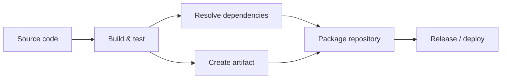
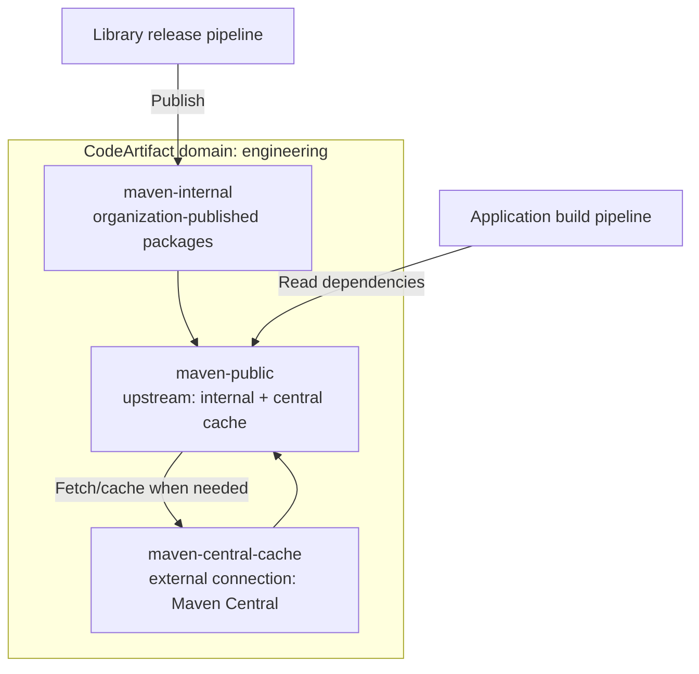
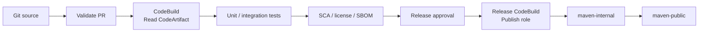

# CodeArtifact Repositories and Internal Dependency Management

In a CI/CD system, application source code is not the only input to a build. Every build also downloads frameworks, third-party libraries, Maven/Gradle plugins, and internal packages published by other teams. If every project accesses multiple public registries directly, it becomes difficult for the organization to control dependency sources, build reproducibility, publish permissions, audit trails, and supply-chain risk.

**AWS CodeArtifact** provides a package management service that serves as a centralized dependency repository for an organization. Teams can publish internal packages, proxy/cache packages from public repositories via external connections and upstream repositories, and then configure Maven, Gradle, or equivalent tools to access only approved endpoints. In pipelines, IAM roles fetch short-lived authorization tokens; there is no need to embed long-lived access keys or passwords in source code.

This lesson belongs to the **CI/CD on AWS** chapter of the **CLOUD_PROVIDERS_AWS** module. The module helps learners explore Region/AZ, IAM, VPC, compute, storage, database, integration, and serverless to select, design, and deploy secure applications with monitoring, recovery, and cost control. In a CI/CD context, CodeArtifact is a link in the software supply chain: it manages dependency inputs and package outputs for builds, coordinating with IAM, pipelines, networking, logging, and release processes.

## 1. Learning Objectives

After this lesson, you will be able to:

1. Explain the role of a package repository in CI/CD and the software supply chain.
2. Distinguish between a CodeArtifact domain, repository, upstream repository, and external connection.
3. Design a repository topology for internal packages and public dependencies.
4. Create a domain/repository and configure an upstream for Maven.
5. Grant read/publish permissions using IAM roles and repository/domain policies.
6. Retrieve CodeArtifact authorization tokens properly, understand token lifetimes, and avoid secret exposure.
7. Configure Maven and Gradle to resolve dependencies from CodeArtifact.
8. Publish internal packages from a pipeline without granting publish permissions to every build.
9. Integrate CodeArtifact into AWS CodeBuild/CodePipeline and OIDC-based pipelines.
10. Manage versions, package origins, upstreams, retention, and dependency governance.
11. Combine CodeArtifact with VPC endpoints, encryption, CloudTrail, and monitoring.
12. Diagnose authentication, authorization, endpoint, dependency resolution, and publish errors.
13. Practice building a shared repository for Java applications.

## 2. Package Repositories in the CI/CD Chain

A pipeline typically follows these steps:



CodeArtifact participates in two directions:

- **Dependency consumption**: builds download internal and third-party packages from an organization-managed repository.
- **Package publishing**: release pipelines push built libraries, SDKs, or packages to an internal repository for other projects to consume.

### 2.1. What Happens If Every Build Accesses Public Registries Directly?

A simple approach is letting every project configure Maven Central, the npm registry, or PyPI directly. This is easy to start, yet introduces several problems:

- Every build depends on the availability and rate limits of public registries.
- Projects may download the same dependency from different sources.
- It is hard to control which packages are permitted or prevent name collisions with internal packages.
- Builds can fail when a public registry experiences outages or throttling.
- There is no central place to track which internal packages are published and consumed.
- Teams struggle to yank or stop distributing a version that is no longer approved.

### 2.2. What Problems Does CodeArtifact Solve?

CodeArtifact is a managed artifact repository, not a build server and not a replacement for source control:

| Component | Responsibility |
|---|---|
| GitHub/GitLab/CodeCommit | Store source code and change history |
| CodeBuild/Jenkins/GitHub Actions | Run builds, tests, scans, and publish steps |
| CodePipeline | Orchestrate CI/CD stages |
| CodeArtifact | Store internal packages, proxy/cache dependencies, and serve package endpoints |
| S3/ECR | Store artifacts or container images by type and purpose |
| IAM/CloudTrail | Control access and audit activity |

CodeArtifact does not automatically verify whether a library is secure, nor does it replace dependency reviews, SCA, SBOMs, or release approval processes. It provides a controlled distribution point so those processes operate more consistently.

## 3. Core Concepts

### 3.1. Domain

A **domain** is the top-level management boundary in CodeArtifact. A domain groups repositories and is where organizations configure encryption and domain-level permission sharing. A domain can be shared across multiple repositories in the same account/Region and supports sharing across AWS accounts when appropriate resource policies are configured.

Example:

```text
Domain: engineering
  Repository: maven-internal
  Repository: maven-central-cache
  Repository: maven-public
  Repository: npm-internal
```

A domain is not a single repository. Consumers always access the endpoint of a specific repository.

### 3.2. Repository

A **repository** stores package versions and serves them via a package-format endpoint. A repository can contain internal packages published directly, packages fetched from upstreams, or a combination of both depending on the design.

Maven repository example:

- `maven-internal`: where pipelines publish the organization's libraries.
- `maven-central-cache`: a repository with an external connection to Maven Central.
- `maven-public`: a consumer-facing repository with upstreams pointing to `maven-internal` and `maven-central-cache`.

### 3.3. Upstream Repository

An **upstream** is another repository that a repository can pull packages from when a package is not already present in the current repository. When a consumer requests a package through a repository with upstreams, CodeArtifact searches along the configured upstream chain and can store the fetched package so subsequent reads reuse it.

Upstreams let an organization provide one standard endpoint for developers and build agents instead of configuring multiple public registries directly.

### 3.4. External Connection

An **external connection** links a CodeArtifact repository to a CodeArtifact-supported public package registry, such as public Maven Central or the npm registry. Typically, you place the external connection on a dedicated repository that caches public packages, then configure the consumer repository to use it as an upstream.

Avoid letting individual projects configure public registries directly when the goal is central dependency governance.

### 3.5. Package, Package Version, and Asset

- **Package**: a format-specific package unit, such as Maven coordinate `com.example:order-client`.
- **Package version**: a specific version, such as `2.4.1`.
- **Asset**: a content file of a package version, such as a JAR, POM, module metadata, checksum, or archive.
- **Package origin**: the allowed source for publishing or ingesting a package version, including direct publish and upstream.

For Maven, basic coordinates are `groupId:artifactId:version`. For npm it is package name/version; for Python it is package name/version following that ecosystem's normalization rules.

## 4. Designing a Topology for Internal Dependencies

Do not start by creating a single repository and granting everyone read/write access. Separate publish and consume permissions.

### 4.1. Recommended Model for Java/Maven



Rules:

1. Library release pipelines have permission to publish to `maven-internal`.
2. Application build pipelines only have read permission from `maven-public`.
3. `maven-public` prioritizes internal packages according to the configured upstream order before checking public packages.
4. Local developers also use `maven-public` to reduce discrepancies between local builds and CI.
5. Never grant publish permissions on the consumer repository to every developer or every pull request.

### 4.2. Why Separate Publish and Consume?

If one repository serves public dependencies while allowing every pipeline to publish, an untrusted build could push a colliding package name or version that shadows internal dependencies. Separating repositories helps:

- Reduce the blast radius if a build job's credentials are exposed.
- Apply distinct IAM policies for reading vs. publishing.
- Enforce approval gates before release.
- Track which pipeline published each internal package.
- Control package origin and upstream ordering.

### 4.3. Upstream Order Matters

If a repository has multiple upstreams, search order determines which package source is selected when multiple sources share the same coordinate/version. Design and test that order carefully, especially for internal namespaces. Never allow a public package with a matching name to shadow an internal package.

For internal packages, use a clear namespace like `com.mycompany.*`, enforce package origin controls, and avoid overly generic groupIds or names.

## 5. Choosing Package Formats and Versioning Conventions

CodeArtifact supports multiple package formats including Maven, npm, PyPI, NuGet, Swift, RubyGems, Cargo, and Generic. Not every repository needs to enable all formats; create repositories aligned with your team's build tools and release workflows.

| Ecosystem | Example identifier | Typical tool |
|---|---|---|
| Maven | `com.mycompany:order-client:2.4.1` | Maven |
| Gradle | Maven coordinates or plugin markers | Gradle |
| npm | `@mycompany/order-ui@2.4.1` | npm |
| PyPI | `company-data-client==2.4.1` | pip/twine |
| NuGet | `Company.Logging 2.4.1` | dotnet/NuGet |
| Generic | package name + version + assets | AWS CLI/API or internal tooling |

### 5.1. Versioning

For internal libraries:

- Use semantic versioning or a consistent organizational versioning convention.
- Release versions should be immutable after publishing; if there is a bug, publish a new version rather than silently replacing assets.
- Do not use dynamic versions in production builds if reproducibility is required.
- Pin plugin and build tool versions alongside dependency versions.
- Use dependency lockfiles or dependency constraints when supported by the ecosystem.
- Record the commit, build number, and provenance metadata in the release process.

Examples:

```text
com.mycompany.platform:logging-starter:3.2.0
com.mycompany.platform:security-client:1.8.4
com.mycompany.shop:order-contract:2.1.0
```

### 5.2. Preventing Dependency Confusion

Dependency confusion occurs when an internal package name collides with or is mistaken for a public package downloadable from an external registry. Mitigations:

1. Define an intentional internal namespace, such as `com.mycompany`.
2. Configure consumer repositories to route exclusively through CodeArtifact.
3. Enforce package origin controls so packages in the internal namespace cannot be pulled arbitrarily from public upstreams.
4. Restrict publishing to the internal repository using IAM.
5. Review new dependencies and record package sources in SBOM/build metadata.

## 6. Creating Domains and Repositories

This section demonstrates AWS CLI v2 in Region `ap-southeast-1`. Replace the domain, account ID, and repository names with values from your lab environment. Domains and repositories are lifecycle resources; never run delete commands in a production account.

### 6.1. Creating a Domain

```bash
aws codeartifact create-domain \
  --domain engineering \
  --region ap-southeast-1
```

The domain is created in the current account/Region. If using a customer-managed KMS key, define the key policy and KMS permissions before creating the domain according to organizational security standards.

### 6.2. Creating the Internal Repository

```bash
aws codeartifact create-repository \
  --domain engineering \
  --repository maven-internal \
  --region ap-southeast-1
```

This repository is the publish target for internal library release pipelines.

### 6.3. Creating the Repository Connected to Maven Central

```bash
aws codeartifact create-repository \
  --domain engineering \
  --repository maven-central-cache \
  --external-connections public:maven-central \
  --region ap-southeast-1
```

External connections must be enabled on the appropriate repository. Permissions to use external connections and package origin controls must be managed rather than opening direct public access.

### 6.4. Creating the Consumer Repository with Upstreams

Create `upstreams.json`:

```json
[
  {
    "repositoryName": "maven-internal"
  },
  {
    "repositoryName": "maven-central-cache"
  }
]
```

Create the repository:

```bash
aws codeartifact create-repository \
  --domain engineering \
  --repository maven-public \
  --upstreams file://upstreams.json \
  --region ap-southeast-1
```

After creation, inspect upstream order and repository details with `describe-repository`. If the topology already exists, use `update-repository` per a reviewed change plan; do not alter upstream order arbitrarily because it can change which source resolves dependencies.

### 6.5. Domain Owner and Endpoints

In a single-account example, `domain-owner` is the account ID owning the domain. For cross-account access, always specify the owner explicitly so the CLI does not default to the current account. Fetch the endpoint via the API instead of constructing strings manually:

```bash
aws codeartifact get-repository-endpoint \
  --domain engineering \
  --domain-owner 111122223333 \
  --repository maven-public \
  --format maven \
  --region ap-southeast-1 \
  --query repositoryEndpoint \
  --output text
```

The command returns the Maven endpoint for the specified repository. Always match the endpoint to the Region, domain, repository, and format.

## 7. Authentication and Authorization

### 7.1. Authorization Token

Package tools like Maven/Gradle need credentials to access private endpoints. CodeArtifact issues an authorization token via the `GetAuthorizationToken` API. The token is temporary, is not an IAM access key, and must not be stored in source control.

Fetch the token:

```bash
export CODEARTIFACT_AUTH_TOKEN="$(
  aws codeartifact get-authorization-token \
    --domain engineering \
    --domain-owner 111122223333 \
    --region ap-southeast-1 \
    --query authorizationToken \
    --output text
)"
```

Tokens default to a 12-hour lifetime. You can set `--duration-seconds` between 900 and 43,200 seconds; if the caller uses an assumed role and you want the token to expire with the role session, pass `--duration-seconds 0`. Do not generate tokens far in advance and store them for later builds.

### 7.2. Required IAM Permissions

An identity needs permission to fetch a token and read the repository. `sts:GetServiceBearerToken` is required to obtain a service bearer token; the `sts:AWSServiceName` condition scopes the service to CodeArtifact.

Illustrative policy for a **consumer**:

```json
{
  "Version": "2012-10-17",
  "Statement": [
    {
      "Sid": "GetCodeArtifactToken",
      "Effect": "Allow",
      "Action": "codeartifact:GetAuthorizationToken",
      "Resource": "arn:aws:codeartifact:ap-southeast-1:111122223333:domain/engineering"
    },
    {
      "Sid": "GetServiceBearerToken",
      "Effect": "Allow",
      "Action": "sts:GetServiceBearerToken",
      "Resource": "*",
      "Condition": {
        "StringEquals": {
          "sts:AWSServiceName": "codeartifact.amazonaws.com"
        }
      }
    },
    {
      "Sid": "ReadPackages",
      "Effect": "Allow",
      "Action": [
        "codeartifact:GetRepositoryEndpoint",
        "codeartifact:ReadFromRepository"
      ],
      "Resource": "arn:aws:codeartifact:ap-southeast-1:111122223333:repository/engineering/maven-public"
    }
  ]
}
```

The illustrative policy must be adapted to your account, domain, repository, SCPs, permission boundaries, and resource policies. Do not grant `codeartifact:*` to a build job that only needs to download dependencies.

### 7.3. Publish Permissions

A release role additionally needs permission to publish package versions to the target repository, such as `codeartifact:PublishPackageVersion` and package metadata permissions appropriate for the package format/tool. Publish permissions should be scoped to `maven-internal`, never granted on `maven-public` for all builds.

Role separation:

| Pipeline/job | Least-privilege permissions by purpose |
|---|---|
| Pull request validation | Read from `maven-public`; no publish |
| Main branch build | Read dependencies and store build artifacts per pipeline |
| Library release | Read dependencies, publish to `maven-internal` after approval |
| Repository admin | Manage repository/domain policies, upstreams, package lifecycle |

### 7.4. Resource Policies and Cross-Account Access

CodeArtifact supports identity-based policies as well as resource policies on domains/repositories. In a multi-account model:

1. The platform account owns the domain and repositories.
2. Workload accounts create IAM roles for build jobs.
3. Domain/repository policies allow principals from workload accounts to perform required actions.
4. The workload role's identity policy must also allow the corresponding actions.
5. `domain-owner` must point to the account owning the domain when calling the CLI/API.

An `Allow` in one policy does not automatically override an explicit `Deny` in another policy, SCP, or permission boundary. Cross-account access must be verified on both sides.

### 7.5. Do Not Use IAM User Access Keys in Pipelines

Prefer:

- CodeBuild service role.
- ECS task role/EC2 instance profile when build agents run on those services.
- GitHub Actions/GitLab CI using OIDC federation and `AssumeRoleWithWebIdentity` where supported by the platform.

Avoid storing long-lived access keys in repository variables or `settings.xml`. The authorization token is also a secret: keep it only in the job that needs it, never print it to logs, upload it as an artifact, or cache it into a shared workspace.

## 8. Configuring Maven to Consume Dependencies

### 8.1. Maven Endpoint

Retrieve the endpoint of `maven-public`:

```bash
export CODEARTIFACT_MAVEN_READ_URL="$(
  aws codeartifact get-repository-endpoint \
    --domain engineering \
    --domain-owner 111122223333 \
    --repository maven-public \
    --format maven \
    --region ap-southeast-1 \
    --query repositoryEndpoint \
    --output text
)"
```

### 8.2. Maven settings.xml

Create `.ci/settings.xml`:

```xml
<settings>
  <mirrors>
    <mirror>
      <id>codeartifact-read</id>
      <mirrorOf>*</mirrorOf>
      <url>${env.CODEARTIFACT_MAVEN_READ_URL}</url>
    </mirror>
  </mirrors>
  <servers>
    <server>
      <id>codeartifact-read</id>
      <username>aws</username>
      <password>${env.CODEARTIFACT_AUTH_TOKEN}</password>
    </server>
    <server>
      <id>codeartifact-publish</id>
      <username>aws</username>
      <password>${env.CODEARTIFACT_AUTH_TOKEN}</password>
    </server>
  </servers>
</settings>
```

This file does not contain any real token. Maven reads the password from the build process environment variable. Server IDs in `settings.xml` must match the IDs declared in the POM; if IDs differ, Maven may fail to attach credentials to repository requests.

### 8.3. Configuring the POM to Resolve Dependencies

```xml
<project>
  <modelVersion>4.0.0</modelVersion>
  <groupId>com.mycompany.shop</groupId>
  <artifactId>order-service</artifactId>
  <version>1.0.0</version>

  <properties>
    <maven.compiler.release>17</maven.compiler.release>
    <codeartifact.read.url>https://replace-with-repository-endpoint/</codeartifact.read.url>
  </properties>

  <repositories>
    <repository>
      <id>codeartifact-read</id>
      <url>${codeartifact.read.url}</url>
    </repository>
  </repositories>

  <dependencies>
    <dependency>
      <groupId>com.mycompany.platform</groupId>
      <artifactId>logging-starter</artifactId>
      <version>3.2.0</version>
    </dependency>
  </dependencies>
</project>
```

In CI, pass the URL obtained from AWS CLI via a system property instead of committing a dummy endpoint:

```bash
mvn -s .ci/settings.xml \
  -Dcodeartifact.read.url="$CODEARTIFACT_MAVEN_READ_URL" \
  -B -ntp verify
```

If configuring the URL via a Maven profile or settings profile, still ensure the consumer endpoint points to `maven-public` and does not accidentally bypass CodeArtifact via `mavenCentral()` or another public repository.

### 8.4. Single Dependency Resolution Point

The `settings.xml` example above uses mirror ID `codeartifact-read` and `mirrorOf=*` to route dependency/plugin requests through the CodeArtifact endpoint. The mirror's server ID must match a server ID with credentials. Mirror policies should be tested in a lab environment, especially when projects declare plugin repositories or custom repositories; use `mvn help:effective-settings` and `mvn help:effective-pom` to confirm which endpoint Maven actually uses.

## 9. Publishing Internal Maven Packages

### 9.1. Configuring distributionManagement

The publish pipeline needs the `maven-internal` endpoint, which differs from the consume endpoint:

```bash
export CODEARTIFACT_MAVEN_PUBLISH_URL="$(
  aws codeartifact get-repository-endpoint \
    --domain engineering \
    --domain-owner 111122223333 \
    --repository maven-internal \
    --format maven \
    --region ap-southeast-1 \
    --query repositoryEndpoint \
    --output text
)"
```

In the library's POM:

```xml
<distributionManagement>
  <repository>
    <id>codeartifact-publish</id>
    <name>Company Maven releases</name>
    <url>${codeartifact.publish.url}</url>
  </repository>
</distributionManagement>
```

Release build job:

```bash
mvn -s .ci/settings.xml \
  -Dcodeartifact.publish.url="$CODEARTIFACT_MAVEN_PUBLISH_URL" \
  -B -ntp clean deploy
```

`deploy` executes earlier phases in the Maven lifecycle and then publishes the artifact. Do not use `-DskipTests` by default in release pipelines; skip tests only with an approved rationale and compensating quality gate.

### 9.2. Never Publish from Untrusted Pull Requests

Pull request builds only need read access to compile/test. Release jobs should:

1. Run from a protected branch/tag.
2. Validate version and release metadata.
3. Run tests, lint, SCA, and license policy checks.
4. Generate SBOM/provenance if required by process.
5. Wait for approval when needed.
6. Assume a role that has only publish permissions.
7. Publish once and record build metadata.

Do not grant publish tokens/roles to code from forks or untrusted pull requests.

## 10. Configuring Gradle

Gradle can use CodeArtifact's Maven repository endpoint for Maven-compatible packages.

### 10.1. Gradle Groovy DSL — Consuming Dependencies

In `settings.gradle` or `build.gradle` depending on where the project configures repositories:

```groovy
repositories {
    maven {
        name = 'companyCodeArtifact'
        url = uri(System.getenv('CODEARTIFACT_MAVEN_READ_URL'))
        credentials {
            username = 'aws'
            password = System.getenv('CODEARTIFACT_AUTH_TOKEN')
        }
    }
}
```

Do not add `mavenCentral()` if policy requires all dependencies to go through CodeArtifact; if left in, Gradle may download directly from the public repository and bypass centralized controls.

### 10.2. Publishing a Gradle Library

With the `maven-publish` plugin:

```groovy
import org.gradle.api.publish.maven.MavenPublication

plugins {
    id 'java-library'
    id 'maven-publish'
}

group = 'com.mycompany.platform'
version = '3.2.0'

publishing {
    publications {
        mavenJava(MavenPublication) {
            from components.java
        }
    }
    repositories {
        maven {
            name = 'companyReleases'
            url = uri(System.getenv('CODEARTIFACT_MAVEN_PUBLISH_URL'))
            credentials {
                username = 'aws'
                password = System.getenv('CODEARTIFACT_AUTH_TOKEN')
            }
        }
    }
}
```

The release job runs:

```bash
./gradlew --no-daemon clean test publish
```

Credentials are read solely from the job environment. Never write tokens into `gradle.properties`, build scripts, committed `gradle.properties` files, or build scans.

### 10.3. Dependency Locking

For Gradle, enable dependency locking on appropriate configurations and commit lockfiles per project convention. Avoid dynamic versions such as `1.+` or `latest.release` in builds requiring reproducibility. Locking preserves resolved versions; CodeArtifact provides controlled distribution, not a replacement for dependency locking.

## 11. Other Package Formats

CodeArtifact supports multiple ecosystems, each with its own authentication setup and repository endpoint format.

### 11.1. npm

Example login for npm:

```bash
aws codeartifact login \
  --tool npm \
  --domain engineering \
  --domain-owner 111122223333 \
  --repository npm-public \
  --region ap-southeast-1
```

The `login` command updates npm configuration for the current environment. In CI, control the generated `.npmrc` file, token lifetime, and log output; never cache files containing tokens into shared workspaces. For scoped private packages, configure scopes explicitly so internal packages resolve through the intended repository.

### 11.2. Python

CodeArtifact supports PyPI repositories. Use `aws codeartifact login --tool pip` to configure pip for the current environment; publishing Python packages typically uses `twine` with the corresponding token. Do not commit URLs containing tokens into `requirements.txt` or shared configuration files.

### 11.3. Choosing Tools Matching the Package Format

Do not use a Maven endpoint for npm/PyPI or vice versa. Repository endpoints are fetched via `get-repository-endpoint` with the matching `--format`. Check AWS documentation for your CLI version and tool because login/configuration mechanics can differ across package formats.

## 12. Integrating CodeArtifact into AWS CodeBuild and CodePipeline

### 12.1. Pipeline Flow



Separate validation jobs and release jobs:

- The validation job has read permissions from `maven-public`.
- The release job uses a different role with publish permissions to `maven-internal`.
- An approval gate ensures a package is not published merely because a pull request succeeded.
- Jobs should use pinned build images/toolchains to improve reproducibility.

### 12.2. CodeBuild Environment

Set non-sensitive environment variables in the CodeBuild project or buildspec:

| Variable | Example |
|---|---|
| `AWS_REGION` | `ap-southeast-1` |
| `CODEARTIFACT_DOMAIN` | `engineering` |
| `CODEARTIFACT_DOMAIN_OWNER` | `111122223333` |
| `CODEARTIFACT_READ_REPOSITORY` | `maven-public` |
| `CODEARTIFACT_PUBLISH_REPOSITORY` | `maven-internal` |

Do not store a static authorization token in project variables. Build jobs fetch a fresh token at start time using their service role.

### 12.3. buildspec.yml for Validation Builds

Example buildspec for a Maven project:

```yaml
version: 0.2

env:
  variables:
    AWS_REGION: ap-southeast-1
    CODEARTIFACT_DOMAIN: engineering
    CODEARTIFACT_DOMAIN_OWNER: "111122223333"
    CODEARTIFACT_READ_REPOSITORY: maven-public

phases:
  install:
    runtime-versions:
      java: corretto17
  build:
    commands:
      - |
        export CODEARTIFACT_AUTH_TOKEN="$(
          aws codeartifact get-authorization-token \
            --domain "$CODEARTIFACT_DOMAIN" \
            --domain-owner "$CODEARTIFACT_DOMAIN_OWNER" \
            --region "$AWS_REGION" \
            --duration-seconds 0 \
            --query authorizationToken \
            --output text
        )"
      - |
        export CODEARTIFACT_MAVEN_READ_URL="$(
          aws codeartifact get-repository-endpoint \
            --domain "$CODEARTIFACT_DOMAIN" \
            --domain-owner "$CODEARTIFACT_DOMAIN_OWNER" \
            --repository "$CODEARTIFACT_READ_REPOSITORY" \
            --format maven \
            --region "$AWS_REGION" \
            --query repositoryEndpoint \
            --output text
        )"
      - mvn -s .ci/settings.xml -Dcodeartifact.read.url="$CODEARTIFACT_MAVEN_READ_URL" -B -ntp clean verify
```

The illustrative buildspec uses CodeBuild role credentials. `.ci/settings.xml` contains only username `aws` and references the environment token as shown in the Maven settings section. Do not enable shell tracing (`set -x`) where tokens are handled; never echo the token variable to logs. In real projects, add reports/test artifacts and timeouts per pipeline standards.

### 12.4. Release Build

The release build uses a separate CodeBuild project or stage with a publish service role. This stage retrieves the token and the `maven-internal` endpoint similarly, then runs Maven `deploy` or Gradle `publish`. Do not reuse the publish role for pull request validation.

### 12.5. GitHub Actions / GitLab CI via OIDC

If the pipeline runs outside AWS, use OIDC to assume a role instead of creating IAM user access keys. The trust policy must restrict issuer, audience, and subject (repository, branch/tag, or environment) to the exact release scope. After assuming the role:

1. AWS CLI obtains temporary role credentials.
2. The job calls `get-authorization-token`.
3. Maven/Gradle receives the token through the environment.
4. The job reads or publishes per policy.
5. The job finishes and temporary credentials/tokens expire; never save tokens in caches/artifacts.

Do not use overly broad wildcard trust policies allowing all repositories/branches when only one project is permitted to publish.

## 13. Package Origin Controls and Dependency Governance

### 13.1. Package Origin

CodeArtifact supports managing package version origins to control whether packages are published directly or fetched from upstreams. For internal packages, prevent a public package with the same name from entering the resolution chain unintentionally.

Governance design:

- Internal namespaces have clear conventions and owners.
- Only release roles can publish internal packages.
- Package origin controls are configured according to organizational policy.
- External connections are opened only to approved registries.
- Upstream order is reviewed and tested.
- New packages or versions may require review/license/SCA checks before production use.

### 13.2. Dependency Review

CodeArtifact does not determine on its own whether a dependency has a CVE, incompatible license, or malicious behavior. Combine it with:

- Software Composition Analysis (SCA).
- License compliance checks.
- SBOM generation and retention.
- Vulnerability remediation workflows.
- Provenance/attestation for release artifacts.
- Dependency pinning/lockfiles.

### 13.3. Package Immutability and Version Releases

Do not overwrite the same release version. If a package has already been released, fix the code and publish a new version. For package versions that need to be retired, choose the appropriate status or dispose/delete according to a reviewed retention policy with full awareness of consumer impact.

## 14. Package and Repository Lifecycle Management

CodeArtifact provides operations to manage package versions, but organizations still need to design lifecycle policies.

### 14.1. Categorizing Package Versions

A process can distinguish:

- Versions currently used by production applications.
- Newly published versions not yet adopted.
- Faulty or vulnerable versions that must stop being distributed.
- Experimental/temporary versions.
- Old versions no longer referenced and eligible for cleanup.

### 14.2. Archive, Dispose, and Delete

CodeArtifact provides operations to update package version statuses and delete versions. Understand the difference between package version statuses (e.g., Published, Unlisted, Archived, Disposed) and deletion before running cleanup. Do not delete packages based on age alone; inspect dependency graphs, release manifests, and rollback windows.

### 14.3. Safe Cleanup Workflow

1. List package versions by repository/format/namespace.
2. Identify which versions are still referenced by projects or release manifests.
3. Determine retention windows and rollback windows.
4. Perform a dry run and review the list of versions to change.
5. Update statuses or delete according to approved policy.
6. Log the results, acting principal/role, and rationale.

Do not automate bulk deletion without an inventory, owner, and recovery procedure.

## 15. Security, Networking, and Encryption

### 15.1. Encryption at Rest

CodeArtifact encrypts stored data. A domain can use an AWS managed key or a customer-managed KMS key depending on domain setup choices. When using a customer-managed key, manage key policies, rotation, grants, and required decrypt/encrypt permissions. Losing access to the KMS key can render the repository inaccessible.

### 15.2. TLS and Token Hygiene

- Use HTTPS endpoints returned by CodeArtifact.
- Never write tokens into POMs, Gradle scripts, or committed repository configs.
- Never print tokens in logs or shell traces.
- Never put settings files containing tokens into build artifacts or caches.
- Use short token lifetimes suited to build duration.
- Revoke/rotate role credentials during incidents; check CloudTrail.

### 15.3. Private Connectivity

Build agents in a VPC can access CodeArtifact via AWS PrivateLink interface VPC endpoints if private connectivity is required. CodeArtifact has endpoints for API and repository traffic; package assets are served via S3, so network design must also account for S3 endpoints/paths per AWS guidance.

When using VPC endpoints, check:

- Interface endpoint services in the right Region.
- Private DNS and endpoint security groups.
- Endpoint policies allowing required actions/resources.
- Routes, DNS, and outbound policies of the build subnet.
- S3 connectivity for package assets.
- IAM identity policies and CodeArtifact resource policies.

Private endpoints do not replace IAM authorization. Having an endpoint does not automatically grant a role permission to read packages.

### 15.4. Network Egress and Public Registries

When CodeArtifact uses an external connection, build jobs only need access to CodeArtifact endpoints; CodeArtifact handles upstream connectivity to public registries. This can reduce egress points from build agent VPCs, provided endpoints, DNS, and service integrations are configured properly.

## 16. Observability and Cost Control

### 16.1. Auditing

Use AWS CloudTrail to record management and access API calls for CodeArtifact per account configuration. Monitor:

- Who creates/deletes domains or repositories?
- Who modifies upstreams/external connections?
- Which principals publish package versions?
- When are repository policies/domain policies modified?
- Are there anomalous accesses or spikes in authorization errors?

### 16.2. Monitoring

Monitor relevant service metrics and pipeline metrics:

- Request count and latency.
- HTTP 4xx/5xx or throttling.
- Build duration spent on dependency resolution.
- Cache hits/upstream load reduction from observed behavior.
- Package storage growth and package version counts.
- Authentication/authorization failures.
- Publish frequency and package version failures.

Set alarms based on organizational baselines rather than arbitrary thresholds without understanding traffic.

### 16.3. Cost Factors

CodeArtifact costs can depend on storage, requests, data transfer, and related services depending on Region and current pricing. In addition:

- NAT Gateways can incur charges if build agents fetch packages through NAT.
- Customer-managed KMS keys have separate charges per KMS pricing.
- CloudTrail, CloudWatch logs/metrics, and data transfer can add costs.
- Caching/public package strategies can affect request volume and storage growth.

Control costs by designing sensible upstreams, avoiding unnecessary rebuilds, pruning package versions per retention policies, choosing proper network paths, and tracking billing by account/Region.

## 17. Troubleshooting

| Symptom | Common causes | How to check |
|---|---|---|
| `401 Unauthorized` | Missing, expired, or unpassed token | Fetch a fresh token; check env vars and Maven server ID |
| `403 Forbidden` | Missing IAM, domain policy, or repository policy permissions | Check principal, action, resource, explicit Deny, and domain owner |
| Maven fails to resolve package | Wrong endpoint/format, missing upstream, wrong version | Check `get-repository-endpoint`, repository details, and coordinates |
| Maven resolves public packages but misses internal ones | Upstream order or consumer repo pointing incorrectly | Check upstream order, internal repository, and package origin |
| `mvn deploy` rejected | Job has read-only permission or wrong `distributionManagement` | Check publish role, target repo, server ID, and `PublishPackageVersion` |
| Gradle fails to authenticate | Token missing in daemon/process environment | Check environment, Gradle daemon, and credential configuration |
| Build passes locally but fails on CodeBuild | Different role/Region/account or missing env variables | Compare assumed role, Region, domain owner, and endpoint |
| Newly published package not visible to consumers | Upstream/metadata propagation or consumer querying another repo | Check target repo and package version status; try reading publish repo directly |
| Timeout using VPC endpoint | DNS, security group, endpoint policy, or S3 path | Check API/repository interface endpoints, private DNS, and S3 connectivity |

### 17.1. Useful Diagnostic Commands

```bash
aws sts get-caller-identity

aws codeartifact describe-domain \
  --domain engineering \
  --domain-owner 111122223333 \
  --region ap-southeast-1

aws codeartifact describe-repository \
  --domain engineering \
  --domain-owner 111122223333 \
  --repository maven-public \
  --region ap-southeast-1

aws codeartifact list-packages \
  --domain engineering \
  --domain-owner 111122223333 \
  --repository maven-internal \
  --format maven \
  --region ap-southeast-1
```

Never paste output containing authorization tokens or secrets into public tickets/logs. When sharing logs, redact account IDs or internal details per organizational policy.

## 18. Lab: Building an Internal Maven Repository for Shop

This lab demonstrates a domain, internal repository, public cache, consumer repository, and a Maven build. AWS charges may apply; use a lab account and clean up resources per procedure after finishing.

### 18.1. Lab Architecture

```text
Region: ap-southeast-1
Domain: engineering-lab
Repositories:
  maven-internal
  maven-central-cache
  maven-public

Internal package:
  com.mycompany.platform:logging-starter:1.0.0
```

### 18.2. Step 1 — Create Domain and Repositories

Create domain `engineering-lab`, repository `maven-internal`, repository `maven-central-cache` with external connection `public:maven-central`, and repository `maven-public` with upstreams ordered as:

1. `maven-internal`
2. `maven-central-cache`

Verify the domain owner, Region, and upstream order using AWS CLI.

### 18.3. Step 2 — Create IAM Roles

Create two roles or two policy boundaries:

- `CodeArtifactReadRole`: obtain token and read from `maven-public`.
- `CodeArtifactPublishRole`: obtain token, read dependencies, and publish to `maven-internal`.

Do not use the publish role for validation builds.

### 18.4. Step 3 — Fetch Token and Endpoint

Assume the appropriate role, obtain an authorization token via `get-authorization-token`, and fetch the Maven endpoint via `get-repository-endpoint`. Export the token into a temporary terminal environment variable; do not write it to a file.

### 18.5. Step 4 — Publish a Sample Library

Create a small Maven library with:

```text
groupId: com.mycompany.platform
artifactId: logging-starter
version: 1.0.0
```

Add `distributionManagement` pointing to `maven-internal`, settings server ID `codeartifact-publish`, then run `mvn clean deploy`. Verify the package version appears in the internal repository.

### 18.6. Step 5 — Consume from an Application

Create an `order-service` application, configure `repositories` pointing to `maven-public`, add dependency `logging-starter:1.0.0`, and run `mvn verify`. Confirm the build agent only needs read permissions on the consumer repository.

### 18.7. Step 6 — Test Public Dependencies

Add a public dependency with a pinned version. Build through `maven-public`; verify the repository fetches the package from the Maven Central upstream and subsequent builds resolve via CodeArtifact.

### 18.8. Step 7 — Verify Permissions

- Attempt to publish to `maven-internal` using the read role: operation must be denied.
- Publish to the permitted repository using the publish role: succeeds.
- Attempt with a role lacking read access: dependency resolution fails with an authorization error.
- Inspect CloudTrail to verify principals and API calls.

### 18.9. Step 8 — Cleanup

List lab resources and package versions. Delete only domains/repositories you created, after confirming no needed packages remain and the domain is not shared. Never delete shared team domains or repositories.

## 19. Self-Check Exercises and Suggested Answers

### Exercise A — How Do Domains and Repositories Differ?

A team creates three Maven repositories in the same domain.

**Answer:** A domain is the high-level management boundary; repositories are the endpoints that store and serve packages. Consumers invoke a repository endpoint rather than treating a domain as a package repository.

### Exercise B — Why Is a Consumer Repository Needed?

Developers need both internal dependencies and Maven Central.

**Answer:** Create a consumer repository with upstreams pointing to the internal repository and the public cache; developers configure only one controlled endpoint.

### Exercise C — Why Not Grant Publish to Pull Requests?

A pull request from a fork passes tests successfully.

**Answer:** Untrusted code builds should not have package publish permissions. Separate a read-only validation role from a release role running from a protected branch/tag after approval.

### Exercise D — Token in settings.xml

A developer plans to commit an authorization token into `.m2/settings.xml`.

**Answer:** Never commit tokens. The settings file should only reference an environment variable; fetch fresh tokens per job and never log, cache, or upload them.

### Exercise E — Build Using an Assumed Role

A build uses an STS assumed role and wants the token lifetime tied to the session.

**Answer:** Pass `--duration-seconds 0` when fetching the authorization token so the token lifetime matches the role session per API semantics.

### Exercise F — `403 Forbidden`

A fresh token was obtained, yet Maven still gets 403.

**Answer:** Obtaining a token does not itself grant permissions; check the identity policy, domain/repository resource policy, SCPs, permission boundaries, resource ARN, account owner, and endpoint.

### Exercise G — Dependency Confusion

An internal package uses a common name matching a public package.

**Answer:** Use a clear internal namespace, enforce package origin controls, upstream ordering, and publish permissions; prevent public packages from shadowing internal ones.

### Exercise H — Maven Deploy Rejected

The build resolves dependencies successfully, yet `mvn deploy` fails.

**Answer:** Read permissions do not include publish. Check the release role, `distributionManagement`, repository endpoint, server ID, and publish permissions.

### Exercise I — Gradle Still Downloads from Maven Central

The project declares CodeArtifact but still includes `mavenCentral()`.

**Answer:** Gradle can resolve directly from the public repository. If policy requires centralization, remove the bypass or configure an appropriate repository policy/mirror.

### Exercise J — Can a Package Version Be Overwritten?

A team wants to replace version `1.0.0` contents after finding a bug.

**Answer:** Release versions should remain immutable. Publish `1.0.1` or a new version, update consumers, and retain provenance of the published release.

### Exercise K — VPC Endpoint Created but Package Download Times Out

A build agent in a private subnet cannot download assets.

**Answer:** Check CodeArtifact API/repository interface endpoints, DNS/security groups/endpoint policies, and S3 connectivity for package assets; also verify IAM.

### Exercise L — Is SCA Still Needed with CodeArtifact?

An organization proxies all public packages through CodeArtifact.

**Answer:** SCA, license review, SBOMs, dependency pinning, and remediation are still needed. A centralized repository does not automatically mean packages are safe.

## 20. Production Checklist

### Domain and Repository Design

- [ ] Domain/Region has a clear owner.
- [ ] Internal repositories and public caches are separated.
- [ ] Consumer repository upstream order is reviewed.
- [ ] External connections point only to approved public registries.
- [ ] Internal package namespaces follow conventions.
- [ ] Package origin controls align with internal namespaces.
- [ ] Endpoints and package formats match each build tool.

### IAM and Secrets

- [ ] Build roles use temporary credentials/OIDC or a service role.
- [ ] Consumers have read-only permissions.
- [ ] Release roles publish only to the target repository.
- [ ] `sts:GetServiceBearerToken` includes the appropriate service name condition.
- [ ] Domain/repository policies are not overly permissive.
- [ ] Authorization tokens are fetched fresh per job with an appropriate lifetime.
- [ ] Tokens/access keys are never committed or logged.
- [ ] Pull requests/forks cannot use the publish role.

### Maven/Gradle and Releases

- [ ] Maven server IDs match repository IDs in the POM.
- [ ] Consumer POM points to the CodeArtifact consumer endpoint.
- [ ] `distributionManagement` points to the internal publish endpoint.
- [ ] Gradle does not accidentally bypass via a public repository.
- [ ] Dependency/plugin versions are pinned or locked.
- [ ] Release versions are never overwritten.
- [ ] Tests, SCA, license checks, and approval gates run before publishing.
- [ ] SBOM/provenance is stored per release policy.

### Operations

- [ ] CloudTrail auditing is configured as required.
- [ ] Request errors, throttling, latency, and storage growth are monitored.
- [ ] VPC endpoints/DNS/S3 connectivity are tested when using private networking.
- [ ] KMS key policies and recovery are managed if using customer-managed keys.
- [ ] Package retention/cleanup uses dry runs, owners, and rollback windows.
- [ ] Runbooks exist for token expiry, 401/403 errors, and endpoint mismatches.
- [ ] Request, storage, data transfer, NAT, and KMS costs are tracked.

## 21. Summary

AWS CodeArtifact helps organizations build a controlled package distribution point for CI/CD:

```text
engineering domain
  maven-internal       <- release pipeline publishes
  maven-central-cache  <- external connection to Maven Central
  maven-public         <- upstream: internal + public cache

validation pipeline -> read maven-public
release pipeline    -> publish maven-internal
```

**Five principles to remember:**

1. **Separate publish and consume.** Validation jobs need only read access; only release jobs get publish permissions.
2. **Use upstreams to centralize dependencies.** Consumers access one managed endpoint instead of multiple public registries.
3. **Use IAM roles and short-lived tokens.** Never store access keys or authorization tokens in source code.
4. **Protect the supply chain.** Internal namespaces, package origin controls, dependency pinning, SCA, SBOMs, and approvals form complementary layers.
5. **Operate with control.** Monitor CloudTrail, errors, networking, storage, retention, and costs.

In the **CI/CD on AWS** chapter of the **CLOUD_PROVIDERS_AWS** module, CodeArtifact serves as the foundation for distributing internal dependencies consistently, making builds more reproducible, and protecting package release pipelines with IAM, network controls, and governance processes.

### AWS Reference Documentation

- [AWS CodeArtifact User Guide](https://docs.aws.amazon.com/codeartifact/latest/ug/welcome.html)
- [CodeArtifact concepts](https://docs.aws.amazon.com/codeartifact/latest/ug/welcome.html#what-is-codeartifact)
- [Create a repository and connect to a public repository](https://docs.aws.amazon.com/codeartifact/latest/ug/create-repo.html)
- [Connect a Maven repository](https://docs.aws.amazon.com/codeartifact/latest/ug/maven-mvn.html)
- [Configure and use Gradle](https://docs.aws.amazon.com/codeartifact/latest/ug/maven-gradle.html)
- [Configure npm with CodeArtifact](https://docs.aws.amazon.com/codeartifact/latest/ug/npm-auth.html)
- [Configure pip and twine](https://docs.aws.amazon.com/codeartifact/latest/ug/python-configure-pip.html)
- [Authentication and tokens](https://docs.aws.amazon.com/codeartifact/latest/ug/tokens-authentication.html)
- [Identity-based policies](https://docs.aws.amazon.com/codeartifact/latest/ug/auth-and-access-control-iam-identity-based-access-control.html)
- [Resource-based policies](https://docs.aws.amazon.com/codeartifact/latest/ug/repo-policies.html)
- [Package origin controls](https://docs.aws.amazon.com/codeartifact/latest/ug/package-origin-controls.html)
- [Package version status](https://docs.aws.amazon.com/codeartifact/latest/ug/packages-overview.html)
- [VPC endpoints](https://docs.aws.amazon.com/codeartifact/latest/ug/vpc-endpoints.html)
- [AWS CodeArtifact pricing](https://aws.amazon.com/codeartifact/pricing/)
- [AWS CodeBuild buildspec reference](https://docs.aws.amazon.com/codebuild/latest/userguide/build-spec-ref.html)
