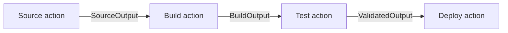
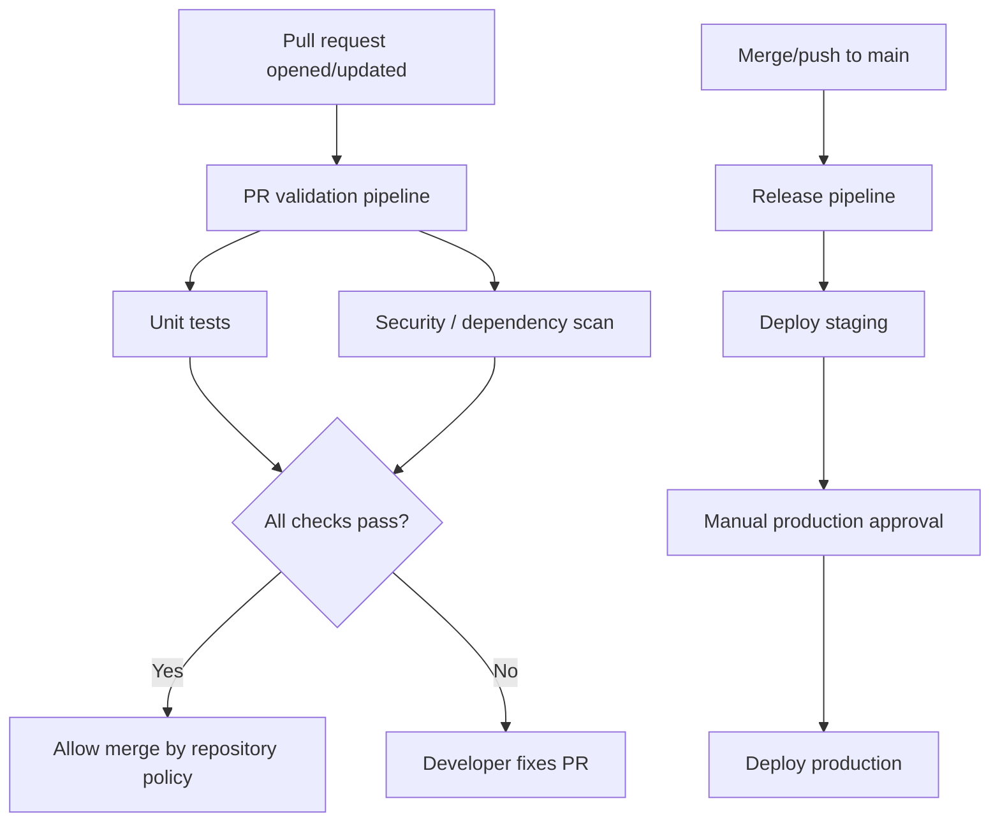
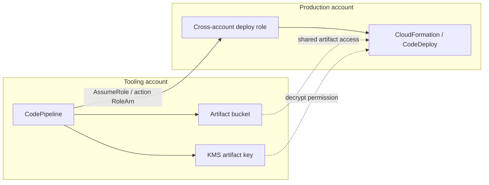
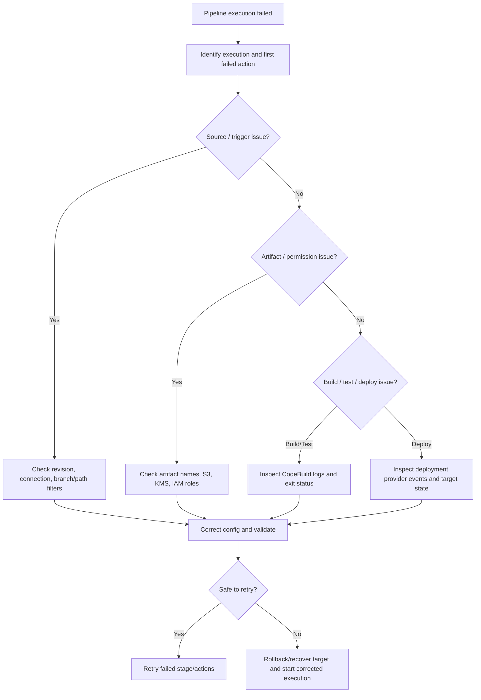

# CodePipeline Stages, Actions, Artifacts, and Triggers

> **Chapter:** CI/CD on AWS · **Module:** `CLOUD_PROVIDERS_AWS`

## 1. Overview: What Does a Pipeline Execute?

A CI/CD process for a Java application might start when a developer pushes code to Git, builds with CodeBuild, runs unit/integration tests, packages a Docker image, pushes the image to Amazon ECR, and then deploys an ECS service or Lambda function. A production pipeline also needs manual approvals, account separation, artifact storage, execution history tracking, and protection against competing deployments.

**AWS CodePipeline** is a CI/CD orchestration service. It orchestrates actions across stages, passes outputs between actions via artifacts, and starts executions from triggers or manual/API requests.

CodePipeline does not compile Java or run tests itself. Those tasks are performed by action providers such as **AWS CodeBuild**, CodeDeploy, CloudFormation, Lambda, or partner/custom actions. CodePipeline orchestrates state and data flow between steps.

```mermaid
flowchart LR
    Git[Git push / tag / PR] --> Trigger[Pipeline trigger]
    Trigger --> Source[Source stage]
    Source -->|Source artifact| Build[Build stage]
    Build -->|Build artifact / image URI| Test[Test stage]
    Test -->|Validated artifact| Approval[Approval stage]
    Approval --> Deploy[Deploy stage]
    Deploy --> Verify[Post-deploy verification]
    Verify --> Done[Pipeline succeeded]
```



**Lesson objectives:**

1. Distinguish between pipeline, execution, stage, action, and artifact.
2. Understand `runOrder`, action dependencies, and how actions run in parallel.
3. Choose action providers for source, build, test, approval, and deploy.
4. Design secure artifact flows and artifact stores.
5. Configure triggers by branch, tag, file path, and pull request.
6. Choose the appropriate V1/V2 pipeline type and execution mode.
7. Deploy cross-Region/cross-account with IAM roles and artifact stores.
8. Monitor executions, handle retries/rollbacks, and operate production pipelines.

## 2. CodePipeline Object Model

### 2.1. Pipeline

A pipeline is the top-level workflow, containing:

- An ordered sequence of stages.
- Actions inside each stage.
- Artifact store configuration for the pipeline and involved Regions.
- The role CodePipeline assumes to access resources.
- Triggers, execution mode, variables, and other pipeline configurations.

Each time a pipeline starts running, it creates a **pipeline execution**. Each execution has its own ID, source revision, and status such as `InProgress`, `Succeeded`, `Failed`, `Stopped`, or `Superseded`.

### 2.2. Stage

A stage is a logical group of actions performing one part of the workflow together, such as:

- `Source`: fetch source code.
- `Build`: compile and package.
- `Test`: unit tests, integration tests, security scans.
- `Approval`: wait for human approval.
- `Deploy`: deploy to dev/staging/prod.
- `PostDeploy`: smoke tests or health checks.

Stages execute in the order declared in the pipeline. A stage typically contains one or more actions; stages serve as useful boundaries for organizing workflows, tracking progress, and placing approval/transition controls.

### 2.3. Action

An action is a specific unit of work within a stage. Examples:

| Action category | Example provider | Task |
| --- | --- | --- |
| `Source` | CodeStarSourceConnection, CodeCommit, S3, ECR | Fetch source revision or image metadata. |
| `Build` | CodeBuild | Compile, package, build Docker image. |
| `Test` | CodeBuild, Lambda, or partner action | Run tests/scans/validation. |
| `Approval` | Manual approval | Pause execution to wait for a decision. |
| `Deploy` | CodeDeploy, CloudFormation, ECS, S3, or partner action | Deploy artifacts/resources. |
| `Invoke` | Lambda | Invoke a function for a custom step. |

Each action has a provider, configuration, input artifacts, output artifacts, role/credentials, and `runOrder` depending on the provider. Not every action requires input artifacts or produces output artifacts.

### 2.4. Artifact

Artifacts are data produced by one action and consumed by a subsequent action. Examples:

- A Source action produces `SourceOutput` containing a source snapshot.
- A Build action consumes `SourceOutput`, compiles with Maven, and produces `BuildOutput`.
- A Deploy action consumes `BuildOutput` to deploy.
- An action can push an image to ECR; the artifact passed onward may contain only the image URI, tag, commit SHA, or manifest, rather than all the image bytes.

An artifact is not synonymous with an arbitrary S3 bucket or source repository. In CodePipeline, artifacts are explicitly declared and linked via `inputArtifacts`/`outputArtifacts` names.

### 2.5. Trigger

A trigger determines **when** to create an execution. Triggers can come from source repository events, tag/branch changes, pull request events, S3 object updates, ECR image updates, EventBridge rules, API/CLI calls, or schedules integrated via EventBridge.

A trigger is not an action. Triggers start the pipeline; actions execute after the pipeline has started.

### 2.6. Overall Relationship

| Component | Answers the question | Example |
| --- | --- | --- |
| Pipeline | Which workflow? | `orders-api-release` |
| Execution | Which run? | Execution for commit `a1b2c3d` |
| Stage | Which phase? | `Build`, `Test`, `Production` |
| Action | Which task runs? | `MavenBuild`, `IntegrationTest`, `DeployEcs` |
| Artifact | Which data passes forward? | `SourceOutput`, `BuildOutput` |
| Trigger | Why did the pipeline start? | Push to `main`, tag `v2.4.0` |

## 3. Stages and Action Execution Order

### 3.1. Stages Run in Declared Order

A pipeline moves through stages sequentially: Source → Build → Test → Deploy. The next stage executes only after the previous stage succeeds. If an action in a stage fails, execution usually stops at that stage until the error is resolved or retried/restarted via supported mechanisms.

Example:

```text
Pipeline: OrdersRelease
  1. Source
  2. Build
  3. Test
  4. Staging
  5. ProductionApproval
  6. Production
```

### 3.2. `runOrder` Controls Actions Within a Stage

Within the same stage:

- Actions with the same `runOrder` run in parallel.
- Lower `runOrder` values run first.
- Actions in the next `runOrder` start only after the preceding group succeeds.
- If omitted, `runOrder` defaults to `1`.

Example:

```text
Stage: Quality
  runOrder 1:
    - UnitTests
    - StaticAnalysis
    - DependencyScan
  runOrder 2:
    - PackageRelease
```

Three independent checks can run in parallel. `PackageRelease` runs only after all actions at `runOrder 1` succeed.

### 3.3. Parallelism and Data Dependencies

Place actions at the same `runOrder` only when they are independent and their input artifacts are already available. For example, unit tests and SAST scans both reading `SourceOutput` is appropriate. An action that needs outputs from another action must be in a higher `runOrder` or a later stage.

CodePipeline does not automatically infer execution order merely because action B references an output artifact from action A. Configure `runOrder`/stages explicitly so dependencies execute properly.

### 3.4. Stage Transitions vs. Manual Approvals

These two mechanisms address different needs:

| Mechanism | Scope | Behavior |
| --- | --- | --- |
| Disable stage transition | Gate between two stages | Prevents new executions from crossing the transition until re-enabled. |
| Manual approval action | A specific action inside a stage | Execution pauses at the action waiting for someone to approve/reject. |

Manual approval is a visible step in execution history that can attach an SNS notification and external review URL. Stage transitions are useful for pausing promotion during maintenance or incidents; they do not replace an audited approval workflow.

### 3.5. Stage Boundaries and Responsibilities

A stage should represent a meaningful step for operators. Avoid creating excessive stages just to label individual shell commands. Use multiple actions within a stage when they belong to the same phase and need `runOrder` coordination; separate stages when clear boundaries exist such as test gates, approvals, environment promotion, or ownership.

## 4. Action Configuration and Action Providers

### 4.1. What Properties Does an Action Have?

An action in a pipeline definition typically includes:

- `name`: unique name within the stage.
- `actionTypeId`: category, owner, provider, version.
- `configuration`: provider-specific parameters.
- `inputArtifacts`: input artifacts.
- `outputArtifacts`: output artifacts.
- `runOrder`: execution order within the stage.
- `namespace`: namespace to expose output variables (if supported by the provider).
- `roleArn`: role assumed by the action when distinct permissions are needed.

Conceptual example:

```yaml
Name: MavenBuild
ActionTypeId:
  Category: Build
  Owner: AWS
  Provider: CodeBuild
  Version: "1"
InputArtifacts:
  - Name: SourceOutput
OutputArtifacts:
  - Name: BuildOutput
RunOrder: 1
```

`Configuration` is not the same as `InputArtifacts`: configuration holds parameters such as project name, branch, deployment group, or connection ARN; artifacts hold payloads passed between actions.

### 4.2. Source Action

The source action fetches a revision from a source provider and produces an artifact. Common providers include:

- AWS CodeCommit.
- GitHub/GitLab/Bitbucket via AWS CodeConnections (formerly CodeStar Connections).
- Amazon S3.
- Amazon ECR.

The source output is typically a ZIP artifact containing a source snapshot. Depending on the provider, the action also exposes metadata such as commit ID, branch, repository, and revision variables.

For Git providers via connections, create/authorize the connection first, grant the pipeline role permission to use the connection, and select the appropriate repository/branch. The Connection ARN is a configuration reference; it does not contain source code itself.

### 4.3. Build Action with CodeBuild

A CodeBuild action takes a source artifact, runs a build project, and can emit output artifacts. The build project defines:

- Compute environment and image.
- Buildspec.
- Environment variables.
- IAM service role.
- Cache/logging/artifact settings.

Example `buildspec.yml` for Java Maven:

```yaml
version: 0.2

phases:
  install:
    runtime-versions:
      java: corretto17
  pre_build:
    commands:
      - mvn -B -ntp --version
  build:
    commands:
      - mvn -B -ntp clean verify
  post_build:
    commands:
      - echo "Build and tests completed"

artifacts:
  files:
    - target/orders-api.jar
    - deploy/appspec.yml
    - deploy/taskdef.json
    - deploy/imageDetail.json
  discard-paths: no
```

This is an illustrative buildspec; file names and paths must match what the deploy action expects. Never store credentials in the buildspec. Use the CodeBuild service role, Secrets Manager/Parameter Store, and controlled environment variables.

### 4.4. Test Action

Tests can run in CodeBuild or an appropriate provider:

- Unit tests in `mvn verify`.
- Integration tests against a test environment.
- SAST, dependency scans, license scans, and container scans.
- Contract tests/API tests.
- Post-deploy smoke tests.

A test action must return a failing exit code when tests fail. If it only prints `FAILED` while exiting with code 0, CodePipeline may mark the action as succeeded.

### 4.5. Manual Approval Action

Manual approvals are commonly used before production or risky steps:

- Attach `NotificationArn` pointing to an SNS topic when notifications are needed.
- Attach `ExternalEntityLink` pointing to a change request, test report, or release notes.
- Provide concise `CustomData` describing what needs review.
- An authorized approver makes the approve/reject decision.

An approval action waits at most **7 days**; if no decision is made within that window, the action expires and the pipeline execution fails. Maintain an owner/on-call rotation and escalation path for pending approvals.

### 4.6. Deploy Action

The deploy provider depends on the application type:

| Workload | Provider/approach |
| --- | --- |
| ECS blue/green | CodeDeploy ECS deployment group with AppSpec and task definition artifacts. |
| ECS rolling update | Amazon ECS deploy action (`ECS`) with image definitions artifact, or CloudFormation/custom action per architecture. |
| Lambda | CloudFormation, CodeDeploy, or an action matching the deployment strategy. |
| Infrastructure | CloudFormation action or CDK deploy from CodeBuild. |
| Static website | S3 deploy action or CodeBuild sync per policy. |
| EKS/Kubernetes | CodeBuild/custom action running deploy tools with short-lived credentials. |

Do not assume every deploy action accepts the same artifact format. Check the input artifact requirements, role, configuration, and rollback behavior of the chosen provider.

### 4.7. Custom and Partner Actions

When built-in providers do not fit, partner/custom actions can be integrated. Evaluate:

- Provider ownership and credential management.
- Action timeout/retry behavior.
- Input/output artifact contract.
- Network access and data egress.
- Logging, auditing, support, and versioning.

Custom actions can execute arbitrary code; restrict permissions and protect data as a production workload.

## 5. Artifacts and Artifact Stores

### 5.1. Artifact Flow

Artifacts connect actions. The pipeline defines the output artifact of an upstream action and the input artifact of a downstream action:



Artifact names are identifiers within the pipeline definition, not fixed S3 object keys that applications should hard-code. CodePipeline manages storage locations and required versioning/metadata for each execution.

### 5.2. An Action Can Have Multiple Inputs/Outputs

For example, an integration test may need both the source test suite and the built package:

```yaml
InputArtifacts:
  - Name: BuildOutput
  - Name: TestData
OutputArtifacts:
  - Name: TestReport
```

The `TestReport` artifact can be consumed by a report-publishing or audit action. Keep artifact contracts stable: file paths, naming, formats, and versions must align across build and deploy actions.

### 5.3. Artifact Store Location

CodePipeline uses an Amazon S3 artifact store for pipeline artifacts. A pipeline has a default artifact store in its primary Region; for actions running in other Regions, declare a corresponding artifact store in each Region so CodePipeline can transfer artifacts across Region boundaries.

Artifact store requirements:

- Must reside in the Region matching the pipeline/action.
- Can use a KMS customer-managed key for encryption.
- Bucket policies/IAM roles must allow CodePipeline and action roles to access it.
- Enable encryption, block public access, enable logging, and configure appropriate retention.

Do not use the artifact bucket as a long-term source of truth or a public download endpoint. Artifact retention must follow audit/release requirements and organizational policy.

### 5.4. Encrypting Artifacts with KMS

The pipeline artifact store can configure a KMS key. When using a customer-managed key:

- The pipeline role needs permission to use the key for artifact encryption/decryption.
- The key policy must permit the relevant principals/roles.
- Cross-account consumers need permissions on both the S3 bucket and the KMS key.
- Do not grant broad `kms:*` or `s3:*` just to work around `AccessDenied`.

Encryption at rest does not replace IAM authorization. Artifacts can contain source code, compiled binaries, deployment manifests, and test reports; restrict who can read artifacts.

### 5.5. Cross-Region Actions

If a pipeline runs in `ap-southeast-1` while a deploy action runs in `ap-northeast-1`, you must:

1. Declare an artifact store in the action's Region.
2. Ensure the pipeline role can read/write both stores as required.
3. Grant matching KMS permissions if stores use customer-managed keys.
4. Verify the resource/provider is supported in the target Region.
5. Account for data residency and transfer latency/cost when moving artifacts.

Cross-Region actions do not automatically replicate all service resources. CodePipeline only transfers artifacts per pipeline configuration; application data and container images need separate replication/distribution strategies.

## 6. Triggers: Starting the Pipeline at the Right Time

### 6.1. Source Change Detection

CodePipeline can start an execution when source changes occur. The detection mechanism depends on the source provider:

| Source provider | Example events |
| --- | --- |
| GitHub/GitLab/Bitbucket via CodeConnections | Push, branch/tag update, or pull request matching configured triggers/filters. |
| CodeCommit | Repository/branch event. |
| Amazon S3 | Object created/updated at a watched bucket/key. |
| Amazon ECR | Image pushed to a repository. |
| External event | EventBridge rule or automation calling `StartPipelineExecution`. |

Not all source actions use the same trigger mechanism. During design, verify the source provider, pipeline type, and active event detection settings.

### 6.2. Pipeline V1 and V2

CodePipeline offers two pipeline types:

| Type | Characteristics |
| --- | --- |
| V1 | Legacy pipeline model supporting basic stages/actions workflows. |
| V2 | Adds pipeline-level triggers for Git sources, pipeline variables, and execution modes such as `QUEUED`/`PARALLEL`. |

When you need trigger filters by branch/tag/file path/pull request or execution modes, choose **V2**. V2 may have a different pricing model from V1; check AWS CodePipeline pricing and usage before upgrading many pipelines.

### 6.3. Git Triggers in V2

A V2 pipeline can declare Git triggers for source actions using CodeStar/CodeConnections. Triggers reference the exact `SourceActionName` and filter push or pull request events.

Conceptual CloudFormation example:

```yaml
PipelineType: V2
ExecutionMode: QUEUED
Triggers:
  - ProviderType: CodeStarSourceConnection
    GitConfiguration:
      SourceActionName: GitHubSource
      Push:
        - Branches:
            Includes:
              - main
              - release/*
          FilePaths:
            Excludes:
              - docs/**
              - "*.md"
      PullRequest:
        - Branches:
            Includes:
              - main
          Events:
            - OPEN
            - UPDATED
          FilePaths:
            Includes:
              - src/**
              - pom.xml
```

This example illustrates filter structure; provider, action name, branch/file path patterns, and event values must match your actual source connection. A trigger works only when the source action and connection are properly configured. `Push` and `PullRequest` triggers represent two separate event types.

### 6.4. Branch, Tag, and File Path Filters

Filters prevent running the pipeline on unrelated changes:

- **Branch filter:** run only on pushes to `main` or `release/*`.
- **Tag filter:** trigger a release execution only when a tag matches a pattern such as `v*`.
- **File path include:** run only when changes fall under `src/**`, `pom.xml`, or `infra/**`.
- **File path exclude:** ignore changes limited to `docs/**` or documentation files.
- **Pull request filter:** run checks when a PR is opened/updated, typically targeting `main`.

Monorepo note: if a pipeline filters only `services/orders/**`, a change in a shared library can affect the orders service without matching the filter. Add shared paths to the include list or maintain explicit pipeline dependency triggers.

### 6.5. Pull Request Triggers Are Not Production Approvals

PR triggers are typically used to validate code before merging:



PR validation and pre-production manual approval serve different goals. A passing PR does not mean a production deployment has been approved.

### 6.6. Avoiding Running a Pipeline Twice for One Change

Some source providers include automatic change detection. If you add an EventBridge rule or custom trigger for the same event while leaving automatic detection active, a single change may start multiple executions.

- Designate one change detection mechanism as primary.
- For source actions supporting `PollForSourceChanges`, set it to `false` when using a dedicated event rule per provider guidance.
- Do not copy `PollForSourceChanges` to another provider if that action does not support the property.
- Monitor for duplicate executions and check EventBridge rule targets after modifying triggers.

### 6.7. Manual/API Triggers

Executions can be started manually to deploy a hotfix, test a pipeline, or re-run with variables:

```bash
aws codepipeline start-pipeline-execution \
  --name orders-api-release \
  --region ap-southeast-1
```

The API/CLI can pass a source revision or pipeline variables depending on the API model. Restrict `codepipeline:StartPipelineExecution` permissions; anyone holding this permission can trigger deployments and consume build/deployment resources.

## 7. Pipeline Execution Modes and Concurrency

### 7.1. Three Execution Modes

Pipeline V2 supports these modes:

| Mode | Behavior | When suitable |
| --- | --- | --- |
| `SUPERSEDED` | Newer executions can replace older running executions per mode semantics, prioritizing the latest revision. | Continuous CI, where older builds become obsolete as soon as a newer commit arrives. |
| `QUEUED` | Executions queue and run one by one in order, preventing parallel deployments. | Releases requiring ordering and preventing two deployments from racing on the same environment. |
| `PARALLEL` | Multiple executions can run simultaneously. | Independent branches/tenants/environments that do not overwrite shared resources. |

With V1, execution behavior follows the legacy model; to choose `QUEUED` or `PARALLEL`, use V2. `SUPERSEDED` is typically the default when creating pipelines with traditional behavior.

### 7.2. Choosing a Mode by Workload Type

**CI branch builds:** `SUPERSEDED` usually makes sense when each new commit makes earlier commits unnecessary. This avoids wasting builds on outdated revisions.

**Production releases:** `QUEUED` fits when deployments must proceed sequentially and version N must not be overwritten by version N+1 mid-rollout. Pipelines still require approvals and release policies.

**Independent environments:** `PARALLEL` can be useful if each execution deploys to an independent target with isolated artifacts and resource names. If two executions deploy to the same ECS service or update the same CloudFormation stack, concurrency can cause conflicts.

### 7.3. Execution Modes Do Not Replace Deployment Locks

Execution modes control concurrency at the pipeline level. They do not automatically lock all external resources that actions modify. If two different pipelines deploy to the same ECS service, database, or schema, both pipelines can still run simultaneously.

For shared targets:

- Designate one release pipeline as the deployment owner.
- Separate targets/environments cleanly.
- Use external locking/coordination when multiple pipelines must share a resource.
- Configure deployment strategy/rollback policies in CodeDeploy, CloudFormation, or a dedicated orchestrator.

### 7.4. Stage Execution and Retries

An action failure does not automatically restart the whole pipeline from the beginning. Operators can retry failed actions/stages if supported by the provider and pipeline state, or start a new execution.

Before retrying:

1. Determine whether the failed action had side effects.
2. Check whether a deploy action partially applied changes.
3. Ensure the retry operation is idempotent or has rollback coverage.
4. Confirm which source revision/artifact is being retried.
5. Record the decision in the incident/release log.

### 7.5. Stopping and Superseding

An execution can be stopped when a source revision is no longer valid or a risk is discovered. Stopping a pipeline does not guarantee rolling back changes already applied to AWS by earlier actions. After stopping, inspect the actual state of resources and the deployment provider.

Do not treat stopping an execution as a rollback. For active deployments, use the deployment provider's rollback/traffic-shifting controls and the application runbook.

## 8. Variables and Output Variables

### 8.1. Pipeline Variables

Pipeline V2 can declare variables to accept values when starting an execution, such as:

- `DeployEnvironment`: `dev`, `staging`, or `prod`.
- `ReleaseVersion`: version/tag to deploy.
- `RunIntegrationTests`: toggle a check per environment.

Variables fit non-sensitive control parameters. Never pass passwords, API tokens, or private keys through pipeline variables; use Secrets Manager/Parameter Store and IAM role permissions.

### 8.2. Action Output Variables and Namespaces

Some actions emit output variables such as commit metadata, build metadata, or image tags. Declare a `namespace` on the action so downstream actions can reference them:

```text
Source action namespace: SourceVars
Build action namespace: BuildVars

Example reference:
#{SourceVars.CommitId}
#{BuildVars.ImageTag}
```

Actual variable names depend on the provider/action version. Reference only variables published by the provider; do not assume every action provides `CommitId` or `ImageTag`.

### 8.3. Starting Executions with Variable Overrides

CLI example:

```bash
aws codepipeline start-pipeline-execution \
  --name orders-api-release \
  --variables name=DeployEnvironment,value=staging
```

The pipeline must declare the matching variable. Permissions to start the pipeline and permissions to deploy to a target must still be controlled separately; passing `prod` in a variable must not automatically escalate a caller to production permissions.

### 8.4. Variables Are Not Artifacts

Variables are small configuration/metadata values; artifacts are file payloads/manifests passed between actions. Use variables for a commit ID or environment name; use artifacts for JARs, test reports, deployment manifests, or metadata files tied to an execution.

## 9. Sample Pipeline: Source → Build → Test → Approval → Deploy

### 9.1. Workflow Design

The `orders-api` application can be structured as follows:

| Stage | Action | Input | Output |
| --- | --- | --- | --- |
| Source | Git connection source | Repository/branch | `SourceOutput` |
| Build | CodeBuild Maven package | `SourceOutput` | `BuildOutput` |
| Quality | Unit tests, SAST, dependency scan | `SourceOutput` or `BuildOutput` | Reports |
| Staging | ECS/CodeDeploy deploy | `BuildOutput` | Deployment result |
| Verify | Integration/smoke test | Endpoint/config | Test report |
| ProductionApproval | Manual approval | Release metadata/report | Approval decision |
| Production | Deploy production | Same release artifact | Deployment result |

Promote the **exact same built/tested artifact** from staging to production. Do not rebuild from source after approval, because that could produce a different binary from the verified one.

### 9.2. Stage/Action Order

```text
Source
  SourceConnection (runOrder 1)

Build
  MavenPackage (runOrder 1)

Quality
  UnitTests       (runOrder 1)
  SASTScan        (runOrder 1)
  DependencyScan  (runOrder 1)
  PackageRelease  (runOrder 2)

Staging
  DeployStaging   (runOrder 1)
  SmokeTest       (runOrder 2)

Production
  ManualApproval  (runOrder 1)
  DeployProduction(runOrder 2)
```

In production, placing approval in its own stage makes ownership and transitions clearer. The example above illustrates logical ordering; the approval action should be positioned appropriately in an actual pipeline.

### 9.3. Artifact Contract

Define build outputs explicitly:

```text
BuildOutput/
  orders-api.jar
  imageDetail.json
  appspec.yaml
  taskdef.json
  reports/
    junit/
    dependency-scan/
```

This is an illustrative layout. ECS CodeDeploy blue/green deployments require AppSpec/task definition artifacts matching the schema; rolling deployments may use different manifests/commands. Never place secrets inside artifacts.

## 10. Defining Pipelines with CloudFormation

### 10.1. Pipeline Resource and Stage/Action Declarations

CodePipeline can be defined using the Console, AWS CLI, CloudFormation, CDK, or SDK. The CloudFormation resource `AWS::CodePipeline::Pipeline` clearly expresses the structure:

- `RoleArn`: service role assumed by CodePipeline.
- `ArtifactStore`: S3 bucket and encryption key for the primary Region.
- `Stages`: list of stages, each containing a list of actions.
- `PipelineType`: `V1` or `V2`.
- `ExecutionMode`: `SUPERSEDED`, `QUEUED`, or `PARALLEL` for V2.
- `Triggers`: trigger declarations for V2 pipelines.
- `Variables`: pipeline-level variables if used.

Abbreviated example for source and build:

```yaml
Resources:
  OrdersPipeline:
    Type: AWS::CodePipeline::Pipeline
    Properties:
      Name: orders-api-release
      PipelineType: V2
      ExecutionMode: QUEUED
      RoleArn: !GetAtt CodePipelineRole.Arn
      ArtifactStore:
        Type: S3
        Location: !Ref PipelineArtifactBucket
        EncryptionKey:
          Type: KMS
          Id: !GetAtt PipelineArtifactKey.Arn
      Stages:
        - Name: Source
          Actions:
            - Name: GitHubSource
              ActionTypeId:
                Category: Source
                Owner: AWS
                Provider: CodeStarSourceConnection
                Version: "1"
              Configuration:
                ConnectionArn: !Ref GitConnectionArn
                FullRepositoryId: example-org/orders-api
                BranchName: main
              OutputArtifacts:
                - Name: SourceOutput
              Namespace: SourceVars
              RunOrder: 1
        - Name: Build
          Actions:
            - Name: MavenBuild
              ActionTypeId:
                Category: Build
                Owner: AWS
                Provider: CodeBuild
                Version: "1"
              Configuration:
                ProjectName: !Ref OrdersBuildProject
              InputArtifacts:
                - Name: SourceOutput
              OutputArtifacts:
                - Name: BuildOutput
              RunOrder: 1
      Variables:
        - Name: DeployEnvironment
          DefaultValue: staging
          Description: Target environment selected by the release workflow.
```

This is a structural snippet, not a standalone template: referenced resources/parameters must be defined, the connection must be authorized, and IAM policies must match. Add test/deploy stages, triggers, and artifact stores for other Regions if the pipeline requires them.

### 10.2. Adding Test, Approval, and Deploy Actions

Subsequent actions can be declared as follows:

```yaml
- Name: Test
  Actions:
    - Name: IntegrationTests
      ActionTypeId:
        Category: Test
        Owner: AWS
        Provider: CodeBuild
        Version: "1"
      Configuration:
        ProjectName: !Ref OrdersIntegrationTestProject
      InputArtifacts:
        - Name: BuildOutput
      RunOrder: 1

- Name: ProductionApproval
  Actions:
    - Name: ApproveRelease
      ActionTypeId:
        Category: Approval
        Owner: AWS
        Provider: Manual
        Version: "1"
      Configuration:
        NotificationArn: !Ref ReleaseApprovalTopic
        ExternalEntityLink: https://change.example.com/orders/release
        CustomData: Review test results and release notes before production.
      RunOrder: 1

- Name: Production
  Actions:
    - Name: DeployOrders
      ActionTypeId:
        Category: Deploy
        Owner: AWS
        Provider: CodeDeploy
        Version: "1"
      Configuration:
        ApplicationName: !Ref OrdersCodeDeployApplication
        DeploymentGroupName: !Ref OrdersProductionDeploymentGroup
      InputArtifacts:
        - Name: BuildOutput
      RunOrder: 1
```

CodeDeploy ECS/Lambda deployments require provider-specific configurations and artifact formats, such as AppSpec, task definition, or image details. Do not use the snippet above as a complete configuration for all deployment types.

### 10.3. Namespaces and Variables in Actions

Actions can set `Namespace` to expose variables provided by the action provider. Downstream actions can reference them like:

```text
#{SourceVars.CommitId}
#{BuildVars.ImageTag}
```

Variable names are examples. Check the output variables of the exact provider/action version. If an action does not expose a needed variable, write metadata into an artifact or use an action that emits output variables with a clear contract.

## 11. IAM, Cross-Account, and Cross-Region

### 11.1. Role Separation

A pipeline can use multiple IAM roles:

| Role | Who assumes it? | Responsibility |
| --- | --- | --- |
| CodePipeline service role | CodePipeline service | Read source connection, artifact store, invoke CodeBuild/CodeDeploy/CloudFormation and needed APIs. |
| CodeBuild service role | CodeBuild service | Read source/build artifacts, access granted dependencies/secrets, write logs/outputs. |
| Action role (`RoleArn`) | CodePipeline when running the action | Execute the action with distinct permissions, e.g., deploying to another account. |
| Deployment service role | CodeDeploy/CloudFormation or related service | Create/update target resources per the deployment model. |

Do not lump all permissions into one administrator role. Each role should have only the actions/resources needed for its responsibility.

### 11.2. Pipeline Service Role

The pipeline role typically needs permissions matching its action providers:

- `codeconnections:UseConnection` for the corresponding source connection.
- `s3:GetObject`, `s3:PutObject`, `s3:GetBucketVersioning`, and required artifact store permissions.
- KMS permissions on the artifact key if using a customer-managed key.
- `codebuild:StartBuild`, `codebuild:BatchGetBuilds`.
- Appropriate CodeDeploy/CloudFormation/approval/EventBridge permissions.
- `iam:PassRole` scoped only to the specific service roles the pipeline must pass.

This is a reference list of permissions, not a copy-paste policy. Action providers and pipeline features determine exact API calls; use IAM Access Analyzer/CloudTrail to refine policies.

### 11.3. Cross-Account Deployment

Common pattern:



To deploy cross-account:

1. Create a deployment role in the target account.
2. Configure its trust policy so only the approved pipeline role/account can assume it.
3. Configure action `RoleArn` if the provider/action supports action roles.
4. Grant read permissions on the artifact bucket and decrypt permissions on the KMS key to the required principals.
5. Verify resource policies, key policies, and `iam:PassRole`.
6. Separate dev/staging/prod roles; production approval must never rely on a user-supplied variable.

Some action providers have their own role assumption/deployment role mechanisms; verify the provider's exact mechanism rather than assuming every action uses the same field.

### 11.4. Cross-Region Artifact Stores

A pipeline running an action in another Region needs an artifact store in that Region. Each Regional store must:

- Reside in the Region required by the action.
- Have appropriate bucket policies/IAM access.
- Have a KMS key in that corresponding Region if encrypted with a customer-managed key.
- Be configured in the pipeline's `ArtifactStores` map.

KMS keys are Regional resources; you cannot use a KMS key ARN from one Region to encrypt an artifact bucket in another Region. With multiple Regions, manage bucket/key permissions and lifecycles separately.

Example declaring an additional artifact store for an action in Tokyo:

```yaml
ArtifactStores:
  - Region: ap-southeast-1
    ArtifactStore:
      Type: S3
      Location: orders-pipeline-artifacts-singapore
      EncryptionKey:
        Type: KMS
        Id: arn:aws:kms:ap-southeast-1:111122223333:key/EXAMPLE-SINGAPORE-KEY
  - Region: ap-northeast-1
    ArtifactStore:
      Type: S3
      Location: orders-pipeline-artifacts-tokyo
      EncryptionKey:
        Type: KMS
        Id: arn:aws:kms:ap-northeast-1:111122223333:key/EXAMPLE-TOKYO-KEY
```

Bucket names and key ARNs are examples. Each bucket must exist/be created in its corresponding Region and its policy must permit pipeline access. In a CloudFormation pipeline definition, use `ArtifactStores` when cross-Region actions exist; a single `ArtifactStore` describes only the pipeline Region's store.

### 11.5. Connection Security and Credentials

For Git providers via CodeConnections:

- Authorize connections using an identity permitted to connect the repository.
- Specify exact repositories and branches.
- Scope `codeconnections:UseConnection` to the connection ARN.
- Review webhook/event scope and repository permissions.
- Do not place Git personal access tokens in pipeline configurations when a connection provider is supported.

For build/deploy actions, use IAM roles and secrets retrieval instead of static credentials. Secrets must be masked and never appear in build logs or artifacts.

## 12. Pipeline Observability and Operations

### 12.1. Execution History and Statuses

The CodePipeline console/CLI lets you inspect:

- Pipeline execution ID and source revision.
- Stage/action statuses and timestamps.
- Action execution details, provider errors, and external execution IDs.
- Artifact/variable metadata per access permissions.
- Pending/decided approvals.

Common statuses include `InProgress`, `Succeeded`, `Failed`, `Stopped`, and `Superseded`. Inspect the error on the first failed action; downstream stage/pipeline failures are usually just rolled-up results.

### 12.2. EventBridge and CloudWatch

CodePipeline emits pipeline/stage/action state change events to Amazon EventBridge. You can create rules to:

- Send an SNS notification when a pipeline fails.
- Create an incident/ticket when a production deployment fails.
- Record successful releases in an audit system.
- Catch approval actions waiting too long and remind owners.

CloudWatch metrics/alarms can monitor pipeline execution failures/duration per service-provided metrics. CodeBuild/CodeDeploy have their own logs/metrics; correlate pipeline execution IDs, build IDs, and deployment IDs for end-to-end traceability.

### 12.3. CLI Pipeline Inspection

```bash
# View pipeline definition
aws codepipeline get-pipeline \
  --name orders-api-release \
  --region ap-southeast-1

# View stage/action states
aws codepipeline get-pipeline-state \
  --name orders-api-release \
  --region ap-southeast-1

# List executions
aws codepipeline list-pipeline-executions \
  --pipeline-name orders-api-release \
  --region ap-southeast-1

# View details of a specific execution
aws codepipeline get-pipeline-execution \
  --pipeline-name orders-api-release \
  --pipeline-execution-id EXECUTION_ID \
  --region ap-southeast-1
```

Replace `EXECUTION_ID` with an ID from `list-pipeline-executions`. `get-pipeline` can return operationally sensitive configurations such as ARNs/names; grant read permissions only to those who need them.

### 12.4. Retrying a Stage After Fixing an Error

If an action failed due to a transient error and the provider supports retrying failed actions:

```bash
aws codepipeline retry-stage-execution \
  --pipeline-name orders-api-release \
  --stage-name Build \
  --pipeline-execution-id EXECUTION_ID \
  --retry-mode FAILED_ACTIONS \
  --region ap-southeast-1
```

Retrying does not fix source code, artifacts, or IAM policies. Retry only after understanding the root cause and confirming the action can safely re-run. If the error was caused by a bad source revision, start a new execution from the desired revision.

## 13. Controlling Stage Transitions and Pipeline Executions

### 13.1. Disabling/Enabling Stage Transitions

A stage transition is the gate into the next stage. You can temporarily disable a transition to pause promotion during maintenance or incident handling:

```bash
aws codepipeline disable-stage-transition \
  --pipeline-name orders-api-release \
  --stage-name Production \
  --transition-type Inbound \
  --reason "Production deployment paused during incident review"

aws codepipeline enable-stage-transition \
  --pipeline-name orders-api-release \
  --stage-name Production \
  --transition-type Inbound \
  --reason "Incident review completed"
```

`Inbound` controls executions entering the stage; `Outbound` controls executions leaving the stage. When a transition is disabled, affected executions may wait at the boundary. Check pipeline state and execution history before and after re-enabling to understand which executions resume.

Disabling a transition does not cancel an execution and does not roll back already-executed actions. Use stop execution separately when a specific run must be halted.

### 13.2. Stopping an Execution

If an execution is no longer safe to continue, stop it via Console/API/CLI. Choose appropriately between stopping and abandoning per API options; then verify resource states because earlier actions may have created side effects.

Do not treat stopping as a rollback. For an active deployment, use the deployment provider's rollback/traffic-shifting controls and the application runbook.

### 13.3. Retrying Failed Actions

Retrying a stage is appropriate when:

- The failure is transient, such as API throttling or a network timeout.
- Source revision and artifacts are still valid.
- The action can safely execute again.
- The deployment provider is not stuck in a half-completed state that would conflict.

Start a new execution when a new source revision, pipeline definition edit, or pipeline variable change is needed. Record execution IDs and release revisions in audit logs to distinguish retries from new releases.

### 13.4. Scheduled or Non-Git Event Triggers

Not every pipeline needs a Git push trigger. EventBridge can invoke `StartPipelineExecution` on a schedule or business event, such as:

- Running nightly integration tests.
- Synchronizing data after an upstream export finishes.
- Triggering a pipeline when a new image appears in ECR.
- Running periodic compliance checks.

The EventBridge rule needs a target role permitted to call CodePipeline. Filter events narrowly enough to avoid triggering excessive executions; use idempotency/correlation IDs in downstream actions when events may be redelivered.

## 14. Practice Exercises and Evaluation Scenarios

> **Lab rule:** Only create pipelines, connections, artifact buckets, and build/deploy resources in authorized AWS accounts/Regions. Operations may incur costs. If you do not have a lab environment, write the pipeline definition, IAM policies, and expected behavior on paper.

### Exercise 1 — Draw the Pipeline Execution Graph

A Java application has a source repository, Maven build, unit tests, SAST, integration tests, staging deploy, smoke test, and production deploy.

- Draw the stages and actions.
- Identify the output/input artifacts of each action.
- Assign `runOrder` for independent and dependent steps.
- Choose where to place manual approval.
- State the pipeline status when a test action fails.

### Exercise 2 — Stages, Actions, and Artifacts

A build action takes source code and outputs a JAR and test reports. A deploy action needs only the JAR and a manifest.

1. Name `SourceOutput`, `BuildOutput`, and `TestReport`.
2. Identify input/output artifacts of each action.
3. Explain why configuration is not an artifact.
4. Design an artifact contract decoupling build and deploy.
5. Describe how to handle a build that succeeds while the JAR file is missing.

### Exercise 3 — Parallelism with runOrder

The Quality stage contains unit tests, dependency scan, SAST, and packaging:

- Place the first three checks at the same `runOrder`.
- Place packaging at the next `runOrder`.
- Explain the conditions for safe parallel execution.
- Describe what happens if one scan fails.
- Identify when scans should be split into a separate stage.

### Exercise 4 — Triggers by Branch and File Paths

A monorepo contains:

```text
services/orders/**
services/payments/**
libs/common/**
docs/**
```

The Orders pipeline must run when changes occur in the orders service or shared library, only on pushes to `main` and `release/*`.

1. Write the Git push filter for branch patterns.
2. Write the file path includes for orders and common.
3. Explain why the shared library must not be excluded.
4. Design a PR trigger for PRs targeting `main`.
5. Verify that a single push creates only one execution.

### Exercise 5 — Choosing Pipeline Type and Execution Mode

A CI pipeline frequently receives new commits while a previous execution is still building. A production pipeline must deploy releases sequentially.

- Choose V2 for pipelines requiring triggers/variables/execution modes.
- Choose `SUPERSEDED` for CI if newer revisions render older builds obsolete.
- Choose `QUEUED` for production releases if every release must run sequentially.
- State the conditions for `PARALLEL` to be safe.
- Distinguish pipeline execution mode from external resource locking.

### Exercise 6 — Artifact Stores and KMS

A pipeline in Singapore builds artifacts and deploys to Tokyo:

1. Declare artifact stores for the primary Region and action Region.
2. Select S3 bucket encryption and customer-managed KMS keys.
3. Write IAM permissions for the pipeline role and action role.
4. Design bucket/key policies for cross-account consumers.
5. Explain why KMS keys must reside in their respective Regions.
6. Evaluate data residency and transfer costs.

### Exercise 7 — Manual Approval and Stage Transitions

Production is paused due to an incident while staging continues receiving releases:

- Design a manual approval action before production.
- Attach an SNS notification and change request URL.
- Disable inbound transition into Production during the incident.
- Explain the difference between disabling a transition and rejecting an approval.
- Define an escalation plan if approval is not decided within 7 days.

### Exercise 8 — Cross-Account Deploy Roles

A tooling account hosts the pipeline; a workload account hosts the production ECS service:

1. Write the trust policy for the deployment role.
2. Configure action `RoleArn` if supported by the provider.
3. Grant least-privilege S3/KMS artifact permissions.
4. Distinguish CodePipeline role, CodeBuild role, and CodeDeploy service role.
5. Verify `iam:PassRole` is scoped to specific roles only.
6. Design separation between dev and production permissions.

### Exercise 9 — Debugging Duplicate Triggers

A single Git push creates two pipeline executions almost simultaneously:

- Check CodeConnections trigger filters.
- Check EventBridge rules and source change detection.
- Check whether `PollForSourceChanges` is enabled on a supported provider.
- Identify which event triggered each execution.
- Choose one trigger path as primary and re-test.

### Exercise 10 — Incident Tabletop: Deploy Action Fails

The production deploy action reports failed, yet some ECS tasks are already running the new image:

- Record execution ID, artifact version, image digest, and deployment ID.
- Inspect CodeDeploy/ECS deployment state.
- Determine whether the action had partial side effects.
- Decide between retry, rollback, or continuing deployment.
- Check health checks and traffic routing.
- Verify the pipeline does not rebuild a different binary from the tested artifact.

### Self-Check Questions

1. What is CodePipeline's responsibility in CI/CD?
2. How does a pipeline differ from a pipeline execution?
3. How does a stage differ from an action?
4. What work does an action provider perform?
5. What are artifacts used for?
6. How does a trigger differ from an action?
7. What is the default `runOrder`?
8. How do actions with the same `runOrder` execute?
9. Why don't artifact references automatically define execution order?
10. How does manual approval differ from a stage transition?
11. How long does a manual approval action wait at most?
12. How does a CodeBuild action receive its source artifact?
13. What must a buildspec do so an action fails when tests fail?
14. Why should the same artifact be promoted from staging to production?
15. Which service does CodePipeline's default artifact store use?
16. Why does a cross-Region action need an artifact store in the target Region?
17. What are the main feature differences between Pipeline V1 and V2?
18. How do `SUPERSEDED`, `QUEUED`, and `PARALLEL` differ?
19. When can `PARALLEL` cause race conditions?
20. Which field does a V2 Git trigger use to reference the source action?
21. How do branch/file path filters help monorepos?
22. Why doesn't PR validation replace production approval?
23. When should `PollForSourceChanges` be disabled?
24. How do pipeline variables differ from artifacts?
25. What is an action namespace used for?
26. How does the CodePipeline role differ from the CodeBuild service role?
27. What trust policy is needed for cross-account deployments?
28. Why must a KMS key and artifact store be in the same Region?
29. Does stopping an execution automatically roll back resource changes?
30. What idempotency checks are needed before retrying a failed stage?

## 15. Official AWS Documentation and Production Checklist

### 15.1. CodePipeline

- [AWS CodePipeline User Guide](https://docs.aws.amazon.com/codepipeline/latest/userguide/welcome.html)
- [Concepts and pipeline structure](https://docs.aws.amazon.com/codepipeline/latest/userguide/concepts.html)
- [Pipeline structure reference](https://docs.aws.amazon.com/codepipeline/latest/userguide/reference-pipeline-structure.html)
- [Actions and action structure](https://docs.aws.amazon.com/codepipeline/latest/userguide/actions.html)
- [Artifacts and artifact stores](https://docs.aws.amazon.com/codepipeline/latest/userguide/welcome-introducing-artifacts.html)
- [Pipeline types and execution modes](https://docs.aws.amazon.com/codepipeline/latest/userguide/pipeline-types.html)
- [Triggers and filtering](https://docs.aws.amazon.com/codepipeline/latest/userguide/pipeline-triggers.html)
- [Pipeline variables](https://docs.aws.amazon.com/codepipeline/latest/userguide/reference-variables.html)
- [Manual approval actions](https://docs.aws.amazon.com/codepipeline/latest/userguide/approvals.html)
- [Cross-Region actions](https://docs.aws.amazon.com/codepipeline/latest/userguide/actions-create-cross-region.html)
- [Cross-account pipeline actions](https://docs.aws.amazon.com/codepipeline/latest/userguide/pipelines-create-cross-account.html)
- [Stage transitions](https://docs.aws.amazon.com/codepipeline/latest/userguide/transitions.html)
- [Troubleshooting CodePipeline](https://docs.aws.amazon.com/codepipeline/latest/userguide/troubleshooting.html)

### 15.2. Action Providers and Integrations

- [CodeBuild User Guide](https://docs.aws.amazon.com/codebuild/latest/userguide/welcome.html)
- [Buildspec reference](https://docs.aws.amazon.com/codebuild/latest/userguide/build-spec-ref.html)
- [CodeDeploy User Guide](https://docs.aws.amazon.com/codedeploy/latest/userguide/welcome.html)
- [AWS CodeConnections User Guide](https://docs.aws.amazon.com/dtconsole/latest/userguide/welcome-connections.html)
- [Amazon EventBridge User Guide](https://docs.aws.amazon.com/eventbridge/latest/userguide/eb-what-is.html)
- [AWS CloudFormation CodePipeline resource](https://docs.aws.amazon.com/AWSCloudFormation/latest/UserGuide/aws-resource-codepipeline-pipeline.html)
- [AWS CLI CodePipeline command reference](https://docs.aws.amazon.com/cli/latest/reference/codepipeline/index.html)

### 15.3. Pre-Production Checklist

| Item | Required evidence |
| --- | --- |
| **Pipeline model** | Pipeline type V1/V2 and execution mode selected per use case. |
| **Stage boundaries** | Stage names, owners, ordering, and approval boundaries are clear. |
| **Action configuration** | Provider/version/configuration, `runOrder`, and IAM roles reviewed. |
| **Artifact contract** | Input/output artifact names, files, schemas, and revision metadata are stable. |
| **Artifact store** | S3 bucket per Region, KMS encryption, bucket policy, and retention configured. |
| **Triggers** | Branch/tag/file path/PR filters accurate; no duplicate detection. |
| **Concurrency** | Execution mode fits and shared deployment targets have coordination. |
| **Variables** | No secrets included; output variables have clear namespaces and contracts. |
| **IAM** | Pipeline, action, CodeBuild, and deployment roles follow least privilege. |
| **Cross-account/Region** | Trust policies, artifact stores, and Regional KMS keys tested. |
| **Approval** | SNS/review URL/owner/escalation and 7-day timeout have runbooks. |
| **Testing** | Unit/integration/security tests fail with accurate exit codes. |
| **Deployment** | Provider artifact schemas, health checks, rollback, and idempotency tested. |
| **Observability** | EventBridge notifications, CloudWatch metrics/logs, and execution IDs correlated. |
| **Operations** | Retry/stop/transition procedures and incident runbooks ready. |

**Remember:** **Stages** divide a pipeline into phases; **actions** perform specific work; **artifacts** pass data between actions; **triggers** start executions. Use `runOrder` to control parallelism inside a stage, V2 triggers to filter Git events, and execution modes to manage concurrency. For production, protect artifacts with S3/KMS, separate IAM roles, require audited approvals, and promote only tested artifacts.

### 12.5. Approval Operations

A manual approval can sit pending inside an execution. Operators must:

- Identify the execution ID, stage/action, and release revision.
- Read the change request/test report/external review link.
- Confirm the approver has appropriate authority.
- Approve or reject via console/API per audit policy.
- Track the 7-day timeout and escalation path.

Do not automatically approve production simply because the previous stage succeeded. Approval is an independent release accountability decision.

### 12.6. Symptom-Based Troubleshooting

| Symptom | Causes to check | Resolution path |
| --- | --- | --- |
| Pipeline does not trigger on push. | Wrong trigger/source branch, unauthorized connection, or event detection disabled. | Check source action, V2 trigger filters, and connection status. |
| One push creates multiple executions. | Both automatic detection and EventBridge/custom trigger emit events. | Choose one trigger path; disable duplicate detection if supported by provider. |
| Source action `AccessDenied`. | Pipeline role missing `UseConnection` or wrong connection ARN. | Scope permissions to the exact connection and check authorization. |
| Build cannot find source files. | Wrong input artifact name or wrong buildspec path. | Check `SourceOutput`, working directory, and artifact contract. |
| Build succeeds but `BuildOutput` is missing. | Buildspec declares no artifacts or file path does not exist. | Check `artifacts.files`, base directory, and output artifact name. |
| Deploy action cannot find AppSpec/task definition. | Artifact missing file or provider expects a different format. | Verify deploy artifact schema and file paths. |
| Artifact access denied. | Missing permissions in S3 bucket policy, pipeline role, or action role. | Check bucket policy, object ARN, and cross-account principal. |
| KMS `AccessDenied`. | Missing key policy or `kms:Decrypt`/`kms:Encrypt`. | Grant permissions on the exact Regional key and principal. |
| Cross-Region action fails. | Missing/wrong artifact store Region or KMS key in another Region. | Declare an artifact store and key in the action's Region. |
| Actions run in parallel unexpectedly. | Actions share the same `runOrder`. | Increase `runOrder` or move action to another stage. |
| Pipeline deploys old revision. | Execution mode/trigger concurrency or source revision override. | Check execution mode and the execution's source revision. |
| Pipeline was superseded. | A newer execution arrived under `SUPERSEDED` mode. | Choose `QUEUED` if every release must run sequentially. |
| Production action is blocked. | Manual approval pending/rejected or stage transition disabled. | Check approval state and transition state. |
| Retry causes duplicate deploy. | Action has side effects and is not idempotent. | Inspect deployment state; design idempotency/rollback before retrying. |
| Pipeline succeeds but app fails. | Missing post-deploy tests/health checks or deploy action reports success before app is healthy. | Add smoke tests, alarms, and rollback/traffic-shift policies. |

### 12.7. Runbook for Pipeline Failures



1. Record the execution ID, pipeline name, source revision, Region, and timestamp.
2. Identify the first failing action rather than reading only the pipeline summary.
3. Inspect action provider logs, artifact inputs/outputs, and IAM/KMS.
4. Verify whether the target was partially modified before the action failed.
5. Choose retry, rollback, or a new execution according to idempotency and release policy.
6. Verify post-deploy application health; document the outcome and root cause.
