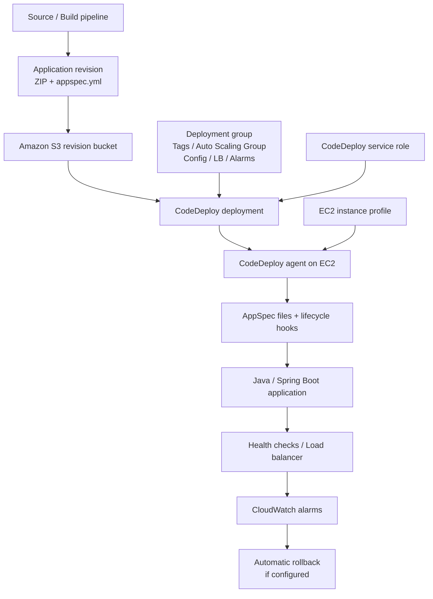
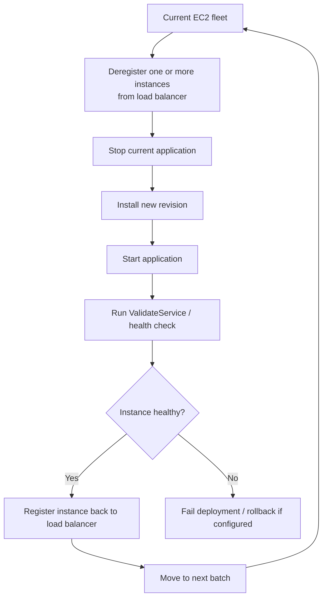
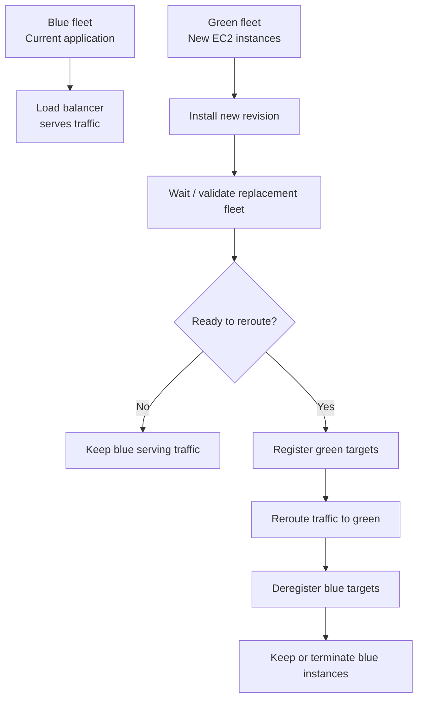
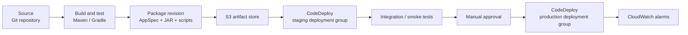

# CodeDeploy Deployment Groups and EC2 Deployments

**AWS CodeDeploy** automates deploying application revisions to Amazon EC2 instances according to rules configured in a **deployment group**. A deployment group specifies the target fleet, deployment batching, load balancer, health checks, alarms, and rollback behavior. Each revision contains the application together with an **AppSpec** file so CodeDeploy knows which files to install and which scripts to execute at each lifecycle event.

For EC2, the two main deployment types are **in-place** and **blue/green**. In-place updates software on the currently running instances; blue/green provisions a replacement fleet, installs the new version, and shifts traffic through a load balancer. The choice depends on downtime tolerance, temporary fleet cost, rollback time, and how the application manages state.

This lesson belongs to the **CI/CD on AWS** chapter of the **CLOUD_PROVIDERS_AWS** module. Its content connects EC2, Auto Scaling Groups (ASG), Elastic Load Balancing, IAM, S3, CloudWatch, CodePipeline, Java/Spring Boot, and controlled deployment operations.

> **Deployment principle:** A deployment group must target the exact intended fleet and use a deployment configuration matching available capacity. AppSpec hooks must be safe to re-run repeatedly. Keep revisions immutable in S3, verify health after startup, enable alarms/automatic rollback, and maintain backward-compatible database schemas between old and new versions.

## 1. Learning Objectives

After this lesson, you will be able to:

1. Explain the roles of a CodeDeploy application, application revision, deployment, and deployment group.
2. Describe the CodeDeploy agent, EC2 instance profile, and CodeDeploy service role.
3. Prepare EC2 instances and Auto Scaling Groups to receive deployments.
4. Target EC2 instances using tags or ASGs.
5. Create a deployment group and configure a deployment configuration.
6. Distinguish in-place deployments from blue/green deployments on EC2.
7. Write an AppSpec YAML file to install a Java/Spring Boot application.
8. Order lifecycle hooks, script timeouts, `runas`, and health validation.
9. Integrate Elastic Load Balancing to drain and register instances safely.
10. Configure CloudWatch alarms, automatic rollback, and SNS notifications.
11. Package an application revision, upload it to S3, and deploy with AWS CLI.
12. Monitor deployments via the Console, CLI, agent logs, and CloudWatch.
13. Troubleshoot AppSpec, agent, IAM, network, health check, and ASG errors.
14. Integrate CodeDeploy with CodePipeline and CI/CD workflows.
15. Design safe rollback, database migration, and release strategies.

## 2. How Does CodeDeploy Work?

In the EC2/On-Premises compute platform, CodeDeploy orchestrates installing an application revision onto a group of EC2 instances. On each instance, the **CodeDeploy agent** receives deployment commands, downloads the revision, installs files, and executes lifecycle scripts.



Key components:

| Component | Responsibility |
| --- | --- |
| **CodeDeploy application** | Represents the deployed application and its compute platform |
| **Application revision** | Deployable version: code, config files, scripts, and AppSpec |
| **Deployment group** | Selects target instances and stores deployment settings |
| **Deployment configuration** | Defines minimum number/percentage of healthy hosts |
| **CodeDeploy service role** | Allows CodeDeploy to interact with EC2, ASG, ELB, and related services on your behalf |
| **EC2 instance profile** | Grants credentials to the agent on the instance, e.g., reading revisions from S3 |
| **CodeDeploy agent** | Polls CodeDeploy, downloads revisions, installs files, and runs hooks |
| **AppSpec** | Describes file mappings and lifecycle scripts |
| **CloudWatch alarms** | Detects bad metrics and can trigger rollback |

CodeDeploy does not replace a build system. Maven/Gradle or a CI pipeline still compiles/tests the application and builds artifacts; CodeDeploy takes the built revision and deploys it.

### 2.1. Application, Revision, and Deployment Group

One CodeDeploy application can have multiple deployment groups:

- **orders-development**: instances tagged `Environment=dev`.
- **orders-staging**: instances tagged `Environment=staging`.
- **orders-production**: instances tagged `Environment=prod`.

The same tested revision can be deployed sequentially to staging and then production. Each deployment group can have its own deployment configuration, alarms, load balancer, and rollback settings.

A deployment group is neither a server nor a release. It is a configuration set defining where and how CodeDeploy executes a deployment.

### 2.2. Compute Platform

A CodeDeploy application uses the **Server** compute platform for EC2/On-Premises. In this lesson, the scope is Amazon EC2.

Similar deployment group concepts exist for ECS and Lambda, but their AppSpec structure, lifecycle hooks, traffic shifting, and deployment configurations differ. Do not use an EC2 AppSpec for ECS/Lambda.

## 3. Two IAM Roles to Distinguish

CodeDeploy deployments on EC2 require separating permissions for the orchestration service from permissions for the instance downloading artifacts.

### 3.1. CodeDeploy Service Role

The service role is assumed by CodeDeploy. Its trust relationship must permit the service principal:

```json
{
  "Version": "2012-10-17",
  "Statement": [
    {
      "Effect": "Allow",
      "Principal": {
        "Service": "codedeploy.amazonaws.com"
      },
      "Action": "sts:AssumeRole"
    }
  ]
}
```

This role needs permissions matching the compute platform and deployment type:

- Identify/inspect EC2 instances.
- Work with Auto Scaling Groups.
- Deregister/register instances with Elastic Load Balancing.
- Create replacement fleets for blue/green if configured.
- Read CloudWatch alarm states and publish SNS notifications when triggers are enabled.

AWS provides the managed policy **AWSCodeDeployRole** as a starting point for many EC2 deployments. In production, review the active policy, scope permissions to your architecture, and apply permissions boundaries/SCPs per organizational guardrails.

If an ASG uses a launch template and CodeDeploy needs to create replacement instances for blue/green, the service role may also require **ec2:RunInstances**, **ec2:CreateTags**, and **iam:PassRole** according to launch template configuration. Verify actual permissions required by the deployment path; do not grant these actions broadly if the deployment does not need them.

### 3.2. EC2 Instance Profile

Every EC2 instance participating in a deployment needs an IAM instance profile. The instance role's trust relationship allows EC2 to assume the role:

```json
{
  "Version": "2012-10-17",
  "Statement": [
    {
      "Effect": "Allow",
      "Principal": {
        "Service": "ec2.amazonaws.com"
      },
      "Action": "sts:AssumeRole"
    }
  ]
}
```

The agent needs to download revisions from S3. A least-privilege policy must permit reading only the exact artifact bucket and object prefix, for example:

```json
{
  "Version": "2012-10-17",
  "Statement": [
    {
      "Effect": "Allow",
      "Action": [
        "s3:GetObject",
        "s3:GetObjectVersion"
      ],
      "Resource": "arn:aws:s3:::company-deployments/orders-api/*"
    },
    {
      "Effect": "Allow",
      "Action": "s3:ListBucket",
      "Resource": "arn:aws:s3:::company-deployments",
      "Condition": {
        "StringLike": {
          "s3:prefix": [
            "orders-api/*"
          ]
        }
      }
    }
  ]
}
```

This is an illustrative policy; bucket policies, KMS key policies, and permissions to download the CodeDeploy agent package must also be considered depending on installation method. If artifacts use an SSE-KMS customer-managed key, the instance role must have appropriate decrypt permissions and the key policy must allow it.

**Do not merge the two roles into one.** The service role allows CodeDeploy to manage deployments; the instance profile allows the EC2 agent to access required resources at runtime.

## 4. Preparing EC2 Instances

Each target EC2 instance must meet these requirements:

- Run an operating system/architecture supported by the CodeDeploy agent.
- Have an appropriate IAM instance profile attached.
- Be able to connect to the CodeDeploy service endpoint.
- Be able to download revisions from S3 or the configured source repository.
- Have the CodeDeploy agent installed and running.
- Have EC2 tags or belong to an Auto Scaling Group targeted by the deployment group.
- Have sufficient disk space and filesystem permissions for revisions, scripts, and the application.
- Have network paths to downstream dependencies and load balancer health checks.

### 4.1. CodeDeploy Agent

The agent is a service running on each instance. It contacts CodeDeploy to receive work and execute the deployment lifecycle.

On Amazon Linux, Ubuntu, or RHEL, check the service:

```bash
sudo systemctl status codedeploy-agent
sudo systemctl start codedeploy-agent
sudo systemctl enable codedeploy-agent
```

On agent 2.0.x and later, check the version with:

```bash
sudo /opt/codedeploy-agent/bin/codedeploy-agent --version
```

Agent version 2.x uses the **latestv2** installer prefix. Example installation on Amazon Linux/RHEL; verify the regional bucket and architecture against AWS documentation before using:

```bash
sudo yum install -y wget
cd /home/ec2-user

AWS_REGION=ap-southeast-1
wget "https://aws-codedeploy-$AWS_REGION.s3.$AWS_REGION.amazonaws.com/latestv2/install"

chmod +x ./install
sudo ./install auto

sudo systemctl enable codedeploy-agent
sudo systemctl start codedeploy-agent
sudo systemctl status codedeploy-agent
```

For Ubuntu, package managers and dependency commands differ. Follow the official installation page for the specific OS/architecture. In production, consider baking a tested agent version into the AMI or managing agent upgrades through a dedicated process.

### 4.2. Network Path

The EC2 agent requires outbound connectivity to CodeDeploy and the revision store. If instances are in private subnets:

- Configure a NAT/egress path or VPC endpoints appropriate for supported services.
- An S3 gateway endpoint can serve S3 access in the same Region.
- Check DNS resolution, route tables, NACLs, and security groups.
- Check whether bucket policies block VPC endpoints or enforce source conditions.
- Do not open inbound management ports from the Internet just for the agent to operate.

The agent initiates outbound connections to AWS services; you do not need to open a public inbound port on EC2 for CodeDeploy to manage the instance.

### 4.3. Agent Logs

On Linux, the default agent log is typically at:

```text
/var/log/aws/codedeploy-agent/codedeploy-agent.log
```

Deployment-specific script logs typically reside under deployment root:

```text
/opt/codedeploy-agent/deployment-root/
  <deployment-group-id>/
    <deployment-id>/
      logs/
        scripts.log
```

The deployment root path can be customized in agent configuration. On Windows Server, logs and deployment files reside under CodeDeploy's ProgramData directory.

On Linux, the agent's aggregated deployment log is typically at **/opt/codedeploy-agent/deployment-root/deployment-logs/codedeploy-agent-deployments.log**. You can install the CloudWatch agent to centralize agent/deployment logs instead of logging into individual instances.

## 5. Targeting EC2 Instances with Tags and Auto Scaling Groups

A deployment group must accurately identify the instance fleet.

### 5.1. EC2 Tag Filters

Tag instances by environment and application:

| Instance | Environment | Application | Role |
| --- | --- | --- | --- |
| i-01 | staging | orders-api | web |
| i-02 | staging | orders-api | web |
| i-03 | production | orders-api | web |
| i-04 | production | orders-api | worker |

The staging deployment group can select:

```text
Environment = staging
Application = orders-api
Role = web
```

Tag filters let you reuse the same CodeDeploy application across different environments. Use consistent keys/values, and never apply overly broad tags like `Environment=prod` to instances that do not belong to that workload.

When configuring multiple tag filter groups, CodeDeploy combines groups to narrow the fleet; instances must match criteria in every group. Within a single group, an instance is matched if it satisfies any one of the tag filters in that group. Review the deployment group tag filter rules when designing combined criteria.

### 5.2. Auto Scaling Group

Instead of listing individual instances, a deployment group can target an ASG. When the ASG launches a new instance, CodeDeploy can automatically deploy the appropriate revision to that instance if integration is configured.

ASGs are useful when:

- The fleet scales in/out based on CPU or request load.
- Instances are replaced frequently.
- A standardized launch template/AMI is required.
- Deployments must align with the fleet lifecycle.

Ensure the launch template attaches the right instance profile, security groups, subnets, and CodeDeploy agent. If a new instance lacks the agent or cannot download the revision, the ASG may report the instance as healthy at the EC2 level while the application is not ready.

### 5.3. Avoid Attaching One ASG to Multiple Deployment Groups

AWS warns that associating one ASG with multiple deployment groups can cause issues when deployments fail or termination hooks run concurrently. Design a clear ownership boundary per application/fleet, or carefully evaluate how deployment groups interact before sharing an ASG.

## 6. Creating a CodeDeploy Application and Deployment Group

Basic workflow:

1. Create a CodeDeploy application with compute platform `Server`.
2. Create or select a CodeDeploy service role.
3. Prepare EC2 instances or an ASG.
4. Install the agent and attach the instance profile.
5. Attach tags or select the ASG.
6. Create a deployment group with deployment type and deployment configuration.
7. If using a load balancer, select the appropriate Classic Load Balancer, Application Load Balancer, or Network Load Balancer.
8. Configure alarms, automatic rollback, and notifications.
9. Upload the application revision and create a deployment.

### 6.1. Key Deployment Group Settings

| Setting | Meaning |
| --- | --- |
| Application name | CodeDeploy application containing the revision |
| Deployment group name | Name of the fleet/configuration group |
| Service role ARN | Role assumed by CodeDeploy |
| EC2 tag filters | Target instances by tags |
| Auto Scaling groups | Target fleets managed by an ASG |
| Deployment type | In-place or blue/green |
| Deployment configuration | Minimum healthy hosts rules |
| Load balancer | Manage traffic during deployment |
| Alarm configuration | Stop deployment when an alarm enters `ALARM` |
| Automatic rollback | Automatically redeploy the previous revision on failure |
| Deployment triggers | Send SNS notifications for deployment events |

One application can have multiple deployment groups, such as staging and production. You do not need to create separate applications just to separate environments, provided trust boundaries, compute platform, and ownership align.

## 7. In-Place Deployment

In an **in-place deployment**, CodeDeploy updates the application directly on the instances in the deployment group.



If no load balancer is configured, instances can still be updated, but users may experience downtime while the application stops and restarts.

### 7.1. Advantages

- No second EC2 fleet needed.
- Lower temporary infrastructure cost than blue/green.
- Suitable for stateful or legacy applications needing in-place updates within planned downtime.
- Concurrent instances being updated can be limited via the deployment configuration.

### 7.2. Risks

- During updates, available fleet capacity drops.
- Installation errors can leave instances unable to serve traffic.
- Rollback takes time because the previous revision must be redeployed.
- OS package/configuration changes may not be fully reversed by copying the old revision back.
- Without a load balancer, traffic can reach restarting instances.

For a production web tier, combine in-place deployments with an ALB/NLB and choose minimum healthy hosts so sufficient capacity remains online.

## 8. Blue/Green Deployment on EC2

In a **blue/green deployment**, CodeDeploy replaces the original fleet with a replacement fleet. CodeDeploy installs the revision on the new instances, waits for a configured validation period if specified, then registers replacement instances with the load balancer and deregisters the original instances.



On the EC2/On-Premises compute platform, blue/green deployment supports only Amazon EC2 instances. Do not confuse this model with canary/linear traffic shifting in Lambda or ECS.

A load balancer is required for EC2 blue/green deployments. If using an ALB, the target group for EC2 instances must have target type **instance**. Both the original environment and replacement environment must be in the same VPC as the load balancer per ELB requirements.

### 8.1. Replacement Fleet Source

The deployment group can be configured to:

- Provision a replacement environment based on an existing Auto Scaling Group configuration.
- Use a replacement ASG/instances prepared via a supported workflow.

Replacement instances need the same network/security prerequisites and the CodeDeploy agent. CodeDeploy installs the revision on the new fleet before shifting traffic.

### 8.2. Handling Original Instances

After traffic shifts to the replacement environment, you can:

- Terminate original instances after a waiting period.
- Keep original instances running for investigation or other uses.

If terminating, ensure lifecycle/backups and local instance data are accounted for. If retaining, manage costs and ensure the old fleet does not accidentally continue receiving traffic.

### 8.3. When to Use Blue/Green?

Choose blue/green when:

- You want to test the new version on a separate fleet before shifting traffic.
- You need to minimize downtime.
- You need fast rollback to the old fleet.
- You can afford capacity for two fleets during cutover.
- Both application and database schema support two versions coexisting during the release window.

Blue/green does not automatically solve backward compatibility. If the new version runs a migration that breaks reads for the old version, shifting traffic back to blue can still fail.

## 9. Comparing In-Place and Blue/Green

| Criterion | In-place | Blue/green |
| --- | --- | --- |
| Fleet updated | Existing instances | Replacement fleet |
| Temporary EC2 capacity | No second fleet needed | May require two fleets |
| Load balancer | Optional, though helpful for web fleets | Required for traffic rerouting |
| Downtime | Possible if traffic is not drained properly | Usually minimizes downtime during traffic shift |
| Rollback | Redeploy previous revision onto fleet | Can shift back to original fleet while retained |
| Cost | Typically lower during deployment | Higher while both fleets coexist |
| Pre-traffic testing | Must be designed manually | Can validate replacement fleet before rerouting |
| EC2 platform support scope | EC2 and on-premises | Amazon EC2 instances |

For Java web applications on EC2, blue/green is often suitable when uptime and pre-traffic fleet verification are priorities. In-place fits small fleets, maintenance windows, or cost-constrained environments.

## 10. Deployment Configurations and Minimum Healthy Hosts

A deployment configuration determines how many or what percentage of instances can be updated concurrently, based on minimum healthy hosts.

Three default configurations for EC2/On-Premises:

| Deployment configuration | Minimum healthy hosts | Behavior |
| --- | ---: | --- |
| `CodeDeployDefault.OneAtATime` | 1 | Deploys one instance at a time |
| `CodeDeployDefault.HalfAtATime` | 50% | Updates part of the fleet in batches |
| `CodeDeployDefault.AllAtOnce` | 0 | Attempts to update as many instances as possible simultaneously |

Example for an 8-instance fleet:

- **OneAtATime:** updates one instance at a time, keeping the rest healthy during deployment.
- **HalfAtATime:** can update up to roughly half the fleet concurrently, subject to rounding and healthy state.
- **AllAtOnce:** minimizes deployment duration with the largest blast radius; multiple instances can go offline together.

Read the success/failure semantics of each deployment configuration carefully. For example, `OneAtATime` has a special rule for the last instance: a deployment can still be marked succeeded if the last instance fails, because the remaining instances were kept healthy.

### 10.1. Custom Deployment Configurations

You can create custom configurations by:

- **HOST_COUNT:** minimum number of instances that must stay healthy.
- **FLEET_PERCENT:** minimum percentage of the fleet that must stay healthy.

Example: a 12-instance fleet where at least 9 must always remain healthy:

```text
Minimum healthy hosts:
type = FLEET_PERCENT
value = 75
```

If using `HOST_COUNT=5`, CodeDeploy must keep at least 5 instances healthy throughout the deployment per that configuration.

### 10.2. Availability Zone Awareness

A multi-AZ fleet may need minimum healthy hosts per AZ so a deployment does not remove all capacity in one AZ. AWS provides custom deployment configurations supporting minimum healthy hosts per Availability Zone. Align instance counts per AZ with the deployment configuration; default configurations do not automatically enforce zonal minimums.

### 10.3. Choosing Batch Size Based on Capacity

Do not pick `HalfAtATime` simply because a fleet has an even number of instances. Calculate remaining capacity while one batch is draining:

- Normal and peak request rates.
- CPU/memory utilization.
- Minimum instances needed to meet SLAs.
- Health check and warm-up time.
- ASG scale-out responsiveness.
- Database connection limits and downstream rate limits.

Deployment config only controls deployment pacing; it cannot keep an application within capacity if initial sizing was wrong.

## 11. Elastic Load Balancing and Instance Health

CodeDeploy coordinates with Classic Load Balancer, Application Load Balancer, or Network Load Balancer to drain/register instances during deployment.

### 11.1. In-Place with a Load Balancer

When updating an instance:

1. CodeDeploy requests deregistering the instance from the load balancer.
2. The load balancer stops sending new requests to the instance.
3. The application finishes or handles in-flight requests per connection draining/deregistration delay.
4. CodeDeploy executes lifecycle events and installs the revision.
5. The application starts and is validated.
6. The instance is registered back.
7. The load balancer waits for target health checks to become healthy before routing traffic per service mechanics.

Configure deregistration delay, health check interval, healthy threshold, and timeout to match the application's shutdown/startup time.

In an in-place deployment using a load balancer, CodeDeploy can wait up to one hour for an instance to return to healthy after registration. If the target does not become healthy within that window, the deployment continues or fails depending on the deployment configuration. Set realistic health check and startup timeouts to avoid deployments hanging for long periods.

### 11.2. Spring Boot Health Checks

A Spring Boot service can expose a health endpoint via Spring Boot Actuator:

```text
GET /actuator/health
```

The ALB target group should check an endpoint reflecting application readiness. Do not let health checks return healthy when the app cannot connect to its database or required dependencies if business requests cannot be served.

Conversely, if a health check depends on every optional downstream service, an auxiliary outage can mark the entire fleet unhealthy. Choose readiness/liveness semantics according to application design.

### 11.3. Do Not Rely Only on Script Exit Codes

A hook script can exit 0 while the application still cannot receive traffic because:

- The port is not listening yet.
- The ALB health check path is wrong.
- A Security Group blocks traffic from the load balancer.
- TLS certificates or listener rules are misconfigured.
- Application startup takes longer than the timeout.
- DB migration/configuration failed.

Combine `ValidateService` scripts with load balancer target health and CloudWatch alarms.

## 12. Application Revisions and S3

An application revision for EC2 is an archive containing application files, configuration, scripts, and AppSpec. Revisions can be stored in Amazon S3 or a GitHub repository per CodeDeploy-supported sources.

### 12.1. Packaging Rules

- AppSpec must be at the root of the archive.
- For EC2/On-Premises, the file must be named **appspec.yml**.
- EC2 AppSpec must use YAML.
- Source paths in AppSpec are relative to the revision root.
- Scripts declared in hooks must also be inside the archive.
- ZIP is the standard format for Linux/Windows.
- TAR/TAR.GZ is not supported for Windows Server instances.
- Revisions should be immutable by build ID or commit SHA.

Example structure:

```text
orders-api-revision/
├── appspec.yml
├── build/
│   └── orders-api.jar
├── systemd/
│   └── orders-api.service
└── scripts/
    ├── stop.sh
    ├── prepare.sh
    ├── configure.sh
    ├── start.sh
    └── validate.sh
```

### 12.2. Storing Immutable Revisions

Do not overwrite the same S3 object key like `latest.zip` on every build if your pipeline needs accurate rollback. Use distinct keys by version/build ID, for example:

```text
s3://company-deployments/orders-api/1.4.2/revision.zip
s3://company-deployments/orders-api/1.4.3/revision.zip
```

Enable S3 versioning, encryption, and appropriate bucket policies. Retain revisions needed for rollback/auditing per retention policy.

## 13. AppSpec File for EC2

**AppSpec** defines file mappings and scripts bound to lifecycle events. For EC2, the file must be YAML named **appspec.yml** at the revision root.

General structure:

```yaml
version: "0.0"
os: linux
files:
  - source: build/orders-api.jar
    destination: /opt/orders
  - source: systemd/orders-api.service
    destination: /etc/systemd/system
hooks:
  ApplicationStop:
    - location: scripts/stop.sh
      timeout: 120
      runas: root
  BeforeInstall:
    - location: scripts/prepare.sh
      timeout: 120
      runas: root
  AfterInstall:
    - location: scripts/configure.sh
      timeout: 120
      runas: root
  ApplicationStart:
    - location: scripts/start.sh
      timeout: 120
      runas: root
  ValidateService:
    - location: scripts/validate.sh
      timeout: 180
      runas: root
```

Key fields:

| Field | Role |
| --- | --- |
| `version` | AppSpec format version; currently `0.0` |
| `os` | `linux` or `windows` |
| `files` | Maps source paths in the revision to destination paths on the instance |
| `permissions` | Sets file ownership/mode/ACL on supported Linux platforms |
| `hooks` | Attaches scripts to deployment lifecycle events |

### 13.1. files Mapping

Example:

```yaml
files:
  - source: build/orders-api.jar
    destination: /opt/orders
```

The source path is relative to the archive root. Destination is the path on the instance. CodeDeploy copies files during the `Install` event.

### 13.2. permissions

On Linux, the `permissions` section sets owner, group, mode, ACLs, and SELinux context for installed files. Verify OS support and AppSpec syntax before using. Windows Server does not use the `permissions` section the same way Linux does.

### 13.3. hooks

Hook entries specify script location, timeout, and `runas`:

```yaml
hooks:
  AfterInstall:
    - location: scripts/configure.sh
      timeout: 120
      runas: root
```

Script locations are relative to the revision root. Every hook script must exit with code 0 on success; a non-zero exit code or timeout fails the lifecycle event. On Amazon Linux/Ubuntu, `runas` can run the script under a specified user if that user exists and requires no password; verify OS support constraints.

### 13.4. ApplicationStop Runs from the Previous Revision

The **ApplicationStop** hook is special:

- Runs before the new revision is downloaded.
- The script comes from the previously successfully deployed revision.
- Does not run on the very first deployment because the instance has no prior AppSpec revision.
- Used to stop services, drain workers, or release resources from the old version.

Therefore, if you modify the stop script logic, remember the first deployment installs the new script for the next deployment. Ensure old scripts can still stop the currently running version.

## 14. Lifecycle Events and Execution Order

In an in-place deployment without a load balancer, the main sequence is typically:

```text
ApplicationStop
DownloadBundle
BeforeInstall
Install
AfterInstall
ApplicationStart
ValidateService
```

Some events are reserved by the agent for downloading/installing and cannot have custom scripts attached directly. You configure `files` mappings for CodeDeploy to perform `Install`.

### 14.1. Purpose of Each Hook

| Lifecycle event | Used for |
| --- | --- |
| `ApplicationStop` | Stop previous version; script comes from previous revision |
| `DownloadBundle` | Agent downloads revision into deployment archive |
| `BeforeInstall` | Backups, directory preparation, config decryption |
| `Install` | Agent copies files per AppSpec |
| `AfterInstall` | Set permissions, configs, symlinks, or compatible migrations |
| `ApplicationStart` | Start/restart application service |
| `ValidateService` | Validate the application after startup |

### 14.2. Traffic Hooks with a Load Balancer

When a deployment group has a load balancer, additional traffic-related events occur:

- `BeforeBlockTraffic`.
- `BlockTraffic`.
- `AfterBlockTraffic`.
- `BeforeAllowTraffic`.
- `AllowTraffic`.
- `AfterAllowTraffic`.

`BlockTraffic` and `AllowTraffic` are handled by CodeDeploy itself, not for running custom scripts. These six traffic-related hooks apply to in-place deployments when the deployment group specifies a Classic Load Balancer, ALB, or NLB.

With blue/green, hooks run on replacement instances and original instances according to their corresponding lifecycle. Consult the official hook availability table to avoid attaching scripts to events that do not fire for your deployment type.

Each hook executes on every instance participating in the deployment. In a 20-instance fleet, `ValidateService` runs 20 times, once per instance. Never put global side effects or exclusive database migrations inside a hook that runs on every host without proper locking/coordination.

### 14.3. Script Timeouts and Idempotency

- By default, each lifecycle event allows scripts to run up to 3600 seconds.
- The combined timeout of scripts within the same event cannot exceed 1 hour.
- Set realistic timeouts shorter than the default if a script only needs a few seconds.
- Use `set -e` or check exit statuses so errors are never masked.
- Scripts must be safe to re-run after a deployment failure or retry.
- Avoid scripts that destructively corrupt unrecoverable state.
- Never log secrets or sensitive environment values.

## 15. Example: Deploying a Spring Boot Service on EC2

Assume a Spring Boot application packaged as an executable JAR running under a `systemd` service named `orders-api`.

### 15.1. systemd Unit

File `systemd/orders-api.service`:

```ini
[Unit]
Description=Orders API
After=network.target

[Service]
Type=simple
User=orders
Group=orders
WorkingDirectory=/opt/orders
ExecStart=/usr/bin/java -jar /opt/orders/orders-api.jar
Restart=on-failure
RestartSec=5
SuccessExitStatus=143
EnvironmentFile=-/etc/orders/orders-api.env

[Install]
WantedBy=multi-user.target
```

Create the `orders` user in the AMI beforehand or during provisioning. The environment file holding runtime config can be managed by SSM/Secrets Manager/configuration management; never bundle secrets into the revision.

### 15.2. Stop Script

File `scripts/stop.sh`:

```bash
#!/usr/bin/env bash
set -euo pipefail

if systemctl cat orders-api.service >/dev/null 2>&1; then
  systemctl stop orders-api.service
fi
```

This allows a first deployment to proceed if the service is not yet installed. However, CodeDeploy does not invoke `ApplicationStop` on the very first deployment; the script is used on subsequent deployments.

### 15.3. Prepare Script

File `scripts/prepare.sh`:

```bash
#!/usr/bin/env bash
set -euo pipefail

install -d -o orders -g orders -m 0750 /opt/orders
install -d -o root -g root -m 0755 /etc/systemd/system
```

### 15.4. Configure Script

File `scripts/configure.sh`:

```bash
#!/usr/bin/env bash
set -euo pipefail

test -s /opt/orders/orders-api.jar
chown orders:orders /opt/orders/orders-api.jar
chmod 0640 /opt/orders/orders-api.jar

systemctl daemon-reload
```

### 15.5. Start Script

File `scripts/start.sh`:

```bash
#!/usr/bin/env bash
set -euo pipefail

systemctl enable orders-api.service
systemctl restart orders-api.service
```

### 15.6. Validate Script

File `scripts/validate.sh`:

```bash
#!/usr/bin/env bash
set -euo pipefail

for attempt in $(seq 1 30); do
  if curl --fail --silent --show-error \
      http://127.0.0.1:8080/actuator/health >/dev/null; then
    exit 0
  fi
  sleep 2
done

echo "Orders API did not become healthy before timeout" >&2
systemctl status orders-api.service --no-pager >&2 || true
exit 1
```

The Actuator endpoint must be enabled and exposed only according to security policy. If the health endpoint requires authentication, configure the validation script to use a secure method; never hardcode tokens inside the revision.

### 15.7. Preparing the Archive

Example on a Linux build agent:

```bash
mkdir -p revision/build revision/systemd revision/scripts

cp target/orders-api.jar revision/build/
cp systemd/orders-api.service revision/systemd/
cp scripts/*.sh revision/scripts/
cp appspec.yml revision/

chmod +x revision/scripts/*.sh

cd revision
zip -r ../orders-api-1.4.2.zip .
```

Verify the archive has AppSpec at the root:

```bash
unzip -l orders-api-1.4.2.zip
```

Avoid nesting into `revision/revision/appspec.yml`, or CodeDeploy will not find AppSpec at the root.

## 16. Load Balancers and Health Validation

For web applications, use a load balancer to protect traffic while CodeDeploy updates instances.

Verify:

- ALB/NLB target group matches the EC2 fleet.
- Listener rules route requests to the target group.
- Health check path/port/protocol are accurate.
- Security Group allows traffic from the load balancer to the app port.
- Deregistration delay is long enough for in-flight requests.
- Spring Boot startup time does not exceed validation/deployment timeouts.
- Health endpoint accurately reflects readiness for business dependencies.

With blue/green, CodeDeploy registers replacement instances and shifts traffic per deployment group configuration. Choosing whether to retain or terminate the original fleet affects the rollback window and cost.

Do not confuse EC2 blue/green with percentage-based traffic shifting. On the EC2 platform, the deployment configuration controls how many instances are registered/switched in steps; it does not provide canary/linear weighted routing like Lambda/ECS.

## 17. CloudWatch Alarms and Automatic Rollback

A deployment group can attach one or more CloudWatch alarms. Alarms must be created beforehand in CloudWatch and then referenced in the deployment group.

Suitable metrics for a web tier:

- ALB `HTTPCode_Target_5XX_Count`.
- ALB `TargetResponseTime`.
- `HealthyHostCount`.
- EC2 `CPUUtilization`.
- Custom application metrics such as request error rate, queue backlog, or JVM heap pressure.

### 17.1. Alarm Design

A deployment alarm should have:

- Metrics matching the application and target group.
- Thresholds reflecting meaningful error levels.
- Evaluation periods avoiding reactions to brief spikes.
- Appropriate missing data treatment.
- Exact dimension scopes.
- Runbooks for when the alarm enters `ALARM`.

Overly sensitive alarms cause repeated rollbacks. Overly loose alarms let faulty versions serve traffic for too long.

### 17.2. Automatic Rollback

Rollback can be enabled when:

- A deployment fails.
- One or more CloudWatch alarms enter `ALARM`.
- A deployment is stopped per selected configuration.

CodeDeploy rolls back by redeploying the last known-good revision. This creates **a new deployment with a new deployment ID**, not an instant undo or automatic database restore.

### 17.3. Alarm Polling Failures

Deployment groups offer an option to continue deployments when CodeDeploy cannot retrieve alarm status. For production, enable this only with clear justification and an understanding that deployments may proceed without alarm protection.

## 18. Rollback and Database Migrations

Rolling back an application revision does not guarantee rolling back every system change.

For example, Spring Boot release 2.0 adds a new database column. If a migration drops or alters a column needed by release 1.9, rolling back the JAR to 1.9 can still fail.

Use the **expand-and-contract** strategy:

1. Release A adds the new schema in a backward-compatible way.
2. Release B reads/writes the new schema while still supporting legacy data.
3. Migrate/backfill data or enable feature flags gradually.
4. Wait until the old fleet no longer depends on the old schema.
5. Only in a subsequent release, drop the old column/API.

Notes:

- Database migrations must be reviewed as separate changes.
- Take backups/snapshots/PITR before major migrations.
- Never run destructive migrations inside `ApplicationStart` on every instance.
- Use migration locks or a single dedicated job step to prevent multiple instances from running migrations concurrently.
- Separate code rollback from data rollback.
- Retain older artifacts and compatible configs so redeployment works.

## 19. AWS CLI: Creating Applications and Deployment Groups

The example below creates a CodeDeploy application and a staging deployment group using an EC2 tag filter. Replace the role ARN, account, bucket, and tags with values assigned in your sandbox.

### 19.1. Creating the Application

```bash
aws deploy create-application \
  --application-name orders-api \
  --compute-platform Server \
  --profile staging
```

### 19.2. Creating the Deployment Group

```bash
aws deploy create-deployment-group \
  --application-name orders-api \
  --deployment-group-name orders-staging \
  --service-role-arn arn:aws:iam::111122223333:role/CodeDeployServiceRole \
  --ec2-tag-filters Key=Environment,Value=staging,Type=KEY_AND_VALUE \
  --deployment-config-name CodeDeployDefault.OneAtATime \
  --profile staging
```

If targeting an ASG, use the Auto Scaling group parameter instead of or combined with EC2 tag filters per deployment group design. If using a load balancer, configure load balancer info on the deployment group.

### 19.3. Creating a Deployment

Upload the revision to S3:

```bash
aws s3 cp orders-api-1.4.2.zip \
  s3://company-deployments/orders-api/1.4.2/revision.zip \
  --sse AES256 \
  --profile staging
```

Create the deployment:

```bash
aws deploy create-deployment \
  --application-name orders-api \
  --deployment-group-name orders-staging \
  --deployment-config-name CodeDeployDefault.OneAtATime \
  --s3-location bucket=company-deployments,key=orders-api/1.4.2/revision.zip,bundleType=zip \
  --description "orders-api release 1.4.2" \
  --profile staging
```

Record the returned deployment ID. Revision keys should be immutable per build/version. If the bucket has versioning enabled, you can pin the object version when creating the deployment to ensure the exact reviewed artifact is deployed.

### 19.4. Tracking Deployments

```bash
aws deploy get-deployment \
  --deployment-id d-EXAMPLE123 \
  --profile staging

aws deploy list-deployment-instances \
  --deployment-id d-EXAMPLE123 \
  --profile staging
```

When inspecting a single instance:

```bash
aws deploy get-deployment-instance \
  --deployment-id d-EXAMPLE123 \
  --instance-id i-0123456789abcdef0 \
  --profile staging
```

Use the deployment ID to correlate CodeDeploy events, instance logs, and pipeline runs.

## 20. Creating a Deployment Group via Console

In the AWS Management Console:

1. Open CodeDeploy and choose Applications.
2. Select an application with compute platform EC2/On-Premises.
3. Choose Create deployment group.
4. Enter a deployment group name.
5. Select a service role.
6. Choose deployment type: In-place or Blue/green.
7. Select EC2 tag filters or Auto Scaling Groups.
8. Choose a deployment configuration.
9. If using a load balancer, select the appropriate load balancer/target group.
10. Configure alarms, automatic rollback, and SNS triggers.
11. Review and create the deployment group.
12. Create a deployment from the uploaded application revision.

The Console displays fields dynamically based on deployment type. Certain options appear only when selecting ASGs, load balancers, or blue/green.

## 21. Deployment Groups with Auto Scaling Groups

CodeDeploy integrates with ASGs in two directions:

- When the ASG launches a new instance, CodeDeploy deploys the current revision onto that instance.
- When the ASG scales in, termination deployments can run cleanup scripts before the instance terminates.

### 21.1. Launch Deployments

Ensure:

- The launch template attaches the instance profile.
- The AMI includes the CodeDeploy agent or a bootstrap script installs it.
- The instance can download revisions.
- Application services install/start in the right order.
- Load balancer health checks do not mark the instance healthy before the app is ready.

Custom AMIs containing the agent and dependencies reduce bootstrap time. When building AMIs, check agent state/cache guidelines in AWS documentation so cloned instances register properly.

### 21.2. Termination Deployments

During scale-in, CodeDeploy can run termination lifecycle hooks so the application performs graceful shutdown, flushes buffers, drains work, or deregisters from auxiliary systems.

If a termination deployment fails, Auto Scaling may still proceed to terminate the instance. Therefore, cleanup hooks must never be the sole safeguard guaranteeing critical data is durably saved.

### 21.3. Deployments While an ASG Is Scaling

If an ASG launches instances while a deployment is in progress, understand the automatic updates to outdated instances mechanism. CodeDeploy can deploy an older revision to instances launched at certain points depending on deployment state; enabling automatic updates for outdated instances reduces fleet version drift.

Do not link one ASG to multiple deployment groups without analyzing interactions between deployments and lifecycle hooks.

## 22. CodePipeline Integration

CodePipeline can use a CodeDeploy action to deploy revisions to a deployment group.

A typical pipeline:



The pipeline should:

- Use the exact tested build artifact rather than rebuilding between staging and production.
- Attach the commit SHA/build number to artifact metadata.
- Store revisions in S3 with immutable keys/versions.
- Run CodeDeploy to staging first.
- Run smoke/integration tests after deployment.
- Require approval before production.
- Deploy using appropriately scoped service roles.
- Track deployment IDs alongside CodePipeline execution IDs.

### 22.1. Separating Deployment Groups by Environment

Staging and production typically need:

- Separate fleets.
- Separate IAM/deployment roles.
- Separate deployment configurations.
- Separate alarms and rollback settings.
- Separate approval policies.

The same revision can be promoted across groups to eliminate the risk of "staging running one artifact while production runs another."

## 23. Monitoring Deployments and Metrics

In the CodeDeploy Console or CLI, monitor:

- Deployment status and deployment ID.
- Counts of succeeded/failed/pending instances.
- Currently executing lifecycle event.
- Instance-specific error messages.
- Revision source and deployment configuration.
- Rollback status.

### 23.1. CloudWatch Metrics

Combine CodeDeploy deployment events with:

- ALB/NLB healthy host count.
- Target 4xx/5xx counts.
- Target response time.
- EC2 CPU, memory (if agent metrics are enabled), disk, and network.
- JVM heap/GC and application request metrics.
- SQS backlog if the app is a worker.
- Database connection count/latency.

Metrics should be segmented by environment, target group, ASG, and application version if instrumentation supports it.

### 23.2. SNS Notifications

Deployment groups can configure triggers to send notifications via SNS for deployment events and instance events. Subscribe email, Lambda, or internal notification systems per policy.

SNS triggers are notifications; they do not replace CloudWatch alarms or automatic rollback.

## 24. Troubleshooting

| Symptom | Common causes | How to check |
| --- | --- | --- |
| Deployment finds no instances | Wrong tag filter/ASG, missing tags | Check target filters and instance tags |
| Instance missing from deployment group | Agent not running or wrong instance profile | `systemctl status`, IAM profile, agent logs |
| Revision download `AccessDenied` | Instance role lacks S3 permission or bucket policy blocks it | S3 `GetObject`/`GetObjectVersion`, KMS, VPC endpoint policy |
| Agent cannot poll CodeDeploy | Network/DNS/egress or clock skew | Routes, DNS, proxy, NTP, agent log |
| AppSpec file not found | `appspec.yml` not at archive root or misnamed | `unzip -l revision.zip` |
| AppSpec parse error | Wrong YAML indentation, key, or value | Validate YAML and AppSpec schema |
| Hook script not found | Script path not relative to revision root or missing from bundle | Check archive and `location` |
| Hook permission denied | Script lacks executable bit or wrong `runas` | `chmod`, owner, user, filesystem |
| `ApplicationStop` fails | Bug in old script; service state differs from assumption | Inspect script from previous revision and logs |
| Deployment stalls at `ValidateService` | Wrong health endpoint/port/startup time | Local `curl`, `systemd` status, app logs |
| Instance unhealthy after deploy | Wrong ALB health check/SG/listener | Target health reason, SG, path, port |
| Rollback fails | Incompatible old revision or non-idempotent scripts | Old artifact, AppSpec/hooks, DB schema |
| New ASG instance lacks app | Agent/bootstrap/automatic update config wrong | Launch template, lifecycle events, agent |
| Slow deployment | Small batch size, long hook timeouts, slow health checks | Deployment timeline and hook durations |
| CloudWatch alarm stops deployment | Overly sensitive threshold or rising app errors | Alarm history, metric dimensions |
| Original fleet terminated unexpectedly | Blue/green termination option | Deployment group cleanup settings |
| Right revision but wrong code | S3 key overwritten or pipeline rebuilt | Object version, artifact checksum, build ID |

### 24.1. Agent Logs on Linux

```bash
sudo tail -n 200 /var/log/aws/codedeploy-agent/codedeploy-agent.log
sudo systemctl status codedeploy-agent
```

### 24.2. Deployment Script Logs

Find the deployment ID and deployment group ID under the deployment root. Inspect `scripts.log` to see which hook failed, stdout/stderr, and exit code.

### 24.3. Investigation Runbook

1. Confirm AWS account, Region, application, and deployment group.
2. Record deployment ID, revision S3 key/version, and build SHA.
3. Identify the failing instance and failing lifecycle event.
4. Check agent service/version and agent logs.
5. Check instance profile, CodeDeploy service role, and bucket/KMS policies.
6. Check AppSpec root placement, YAML syntax, `files` mappings, and script paths.
7. Run hook scripts manually in a sandbox to reproduce errors.
8. Check `systemd` status, application logs, and health endpoint.
9. Check ALB target health and CloudWatch alarms.
10. Confirm whether rollback has already been triggered.
11. Create a new deployment only after identifying the root cause and target revision.

## 25. Security and Operational Best Practices

### 25.1. IAM Least Privilege

- Separate the CodeDeploy service role from the EC2 instance profile.
- Scope S3 read access to the exact revision bucket/prefix.
- Use appropriate KMS key policies if artifacts are encrypted with customer-managed keys.
- Restrict who can create deployment groups, alter service roles, or invoke `create-deployment`.
- Review `iam:PassRole`, ASG launch templates, and EC2 permissions.
- Use CloudTrail to audit deployment/API actions.

### 25.2. Artifact Integrity

- Use immutable S3 object keys.
- Enable versioning and encryption.
- Record build SHA, commit SHA, and checksums.
- Never place secrets inside ZIP/AppSpec/scripts.
- Scan dependencies/artifacts before publishing.
- Retain the last-known-good revision within the retention window.
- Allow only the pipeline role to write to the revision prefix.

### 25.3. Hook Scripts

- Use absolute paths or explicitly set working directories.
- Quote shell variables and enable error handling.
- Never download and execute remote scripts directly from the Internet as an uncontrolled deploy step.
- Restrict script permissions and modified files.
- Never log tokens/passwords.
- Set timeouts and check exit statuses.
- Design idempotent scripts.
- Avoid running heavy database migrations on every instance.

### 25.4. Host Security

- Use private subnets when architecture permits.
- Allow app ports only from the load balancer security group.
- Manage SSH/SSM access separately.
- Patch the OS and agent.
- Use EDR/host monitoring per organizational standards.
- Keep application configs/secrets outside the deployment archive.

## 26. Costs and Strategy Selection

CodeDeploy orchestrates deployments; primary costs usually come from EC2, load balancers, S3, CloudWatch, NAT, and supporting resources.

| Component | Impact |
| --- | --- |
| EC2 fleet | Compute and storage |
| Blue/green replacement fleet | Cost of two fleets during cutover |
| ALB/NLB | Load balancer hours, capacity units, and data processing by type |
| S3 revision bucket | Storage, requests, and transfer |
| CloudWatch | Logs, metrics, alarms, and retention |
| NAT Gateway | Hourly and data processing if private instances use NAT |
| KMS | Key and API requests if using customer-managed keys |

### 26.1. Choosing Deployment Type

- Use in-place if downtime is controllable, spare capacity exists, and paying for a second fleet does not make sense.
- Use in-place + load balancer when you want sequential updates and traffic draining.
- Use blue/green when you need to validate a replacement fleet before shifting traffic and can afford temporary dual capacity.
- Use ASGs to maintain fleet size and automatically deploy to new instances.
- Choose deployment configs based on capacity/SLOs, not release speed alone.

## 27. Hands-On Exercise: Deploying Orders API to EC2

### 27.1. Context

A Spring Boot Orders API packaged as a JAR runs on Amazon Linux EC2 under `systemd`. Two instances sit inside an ASG behind an ALB. CodeDeploy will update the staging fleet using an in-place deployment before promoting the same revision to production.

### 27.2. Task A — Prepare Infrastructure

Create or use:

- A VPC with at least two subnets for the ALB.
- An ALB and target group.
- An ASG with two EC2 instances.
- A launch template with an IAM instance profile.
- A Security Group allowing the app port only from the ALB.
- An S3 bucket storing CodeDeploy revisions.
- CodeDeploy service role and instance profile permissions.
- CodeDeploy agent running on both instances.

### 27.3. Task B — Prepare the Application

Build the JAR:

```bash
mvn clean test package
```

Create the `systemd` unit, hook scripts, and AppSpec as in earlier examples. Ensure the health endpoint returns healthy after the application starts.

### 27.4. Task C — Bundle and Upload the Revision

```bash
cd revision
zip -r orders-api-1.4.2.zip appspec.yml build systemd scripts
cd ..

aws s3 cp orders-api-1.4.2.zip \
  s3://company-deployments/orders-api/1.4.2/revision.zip \
  --sse AES256 \
  --profile staging
```

Inspect the archive root and S3 object metadata/version.

### 27.5. Task D — Create the Deployment Group

Create the application and staging deployment group:

```bash
aws deploy create-application \
  --application-name orders-api \
  --compute-platform Server \
  --profile staging

aws deploy create-deployment-group \
  --application-name orders-api \
  --deployment-group-name orders-staging \
  --service-role-arn arn:aws:iam::111122223333:role/CodeDeployServiceRole \
  --auto-scaling-groups orders-staging-asg \
  --deployment-config-name CodeDeployDefault.OneAtATime \
  --profile staging
```

In the Console or CLI, configure the ALB target group, CloudWatch alarms, and automatic rollback per environment.

### 27.6. Task E — Deploy and Verify

```bash
aws deploy create-deployment \
  --application-name orders-api \
  --deployment-group-name orders-staging \
  --s3-location bucket=company-deployments,key=orders-api/1.4.2/revision.zip,bundleType=zip \
  --profile staging
```

After deployment:

1. Record the deployment ID.
2. Monitor the deployment until completion.
3. Verify both EC2 instances run the new revision.
4. Check the `systemd` service.
5. Check ALB target health.
6. Run an API smoke test.
7. Check CloudWatch alarms and logs.
8. Confirm there is no abnormal message backlog or error rate.

### 27.7. Task F — Test Automatic Rollback

In a sandbox, create a revision with an unhealthy health endpoint or a `ValidateService` hook returning a non-zero exit code. Observe:

- Which lifecycle event fails.
- Whether CodeDeploy automatic rollback triggers.
- The old revision being redeployed under a new deployment ID.
- ALB target health returning to healthy.
- Application logs providing sufficient diagnostic details.

Never intentionally break health checks in production.

### 27.8. Task G — Compare Blue/Green

Create a replacement ASG/instances per CodeDeploy blue/green guidance. Deploy the same revision to the green fleet, verify health, and shift traffic. Record:

- Time to provision the replacement fleet.
- Time to install the revision.
- Time for health validation.
- Traffic rerouting duration.
- Duration the blue fleet is retained.
- Cost of fleet overlap.
- Behavior when rolling back while the blue fleet still exists.

## 28. Self-Check Questions

1. How does a CodeDeploy application differ from a deployment group?
2. What does an application revision contain?
3. What details does a deployment group define?
4. Which platforms does the `Server` compute platform represent in CodeDeploy?
5. How does the CodeDeploy service role differ from the EC2 instance profile?
6. What does the CodeDeploy agent do?
7. Why do EC2 instances need access to the S3 revision bucket?
8. Which network paths must exist for the agent?
9. How can a deployment group select target instances?
10. How do tag filters help separate staging and production?
11. Why should one ASG not be shared across multiple deployment groups without analysis?
12. How does an in-place deployment update a fleet?
13. How does a blue/green deployment replace a fleet?
14. Why does EC2 blue/green require a load balancer?
15. How does EC2 blue/green differ from Lambda/ECS canary traffic shifting?
16. What does `CodeDeployDefault.OneAtATime` mean?
17. What is minimum healthy hosts?
18. When should a custom deployment configuration be created?
19. What must an EC2 AppSpec file be named and where must it sit?
20. What top-level fields does an EC2 AppSpec have?
21. Where are source paths in `files` mappings resolved from?
22. Which revision does `ApplicationStop` take its script from?
23. Why does `ApplicationStop` not run on the first deployment?
24. What is `ValidateService` used for?
25. Which traffic hooks appear when a load balancer is attached?
26. Why must hook scripts be idempotent?
27. Is a CodeDeploy rollback an instant undo?
28. Why must database migrations be backward-compatible?
29. How can CloudWatch alarms affect a deployment?
30. How do immutable revisions help rollback and auditing?
31. How do ASG launch deployments handle new instances?
32. Why does a termination deployment not guarantee cleanup always succeeds?
33. Where is the default agent log on Linux?
34. How do you investigate an AppSpec parse error?
35. When should blue/green be chosen over in-place?
36. How does CodePipeline integrate with CodeDeploy?
37. Which permissions should be reviewed in the service role?
38. Why should an instance profile not hold admin permissions?
39. How do ALB health checks and `ValidateService` complement each other?
40. What details should be saved to reproduce a deployment?

## 29. Official AWS Documentation

1. [What is AWS CodeDeploy?](https://docs.aws.amazon.com/codedeploy/latest/userguide/welcome.html).
2. [Working with deployment groups in CodeDeploy](https://docs.aws.amazon.com/codedeploy/latest/userguide/deployment-groups.html).
3. [Working with deployments in CodeDeploy](https://docs.aws.amazon.com/codedeploy/latest/userguide/deployments.html).
4. [Deployment steps for EC2/On-Premises](https://docs.aws.amazon.com/codedeploy/latest/userguide/deployment-steps-server.html).
5. [Configure EC2 instances for CodeDeploy](https://docs.aws.amazon.com/codedeploy/latest/userguide/instances-ec2-configure.html).
6. [Working with the CodeDeploy agent](https://docs.aws.amazon.com/codedeploy/latest/userguide/codedeploy-agent.html).
7. [Install CodeDeploy agent on Amazon Linux/RHEL](https://docs.aws.amazon.com/codedeploy/latest/userguide/codedeploy-agent-operations-install-linux.html).
8. [Create an IAM instance profile for EC2 instances](https://docs.aws.amazon.com/codedeploy/latest/userguide/getting-started-create-iam-instance-profile.html).
9. [Create a service role for CodeDeploy](https://docs.aws.amazon.com/codedeploy/latest/userguide/getting-started-create-service-role.html).
10. [Application revision and AppSpec files](https://docs.aws.amazon.com/codedeploy/latest/userguide/application-specification-files.html).
11. [AppSpec file reference](https://docs.aws.amazon.com/codedeploy/latest/userguide/reference-appspec-file.html).
12. [AppSpec lifecycle hooks for EC2/On-Premises](https://docs.aws.amazon.com/codedeploy/latest/userguide/reference-appspec-file-structure-hooks.html).
13. [AppSpec files and permissions](https://docs.aws.amazon.com/codedeploy/latest/userguide/reference-appspec-file-structure.html).
14. [Deployment configurations](https://docs.aws.amazon.com/codedeploy/latest/userguide/deployment-configurations.html).
15. [Instance health and minimum healthy hosts](https://docs.aws.amazon.com/codedeploy/latest/userguide/instances-health.html).
16. [Integrating CodeDeploy with Elastic Load Balancing](https://docs.aws.amazon.com/codedeploy/latest/userguide/integrations-aws-elastic-load-balancing.html).
17. [Integrating CodeDeploy with Auto Scaling](https://docs.aws.amazon.com/codedeploy/latest/userguide/integrations-aws-auto-scaling.html).
18. [Configure deployment group alarms and automatic rollback](https://docs.aws.amazon.com/codedeploy/latest/userguide/deployment-groups-configure-advanced-options.html).
19. [Redeploy and roll back a deployment](https://docs.aws.amazon.com/codedeploy/latest/userguide/deployments-rollback-and-redeploy.html).
20. [View deployment log data](https://docs.aws.amazon.com/codedeploy/latest/userguide/deployments-view-logs.html).
21. [CodeDeploy CLI reference](https://docs.aws.amazon.com/cli/latest/reference/deploy/index.html).
22. [CodePipeline CodeDeploy deployment action](https://docs.aws.amazon.com/codepipeline/latest/userguide/action-reference-CodeDeploy.html).

> **Remember:** A deployment group defines the target fleet and deployment method. On EC2, in-place updates existing instances; blue/green provisions a replacement fleet and shifts traffic via a load balancer. The agent, instance profile, service role, AppSpec hooks, minimum healthy hosts, health checks, and automatic rollback must be designed together so deployments are observable, controllable, and recoverable.
