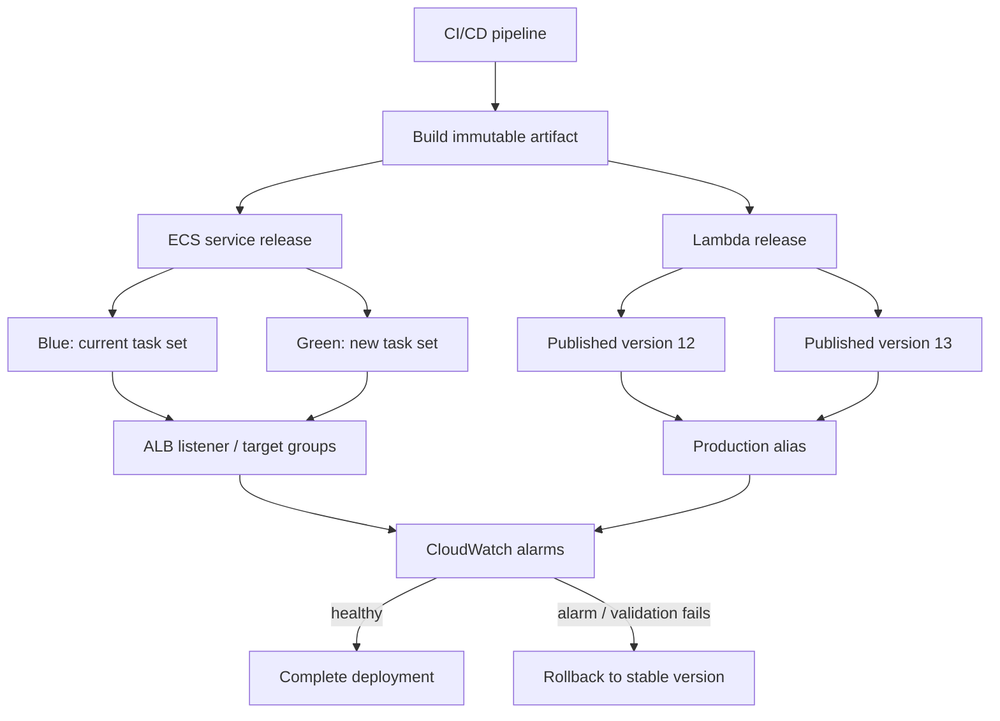
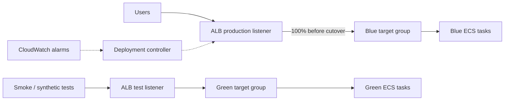
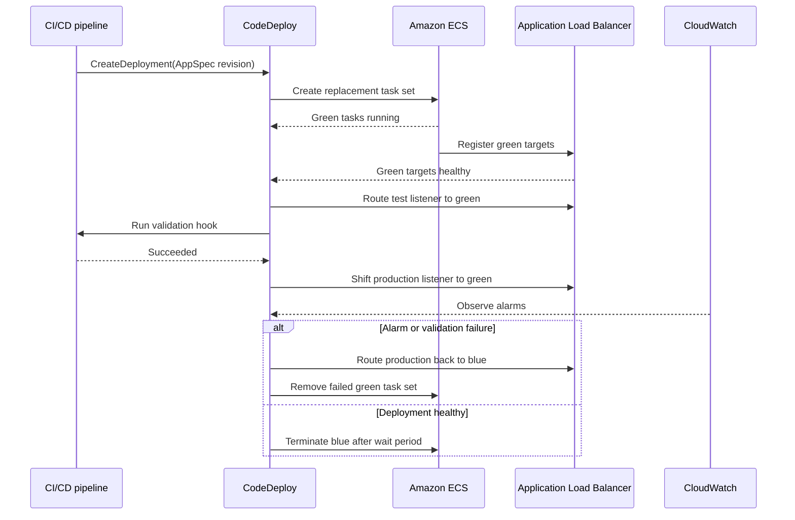
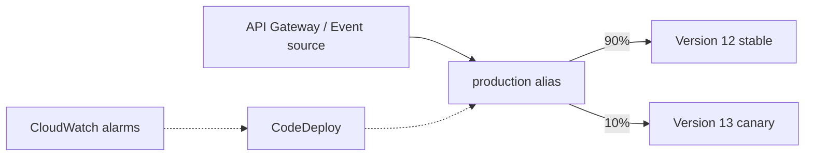
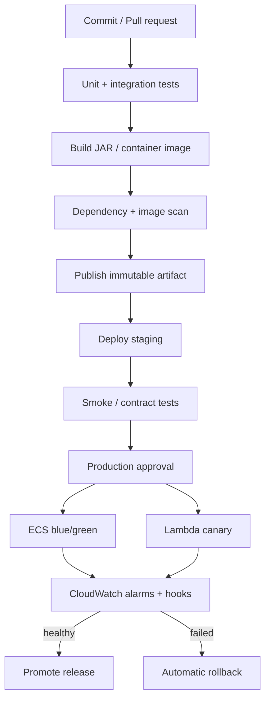

# Blue/Green Deployments for ECS and Canary Deployments for Lambda

> **Module:** CLOUD_PROVIDERS_AWS  
> **Chapter:** CI/CD on AWS  
> **Lesson:** Blue/Green Deployments for ECS and Canary Deployments for Lambda  
> **Context:** Releasing Java/Spring Boot applications on Amazon ECS and AWS Lambda with traffic shifting, new-version verification, CloudWatch monitoring, and automatic rollback.

## 1. Why Is Gradual Traffic Deployment Needed?

A Course API serves learners continuously. Each release might modify tuition calculation logic, update database queries, or upgrade libraries. If all traffic is routed to a new version the instant a container or Lambda function starts, configuration bugs, memory leaks, or regressions can impact every user.

CI/CD needs more than building artifacts and running a deploy command. A safe release process needs to:

- Launch the new version in a testable environment.
- Verify health checks, dependency connectivity, and application behavior.
- Shift traffic according to an appropriate strategy.
- Monitor error rates, latency, throttling, and business metrics.
- Automatically halt or roll back when abnormal signals appear.
- Retain the old version long enough for rapid recovery.
- Ensure database schemas and message contracts remain compatible while both versions run concurrently.

Two primary models in this lesson:

- **ECS blue/green:** runs a new service revision (green) alongside the current revision (blue), validates green, and then shifts traffic. Amazon ECS currently supports the `ECS` deployment controller with strategies `ROLLING`, `BLUE_GREEN`, `LINEAR`, and `CANARY`. In addition, the CodeDeploy ECS controller (`CODE_DEPLOY`) model uses task sets and AppSpec.
- **Lambda canary:** publishes an immutable version, keeps the production alias pointing to the current version, and uses CodeDeploy to shift a percentage of traffic to the new version over time.



### Learning Objectives

After this lesson, you will be able to:

1. Distinguish between rolling, blue/green, canary, and linear deployments.
2. Describe blue/green traffic flow on ECS with an ALB and two target groups.
3. Distinguish ECS native deployment strategies from the CodeDeploy ECS deployment controller.
4. Configure task definitions, service revisions, listeners, target groups, and lifecycle hooks.
5. Use Lambda aliases and published versions for canary traffic.
6. Choose the appropriate CodeDeploy deployment configuration.
7. Set up CloudWatch alarms, validation hooks, and automatic rollback.
8. Design a promotion pipeline from build to production.
9. Handle IAM, secrets, database migrations, and backward compatibility.
10. Test rollbacks, monitor deployments, and measure release health.

## 2. Traffic Shifting Strategies

| Strategy | How it works | Pros | Trade-offs |
|---|---|---|---|
| Rolling | Replaces tasks/instances in batches | Minimal duplicate resources, simple configuration | Hard to test the entire new version before it receives traffic |
| Blue/green | Runs blue and green concurrently, then shifts traffic | Independent testing, fast rollback | Temporarily requires resources for both versions |
| Canary | Shifts a small share of traffic first, observes, then shifts the rest | Limits blast radius | Needs enough traffic and metrics to evaluate |
| Linear | Increases traffic percentage in equal steps | Catches errors progressively | Longer release duration, requires continuous monitoring |
| All-at-once | Shifts 100% of traffic immediately | Fast, minimal stages | Large blast radius if the new version has bugs |

Examples:

- Blue/green: blue holds 100% of traffic while green starts; after validation, the listener shifts 100% to green.
- Canary 10%/5 minutes: 10% of traffic goes to the new version; if the observation window passes without alarms, the remaining 90% shifts over.
- Linear 10%/1 minute: traffic increases by 10% every minute until reaching 100%.

Canary and linear only provide meaningful signal when the traffic sample is large enough to observe. If a system receives only a few requests per minute, 10% of traffic may not be enough to catch regressions.

## 3. ECS: Blue/Green Architecture

Blue/green runs two service revisions concurrently during deployment:

- **Blue:** the revision currently serving production.
- **Green:** the new revision using a new task definition.
- **Target groups:** route to tasks belonging to each revision.
- **Production listener:** receives real user traffic.
- **Test listener (optional):** sends test traffic to green before switching production.
- **CloudWatch alarms:** detect errors and trigger rollback.
- **Bake time:** observation period after traffic shifts to green while blue remains available for recovery.



Before cutover, the production listener points to blue; the test listener can point to green. Once green is healthy and validation succeeds, the deployment controller updates listener routing. If the deployment fails, traffic can return to blue.

### 3.1. Two Target Groups Are Mandatory in the ALB Model

For ECS blue/green via Elastic Load Balancing:

| Component | Role |
|---|---|
| Primary target group | Attached to the initial blue revision |
| Alternate target group | Attached to the replacement green revision |
| Production listener | Receives production traffic |
| Test listener | Optional, used to test green |
| ECS service | Manages service revisions/tasks |
| Deployment controller | ECS native or CodeDeploy, depending on model |
| IAM role | Allows the controller to manage ECS/ELB resources |

With Fargate or ECS tasks using `awsvpc`, target groups typically must use target type `ip`. Both target groups must share the same VPC, protocol/port, and container-compatible health checks.

### 3.2. Health Checks Must Reflect Readiness to Serve

Do not check only whether a TCP port is open. The readiness endpoint should confirm the application has initialized and is ready to process requests.

Spring Boot example:

```yaml
management:
  endpoint:
    health:
      probes:
        enabled: true
  endpoints:
    web:
      exposure:
        include: health,info

server:
  shutdown: graceful
```

Configure the target group health check to hit the appropriate endpoint, such as `/actuator/health/readiness`. Do not allow the readiness endpoint to return healthy before the application connects to mandatory dependencies.

### 3.3. Bake Time and Capacity

Blue/green can require nearly double the task capacity while green launches before blue terminates. On ECS EC2, the cluster must have enough spare CPU/memory to run two revisions; on Fargate, account for the cost of parallel tasks.

Bake time should be long enough to observe real traffic, without stretching unnecessarily since both blue and green consume resources. If rollback requires keeping blue longer, weigh capacity costs and database/message compatibility.

## 4. ECS Has Two Blue/Green Controller Models

Distinguish between:

| Model | ECS `deploymentController.type` | Who orchestrates | Characteristics |
|---|---|---|---|
| ECS native blue/green | `ECS` | ECS service deployment | Uses `deploymentConfiguration.strategy` such as `BLUE_GREEN`, `CANARY`, `LINEAR`, or `ROLLING` |
| CodeDeploy ECS blue/green | `CODE_DEPLOY` | AWS CodeDeploy | Uses task sets, deployment groups, AppSpec, hooks, and CodeDeploy deployment configurations |

These are two separate models. Do not configure one ECS service to use both a native ECS strategy and a CodeDeploy controller for the same deployment.

### 4.1. ECS Native Deployment Strategy

With the `ECS` controller, service deployment strategies can be:

- `ROLLING`: updates tasks per deployment configuration.
- `BLUE_GREEN`: runs the new revision alongside the old revision, then shifts traffic.
- `CANARY`: shifts a small percentage first, waits for bake/validation, then shifts the remainder.
- `LINEAR`: shifts traffic in equal percentage steps.

Blue/green, canary, and linear strategies require a supported traffic management mechanism such as ALB, NLB, Service Connect, or VPC Lattice. For a headless service without a traffic routing layer, ECS cannot manage listener traffic shifting in the same way.

Conceptual deployment strategy configuration snippet:

```yaml
deploymentController:
  type: ECS

deploymentConfiguration:
  strategy: BLUE_GREEN
  bakeTimeInMinutes: 10
```

This fragment illustrates service deployment properties; a complete configuration also requires a task definition, networking, load balancer, target groups, roles, and appropriate service parameters. Check the API/CloudFormation schema for your target Region and platform before deploying.

### 4.2. CodeDeploy ECS Blue/Green

CodeDeploy ECS uses `deploymentController.type: CODE_DEPLOY`. The deployment group specifies:

- ECS cluster and service.
- Production listener, optional test listener.
- Two target groups.
- Traffic rerouting behavior.
- Original task set termination wait time.
- CloudWatch alarms and automatic rollback.
- Service role for CodeDeploy to orchestrate deployments.

CodeDeploy creates the replacement task set (green), registers it with the alternate target group, runs validation hooks if configured, and then updates the listener to shift production traffic. After deployment succeeds and the wait period expires, the old task set is terminated.

### 4.3. Which Model to Choose?

- Choose **ECS native** if you want deployment strategies managed directly by the ECS service and current lifecycle stages.
- Choose **CodeDeploy controller** if your system already relies on CodeDeploy deployment groups/AppSpec, hooks, and CodeDeploy-integrated workflows.
- If migrating from CodeDeploy to native ECS, plan to replace controllers, roles, listeners, lifecycle hooks, and deployment automation; do not just change a single field.

## 5. CodeDeploy ECS: AppSpec and Lifecycle Hooks

AppSpec describes the new task definition, routing container/port, and Lambda hooks executed at lifecycle events.

Abbreviated AppSpec YAML example:

```yaml
version: 0.0
Resources:
  - TargetService:
      Type: AWS::ECS::Service
      Properties:
        TaskDefinition: arn:aws:ecs:ap-southeast-1:123456789012:task-definition/course-api:42
        LoadBalancerInfo:
          ContainerName: app
          ContainerPort: 8080
Hooks:
  - AfterAllowTestTraffic: ValidateGreenEnvironment
  - BeforeAllowTraffic: FinalPreTrafficCheck
  - AfterAllowTraffic: VerifyProductionTraffic
```

Hooks can invoke Lambda validation functions:

| Hook | Timing | Objective |
|---|---|---|
| `AfterAllowTestTraffic` | Green has received test traffic | Smoke tests, contract tests, dependency checks |
| `BeforeAllowTraffic` | Before production traffic shifts to green | Final checks, release gate verification |
| `AfterAllowTraffic` | After production traffic shifts to green | Verify production behavior and metrics |

With a CodeDeploy Lambda hook, the function must report lifecycle event status back to CodeDeploy via the `PutLifecycleEventHookExecutionStatus` API. If a hook fails to call back within the timeout, the deployment can fail. Never just return HTTP 200 from the Lambda handler assuming CodeDeploy received the result.

### 5.1. AppSpec Does Not Contain the Full Task Definition

AppSpec references the ARN of a registered task definition revision. The task definition contains the image, CPU/memory, environment variables, secrets, logging, IAM task role, execution role, and container port mappings.

Do not point a task definition to a mutable `latest` image tag that can be overwritten. Build immutable images, push them to ECR, and reference an immutable tag or image digest.

## 6. ECS CodeDeploy: Configuration and Deployment

### 6.1. Pre-Deployment Prerequisites

- ECS service created with deployment controller `CODE_DEPLOY`.
- Suitable ALB or NLB in place.
- Production listener configured; test listener optional.
- Two target groups created for original and replacement task sets.
- Target group health checks configured accurately.
- CodeDeploy deployment group pointing to the right cluster/service/listeners/target groups.
- CodeDeploy service role granted necessary ECS and ELB permissions.
- AppSpec pointing to the right task definition, container name, and port.
- CloudWatch alarms and rollback settings configured.

### 6.2. Traffic Flow



### 6.3. Creating a Deployment with CLI

Once the CodeDeploy application, deployment group, and S3 revision exist:

```bash
aws deploy create-deployment \
  --application-name course-api-ecs \
  --deployment-group-name course-api-production \
  --revision revisionType=S3,s3Location="{bucket=course-release-artifacts,key=releases/42/appspec.yaml,bundleType=YAML}" \
  --profile prod \
  --region ap-southeast-1
```

This example demonstrates creating a deployment from an AppSpec stored in S3. The bucket/key, revision bundle, and profile must point to a verified artifact. In real pipelines, use the CodePipeline CodeDeploy action or the corresponding SDK/API.

### 6.4. Monitoring the Deployment

```bash
aws deploy get-deployment \
  --deployment-id d-ABC123456 \
  --profile prod \
  --region ap-southeast-1

aws deploy list-deployment-targets \
  --deployment-id d-ABC123456 \
  --profile prod \
  --region ap-southeast-1
```

Inspect deployment status, lifecycle events, target group health, ECS task health, hook logs, and CloudWatch alarms. Never mark a release successful merely because `create-deployment` returned a deployment ID.

## 7. ECS Native Blue/Green: Alarms and Lifecycle Stages

ECS native deployments expose lifecycle stages to track green creation, testing, and traffic shifting. Exact stage names depend on the strategy and resource types.

Representative stages:

- `PRE_SCALE_UP`: before green tasks scale up.
- `POST_SCALE_UP`: green is created while production remains on blue.
- `TEST_TRAFFIC_SHIFT`: shifts test traffic to green (when configured).
- `POST_TEST_TRAFFIC_SHIFT`: test traffic shift completed.
- `PRE_PRODUCTION_TRAFFIC_SHIFT`: checks before production cutover.
- `POST_PRODUCTION_TRAFFIC_SHIFT`: production traffic has shifted.
- `BAKE_TIME`: observation after traffic shift.
- `CLEAN_UP`: terminates the old revision after deployment succeeds.

Lifecycle hooks can run Lambda validations or pause for continuation decisions. Hooks must be idempotent because they may be re-invoked during retries/reconciliation. Do not place irreversible actions in a pre-traffic hook without compensation logic.

### 7.1. Automatic Rollback

CloudWatch alarms can be configured to detect failing deployments. When an alarm enters `ALARM`, the ECS deployment can roll back to the previous revision per service configuration.

Example signals:

- ALB target 5xx increases.
- Target response time breaches SLO.
- Healthy target count drops below threshold.
- Abnormal ECS service CPU/memory.
- Custom application error-rate metric increases.

## 8. Lambda Canary: Published Versions and Aliases

An AWS Lambda function can be invoked via `$LATEST` or a published version. `$LATEST` mutates whenever code/configuration updates; a published version is an immutable snapshot. For canary deployments, the pipeline publishes a new version, keeps the production alias pointing to the stable version, and lets CodeDeploy shift weighted traffic to the new version.



### 8.1. Aliases Are the Production Integration Point

API Gateway, EventBridge, Function URLs, or callers invoking Lambda should call the production alias ARN rather than an unqualified function ARN or `$LATEST`.

```text
Function ARN:
arn:aws:lambda:ap-southeast-1:123456789012:function:course-handler

Production alias ARN:
arn:aws:lambda:ap-southeast-1:123456789012:function:course-handler:production
```

If an integration invokes the unqualified function ARN without an alias, alias traffic routing will not take effect.

### 8.2. Routing Configuration

A Lambda alias can split invocations between a primary version and additional version weights:

```json
{
  "FunctionVersion": "12",
  "RoutingConfig": {
    "AdditionalVersionWeights": {
      "13": 0.1
    }
  }
}
```

This example routes approximately 10% of invocations to version 13 and the rest to version 12. Weighted routing is probabilistic; over a short window with few invocations, actual percentages can deviate noticeably. CodeDeploy manages alias routing during deployment; never edit the alias manually mid-deployment.

An alias can point to at most two published versions in weighted routing. Both versions must use the same execution role and the same dead-letter queue configuration (or neither configures a DLQ); an alias cannot point to `$LATEST`. CloudWatch Lambda metrics provide the `ExecutedVersion` dimension to distinguish which version actually ran.

### 8.3. Predefined Lambda Deployment Configurations

| Deployment configuration | Traffic shift |
|---|---|
| `CodeDeployDefault.LambdaCanary10Percent5Minutes` | 10% first, wait 5 minutes, then remaining 90% |
| `CodeDeployDefault.LambdaCanary10Percent10Minutes` | 10% first, wait 10 minutes |
| `CodeDeployDefault.LambdaCanary10Percent30Minutes` | 10% first, wait 30 minutes |
| `CodeDeployDefault.LambdaLinear10PercentEvery1Minute` | Increase 10% every minute to 100% |
| `CodeDeployDefault.LambdaLinear10PercentEvery10Minutes` | Increase 10% every 10 minutes |
| `CodeDeployDefault.LambdaAllAtOnce` | Shift all traffic immediately |

Canary 10%/5 minutes does not mean CodeDeploy automatically understands business behavior. You must configure alarms and validation to decide whether deployment proceeds.

## 9. Configuring Lambda Canary with AWS SAM

AWS SAM supports deployment preferences on Lambda functions with aliases. The SAM transform creates the required CodeDeploy resources such as the deployment group and role.

Abbreviated template example:

```yaml
Transform: AWS::Serverless-2016-10-31

Resources:
  CourseHandler:
    Type: AWS::Serverless::Function
    Properties:
      CodeUri: course-handler/
      Handler: com.example.CourseHandler::handleRequest
      Runtime: java21
      MemorySize: 1024
      Timeout: 15
      AutoPublishAlias: production
      DeploymentPreference:
        Type: Canary10Percent5Minutes
        Alarms:
          - !Ref CourseHandlerErrorAlarm
        Hooks:
          PreTraffic: !Ref PreTrafficValidation
          PostTraffic: !Ref PostTrafficValidation

  CourseHandlerErrorAlarm:
    Type: AWS::CloudWatch::Alarm
    Properties:
      AlarmDescription: Roll back when Lambda errors increase
      Namespace: AWS/Lambda
      MetricName: Errors
      Dimensions:
        - Name: FunctionName
          Value: !Ref CourseHandler
      Statistic: Sum
      Period: 60
      EvaluationPeriods: 1
      Threshold: 5
      ComparisonOperator: GreaterThanOrEqualToThreshold
```

This is an illustrative template; the `course-handler/` folder must contain Maven/Gradle build files and source per SAM Java conventions. Verify SAM CLI/transform version, runtime, and alarm dimensions for your application. Alarms should measure the exact function/version/alias or custom metric you want to protect. Function-wide aggregate metrics can blend baseline errors from the stable version with canary errors. Logical IDs `PreTrafficValidation` and `PostTrafficValidation` must reference Lambda hook functions declared in the template.

### 9.1. AutoPublishAlias

`AutoPublishAlias: production` instructs SAM to create/publish a new version whenever code or configuration changes per SAM versioning rules, and then attach the `production` alias. The alias keeps the integration endpoint stable across releases.

### 9.2. PreTraffic and PostTraffic Hooks

- **PreTraffic:** tests the new version before CodeDeploy shifts traffic.
- **PostTraffic:** tests after traffic shifting completes.
- Hooks must report results to the CodeDeploy lifecycle event following the protocol.
- Hooks need finite timeouts, idempotency, and sufficient logging for investigation.
- If a hook fails or never calls back, the deployment is marked failed.

With a CodeDeploy Lambda hook, the handler must call `PutLifecycleEventHookExecutionStatus` with the deployment ID, lifecycle event hook execution ID, and status `Succeeded` or `Failed`. Merely returning normally from the Lambda handler does not complete the lifecycle hook.

Validation can invoke the canary endpoint, check dependencies, verify schema compatibility, or run synthetic transactions. Never create irreversible business side effects in smoke tests.

## 10. Configuring Lambda Canary with CDK

CDK can create the Lambda function, published version, alias, CloudWatch alarm, and CodeDeploy deployment group.

```typescript
import * as cdk from 'aws-cdk-lib';
import * as lambda from 'aws-cdk-lib/aws-lambda';
import * as cloudwatch from 'aws-cdk-lib/aws-cloudwatch';
import * as codedeploy from 'aws-cdk-lib/aws-codedeploy';
import { Construct } from 'constructs';

export class CourseLambdaStack extends cdk.Stack {
  constructor(scope: Construct, id: string, props?: cdk.StackProps) {
    super(scope, id, props);

    const fn = new lambda.Function(this, 'CourseHandler', {
      runtime: lambda.Runtime.JAVA_21,
      handler: 'com.example.CourseHandler::handleRequest',
      code: lambda.Code.fromAsset('../course-handler/target/function.zip'),
      memorySize: 1024,
      timeout: cdk.Duration.seconds(15),
    });

    const alias = new lambda.Alias(this, 'ProductionAlias', {
      aliasName: 'production',
      version: fn.currentVersion,
    });

    const errorAlarm = new cloudwatch.Alarm(this, 'CanaryErrorAlarm', {
      metric: alias.metricErrors({
        period: cdk.Duration.minutes(1),
      }),
      threshold: 5,
      evaluationPeriods: 1,
      comparisonOperator:
        cloudwatch.ComparisonOperator.GREATER_THAN_OR_EQUAL_TO_THRESHOLD,
      treatMissingData: cloudwatch.TreatMissingData.MISSING,
    });

    new codedeploy.LambdaDeploymentGroup(this, 'CanaryDeployment', {
      alias,
      deploymentConfig:
        codedeploy.LambdaDeploymentConfig.CANARY_10PERCENT_5MINUTES,
      alarms: [errorAlarm],
      autoRollback: {
        failedDeployment: true,
        deploymentInAlarm: true,
      },
    });
  }
}
```

This is an illustrative CDK example. In production, the version must change on each release; verify asset hashes, published versions, and deployment group synthesis to be sure CodeDeploy receives the new version.

### 10.1. Java Lambda and Immutable Release Artifacts

- Build JAR/ZIP or container images from an immutable commit.
- Pin dependency versions and runtime versions.
- Create a published version per release.
- Use the `production` alias as the integration target.
- Never modify code of a published version; create a new version for each release.
- Store artifact, commit SHA, build ID, and version number in deployment metadata.

## 11. Lambda AppSpec and Lifecycle Hooks

A CodeDeploy Lambda AppSpec specifies the function, alias, current version, target version, and optional validation hooks:

```yaml
version: 0.0
Resources:
  - CourseHandler:
      Type: AWS::Lambda::Function
      Properties:
        Name: course-handler
        Alias: production
        CurrentVersion: "12"
        TargetVersion: "13"
Hooks:
  - BeforeAllowTraffic: PreTrafficValidation
  - AfterAllowTraffic: PostTrafficValidation
```

`CurrentVersion` is the alias's current version; `TargetVersion` is the newly published version. CodeDeploy controls alias routing throughout traffic shifting.

The `PreTraffic` hook can verify function startup, environment variables, secrets, database connections, API contracts, and downstream dependencies. The `PostTraffic` hook verifies error rates, latency, business transactions, and metrics after traffic shifting completes.

Hooks do not replace CloudWatch alarms. Hooks provide proactive validation logic; alarms monitor metrics continuously throughout deployment.

## 12. CloudWatch Alarms for Canary and Blue/Green

A deployment should be considered healthy only when both application metrics and infrastructure metrics remain stable.

### 12.1. ECS/ALB Metrics

| Metric | Used to detect |
|---|---|
| `HTTPCode_Target_5XX_Count` | HTTP errors from target tasks |
| `HTTPCode_ELB_5XX_Count` | Load balancer errors |
| `TargetResponseTime` | Target-side latency |
| `HealthyHostCount` | Number of healthy targets |
| `UnHealthyHostCount` | Unhealthy targets |
| ECS CPU utilization | CPU saturation |
| ECS memory utilization | Memory pressure |
| Application error-rate metric | Business/API errors |

Scope metrics by target group and deployment revision where dimensions permit. Service-wide alarms can be skewed by blue traffic or downstream outages; consider custom metrics with a release/version dimension.

### 12.2. Lambda Metrics

| Metric | Used to detect |
|---|---|
| `Errors` | Failed invocations |
| `Throttles` | Function throttling |
| `Duration` | Execution duration and latency trends |
| `ConcurrentExecutions` | Concurrency pressure |
| `IteratorAge` | Slow stream consumers (if applicable) |
| Custom business metric | Transaction success rates, validation errors |

For canaries, track by specific version/alias whenever possible. A single aggregate alarm across the entire function may fail to separate baseline errors on the stable version from errors in the new canary.

### 12.3. Choosing Alarm Thresholds

Do not reuse one fixed number across all APIs. Design thresholds around SLOs and baselines:

- Error rate: exceeds baseline/SLO across a number of evaluation periods.
- Latency: p95/p99 rises significantly above the stable version.
- Throttles: increases while concurrency approaches quota.
- Healthy targets: insufficient minimum targets online to serve.
- Business success rate: drops even though HTTP statuses remain 200.

Use CloudWatch composite alarms when combining multiple signals. Configure `TreatMissingData` according to traffic volume; missing datapoints do not automatically mean a deployment is healthy.

## 13. Rollback and Rollback Limitations

Rolling back traffic does not mean rolling back every system change.

### 13.1. ECS Rollback

- If green fails before cutover, keep production on blue and mark the deployment failed.
- If green fails during bake time, shift listener traffic back to blue per controller behavior.
- Verify blue tasks are still healthy and not yet terminated.
- After deployment finishes and blue is cleaned up, rolling back may require creating a new deployment using the old task definition revision.
- With ECS native, inspect the deployment circuit breaker/alarms and service deployment history per the active strategy.
- With CodeDeploy controller, inspect automatic rollback configuration, alarms, and deployment lifecycle events.

### 13.2. Lambda Rollback

- CodeDeploy can revert the alias to the previous stable version when a deployment fails or an alarm triggers.
- Published versions remain available until deleted by a cleanup process.
- Alias routing config must return to the stable version; do not simply redeploy the same source code if versions/configurations changed.
- Check event source mappings, API integrations, and permissions to confirm they invoke the right alias.
- Retain at least the most recent stable version throughout the rollback window.

### 13.3. Database Migrations and Backward Compatibility

During blue/green or canary deployments, two versions may access the database concurrently for a period. Therefore:

- Use the **expand-contract** strategy: add the new schema/column first, deploy code compatible with both old and new schemas, and remove the old schema only in a later release.
- Never rename/drop columns in the same release while old code is still running.
- Keep message/event schemas compatible across producer and consumer versions.
- Avoid long migration locks right before traffic cutover.
- Maintain a backup/restore plan; CloudFormation/CodeDeploy rollbacks do not undo committed data changes.

### 13.4. Rollback Runbook

1. Stop pipeline promotion and prevent publishing further artifacts.
2. Identify the deployment ID, service revision, or Lambda alias version.
3. Verify alarms, logs, traces, and when errors began.
4. ECS: shift traffic back to blue or redeploy the stable task definition revision.
5. Lambda: let CodeDeploy roll back the alias or restore the alias to the stable published version.
6. Check database/message compatibility.
7. Confirm error rates/latency return to baseline.
8. Record the incident timeline, artifact digest, and root cause.

## 14. CI/CD Pipeline for ECS and Lambda

Pipelines should produce one immutable artifact and reuse that exact artifact across environments. Never rebuild different artifacts between staging and production.



### 14.1. Recommended Stages

1. **Source:** checkout an immutable commit SHA.
2. **Test:** unit, integration, contract, and migration compatibility tests.
3. **Build:** create JAR/image, SBOM, and metadata.
4. **Security:** dependency scan, container scan, secret scan, policy checks.
5. **Publish:** push ECR image by digest or immutable artifact version.
6. **Staging:** deploy the exact built task definition/Lambda artifact.
7. **Validation:** smoke tests, synthetic transactions, and load checks.
8. **Approval:** production approval when release risk requires it.
9. **Production rollout:** ECS blue/green or Lambda canary.
10. **Observe:** monitor alarms during the bake/canary interval.
11. **Promote/rollback:** mark release complete or revert to the stable revision.
12. **Record:** store commit SHA, image digest, Lambda version, deployment ID, and metrics.

### 14.2. Never Build a New Artifact at the Production Step

If staging tested image digest `sha256:abc...`, production must deploy that exact digest. Rebuilding from the same Git commit without pinned dependencies can yield a different output.

Similarly for Lambda, keep the exact tested ZIP/image artifact and published version. Release metadata should link:

```text
Git commit SHA
Build ID
Container image digest / Lambda artifact checksum
ECS task definition revision
Lambda published version
CodeDeploy deployment ID
CloudWatch alarm state
Deployment start/end timestamps
```

## 15. IAM and Deployment Security

Blue/green/canary involves many actors: pipeline, CodeDeploy, ECS, Lambda hooks, load balancers, and application task roles.

### 15.1. Role Separation

| Role | Responsibility |
|---|---|
| CI/CD execution role | Build/publish artifacts and invoke deployment APIs |
| CodeDeploy service role | Orchestrate ECS/Lambda traffic shifting and deployment lifecycle |
| ECS task execution role | Pull ECR images, write logs, fetch secrets per configuration |
| ECS task role | Application runtime permissions |
| Lambda execution role | Function runtime permissions |
| Validation hook role | Call test endpoints, read metrics, and report lifecycle status |

Do not merge all permissions into a single role with `AdministratorAccess`.

### 15.2. Least Privilege Rules

- Allow the pipeline to deploy only the specific ECS service, CodeDeploy application/deployment group, and Lambda function/alias.
- Restrict alias updates and version publishing permissions to the matching function ARN.
- Allow the CodeDeploy service role to manage only required ECS/ELB/Lambda resources.
- Grant the task execution role only required ECR pull, CloudWatch Logs, and secrets access.
- Do not grant production write privileges to validation hooks that only run smoke tests.
- Scope `iam:PassRole` to explicitly named task/execution roles.
- Apply KMS key policies and Secrets Manager resource policies per environment.
- Use CloudTrail to audit who started, stopped, or rolled back deployments.

### 15.3. Secrets and Configuration

Never embed database passwords, API keys, or private certificates in images, AppSpecs, SAM templates, or deployment logs. Reference Secrets Manager/SSM Parameter Store via runtime roles. When canary and stable run concurrently, ensure both versions can read compatible configuration during the transition window.

## 16. Operations and Troubleshooting

| Symptom | Possible cause | Resolution |
|---|---|---|
| Green tasks unhealthy | Wrong readiness path, wrong port mapping, SG, or startup error | Check ECS task events, target health reasons, and application logs |
| CodeDeploy fails to create replacement task set | Wrong AppSpec task definition/container name/port or missing IAM permissions | Check AppSpec, task definition, and service role |
| Test listener does not route to green | Wrong listener/rule or target group mapping | Check deployment group and ALB listener rules |
| Traffic shift pauses or fails | Lifecycle hook timeout/failure | Inspect Lambda hook logs and callback status |
| Rollback does not trigger | Missing alarm attachment, missing data, or insufficient evaluation window | Check alarm state and rollback settings |
| Lambda canary receives no traffic | Integration invokes function ARN instead of alias ARN | Update API/event source integration to point to the alias |
| New Lambda version not published | SAM/CDK version configuration unchanged or artifact hash unchanged | Check `AutoPublishAlias`/`currentVersion` and build artifact |
| Lambda canary errors rise without alarm | Metric dimension does not isolate version/alias or wrong threshold | Use appropriate metric dimensions/custom metrics |
| Canary lacks sufficient samples | Low traffic or too short an observation window | Extend interval or run controlled synthetic traffic |
| Traffic rollback succeeds but errors persist | Database/schema or side effects already changed | Check expand-contract, compatibility, and recovery plan |
| Deployment consumes double resources | Blue and green run together during bake time | Budget capacity/cost and choose a sensible bake time |
| Old tasks terminated too early | Inappropriate termination wait/bake time | Adjust cleanup wait and verify rollback window |

### 16.1. Pre-Release Checklist

- Artifact digest/version is pinned and scanned.
- ECS task definition or Lambda published version is ready.
- Alias/target group/listener point correctly.
- Readiness/health checks have been tested.
- CloudWatch alarms have data and sensible thresholds.
- Validation hooks tested for both success and failure paths.
- IAM roles and `iam:PassRole` reviewed.
- Database migrations compatible with both old and new versions.
- Sufficient capacity available for blue and green to run concurrently.
- Rollback procedure rehearsed in staging.

## 17. Lab: ECS Blue/Green for Course API

**Scenario:** Course API runs Spring Boot on ECS Fargate behind an ALB. The team is releasing a new task definition revision and wants to verify green before shifting production traffic.

### 17.1. Preparation

1. Create an ECS cluster and Fargate service in a sandbox.
2. Create a task definition revision with container name `app`, port `8080`, and an immutable image digest.
3. Create an ALB production listener and two target groups in the same VPC.
4. For CodeDeploy controller, create an optional test listener, CodeDeploy application/deployment group, and service role.
5. For ECS native, configure the appropriate service deployment strategy and supported traffic routing resources.
6. Configure the readiness endpoint, target group health checks, and CloudWatch alarms.
7. Create a validation hook to run smoke tests against green.

### 17.2. CodeDeploy ECS Practice

- Deploy the first revision and confirm the blue target group receives 100% of production traffic.
- Create a new task definition revision and push a new image to ECR.
- Update AppSpec with the task definition ARN, container name, and port.
- Run the CodeDeploy deployment.
- Confirm green tasks are created and healthy.
- Send test traffic to green through the test listener.
- Run the validation hook and verify the hook callback succeeds.
- Monitor production traffic shift, bake time, and CloudWatch alarms.
- Once deployment succeeds, confirm green is the primary revision and blue is cleaned up after the termination wait.
- Trigger a faulty release in sandbox to confirm traffic shifts back to blue when an alarm/hook fails.

### 17.3. ECS Native Practice

- Create a service with the `ECS` deployment controller.
- Select strategy `BLUE_GREEN`; then try `CANARY` or `LINEAR` if supported in your environment.
- Configure bake time, target groups/listeners, and CloudWatch alarms.
- Deploy a new task definition revision.
- Observe lifecycle stages, traffic shifting, and rollback behavior.
- Compare resource consumption against a rolling deployment.

Do not change a production service's deployment controller just to run labs. Create separate sandbox services for each controller model.

## 18. Lab: Lambda Canary for Java Handler

**Scenario:** A Java Lambda handles report generation requests. Version 12 currently serves the `production` alias; version 13 adds new logic.

### 18.1. Preparation

1. Create a Java Lambda function with supported runtime/dependencies.
2. Create a stable published version and the `production` alias.
3. Configure API Gateway or an event source integration to invoke the alias ARN.
4. Create CloudWatch alarms for Errors and Duration; add a custom metric for business success rate.
5. Create a CodeDeploy deployment group or use SAM `DeploymentPreference`/CDK `LambdaDeploymentGroup`.
6. Configure `Canary10Percent5Minutes` and `PreTraffic`/`PostTraffic` hooks.

### 18.2. Execution

- Deploy code version 12 and confirm the `production` alias points to version 12.
- Build version 13 from a new commit and publish an immutable artifact.
- Run `PreTraffic` validation on version 13.
- Start the 10%/5-minute canary.
- Send synthetic requests and observe metrics by version/alias.
- When alarms do not fire, confirm the remaining traffic shifts to version 13.
- In another sandbox run, intentionally trigger errors so the alarm activates rollback.
- Confirm the alias reverts to version 12 and API integrations still invoke the alias.
- Record deployment ID, function version, artifact checksum, and alarm timeline.

### 18.3. Results Table

| Experiment | Stable version | New version | Traffic strategy | Error rate | p95 latency | Rollback | Result |
|---|---:|---:|---|---:|---:|---|---|
| ECS blue/green success | Measure | Measure | 100% cutover | Measure | Measure | No | Pass/Fail |
| ECS blue/green failure | Measure | Measure | Test + cutover | Measure | Measure | Yes/No | Pass/Fail |
| Lambda canary success | 12 | 13 | 10% / 5 min | Measure | Measure | No | Pass/Fail |
| Lambda canary failure | 12 | 13 | 10% / 5 min | Measure | Measure | Yes/No | Pass/Fail |

Do not fill in fake benchmarks. Run the same workload, same Region, and same alarm settings to compare.

## 19. Negative Tests

| Test | Condition | Expected result |
|---|---|---|
| T1 | Green task uses wrong container port | Target group health check fails, production stays on blue |
| T2 | Green task lacks secret permission | Startup/readiness fails; no cutover occurs |
| T3 | Test listener points to wrong target group | Validation does not actually test green; test must catch this |
| T4 | AppSpec references nonexistent task definition revision | CodeDeploy deployment fails before traffic shift |
| T5 | Lifecycle hook fails to call back status | Deployment times out/fails per hook contract |
| T6 | CloudWatch alarm threshold too high | Regression fails to trigger rollback; test tunes alarm |
| T7 | Canary alias integration calls unqualified function ARN | Traffic bypasses alias routing |
| T8 | New Lambda version not published | CodeDeploy lacks a valid target version |
| T9 | Alarm dimension does not isolate canary | New version errors masked by aggregate metric |
| T10 | Low traffic, canary interval too short | Insufficient samples to evaluate release health |
| T11 | DB migration drops column while blue still runs | Old version can fail after cutover/rollback |
| T12 | Blue terminated immediately after cutover | Loses ability to quickly roll back to old task set |
| T13 | CI rebuilds image in production | Production artifact differs from artifact tested in staging |
| T14 | Pipeline has overly broad `iam:PassRole` | Risk of deploying tasks/functions with out-of-scope roles |

Only run tests that can cause failures, rollbacks, or traffic disruptions in sandbox/staging. Never intentionally break production.

## 20. Self-Check Questions

**1. What is a blue/green deployment?**  
Creating a green revision alongside blue, validating green, and then shifting production traffic; blue can be retained during a bake/termination window for rollback.

**2. How does canary differ from linear?**  
Canary shifts a small percentage first and shifts the remainder after an interval; linear increases traffic in equal incremental steps.

**3. How does the ECS native deployment controller differ from the CodeDeploy controller?**  
ECS native uses the `ECS` controller and ECS service deployment strategies; the CodeDeploy controller uses task sets, deployment groups, AppSpec, and CodeDeploy lifecycle hooks.

**4. Why does ECS blue/green need two target groups?**  
One target group attaches to the blue/original task set and the other attaches to the green/replacement task set so the load balancer can shift traffic.

**5. What is the test listener used for?**  
Allows validating green with test traffic before shifting production traffic.

**6. What is bake time?**  
The observation period after a traffic shift while the old revision is still retained per configuration.

**7. Why does Lambda canary use an alias?**  
An alias provides a stable endpoint pointing to a published version and supports weighted routing between stable and canary versions.

**8. Why avoid calling an unqualified Lambda ARN when canary is needed?**  
Invocations bypass the alias routing configuration, so alias traffic shifting is not applied.

**9. How does CodeDeploy Lambda canary 10%/5 minutes work?**  
Shifts 10% of invocations to the new version, waits 5 minutes, and then shifts the rest if the deployment remains healthy.

**10. What role do CloudWatch alarms play?**  
Monitor errors, latency, throttling, and health, triggering rollback when configured thresholds are breached.

**11. What is the `PreTraffic` hook used for?**  
Validates the new version before traffic shifts; the hook must report results using the CodeDeploy lifecycle protocol.

**12. Does rolling back traffic reverse database migrations?**  
No. Database changes require backward compatibility, expand-contract, and separate backup/recovery plans.

**13. Why use image digests instead of mutable tags?**  
Ensures production runs the exact artifact built, scanned, and tested in staging.

**14. When is a 10% canary insufficient for evaluation?**  
When traffic is too low or the observation interval is too short, leaving the sample unrepresentative.

**15. Why does retaining blue during bake time incur cost?**  
Blue and green run simultaneously, requiring extra task capacity and paying resource costs during that window.

## 21. Summary and Official AWS Documentation

ECS blue/green deploys a new service revision alongside the revision currently serving production. Green is validated through health checks and an optional test listener before traffic shifts. The ECS native controller now supports `ROLLING`, `BLUE_GREEN`, `LINEAR`, and `CANARY` strategies; the CodeDeploy ECS controller is a separate model using task sets, deployment groups, AppSpec, and lifecycle hooks.

Lambda canary uses published versions and a production alias. CodeDeploy adjusts additional version weights according to the deployment configuration, such as 10% traffic for 5 minutes before shifting the rest. CloudWatch alarms and validation hooks stop or roll back deployments when errors are detected.

A safe release requires immutable artifacts, health checks, alarms with real signal, least-privilege roles, backward-compatible databases, and a rehearsed rollback runbook. Traffic rollback restores routing only; it does not automatically undo database writes or business workflow side effects.

### Official AWS Documentation

- [Amazon ECS — Service deployment controllers and strategies](https://docs.aws.amazon.com/AmazonECS/latest/developerguide/ecs_service-options.html)
- [Amazon ECS — Blue/green deployment workflow](https://docs.aws.amazon.com/AmazonECS/latest/developerguide/blue-green-deployment-how-it-works.html)
- [Amazon ECS — Blue/green deployment resources](https://docs.aws.amazon.com/AmazonECS/latest/developerguide/blue-green-deployment-implementation.html)
- [Amazon ECS — ALB resources for blue/green, linear and canary](https://docs.aws.amazon.com/AmazonECS/latest/developerguide/alb-resources-for-blue-green.html)
- [Amazon ECS — Update deployment strategy](https://docs.aws.amazon.com/AmazonECS/latest/developerguide/migrate-deployment-strategies.html)
- [AWS CodeDeploy — ECS deployment steps](https://docs.aws.amazon.com/codedeploy/latest/userguide/deployment-steps-ecs.html)
- [AWS CodeDeploy — ECS AppSpec hooks](https://docs.aws.amazon.com/codedeploy/latest/userguide/reference-appspec-file-structure-hooks.html)
- [AWS CodeDeploy — Lambda deployment configurations](https://docs.aws.amazon.com/codedeploy/latest/userguide/deployment-configurations.html)
- [AWS CodeDeploy — Lambda AppSpec example](https://docs.aws.amazon.com/codedeploy/latest/userguide/reference-appspec-file-example.html)
- [AWS SAM — Safe Lambda deployments](https://docs.aws.amazon.com/serverless-application-model/latest/developerguide/automating-updates-to-serverless-apps.html)
- [AWS Lambda — Aliases and weighted routing](https://docs.aws.amazon.com/lambda/latest/dg/configuration-aliases.html)
- [AWS Lambda — Traffic shifting with CodeDeploy](https://docs.aws.amazon.com/lambda/latest/dg/configuring-alias-routing.html)
- [Amazon CloudWatch — Alarm concepts](https://docs.aws.amazon.com/AmazonCloudWatch/latest/monitoring/AlarmThatSendsEmail.html)

> **Practice note:** Cluster/service names, account IDs, Regions, target groups, function names, versions, alarm thresholds, and deployment intervals in this lesson are examples. Verify your ECS controller model, CodeDeploy AppSpec schema, alias integrations, alarm dimensions, IAM roles, and rollback behavior in a sandbox before applying to production.
