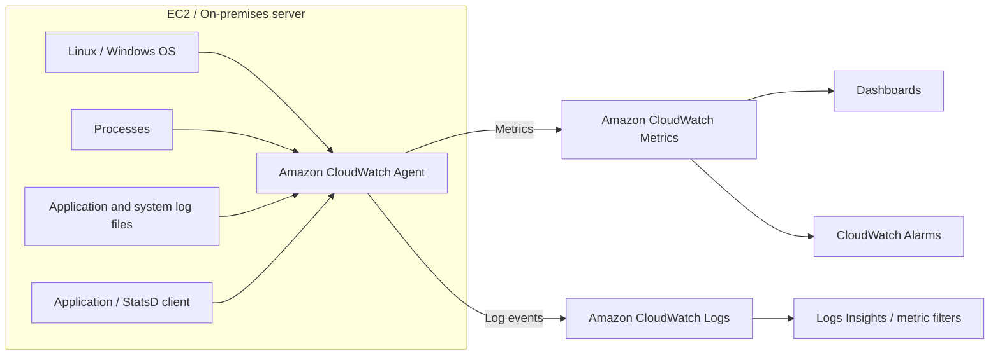

# CloudWatch Agent and Host Metric Collection

> **Chapter:** Observability with CloudWatch  
> **Module:** CLOUD_PROVIDERS_AWS  
> **Scope:** Installing, configuring, and operating Amazon CloudWatch Agent to collect OS metrics, process metrics, and logs from Amazon EC2 or on-premises servers. This lesson focuses on IAM, centralized configuration management, data verification, alerting, cost, and troubleshooting.

## Learning Objectives

After this lesson, learners can:

1. Distinguish default EC2 infrastructure metrics from in-OS metrics collected by CloudWatch Agent.
2. Describe the data flow from the agent to CloudWatch Metrics and CloudWatch Logs.
3. Select appropriate CPU, memory, disk, disk I/O, network, swap, and TCP metrics.
4. Install the agent on Linux, Windows Server, and on-premises servers.
5. Grant least-privilege IAM permissions and distinguish telemetry publishing permissions from server management permissions via Systems Manager.
6. Author, read, and validate CloudWatch Agent JSON configurations.
7. Use the configuration wizard or manage configuration files through Systems Manager Parameter Store.
8. Start, update, check status, and inspect logs of the agent.
9. Collect process metrics with procstat and custom metrics with StatsD/collectd.
10. Collect log files, build dashboards, and create CloudWatch alarms.
11. Understand namespaces, dimensions, aggregation, high-resolution metrics, and cost.
12. Deploy consistent configurations across multiple EC2 instances.
13. Troubleshoot IAM, network, JSON, missing metrics, log streams, and agent service issues.
14. Practice monitoring a Linux server running a Java application.

## 1. Why Do We Need CloudWatch Agent?

Amazon CloudWatch provides AWS resource observability through metrics, logs, alarms, and dashboards. However, not all information inside a server is automatically sent by EC2 to CloudWatch.

### 1.1 Default EC2 Metrics and OS Metrics

EC2 provides infrastructure metrics such as:

- CPUUtilization.
- NetworkIn and NetworkOut.
- NetworkPacketsIn and NetworkPacketsOut.
- DiskReadOps and DiskWriteOps for supported storage types.
- StatusCheckFailed.

These metrics are useful for evaluating instance and infrastructure health, but they do not directly report full RAM percentage used, remaining filesystem space, how much CPU/RAM a Java process is consuming, how many TCP connections are established, or whether application logs show errors.

CloudWatch Agent runs inside the host to read data from the operating system, processes, applications, and configured telemetry sources, then sends that data to CloudWatch.

### 1.2 What Does CloudWatch Agent Collect?

| Data Category | Examples | Purpose |
|---|---|---|
| CPU | usage_active, usage_idle | Detect CPU saturation |
| Memory | mem_used_percent | Detect RAM exhaustion |
| Disk | disk_used_percent, disk_inodes_free | Detect full filesystems and inode exhaustion |
| Disk I/O | diskio_reads, diskio_writes | Track storage activity |
| Network | net_bytes_sent, net_bytes_recv | Track interface traffic |
| TCP | netstat_tcp_established | Detect connection buildup |
| Process | procstat_cpu_usage, procstat_memory_rss | Monitor processes |
| Application metrics | StatsD, collectd | Collect application metrics |
| Logs | application.log, system.log | Investigate errors and events |
| Traces | OpenTelemetry pipeline | Send trace telemetry in supported configs |

Metrics exported to CloudWatch Metrics use the default namespace CWAgent unless configured otherwise. These metrics are billed as custom metrics under CloudWatch pricing.

### 1.3 When Should You Use CloudWatch Agent?

Use the agent when you need to monitor memory, filesystems, processes, application logs, OS metrics, or custom metrics from hosts. The agent is also well suited for standardizing telemetry across EC2 fleets and on-premises servers.

If basic EC2 CPU and network metrics suffice, default metrics may already be enough. Do not install the agent just to re-collect data that adds no operational value.

## 2. Architecture and Data Flow

### 2.1 Overall Architecture



### 2.2 Components

| Component | Role |
|---|---|
| Operating system | Provides CPU, RAM, filesystem, and network metrics |
| Process | Provides per-process metrics |
| Application | Emits custom metrics or writes logs |
| CloudWatch Agent | Collects, processes, and sends telemetry |
| IAM role/user | Authorizes the agent to send metrics/logs |
| Systems Manager | Installs the agent, manages configurations, and executes remote commands |
| CloudWatch Metrics | Stores time-series metrics |
| CloudWatch Logs | Stores log events |
| CloudWatch Alarm | Evaluates metrics against conditions |
| CloudWatch Dashboard | Displays multiple metrics in a single view |

### 2.3 Agent Does Not Need Inbound Ports to Send Metrics

In the standard model:

- The agent initiates outbound HTTPS connections to AWS service endpoints.
- No inbound port from the Internet needs to be opened to EC2 just to send metrics.
- In a private subnet, a NAT Gateway or appropriate VPC endpoints are needed to reach CloudWatch, CloudWatch Logs, and Systems Manager.
- When using StatsD, the agent can listen on a local UDP port; restrict the listener to loopback if only applications on the same host emit metrics.

### 2.4 CloudWatch Agent and Systems Manager

The two services work well together:

- Systems Manager installs the agent across multiple EC2 instances.
- Parameter Store stores shared JSON configurations.
- Run Command or State Manager deploys/updates the agent.
- CloudWatch Agent sends telemetry to CloudWatch.

Do not confuse SSM Agent permissions with CloudWatch Agent permissions. An instance can be managed by Systems Manager while CloudWatch Agent still fails to send metrics if it lacks CloudWatch permissions.

## 3. Host Metrics to Monitor

### 3.1 CPU

| Metric | Meaning |
|---|---|
| cpu_usage_active | Percentage of time CPU is active |
| cpu_usage_idle | Percentage of time CPU is idle |
| cpu_usage_user | CPU time running user-space code |
| cpu_usage_system | CPU time running kernel/system code |
| cpu_usage_iowait | Time CPU waits on I/O on Linux |
| cpu_usage_steal | Time CPU is taken by hypervisor on Linux |

Sustained high CPU utilization can indicate traffic surges, CPU-intensive queries or algorithms, thread contention, stuck processes, or under-provisioned instance capacity.

Brief high CPU is not necessarily an incident. Correlate with latency, throughput, queue depth, and application errors.

### 3.2 Memory

Commonly used metrics:

- mem_used_percent.
- mem_available.
- mem_available_percent.
- swap_used_percent.
- swap_free.

Memory pressure can lead to the Linux OOM killer, Java OutOfMemoryError, prolonged garbage collection, increased swapping, elevated application latency, or OS process termination.

mem_used_percent is not synonymous with JVM heap utilization. CloudWatch Agent includes a JMX plugin to collect JVM heap, garbage collection, class loading, and thread metrics; OpenTelemetry or application-level metrics can also be used.

### 3.3 Disk and Filesystem

Commonly used metrics:

- disk_used_percent.
- disk_used.
- disk_free.
- disk_total.
- disk_inodes_free.
- disk_inodes_used.

Monitor critical mount points: /, /var, /var/log, /opt, and mounts holding application data.

A filesystem can exhaust inodes even while byte capacity remains available. Monitoring only disk_used_percent can therefore miss incidents caused by creating too many small files.

CloudWatch Agent collects disk metrics on Linux for mounted filesystems. Use resources to specify mount points and ignore_file_system_types to exclude virtual or unneeded filesystems.

### 3.4 Disk I/O

Disk I/O metrics can include:

- diskio_reads.
- diskio_writes.
- diskio_read_bytes.
- diskio_write_bytes.
- diskio_read_time.
- diskio_write_time.
- diskio_io_time.

They help detect excessive logging workloads, rising database I/O, abnormal disk I/O, and storage contention.

Agent metrics reflect activity inside the OS/device. When analyzing EBS performance, combine them with EBS metrics such as VolumeReadOps, VolumeWriteOps, VolumeQueueLength, and VolumeThroughputPercentage if supported by the volume type.

### 3.5 Network

Commonly used Linux metrics:

- net_bytes_sent.
- net_bytes_recv.
- net_packets_sent.
- net_packets_recv.
- net_drop_in.
- net_drop_out.
- netstat_tcp_established.
- netstat_tcp_time_wait.
- netstat_tcp_syn_sent.

Use these metrics to detect traffic spikes, packet drops, unusual connection counts, TCP connection buildup, or applications failing to close connections.

Do not equate net_bytes_sent with EC2 NetworkOut in every situation. They are collected at different layers and may have different scopes/definitions.

### 3.6 Process

CloudWatch Agent provides the procstat plugin to collect per-process metrics:

- CPU usage.
- Memory RSS.
- Virtual memory.
- PID count.
- Thread count.
- Disk read/write bytes.
- File descriptor usage on Linux.

Example monitoring the orders-api Java process:

```text
procstat_cpu_usage
procstat_memory_rss
procstat_memory_vms
procstat_lookup_pid_count
```

procstat_lookup_pid_count reports the number of processes matching the lookup criteria. This is a useful metric for alerting when a service process disappears.

### 3.7 Selecting Metrics by Operational Goal

| Goal | Suggested Metric |
|---|---|
| Detect CPU saturation | cpu_usage_active |
| Detect RAM pressure | mem_used_percent |
| Detect full disk | disk_used_percent |
| Detect inode exhaustion | disk inode metrics |
| Detect dead process | procstat_lookup_pid_count |
| Detect high RAM usage by Java process | procstat_memory_rss |
| Detect connection buildup | netstat_tcp_established |
| Detect network drops | net_drop_in, net_drop_out |

Do not mechanically enable every metric on every server. Select metrics based on workload, SLOs, cost, and troubleshooting needs.

## 4. Preparing IAM Permissions

CloudWatch Agent requires AWS credentials to send telemetry.

### 4.1 EC2 Instance Role

For EC2, use an IAM role attached to an instance profile.

Common AWS managed policy:

```text
CloudWatchAgentServerPolicy
```

ARN:

```text
arn:aws:iam::aws:policy/CloudWatchAgentServerPolicy
```

This policy includes the permissions the agent needs to send metrics/logs and read certain SSM parameters per AWS conventions. AWS may update managed policy contents; verify the current version before building custom policies.

### 4.2 Creating a Role for EC2

Steps:

1. Open the IAM Console.
2. Choose Roles.
3. Create role.
4. Trusted entity: AWS service.
5. Use case: EC2.
6. Attach CloudWatchAgentServerPolicy.
7. Name it CloudWatchAgentEC2Role.
8. Attach the role to the EC2 instance profile.
9. Verify the instance has assumed the role.

If using Systems Manager to install the agent and run Run Command, the instance also needs SSM management permissions, typically via AmazonSSMManagedInstanceCore or an equivalent policy matching your deployment model.

| Policy | Role |
|---|---|
| CloudWatchAgentServerPolicy | Send metrics/logs/traces and read config parameters within policy scope |
| AmazonSSMManagedInstanceCore | Allow SSM Agent to register and receive management commands |

Never attach AdministratorAccess to EC2 just so CloudWatch Agent can send metrics.

### 4.3 On-Premises Servers

For servers outside AWS, the agent needs dedicated AWS credentials to send telemetry. A common setup uses an IAM user with programmatic credentials and a dedicated profile in a shared credentials file; the agent reads the profile per common-config.toml at /opt/aws/amazon-cloudwatch-agent/etc/common-config.toml. Scope permissions to CloudWatch, store credentials with tight file permissions, and rotate them per organizational policy. Never hardcode access keys in scripts, images, or agent JSON files.

Example common-config.toml on Linux when the agent runs as root:

```toml
[credentials]
shared_credential_profile = "AmazonCloudWatchAgent"
shared_credential_file = "/root/.aws/credentials"
```

The AmazonCloudWatchAgent profile must exist in the credentials file. Restrict file read permissions, never commit the file to source control, and test credential refresh after rotation. Login shell environment variables are generally not automatically inherited by systemd services.

Systems Manager hybrid activation helps manage on-premises servers with SSM, but do not assume hybrid registration automatically replaces the credential provider used by CloudWatch Agent to publish metrics/logs. Agent credentials and SSM management permissions are two separate pieces to verify independently.

### 4.4 Permissions When Using Parameter Store

If the agent reads its config from Parameter Store, the role needs ssm:GetParameter for the exact parameter ARN.

Example:

```json
{
  "Version": "2012-10-17",
  "Statement": [
    {
      "Sid": "ReadCloudWatchAgentConfig",
      "Effect": "Allow",
      "Action": "ssm:GetParameter",
      "Resource": "arn:aws:ssm:ap-southeast-1:111122223333:parameter/AmazonCloudWatch-linux-prod"
    }
  ]
}
```

If using CloudWatchAgentServerPolicy, read permission for parameters prefixed with AmazonCloudWatch-* is already included in the current managed policy. Verify the policy version and parameter naming before adding duplicate permissions.

### 4.5 Permissions to Manage Log Retention

If configuring the agent to set a retention policy on a log group, logs:PutRetentionPolicy is required.

Be careful: changing retention on an existing log group can delete logs older than the new retention period. For production, manage retention via IaC and change processes.

### 4.6 Permission Boundaries and SCPs

Even when an EC2 instance role has CloudWatchAgentServerPolicy, sending data can still be blocked by a permission boundary, Service Control Policy, VPC endpoint policy, KMS key policy, or an explicit Deny in IAM.

When encountering AccessDenied, inspect the entire authorization path, not just attached policies.

## 5. Network Prerequisites

### 5.1 Outbound Connectivity

CloudWatch Agent requires access to AWS endpoints over HTTPS port 443.

Commonly involved services:

- CloudWatch Monitoring API to send metrics.
- CloudWatch Logs API to send log events.
- Systems Manager API if fetching configurations or managing via SSM.
- Amazon S3 if downloading installation packages.
- EC2 metadata service if retrieving instance dimensions.

### 5.2 Private Subnets

If EC2 resides in a private subnet:

- Use a NAT Gateway to reach public AWS service endpoints; or
- Use appropriate VPC interface endpoints for CloudWatch, Logs, and Systems Manager.
- Use an S3 gateway endpoint or appropriate network path to download packages.
- Check endpoint policies and interface endpoint security groups.

Example service endpoints by Region:

```text
com.amazonaws.ap-southeast-1.monitoring
com.amazonaws.ap-southeast-1.logs
com.amazonaws.ap-southeast-1.ec2
com.amazonaws.ap-southeast-1.ssm
com.amazonaws.ap-southeast-1.ssmmessages
com.amazonaws.ap-southeast-1.ec2messages
com.amazonaws.ap-southeast-1.s3
com.amazonaws.ap-southeast-1.sts
```

The required list of endpoints depends on whether the agent only sends metrics/logs or also uses Systems Manager for installation and management. The EC2 endpoint may be needed if the agent reads instance tags; S3 is used to download packages; STS is needed if configured to assume a role or send cross-account telemetry. Certain endpoints or features vary by Region.

### 5.3 Do Not Open Inbound Ports for the Agent

The agent actively pushes data out to AWS. There is no need to open inbound port 443 to EC2.

If enabling StatsD or Prometheus scraping, open only the required internal port, restrict allowed metric sources, and never leave a listener accepting UDP from the entire Internet.

## 6. Installing CloudWatch Agent

AWS supports installing the agent via Systems Manager, CloudWatch Console, package managers, or manual package downloads.

### 6.1 Installing via Systems Manager Run Command

This is the preferred method when deploying across many EC2 instances.

In the Systems Manager Console:

1. Open Systems Manager.
2. Choose Run Command.
3. Choose Run command.
4. Document: AWS-ConfigureAWSPackage.
5. Action: Install.
6. Name: AmazonCloudWatchAgent.
7. Version: latest or an organization-pinned version.
8. Select the EC2 managed instances.
9. Run the command.
10. Check the command status.

The SSM Agent on EC2 must be recent enough to support this document (minimum 2.2.93.0). When upgrading the CloudWatch Agent version, the supported procedure is to uninstall the old version and install the new version; do not assume the Install action performs an in-place upgrade.

AWS CLI:

```bash
aws ssm send-command \
  --document-name "AWS-ConfigureAWSPackage" \
  --instance-ids "i-0123456789abcdef0" \
  --parameters '{"action":["Install"],"name":["AmazonCloudWatchAgent"],"version":["latest"]}' \
  --region ap-southeast-1
```

This command requires Run Command permissions and the instance must be managed by Systems Manager.

### 6.2 Manual Installation on Linux

You can download the official package from Amazon S3 matching your operating system, architecture, and Region, then install with a package manager.

Example for Amazon Linux x86_64:

```bash
wget https://amazoncloudwatch-agent.s3.amazonaws.com/amazon_linux/amd64/latest/amazon-cloudwatch-agent.rpm
sudo rpm -U ./amazon-cloudwatch-agent.rpm
```

For Ubuntu/Debian, use the .deb package matching your version and architecture from the official download page.

Do not download packages from untrusted mirrors. In environments requiring supply-chain verification, verify signatures/checksums per AWS instructions.

### 6.3 Installing on Windows Server

You can use Systems Manager Run Command or download the MSI installer from official AWS sources.

After installation, the agent typically resides at:

```text
C:\Program Files\Amazon\AmazonCloudWatchAgent\
```

Configuration and logs reside under ProgramData:

```text
C:\ProgramData\Amazon\AmazonCloudWatchAgent\
C:\ProgramData\Amazon\AmazonCloudWatchAgent\Logs\
```

### 6.4 Verifying Package Installation

Linux:

```bash
rpm -qa | grep amazon-cloudwatch-agent
```

Ubuntu/Debian:

```bash
dpkg -l | grep amazon-cloudwatch-agent
```

Windows PowerShell:

```powershell
Get-Service AmazonCloudWatchAgent
```

Having the package installed does not mean the agent is running or successfully sending metrics. Check service status and CloudWatch data afterward.

## 7. Creating the CloudWatch Agent Configuration

### 7.1 Configuration Is JSON

CloudWatch Agent uses a JSON config to define agent behavior, metrics namespace, metrics collection interval, metric plugins, dimensions and aggregation, log files and log groups, and trace/OTel pipelines if configured.

The configuration can be generated with the wizard or written manually.

### 7.2 General Structure

```json
{
  "agent": {
    "metrics_collection_interval": 60
  },
  "metrics": {
    "namespace": "CWAgent",
    "metrics_collected": {}
  },
  "logs": {
    "logs_collected": {}
  }
}
```

| Section | Purpose |
|---|---|
| agent | General agent settings |
| metrics | Metric collection configuration |
| metrics_collected | Plugins for CPU, memory, disk, net, procstat, etc. |
| append_dimensions | Attach metadata to metrics |
| aggregation_dimensions | Aggregate metrics by groups |
| logs | Log collection configuration |
| traces | Trace pipeline configuration if used |
| opentelemetry | OpenTelemetry receivers/processors/exporters configuration if used |

### 7.3 Common Configuration Locations

Linux:

```text
/opt/aws/amazon-cloudwatch-agent/etc/amazon-cloudwatch-agent.json
```

Windows:

```text
C:\ProgramData\Amazon\AmazonCloudWatchAgent\amazon-cloudwatch-agent.json
```

The agent may generate a runtime TOML config file from JSON. Do not edit the auto-generated TOML file in place of the source configuration. Update the JSON source and run fetch-config to apply it.

### 7.4 Configuration Wizard

Linux:

```bash
sudo /opt/aws/amazon-cloudwatch-agent/bin/amazon-cloudwatch-agent-config-wizard
```

The wizard prompts for operating system, EC2 vs. on-premises, metrics collection interval, CPU/memory/disk/network metrics, log files, namespace/dimensions, and StatsD/collectd if needed.

The wizard helps generate an initial configuration. You can then edit the JSON manually for finer control. Do not select every metric just because the wizard offers it; define your monitoring objectives first.

## 8. Linux Configuration: CPU, Memory, Disk, Network, and Process

Example configuration for an EC2 Linux host running a Java application.

```json
{
  "agent": {
    "metrics_collection_interval": 60,
    "logfile": "/opt/aws/amazon-cloudwatch-agent/logs/amazon-cloudwatch-agent.log",
    "run_as_user": "root"
  },
  "metrics": {
    "namespace": "CWAgent",
    "append_dimensions": {
      "InstanceId": "INSTANCE_ID_DIMENSION",
      "InstanceType": "INSTANCE_TYPE_DIMENSION",
      "AutoScalingGroupName": "ASG_NAME_DIMENSION"
    },
    "metrics_collected": {
      "cpu": {
        "resources": ["*"],
        "totalcpu": true,
        "measurement": [
          "usage_active",
          "usage_idle",
          "usage_system",
          "usage_user",
          "usage_iowait"
        ]
      },
      "mem": {
        "measurement": [
          "used_percent",
          "available",
          "available_percent"
        ]
      },
      "swap": {
        "measurement": [
          "swap_used",
          "swap_free",
          "swap_used_percent"
        ]
      },
      "disk": {
        "resources": ["/", "/var"],
        "measurement": [
          "used_percent",
          "free",
          "total",
          "inodes_free"
        ],
        "ignore_file_system_types": [
          "sysfs",
          "devtmpfs",
          "tmpfs"
        ]
      },
      "diskio": {
        "resources": ["*"],
        "measurement": [
          "reads",
          "writes",
          "read_bytes",
          "write_bytes",
          "io_time"
        ]
      },
      "net": {
        "resources": ["eth0"],
        "measurement": [
          "bytes_sent",
          "bytes_recv",
          "packets_sent",
          "packets_recv",
          "drop_in",
          "drop_out"
        ]
      },
      "netstat": {
        "measurement": [
          "tcp_established",
          "tcp_time_wait",
          "tcp_syn_sent"
        ]
      },
      "procstat": [
        {
          "pattern": "java.*orders-api",
          "measurement": [
            "cpu_usage",
            "memory_rss",
            "memory_vms",
            "pid_count"
          ],
          "metrics_collection_interval": 60
        }
      ]
    }
  }
}
```

**Notes when using:**

- INSTANCE_ID_DIMENSION, INSTANCE_TYPE_DIMENSION, and ASG_NAME_DIMENSION are placeholders. When deploying to EC2, replace them with the corresponding CloudWatch Agent dimension metadata variables (InstanceId, InstanceType, and AutoScalingGroupName).
- eth0 is an example interface name. Your host may use ens5, ens160, or another name. Check with ip link.
- The /var mount point may not exist; replace with actual mount points.
- procstat.pattern must match the actual process command line. Verify with ps -ef.
- procstat must use only one process selection method per entry: pid_file, exe, or pattern.
- The configuration above illustrates Linux; do not apply it verbatim to Windows Server.

### 8.1 Dimension Metadata

Dimensions distinguish metrics across hosts.

Example:

```text
Namespace: CWAgent
Metric: mem_used_percent
Dimensions:
  InstanceId = i-0123456789abcdef0
  InstanceType = m7i.large
```

When multiple instances emit the same metric name with different InstanceId values, CloudWatch creates separate time series.

### 8.2 Metadata Variables

In append_dimensions, you can use CloudWatch Agent metadata variables to automatically populate InstanceId, InstanceType, and AutoScalingGroupName. The agent retrieves the corresponding values from EC2 metadata. Specific configuration syntax:

```json
{
  "append_dimensions": {
    "InstanceId": "${aws:InstanceId}",
    "InstanceType": "${aws:InstanceType}",
    "AutoScalingGroupName": "${aws:AutoScalingGroupName}"
  }
}
```

If configuring on-premises servers, do not use EC2 metadata variables when the environment lacks corresponding metadata.

### 8.3 Disk Configuration on EC2 Nitro

On EC2 Nitro, device names can change across reboots or volume mappings. Including a Device dimension in disk metrics can create unstable time series.

You can use drop_device: true in the disk config when distinguishing devices is unnecessary and you want stable dimensions by mount point.

Always verify the actual dimensions in CloudWatch before creating alarms.

## 9. Windows Server Configuration

CloudWatch Agent collects Windows metrics through Performance Counters.

Example:

```json
{
  "agent": {
    "metrics_collection_interval": 60,
    "logfile": "C:\\ProgramData\\Amazon\\AmazonCloudWatchAgent\\Logs\\amazon-cloudwatch-agent.log"
  },
  "metrics": {
    "namespace": "CWAgent",
    "append_dimensions": {
      "InstanceId": "INSTANCE_ID_DIMENSION",
      "InstanceType": "INSTANCE_TYPE_DIMENSION"
    },
    "metrics_collected": {
      "Processor": {
        "measurement": [
          "% Processor Time",
          "% User Time",
          "% Privileged Time",
          "% Idle Time"
        ],
        "resources": ["*"]
      },
      "Memory": {
        "measurement": [
          "Available Bytes",
          "% Committed Bytes In Use"
        ]
      },
      "LogicalDisk": {
        "measurement": [
          "% Free Space",
          "Free Megabytes"
        ],
        "resources": ["*"]
      },
      "Network Interface": {
        "measurement": [
          "Bytes Received/sec",
          "Bytes Sent/sec",
          "Packets Received/sec",
          "Packets Sent/sec"
        ],
        "resources": ["*"]
      },
      "System": {
        "measurement": [
          "Context Switches/sec",
          "Processor Queue Length",
          "System Calls/sec"
        ]
      },
      "procstat": [
        {
          "exe": "w3wp",
          "measurement": [
            "cpu_usage",
            "memory_rss",
            "pid_count"
          ]
        }
      ]
    }
  }
}
```

Replace the dimension placeholders with the corresponding EC2 variables if running on EC2.

### 9.1 Performance Counter Names

Windows counter names depend on the OS language and performance counter configuration.

Inspect counter sets using PowerShell:

```powershell
Get-Counter -ListSet *
```

Or:

```powershell
Get-Counter '\Processor(_Total)\% Processor Time'
```

When a counter does not exist or has a different name on a localized Windows installation, choose the exact counter present on the target host.

For multi-instance counters, resources ["*"] creates time series per core/volume/interface. If you need total CPU, verify and configure the _Total instance explicitly; do not assume a wildcard automatically includes every aggregate counter.

### 9.2 Process Matching on Windows

- exe is evaluated as a regular expression against the process name.
- pattern uses WMI LIKE syntax on Windows.
- For IIS, exe: w3wp can match multiple worker processes.
- pid_count lets you observe how many processes matched.

Do not use Linux pattern syntax and assume Windows handles it identically.

## 10. Collecting Per-Process Metrics with procstat

### 10.1 Why Do We Need procstat?

Instance-wide CPU can be low while a specific process is still in trouble: a Java process has a memory leak, an Nginx worker grows abnormally, a background worker keeps restarting, a critical process disappears, or one process consumes too many file descriptors.

Procstat enables collecting metrics for selected processes.

### 10.2 Three Ways to Select Processes

| Selector | How It Works | Example |
|---|---|---|
| pid_file | Reads PID from a file | /var/run/orders.pid |
| exe | Matches executable name | java |
| pattern | Matches command line | orders-api |

Each procstat entry should use only one process selection method. If multiple selectors are declared, the agent applies precedence rules; declare only one selector to avoid confusing configurations.

### 10.3 Example Using PID File

```json
{
  "metrics": {
    "metrics_collected": {
      "procstat": [
        {
          "pid_file": "/var/run/orders-api.pid",
          "measurement": [
            "cpu_usage",
            "memory_rss",
            "memory_vms",
            "pid_count"
          ],
          "metrics_collection_interval": 60
        }
      ]
    }
  }
}
```

### 10.4 Example Using Executable

```json
{
  "metrics": {
    "metrics_collected": {
      "procstat": [
        {
          "exe": "java",
          "measurement": [
            "cpu_usage",
            "memory_rss",
            "num_threads",
            "pid_count"
          ]
        }
      ]
    }
  }
}
```

If multiple Java applications run on the same host, the selector java may match multiple processes. Use a specific pattern or PID file to distinguish them.

### 10.5 Monitoring Process Count

Example on Linux:

- Expected process count: 1.
- Observed procstat_lookup_pid_count: 0.
- The application may have stopped or the pattern did not match.

Procstat metric names depend on the operating system and selector; on Windows, counter names often contain spaces, such as procstat pid_count. Select the exact metric name inside the CWAgent namespace rather than reusing Linux names verbatim.

Do not conclude a service is dead from a single data point. Check the actual process, agent status, collection interval, and metric dimensions.

### 10.6 Limitations

The procstat plugin is not supported for the ECS Fargate launch type. For container workloads, suitable telemetry options include Container Insights, OpenTelemetry, or the corresponding container observability solution.

## 11. Collecting Log Files

CloudWatch Agent can tail log files and send log events to CloudWatch Logs.

### 11.1 Log Collection Configuration

Example:

```json
{
  "logs": {
    "logs_collected": {
      "files": {
        "collect_list": [
          {
            "file_path": "/var/log/messages",
            "log_group_name": "/infra/ec2/system",
            "log_stream_name": "{instance_id}/messages",
            "timezone": "UTC"
          },
          {
            "file_path": "/opt/orders/logs/application.log",
            "log_group_name": "/application/orders-api",
            "log_stream_name": "{instance_id}/orders-api",
            "timezone": "UTC",
            "multi_line_start_pattern": "^\\d{4}-\\d{2}-\\d{2}"
          }
        ]
      }
    }
  }
}
```

### 11.2 Log Group and Log Stream

- A log group represents logs grouped by application or environment.
- A log stream typically represents an individual instance or log source.
- One log group can contain many log streams.
- Variables such as instance_id, hostname, local_hostname, and ip_address can be used in log group/log stream names per supported syntax.

Example:

```text
Log group:
  /application/orders-api

Log streams:
  i-0123456789abcdef0/orders-api
  i-0abcdef1234567890/orders-api
```

### 11.3 Multi-Line Logs

A Java stack trace typically spans multiple lines for one exception. Without an appropriate multi-line pattern, each line may become a separate log event.

Example:

```text
2026-11-20 10:15:30 ERROR OrderService - Failed to create order
java.lang.IllegalStateException: Payment unavailable
    at example.orders.PaymentService.charge(PaymentService.java:42)
    at example.orders.OrderService.create(OrderService.java:81)
```

You can configure multi_line_start_pattern to identify the start of each log event. The regex must match the actual timestamp format exactly.

### 11.4 Log Retention

You can set retention_in_days in the log collection config if the agent has the logs:PutRetentionPolicy permission.

Example:

```json
{
  "file_path": "/opt/orders/logs/application.log",
  "log_group_name": "/application/orders-api",
  "log_stream_name": "{instance_id}/orders-api",
  "retention_in_days": 30
}
```

If the log group already exists and retention is changed, logs older than the new retention period can be deleted. In production, manage retention via IaC and review before changing.

### 11.5 Tracking Log Rotation

When an application rotates logs:

- Know how the application renames, truncates, or creates new files.
- Verify the agent can read the newly created file.
- Ensure the user running the agent has read permissions on the directory and files.
- Check inodes and file descriptors when troubleshooting issues.
- Do not delete a log file actively being read by the agent without understanding the rotation behavior.

### 11.6 Protecting Sensitive Data

Do not send unnecessary sensitive content to CloudWatch Logs: passwords, access tokens, session cookies, private keys, PII, or sensitive customer data.

Apply masking/redaction at the application logging layer before the agent ships logs. The agent does not replace application-level data protection controls.

## 12. Custom Metrics with StatsD and collectd

Beyond OS metrics, CloudWatch Agent can ingest custom metrics from applications via StatsD or collectd.

### 12.1 StatsD

StatsD typically uses UDP.

Illustrative configuration:

```json
{
  "metrics": {
    "namespace": "OrdersApplication",
    "metrics_collected": {
      "statsd": {
        "service_address": "127.0.0.1:8125",
        "metrics_collection_interval": 10,
        "metrics_aggregation_interval": 60
      }
    }
  }
}
```

StatsD is supported on Linux and Windows; the default listener uses UDP port 8125 unless reconfigured. Bind service_address to loopback when the application runs on the same host to avoid listening on all network interfaces.

### 12.2 Example Application Emitting Metrics

A StatsD client can emit:

```text
orders.created:1|c
orders.processing_time:120|ms
orders.queue_depth:18|g
```

Meaning:

- c: counter.
- ms: timing.
- g: gauge.

CloudWatch Agent receives and aggregates metrics per the StatsD configuration.

### 12.3 StatsD Aggregation

For example, a 10-second collection interval and 60-second aggregation interval. The agent collects multiple samples within a minute and aggregates them before sending per the plugin's aggregation behavior.

Setting the aggregation interval to 0 disables StatsD aggregation per supported configuration.

### 12.4 collectd

collectd is a daemon for collecting system/application metrics. CloudWatch Agent can ingest custom metrics from the collectd protocol on Linux.

Enable collectd only when the workload genuinely needs it. Each additional custom metric and dimension can increase cost.

### 12.5 JMX Metrics for Java Applications

CloudWatch Agent has a JMX plugin to collect JVM metrics such as heap usage, garbage collection, loaded class count, and thread count. The JVM must expose a JMX endpoint accessible to the agent.

Example plugin configuration under metrics_collected:

```json
{
  "jmx": [
    {
      "endpoint": "localhost:9010",
      "jvm": {
        "measurement": [
          "jvm.memory.heap.used",
          "jvm.memory.heap.max",
          "jvm.memory.heap.committed",
          "jvm.gc.collections.count",
          "jvm.gc.collections.elapsed",
          "jvm.threads.count"
        ]
      }
    }
  ]
}
```

The endpoint and measurements must match the actual JVM/JMX configuration. Prefer binding JMX to loopback when the agent runs on the same host. If remote connections are required, enable authentication and TLS, restrict network access, and never expose JMX ports to the Internet.

### 12.6 Sending Metrics to Amazon Managed Service for Prometheus

CloudWatch Agent can send metrics to CloudWatch, Amazon Managed Service for Prometheus (AMP), or both. For AMP, configure metrics_destinations and the appropriate workspace ID. The IAM role needs remote write permissions to the workspace, and the network must be able to reach the AMP endpoint.

Example metrics_destinations section:

```json
{
  "metrics": {
    "metrics_destinations": {
      "cloudwatch": {},
      "amp": {
        "workspace_id": "ws-abcd1234-ef56-7890-ab12-example"
      }
    }
  }
}
```

## 13. High-Resolution Metrics, Dimensions, and Cost

### 13.1 Collection Interval

Typically, the agent collects metrics at a 60-second interval.

If the interval is set below 60 seconds, metrics are sent in high-resolution mode per CloudWatch definitions.

| Interval | Characteristic |
|---:|---|
| 60 seconds | Standard-resolution metric |
| 30 seconds | High-resolution metric |
| 10 seconds | High-resolution metric |
| 5 seconds | High-resolution metric |
| 1 second | High-resolution metric if supported by plugin/metric |

High-resolution metrics are appropriate when observing brief bursts, but should not be set to 1 second for every metric on every instance.

### 13.2 Dimensions Multiply Time Series

A metric can have multiple dimensions:

```text
mem_used_percent
  InstanceId = i-0123456789abcdef0
  InstanceType = m7i.large
```

If you add InstanceId, InstanceType, AutoScalingGroupName, Application, Environment, Device, and Mount path, the number of dimension combinations can grow rapidly.

Each unique metric name + dimensions combination counts as a separate metric time series and impacts custom metric costs.

### 13.3 Aggregation Dimensions

Metrics can be aggregated by AutoScalingGroupName, InstanceType, Environment, or Application.

Example:

```json
{
  "aggregation_dimensions": [
    ["AutoScalingGroupName"],
    ["InstanceType"]
  ]
}
```

The agent can send both the original metrics with full dimensions and the aggregated metrics as configured. This gives visibility into both individual instances and the entire fleet, but can increase metric counts.

You can use drop_original_metrics in supported plugins if you only want to keep aggregated metrics for certain measurements. Check the config reference before applying, as this field resides inside individual collector configurations.

### 13.4 Cost-Reduction Strategies

- Collect only necessary metrics.
- Use a 60-second interval unless high resolution is required.
- Limit disk resources and network interfaces.
- Avoid high-cardinality dimensions.
- Consider aggregation by Auto Scaling Group.
- Use drop_original_metrics when both series types are not needed.
- Set appropriate log retention.
- Avoid continuously shipping debug logs in production.
- Review custom metrics and log ingestion periodically.

### 13.5 Preserving Diagnostic Capability

Dropping all dimensions or removing all per-instance metrics can make it hard to identify which host is failing. Keep enough metadata to answer which instance is unhealthy, which Auto Scaling Group it belongs to, which application/environment is impacted, and which metrics can be compared across hosts.

Dimension design must balance investigative power against cost.

## 14. Storing and Managing Configurations via Systems Manager Parameter Store

### 14.1 Why Centralize Management?

Suppose you have 100 EC2 instances running the same application. Editing configs manually on each host introduces drift, leaves some hosts outdated, complicates rollbacks, and obscures which config version each host runs.

Parameter Store lets you store agent configurations and deploy them consistently across many instances.

### 14.2 Uploading a Configuration to Parameter Store

Example:

```bash
aws ssm put-parameter \
  --name "AmazonCloudWatch-linux-prod" \
  --type "String" \
  --value file://amazon-cloudwatch-agent.json \
  --overwrite \
  --region ap-southeast-1
```

Configs without passwords or secrets can typically use String. If sensitive data were needed, do not place secrets here; store secrets separately in Secrets Manager and grant access as required.

### 14.3 Applying Configuration from Parameter Store

Linux:

```bash
sudo /opt/aws/amazon-cloudwatch-agent/bin/amazon-cloudwatch-agent-ctl \
  -a fetch-config \
  -m ec2 \
  -c ssm:AmazonCloudWatch-linux-prod \
  -s
```

Explanation:

- -a fetch-config: downloads and applies the configuration.
- -m ec2: agent runs on EC2.
- -c ssm:...: parameter name holding the config.
- -s: starts the agent after applying.

### 14.4 Environment-Specific Configurations

Examples:

```text
AmazonCloudWatch-linux-dev
AmazonCloudWatch-linux-staging
AmazonCloudWatch-linux-prod
AmazonCloudWatch-windows-prod
```

Tags can be used to target instances and deploy the right config via Systems Manager.

### 14.5 Versioning and Rollback

When updating a configuration:

1. Save a new version.
2. Validate the JSON.
3. Test on staging.
4. Roll out to a small canary group.
5. Verify metrics/logs.
6. Expand deployment.
7. If errors occur, restore the previous version and re-run fetch-config.

Do not update the entire fleet simultaneously without testing the config on the exact OS and agent version.

## 15. Starting, Updating, and Checking the Agent

### 15.1 Applying a Config File on Linux

```bash
sudo /opt/aws/amazon-cloudwatch-agent/bin/amazon-cloudwatch-agent-ctl \
  -a fetch-config \
  -m ec2 \
  -c file:/opt/aws/amazon-cloudwatch-agent/etc/amazon-cloudwatch-agent.json \
  -s
```

### 15.2 Applying a Config File on Windows

PowerShell:

```powershell
& "C:\Program Files\Amazon\AmazonCloudWatchAgent\amazon-cloudwatch-agent-ctl.ps1" -a fetch-config -m ec2 -c file:"C:\Program Files\Amazon\AmazonCloudWatchAgent\amazon-cloudwatch-agent.json" -s
```

### 15.3 fetch-config and append-config

| Action | Meaning |
|---|---|
| fetch-config | Loads the primary config and applies it |
| append-config | Appends configuration to the running agent config |
| start | Starts the agent |
| stop | Stops the agent |
| status | Displays agent status |
| remove-config | Removes the specified configuration per supported syntax |

After editing JSON, run fetch-config or append-config as appropriate. Simply saving the source file without reloading will not cause the agent to apply changes.

### 15.4 Checking Status on Linux

```bash
sudo /opt/aws/amazon-cloudwatch-agent/bin/amazon-cloudwatch-agent-ctl -a status
```

Output shows agent status, start time, config status, and agent version.

Even if the agent reports running, if no metrics appear, inspect logs, IAM, and network connectivity.

### 15.5 Checking the Service

Linux:

```bash
sudo systemctl status amazon-cloudwatch-agent
sudo systemctl restart amazon-cloudwatch-agent
```

Windows:

```powershell
Get-Service AmazonCloudWatchAgent
Restart-Service AmazonCloudWatchAgent
```

Prefer the agent's control script to fetch/apply configurations; use systemctl or Windows service controls to check and manage the OS service as needed.

### 15.6 Checking Agent Logs

Linux:

```bash
sudo tail -n 100 /opt/aws/amazon-cloudwatch-agent/logs/amazon-cloudwatch-agent.log
```

Configuration validation log:

```text
/opt/aws/amazon-cloudwatch-agent/logs/configuration-validation.log
```

Windows:

```text
C:\ProgramData\Amazon\AmazonCloudWatchAgent\Logs\amazon-cloudwatch-agent.log
C:\ProgramData\Amazon\AmazonCloudWatchAgent\Logs\configuration-validation.log
```

These logs are the first place to check when the agent fails to start or rejects a configuration.

## 16. Verifying Data in CloudWatch

### 16.1 CloudWatch Metrics Console

1. Open the CloudWatch Console.
2. Choose Metrics.
3. Select the CWAgent namespace.
4. Choose the corresponding dimension group.
5. Select InstanceId.
6. Choose a metric such as mem_used_percent.
7. View the time series.

If a custom namespace was configured, select the namespace declared in the JSON.

### 16.2 Checking with AWS CLI

List metrics:

```bash
aws cloudwatch list-metrics \
  --namespace CWAgent \
  --region ap-southeast-1
```

Filter memory metric:

```bash
aws cloudwatch list-metrics \
  --namespace CWAgent \
  --metric-name mem_used_percent \
  --region ap-southeast-1
```

If results are empty, check agent status, config, IAM role, network, collection interval, namespace, and actual dimensions.

### 16.3 CloudWatch Logs

Check log group:

```bash
aws logs describe-log-groups \
  --log-group-name-prefix "/application/orders-api" \
  --region ap-southeast-1
```

Check log streams:

```bash
aws logs describe-log-streams \
  --log-group-name "/application/orders-api" \
  --region ap-southeast-1
```

A missing log group can result from misconfiguration, missing log group creation permissions, or the agent failing to ship log events.

### 16.4 Distinguishing Missing Metrics from Zero Metrics

- No data points: the agent has not sent data, dimensions differ, the metric was not created, or the publishing interval has not elapsed yet.
- Data point equal to 0: the agent explicitly sent a value of 0.
- Alarm INSUFFICIENT_DATA: missing data points, newly created metric, or inappropriate treat-missing-data configuration.

Never interpret a missing metric as a healthy host.

## 17. Host Dashboards and Alarms

### 17.1 Important Metrics

| Panel | Metric | Purpose |
|---|---|---|
| CPU | cpu_usage_active | CPU pressure |
| Memory | mem_used_percent | RAM pressure |
| Root disk | disk_used_percent | Filesystem capacity |
| Swap | swap_used_percent | Swap usage |
| Java process | procstat_cpu_usage | Application CPU |
| Java RSS | procstat_memory_rss | Physical RAM of the process |
| TCP | netstat_tcp_established | Connection count |

### 17.2 Creating a High-Memory Alarm

Example alarm when average memory usage reaches 85% across 2 of 3 five-minute periods.

```bash
aws cloudwatch put-metric-alarm \
  --alarm-name "orders-ec2-memory-high" \
  --namespace "CWAgent" \
  --metric-name "mem_used_percent" \
  --dimensions Name=InstanceId,Value=i-0123456789abcdef0 Name=InstanceType,Value=m7i.large Name=AutoScalingGroupName,Value=orders-asg \
  --statistic Average \
  --period 300 \
  --evaluation-periods 3 \
  --datapoints-to-alarm 2 \
  --threshold 85 \
  --comparison-operator GreaterThanOrEqualToThreshold \
  --treat-missing-data missing \
  --region ap-southeast-1
```

This command creates the alarm without configuring notifications. To send alerts, add alarm-actions with an SNS topic ARN or appropriate action.

Metric dimensions must match the exact dimensions of the collected time series. For disk metrics, dimensions such as path/device/fstype may be required; do not copy a lone InstanceId dimension if the actual metric carries additional dimensions.

### 17.3 Disk Usage Alarm

Example condition: disk_used_percent >= 85%, period 5 minutes, evaluation periods 3, datapoints to alarm 2.

Create separate alarms for critical filesystems such as / and /var if dimensions distinguish mount points.

### 17.4 Process Count Alarm

For critical services:

- Expected process count = 1.
- procstat_lookup_pid_count < 1.
- Alarm when the condition persists across multiple evaluation periods.

If the application runs multiple worker processes, adjust the threshold to match the expected process count.

### 17.5 Missing Data Policy

CloudWatch alarms support missing-data treatments including missing, notBreaching, breaching, and ignore.

Choose based on the metric:

- For memory metrics, missing data may indicate interrupted agent/host telemetry.
- For heartbeat/process-count metrics, missing data may need to be treated as abnormal.
- For instances about to terminate, missing data may be expected behavior.

Do not use a single treat-missing-data policy for every alarm.

## 18. Deploying to an EC2 Fleet

### 18.1 Avoid Managing Instances Manually One by One

For large fleets, standardize agent package versions, IAM instance profiles, JSON configurations, SSM Parameter Store parameters, tags, deployment groups, alarm templates, and dashboard naming.

### 18.2 Systems Manager Run Command

You can use the document:

```text
AWS-ConfigureAWSPackage
```

To install or uninstall the agent. When changing agent versions, uninstall the old version first and then install the new version per AWS guidance. To apply configurations, run the appropriate command or use a State Manager association.

### 18.3 State Manager Associations

State Manager helps maintain desired state:

- Instances tagged Monitoring=true must have CloudWatch Agent installed.
- Instances in the production environment must use the corresponding parameter.
- The agent is checked and reapplied if drift occurs.

Test associations on a small group before rolling out fleet-wide.

### 18.4 Auto Scaling Groups

For Auto Scaling Groups:

- Attach the IAM instance profile to the launch template.
- Install the agent via user data or SSM.
- Fetch shared config from Parameter Store.
- Include the AutoScalingGroupName dimension.
- Ensure new instances emit metrics promptly after boot.
- Do not assume old and new instances share the same InstanceId.

Aggregating metrics by AutoScalingGroupName is useful when instance counts fluctuate continuously.

### 18.5 Illustrative User Data

Example user data on Amazon Linux where SSM role, agent package, and package access are already in place:

```bash
#!/bin/bash
set -e

/opt/aws/amazon-cloudwatch-agent/bin/amazon-cloudwatch-agent-ctl \
  -a fetch-config \
  -m ec2 \
  -c ssm:AmazonCloudWatch-linux-prod \
  -s
```

How the package is installed depends on the AMI and package source. In environments requiring consistency, use SSM AWS-ConfigureAWSPackage or an organization-managed package repository.

## 19. Troubleshooting by Symptom

| Symptom | Possible Cause | First Check |
|---|---|---|
| Agent fails to start | Package/service/config error | systemctl, service status, validation log |
| Config invalid | JSON syntax or wrong field | JSON parser and configuration-validation.log |
| Agent running but no metrics | IAM/network/dimensions | Agent log, role, endpoint, CWAgent namespace |
| AccessDenied PutMetricData | Missing CloudWatch permissions | CloudWatchAgentServerPolicy or custom policy |
| Logs not appearing | File path/read permissions/logs permissions | File exists, owner, log group/stream |
| Cannot read SSM parameter | Missing ssm:GetParameter | Instance role and parameter ARN |
| Duplicate metrics | Multiple dimensions/aggregation | append_dimensions and aggregation_dimensions |
| Metric cost increasing | Many custom metrics/high resolution | Metric count, interval, dimensions |
| Process metric missing | Pattern mismatch | ps -ef, exe/pattern/pid_file |
| Disk metric missing | Non-existent mount point or ignored filesystem | df -h, ignore_file_system_types |
| Windows counter invalid | Wrong/localized counter name | Get-Counter -ListSet |
| Agent fails to download package | S3 endpoint/network/SSM issue | DNS, routing, endpoint policy |
| CloudWatch log stream not created | IAM/log group permissions | logs:CreateLogStream, PutLogEvents |
| Alarm INSUFFICIENT_DATA | Missing datapoints or wrong dimensions | Metric graph, alarm dimensions |

### 19.1 Check Sequence When Agent Sends No Metrics

1. Verify the package is installed.
2. Verify the service is running.
3. Run amazon-cloudwatch-agent-ctl -a status.
4. Inspect amazon-cloudwatch-agent.log.
5. Inspect configuration-validation.log.
6. Validate the JSON config.
7. Check instance profile/credentials.
8. Check CloudWatch endpoints and outbound HTTPS 443.
9. Check namespace and dimensions.
10. Verify metrics in CloudWatch Console/CLI.

### 19.2 IAM Errors

If logs report AccessDenied:

- Verify the instance profile is attached.
- Verify the role's EC2 trust policy.
- Check CloudWatchAgentServerPolicy.
- Check permission boundaries and SCPs.
- Check VPC endpoint policies.
- Check the SSM parameter ARN.
- Check KMS key policies if the log group is encrypted with a customer-managed key.

Do not grant AdministratorAccess as a default workaround.

### 19.3 JSON Configuration Errors

Validate syntax using Python or an appropriate JSON validator in your build/deployment pipeline.

Example:

```bash
python3 -m json.tool amazon-cloudwatch-agent.json
```

This checks JSON syntax. The agent can still reject valid JSON if schema or plugin fields are invalid; check the configuration validation log.

### 19.4 Credential Errors

CloudWatch Agent has its own credential provider precedence. If the agent picks up the wrong credential source:

- Check the instance profile.
- Check credential files on the host.
- Check service environment variables.
- Check role_arn configuration if shipping cross-account telemetry.
- Remove obsolete credentials via your change process.

Never write access keys into the agent config.

### 19.5 Missing Metrics Due to Dimensions

Each dimension combination creates a distinct metric time series.

If a dashboard queries:

```text
InstanceId = i-0123456789abcdef0
```

But the agent actually publishes:

```text
InstanceId = i-0123456789abcdef0
AutoScalingGroupName = orders-asg
InstanceType = m7i.large
```

then a mismatched dimension query may fail to find the expected series.

Open Metrics → CWAgent to verify actual dimensions before editing dashboards or alarms.

### 19.6 Runbook: High CPU

1. Check EC2 CPUUtilization.
2. Check CWAgent cpu_usage_active and per-core metrics if available.
3. Identify the process via procstat.
4. Check thread counts, logs, and application latency.
5. Check for workload spikes.
6. Check CPU throttling/credits if the instance family uses CPU credits.
7. Optimize the application or resize the instance based on evidence.

### 19.7 Runbook: Rising RAM

1. Check mem_used_percent.
2. Check mem_available.
3. Check swap_used_percent.
4. Check procstat_memory_rss.
5. For Java, inspect JVM heap, GC logs, and native memory.
6. Check for OOM logs.
7. Determine whether it is a leak or traffic growth.
8. Adjust heap, application memory, or instance size based on analysis.

### 19.8 Runbook: Disk Full

1. Check disk_used_percent per mount.
2. Check inode metrics.
3. Run df -h and df -i.
4. Find rapidly growing directories using du.
5. Check application log rotation.
6. Check temporary files and core dumps.
7. Clean up data per retention policies.
8. Increase volume size if needed and verify filesystem expansion.

## 20. Lab: Monitoring an EC2 Linux Host Running Spring Boot

**Objective:** Install CloudWatch Agent and send CPU/memory/disk/process metrics and application logs from a Spring Boot service to CloudWatch.

**Environment:**

- One EC2 Linux instance in an AWS sandbox.
- Instance profile with CloudWatchAgentServerPolicy.
- Systems Manager managed instance if installing via Run Command.
- A running Java/Spring Boot application.
- Outbound HTTPS to AWS service endpoints.
- Example AWS Region: ap-southeast-1.

Do not use production credentials or logs containing sensitive data.

### 20.1 Preparing the Instance

1. Launch an EC2 Linux instance.
2. Attach the IAM instance profile.
3. Verify the instance is registered in Systems Manager.
4. Install Java and deploy a sample Spring Boot app.
5. Identify the process command line and log file path.
6. Verify df -h, free -m, and ps -ef work.

### 20.2 Installing CloudWatch Agent

Use SSM Run Command with document AWS-ConfigureAWSPackage.

Parameters:

- action: Install.
- name: AmazonCloudWatchAgent.
- version: latest or a pinned version.

Verify the agent package is installed.

### 20.3 Creating the Config

Create a JSON config covering CPU, memory, swap, disk, disk I/O, network, procstat for the Java process, and log collection for the application log.

Set namespace CWAgent and append InstanceId.

### 20.4 Saving the Config to Parameter Store

Create parameter:

```text
AmazonCloudWatch-orders-api-lab
```

Upload the JSON using aws ssm put-parameter.

### 20.5 Starting the Agent

Run:

```bash
sudo /opt/aws/amazon-cloudwatch-agent/bin/amazon-cloudwatch-agent-ctl \
  -a fetch-config \
  -m ec2 \
  -c ssm:AmazonCloudWatch-orders-api-lab \
  -s
```

Check status and logs.

### 20.6 Verifying Metrics

Open CloudWatch Metrics → CWAgent. Locate mem_used_percent, cpu_usage_active, disk_used_percent, procstat_memory_rss, and procstat_lookup_pid_count.

Verify InstanceId and any other configured dimensions.

### 20.7 Verifying Application Logs

1. Generate a test log entry in Spring Boot.
2. Wait for the agent to ship the log.
3. Open CloudWatch Logs.
4. Find the configured log group.
5. Verify the stream corresponding to the EC2 instance.
6. Verify timestamps and multi-line stack traces.

### 20.8 Creating Alarms

Create alarms when memory exceeds 85% or disk exceeds 85%. If notifications are needed, configure an SNS topic and subscription.

### 20.9 Verifying Behavior When the Process Stops

1. Stop the Spring Boot process in the lab.
2. Watch procstat_lookup_pid_count.
3. Confirm process count drops to 0.
4. Verify alarms/metrics reflect the state.
5. Restart the application and confirm metrics recover.

### 20.10 Expected Results

| Check | Outcome |
|---|---|
| IAM | Agent uses the instance role |
| Installation | Package is installed |
| Configuration | JSON is validated |
| Agent status | Running |
| CPU/memory | Metrics appear in CWAgent |
| Disk | Metrics carry expected mount dimensions |
| Process | Java process emits procstat metrics |
| Logs | Application logs appear in CloudWatch Logs |
| Dashboard | Collected metrics can be graphed |
| Alarm | Detects memory/disk/process anomalies |

## 21. Self-Check Exercises

**Exercise 1 — Concept.** What data does CloudWatch Agent add that EC2 basic monitoring does not fully provide?

**Exercise 2 — Architecture.** Describe the data flow from a Java process to CloudWatch Metrics.

**Exercise 3 — IAM.** Why does the instance role need CloudWatchAgentServerPolicy?

**Exercise 4 — SSM.** How does AmazonSSMManagedInstanceCore differ in purpose from CloudWatchAgentServerPolicy?

**Exercise 5 — Network.** What network path does an EC2 instance in a private subnet need for the agent to send metrics and logs?

**Exercise 6 — Namespace.** What is the default namespace for CloudWatch Agent metrics?

**Exercise 7 — Memory.** Does mem_used_percent accurately reflect JVM heap usage? Why or why not?

**Exercise 8 — Disk.** Why is it necessary to monitor inodes alongside disk_used_percent?

**Exercise 9 — Process.** Distinguish procstat pid_file, exe, and pattern.

**Exercise 10 — Windows.** How do you verify performance counter names on Windows Server?

**Exercise 11 — Logs.** Distinguish log group and log stream.

**Exercise 12 — Multi-line.** Why does a Java stack trace need multi_line_start_pattern?

**Exercise 13 — Config.** After editing a JSON config, why is saving the file alone not enough for the agent to apply it?

**Exercise 14 — SSM Parameter Store.** How can multiple EC2 instances share the same agent configuration?

**Exercise 15 — High resolution.** What happens when metrics_collection_interval is less than 60 seconds?

**Exercise 16 — Dimensions.** Why can adding many dimensions increase costs?

**Exercise 17 — StatsD.** Which protocol/port does StatsD use by default? Why should the listener be restricted to loopback?

**Exercise 18 — Troubleshooting.** The agent is running, yet CloudWatch shows no metrics. In what order should you check?

**Exercise 19 — Alarm.** Why can an alarm stay in INSUFFICIENT_DATA even though EC2 is running?

**Exercise 20 — Fleet.** When deploying a new config to 100 EC2 instances, why roll out to a small group first?

<details>
<summary>Suggested Answers</summary>

1. OS memory, filesystems, processes, TCP state, application logs, and custom metrics.
2. The agent reads process/OS metrics, attaches dimensions, and sends them to CloudWatch Metrics over HTTPS.
3. The policy grants the permissions needed to publish metrics/logs and read config parameters within policy scope.
4. The SSM policy lets SSM Agent manage the instance; CloudWatchAgentServerPolicy lets the agent send telemetry.
5. A NAT Gateway or appropriate VPC endpoints for CloudWatch, Logs, SSM, and S3 if downloading packages.
6. CWAgent.
7. No. mem_used_percent measures OS RAM; JVM heap requires JMX/OTel/JVM metrics.
8. A filesystem can run out of inodes even while byte capacity remains.
9. pid_file selects by PID file; exe matches process name; pattern matches command line.
10. Use Get-Counter -ListSet * and Get-Counter.
11. A log group groups logs by application/source; a log stream is an individual log stream within the group.
12. To combine multiple stack trace lines into a single log event.
13. You must run fetch-config or append-config to load the new config and restart/apply the agent.
14. Store JSON in Parameter Store, grant ssm:GetParameter, and deploy via SSM.
15. Metrics are sent as high-resolution metrics and may increase costs.
16. Each unique metric name and dimensions combination creates a separate time series.
17. UDP port 8125; loopback restricts metric emitters to the same host.
18. Status, agent logs, validation log, IAM, network, namespace, and dimensions.
19. No data points yet, wrong dimensions, collection not running, or agent lost connectivity.
20. To catch config/permission/OS compatibility issues before impacting the entire fleet.

</details>

## 22. Production Checklist

### IAM and Network

- [ ] EC2 instances have an appropriate instance profile.
- [ ] CloudWatchAgentServerPolicy or a sufficiently scoped custom policy is attached.
- [ ] SSM role is granted separately if using Systems Manager.
- [ ] No hardcoded AWS access keys.
- [ ] EC2 has outbound HTTPS to CloudWatch/Logs/SSM endpoints.
- [ ] Private subnets have a NAT Gateway or required VPC endpoints.
- [ ] No inbound Internet access opened solely for the agent to send metrics.

### Installation and Configuration

- [ ] Agent version is managed.
- [ ] Packages are obtained from official AWS sources.
- [ ] JSON config is validated.
- [ ] Metrics interval matches workload and cost targets.
- [ ] Namespace is consistent.
- [ ] Dimensions have reasonable cardinality.
- [ ] Mount points and network interfaces match the target servers.
- [ ] Procstat selectors match actual processes.
- [ ] Log file permissions and rotation are tested.
- [ ] Configurations are centrally managed via IaC/Parameter Store where appropriate.

### Monitoring and Cost

- [ ] Dashboards include CPU, memory, disk, network, and process metrics.
- [ ] Alarms have appropriate thresholds, periods, evaluations, and missing-data policies.
- [ ] Alarm dimensions match metric time series.
- [ ] Log groups have appropriate retention.
- [ ] No secrets/PII are sent to logs.
- [ ] High-resolution metrics are enabled only when needed.
- [ ] Custom metric counts and dimensions are reviewed.
- [ ] Plans exist for stopped agents, missing metrics, and AccessDenied errors.

### Fleet Operations

- [ ] Config is tested in staging.
- [ ] Rolled out in small batches.
- [ ] Configuration version rollback is ready.
- [ ] New ASG instances automatically install and start the agent.
- [ ] Agent status is monitored.
- [ ] Runbooks exist for Linux, Windows, and on-premises.
- [ ] Owners are assigned for agent packages/configs and CloudWatch alarms.

## 23. Official AWS Documentation

### CloudWatch Agent

- [Collect metrics, logs, and traces using the CloudWatch agent](https://docs.aws.amazon.com/AmazonCloudWatch/latest/monitoring/Install-CloudWatch-Agent.html)
- [Installing the CloudWatch agent](https://docs.aws.amazon.com/AmazonCloudWatch/latest/monitoring/install-CloudWatch-Agent-on-EC2-Instance.html)
- [CloudWatch agent prerequisites and IAM permissions](https://docs.aws.amazon.com/AmazonCloudWatch/latest/monitoring/prerequisites.html)
- [Create the CloudWatch agent configuration file](https://docs.aws.amazon.com/AmazonCloudWatch/latest/monitoring/create-cloudwatch-agent-configuration-file.html)
- [CloudWatch agent configuration file details](https://docs.aws.amazon.com/AmazonCloudWatch/latest/monitoring/CloudWatch-Agent-Configuration-File-Details.html)
- [Configuration file examples](https://docs.aws.amazon.com/AmazonCloudWatch/latest/monitoring/create-cloudwatch-agent-configuration-file-examples.html)
- [Install the CloudWatch agent using Systems Manager](https://docs.aws.amazon.com/AmazonCloudWatch/latest/monitoring/installing-cloudwatch-agent-ssm.html)
- [Troubleshooting the CloudWatch agent](https://docs.aws.amazon.com/AmazonCloudWatch/latest/monitoring/troubleshooting-CloudWatch-Agent.html)

### Process, StatsD, and Custom Metrics

- [Collect process metrics with procstat](https://docs.aws.amazon.com/AmazonCloudWatch/latest/monitoring/CloudWatch-Agent-procstat-process-metrics.html)
- [Retrieve custom metrics with StatsD](https://docs.aws.amazon.com/AmazonCloudWatch/latest/monitoring/CloudWatch-Agent-custom-metrics-statsd.html)
- [Retrieve custom metrics with collectd](https://docs.aws.amazon.com/AmazonCloudWatch/latest/monitoring/CloudWatch-Agent-custom-metrics-collectd.html)
- [Common scenarios with the CloudWatch agent](https://docs.aws.amazon.com/AmazonCloudWatch/latest/monitoring/CloudWatch-Agent-common-scenarios.html)
- [CloudWatchAgentServerPolicy](https://docs.aws.amazon.com/aws-managed-policy/latest/reference/CloudWatchAgentServerPolicy.html)

## Summary

Amazon CloudWatch Agent extends observability from EC2 infrastructure metrics into OS-level and application-level telemetry. The agent can collect CPU, memory, disk, network, process metrics, and log files, then send them to CloudWatch Metrics or CloudWatch Logs.

When deploying, remember:

1. Use an EC2 instance profile with CloudWatchAgentServerPolicy or an appropriate custom policy.
2. Distinguish telemetry publishing permissions from Systems Manager instance management permissions.
3. JSON configurations must match Linux/Windows and actual running processes.
4. Use fetch-config or append-config to apply configurations; verify agent status and validation logs.
5. Use Parameter Store and Systems Manager for centralized fleet configuration management.
6. Monitor the CWAgent namespace, dimensions, and metric collection intervals.
7. Control high-resolution metrics, dimensions, log volume, and retention to manage cost.
8. Build dashboards/alarms based on actual metrics and maintain runbooks for missing data, IAM, network, and agent errors.

**Core principle:** A running agent service alone does not prove data has reached CloudWatch. Verify all three steps: the agent collects the right data, AWS credentials/network allow publishing, and metrics/logs appear under the expected namespace, dimensions, log group, and stream.
