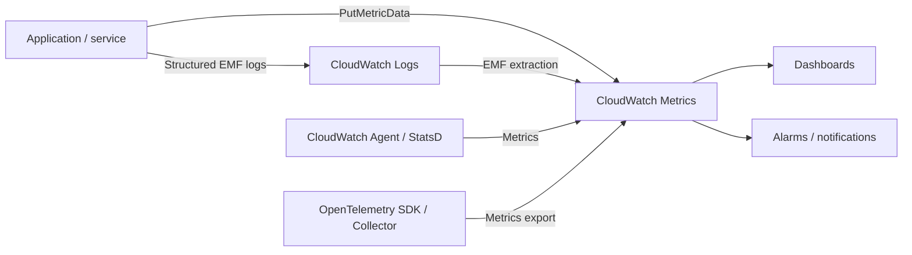
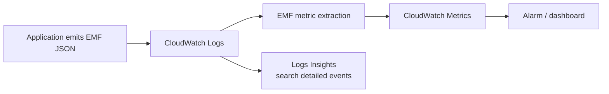

# Custom Metrics and Embedded Metric Format

## Learning Objectives

After this lesson, you will be able to:

1. Explain custom metrics in Amazon CloudWatch and when applications should emit their own metrics.
2. Distinguish namespace, metric name, dimensions, timestamp, unit, statistic, and storage resolution.
3. Publish metrics directly using the CloudWatch PutMetricData API/AWS SDK.
4. Understand Embedded Metric Format (EMF), its JSON structure, and how CloudWatch Logs extracts metrics.
5. Choose among PutMetricData, EMF, CloudWatch Agent/StatsD, and OpenTelemetry.
6. Design low-cardinality dimension sets and avoid creating unintended swarms of time series.
7. Build dashboards and alarms from custom metrics, handling missing data and high-resolution metrics.
8. Integrate custom metrics into applications, Lambda, containers, and EC2.
9. Verify ingestion, IAM permissions, log parsing, timestamps, and costs.
10. Practice publishing metrics for an orders API, inspecting detailed logs, and creating alarms.

## 1. Custom Metrics in CloudWatch

Amazon CloudWatch collects metrics from many AWS services such as EC2, Lambda, RDS, S3, and API Gateway. Built-in metrics help monitor infrastructure, yet do not always reflect an application's business health.

For example, low EC2 CPU does not prove an API is healthy. An ordering application may need to track:

- Number of successful order-creation requests.
- Number of rejected or failed requests.
- Request processing duration.
- Number of orders paid.
- Number of payment service call timeouts.
- Number of messages retried or sent to a dead-letter queue.
- Number of connections waiting in a connection pool.

Metrics emitted by an application or agent are called **custom metrics**. They let you observe system-specific signals rather than looking solely at host resources.



### 1.1. What Questions Do Custom Metrics Answer?

| Operational Question | Suggested Metric | Meaning |
| --- | --- | --- |
| Is the API receiving requests? | RequestCount | Traffic by service/route group. |
| Are requests failing? | ErrorCount, ErrorRate | Application quality signal. |
| Is the API responding slowly? | RequestLatency | Latency measurement, typically tracking p90/p95/p99. |
| Is business processing backed up? | OrdersPending, PaymentFailures | Measures backlog and business errors. |
| Is the worker keeping up with the queue? | MessagesProcessed, ProcessingLatency | Tracks processing capacity. |
| Is a dependency unstable? | DependencyTimeouts | Counts timeouts per dependency in a controlled way. |

A metric should represent a signal that can be aggregated over time and used to make decisions. Logs are suited for preserving individual event details; metrics are suited for viewing trends, creating alarms, and building dashboards.

### 1.2. Namespace and Metric Identity

A metric in CloudWatch is identified by the combination of:

- **Namespace:** metric group, such as MyCompany/Orders.
- **Metric name:** signal name, such as RequestLatency.
- **Dimensions:** name/value pairs categorizing time series, such as Service=orders-api, Environment=prod.

Example of two distinct metric identities:

```text
Namespace: MyCompany/Orders
Metric:    RequestCount
Dimensions:
  Service=orders-api
  Environment=prod

Namespace: MyCompany/Orders
Metric:    RequestCount
Dimensions:
  Service=payments-api
  Environment=prod
```

Two different dimension sets produce two distinct time series, even when the namespace and metric name match. When querying a metric that has dimensions, you must select the exact published dimension combination.

CloudWatch metrics are stored per Region. When publishing to ap-southeast-1, query that namespace in the same Region; picking the wrong Region is a common reason metrics appear missing.

Use your organization's or application's own namespace. Do not place custom metrics into reserved AWS service namespaces like AWS/EC2; doing so invites confusion with AWS-managed metrics.

### 1.3. Metrics, Logs, and Traces Complement Each Other

| Telemetry | Answers | Example |
| --- | --- | --- |
| Metric | What is rising, falling, or breaching a threshold? | Error rate jumped from 0.2% to 8%. |
| Log | What specific event occurred? | Payment provider returned HTTP 503 with an error code. |
| Trace | Which components did a request traverse and where was it slow? | API took 900 ms, of which calling payment took 720 ms. |

A good metric guides operators toward dashboards, log queries, or traces to investigate root cause. Avoid cramming full log payloads into metric dimensions.

## 2. Designing Custom Metrics Properly

### 2.1. Metric Name, Unit, and Timestamp

- **Metric name** should be short, stable, and clearly express the measured quantity: RequestCount, RequestLatency, PaymentFailures.
- **Unit** describes the unit: Count, Milliseconds, Bytes, Percent, Seconds, or None.
- **Timestamp** is when the data was measured, not necessarily when the collector shipped it.

For PutMetricData, timestamps can be up to roughly two weeks in the past and two hours in the future. Backdated data may take additional time to appear in metric queries. For EMF, the timestamp in _aws.Timestamp is in milliseconds since Unix epoch and is also subject to valid time bounds.

If no unit is specified, CloudWatch uses None. Keep units consistent for a metric name; the same metric name should not receive milliseconds in one emit and seconds in another.

### 2.2. Dimensions and Cardinality

Dimensions partition metrics by operationally meaningful attributes:

- Service=orders-api
- Environment=prod
- Operation=CreateOrder
- Region=ap-southeast-1
- StatusClass=5xx

Every dimension combination creates a separate metric time series. CloudWatch supports up to 30 dimensions per metric. This is a major cost driver to manage.

**Do not use high-cardinality values as dimensions**, for example:

- requestId, traceId, correlationId.
- Email, customer ID, or order ID.
- Full URLs with path parameters.
- Session IDs or individual user IP addresses.
- Timestamps or random values.

If every request has a distinct requestId and requestId is a dimension, the system can create a custom metric identity per request. Time-series counts and costs will explode.

Keep those IDs in logs or traces for investigation. Keep them out of metric dimensions.

| Attribute | Should It Be a Dimension? | Reason |
| --- | --- | --- |
| Environment (dev, prod) | Yes | Small, stable set of values. |
| Service (orders-api) | Yes | Separates components. |
| Operation (CreateOrder) | Yes, if operations are bounded | Helps identify failing/slow operations. |
| HTTP status class (2xx, 4xx, 5xx) | Yes | Low cardinality, operationally meaningful. |
| Request ID | No | Every request can have a unique value. |
| User ID | No | Could have millions of values. |
| Raw URL | Usually no | Path parameters/query strings inflate cardinality. |

### 2.3. Dimension Sets and Rollups

You may need metrics both at the overall service level and per operation. One strategy is publishing two dimension sets:

```text
Aggregate set:
  Service=orders-api, Environment=prod

Detailed set:
  Service=orders-api, Environment=prod, Operation=CreateOrder
```

With EMF, a single MetricDirective can declare multiple dimension sets. Each dimension set creates a separate metric identity. This provides both rolled-up and broken-down numbers, though each extra set increases time-series count.

Do not turn fields into dimensions merely because they exist in logs. Start with the dimensions actually required by dashboards, alarms, and operational queries.

### 2.4. Resolution: Standard and High Resolution

| Type | Storage Resolution | Meaning |
| --- | --- | --- |
| Standard resolution | 60 seconds | Default choice for most operational metrics. |
| High resolution | 1 second | Tracks signals needing sub-minute observation. |

High-resolution metrics can be queried at periods of 1, 5, 10, 30 seconds, or multiples of 60 seconds. High-resolution alarms can use 10- or 30-second periods; shorter-period alarms carry higher fees.

Use high resolution only when sub-minute reaction genuinely matters, such as rapid saturation in a trading system. For per-minute order counts or 5-minute error counts, standard resolution is usually more appropriate.

### 2.5. Statistics and Percentiles

CloudWatch stores metric data points and calculates statistics by period:

- Sum: sum of values within the period.
- SampleCount: number of samples.
- Average: mean value.
- Minimum, Maximum: smallest/largest value.
- Percentiles such as p90, p95, p99: percentiles of the sample distribution when supported by the data.

For example, RequestCount typically uses Sum; RequestLatency typically uses Average, Maximum, and p95/p99. Do not substitute Average for percentiles when tail latency matters.

If publishing statistic sets instead of raw samples, CloudWatch can compute percentiles only under limited conditions, such as SampleCount=1 with Min/Max/Sum equal to that single value, or Min equal to Max and Sum equal to Min times SampleCount. For meaningful percentiles, publish raw values or use an appropriate values/counts mechanism.

## 3. Publishing Metrics Directly with PutMetricData

### 3.1. When to Use PutMetricData?

PutMetricData is the CloudWatch API for submitting metric data directly. It is a good fit when:

- The application can call the AWS SDK/API.
- You want explicit control over metric name, dimensions, unit, timestamp, and resolution.
- You do not need to retain every detailed log event for that metric.
- You can batch data and manage retries.

The application needs the cloudwatch:PutMetricData IAM permission for the allowed namespace. API calls are billed under CloudWatch pricing; batching multiple MetricDatum entries in a single request reduces call volume.

### 3.2. AWS CLI Examples

Send a request count to a custom namespace:

```bash
aws cloudwatch put-metric-data \
  --namespace "MyCompany/Orders" \
  --metric-name "RequestCount" \
  --value 1 \
  --unit Count \
  --dimensions Service=orders-api,Environment=dev
```

Send a high-resolution latency metric:

```bash
aws cloudwatch put-metric-data \
  --namespace "MyCompany/Orders" \
  --metric-name "RequestLatency" \
  --value 125.4 \
  --unit Milliseconds \
  --storage-resolution 1 \
  --dimensions Service=orders-api,Environment=dev,Operation=CreateOrder
```

storage-resolution 1 requests high resolution. Omitting it or setting 60 uses standard resolution.

### 3.3. Publishing with AWS SDK for Java 2.x

In a Java/Spring Boot application, inject and reuse CloudWatchClient instead of creating a new client per request:

With Maven, add the CloudWatch SDK module dependency. The example below assumes the project manages AWS SDK for Java 2.x versions via a BOM in dependencyManagement:

```xml
<dependency>
  <groupId>software.amazon.awssdk</groupId>
  <artifactId>cloudwatch</artifactId>
</dependency>
```

```java
import java.time.Instant;
import java.util.List;

import software.amazon.awssdk.regions.Region;
import software.amazon.awssdk.services.cloudwatch.CloudWatchClient;
import software.amazon.awssdk.services.cloudwatch.model.Dimension;
import software.amazon.awssdk.services.cloudwatch.model.MetricDatum;
import software.amazon.awssdk.services.cloudwatch.model.PutMetricDataRequest;
import software.amazon.awssdk.services.cloudwatch.model.StandardUnit;

public final class OrderMetricsPublisher implements AutoCloseable {

    private static final String NAMESPACE = "MyCompany/Orders";

    private final CloudWatchClient cloudWatch;

    public OrderMetricsPublisher() {
        this.cloudWatch = CloudWatchClient.builder()
                .region(Region.AP_SOUTHEAST_1)
                .build();
    }

    public void publishRequestLatency(
            String environment,
            String operation,
            double latencyMillis) {

        MetricDatum datum = MetricDatum.builder()
                .metricName("RequestLatency")
                .dimensions(List.of(
                        Dimension.builder()
                                .name("Service")
                                .value("orders-api")
                                .build(),
                        Dimension.builder()
                                .name("Environment")
                                .value(environment)
                                .build(),
                        Dimension.builder()
                                .name("Operation")
                                .value(operation)
                                .build()
                ))
                .unit(StandardUnit.MILLISECONDS)
                .value(latencyMillis)
                .timestamp(Instant.now())
                .storageResolution(60)
                .build();

        PutMetricDataRequest request = PutMetricDataRequest.builder()
                .namespace(NAMESPACE)
                .metricData(datum)
                .build();

        cloudWatch.putMetricData(request);
    }

    @Override
    public void close() {
        cloudWatch.close();
    }
}
```

This is a minimal example illustrating the SDK. In Spring Boot, register the client/publisher as a singleton bean and manage its lifecycle through dependency injection. Avoid calling CloudWatch synchronously on every request when API latency matters; consider buffering, batching, or asynchronous metric emission.

### 3.4. Batching Metric Data

PutMetricData accepts up to 1,000 metric data entries per request and a maximum 1 MB HTTP POST payload. Each metric supports up to 30 dimensions. Gzip compression can be used. The API supports sending a single value, a statistic set, or arrays of values/counts per metric.

Batching reduces overhead and request counts, but requires balancing:

- Delay from measurement until the metric appears.
- Buffer capacity and risk of data loss if the process terminates.
- Retries/backoff on API throttling or transient failures.
- Number of metric identities and publishing frequency.

Each sample's timestamp should reflect when it was measured. Avoid uncontrolled retries that re-publish the same event multiple times; CloudWatch metric ingestion should not be treated as an exactly-once store for business events.

### 3.5. IAM Permissions

An application role calling PutMetricData needs the cloudwatch:PutMetricData permission. You can restrict the namespace using the cloudwatch:namespace condition:

```json
{
  "Version": "2012-10-17",
  "Statement": [
    {
      "Effect": "Allow",
      "Action": "cloudwatch:PutMetricData",
      "Resource": "*",
      "Condition": {
        "StringEquals": {
          "cloudwatch:namespace": "MyCompany/Orders"
        }
      }
    }
  ]
}
```

PutMetricData does not support resource-level ARN scoping like some resource APIs; the namespace condition is the standard way to narrow permissions. Do not grant cloudwatch:* when the application only needs to publish metrics.

## 4. Embedded Metric Format (EMF)

### 4.1. What Is EMF?

**Embedded Metric Format** is a JSON specification that allows embedding metric values inside structured log events. The application writes JSON logs to CloudWatch Logs; CloudWatch recognizes the EMF metadata, extracts the metrics, and publishes them to CloudWatch Metrics.

EMF is especially well suited for Lambda and ephemeral workloads because the application only needs to write logs to stdout/stderr. No separate cloudwatch:PutMetricData permission is needed to create metrics from EMF; the workload only needs permission to send log events to CloudWatch Logs.



EMF combines two benefits:

- Metrics can be used for graphs, alarms, and metric math.
- The original log event retains detailed fields for querying in CloudWatch Logs Insights.

### 4.2. Minimal EMF Structure

An EMF log event is a valid JSON object. The root object must contain _aws, which holds the CloudWatchMetrics directive:

```json
{
  "_aws": {
    "Timestamp": 1795150800000,
    "CloudWatchMetrics": [
      {
        "Namespace": "MyCompany/Orders",
        "Dimensions": [
          ["Service", "Environment", "Operation"]
        ],
        "Metrics": [
          {
            "Name": "RequestCount",
            "Unit": "Count",
            "StorageResolution": 60
          },
          {
            "Name": "RequestLatency",
            "Unit": "Milliseconds",
            "StorageResolution": 1
          },
          {
            "Name": "ErrorCount",
            "Unit": "Count"
          }
        ]
      }
    ]
  },
  "Service": "orders-api",
  "Environment": "dev",
  "Operation": "CreateOrder",
  "RequestCount": 1,
  "RequestLatency": 125.4,
  "ErrorCount": 0,
  "requestId": "req-7f6d9a"
}
```

Components:

| Component | Meaning |
| --- | --- |
| _aws.Timestamp | Unix timestamp in milliseconds. |
| _aws.CloudWatchMetrics | List of metric directives. |
| Namespace | Target namespace receiving the metrics. |
| Dimensions | List of dimension sets; each set is a combination of keys. |
| Metrics | Metric names, units, and storage resolutions. |
| Root fields Service, Environment, Operation | Actual values for the dimensions. |
| Root fields RequestCount, RequestLatency, ErrorCount | Numeric metric targets. |
| Root field requestId | Log field for investigation; not a dimension. |

The timestamp in the illustrative JSON is an example value. When an application emits real logs, generate the current Unix epoch milliseconds at measurement time; do not reuse timestamps from documentation or old samples.

### 4.3. Important EMF Rules

- The log event must be a valid JSON object with no leading or trailing text.
- _aws.CloudWatchMetrics must be an array containing at least one valid metric directive.
- Metric targets are referenced by root-level field names; targets must be numbers or arrays of numbers, not nested objects.
- Dimension targets must be root-level strings.
- Namespace length is 1 to 255 printable ASCII characters.
- Each dimension set supports at most 30 dimension keys.
- Total metric definitions in a single log event must not exceed 100.
- Maximum EMF log event size is 1 MB.
- Timestamp must fall within CloudWatch's accepted window: up to 14 days in the past and 2 hours in the future.
- Valid StorageResolution values are 1 or 60; default is 60.

An EMF log event can contain multiple metric directives. Referenced fields must live on the root node and field names are case-sensitive.

### 4.4. Dimension Sets Create Metric Identities

Multiple dimension sets can be declared to produce metrics at multiple aggregation levels:

```json
{
  "_aws": {
    "Timestamp": 1795150800000,
    "CloudWatchMetrics": [
      {
        "Namespace": "MyCompany/Orders",
        "Dimensions": [
          ["Service", "Environment"],
          ["Service", "Environment", "Operation"]
        ],
        "Metrics": [
          {
            "Name": "RequestCount",
            "Unit": "Count"
          }
        ]
      }
    ]
  },
  "Service": "orders-api",
  "Environment": "prod",
  "Operation": "CreateOrder",
  "RequestCount": 1,
  "requestId": "req-7f6d9a"
}
```

From this event, EMF creates an aggregate series by Service + Environment and a detailed series by Service + Environment + Operation. requestId remains in the log without creating a separate dimension.

Each additional dimension set creates another metric identity. Estimate the total number of dimension combinations before emitting EMF in production.

### 4.5. EMF Delivery Semantics

EMF guarantees metric extraction with at-least-once semantics; occasionally metric values may be duplicated. Therefore, EMF is suited for telemetry and operational monitoring, not as an exactly-once ledger for transactions or business accounting.

If a metric requires exact business counts for financial reconciliation, use transactional data or an event store as the source of truth. CloudWatch metrics are operational signals meant to be aggregated for monitoring.

### 4.6. EMF from Lambda

Lambda automatically forwards stdout/stderr to log events in CloudWatch Logs when the execution role has appropriate logging permissions. If the application prints a single-line JSON EMF object, CloudWatch Logs can process the metric directive.

Basic permissions typically needed:

- logs:CreateLogGroup if the function creates its own log group.
- logs:CreateLogStream.
- logs:PutLogEvents.

When emitting EMF through CloudWatch Logs, cloudwatch:PutMetricData is not needed solely to extract metrics. If the application also calls PutMetricData directly for other metrics, separate permissions are required for that API.

### 4.7. EMF from EC2/Containers/On-Premises

For EC2, ECS, or workloads that do not automatically forward stdout to CloudWatch Logs, use CloudWatch Agent or a logging pipeline to ship EMF log events. The agent can tail files, collect metrics, and send logs/metrics to CloudWatch as configured.

Ensure log events are delivered as intact JSON. If a log shipper wraps JSON inside another string, prepends a prefix, splits lines, or mishandles multiline events, the EMF parser may fail to recognize the directive.

### 4.8. Monitoring EMF Extraction

CloudWatch publishes operational metrics for EMF processing in the AWS/Logs namespace. You can use them to monitor parsing/validation errors and metric generation health. When metrics fail to appear, check both log ingestion and metric extraction; logs may enter the log group while the EMF directive fails validation.

## 5. Choosing a Metric Publishing Method

| Method | Mechanism | Typical Permissions Needed | Best Suited When |
| --- | --- | --- | --- |
| PutMetricData | Direct CloudWatch API/SDK call. | cloudwatch:PutMetricData | Long-lived services needing explicit control over batching, timestamps, and publishing. |
| EMF | Write JSON log; CloudWatch Logs extracts metrics. | logs:PutLogEvents (and group/stream creation if needed) | Lambda, ephemeral compute, or when keeping detailed log events alongside metrics. |
| CloudWatch Agent + StatsD/collectd | App sends metrics to agent; agent buffers and aggregates. | Agent role needs publish permissions to target | EC2, on-premises, or apps already using StatsD or collectd. |
| OpenTelemetry | SDK/instrumentation and exporter/collector ship metrics. | Depends on exporter and destination | New telemetry designs wanting standardized instrumentation and portability. |

AWS recommends considering OpenTelemetry for new custom metric implementations. However, EMF remains valuable when structured logs are already the workload's natural telemetry stream; PutMetricData remains appropriate when direct API calls are needed.

## 6. CloudWatch Agent and StatsD

CloudWatch Agent can collect OS metrics, logs, and custom metrics via StatsD or collectd. StatsD supports Linux and Windows Server; collectd supports Linux.

Example agent configuration for StatsD on EC2:

```json
{
  "agent": {
    "metrics_collection_interval": 60,
    "run_as_user": "cwagent"
  },
  "metrics": {
    "namespace": "MyCompany/Host",
    "append_dimensions": {
      "InstanceId": "${aws:InstanceId}"
    },
    "metrics_collected": {
      "statsd": {
        "service_address": ":8125",
        "metrics_collection_interval": 10,
        "metrics_aggregation_interval": 60
      }
    }
  }
}
```

This is an illustrative configuration; save the file in the agent's supported location and use amazon-cloudwatch-agent-ctl to fetch/start the configuration on your OS. The instance role needs permission to send metrics to CloudWatch. service_address opens the StatsD listener; restrict interface/network access so only trusted workloads can send data.

A StatsD client can emit:

```text
orders.request.count:1|c
orders.request.latency:125|ms
orders.queue.depth:8|g
```

Here c denotes a counter, ms denotes timing, and g denotes a gauge per the StatsD protocol. The agent aggregates/buffers metrics per the collection interval before publishing to CloudWatch.

### 6.1. Aggregation Dimensions

CloudWatch Agent supports aggregation_dimensions to aggregate metrics across dimensions. For instance, you can retain per-InstanceId metrics while also producing an aggregated series by AutoScalingGroupName.

Aggregation reduces the number of metric identities to track. Decide whether to keep original per-instance metrics or only the aggregated series; setting drop_original_metrics reduces metric volume but removes the ability to drill down by the original dimensions.

## 7. Building Dashboards and Alarms for Custom Metrics

### 7.1. Dashboards

Dashboards combine custom metrics with infrastructure metrics:

- Request count and error count by service.
- p95/p99 latency.
- CPU/memory or queue depth.
- Retry counts and dependency failures.
- Alarm states and deployment annotations.

Metric widgets must match the exact namespace, metric name, dimensions, statistic, and period. If dimension values differ from what was published, the widget will display no data.

### 7.2. Creating an Alarm from a Custom Metric

Example alarm when ErrorCount exceeds 10 errors in a 5-minute period:

```bash
aws cloudwatch put-metric-alarm \
  --alarm-name "orders-api-high-errors-dev" \
  --namespace "MyCompany/Orders" \
  --metric-name "ErrorCount" \
  --dimensions Name=Service,Value=orders-api Name=Environment,Value=dev \
  --statistic Sum \
  --period 300 \
  --evaluation-periods 2 \
  --datapoints-to-alarm 2 \
  --threshold 10 \
  --comparison-operator GreaterThanThreshold \
  --treat-missing-data notBreaching \
  --alarm-actions "arn:aws:sns:ap-southeast-1:123456789012:ops-alerts"
```

Replace the SNS topic ARN with your real topic and confirm subscriptions are configured. This alarm assumes the metric carries Service and Environment dimensions; if the metric publishes an extra Operation dimension without an aggregate dimension set, this alarm will not match that series.

### 7.3. Choosing the Right Statistic and Period

| Metric | Common Statistic | Notes |
| --- | --- | --- |
| RequestCount | Sum | Total requests in the period. |
| ErrorCount | Sum | Total errors in the period. |
| RequestLatency | Average, p95, p99, Maximum | Publish raw samples if percentiles are needed. |
| QueueDepth | Maximum or Average | Maximum detects backlog spikes; Average shows mean queue level. |
| ActiveConnections | Maximum | Observes peak connections. |

Period must match storage resolution and publishing cadence. Do not configure a 10-second alarm period on a 60-second standard-resolution metric and expect data points every 10 seconds.

### 7.4. Missing Data and Zero-Traffic Metrics

CloudWatch alarms provide four missing-data treatments:

- breaching: treat missing data points as breaching the threshold.
- notBreaching: treat missing data points as within bounds.
- ignore: maintain the current alarm state.
- missing: evaluate missing data normally; if insufficient data exists, transition to INSUFFICIENT_DATA.

Choose based on metric semantics:

| Scenario | Suggestion |
| --- | --- |
| Heartbeat metric expected continuously | Consider breaching; a missing heartbeat indicates a problem. |
| Metric emitted only on errors | notBreaching; no errors means no data points. |
| RequestCount emitted only when traffic arrives | Define explicitly whether zero traffic is normal or alert-worthy. |
| Scheduled business metric | Consider emitting zero/heartbeat if distinguishing "none occurred" from "publisher stopped" matters. |

**No data points does not equal a value of 0.** If an application only publishes ErrorCount when an error happens, missing data points could mean zero errors, zero traffic, or a broken publisher. Design a heartbeat or explicit zero emission if you need to tell those states apart.

## 8. Costs and Limits to Control

### 8.1. Cost Factors

- Number of custom metric identities, determined by namespace/name/dimensions.
- Storage resolution and number of high-resolution metrics.
- PutMetricData request frequency.
- Volume of metric data points/series and API queries.
- Number of alarms, dashboards, and metric streams if used.
- For EMF: CloudWatch Logs ingestion/retention plus extracted custom metrics.
- For the agent: metric count, aggregation, and flush frequency.

EMF is not free just because metrics piggyback on logs. You still pay for log ingestion/retention as well as the generated custom metrics.

### 8.2. Cardinality Is a Source of Unintended Metric Growth

Suppose an application has:

- 3 environments.
- 8 services.
- 12 operations.
- 5 status classes.

The maximum dimension combinations across these fields is 3 × 8 × 12 × 5 = 1,440 series for a single metric name if every combination occurs. Adding request ID with millions of values causes series count to skyrocket.

Before adding a dimension, ask:

1. Does the dimension have a finite, stable set of values?
2. Is an alarm/dashboard needed along this dimension?
3. Can detailed values remain in logs/traces instead of metrics?
4. What is the maximum number of combinations?
5. Does the new metric genuinely require high resolution?

### 8.3. Metric Retention

CloudWatch retains metric data at varying granularity over time:

| Resolution/Period | Retention |
| --- | --- |
| High-resolution data points with period under 60 seconds | 3 hours |
| 1 minute | 15 days |
| 5 minutes | 63 days |
| 1 hour | 455 days |

CloudWatch automatically rolls up older data into coarser resolutions. If long-term detailed analysis is needed, store raw events/logs or telemetry in an appropriate storage system; do not expect high-resolution data points to persist indefinitely.

## 9. Troubleshooting

| Symptom | Common Cause | Investigation Direction |
| --- | --- | --- |
| PutMetricData returns AccessDenied | Role lacks cloudwatch:PutMetricData or namespace condition mismatches. | Inspect execution role and IAM condition. |
| Metric missing from console | Wrong namespace/name/dimensions, Region, or time window. | Verify Region, dimension set, and timestamp; new metrics can take up to ~15 minutes to appear in ListMetrics. |
| EMF log appears but no metric | Invalid JSON, invalid _aws/directive, or invalid metric target. | Inspect raw log event and EMF validation rules. |
| EMF not extracted from container | Log shipper wrapped JSON, added a prefix, or split multiline. | Ensure each EMF event is a single intact JSON object. |
| Dimension missing | Dimension key not at root level or value not a string. | Check field name and type; EMF targets cannot be nested. |
| Too many metric series | High-cardinality dimension such as requestId/userId/path. | Remove high-cardinality dimensions; keep IDs in logs/traces. |
| Alarm in INSUFFICIENT_DATA | No data points, publisher stopped, or period/resolution mismatch. | Check metric emission, timestamps, missing-data treatment, and period. |
| Alarm stays OK despite rising errors | Wrong statistic, dimension, threshold, or evaluation periods. | Reconcile exact metric identity and aggregation. |
| No data for p95/p99 | Sending only statistic sets that do not satisfy percentile rules. | Publish raw samples/values or select a supported statistic. |
| Duplicate EMF counts | At-least-once EMF delivery can produce duplicates. | Never use EMF as an exactly-once transaction ledger; use a business store for reconciliation. |
| CloudWatch Agent not receiving StatsD | Wrong listener/port, network interface, or agent config. | Check service_address, agent status, port, and agent logs. |
| High-resolution metric lacks 10-second data points | Metric was published with StorageResolution 60. | Publish with StorageResolution 1 and query a valid period. |

### 9.1. Tracing the EMF Pipeline

When troubleshooting EMF, check in order:

1. Is the application actually writing JSON to stdout/file?
2. Is the log group/stream receiving the event?
3. Is the event a single valid JSON object with no prefix/suffix?
4. Is _aws.Timestamp in milliseconds and within valid time bounds?
5. Do Namespace, dimensions, and metric targets comply with the spec?
6. Are referenced fields on the root node with valid types?
7. Does the metric appear in the expected Region, namespace, and dimension set?
8. Does AWS/Logs report any EMF parsing/validation errors?

## 10. Lab: Publishing Custom Metrics and EMF for Orders API

This lab demonstrates two flows: publishing a metric directly with the CLI and emitting an EMF log event. Use an authorized AWS sandbox account; never place request IDs, customer IDs, or personal data in metric dimensions.

### 10.1. Preparing Namespace and Permissions

Select a Region and verify identity:

```bash
aws sts get-caller-identity
aws configure get region
```

The executing identity needs cloudwatch:PutMetricData for namespace MyCompany/Orders. If testing EMF via the CloudWatch Logs API, the identity needs permission to write log events to the target log group.

### 10.2. Sending Metrics Directly

```bash
aws cloudwatch put-metric-data \
  --namespace "MyCompany/Orders" \
  --metric-data '[
    {
      "MetricName": "RequestCount",
      "Dimensions": [
        {"Name": "Service", "Value": "orders-api"},
        {"Name": "Environment", "Value": "dev"},
        {"Name": "Operation", "Value": "CreateOrder"}
      ],
      "Timestamp": "2026-11-20T05:00:00Z",
      "Unit": "Count",
      "Value": 1,
      "StorageResolution": 60
    },
    {
      "MetricName": "RequestLatency",
      "Dimensions": [
        {"Name": "Service", "Value": "orders-api"},
        {"Name": "Environment", "Value": "dev"},
        {"Name": "Operation", "Value": "CreateOrder"}
      ],
      "Timestamp": "2026-11-20T05:00:00Z",
      "Unit": "Milliseconds",
      "Value": 125.4,
      "StorageResolution": 1
    }
  ]'
```

The timestamp here is a fixed illustrative example; when practicing, replace it with a current timestamp within CloudWatch's accepted range. This command publishes two metric identities in a single request.

### 10.3. Verifying Metrics

List metric names in the namespace:

```bash
aws cloudwatch list-metrics \
  --namespace "MyCompany/Orders"
```

New metrics can take up to about 15 minutes to appear in ListMetrics. When querying, specify the exact published dimensions.

Fetch statistics with get-metric-statistics:

```bash
aws cloudwatch get-metric-statistics \
  --namespace "MyCompany/Orders" \
  --metric-name "RequestCount" \
  --dimensions Name=Service,Value=orders-api Name=Environment,Value=dev Name=Operation,Value=CreateOrder \
  --start-time "2026-11-20T04:55:00Z" \
  --end-time "2026-11-20T05:10:00Z" \
  --period 60 \
  --statistics Sum
```

Adjust the time window to match the timestamp you sent. For high-resolution data, you can query at 1-, 5-, 10-, or 30-second periods; standard-resolution metrics require periods of 60 seconds or higher.

### 10.4. Sending an EMF Log Event

Create emf-event.json containing one JSON object per log event. The block below is formatted across lines for readability; in real logging, the serializer should output each object as a single complete JSON line:

```json
{
  "_aws": {
    "Timestamp": 1795150800000,
    "CloudWatchMetrics": [
      {
        "Namespace": "MyCompany/Orders",
        "Dimensions": [
          ["Service", "Environment"],
          ["Service", "Environment", "Operation"]
        ],
        "Metrics": [
          {"Name": "PaymentFailureCount", "Unit": "Count", "StorageResolution": 60},
          {"Name": "PaymentLatency", "Unit": "Milliseconds", "StorageResolution": 1}
        ]
      }
    ]
  },
  "Service": "orders-api",
  "Environment": "dev",
  "Operation": "AuthorizePayment",
  "PaymentFailureCount": 1,
  "PaymentLatency": 820.5,
  "requestId": "req-example-001",
  "errorCode": "PAYMENT_PROVIDER_TIMEOUT"
}
```

The timestamp in the JSON above is illustrative; replace it with the current Unix epoch milliseconds before sending. You can print the event to Lambda stdout or send it to CloudWatch Logs via an agent/PutLogEvents.

Events sent through CloudWatch Logs must go to a log stream in an existing log group. When calling PutLogEvents, follow current API behavior for log streams and sequence tokens; in practice, prefer the SDK or logging agent over managing them manually.

### 10.5. Creating an Alarm

Create an alarm for the sum of PaymentFailureCount:

```bash
aws cloudwatch put-metric-alarm \
  --alarm-name "orders-payment-failures-dev" \
  --namespace "MyCompany/Orders" \
  --metric-name "PaymentFailureCount" \
  --dimensions Name=Service,Value=orders-api Name=Environment,Value=dev \
  --statistic Sum \
  --period 300 \
  --evaluation-periods 1 \
  --datapoints-to-alarm 1 \
  --threshold 0 \
  --comparison-operator GreaterThanThreshold \
  --treat-missing-data notBreaching
```

This alarm targets the aggregated Service + Environment dimension set from EMF. If the event only declares a dimension set that includes Operation, the alarm must specify that full dimension set. In production, attach an SNS action and tune threshold/evaluation windows to actual baselines.

### 10.6. Observing and Investigating

- Open CloudWatch Metrics and select the MyCompany/Orders namespace.
- Select PaymentFailureCount and the Service + Environment dimension set.
- Open CloudWatch Logs Insights to search for errorCode=PAYMENT_PROVIDER_TIMEOUT.
- Compare metric trends against log events for the same operation.
- Check AWS/Logs if logs entered the group yet metrics were not extracted.

### 10.7. Cleanup

Delete the lab alarm if no longer needed:

```bash
aws cloudwatch delete-alarms \
  --alarm-names "orders-payment-failures-dev"
```

CloudWatch metric data does not require manual deletion to stop accruing; stop publishing and data expires per retention. Delete the lab log group if logs are no longer needed and doing so complies with retention/audit policies.

## 11. Common Misconceptions

**Misconception 1: "A custom metric is just a log with a different name."**

No. A metric is a time series with namespace/name/dimensions/statistics; a log is a detailed event that can hold many fields.

**Misconception 2: "EMF requires cloudwatch:PutMetricData."**

No. EMF metric extraction relies on log ingestion; log-writing permissions such as logs:PutLogEvents are required. PutMetricData is only needed when calling that API directly.

**Misconception 3: "Dimensions are just free labels."**

No. Each dimension combination creates a separate metric identity and affects custom metric usage and cost.

**Misconception 4: "You can use requestId as a dimension to drill down."**

No. Request ID has very high cardinality; keep it in logs/traces.

**Misconception 5: "No data points means the metric equals 0."**

No. Missing data points can mean nothing occurred, zero traffic, or a stopped publisher.

**Misconception 6: "High resolution is always better."**

No. It fits signals requiring sub-minute reaction, but increases costs and fine-grained data has shorter retention.

**Misconception 7: "EMF is exactly-once."**

No. EMF guarantees at-least-once metric delivery; duplicate values can occur.

**Misconception 8: "Any field in EMF can serve as a dimension."**

No. Dimension targets must be root-level strings; choose only a small set of low-cardinality fields.

**Misconception 9: "Average latency is enough to tell whether an API is slow."**

No. Tail latency (p95/p99) can be degraded even while average looks healthy.

**Misconception 10: "CloudWatch Agent only collects OS metrics."**

No. The agent can collect custom metrics via StatsD/collectd in addition to logs and other telemetry.

## 12. Self-Check Questions

**Question 1.** What is a custom metric?

**Answer:** A metric published by an application or agent to represent system-specific signals that built-in AWS metrics do not fully capture.

**Question 2.** What components make up a metric identity?

**Answer:** Namespace, metric name, and the combination of dimensions.

**Question 3.** Which IAM permission does PutMetricData require?

**Answer:** cloudwatch:PutMetricData.

**Question 4.** What is EMF?

**Answer:** A JSON format that embeds metric values inside a log event so CloudWatch Logs can extract metrics automatically.

**Question 5.** Which permissions does EMF need to write logs?

**Answer:** logs:PutLogEvents, plus log group/stream creation permissions if the workload needs to create them itself.

**Question 6.** Which field in EMF holds metric directives?

**Answer:** _aws.CloudWatchMetrics.

**Question 7.** What unit does the EMF timestamp use?

**Answer:** Unix epoch milliseconds.

**Question 8.** What is the maximum number of dimension keys in one EMF dimension set?

**Answer:** 30.

**Question 9.** Why shouldn't requestId be a metric dimension?

**Answer:** Very high cardinality creates numerous metric identities and drives up costs.

**Question 10.** What does StorageResolution 1 mean?

**Answer:** A high-resolution metric with one-second granularity.

**Question 11.** Why is EMF unsuitable as an exactly-once transaction counter?

**Answer:** EMF metric delivery is at-least-once and can occasionally produce duplicates.

**Question 12.** What missing-data options does an alarm support?

**Answer:** breaching, notBreaching, ignore, and missing.

**Question 13.** When should StatsD be used with CloudWatch Agent?

**Answer:** When an application or library already emits StatsD and the workload needs an agent to collect, buffer, and publish custom metrics.

**Question 14.** Why are p95/p99 needed for latency?

**Answer:** Percentiles expose tail latency that Average can conceal.

**Question 15.** What should you check if an EMF metric does not appear even though the log is in CloudWatch Logs?

**Answer:** The JSON event, _aws directive, timestamp, root-level target fields, dimension types/cardinality, metric definitions, and AWS/Logs extraction errors.

## Official Documentation

- [Amazon CloudWatch — Publish custom metrics (PutMetricData / EMF)](https://docs.aws.amazon.com/AmazonCloudWatch/latest/monitoring/publishingMetrics.html)
- [Amazon CloudWatch — Embedded Metric Format](https://docs.aws.amazon.com/AmazonCloudWatch/latest/monitoring/CloudWatch_Embedded_Metric_Format.html)
- [Amazon CloudWatch — EMF specification](https://docs.aws.amazon.com/AmazonCloudWatch/latest/monitoring/CloudWatch_Embedded_Metric_Format_Specification.html)
- [Amazon CloudWatch API — PutMetricData](https://docs.aws.amazon.com/AmazonCloudWatch/latest/APIReference/API_PutMetricData.html)
- [Amazon CloudWatch — Metrics concepts](https://docs.aws.amazon.com/AmazonCloudWatch/latest/monitoring/cloudwatch_concepts.html)
- [Amazon CloudWatch — CloudWatch Agent configuration](https://docs.aws.amazon.com/AmazonCloudWatch/latest/monitoring/CloudWatch-Agent-Configuration-File-Details.html)
- [Amazon CloudWatch — Install and configure the CloudWatch Agent](https://docs.aws.amazon.com/AmazonCloudWatch/latest/monitoring/Install-CloudWatch-Agent.html)
- [Amazon CloudWatch — StatsD custom metrics](https://docs.aws.amazon.com/AmazonCloudWatch/latest/monitoring/CloudWatch-Agent-custom-metrics-statsd.html)
- [Amazon CloudWatch — Configure alarm missing data](https://docs.aws.amazon.com/AmazonCloudWatch/latest/monitoring/alarms-and-missing-data.html)
- [Amazon CloudWatch — Alarm evaluation](https://docs.aws.amazon.com/AmazonCloudWatch/latest/monitoring/alarm-evaluation.html)
- [Amazon CloudWatch — GetMetricData and retention](https://docs.aws.amazon.com/AmazonCloudWatch/latest/APIReference/API_GetMetricData.html)
- [AWS Distro for OpenTelemetry](https://aws-otel.github.io/)
- [OpenTelemetry metrics concepts](https://opentelemetry.io/docs/concepts/signals/metrics/)

**Takeaway:** PutMetricData sends metrics directly via the API; EMF embeds metrics inside structured logs for CloudWatch Logs to extract; CloudWatch Agent/StatsD and OpenTelemetry are alternative instrumentation/collection options. Design stable, low-cardinality namespaces and dimensions; choose standard or high resolution intentionally; and understand missing data, retention, and costs before creating production alarms.
