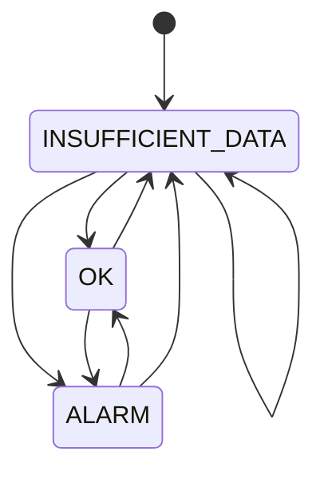

# Alarms, Composite Alarms, and Anomaly Detection

## 1. The Role of CloudWatch Alarms in Observability

A Java Spring Boot application running on ECS may run normally for hours and then suddenly experience latency spikes, elevated HTTP 5xx responses, or connection pool exhaustion. CloudWatch metrics surface these signals, yet a dashboard is only useful when someone opens and reads it. Operations teams need a mechanism to detect abnormal conditions, assess severity, and initiate appropriate actions.

**Amazon CloudWatch alarms** monitor metrics or metric math results, evaluate them against configured conditions, and transition states when conditions are met. An alarm can send notifications, trigger remediation actions, or serve as an input to a composite alarm. **Anomaly detection** adds thresholding based on a machine learning model of a metric's historical behavior instead of forcing operators to pick a single static number.

This lesson belongs to the **Observability with CloudWatch** chapter of the **CLOUD_PROVIDERS_AWS** module. The module explores Regions/AZs, IAM, VPC, compute, storage, databases, integration, and serverless; learners build the ability to design and deploy secure applications with monitoring, recovery, and cost control. Alarms connect metrics to operations: surfacing signals requiring attention, reducing noisy alerts, and helping teams respond according to impact.

After this lesson, you will be able to:

- Distinguish metric alarms, composite alarms, and anomaly detection alarms.
- Explain the three states: OK, ALARM, and INSUFFICIENT_DATA.
- Choose period, statistic, threshold, evaluation periods, and datapoints to alarm.
- Handle missing data, percentile metrics, and metric math.
- Combine multiple alarms using AND, OR, and NOT expressions.
- Use composite alarms and suppressors to reduce duplicate notifications during incidents or maintenance.
- Create anomaly detection bands, interpret model behavior, and tune sensitivity.
- Design alarm actions, SNS/EventBridge routing, IAM permissions, and runbooks.

## 2. How Does a CloudWatch Alarm Work?

An alarm ingests metric data periodically, computes a statistic for each period, and compares the result against a defined condition. When enough data points satisfy the condition, the alarm transitions to the corresponding state. An alarm does not inherently understand business impact; the designer must choose metrics, dimensions, statistics, thresholds, and missing-data handling tailored to the workload.

For example, suppose a service emits an HTTP5xxCount metric. If 5xx errors stay elevated across consecutive periods, an alarm can transition to ALARM and send an SNS notification to the on-call team. High CPUUtilization may signal saturation, yet if CPU rises during a scheduled batch job, it may not be an incident.

### 2.1. Components of a Metric Alarm

| Component | Question Answered | Example |
| --- | --- | --- |
| Metric | Which signal is measured? | CPUUtilization, 5xxCount, TargetResponseTime |
| Namespace | Which system owns the metric? | AWS/EC2, AWS/ApplicationELB, Orders/API |
| Dimensions | Which resource/group is measured? | InstanceId, LoadBalancer, Service |
| Statistic | How are data points aggregated? | Average, Sum, p99 |
| Period | How long is the aggregation window? | 60 seconds or 5 minutes |
| Threshold/condition | What value counts as breaching? | Average CPU greater than 80% |
| Evaluation | How many breaching data points are required? | 2 out of 3 periods |
| Missing data | How are absent data points handled? | missing, notBreaching |
| Actions | What happens on state transitions? | SNS topic, Auto Scaling policy |

### 2.2. Choosing the Right Metrics and Dimensions

An alarm is meaningful only if the metric represents what needs protection. A CPUUtilization alarm on each EC2 instance differs from an alarm across an entire service; a metric lacking proper dimensions may aggregate multiple resources and obscure one failing instance.

Examples:

- EC2: namespace AWS/EC2, metric CPUUtilization, dimension InstanceId.
- Application Load Balancer: namespace AWS/ApplicationELB, metric HTTPCode_Target_5XX_Count or TargetResponseTime, dimensions matching the load balancer/target group.
- Lambda: namespace AWS/Lambda, metrics Errors, Throttles, Duration, dimension FunctionName.
- DynamoDB: namespace AWS/DynamoDB, metrics ThrottledRequests or SystemErrors, dimension TableName.
- Self-instrumented applications: dedicated namespace such as Orders/API with controlled-cardinality dimensions.

Never use user IDs, request IDs, or random values as alarm metric dimensions. High cardinality multiplies time series, complicates operations, and increases costs.

### 2.3. Metric Alarms vs. Composite Alarms

A **metric alarm** evaluates a metric, metric math expression, or anomaly detection band. A **composite alarm** evaluates the states of other alarms using a logical expression. Composite alarms do not replace metric collection; they combine lower-level signals into a higher-level condition.

For example: HighLatency and High5xxRate both being in ALARM together triggers OrdersApiIncident. This helps avoid paging on-call for a brief single-metric spike.

## 3. Three Alarm States

A CloudWatch metric alarm has three states:

| State | Meaning | Interpretation |
| --- | --- | --- |
| OK | Alarm condition is not met | Metric is within normal bounds per the rule |
| ALARM | Alarm condition is met | Action required per severity and runbook |
| INSUFFICIENT_DATA | Not enough data to evaluate | May indicate a new metric, interrupted telemetry, or missing-data policy |

INSUFFICIENT_DATA does not guarantee a service is either broken or healthy. For instance, a newly launched EC2 instance lacks sufficient metrics, an agent stopped, or a custom metric publisher stopped emitting. Correlate alarms with telemetry pipeline status and health checks.

### 3.1. State Transitions



An alarm may start in INSUFFICIENT_DATA and transition once data points arrive. Actions configured for a state transition execute when the alarm enters the target state. Current state and transition history can be inspected in the CloudWatch console or API.

### 3.2. State Does Not Equal Action

State describes the evaluation result; action is a separately configured response. An alarm can transition to ALARM without sending notifications if AlarmActions are omitted, actions are disabled, or target permissions/ARNs are wrong. Conversely, an alarm may deliver a notification that nobody acts upon in time.

Operational design requires both: reliable rules and well-defined actions/notifications with clear owners, escalation paths, and runbooks.

## 4. Configuring Metric Alarms: Period, Statistic, and Threshold

### 4.1. Period

Period is the length of each evaluation window. For standard-resolution metrics, alarms typically use periods of 60 seconds or higher in multiples of 60 seconds. For high-resolution custom metrics, 10-, 20-, or 30-second periods can be used. High-resolution alarms detect issues faster but run more evaluations and cost more.

Choose periods based on how fast signals change and how noisy they are:

- 1 minute fits signals needing relatively fast reaction with sufficient data points.
- 5 minutes smooths brief fluctuations, at the cost of slower detection.
- Periods too short for sparse metrics cause frequent missing data.
- Periods too long can mask short but severe spikes.

### 4.2. Statistic

Statistic defines how data points are aggregated within each period:

| Statistic | Meaning | Example Usage |
| --- | --- | --- |
| Average | Mean | Average CPU utilization |
| Sum | Total | Failed request count in the period |
| Minimum | Smallest value | Lowest remaining capacity |
| Maximum | Largest value | Peak CPU or latency |
| SampleCount | Number of data points | Telemetry volume check |
| pNN | Percentile | p95 or p99 latency |

Choose statistics to match how the metric is published. For incrementing counters, Sum or a rate expression is typically appropriate; for gauges like CPU %, Average or Maximum makes sense. Do not apply the same statistic blindly to every metric.

### 4.3. Threshold and Comparison Operator

A static-threshold metric alarm supports comparison operators such as:

- GreaterThanThreshold
- GreaterThanOrEqualToThreshold
- LessThanThreshold
- LessThanOrEqualToThreshold

For instance, Average CPUUtilization greater than 80 is a simple rule. However, 80% is not universal: one workload may operate fine at 90% CPU, while another degrades at 45% if latency rises due to lock contention.

Set thresholds based on SLOs, capacity, load testing, historical behavior, and impact. Separate warning thresholds from critical thresholds when operations have two response tiers.

### 4.4. Unit and Dimensions

If a Unit is specified, metric data points with different units are excluded from evaluation. Specify Unit only when you know the exact published unit. Dimension values must match the actual metric time series; wrong dimensions typically lead to INSUFFICIENT_DATA or missing data points.

## 5. Evaluation Periods and M out of N

CloudWatch evaluates a set of data points defined by EvaluationPeriods (N). DatapointsToAlarm specifies how many data points must breach (M) to enter ALARM. This is commonly called **M out of N**.

Example:

- EvaluationPeriods: 3
- DatapointsToAlarm: 2
- Period: 60

The alarm enters ALARM when at least 2 of the 3 evaluated data points breach the threshold. If DatapointsToAlarm is omitted, by default all N data points must breach.

### 5.1. Why Is M out of N Useful?

A single anomalous data point can stem from a brief spike, network jitter, or sampling noise. M out of N reduces false positives while still catching sustained failures. Choosing M/N is a trade-off:

| Configuration | Characteristic | When to Consider |
| --- | --- | --- |
| 1/1 | Sensitive, fast response | Immediate-response incidents with steady metrics |
| 2/3 | Balanced speed and noise rejection | Many application metrics |
| 3/5 | Tolerates occasional normal data points | Metrics with short bursts |
| 5/5 | Requires continuous breaches | High-confidence alerts insensitive to brief spikes |

Do not pick M/N solely to cut notification counts. If the alarm reacts slower than your SLO/error budget allows, the rule loses effective detection capability.

### 5.2. Evaluation Cadence

Alarms evaluate periodically according to period and metric type. High-resolution alarms can evaluate more frequently than standard alarms. Time from incident onset to notification also depends on period, required breaching data points, ingestion delay, action delivery, and downstream notification receivers.

Do not treat Period times EvaluationPeriods as an exact detection guarantee in all scenarios; CloudWatch may inspect additional recent data points to handle missing data and delayed arrivals.

## 6. Missing Data and Low Sample Count

A metric might emit no data points during a period. This can mean the workload is idle, telemetry was lost, or the metric is emitted only on specific events. Missing data does not automatically mean zero.

### 6.1. TreatMissingData

TreatMissingData defines how CloudWatch interprets missing data points:

| Value | General Behavior |
| --- | --- |
| missing | Treats data points as missing; if insufficient data exists to evaluate, alarm may enter INSUFFICIENT_DATA |
| notBreaching | Treats missing data points as not breaching the threshold |
| breaching | Treats missing data points as breaching the threshold |
| ignore | Retains current state when data points are missing |

The default is typically missing. CloudWatch may examine additional recent data points outside the evaluation window to gather enough real data before applying missing-data treatment. Always verify actual behavior against metric frequency and alarm history.

### 6.2. Choosing Missing-Data Policy by Metric Semantics

| Metric Type | Consideration |
| --- | --- |
| Heartbeat/agent expected continuously | Missing may indicate an incident; breaching or dedicated telemetry alarm |
| Request count for a service with zero overnight traffic | notBreaching may fit well |
| Event metric emitted only on errors | Clarify zero/absence semantics; notBreaching may be appropriate |
| Critical metric with interrupted telemetry | missing surfaces the lack of sufficient data |
| Metric with planned maintenance windows | Consider suppressor/maintenance alarms rather than hiding missing data globally |

Do not set notBreaching on every alarm just to avoid INSUFFICIENT_DATA—doing so can hide a broken telemetry pipeline. For event-driven metrics, explicitly distinguish "no events occurred" from "publisher stopped running."

### 6.3. Percentiles and EvaluateLowSampleCountPercentile

Percentiles such as p99 can fluctuate wildly when sample counts are small. EvaluateLowSampleCountPercentile lets you choose evaluate or ignore during low sample counts for percentile alarms. ignore keeps the current state when sample count is too low; evaluate evaluates the percentile anyway.

Use ignore only when you understand traffic volume and the consequence of skipping low-sample periods. A low-traffic service can still suffer slow critical requests; a small sample count does not mean negligible impact.

## 7. Alarm Actions and Notification

Metric alarms can trigger actions on state transitions:

| Property | When Triggered |
| --- | --- |
| AlarmActions | Alarm transitions to ALARM |
| OKActions | Alarm transitions to OK |
| InsufficientDataActions | Alarm transitions to INSUFFICIENT_DATA |

Common actions include SNS notifications, EC2 actions in supported scenarios, Auto Scaling policies, and operational integrations such as Systems Manager/OpsCenter or Incident Manager per supported alarm/action types. EventBridge can receive CloudWatch alarm state change events for routing, enrichment, or advanced automation.

### 7.1. SNS Notifications

SNS works well for delivering notifications to email, HTTPS endpoints, SQS, or other subscribers. For example, AlarmActions points to an SNS topic whose subscription sends alerts to an on-call channel.

To function properly:

- Alarm and action target must specify valid Region/ARN per service requirements.
- Topic/subscriber must have valid policies and confirmed subscriptions.
- Recipients must see severity, owner, runbook, and acknowledgement steps.
- Notifications must never contain secrets, customer data, or sensitive payloads.

### 7.2. EC2 and Auto Scaling Actions

Certain EC2 metric alarms can invoke actions such as stop, terminate, reboot, or recover an instance when conditions are met and supported by the instance/action type. Auto Scaling actions execute scaling policies when an alarm enters ALARM.

These actions directly impact workloads. Before enabling:

- Confirm the action suits the instance/resource type.
- Test behavior in a safe environment.
- Review instance roles, ASG health checks, cooldowns, and scaling limits.
- Avoid actions that risk data loss or trigger scaling oscillations.

### 7.3. ActionsEnabled and State History

You can temporarily disable alarm actions while continuing state evaluation. This is useful during maintenance or testing, but requires an owner, expiration time, and plan to re-enable. Disabling actions does not disable the alarm itself.

CloudWatch retains state history to investigate transitions, reasons, and timestamps. When notifications fail to arrive, inspect alarm state/history, actions enabled, action ARNs, SNS topic policy/subscriptions, IAM/resource policies, and EventBridge rules if applicable.

### 7.4. One Alarm, One Clear Responsibility

Each alarm should have:

- A name describing service, signal, and severity.
- A description stating the condition and runbook link.
- An accountable owner/team.
- Intentional metric/dimension/statistic/period choices.
- Thresholds grounded in SLOs or capacity.
- An explicitly chosen missing-data policy.
- Tested action targets.

Avoid creating alarms for every metric without defining who responds. Ownerless alerts cause alert fatigue and erode trust in monitoring.

## 8. Anomaly Detection and Dynamic Thresholds

Static thresholds work well when metrics stay within relatively steady bounds. Many workloads, however, show seasonality: traffic rises during business hours, drops overnight, varies by day of week, or surges seasonally. A fixed threshold can page incessantly during peak hours while missing anomalies during off-peak hours.

**CloudWatch anomaly detection** uses machine learning to learn metric behavior over time and produce an expected band. An alarm transitions to ALARM when data points fall above or below the learned band. The band adapts to trends and recurring patterns, detecting unusual shifts without manual static thresholds for every hour.

### 8.1. Anomaly Detection Band

The band has an upper bound and a lower bound. In a metric math expression, use the ANOMALY_DETECTION_BAND function with an input metric and band width multiplier:

```text
ANOMALY_DETECTION_BAND(m1, 2)
```

The parameter 2 adjusts band width around expected values. A wider band is less sensitive; a narrower band is more sensitive but can raise false positives. Tune width to the metric, seasonality, and workload risk tolerance.

### 8.2. Comparison Operators for Anomaly Alarms

Anomaly detection alarms use band-specific comparison operators:

| Operator | Condition |
| --- | --- |
| GreaterThanUpperThreshold | Metric value is above the upper band |
| LessThanLowerThreshold | Metric value is below the lower band |
| LessThanLowerOrGreaterThanUpperThreshold | Value falls outside the band in either direction |

Choose direction based on metric semantics. For error rate or latency, abnormal increases matter most. For free storage or available capacity, abnormal drops can be critical. For request volume, both sudden drops and spikes can signal trouble.

### 8.3. What Does the Model Learn?

The model uses metric history to identify trends, seasonality, and normal variance. As new data arrives, the model keeps adjusting the expected band. Model quality depends on representative historical data and well-chosen metric/dimensions/statistic/period settings.

Do not treat the band as an SLO definition. Anomaly detection answers "is this different from expected behavior?", whereas an SLO answers "is the service meeting its committed quality target?". A metric can be anomalous while still within SLO, or breach SLO without triggering an anomaly if the model learned that degraded pattern.

### 8.4. Preparing Training Data

- Pick metrics with stable history and operational meaning.
- Ensure dimensions identify a single time series with consistent behavior.
- Check for gaps, publisher failures, and schema/unit changes.
- Avoid baking prolonged incident periods into the baseline unexamined.
- Use excluded time ranges for known anomalous periods such as major migrations/deployments when supported by features and workflows.
- Observe the band on a dashboard before enabling paging actions.

If a workload is new, has sparse data points, or recently changed patterns, the initial expected band may be unreliable. Allow time to gather data, re-evaluate across representative cycles, and avoid enabling high-risk automated actions before understanding model output.

### 8.5. Anomaly Detection with Metric Math

Metric math lets you build expressions from one or more metrics prior to alarm evaluation. For example, computing an error ratio:

```text
errorRate = 100 * errors / requests
```

Then apply an anomaly detection band to the expression if the expression and metrics meet CloudWatch support constraints. This helps when error ratio matters more than raw error count: 10 errors out of 100 requests is very different from 10 errors out of 1 million requests.

When using metric math, verify zero denominators, missing data, units, periods, and ReturnData/metric query IDs. Broken expressions or invalid time series leave alarms without data.

### 8.6. Anomaly Detection Does Not Replace Static Alarms

Keep static alarms for hard limits with unambiguous meaning such as nearly full disks, queue age exceeding SLAs, exhausted error budgets, or capacity ceilings. Use anomaly detection for metrics with time-varying patterns. Combine both in a composite alarm to separate statistical anomalies from real impact.

## 9. Composite Alarms and Multi-Signal Logic

A composite alarm evaluates a logical expression over the states of metric alarms or other composite alarms. It builds service-level signals from correlated causes instead of paging on-call for each metric independently.

### 9.1. Alarm Rules

Common state functions:

| Function | Meaning |
| --- | --- |
| ALARM("AlarmName") | Child alarm is in ALARM |
| OK("AlarmName") | Child alarm is in OK |
| INSUFFICIENT_DATA("AlarmName") | Child alarm has insufficient data |

Combine with logical operators:

- AND: all conditions must be true.
- OR: at least one condition must be true.
- NOT: negates a condition.

Example:

```text
ALARM("OrdersHighLatency") AND ALARM("OrdersHigh5xx")
```

The composite alarm enters ALARM only when both metric alarms are in ALARM. Another rule might be:

```text
ALARM("OrdersHigh5xx") OR ALARM("OrdersQueueAge")
```

This rule enters ALARM if either condition is met. Composite alarms can reference other composite alarms, though you should keep dependency graphs understandable and avoid circular logic.

### 9.2. Designing Composite Alarms Around Service Impact

Example Orders API:

| Child Alarm | Meaning |
| --- | --- |
| OrdersHigh5xx | HTTP error rate increasing |
| OrdersHighLatency | Request latency above threshold |
| OrdersTargetUnhealthy | Target group has unhealthy targets |
| OrdersQueueAge | Message age rising |
| OrdersDatabaseThrottle | Database throttling |

A composite alarm OrdersApiCustomerImpact can combine high 5xx and high latency to page the application team. Another composite alarm OrdersApiDependencyIssue can group queue age or database throttling to route to the platform/data team. Logic follows service architecture and ownership.

### 9.3. Composite Alarm State and Actions

Composite alarms also have OK, ALARM, and INSUFFICIENT_DATA states. They support AlarmActions, OKActions, and InsufficientDataActions to manage actions at the composite level. Configure actions only on the composite alarm when you want consolidated notifications; if child metric alarms retain actions, they will still fire notifications independently.

A common pattern:

1. Child metric alarms track technical signals without paging directly.
2. Composite alarms combine signals by impact and ownership.
3. Composite alarms send SNS notifications or create incidents.
4. Dashboards display both composite alarms and child alarms so responders can pinpoint root cause.

Do not strip actions from child alarms mechanically: certain individual metrics such as database failure warrant direct alerts. Route based on ownership and severity.

### 9.4. Suppressor Alarms and Action Suppression

Composite alarms support suppressor alarms to temporarily suppress **composite alarm actions** during periods represented by another alarm, such as a maintenance window or primary dependency incident.

Properties:

- ActionsSuppressor: name of the alarm acting as suppressor.
- ActionsSuppressorWaitPeriod: seconds to wait for the suppressor to transition to ALARM before executing composite actions.
- ActionsSuppressorExtensionPeriod: seconds to continue suppressing actions after the suppressor returns to OK.

For example, while a maintenance alarm is in ALARM, the composite alarm does not page; the wait period prevents paging right before the suppressor flips; the extension period prevents immediate paging as maintenance wraps up.

Action suppression does not automatically mute actions configured directly on child metric alarms. If you want a single consolidated notification per incident, align child alarm actions and composite actions accordingly.

### 9.5. Avoid Overly Complex Composite Rules

- Use meaningful, consistent alarm names.
- Align logic with service boundaries and ownership.
- Do not create a composite alarm wrapping a single child alarm without operational benefit.
- Avoid deep multi-layer rule trees that obscure root cause.
- Test combinations of OK/ALARM/INSUFFICIENT_DATA states.
- Document rule descriptions and runbooks so on-call understands paging conditions.

## 10. CloudFormation Examples: Metric Alarm and Composite Alarm

CloudFormation manages alarms alongside application infrastructure as code. The example below defines a static CPU alarm and a composite alarm for a service. The SNS topic ARN is passed via parameter for reuse across environments.

### 10.1. Metric Alarm with M out of N

```yaml
Parameters:
  AlarmTopicArn:
    Type: String
  InstanceId:
    Type: AWS::EC2::Instance::Id

Resources:
  HighCpuAlarm:
    Type: AWS::CloudWatch::Alarm
    Properties:
      AlarmName: orders-worker-high-cpu
      AlarmDescription: Average CPU exceeds 80% in at least 2 of 3 minutes.
      Namespace: AWS/EC2
      MetricName: CPUUtilization
      Dimensions:
        - Name: InstanceId
          Value: !Ref InstanceId
      Statistic: Average
      Period: 60
      EvaluationPeriods: 3
      DatapointsToAlarm: 2
      Threshold: 80
      ComparisonOperator: GreaterThanThreshold
      TreatMissingData: missing
      AlarmActions:
        - !Ref AlarmTopicArn
```

This is an example alarm for an EC2 instance. In production, resource IDs typically come from compute stack outputs/parameters or use dimensions suited to the workload. Threshold 80 is illustrative; determine thresholds from load tests, capacity, and SLOs.

### 10.2. Composite Alarm

Assuming two metric alarms OrdersHighLatency and OrdersHigh5xx already exist in the same Region:

```yaml
Resources:
  OrdersCustomerImpact:
    Type: AWS::CloudWatch::CompositeAlarm
    Properties:
      AlarmName: orders-api-customer-impact
      AlarmDescription: Both latency and HTTP 5xx exceed thresholds.
      AlarmRule: 'ALARM("OrdersHighLatency") AND ALARM("OrdersHigh5xx")'
      AlarmActions:
        - !Ref AlarmTopicArn
      ActionsEnabled: true
```

Rules reference alarm names, not SNS topic ARNs. Referenced alarms must reside in the same account/Region within composite alarm support bounds. In real stacks, use resource references/stack outputs aligned with ownership to avoid typos and unclear dependencies.

### 10.3. Composite Alarm with Suppressor

```yaml
Resources:
  OrdersCustomerImpact:
    Type: AWS::CloudWatch::CompositeAlarm
    Properties:
      AlarmName: orders-api-customer-impact
      AlarmRule: 'ALARM("OrdersHighLatency") OR ALARM("OrdersHigh5xx")'
      AlarmActions:
        - !Ref AlarmTopicArn
      ActionsSuppressor: OrdersMaintenanceAlarm
      ActionsSuppressorWaitPeriod: 90
      ActionsSuppressorExtensionPeriod: 180
```

OrdersMaintenanceAlarm must already exist with a clear lifecycle. The 90/180-second durations are illustrative; pick values suited to maintenance detection lag and operational procedures. A suppressor only halts composite alarm actions, not child alarm actions.

## 11. CloudFormation Example: Anomaly Detection Alarm

An anomaly alarm uses MetricDataQueries to declare the base metric and the expression generating the band. ThresholdMetricId points to the anomaly band expression.

```yaml
Resources:
  CpuAnomalyAlarm:
    Type: AWS::CloudWatch::Alarm
    Properties:
      AlarmName: orders-worker-cpu-anomaly
      AlarmDescription: CPU is outside the expected band.
      ComparisonOperator: LessThanLowerOrGreaterThanUpperThreshold
      EvaluationPeriods: 3
      DatapointsToAlarm: 2
      TreatMissingData: missing
      ThresholdMetricId: anomalyBand
      Metrics:
        - Id: cpu
          MetricStat:
            Metric:
              Namespace: AWS/EC2
              MetricName: CPUUtilization
              Dimensions:
                - Name: InstanceId
                  Value: i-0123456789abcdef0
            Period: 300
            Stat: Average
          ReturnData: false
        - Id: anomalyBand
          Expression: ANOMALY_DETECTION_BAND(cpu, 2)
          Label: CPU expected band
          ReturnData: true
```

This example uses an illustrative EC2 instance ID and band multiplier 2. Replace the ID with your actual resource dimension. For anomaly-band alarms, the CloudFormation resource omits static Threshold; ThresholdMetricId points to the metric math expression generating the band. Check current template/resource specifications when adding properties such as actions, tags, or excluded time ranges.

## 12. Creating and Managing Alarms with AWS CLI

AWS CLI is helpful for automation, scripting, and quick checks. The commands below require credentials with appropriate CloudWatch permissions and must target the Region holding the metric/alarm.

### 12.1. Creating a Static Metric Alarm

```bash
aws cloudwatch put-metric-alarm \
  --alarm-name orders-worker-high-cpu \
  --namespace AWS/EC2 \
  --metric-name CPUUtilization \
  --dimensions Name=InstanceId,Value=i-0123456789abcdef0 \
  --statistic Average \
  --period 60 \
  --evaluation-periods 3 \
  --datapoints-to-alarm 2 \
  --threshold 80 \
  --comparison-operator GreaterThanThreshold \
  --treat-missing-data missing \
  --alarm-actions arn:aws:sns:ap-southeast-1:111122223333:platform-alerts \
  --region ap-southeast-1
```

PutMetricAlarm creates or updates an alarm with that name. In automation, verify account/Region and review parameters before running because the same command overwrites existing alarm configurations.

### 12.2. Creating a Composite Alarm

```bash
aws cloudwatch put-composite-alarm \
  --alarm-name orders-api-customer-impact \
  --alarm-rule 'ALARM("OrdersHighLatency") AND ALARM("OrdersHigh5xx")' \
  --alarm-actions arn:aws:sns:ap-southeast-1:111122223333:platform-alerts \
  --region ap-southeast-1
```

Alarm rules reference alarm names. If names include special characters, escape them cleanly for both your shell and CloudWatch alarm rule syntax. For complex rules, store expressions in reviewed config files instead of ad-hoc string concatenation.

### 12.3. Describing and Viewing Alarm History

```bash
aws cloudwatch describe-alarms \
  --alarm-names orders-worker-high-cpu orders-api-customer-impact \
  --region ap-southeast-1

aws cloudwatch describe-alarm-history \
  --alarm-name orders-worker-high-cpu \
  --history-item-type StateUpdate \
  --region ap-southeast-1
```

Describe displays state, metric settings, actions, and timestamps. Alarm history reveals why a state changed, though it should be cross-referenced with metric graphs and application logs.

### 12.4. Enabling and Disabling Actions

```bash
aws cloudwatch disable-alarm-actions \
  --alarm-names orders-worker-high-cpu \
  --region ap-southeast-1

aws cloudwatch enable-alarm-actions \
  --alarm-names orders-worker-high-cpu \
  --region ap-southeast-1
```

Disabling actions only stops action execution; the alarm continues evaluating and changing state. Every disable operation should have a reason, owner, and re-enable deadline.

## 13. Java Example with AWS SDK for Java 2.x

Java applications or platform tooling can manage CloudWatch alarms via AWS SDK for Java 2.x. Normally, alarm provisioning belongs in IaC; the SDK is better suited for controlled operational automation or internal tooling.

### 13.1. Creating a Metric Alarm

Dependencies use the AWS SDK for Java 2.x CloudWatch module with a unified project BOM version.

```java
import software.amazon.awssdk.regions.Region;
import software.amazon.awssdk.services.cloudwatch.CloudWatchClient;
import software.amazon.awssdk.services.cloudwatch.model.ComparisonOperator;
import software.amazon.awssdk.services.cloudwatch.model.Dimension;
import software.amazon.awssdk.services.cloudwatch.model.PutMetricAlarmRequest;
import software.amazon.awssdk.services.cloudwatch.model.Statistic;

public final class AlarmProvisioner {
    public static void createCpuAlarm(
            String instanceId,
            String alarmTopicArn) {

        try (CloudWatchClient cloudWatch = CloudWatchClient.builder()
                .region(Region.AP_SOUTHEAST_1)
                .build()) {

            PutMetricAlarmRequest request = PutMetricAlarmRequest.builder()
                    .alarmName("orders-worker-high-cpu")
                    .alarmDescription(
                            "Average CPU exceeds 80 percent in two of three periods")
                    .namespace("AWS/EC2")
                    .metricName("CPUUtilization")
                    .dimensions(Dimension.builder()
                            .name("InstanceId")
                            .value(instanceId)
                            .build())
                    .statistic(Statistic.AVERAGE)
                    .period(60)
                    .evaluationPeriods(3)
                    .datapointsToAlarm(2)
                    .threshold(80.0)
                    .comparisonOperator(
                            ComparisonOperator.GREATER_THAN_THRESHOLD)
                    .treatMissingData("missing")
                    .alarmActions(alarmTopicArn)
                    .build();

            cloudWatch.putMetricAlarm(request);
        }
    }
}
```

SDK clients should be reused in long-running applications rather than created per request; the example closes the client via try-with-resources to illustrate lifecycle in a short-lived task. Region, account credentials, and resource ARNs must come from appropriate config/roles. Never hardcode credentials.

### 13.2. Creating a Composite Alarm

```java
import software.amazon.awssdk.services.cloudwatch.model.PutCompositeAlarmRequest;

PutCompositeAlarmRequest compositeRequest =
        PutCompositeAlarmRequest.builder()
                .alarmName("orders-api-customer-impact")
                .alarmDescription(
                        "Latency and HTTP 5xx alarms are both breaching")
                .alarmRule(
                        "ALARM(\"OrdersHighLatency\") AND " +
                        "ALARM(\"OrdersHigh5xx\")")
                .alarmActions(alarmTopicArn)
                .actionsEnabled(true)
                .build();

cloudWatch.putCompositeAlarm(compositeRequest);
```

A composite alarm holds no direct metric configuration; it references other alarms' states. Before calling the API, ensure child alarms exist and the rule is validated. In production, managing alarm definitions with IaC enables diff reviews and prevents drift across environments.

### 13.3. Error Handling and Retries

The CloudWatch API can return throttling, access denied, validation errors, or resource-not-found errors. Retry only transient errors per the SDK retry policy; never retry validation/permission errors endlessly. When updating alarms, log alarm name, account, Region, and request context without logging credentials or sensitive payloads.

## 14. Dashboards, EventBridge, and Incident Workflows

Alarms should never be the sole information source during investigations. Dashboards show metrics over time; alarm state shows which rules are firing; logs/traces identify specific failing requests or dependencies.

### 14.1. Dashboards for Alarms

A service dashboard should display:

- Service-level composite alarms and child metric alarms.
- Request rate, error rate, and latency percentiles.
- Saturation: CPU, memory, connections, queue depth/age.
- Dependency health: database throttling, downstream errors, retry rate.
- Deployment markers or release/maintenance annotations.

When a composite alarm enters ALARM, responders should immediately see all child alarms to determine which condition triggered the incident.

### 14.2. EventBridge State Change Events

CloudWatch alarm state change events can be routed by EventBridge to:

- SNS/SQS for notifications or asynchronous handling.
- Lambda for enrichment, deduplication, or incident system updates.
- Systems Manager Automation or appropriate operational workflows.
- A central event bus in a multi-account setup when configured.

EventBridge rules should filter by account, Region, alarm name/tags, or state. Automation must be idempotent because event delivery can repeat; record event IDs and state transitions to avoid duplicate incidents.

### 14.3. Runbooks and Escalation

Notifications should include:

- Alarm name and new state.
- Service/environment/Region.
- Metric, threshold, or composite rule.
- Dashboard and logs/traces links.
- Runbook with verification, mitigation, and escalation steps.
- Owner/team and severity.

Do not automatically reboot, terminate, or scale resources solely from an alarm without verified safe actions and guardrails. Automated actions require tight scoping, idempotency, timeouts, and auditing.

### 14.4. Maintenance Windows

During maintenance, use suppressor alarms, time-boxed action disabling, or rule adjustments per approved processes. Choose an approach that keeps alarms evaluating and preserves state/history where needed. Ensure notifications are never left permanently muted after maintenance finishes.

## 15. Designing Alarms Around SLIs/SLOs and Impact

A good alarm detects conditions affecting users or service availability, not merely a high number on a resource. Combine **symptom-based signals** with **cause-based signals**:

- Symptom: latency, error rate, availability, queue age.
- Cause: CPU, memory, connection pool, throttling, disk, dependency failures.

Symptom alarms prioritize incidents by user impact. Cause alarms identify root causes and let teams intervene before symptoms grow severe.

### 15.1. SLIs and SLOs

Suppose a service has a 99.9% successful-request SLO over a rolling window. Alarms can monitor error ratio or error budget burn rate instead of raw error counts alone. At low traffic, raw error count may misrepresent the ratio; metric math dividing errors by total requests measures the true rate.

### 15.2. Severity and Notification Routing

| Severity | Example | Response |
| --- | --- | --- |
| Critical/page | Clear customer impact, fast SLO burn | Immediate on-call page, runbook mitigation |
| High/ticket | Capacity approaching limits | Create ticket, owner addresses during work hours |
| Warning/dashboard | Minor deviation or long-term trend | Monitor, investigate on schedule |
| Telemetry | Metric/agent stops reporting | Observability team inspects telemetry pipeline |

Do not assign severity purely by threshold value. A CPU alarm may be a warning; a latency alarm may be critical if it disrupts checkout/payments.

### 15.3. Multi-Window and Multi-Burn-Rate Alerting

For SLOs, multiple alarms across short and long windows detect both fast and slow error-budget burn. Composite alarms can combine burn-rate alarms into one paging rule. Select windows and thresholds based on SLO, traffic profile, and incident response objectives; avoid copying one generic set of numbers to every service.

## 16. Security and Governance for Alarms

### 16.1. IAM Permissions

Separate alarm management permissions from dashboard read permissions if your organization requires separation of duties:

- Read-only: view alarms, metrics, and history.
- Alarm operator: create/update/delete alarms and enable/disable actions within allowed scope.
- Platform automation: manage alarm definitions through IaC pipelines.

Common API actions include cloudwatch:PutMetricAlarm, cloudwatch:PutCompositeAlarm, cloudwatch:DescribeAlarms, cloudwatch:DescribeAlarmHistory, cloudwatch:DeleteAlarms, cloudwatch:EnableAlarmActions, and cloudwatch:DisableAlarmActions. Scope resources via ARNs/conditions where supported by the API and resource type; some operations may require wildcard resources.

### 16.2. Action Target Permissions

Alarm action ARNs must point to valid targets. For SNS, verify topic policy, encryption key policy, and subscriptions. For EventBridge, verify rule patterns, target permissions, and dead-letter/retry settings if configured. An ALARM state does not guarantee notifications reached responders.

### 16.3. Multi-Account Observability

In AWS Organizations, cross-account observability lets a monitoring account view metrics/logs/traces from source accounts. Alarms are created in the account/Region matching where metrics are observed and permissions granted; design naming, ownership, topic routing, and dashboards to prevent confusion across environments or accounts.

### 16.4. Tags and Ownership

Apply tags such as Application, Environment, Owner, CostCenter, and Severity per internal standards. Use tags/metadata to find ownerless alarms, audit coverage, and support automation. Never treat tags as the sole security boundary; IAM and resource policies enforce permissions.

## 17. Troubleshooting Alarms

| Symptom | Common Cause | Check |
| --- | --- | --- |
| Alarm in INSUFFICIENT_DATA | No data points yet, wrong dimensions, or publisher/agent stopped | Check metric graph, namespace, dimensions, unit, and source telemetry |
| Alarm stays OK despite service errors | Wrong metric/statistic, threshold too high, or wrong dimensions | Compare raw metric against alarm config and state history |
| Alarm flaps into ALARM too often | Threshold/M-N/period too sensitive, natural metric spikes | Inspect data points; tune period and M/N around SLO |
| Alarm detects too slowly | Long period, strict M/N, or ingestion/action delay | Inspect metric timeline, evaluation, and notification delivery |
| Alarm sends no notifications | Actions disabled, wrong ARN, SNS topic policy/subscription error | Check actions, state history, and SNS/EventBridge permissions |
| Duplicate notifications | Both child and composite alarms have actions, or multiple rules route | Check action targets, composite rules, and EventBridge filters |
| Composite alarm never enters ALARM | Typo in alarm names, child alarms not in required state, wrong logic | Read AlarmRule and each child alarm's state |
| Composite actions stay suppressed | Suppressor still ALARM or unsuitable wait/extension config | Check suppressor state/history and suppression periods |
| Anomaly band too wide | Model learned large swings or high multiplier | Check metric history, excluded ranges, and band multiplier |
| Anomaly alarm fires constantly | Unrepresentative baseline or incident inside training history | Inspect training range, seasonality, dimensions, and expected band |
| Percentile alarm lacks data | Low sample count or metric does not support percentiles as expected | Check sample volume and EvaluateLowSampleCountPercentile |
| Metric math alarm fails to work | Wrong query ID, expression, period, or ReturnData | Test each input metric and expression on a graph |

### 17.1. Investigation Workflow

1. Confirm account, Region, alarm name, and current state.
2. Open alarm history to find transition timestamps and reasons.
3. Open the metric graph with identical dimensions, statistic, and period.
4. Check evaluation periods, datapoints to alarm, and missing-data treatment.
5. For composite alarms, inspect every child alarm and suppressor.
6. If actions failed to arrive, check actions enabled, target ARN, resource policy, subscription, and delivery logs.
7. For anomaly alarms, inspect the expected band and historical training data.
8. Document root cause, update IaC, and add tests/runbooks to prevent recurrence.

### 17.2. Testing Alarms Safely

Create test alarms in a sandbox using a dedicated metric namespace or test resource. Publish controlled data points to verify thresholds/M-N, state transitions, SNS subscriptions, and dashboards. Clean up test alarms/metrics per policy after testing.

Never test destructive actions such as terminating production instances or scaling production services by intentionally forcing metrics past thresholds. For automated actions, use test resources and verify permissions/targets beforehand.

## 18. Case Study: Monitoring Orders API on ECS

An Orders API runs on ECS Fargate behind an Application Load Balancer. The application reads/writes DynamoDB, publishes events to SQS, and emits custom metrics for request count, latency, and error rate.

### 18.1. Selecting Signals

| Metric/Alarm | Role |
| --- | --- |
| OrdersHigh5xx | Detects errors returned to customers |
| OrdersHighLatency | Detects slow requests |
| OrdersTargetUnhealthy | Detects unhealthy targets |
| OrdersQueueAge | Detects growing processing backlog |
| OrdersDynamoThrottles | Detects database throttling |
| OrdersRequestRateAnomaly | Detects abnormal request volume patterns |
| OrdersLatencyAnomaly | Detects abnormal latency patterns |

### 18.2. Incident Logic

The OrdersCustomerImpact composite alarm can use:

```text
ALARM("OrdersHigh5xx") AND ALARM("OrdersHighLatency")
```

This pages the application team when both error rate and latency breach simultaneously. A second composite alarm OrdersDependencyRisk can use:

```text
ALARM("OrdersQueueAge") OR ALARM("OrdersDynamoThrottles")
```

The second rule routes to the dependency/data platform owner to investigate backlogs or throttling. Underlying metric alarms remain visible on dashboards to help pinpoint root cause.

### 18.3. Anomaly Detection

Request rate typically varies by hour of day and day of week. Use an anomaly detection band to catch abnormal traffic drops (for instance, the API stopped receiving requests) or sudden spikes. For latency, anomaly detection alone warns when latency deviates from normal patterns; keep a static SLO alarm to catch absolute breaches.

Before enabling paging, observe the band across multiple traffic cycles, exclude known maintenance/deployment windows where appropriate, and check for false positives. Do not train the model across a prolonged outage without assessing baseline distortion.

### 18.4. Maintenance and Notifications

When the team performs database maintenance, set/trigger the maintenance alarm into ALARM per tested workflow. The customer-impact composite alarm uses that maintenance alarm as its suppressor during the scheduled window. Afterward, the suppressor returns to OK; the extension period keeps suppression active briefly while metrics stabilize. Child alarms continue evaluating and recording state/history.

### 18.5. Runbook

When OrdersCustomerImpact pages:

1. Check the dashboard for error rate, latency, request rate, and target health.
2. Identify the latest release and compare deployment markers.
3. Inspect ECS task health, CPU/memory, restarts, and service events.
4. Inspect DynamoDB throttles, capacity, request errors, and SQS queue age.
5. Determine whether rollback, scaling, or mitigation is safe per runbook and owner.
6. Record incident timeline, root cause, and preventive actions.

## 19. Production CloudWatch Alarms Design Checklist

1. **Signal:** metrics reflect user impact, capacity, or telemetry health.
2. **Scope:** namespace, dimensions, and Region match the exact resource/service.
3. **Statistic:** Average/Sum/Maximum/percentile fits the metric type.
4. **Period:** balances detection speed against data point stability.
5. **Threshold:** grounded in SLOs, capacity, load testing, and historical behavior.
6. **M out of N:** reduces noise while still detecting within allowed timeframes.
7. **Missing data:** distinguishes zero traffic from telemetry failure.
8. **Percentile:** accounts for low sample counts and evaluate/ignore policy.
9. **Actions:** target ARNs, Region, policies, and subscriptions are tested.
10. **Composite:** AND/OR/NOT logic reflects actual incident impact and ownership.
11. **Suppressor:** wait/extension periods have clear intent, owners, and expiration.
12. **Anomaly:** models have representative data, tuned band multipliers, and reviewed excluded ranges.
13. **SLO:** anomaly detection complements—never replaces—SLO/static guardrails.
14. **Dashboard:** child alarms, composite alarms, and supporting metrics appear together.
15. **Runbook:** notifications include owner, severity, dashboard, and mitigation steps.
16. **Security:** least-privilege IAM, SNS/EventBridge policies, and no sensitive data exposure.
17. **Governance:** alarm definitions versioned via IaC with tags and owners.
18. **Testing:** sandbox-tested state transitions, action delivery, and suppression.
19. **Noise:** track false positives, duplicate pages, and alert fatigue.
20. **Lifecycle:** review alarms whenever services, metric schemas, SLOs, or architectures change.

## 20. Self-Check Questions

**Question 1.** What is a CloudWatch metric alarm used for?

**Hint:** Evaluating metrics/metric math against conditions and transitioning states to trigger notifications or actions.

**Question 2.** What are the three metric alarm states?

**Hint:** OK, ALARM, and INSUFFICIENT_DATA.

**Question 3.** How do period and statistic differ?

**Hint:** Period is the window length; statistic is how data points are aggregated within that window.

**Question 4.** What does M out of N mean?

**Hint:** M breaching data points out of N evaluation periods are required for the alarm to transition to ALARM.

**Question 5.** Why shouldn't missing data always be treated as zero?

**Hint:** Missing data points can mean zero traffic or a broken telemetry publisher; those two situations carry very different meanings.

**Question 6.** What values does TreatMissingData support?

**Hint:** missing, notBreaching, breaching, and ignore.

**Question 7.** When should you use a percentile alarm?

**Hint:** When tracking tail latency or metric distributions rather than averages alone; sample counts must be considered.

**Question 8.** How do AlarmActions differ from OKActions?

**Hint:** AlarmActions run when entering ALARM; OKActions run when entering OK.

**Question 9.** What does a composite alarm evaluate?

**Hint:** The states of other metric/composite alarms via a logical expression.

**Question 10.** How does ALARM(A) AND ALARM(B) differ from ALARM(A) OR ALARM(B)?

**Hint:** AND requires both child alarms to be in ALARM; OR requires only one child alarm to be in ALARM.

**Question 11.** Does a composite alarm automatically disable actions on child alarms?

**Hint:** No. Actions configured directly on child alarms can still execute.

**Question 12.** What is the purpose of ActionsSuppressorWaitPeriod?

**Hint:** Waiting to give the suppressor a chance to enter ALARM before the composite alarm executes actions.

**Question 13.** What is an anomaly detection band?

**Hint:** The expected upper/lower range produced by a model trained on metric history.

**Question 14.** What does a larger band multiplier generally do?

**Hint:** Widens the band, typically reducing sensitivity and false positives while risking missed subtle shifts.

**Question 15.** Why doesn't anomaly detection replace SLO alarms?

**Hint:** Anomaly detection measures deviation from patterns; SLOs measure committed service quality targets.

**Question 16.** How is metric math useful in alarms?

**Hint:** Combining metrics, such as computing an error ratio from errors and requests before evaluation.

**Question 17.** What should you check when a composite alarm fails to enter ALARM?

**Hint:** AlarmRule, child alarm names, each child's state, and AND/OR/NOT logic.

**Question 18.** What should you check when an alarm is in ALARM yet SNS sends no notification?

**Hint:** ActionsEnabled, AlarmActions ARN, SNS topic policy, subscription, KMS, and Region.

**Question 19.** Why should an alarm have an owner and a runbook?

**Hint:** Ensures notifications have clear accountability, actionable response steps, and reduced alert fatigue.

**Question 20.** How can you safely test alarm actions?

**Hint:** Use sandbox/test metrics and test action targets; never trigger destructive actions on production.

## 21. Key Takeaways

**Metric alarms** evaluate a metric or metric math expression using period, statistic, threshold, and M out of N. The three states OK, ALARM, and INSUFFICIENT_DATA reflect evaluation results and do not guarantee action delivery on their own. Missing data must be interpreted according to telemetry semantics; percentile alarms require attention to low sample counts.

**Composite alarms** combine child alarm states with AND, OR, and NOT to represent incident or service impact. A suppressor can delay or temporarily mute composite alarm actions during maintenance or other incidents; it does not automatically silence actions configured on child alarms. SNS, EventBridge, and action targets require proper policies, owners, runbooks, and delivery testing.

**Anomaly detection** uses metric history to build an expected band, well suited for traffic with seasonality or trends. The band multiplier tunes sensitivity; training history must be representative, and known incidents/maintenance should be accounted for in training. Anomaly detection complements SLOs and static thresholds rather than replacing them. Production alarms should be versioned, assigned owners, surfaced on dashboards, monitored for noise, and tested across their state/action lifecycle.

### AWS References

- [CloudWatch alarms — User Guide](https://docs.aws.amazon.com/AmazonCloudWatch/latest/monitoring/AlarmThatSendsEmail.html)
- [Using CloudWatch alarms](https://docs.aws.amazon.com/AmazonCloudWatch/latest/monitoring/AlarmThatSendsEmail.html)
- [Alarm evaluation and missing data](https://docs.aws.amazon.com/AmazonCloudWatch/latest/monitoring/alarms-and-missing-data.html)
- [Create a composite alarm](https://docs.aws.amazon.com/AmazonCloudWatch/latest/monitoring/Create_Composite_Alarm.html)
- [Suppress actions for composite alarms](https://docs.aws.amazon.com/AmazonCloudWatch/latest/monitoring/alarm-actions-suppressor.html)
- [CloudWatch anomaly detection](https://docs.aws.amazon.com/AmazonCloudWatch/latest/monitoring/CloudWatch_Anomaly_Detection.html)
- [Using metric math](https://docs.aws.amazon.com/AmazonCloudWatch/latest/monitoring/using-metric-math.html)
- [CloudWatch alarm actions](https://docs.aws.amazon.com/AmazonCloudWatch/latest/monitoring/AlarmThatSendsEmail.html#AlarmThatSendsEmail-AlarmActions)
- [CloudWatch API — PutMetricAlarm](https://docs.aws.amazon.com/AmazonCloudWatch/latest/APIReference/API_PutMetricAlarm.html)
- [CloudWatch API — PutCompositeAlarm](https://docs.aws.amazon.com/AmazonCloudWatch/latest/APIReference/API_PutCompositeAlarm.html)
- [CloudWatch API — PutAnomalyDetector](https://docs.aws.amazon.com/AmazonCloudWatch/latest/APIReference/API_PutAnomalyDetector.html)
- [CloudWatch alarm state change events](https://docs.aws.amazon.com/AmazonCloudWatch/latest/monitoring/cloudwatch-and-eventbridge.html)
- [CloudWatch pricing](https://aws.amazon.com/cloudwatch/pricing/)
