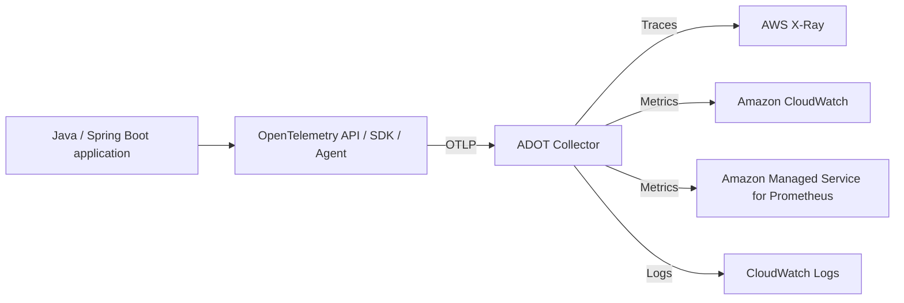
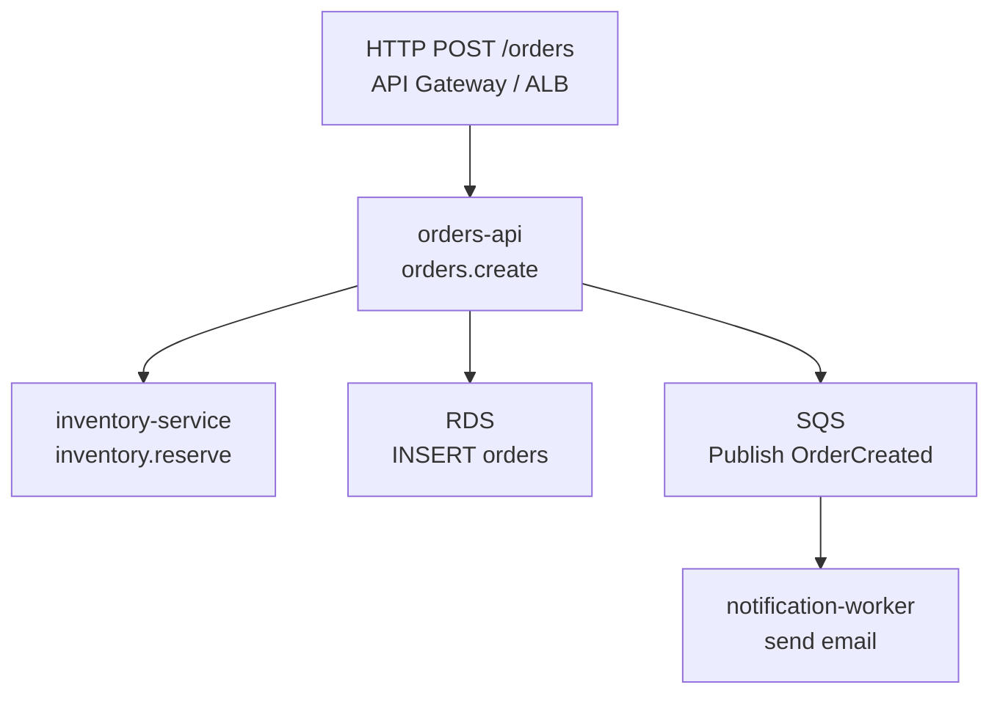
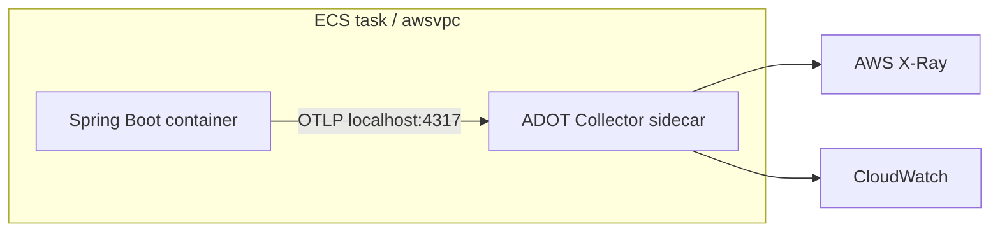
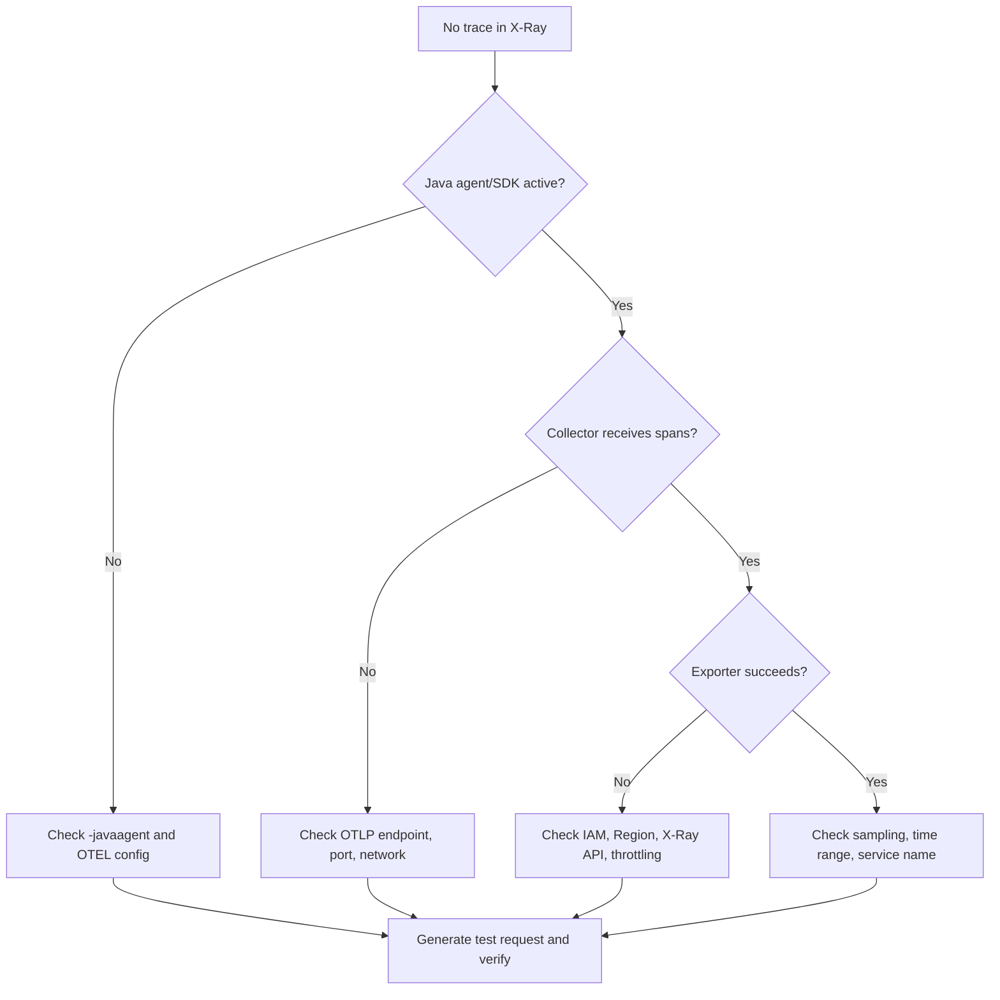

# OpenTelemetry and AWS Distro for OpenTelemetry

> **Chapter:** Observability with CloudWatch · **Module:** `CLOUD_PROVIDERS_AWS`

## 1. Why Do We Need OpenTelemetry?

A Java Spring Boot application running on ECS or EKS may call multiple services, query RDS, publish messages to SQS, read from a cache, and invoke external APIs. When a request is slow or fails, checking logs from a single container is rarely enough to see which components the request traversed, where time was spent, or which service caused the failure.

**Observability** lets you infer the internal state of a system from telemetry emitted by applications and infrastructure. Three common signals:

- **Metrics:** time-aggregated measurements such as request rate, error rate, latency, CPU, and memory.
- **Traces:** the end-to-end journey of a request across services; each trace consists of spans with parent-child relationships.
- **Logs:** timestamped events with detailed payloads that can be linked to traces/spans to investigate specific requests.

**OpenTelemetry (OTel)** is a vendor-neutral open-source standard and toolkit for instrumenting applications and collecting, processing, and exporting telemetry. It provides APIs, SDKs, instrumentation libraries, semantic conventions, and the Collector.

**AWS Distro for OpenTelemetry (ADOT)** is an AWS-supported distribution of OpenTelemetry packaging OTel components alongside AWS integrations. ADOT enables applications instrumented with OTel standards to send telemetry to AWS services such as AWS X-Ray, Amazon CloudWatch, and Amazon Managed Service for Prometheus (AMP).



OTel defines how telemetry is instrumented and transported; ADOT is the distribution supporting OTel deployment on AWS; CloudWatch, X-Ray, and AMP are backends for storing, querying, visualizing, and alerting. Do not confuse these three roles.

**Learning objectives for this lesson:**

1. Distinguish metrics, traces, and logs and the role of OpenTelemetry.
2. Understand API, SDK, auto-instrumentation agent, and Collector.
3. Explain the Collector's receivers–processors–exporters pipeline.
4. Configure ADOT Collector to send traces to X-Ray and metrics to CloudWatch/AMP.
5. Instrument Java/Spring Boot using the Java agent and API.
6. Deploy the Collector on ECS, EKS, EC2, and Lambda.
7. Apply context propagation, resource attributes, sampling, and batching.
8. Secure telemetry using IAM, TLS, redaction, and least privilege.
9. Monitor the Collector, handle export failures, and optimize cost.

## 2. Three Telemetry Signals and How They Complement Each Other

### 2.1. Metrics — Knowing What Is Happening

Metrics are measurements aggregated over time. Examples:

| Metric | Meaning | Used For |
| --- | --- | --- |
| `http.server.request.duration` | HTTP request processing time | Latency SLOs, p95/p99. |
| Request count (count of duration histogram) | Request volume | Traffic, throughput. |
| `http.server.active_requests` | In-flight requests | Saturation, concurrency. |
| `process.runtime.jvm.memory.used` | JVM memory in use | Memory pressure, leak investigation. |
| `process.runtime.jvm.cpu.utilization` | JVM CPU utilization | Capacity and saturation. |
| `db.client.operation.duration` | Database operation time | Database latency. |

Metrics surface trends and anomalies. A dashboard might show p99 jumping from 200 ms to 2 s; traces then pinpoint whether that time was spent in a service, database, or downstream dependency.

### 2.2. Traces — Where Did the Request Go?

A trace represents a single request flowing through the system. Each span records an operation with:

- Trace ID: identifies the entire journey.
- Span ID: identifies the current operation.
- Parent span ID: links the span to its caller operation.
- Start/end timestamps and duration.
- Attributes, events, status, and links.

Example order-creation request:



Spans sharing the same Trace ID give an end-to-end view of the request. Traces help answer "where was this specific request slow?".

### 2.3. Logs — Event Details

Logs capture messages and structured fields for an event. Example:

```json
{
  "timestamp": "2026-11-20T09:30:00Z",
  "severity": "ERROR",
  "service.name": "orders-api",
  "message": "Failed to reserve inventory",
  "trace_id": "4bf92f3577b34da6a3ce929d0e0e4736",
  "span_id": "00f067aa0ba902b7",
  "error.type": "TimeoutException"
}
```

Logs reveal specific exceptions, redacted inputs, and business codes. Traces supply timing relationships and call graphs; metrics reveal whether errors are climbing system-wide.

### 2.4. Correlation Across Metrics, Traces, and Logs

When an alarm reports elevated p99 latency:

1. Use metrics to identify the timeframe, service, and blast radius.
2. Open traces for the same service and time range to find slow spans.
3. Open logs matching the Trace ID/Span ID to inspect exceptions and context.
4. Cross-reference deployments/versions to see which release introduced the regression.

Not every backend automatically links all signals. You must instrument code, emit trace context in logs, and configure dashboards/log queries appropriately.

## 3. OpenTelemetry Architecture

### 3.1. API, SDK, and Instrumentation

OpenTelemetry separates the API from the SDK:

- **API:** interfaces called by applications/libraries to create spans, metrics, and logs.
- **SDK:** implementation handling sampling, aggregation, resource detection, processors, and exporters.
- **Instrumentation libraries:** automatically instrument frameworks/libraries such as HTTP servers/clients, JDBC, messaging, and runtimes.
- **Auto-instrumentation agent:** attaches to the JVM to instrument numerous libraries without modifying every call site.

Applications can call the OTel API directly for business operations while the agent instruments frameworks and database clients. Shared Trace Context stitches all spans into a single trace.

### 3.2. Collector

The OpenTelemetry Collector is a service that receives, processes, and exports telemetry to one or more backends. The Collector decouples applications from backends:

- Applications send OTLP to the Collector.
- The Collector batches, filters, enriches, samples, or transforms telemetry.
- The Collector exports to X-Ray, CloudWatch, AMP, or other OTLP endpoints.

The Collector can run as an agent close to workloads or as a centralized gateway. The Collector does not invent trace spans if an application is uninstrumented, nor does it turn arbitrary logs into fully contextualized traces.

### 3.3. OTLP — OpenTelemetry Protocol

**OTLP** is the standard protocol for transmitting telemetry between SDKs/agents and Collectors/backends:

| Transport | Common Default Port | Description |
| --- | ---: | --- |
| OTLP/gRPC | `4317` | gRPC transport, suited for SDKs/agents supporting gRPC. |
| OTLP/HTTP | `4318` | HTTP transport, commonly carrying protobuf payloads. |

Default ports can be overridden in the Collector config. Expose receivers only on network interfaces needed by workloads; avoid binding to public interfaces without TLS/authentication.

### 3.4. W3C Trace Context and Propagation

When service A calls service B, trace context must be propagated on the request so B continues the trace instead of starting a new one.

W3C Trace Context commonly uses HTTP headers:

- `traceparent`: version, trace ID, parent span ID, and trace flags.
- `tracestate`: vendor-specific trace state.
- `baggage`: key/value context propagated across service boundaries.

Example `traceparent`:

```text
00-4bf92f3577b34da6a3ce929d0e0e4736-00f067aa0ba902b7-01
```

Do not generate or overwrite trace IDs inside every service. Use OTel propagators to inject and extract context. Because baggage travels across services, never put PII, credentials, or sensitive data into baggage.

## 4. Resource Attributes and Semantic Conventions

### 4.1. Resources Describe the Telemetry Source

Resource attributes identify the entity producing telemetry, for example:

```text
service.name=orders-api
service.namespace=commerce
service.version=2.4.1
deployment.environment.name=production
cloud.provider=aws
cloud.region=ap-southeast-1
cloud.platform=aws_ecs
```

These attributes attach to all spans, metrics, and log records from that resource, enabling filtering by service, version, environment, Region, and platform.

### 4.2. Resource Attributes vs. Span Attributes

| Type | Scope | Examples |
| --- | --- | --- |
| Resource attributes | Process/service instance or telemetry-emitting entity | `service.name`, `service.version`, `cloud.region`. |
| Span attributes | Specific operation | `http.request.method`, `url.route`, `db.system.name`. |
| Span events | Events occurring during a span | Exceptions, retries, cache misses. |
| Metric attributes | Dimensions of a data point | `http.request.method`, `http.response.status_code`. |

Do not use `order.id`, `user.id`, request UUIDs, or session IDs as metric dimensions when they introduce high cardinality. Appropriate attributes may appear in controlled traces/logs, subject to privacy and retention policies.

### 4.3. Semantic Conventions

Semantic conventions standardize attribute names and meanings across HTTP, databases, messaging, RPC, cloud, and runtimes. Examples:

- `service.name`
- `http.request.method`
- `http.response.status_code`
- `server.address`
- `db.system.name`
- `messaging.system`
- `exception.type`

Semantic conventions evolve across versions. When upgrading OTel agents/SDKs, check schema/semantic convention versions and any dashboards/queries relying on attribute names.

### 4.4. Service Name and Environment Must Be Stable

`service.name` should be the logical service name, not a container ID, pod UID, or hostname. Values that change on every deployment fragment dashboards and service maps.

Use `service.version` for release/build versions, `deployment.environment.name` for environments, and platform attributes generated by appropriate resource detectors. Avoid inventing inconsistent spellings for the same key across services.

## 5. What Is ADOT and What Does It Include?

### 5.1. AWS Distro for OpenTelemetry

ADOT is an AWS-supported distribution of OpenTelemetry designed to help instrument, collect, and export telemetry from workloads running on AWS or elsewhere. ADOT builds on upstream OpenTelemetry while packaging AWS-focused components, exporters, receivers, and instrumentation.

ADOT is not a separate monitoring backend. It is the instrumentation/collection/transport layer. Backends can include:

- **AWS X-Ray:** distributed tracing and service maps.
- **Amazon CloudWatch:** metrics, logs, dashboards, alarms, and Application Signals.
- **Amazon Managed Service for Prometheus (AMP):** Prometheus-compatible metric storage and querying.
- Other OTLP-compatible backends depending on architecture.

### 5.2. Common ADOT Components

| Component | Role |
| --- | --- |
| ADOT Java auto-instrumentation agent | Automatically emits telemetry for supported Java frameworks/libraries. |
| OTel API/SDK | Manual instrumentation and in-application telemetry configuration. |
| ADOT Collector | Receives, processes, and exports telemetry. |
| EKS add-on | Deploys the Collector into Kubernetes clusters via supported add-on lifecycle. |
| Lambda layers/extensions | Supports instrumentation and telemetry collection for supported runtimes/deployment models. |

Component lists and support matrices depend on the ADOT release. Check release notes and official docs before selecting receivers, exporters, or runtime versions.

### 5.3. ADOT Collector vs. Upstream Collector

The Collector uses a component-based architecture. ADOT Collector is a curated build/distribution containing selected AWS-supported components. Do not assume every component in upstream `otelcol-contrib` exists in every ADOT image/version.

When writing configs:

1. Identify the exact ADOT Collector image/version you run.
2. Verify that each receiver, processor, exporter, and extension is included in that distribution.
3. Consult the schema/configuration reference for that exact version.
4. Validate configs when upgrading images; components can change or be deprecated.

### 5.4. Choosing a Backend by Signal

| Signal | Common AWS Destination | Use Case |
| --- | --- | --- |
| Traces | AWS X-Ray | Trace search, service map, latency/error analysis. |
| Metrics | CloudWatch EMF exporter | CloudWatch metrics, dashboards, and alarms. |
| Metrics | AMP Prometheus Remote Write | Prometheus metrics and PromQL. |
| Logs | CloudWatch Logs exporter or Fluent Bit/agent | Log search and retention. |

You can export the same signal to multiple backends if required, though it increases network/API costs and requires reconciling duplicate retention and query semantics.

## 6. Collector Pipeline: Receivers, Processors, and Exporters

### 6.1. Three Core Building Blocks

A Collector pipeline has three parts:

| Component | Function | Examples |
| --- | --- | --- |
| **Receiver** | Ingests telemetry from SDKs, agents, or other services. | `otlp`, `prometheus`, `jaeger`, `filelog` if included in distribution. |
| **Processor** | Processes data after ingestion and before export. | `memory_limiter`, `batch`, `resource`, `attributes`, `filter`, `tail_sampling`. |
| **Exporter** | Sends telemetry to a backend or downstream destination. | `awsxray`, `awsemf`, `prometheusremotewrite`, `otlp`. |

The Collector config declares components and then wires them into pipelines per signal (`traces`, `metrics`, `logs`).

### 6.2. Extensions

Extensions provide operational capabilities outside the telemetry data pipeline, such as:

- `health_check`: health endpoint for orchestrators to probe the Collector.
- `pprof`: Collector profiling when investigating CPU/memory.
- `zpages`: internal telemetry/state debugging inside protected environments.
- `sigv4auth`: AWS request signing for exporters supporting SigV4 authentication.

Extensions must be declared under `extensions` and enabled under `service.extensions`. Expose debug endpoints only on private management networks; never expose them publicly.

### 6.3. Pipelines per Signal

A Collector can run multiple pipelines:

```yaml
service:
  pipelines:
    traces:
      receivers: [otlp]
      processors: [memory_limiter, batch]
      exporters: [awsxray]
    metrics:
      receivers: [otlp]
      processors: [memory_limiter, batch]
      exporters: [awsemf]
```

Every pipeline must reference declared components. Receivers and exporters can participate in multiple pipelines, provided shared component configs fit each signal.

### 6.4. Ordered Processors

Processors run in the exact order listed in the pipeline. A common order:

1. `memory_limiter`: protects the Collector from exceeding memory limits.
2. `resource` or `attributes`: standardizes/enriches metadata.
3. `filter`: drops unwanted telemetry or disallowed data.
4. `batch`: groups telemetry into batches prior to export.

Exact ordering depends on the use case. Filter before batching; add resource attributes before exporting; ensure sampling runs before shipping to backends. Read processor behavior and check your exact config version.

### 6.5. Memory Limiter and Batching

`memory_limiter` caps Collector memory usage. If the Collector hits thresholds, the processor rejects incoming data to apply backpressure. Size memory limits below container limits to leave headroom for runtime overhead.

`batch` groups spans/metrics/log records to cut exporter API calls and raise throughput. Overly large batches increase memory usage and export latency; overly small batches increase API calls and overhead.

Example:

```yaml
processors:
  memory_limiter:
    check_interval: 1s
    limit_mib: 512
    spike_limit_mib: 128
  batch:
    timeout: 5s
    send_batch_size: 1024
```

These values are starting points for labs; tune them around memory limits, telemetry volume, exporter latency, and drop/retry metrics.

### 6.6. Filtering and Redaction

The Collector can strip unnecessary spans/attributes before export:

- High-frequency, low-value health-check requests.
- Query parameters that may contain tokens or PII.
- Headers such as `Authorization`, `Cookie`, and `Set-Cookie`.
- SQL statements containing literal values or user data.
- Excessively high-cardinality attributes.

Prefer not collecting sensitive data at instrumentation time. Collector filtering/redaction is defense-in-depth, not an excuse to emit secrets and scrub them later.

### 6.7. Export Retries and Backpressure

Exporters typically support sending queues and retries depending on the component. When a backend is unavailable:

- Queues absorb brief outages while consuming memory/disk.
- Retries handle transient errors without guaranteeing infinite retention.
- Full queues or Collector restarts can drop unflushed telemetry.
- Backpressure can slow down SDKs/agents or drop data once buffers fill.

Design the Collector around a failure budget: bound queues, enable persistent storage where supported and appropriate, monitor send failures/dropped items, and prevent telemetry from starving application resources.

## 7. ADOT Collector Sending Traces to X-Ray and Metrics to CloudWatch

### 7.1. Sample Config for ECS/EC2

The example below shows an OTLP receiver, memory limiter, batch processor, and two AWS exporters:

```yaml
receivers:
  otlp:
    protocols:
      grpc:
        endpoint: 0.0.0.0:4317
      http:
        endpoint: 0.0.0.0:4318

processors:
  memory_limiter:
    check_interval: 1s
    limit_mib: 512
    spike_limit_mib: 128
  batch:
    timeout: 5s
    send_batch_size: 1024

exporters:
  awsxray:
    region: ap-southeast-1
  awsemf:
    namespace: OrdersAPI
    log_group_name: /aws/otel/metrics
    dimension_rollup_option: NoDimensionRollup
    resource_to_telemetry_conversion:
      enabled: true

extensions:
  health_check:
    endpoint: 0.0.0.0:13133

service:
  extensions: [health_check]
  pipelines:
    traces:
      receivers: [otlp]
      processors: [memory_limiter, batch]
      exporters: [awsxray]
    metrics:
      receivers: [otlp]
      processors: [memory_limiter, batch]
      exporters: [awsemf]
```

This is an illustrative configuration; component availability and exporter options depend on the ADOT Collector image/version. Validate with the exact binary/image before deploying. `awsemf` uses CloudWatch Embedded Metric Format, shipping metric payloads via CloudWatch Logs; the log group must exist or the exporter must hold creation permissions per config. `awsxray` sends trace segments to X-Ray.

### 7.2. IAM Permissions for Exporters

The Collector's workload role needs permissions for each destination:

| Destination | Typical API Permissions Needed |
| --- | --- |
| X-Ray | `xray:PutTraceSegments`, `xray:PutTelemetryRecords` |
| CloudWatch EMF | CloudWatch Logs permissions such as `logs:CreateLogGroup`, `logs:CreateLogStream`, `logs:PutLogEvents` depending on log group lifecycle/config |
| AMP Remote Write | `aps:RemoteWrite` on the workspace ARN |

These are reference permissions per exporter. Pre-create log groups/streams with IaC to remove create permissions from the runtime role. Scope resource ARNs and KMS/log resource policies to the exact workload; never grant account-wide `logs:*`, `xray:*`, or `aps:*`.

### 7.3. Sending Metrics to AMP with Prometheus Remote Write

When PromQL/Grafana and the Prometheus data model are desired, ADOT Collector can export metrics to AMP via `prometheusremotewrite`. AMP requires AWS Signature Version 4, configured via the `sigv4auth` extension:

```yaml
extensions:
  sigv4auth:
    region: ap-southeast-1
    service: aps

exporters:
  prometheusremotewrite:
    endpoint: https://aps-workspaces.ap-southeast-1.amazonaws.com/workspaces/ws-EXAMPLE/api/v1/remote_write
    auth:
      authenticator: sigv4auth

service:
  extensions: [sigv4auth]
  pipelines:
    metrics:
      receivers: [otlp]
      processors: [memory_limiter, batch]
      exporters: [prometheusremotewrite]
```

The endpoint/workspace ID is a placeholder. Use the workload role's AWS credentials provider chain; never embed access keys or secret keys inside Collector configs. Match endpoint, Region, and SigV4 service name to your AMP workspace and ADOT version.

### 7.4. CloudWatch EMF vs. Prometheus

| Criterion | CloudWatch EMF | AMP |
| --- | --- | --- |
| Data model | CloudWatch metrics extracted from EMF log events | Prometheus time series |
| Query | CloudWatch Metrics/Metrics Insights | PromQL |
| Integration | CloudWatch dashboards, alarms, Application Signals | Prometheus ecosystem, Grafana |
| Cardinality/cost | Dimensions impact metric counts and cost | Label cardinality impacts ingestion/storage/queries |
| Best when | AWS-native operations and alarms | Prometheus-compatible monitoring/querying needed |

Do not export the same metric to both backends without a clear requirement; duplication raises costs and creates two datasets to reconcile.

### 7.5. Exporting Logs

Logs can flow through an OTel Logs pipeline if applications/agents emit OTel log records and your Collector distribution includes an appropriate exporter. On AWS, many architectures keep CloudWatch Agent or Fluent Bit for container stdout/stderr while ADOT handles traces and metrics.

You do not have to push all logs through ADOT just to get distributed tracing. You can keep a separate log shipper while maintaining trace context correlation (`trace_id`, `span_id`) and unified service/environment attributes.

## 8. Instrumenting Java and Spring Boot

### 8.1. Auto-Instrumentation with the Java Agent

The Java agent provides a fast path to tracing without modifying every controller, HTTP client, or JDBC call. The agent attaches to the JVM at startup, instruments supported libraries/frameworks, and exports telemetry over OTLP.

Startup example:

```bash
java \
  -javaagent:/opt/aws-opentelemetry-agent.jar \
  -Dotel.service.name=orders-api \
  -Dotel.resource.attributes=service.version=2.4.1,deployment.environment.name=staging \
  -Dotel.exporter.otlp.endpoint=http://adot-collector:4317 \
  -Dotel.exporter.otlp.protocol=grpc \
  -jar orders-api.jar
```

The agent JAR name/path depends on your chosen ADOT Java agent release and container packaging. In containers, bake the agent into the image during build or mount a verified artifact. Never download unpinned agent versions on every container boot.

### 8.2. Configuration via Environment Variables

The agent can be configured with environment variables:

```bash
OTEL_SERVICE_NAME=orders-api
OTEL_RESOURCE_ATTRIBUTES=service.version=2.4.1,deployment.environment.name=production,cloud.region=ap-southeast-1
OTEL_EXPORTER_OTLP_ENDPOINT=http://adot-collector:4317
OTEL_EXPORTER_OTLP_PROTOCOL=grpc
OTEL_TRACES_EXPORTER=otlp
OTEL_METRICS_EXPORTER=otlp
OTEL_LOGS_EXPORTER=otlp
JAVA_TOOL_OPTIONS=-javaagent:/opt/aws-opentelemetry-agent.jar
```

Supported exporters and signals depend on the agent distribution/version; not every Java agent release auto-instruments logs. For OTLP/HTTP protobuf, configure `http/protobuf` protocol and the HTTP receiver endpoint/port (typically `4318`). Avoid setting conflicting values in both system properties and environment variables.

### 8.3. What the Agent Can Instrument

Depending on agent release and libraries, auto-instrumentation emits spans for:

- Spring MVC/WebFlux server requests.
- HTTP clients such as Apache HttpClient, OkHttp, or Java HTTP client.
- JDBC/database clients.
- Messaging clients such as Kafka, JMS, and certain AWS SDK calls.
- Executor/thread context propagation.
- JVM/runtime metrics.

Check the agent compatibility matrix before relying on an integration. Brand-new framework releases, custom networking stacks, or unsupported libraries may not generate automatic spans.

### 8.4. Avoiding Duplicate Instrumentation

Never attach two OTel agents or combine an instrumentation agent with manual framework instrumentation of the same calls unintentionally. Duplicate spans clutter trace trees with repeated operations, increase ingestion costs, and distort latency readings.

When custom spans are needed, let auto-instrumentation cover frameworks and add spans only for business operations not captured by the agent. Specific auto-instrumentations can be disabled via agent configuration when replaced by another instrumentation.

### 8.5. Sampling and Resource Attributes for Java

Samplers can be configured via environment variables:

```bash
OTEL_TRACES_SAMPLER=parentbased_traceidratio
OTEL_TRACES_SAMPLER_ARG=0.10
```

This example samples roughly 10% of root traces by ratio; child spans follow the parent decision. Production sampling should reflect traffic volume, latency/error objectives, and backend capacity. To retain all errors or slow traces, evaluate tail sampling in the Collector rather than relying solely on head sampling in the SDK.

### 8.6. Spring Boot and Service Identity Configuration

`service.name` should stay identical across all replicas of a logical service. Supply `service.version` from build metadata and `deployment.environment.name` from deployment config. On ECS/EKS, add cluster, namespace, and task/pod attributes using appropriate resource detectors.

Never use container ID or pod name as `service.name`; those belong in detector-populated instance/container attributes.

## 9. Instrumenting Business Operations with the OTel API

### 9.1. When Is Manual Instrumentation Needed?

Auto-instrumentation understands HTTP, JDBC, and messaging operations, but does not understand business steps such as:

- Creating an order and applying discounts.
- Reserving inventory.
- Calculating shipping fees.
- Submitting an order to fulfillment.

Manual spans add business semantics so traces reveal where application logic consumes time or fails.

### 9.2. Adding a Span in Java

The following example uses the global OpenTelemetry instance initialized by the Java agent/SDK:

```java
import io.opentelemetry.api.GlobalOpenTelemetry;
import io.opentelemetry.api.trace.Span;
import io.opentelemetry.api.trace.SpanKind;
import io.opentelemetry.api.trace.StatusCode;
import io.opentelemetry.api.trace.Tracer;
import io.opentelemetry.context.Scope;

public class OrderService {
    private final Tracer tracer =
            GlobalOpenTelemetry.getTracer("com.example.orders");

    public void createOrder() {
        Span span = tracer.spanBuilder("orders.create")
                .setSpanKind(SpanKind.INTERNAL)
                .startSpan();

        try (Scope scope = span.makeCurrent()) {
            span.setAttribute("order.channel", "web");
            reserveInventory();
        } catch (RuntimeException exception) {
            span.recordException(exception);
            span.setStatus(StatusCode.ERROR);
            throw exception;
        } finally {
            span.end();
        }
    }

    private void reserveInventory() {
        // Business operation.
    }
}
```

Include the `io.opentelemetry.api.trace.Tracer` import for the `tracer` field. `makeCurrent()` activates the span in the current scope so downstream instrumentation creates child spans. Always close the scope and end the span; try-with-resources plus finally prevents context/span leaks on exceptions.

If no agent or SDK provider is configured, the global API returns a no-op implementation; code runs normally without exporting spans. When managing the SDK directly, initialize SDK/exporter/processor once at startup and shut down cleanly.

### 9.3. Attributes and Events

Attributes should describe operations with useful, controlled-cardinality values:

```java
span.setAttribute("order.channel", "mobile");
span.setAttribute("payment.provider", "example-pay");
span.addEvent("inventory.reservation.started");
```

Never attach passwords, bearer tokens, full card numbers, email addresses, physical addresses, or raw request bodies to spans. For business identifiers, assess privacy, retention, cardinality, and access controls before collecting them.

### 9.4. Recording Exceptions Properly

When an operation fails:

- Record the exception using `recordException`.
- Set span status to `ERROR` when the exception causes the operation to fail.
- Re-throw or handle the exception per business contract.
- Avoid writing full exception messages into spans/logs if messages could contain secrets or PII.

Do not mark every caught exception as a request failure if it represents a normal business branch, such as an expected not-found check.

### 9.5. Creating Metrics for Business Operations

Example using a counter and histogram:

```java
import io.opentelemetry.api.GlobalOpenTelemetry;
import io.opentelemetry.api.common.AttributeKey;
import io.opentelemetry.api.common.Attributes;
import io.opentelemetry.api.metrics.DoubleHistogram;
import io.opentelemetry.api.metrics.LongCounter;
import io.opentelemetry.api.metrics.Meter;

Meter meter = GlobalOpenTelemetry.getMeter("com.example.orders");

LongCounter ordersCreated = meter.counterBuilder("orders.created")
        .setDescription("Number of orders created")
        .build();

DoubleHistogram orderDuration = meter.histogramBuilder("orders.processing.duration")
        .setUnit("s")
        .setDescription("Time spent processing an order")
        .build();

Attributes dimensions = Attributes.of(
        AttributeKey.stringKey("order.channel"), "web");

ordersCreated.add(1, dimensions);
orderDuration.record(0.245, dimensions);
```

Create instruments once and reuse them rather than allocating a new counter per request. Use bounded dimensions such as channel/provider/status; never use order ID, user ID, or request ID as metric attributes.

### 9.6. Linking Logs with Trace Context

When logging inside an active span, logging integrations can inject trace ID/span ID into log records. You can also read the current context explicitly when needed:

```java
import io.opentelemetry.api.trace.Span;
import io.opentelemetry.api.trace.SpanContext;

SpanContext context = Span.current().getSpanContext();
if (context.isValid()) {
    String traceId = context.getTraceId();
    String spanId = context.getSpanId();
    // Put IDs into structured log fields; do not log secrets.
}
```

Prefer supported OTel logging appenders/bridges or integrations so correlation is injected consistently. Never invent new trace IDs for individual log events.

## 10. Deploying ADOT by Compute Platform

### 10.1. Amazon ECS

On ECS, a common pattern runs ADOT Collector as a sidecar inside the same task as the application:



Containers in the same ECS task share a network namespace under the appropriate task network mode, allowing the sidecar to receive OTLP on localhost. Verify network mode, port mappings, and health checks during configuration.

**Pros:** telemetry stays local to the application, collector lifecycle scales per task, and task/resource metadata is easy to attach. **Trade-off:** every task consumes extra CPU/memory; scaling a service from 5 to 100 tasks scales Collector count too.

A separate gateway Collector service reduces exporter connections and centralizes processing, but requires service discovery, network permissions, TLS/auth, and HA/scaling management.

IAM note: an ECS task has one task-level task role shared by all containers in that task. The task execution role lets the ECS agent pull images and write logs per config. If the Collector needs AWS permissions distinct from the application container, separate the Collector into its own task/service rather than assuming a sidecar holds an independent role.

### 10.2. Amazon EKS

Common deployment patterns:

| Pattern | Purpose |
| --- | --- |
| DaemonSet | One Collector agent per node receiving telemetry from workloads/node on that host. |
| Deployment gateway | A pool of Collector replicas receiving telemetry centrally across workloads. |
| Sidecar | Dedicated Collector per workload/pod needing isolation or custom processing. |
| EKS add-on | Managing ADOT Collector via EKS add-on lifecycle. |

Workloads export OTLP to a cluster Collector service or local endpoint depending on the pattern. Use Kubernetes service discovery, NetworkPolicy, and security groups for pods to restrict network paths.

For the Collector to call AWS APIs, bind IAM permissions to its Kubernetes service account using **EKS Pod Identity** or **IRSA** per organizational standards. Avoid granting broad permissions to node instance roles when only the Collector needs export access.

### 10.3. Amazon EC2

On EC2, run the Collector as a system service or container. The instance profile supplies IAM role credentials:

- Install and pin the ADOT Collector version.
- Store configs in a permission-protected directory.
- Run under a dedicated unprivileged user with tight filesystem permissions.
- Configure systemd/container health checks and restart policies.
- Export telemetry over controlled VPC/network paths.

Do not run the Collector as root unnecessarily. Never expose OTLP ports or debug endpoints to the public Internet.

### 10.4. AWS Lambda

For Lambda, ADOT provides Lambda layers/extensions and instrumentation options for supported runtimes. The layer/extension collects telemetry inside the execution environment and ships it to configured destinations.

Before deploying:

- Check supported runtimes, architectures, Regions, and layer versions.
- Choose the exact layer matching Java/your runtime and the collector extension model.
- Grant IAM permissions to the Lambda execution role.
- Measure timeout/memory overhead and cold-start impact.
- Test telemetry across cold starts, warm invocations, and timeout errors.

Lambda has a distinct execution environment lifecycle; do not assume a Collector process stays alive like a daemon on ECS/EC2. Follow ADOT Lambda integration docs for your exact runtime/version.

### 10.5. Choosing Sidecar vs. Gateway?

| Criterion | Sidecar/Agent Near Workload | Centralized Gateway |
| --- | --- | --- |
| Network | Local/cluster-local | Workloads call gateway endpoint |
| Resource overhead | Scales with tasks/pods/nodes | Centralized, easier to share |
| Isolation | Stronger per-workload isolation | Requires tenant/resource isolation inside gateway |
| Scaling | Scales with workload replicas | Scales independently by telemetry throughput |
| Failure domain | Collector failure affects local workload | Gateway failure can affect many services |
| Use case | Fewer workloads, isolation needs, low latency | Many services, central processing/tail sampling |

You can combine node/task agents with a gateway tier for centralized processing. Design carefully for networking, queuing, retries, and trace affinity.

## 11. Sampling, Cardinality, and Telemetry Cost

### 11.1. Head Sampling

Head sampling decides whether to record a trace when the root span begins, typically inside the SDK/agent. Its advantage is dropping data at the source, saving bandwidth, Collector capacity, and backend storage. Its drawback is deciding before knowing whether the trace will fail or run slowly.

Example 10% parent-based ratio sampler:

```bash
OTEL_TRACES_SAMPLER=parentbased_traceidratio
OTEL_TRACES_SAMPLER_ARG=0.10
```

Parent-based sampling propagates the parent's sampling decision to child spans so traces do not lose random spans across services.

### 11.2. Tail Sampling

Tail sampling decides after the Collector receives a trace's spans, keeping traces based on latency, status, or attributes. For example, retain 100% of error traces and 5% of successful traces:

```yaml
processors:
  tail_sampling:
    decision_wait: 10s
    num_traces: 50000
    expected_new_traces_per_sec: 1000
    policies:
      - name: keep-errors
        type: status_code
        status_code:
          status_codes: [ERROR]
      - name: sample-success
        type: probabilistic
        probabilistic:
          sampling_percentage: 5
```

This is a conceptual config; check policy syntax and component availability in your ADOT Collector version. Tail sampling holds state during decision wait, consumes significant memory, and requires routing all spans of a trace to the same tail-sampling Collector replica. If spans scatter across replicas, decisions become incomplete.

### 11.3. Never Sample Traces Independently in Each Service

If service A independently samples 10% and service B independently samples 10%, traces break mid-path. Use parent-based samplers and propagate trace flags; when tail sampling at a gateway, enforce trace affinity or trace-ID-based routing.

### 11.4. Metric Cardinality

Cardinality explodes when a metric carries many combinations of attribute values. For example, `http.server.request.count` with method (5 values), status code (10 values), and route (20 values) generates many series; adding user ID with millions of values causes series count to skyrocket.

Rules:

- Use route templates (`/orders/{id}`) rather than raw URL paths with IDs.
- Never put user/order/session/request IDs into metric labels.
- Keep dimensions to small, bounded value sets.
- Monitor active time series and ingestion volume.
- Keep high-cardinality diagnostics in controlled traces/logs.

### 11.5. Cost and Retention

Costs depend on backend, volume, retention, queries, and dimensions. In CloudWatch, EMF log ingestion and custom metric dimensions affect costs. In X-Ray, traces recorded and scanned drive costs. In AMP, samples, active time series, and retention drive costs.

To control spend:

1. Tune sampling rates to SLOs and incident use cases.
2. Filter health checks and low-value noisy spans.
3. Bound metric dimensions.
4. Batch exports and eliminate duplicate telemetry.
5. Configure appropriate retention per signal.
6. Monitor ingestion volume and cost allocation by service/environment.

Do not cut sampling so low that rare errors or tail latency become impossible to investigate. Evaluate sampling against real incident scenarios, not just traffic percentages.

## 12. Security and Access Control

### 12.1. IAM Role for the Collector

The Collector needs permissions for its target backends. Choose identity by compute platform:

| Compute | Typical Identity |
| --- | --- |
| ECS | ECS task role |
| EKS | EKS Pod Identity or IRSA for service account |
| EC2 | Instance profile role |
| Lambda | Lambda execution role |

AWS exporters typically use the AWS SDK credential provider chain. Use short-lived role credentials; never hardcode access keys or secret keys in Collector YAML, Docker images, or environment variables.

### 12.2. Reference Permissions

| Export Destination | Reference Permissions |
| --- | --- |
| X-Ray | `xray:PutTraceSegments`, `xray:PutTelemetryRecords` |
| CloudWatch EMF | CloudWatch Logs permissions such as `logs:PutLogEvents`, `logs:CreateLogStream`; `logs:CreateLogGroup` if runtime may create groups |
| AMP | `aps:RemoteWrite` on the workspace ARN |

Specific exporters/versions may call additional APIs. Rely on official documentation, CloudTrail, and error responses to refine policies. Never grant account-wide wildcard actions or resources.

### 12.3. Networking and TLS

When the application and Collector share a host/task/pod, loopback or private networking suffices. When a Collector gateway accepts OTLP across workloads:

- Expose listeners only on private networks.
- Enable TLS/mTLS when traffic crosses untrusted network boundaries.
- Enforce authentication appropriate for the gateway and tenants.
- Restrict source security groups and NetworkPolicies.
- Never expose pprof/zpages/health endpoints publicly.

For AWS endpoints, ensure proper routing, DNS, NAT, or VPC endpoints. Verify PrivateLink support for each telemetry destination in your Region/use case; never assume every telemetry destination has a VPC endpoint.

### 12.4. Privacy and Data Minimization

Telemetry can capture sensitive data through span attributes, exception messages, baggage, SQL statements, or logs. Before production:

1. Define what data is permitted for collection.
2. Never capture authorization/cookie headers or request bodies by default.
3. Redact PII, payment data, and secrets at the instrumentation layer.
4. Use Collector filters as defense-in-depth.
5. Restrict access to traces/logs and enforce retention.
6. Verify data residency and cross-Region export rules.

Telemetry is often accessed by many operational teams; apply least privilege just as strictly as production data.

### 12.5. Protecting Collector Configuration

Collector configs control where telemetry goes and what gets kept. Protect configs:

- Store in version control and review like application code.
- Never embed credentials in YAML.
- Pin image versions/digests and scan container images.
- Restrict who can edit task definitions, Helm releases, or ConfigMaps.
- Enable audit trails for deployment/config changes.
- Roll out config changes via canary when affecting multiple workloads.

## 13. Monitoring the Collector and Production Operations

### 13.1. Observing the Collector Itself

The Collector is itself a production service. Monitor:

- CPU, memory, restarts, and health status.
- Telemetry accepted vs. refused by receivers.
- Spans/metrics/logs sent vs. failed by exporters.
- Queue size/capacity and retry counts if queuing is enabled.
- Items dropped or refused by processors.
- Export latency and backend throttling.
- Connections/requests hitting the Collector.

The Collector emits internal metrics; exact metric names vary by version and distribution. Common names in upstream Collector include `otelcol_receiver_accepted_spans`, `otelcol_receiver_refused_spans`, `otelcol_exporter_sent_spans`, and `otelcol_exporter_send_failed_spans`. Verify actual metrics exposed by your ADOT image before building dashboards or alarms.

### 13.2. Health Checks

The `health_check` extension exposes an endpoint for ECS/EKS/orchestrators to probe the process:

```yaml
extensions:
  health_check:
    endpoint: 0.0.0.0:13133

service:
  extensions: [health_check]
```

The health endpoint only reports Collector health according to the extension. A healthy Collector process can still fail to export telemetry due to IAM, KMS, network, or backend errors. Add alarms on exporter failures and receiver/exporter counters.

### 13.3. Alerting for the Telemetry Pipeline

Recommended alerts:

| Condition | Meaning |
| --- | --- |
| Rising exporter send failures | Backend unavailable, IAM denied, throttling, or misconfiguration. |
| Rising receiver refused/dropped | Collector overloaded or memory limiter triggered. |
| Queue utilization near 100% | Exporter cannot keep up with ingestion. |
| Rising Collector restarts/OOM | Memory limit too low or batch/queue too large. |
| Missing telemetry from a service | App agent/SDK broken, wrong endpoint, or service stopped emitting. |
| Unusual drop in trace volume | Sampling/filter/propagation issue or source workload issue. |

Collector failure alerts must be independent of application failure alerts. If the monitoring pipeline breaks, detect it via container logs, CloudWatch metrics, or platform health signals.

### 13.4. Config Versioning and Rollout

Collector configuration is operational code:

1. Pin the ADOT image tag/digest.
2. Store configs in Git.
3. Validate configs against the exact binary/image version.
4. Test on a canary Collector or small workload first.
5. Watch drop/failure/latency metrics before broad rollout.
6. Keep previous config/image versions ready for rollback.

Never pull `latest` automatically in production. ADOT upgrades can alter component versions, defaults, semantic conventions, or exporter behavior.

### 13.5. Capacity Planning

Estimate Collector capacity from:

- Spans, metrics, and log records per second.
- Attribute and event payload sizes.
- Sampling rates and active signals.
- Batch size and timeout.
- Exporter latency and retries.
- Tail sampling state and decision wait.
- CPU/memory limits and network throughput.

Load test with production-like traffic including bursts and backend throttling. Tail sampling and large batches can spike memory rapidly; never size purely by average CPU.

## 14. Troubleshooting by Symptom

| Symptom | Causes to Check | Resolution |
| --- | --- | --- |
| No spans visible in X-Ray. | Java agent not attached, wrong exporter endpoint, Collector not receiving OTLP, or missing IAM. | Check JVM startup options, Collector receiver logs, `xray:PutTraceSegments`, and Region. |
| Trace split into multiple trace IDs. | Context propagation not injected/extracted or proxy strips headers. | Check `traceparent`, propagators, and HTTP/messaging instrumentation. |
| Trace missing downstream spans. | Independent sampling, SDK not propagating parent decision, or distributed tail sampling. | Use parent-based sampling and route same trace to one tail sampler. |
| Collector reports connection refused. | Wrong endpoint/port, receiver bound to wrong interface, or network policy/SG blocks traffic. | Check OTLP gRPC 4317/HTTP 4318, DNS, and connectivity. |
| Collector healthy yet exporter fails. | IAM/KMS, endpoint, Region, throttling, or backend outage. | Inspect exporter logs/metrics and CloudTrail; verify roles/policies. |
| CloudWatch missing custom metrics. | Wrong EMF log group/permissions or unexpected dimensions/namespace. | Check log group, `logs:PutLogEvents`, EMF format, and namespace. |
| AMP returns 403/AccessDenied. | Missing `aps:RemoteWrite`, wrong SigV4 region/service, or wrong workspace ARN. | Check `sigv4auth`, Region, endpoint, and workload role. |
| `otelcol_exporter_send_failed_*` rising. | Backend errors, full queue, or network latency. | Check backend/API quotas, queues, retries, and export latency. |
| `receiver_refused` or dropped items rising. | Memory limiter triggered, Collector overloaded, or downstream backpressure. | Scale capacity, trim telemetry, tune batch/queue and sampling. |
| Collector OOM/restarts continuously. | Memory limit too low, large tail-sampling state, or oversized batches/queues. | Shrink state/queues, scale Collector, increase memory carefully. |
| Duplicate spans. | Duplicate agents or manual instrumentation overlapping auto-instrumentation. | Enable only one integration per operation and check agent config. |
| Service map shows many service names. | `service.name` derived from pod/container ID or inconsistent naming. | Use stable logical service names; keep version/env in separate attributes. |
| Metric series surging unexpectedly. | High-cardinality labels like user/order/request ID or raw URL paths. | Drop unbounded dimensions, use route templates, trim attributes. |
| Logs missing trace IDs. | Logging bridge/appender not integrated or logs emitted outside active spans. | Enable trace-context correlation and verify context propagation. |
| Lambda emits telemetry only on cold starts. | Misconfigured extension/layer/runtime or incomplete flush. | Check ADOT Lambda layer/extension version, timeout, and execution role. |
| EKS Collector cannot export AWS data. | Misconfigured Pod Identity/IRSA trust or service account annotation. | Verify service account, role trust, token audience, and permissions. |

### 14.1. Runbook When Traces Are Missing



1. Send a test request carrying a known correlation ID.
2. Check JVM startup logs to confirm the agent attached.
3. Check OTLP receiver accepted spans and Collector logs.
4. Check exporter send failures, Region, and IAM role.
5. Confirm sampling decisions and time range in X-Ray.
6. Open the trace and verify `service.name`, `service.version`, and Trace ID.

### 14.2. Runbook When Telemetry Pipeline Is Overloaded

1. Identify which signal dominates volume: traces, metrics, or logs.
2. Check receiver accepted/refused and exporter sent/failed counters.
3. Inspect CPU/memory, queue utilization, and backend throttling.
4. Drop health-check/noisy spans or unnecessary attributes.
5. Trim high-cardinality metrics and adjust sampling in a controlled manner.
6. Scale the Collector or split pipelines by signal/tenant if needed.
7. Monitor drop rates and service impact after changes.

## 15. Practice Exercises and Evaluation Scenarios

> **Lab rule:** Deploy Collectors, Lambda layers, EKS add-ons, and IAM roles only in authorized AWS accounts/Regions. Telemetry export can incur charges. Without a lab environment, design the configs/policies and explain expected behavior.

### Exercise 1 — Distinguishing Three Signals

An API shows rising p99, 5% HTTP 500s, and several logs containing `TimeoutException`.

- Choose metrics to detect latency and error rate.
- Describe the trace needed to isolate the slow downstream dependency.
- Design log fields to correlate via Trace ID/Span ID.
- Explain why logs alone are insufficient to compute system-wide p99.

### Exercise 2 — Trace Propagation Across Microservices

`orders-api` calls `inventory-service`, writes to RDS, and publishes an SQS event:

1. Sketch the trace with parent/child spans.
2. Point out where HTTP `traceparent` is injected/extracted.
3. Explain propagation across asynchronous messaging.
4. State what happens if the consumer fails to extract context.
5. Design log correlation for both producer and consumer.

### Exercise 3 — Configuring ADOT Collector

Create a config receiving OTLP gRPC/HTTP, adding memory limiter and batch, exporting traces to X-Ray and metrics to CloudWatch EMF:

- Write receivers/processors/exporters.
- Enable the health check extension.
- Choose namespace and log group.
- List required IAM permissions.
- Validate the config against the exact ADOT image version.

### Exercise 4 — Java Auto-Instrumentation

A Spring Boot service runs on ECS:

1. Package the ADOT Java agent into the container image.
2. Configure `JAVA_TOOL_OPTIONS`.
3. Set `OTEL_SERVICE_NAME`, resource attributes, and OTLP endpoint.
4. Verify HTTP/JDBC spans.
5. Add a custom business span.
6. Check for duplicate instrumentation.

### Exercise 5 — Manual Spans and Business Metrics

Inside `OrderService.createOrder()`:

- Create span `orders.create`.
- Set attribute `order.channel`.
- Record exceptions and status `ERROR`.
- Create counter `orders.created`.
- Create histogram `orders.processing.duration`.
- Explain why `order.id` must not be a metric dimension.

### Exercise 6 — Choosing a Deployment Pattern

An ECS cluster runs 80 tasks; an EKS cluster runs 40 nodes and 300 pods:

1. Compare sidecar, DaemonSet, and gateway Collector patterns.
2. Estimate resource overhead.
3. Select the IAM identity for ECS and EKS Collectors.
4. Design network paths and TLS.
5. Describe failure domains and scaling/HA strategies.

### Exercise 7 — Head Sampling vs. Tail Sampling

Traffic is 10,000 requests/second; the team wants to keep all error traces and 5% of successful traces:

- Compare head and tail sampling.
- Write a conceptual tail sampling policy.
- Explain memory and decision wait trade-offs.
- Design trace affinity across Collector replicas.
- Describe the impact if one trace splits across two collectors.

### Exercise 8 — Exporting Metrics to AMP

A team needs PromQL and Grafana:

1. Configure `prometheusremotewrite`.
2. Configure `sigv4auth` with Region/workspace endpoint.
3. Grant `aps:RemoteWrite` scoped to the exact workspace.
4. Verify DNS/networking to AMP.
5. Confirm samples arrive and are queryable.

### Exercise 9 — Incident: Collector Not Exporting

CloudWatch dashboards show no new metrics, yet the Collector health check stays healthy:

- Inspect exporter errors and internal metrics.
- Check log group, IAM permissions, and KMS if applicable.
- Check batching/queues and CloudWatch throttling.
- Determine whether telemetry is being dropped or refused.
- Write a recovery runbook and preventive alarms.

### Exercise 10 — Privacy and Cardinality Review

Trace attributes currently include `user.email`, `authorization`, raw URLs, and `order.id`; a metric has label `customer_id`:

- Classify sensitive and high-cardinality data.
- Design redaction at instrumentation time.
- Write a Collector filter as defense-in-depth.
- Choose bounded replacement dimensions.
- Propose retention and access policies for traces and logs.

### Self-Check Questions

1. What components does OpenTelemetry provide?
2. How does ADOT differ from CloudWatch/X-Ray?
3. What questions do metrics, traces, and logs each answer?
4. What relationships link spans inside a trace?
5. How does the API differ from the SDK?
6. What are the three main Collector pipeline components?
7. Which ports do OTLP/gRPC and OTLP/HTTP typically use?
8. What role does `traceparent` play?
9. How do resource attributes differ from span attributes?
10. Why must `service.name` remain stable?
11. Is ADOT Collector guaranteed to include every upstream component?
12. Which signal does the `awsxray` exporter send?
13. Through what mechanism does `awsemf` send metrics to CloudWatch?
14. Which authentication method does AMP Remote Write require?
15. How does an ECS task role differ from a task execution role?
16. What ways exist on EKS to grant an IAM identity to the Collector?
17. How do head sampling and tail sampling differ in decision timing?
18. Why does tail sampling require trace affinity?
19. What problems do `memory_limiter` and `batch` solve?
20. When does metric cardinality grow?
21. Why shouldn't user ID be a metric label?
22. When should you use a sidecar vs. a gateway?
23. Why doesn't a healthy Collector guarantee exporter success?
24. Which IAM permissions are typically required to send spans to X-Ray?
25. How do you correlate logs with trace context?
26. Why shouldn't secrets be placed in baggage or span attributes?
27. When are VPC endpoints or NAT needed for telemetry export?
28. How do you detect dropped telemetry?
29. Why should you pin the ADOT Collector image version?
30. When should you use CloudWatch EMF instead of AMP?

## 16. Official AWS/OpenTelemetry Documentation and Production Checklist

### 16.1. OpenTelemetry

- [OpenTelemetry documentation](https://opentelemetry.io/docs/)
- [OpenTelemetry signals](https://opentelemetry.io/docs/concepts/signals/)
- [Distributed tracing concepts](https://opentelemetry.io/docs/concepts/signals/traces/)
- [OpenTelemetry Collector](https://opentelemetry.io/docs/collector/)
- [OpenTelemetry Java](https://opentelemetry.io/docs/languages/java/)
- [Java zero-code instrumentation](https://opentelemetry.io/docs/zero-code/java/agent/)
- [Semantic conventions](https://opentelemetry.io/docs/specs/semconv/)
- [OTLP specification](https://opentelemetry.io/docs/specs/otlp/)

### 16.2. AWS Distro for OpenTelemetry

- [AWS Distro for OpenTelemetry documentation](https://aws-otel.github.io/docs/)
- [ADOT Collector getting started](https://aws-otel.github.io/docs/getting-started/collector)
- [ADOT Java auto-instrumentation](https://aws-otel.github.io/docs/getting-started/java-sdk/auto-instr)
- [ADOT on Amazon EKS](https://aws-otel.github.io/docs/getting-started/collector/eks)
- [ADOT on Amazon ECS](https://aws-otel.github.io/docs/getting-started/collector/ecs)
- [ADOT Lambda integration](https://aws-otel.github.io/docs/getting-started/lambda)
- [ADOT Collector components and configuration](https://aws-otel.github.io/docs/components)

### 16.3. AWS Telemetry Backends

- [AWS X-Ray and OpenTelemetry](https://docs.aws.amazon.com/xray/latest/devguide/xray-services-adot.html)
- [Amazon CloudWatch and OpenTelemetry](https://docs.aws.amazon.com/AmazonCloudWatch/latest/monitoring/CloudWatch-OTel-ADOT.html)
- [Amazon Managed Service for Prometheus with ADOT](https://docs.aws.amazon.com/prometheus/latest/userguide/AMP-collector.html)
- [CloudWatch Embedded Metric Format](https://docs.aws.amazon.com/AmazonCloudWatch/latest/monitoring/CloudWatch_Embedded_Metric_Format.html)
- [AWS X-Ray IAM permissions](https://docs.aws.amazon.com/xray/latest/devguide/security_iam_service-with-iam.html)
- [EKS Pod Identity](https://docs.aws.amazon.com/eks/latest/userguide/pod-identities.html)
- [IAM roles for service accounts (IRSA)](https://docs.aws.amazon.com/eks/latest/userguide/iam-roles-for-service-accounts.html)

### 16.4. Pre-Production Checklist

| Item | Required Evidence |
| --- | --- |
| **Instrumentation** | Agent/SDK versions pinned; framework integrations supported and tested. |
| **Service identity** | `service.name`, version, environment, and cloud resource attributes are stable. |
| **Propagation** | Trace context crosses HTTP/messaging boundaries; downstream spans join the same trace. |
| **Collector** | ADOT image/version pinned; receivers/processors/exporters validated. |
| **Deployment** | Appropriate ECS/EKS/EC2/Lambda pattern; resource limits and health checks configured. |
| **Export destinations** | X-Ray/CloudWatch/AMP endpoints, Regions, and signal mappings clearly defined. |
| **IAM** | Least-privilege task role/Pod Identity/IRSA/instance profile/Lambda role. |
| **Network** | OTLP exposed only in private networks; appropriate TLS/mTLS and SG/NetworkPolicy. |
| **Sampling** | Head/tail policy aligned with SLOs; trace affinity ensured if using tail sampling. |
| **Cardinality** | No unbounded metric dimensions; route templates and attributes reviewed. |
| **Privacy** | PII, secrets, and authorization headers absent from telemetry. |
| **Reliability** | Batching, memory limiter, queuing/retries, and overload behavior tested. |
| **Observability of Collector** | Alarms cover health, receiver/exporter counters, queues, memory, and send failures. |
| **Cost/retention** | Sampling, volume, dimensions, retention, and multi-backend duplication estimated. |
| **Operations** | Troubleshooting, config/image rollback, and incident runbooks rehearsed. |

**Key takeaway:** OpenTelemetry standardizes how telemetry is created and transported; ADOT provides an AWS-integrated distribution and Collector. The Java agent instruments frameworks rapidly, the OTel API adds business spans/metrics, and the Collector processes and exports signals to X-Ray, CloudWatch, or AMP. Production readiness requires governing context propagation, sampling, cardinality, IAM, networking, privacy, and the health of the Collector itself.
