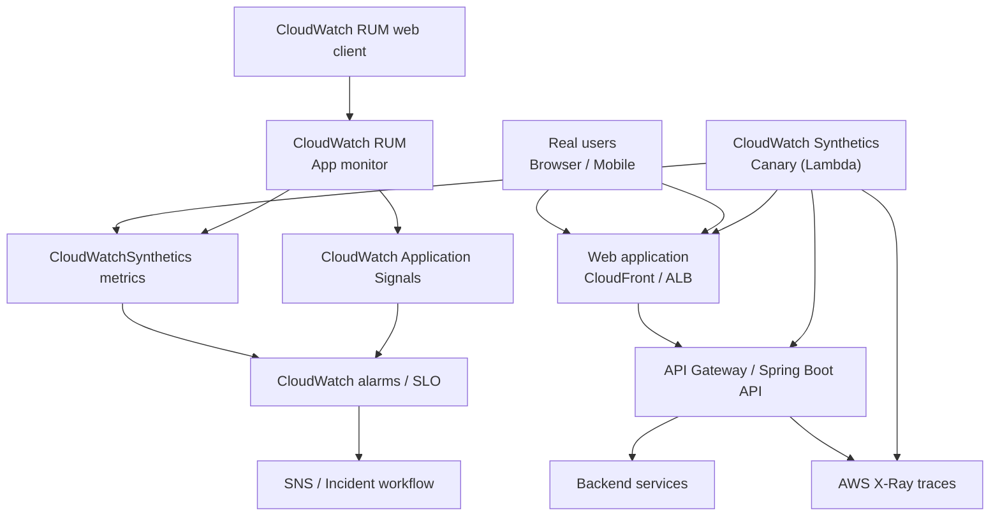

# CloudWatch Synthetics and User Experience Monitoring

**CloudWatch Synthetics** and **CloudWatch Real User Monitoring (RUM)** observe applications from two complementary perspectives. Synthetics runs scheduled test scripts authored by the engineering team to verify that websites, APIs, and business journeys keep working. RUM collects telemetry from real user sessions to show which browsers and devices are experiencing latency, JavaScript errors, HTTP failures, or performance issues.

Synthetics answers: *If a customer opens the site and performs a critical action right now, does the system work?* RUM answers: *What are real customers actually experiencing?* Combining both data sources detects outages before users are affected while measuring real-world blast radius when incidents occur.

This lesson belongs to the **Observability with CloudWatch** chapter of the **CLOUD_PROVIDERS_AWS** module. Content connects CloudWatch Synthetics, CloudWatch RUM, Lambda, CloudWatch Logs/Metrics/Alarms, Application Signals, AWS X-Ray, Cognito, IAM, S3, VPC, and Java/Spring Boot web applications.

> **Design principle:** Canaries must test critical journeys using dedicated identities and scoped test data. RUM must collect only needed telemetry with sampling and privacy controls. Every alert should tie to an actionable response.

## 1. Learning Objectives

After this lesson, you will be able to:

1. Distinguish synthetic monitoring from real user monitoring and explain each role.
2. Explain how a CloudWatch Synthetics canary executes using Lambda.
3. Choose the right blueprint, runtime, and browser framework for a canary.
4. Write a Node.js Playwright canary testing a meaningful web journey.
5. Verify APIs, endpoints, page content, navigation, and response times.
6. Schedule canaries using rate/cron expressions across multiple AWS Regions.
7. Interpret screenshots, HAR files, logs, reports, and canary run artifacts.
8. Use SuccessPercent, Duration, Failed, 4xx, and 5xx metrics.
9. Create CloudWatch alarms and SLOs from synthetic monitoring results.
10. Run canaries inside a VPC to probe private endpoints.
11. Grant IAM permissions and protect canary artifacts and source code.
12. Integrate CloudWatch RUM into web applications using JavaScript/TypeScript.
13. Configure app monitors, telemetry, session sampling, and authorization.
14. Understand experience metrics such as page load, Web Vitals, JavaScript errors, and HTTP failures.
15. Combine RUM with X-Ray and Application Signals to trace requests.
16. Design session replay, redaction, and data retention responsibly.
17. Analyze costs, troubleshoot issues, and build continuous monitoring workflows.

## 2. Synthetic Monitoring vs. Real User Monitoring

### 2.1. Synthetic Monitoring

Synthetic monitoring uses scripts simulating user actions. Scripts run from one or more locations on a schedule and verify expected outcomes.

Examples:

- Open the sign-in page.
- Enter credentials for a synthetic test account.
- Sign in successfully.
- Open the orders list page.
- Verify an API returns data matching its schema.
- Add an item to the cart in a test environment.
- Verify the sandbox checkout page renders properly.

A canary runs even when the application has zero traffic. Thus, it catches issues before customers arrive.

### 2.2. Real User Monitoring (RUM)

RUM collects telemetry from real browsers or devices during actual user sessions. For web applications, CloudWatch RUM can observe:

- Page load and resource load timings.
- Core Web Vitals and browser performance metrics.
- JavaScript errors.
- HTTP request failures.
- Page views, sessions, and multi-page user journeys when corresponding features are enabled.
- Browser, browser version, operating system, device, and certain location metadata.
- Session replay when the plugin and configuration are enabled.

RUM reflects true diversity in networks, devices, browser extensions, geographies, and user data.

### 2.3. Comparing Both Approaches

| Criterion | CloudWatch Synthetics | CloudWatch RUM |
| --- | --- | --- |
| Data source | Test scripts controlled by the engineering team | Sampled real user sessions |
| Timing | Scheduled; runs even with zero traffic | When real users actively use the app |
| Perspective | Outside-in: probes from endpoint/browser to app | Client-side: observes experience on user devices |
| Detects | Availability, latency, broken business journeys | Frontend bugs, slow page loads, HTTP errors, user impact |
| Repeatability | High when scripts and test data are stable | Depends on real environments and user behavior |
| Locations | One or more selected AWS Regions | User session locations/devices per collected data |
| When traffic is zero | Still detects failures | No new sessions to collect |
| Outputs | Canary metrics, logs, screenshots, HAR, and reports | RUM dashboards, events, Web Vitals, session data, and replay |

Do not replace RUM with Synthetics or vice versa. A canary signing in from one AWS Region does not prove all customers across every country, browser, and network enjoy a healthy experience.

### 2.4. Combining with CloudWatch Application Signals and X-Ray

Application Signals tracks health, service level indicators (SLIs), service level objectives (SLOs), and dependencies across services. X-Ray provides traces to investigate requests across components.

When tracing is configured properly:

- Canaries can appear on the Application Map linked to the services they call.
- RUM can inject trace headers on selected HTTP requests.
- X-Ray traces requests from the frontend through API Gateway/load balancers to backend services.
- CloudWatch Logs/Metrics supply corroborating evidence to determine whether faults live in the browser, API, Lambda, EC2, database, or downstream services.

## 3. Experience Monitoring Architecture

A web application architecture can use both Synthetics and RUM together:



Data flow:

1. Users visit the website; the RUM web client collects telemetry per configuration.
2. RUM ships events to the CloudWatch app monitor.
3. The canary executes from Lambda, accesses the website/API, and checks expected results.
4. The canary stores logs, screenshots, HAR files, and run reports in configured artifact locations.
5. Synthetics emits metrics into the CloudWatchSynthetics namespace.
6. CloudWatch alarms/SLOs detect drops in success rate, rising duration, or spikes in errors.
7. X-Ray/Application Signals help pinpoint which service or dependency caused the issue.
8. SNS or incident integrations route alerts to the operations team.

CloudWatch Synthetics is not a load testing service. Never crank up frequency or canary counts to generate heavy load against production. Use dedicated load/performance testing tools for that goal.

## 4. What Is a CloudWatch Synthetics Canary?

A canary is a script run on a schedule by CloudWatch Synthetics. Canaries deploy as Lambda functions inside your AWS account using Synthetics-provided runtimes and layers.

Canaries can check:

- HTTP/HTTPS endpoints.
- REST APIs and response payloads.
- Website content.
- Browser rendering and navigation.
- Multi-step journeys such as login, search, or sandbox checkout.
- Unexpected UI changes via visual monitoring.
- Availability and latency from multiple locations.

### 4.1. Canary Components

| Component | Role |
| --- | --- |
| Canary | Defines script, schedule, runtime, and execution settings |
| Synthetics runtime | Wrapper and libraries enabling script execution |
| Lambda function | Canary execution environment |
| Execution role | IAM role assumed by the canary Lambda |
| Artifact S3 location | Stores screenshots, HAR files, logs, and reports |
| Schedule | Determines when runs execute |
| Location | AWS Region where the canary runs |
| CloudWatch metrics | Success, duration, failed runs, and request counts |
| CloudWatch alarms | Alerts when the canary breaches conditions |

### 4.2. Canary Blueprints vs. Custom Scripts

CloudWatch offers blueprints to get started quickly. Common blueprints include:

- Heartbeat: checks whether a URL responds.
- API canary: sends requests and verifies status/responses.
- GUI workflow: launches a browser and executes multi-step interactions.
- Broken link checker: verifies links across a website.
- Visual monitoring: compares screenshots against baselines.

Blueprints work well for a first check. When verifying real business behavior, write custom scripts to validate specific content and flows.

## 5. Choosing a Runtime and Browser Framework

CloudWatch Synthetics supports scripts written in Node.js, Python, or Java.

| Language/Runtime | Core Capability | When to Use |
| --- | --- | --- |
| Node.js + Playwright | Browser automation and UI verification | Modern web apps, SPAs, multi-step flows |
| Node.js + Puppeteer | Chromium-based browser automation | Websites tested with Chrome/Chromium |
| Python + Selenium WebDriver | Browser automation | QA teams using Python/Selenium |
| Java runtime | Service/API checks in Java; no built-in browser framework | Java developers writing HTTP/service probes |

Notes:

- Playwright and Puppeteer control headless browsers.
- Synthetics' Selenium runtime supports Chrome only.
- The Java runtime suits HTTP/service checks but includes no browser framework.
- AWS updates runtime versions over time. Choose supported runtimes and prefer newer tested versions.
- Do not assume all runtime versions share identical libraries, namespaces, or APIs.
- When upgrading runtimes, re-verify imports, handler names, browser setup, and local tests.

### 5.1. Runtime Versions

A Synthetics runtime combines handler-invoking wrapper code with Lambda layers holding dependencies. Runtime names typically reflect language/framework and version.

When upgrading a runtime:

1. Read release notes and runtime support policies.
2. Check for namespace/module import changes.
3. Run scripts locally following AWS guidance.
4. Create a canary clone or test canary.
5. Inspect screenshots, HAR files, metrics, and artifacts.
6. Update production canaries only after verification.

Never hardcode an aging runtime version in long-term operational docs. Pick a version actively supported at deployment time.

## 6. Writing a UI Canary with Node.js and Playwright

The example below checks the home page of an Orders application. The script verifies the HTTP response, heading, and navigation to the sign-in page.

File **orders-canary.mjs**:

```javascript
import { synthetics } from '@aws/synthetics-playwright';

export const handler = async () => {
  try {
    const browser = await synthetics.launch();
    const page = await synthetics.newPage(browser);

    const baseUrl = process.env.BASE_URL;
    if (!baseUrl || !baseUrl.startsWith('https://')) {
      throw new Error('BASE_URL must be configured with HTTPS');
    }

    const response = await page.goto(baseUrl, {
      waitUntil: 'domcontentloaded',
      timeout: 30000
    });

    if (!response) {
      throw new Error('The browser did not receive a page response');
    }

    if (response.status() < 200 || response.status() >= 400) {
      throw new Error('Unexpected home page status: ' + response.status());
    }

    const heading = page.getByRole('heading', {
      name: 'Orders Portal'
    });

    if (await heading.count() === 0) {
      throw new Error('Orders Portal heading was not found');
    }

    const signInLink = page.getByRole('link', {
      name: 'Sign in'
    });

    if (await signInLink.count() === 0) {
      throw new Error('Sign in link was not found');
    }

    await signInLink.click();
    await page.waitForURL('**/login', { timeout: 10000 });

    const loginHeading = page.getByRole('heading', {
      name: 'Sign in to Orders'
    });

    if (await loginHeading.count() === 0) {
      throw new Error('Login page did not render the expected heading');
    }

    await page.screenshot({
      path: '/tmp/orders-login.png',
      fullPage: true
    });
  } finally {
    await synthetics.close();
  }
};
```

Set the canary handler to match the file and function name, e.g., **orders-canary.handler**. Select a Node.js Playwright runtime compatible with the package imports in your script.

### 6.1. Why Check More Than HTTP 200?

A website can return HTTP 200 and still be unusable:

- A JavaScript bundle failed to execute.
- A backend API returned an error.
- The page rendered without data.
- The login link disappeared.
- Routing redirected to the wrong view.
- The UI displays an error banner while the server still returned 200.

Therefore, UI canaries should assert elements or states representing real user journeys.

### 6.2. Avoid Brittle Selectors

Prefer accessibility-first selectors:

- getByRole.
- getByLabel.
- getByText when copy is stable.
- data-testid dedicated to testing.

Avoid selectors tied to auto-generated CSS classes, deep DOM paths, or unstable element indices. When UI changes occur, a canary should fail due to meaningful functional regressions—not an incidental CSS class rename.

### 6.3. Creating a Synthetic Test Account

If a canary must sign in:

- Create a dedicated account for monitoring.
- Never use a developer's personal account.
- Grant only minimal business permissions.
- Store passwords/secrets in Secrets Manager or encrypted environment settings.
- Never log passwords, tokens, cookies, or authorization headers.
- Establish a secret rotation workflow and verify the canary after rotation.
- Avoid actions creating real financial transactions or sending emails/SMS to customers.

In production, keep synthetic data identifiable, idempotent, and paired with cleanup mechanisms. For payments, use a sandbox/test gateway or non-financial test flow.

## 7. API Canaries and Response Verification

If the goal is checking an API, launching a browser is unnecessary. Use a browserless Node.js runtime or an appropriate API blueprint.

Example API check logic:

```javascript
export const handler = async () => {
  const endpoint = process.env.HEALTH_API_URL;

  if (!endpoint || !endpoint.startsWith('https://')) {
    throw new Error('HEALTH_API_URL must use HTTPS');
  }

  const response = await fetch(endpoint, {
    method: 'GET',
    headers: {
      accept: 'application/json'
    },
    signal: AbortSignal.timeout(10000)
  });

  if (!response.ok) {
    throw new Error('API returned HTTP ' + response.status);
  }

  const payload = await response.json();

  if (payload.status !== 'UP') {
    throw new Error('API health status is not UP');
  }
};
```

This example illustrates checking a health endpoint. When selecting an actual Synthetics runtime, check the Node.js version and supported APIs. You can use Synthetics library functions like executeHttpStep to emit step-level metrics and reports.

### 7.1. Validate Contracts, Not Just Status Codes

API canaries should check:

- Expected HTTP status code.
- Content-Type.
- Required schema/fields.
- Safe business-value assertions.
- Latency or timeout bounds.
- Authentication/authorization if required by the endpoint.
- Correlation/request IDs for log lookup on failure.

Never log response bodies containing personal data or secrets by default.

### 7.2. Choosing Appropriate Health Endpoints

Health endpoints typically have multiple tiers:

| Endpoint | Meaning | Used For |
| --- | --- | --- |
| Liveness | Process is alive | Detecting dead processes |
| Readiness | Instance is ready to serve | Load balancers/orchestrators |
| Dependency health | Database/queue/downstream works | Verifying critical dependencies |
| Business synthetic journey | User business flow works | End-to-end canaries |

An endpoint returning "UP" does not prove checkout, search, or login works. Use business-journey canaries for critical flows.

## 8. Steps and Per-Step Results

A multi-step canary should name steps clearly:

1. OpenHomePage.
2. OpenSignIn.
3. AuthenticateSyntheticUser.
4. OpenOrders.
5. VerifyOrderSummary.

When using Synthetics library step functions, CloudWatch emits metrics with the **StepName** dimension such as SuccessPercent and Duration. This pinpoints exactly which step failed or slowed down.

Do not lump an entire journey into one giant step if you need to locate failures. Conversely, do not split into dozens of tiny steps that make dashboards and metric costs unwieldy.

### 8.1. Controlled Retries

A retry can absorb transient blips, but retries must never mask real failures:

- Retry only potentially transient errors.
- Bound retry count and total duration.
- Never retry non-idempotent write operations with side effects.
- Track both pre-retry SuccessPercent and SuccessPercentWithRetries when emitted by the runtime.
- Do not treat passing after a retry as completely healthy if retry rates keep climbing.

## 9. Scheduling and Running from Multiple Locations

Canaries can run once or on a schedule. CloudWatch Synthetics supports rate and cron expressions at frequencies up to once per minute.

Examples:

```text
rate(5 minutes)
rate(1 minute)
cron(0/15 * * * ? *)
```

- rate(5 minutes): runs every 5 minutes.
- rate(1 minute): runs every minute.
- cron: runs on a CloudWatch cron schedule.

### 9.1. Choosing Frequency

Select frequency based on:

- Journey criticality.
- Desired incident detection time.
- Duration of each canary run.
- Additional load placed on endpoints.
- Number of locations and browsers.
- Cost of Lambda execution, artifacts, metrics, and logs.

An e-commerce site might run fast homepage/API health checks every few minutes while running full login/order journeys less often. Not every canary needs to run every minute.

### 9.2. Multi-Location Canaries

You can configure a canary to run from multiple AWS Regions to observe latency and availability by origin location.

Examples:

- ap-southeast-1: probe from Singapore.
- ap-northeast-1: probe from Tokyo.
- eu-west-1: probe from Ireland.
- us-east-1: probe from Virginia.

Pick Regions near your customer bases or monitored network paths. AWS locations do not fully represent every ISP, device, or mobile carrier used by customers.

SuccessPercent and Duration metrics can carry a Location dimension. Use it to compare results across regions.

### 9.3. Timeouts

Canary timeouts must accommodate Lambda cold starts, browser initialization, and the test journey. AWS documentation recommends not setting timeouts below 15 seconds. Multi-step journeys usually need longer timeouts.

Configure sensible overall timeouts plus per-navigation/per-action timeouts. If a step hangs, the script must fail with a clear error rather than running indefinitely.

## 10. Canary Artifacts: Logs, Screenshots, HAR, and Reports

After each run, Synthetics produces artifacts for investigation:

- Logs: execution trace and exceptions.
- Screenshots: UI state captured at key points.
- HTTP Archive (HAR): browser request/response metadata.
- Step reports: per-step outcomes and timings.
- Runtime/report artifacts: debugging data.

Artifacts are stored in the canary's Amazon S3 location. The canary also writes to a log group in CloudWatch Logs.

### 10.1. Reading HAR Files

HAR files help uncover:

- Requests that timed out.
- HTTP 4xx/5xx statuses.
- DNS/TLS/connect timings.
- Failing requests to third-party domains.
- Slow-loading JavaScript, CSS, or image assets.
- API calls failing after the UI rendered.

HAR files can record URLs, headers, and request/response data if capture is enabled. Restrict access and enable redaction for sensitive fields.

### 10.2. Comparing Passing and Failing Runs

When a canary fails:

1. Open the failing run.
2. Check the step report to find the first failing step.
3. Inspect the screenshot to see the UI at failure time.
4. Check the HAR file to identify broken or slow requests.
5. Read CloudWatch Logs around the run timestamp.
6. Compare against the most recent passing run.
7. Correlate requests with X-Ray traces or backend logs if available.

### 10.3. Artifact Retention

Canaries configure separate retention for passing and failing artifacts. Set retention around investigative needs, compliance, and S3 cost. You can apply S3 lifecycle policies to the artifact bucket per supported guidelines, taking care not to purge data operations still need for incident analysis.

## 11. CloudWatch Synthetics Metrics

Canaries publish metrics into the **CloudWatchSynthetics** namespace.

| Metric | Meaning | Usage |
| --- | --- | --- |
| SuccessPercent | Percentage of successful canary runs | Synthetic availability |
| Duration | Run completion time in milliseconds | Synthetic latency |
| Failed | Number of failed runs | Detecting canary failures |
| Failed requests | HTTP requests receiving no response | Detecting request-level failures |
| 2xx | Requests returning 2xx status | Tracking successful requests |
| 4xx | Requests returning 4xx status | Detecting auth/client errors |
| 5xx | Requests returning 5xx status | Detecting server errors |
| RetryCount | Number of retries | Tracking transient failures |
| VisualMonitoringSuccessPercent | Ratio of visual checks matching baseline | Monitoring UI regressions |
| VisualMonitoringTotalComparisons | Number of visual comparisons | Assessing visual test activity |

Metrics carry the CanaryName dimension; depending on canary type and runtime, they may also include Browser, Location, or StepName. Verify actual dimensions when creating alarms.

### 11.1. Distinguishing Failed from SuccessPercent

- Failed counts failed canary executions.
- SuccessPercent reports the percentage of passing runs.
- Failed requests captures browser/API requests that received no response.
- 4xx/5xx reflect HTTP status classes.

A canary can fail due to a script exception or assertion even when every HTTP request returned 2xx. Conversely, a run might include a benign 4xx request if the script intentionally tolerates it. Read the run report rather than relying on a single metric alone.

### 11.2. Sample Alarms

Example alerting conditions:

- SuccessPercent below 100% for 2 consecutive data points.
- Duration exceeding agreed latency threshold.
- Failed greater than 0 within an evaluation window.
- 5xx spiking above baseline.
- VisualMonitoringSuccessPercent dropping after a release.

Thresholds are illustrative. Align period, evaluation periods, datapoints-to-alarm, and missing-data treatment with canary frequency. If a canary runs every 10 minutes, a 1-minute alarm period will have no data points most of the time.

## 12. SLOs for Canaries

CloudWatch Service Level Objectives can use Synthetics canaries as SLI sources, including **SuccessPercent** or **Duration**.

Examples:

| SLO | SLI | Illustrative Success Condition |
| --- | --- | --- |
| Orders page availability | SuccessPercent | Run succeeds within evaluation window |
| Home page latency | Duration | Run completes below chosen threshold |
| Sandbox checkout | SuccessPercent | All required steps complete |

With a canary SLO, each run acts as an evaluation period. This differs from SLIs based on real request volume. If a canary runs every 5 minutes, each run contributes one evaluation point; a 5-minute outage may fail one or multiple runs depending on timing alignment.

### 12.1. Error Budgets

For a 99.9% success SLO, the allowable failed runs depend on the total evaluation periods in the window. Use the error budget to decide:

- Whether releases can continue.
- Whether to pause rollouts and pay down reliability debt.
- Whether to expand coverage or add locations/browsers.

A canary SLO only reflects the journeys and locations tested by the script. It does not represent every real request or every customer.

## 13. Running Canaries in a VPC

Canaries can reach private endpoints inside a VPC by configuring VPC settings on the canary Lambda.

Use cases:

- Internal APIs.
- Private ALBs.
- Services with private DNS only.
- Applications in isolated/private subnets.
- Internal endpoints not exposed to the public Internet.

### 13.1. VPC Prerequisites

- Enable DNS resolution and DNS hostnames on the VPC.
- Choose appropriate subnets and security groups for the canary.
- Allow the canary to reach the target endpoint and port.
- Verify route tables, NACLs, and private DNS.
- Ensure the canary can still ship metrics to CloudWatch and artifacts to S3.

### 13.2. Private Canaries Do Not Automatically Reach AWS Services

If the VPC lacks Internet egress, configure appropriate private VPC endpoints to deliver metrics and artifacts:

- CloudWatch Monitoring endpoint for metrics.
- CloudWatch Logs endpoint if shipping logs over private paths.
- S3 gateway endpoint for the artifact bucket.
- Additional endpoints for any AWS services/APIs invoked by the script.

If the canary must reach public websites or third-party APIs from a private subnet, design egress through NAT or an approved proxy. VPC endpoints do not provide general Internet reachability.

### 13.3. Security Groups

The canary's security group needs egress to the target port. The private ALB/service's security group needs ingress from the canary's security group or designated network range.

Never open a private endpoint to 0.0.0.0/0 just to let a canary connect. Use security group references, tight routes, and scoped endpoint policies.

## 14. IAM and Security for Synthetics

### 14.1. Canary Execution Role

Because a canary runs on Lambda, it requires an execution role. The role may need permissions to:

- Write CloudWatch Logs.
- Publish CloudWatch metrics.
- Write artifacts to S3.
- Read source code/config from S3 if imported.
- Call Secrets Manager/SSM if the script fetches runtime secrets.
- Use KMS if customer-managed keys are enabled.
- Manage ENIs if the canary Lambda attaches to a VPC.
- Send X-Ray traces if active tracing is enabled.

Grant only required actions scoped to exact Resource ARNs. Never attach AdministratorAccess to a canary role.

### 14.2. Permissions for Canary Creators

Users creating or updating canaries need permissions to manage Synthetics resources and potentially create or pass IAM roles. Permissions to create IAM roles/policies are sensitive because they allow creating new identities. Separate IAM provisioning duties from script authoring if required by organizational policy.

### 14.3. Probe Only Authorized Endpoints

Point canaries only at websites and APIs owned by your organization or explicitly authorized for testing. A browser canary downloads and executes page content; an untrusted site could attempt to exploit the browser/runtime or abuse canary credentials.

Use least-privilege IAM execution roles to limit blast radius if a script or browser is ever compromised.

### 14.4. Secrets and Source Code

- Never hardcode passwords, access keys, tokens, or database credentials in scripts.
- Never pass secrets in URL query strings.
- If source code contains sensitive details, store scripts in versioned S3 objects and reference exact object versions.
- Store credentials in Secrets Manager or SSM SecureString.
- Restrict read access to source and artifact buckets.
- Canary names should not reveal customer names, confidential projects, or internal details.

AWS notes that when uploading source code directly as a ZIP, script contents may appear in CloudTrail logs. Never embed secrets inside script packages.

### 14.5. Encrypting Artifacts

Synthetics artifacts are stored in S3 and encrypted with AWS-managed keys by default. You can choose SSE-S3 or SSE-KMS with a customer-managed key.

With a customer-managed key:

- The canary execution role needs `kms:GenerateDataKey` to encrypt artifacts.
- When using visual monitoring, the role may need `kms:Decrypt` to read baseline artifacts.
- The key policy must allow the role to use the key.
- Users viewing artifacts also need appropriate decrypt permissions.
- Cross-account keys require corresponding policies and grants.

Example minimal policy for a canary using a customer-managed key:

```json
{
  "Version": "2012-10-17",
  "Statement": [
    {
      "Effect": "Allow",
      "Action": [
        "kms:GenerateDataKey",
        "kms:Decrypt"
      ],
      "Resource": "arn:aws:kms:ap-southeast-1:123456789012:key/KEY_ID"
    }
  ]
}
```

Scope permissions to the real key ARN and grant Decrypt only if the canary needs to read encrypted artifacts or baselines.

## 15. Protecting Data in Canaries

Synthetics can record URLs, statuses, exceptions, stack traces, and request metadata in logs/reports. Certain settings can capture headers, request/response bodies, or HAR files.

Data protection design:

- Always use HTTPS.
- Never pass passwords/tokens in URLs.
- Do not log request/response bodies unnecessarily.
- Do not enable capturing all headers by default.
- Redact Authorization headers, cookies, and sensitive query parameters.
- Use Synthetics configuration to restrict restrictedHeaders and restrictedUrlParameters.
- Sanitize URLs and error messages before logging.
- Keep PII out of exception text.
- Restrict read permissions on artifacts and logs.
- Choose appropriate retention periods.

Both canary source code and artifacts require protection. Anyone able to read source sees test logic; anyone able to read artifacts sees endpoints, request metadata, and UI screenshots.

## 16. What Is CloudWatch RUM?

CloudWatch RUM collects and visualizes data from real user sessions across web and mobile applications.

For web applications, the RUM web client is a JavaScript library embedded into the app. It captures browser-side events and sends them to a CloudWatch RUM app monitor.

RUM helps answer:

- Which pages load slowly?
- Which browsers/devices have high error rates?
- Which JavaScript errors affect the most sessions?
- Which HTTP requests fail frequently?
- How are Core Web Vitals trending?
- Which page sequence do users follow across a session when session cookies are enabled?
- Can session replay show the exact UI context in which a bug occurred?

CloudWatch RUM also supports mobile app monitoring. For mobile, telemetry can include screen loads, app launches, network errors, crashes, Android ANRs, and iOS app hangs. This lab focuses on the web client.

## 17. Creating a CloudWatch RUM App Monitor

An app monitor represents the monitored web application.

Steps in the CloudWatch Console:

1. Open CloudWatch.
2. In the navigation pane, choose Application Signals, then RUM.
3. Click Add app monitor.
4. Name the app monitor.
5. Select the Web platform.
6. Declare the application's domain.
7. Choose telemetry types to collect.
8. Configure session sampling.
9. Decide whether to enable cookies.
10. Select an authorization method.
11. Optionally enable X-Ray active tracing.
12. Create the app monitor and retrieve the generated code snippet.

### 17.1. Domain Allowlist

Declare only domains controlled by your organization. The RUM app monitor uses the domain list to validate which origins may submit telemetry.

Example:

```text
app.example.com
www.example.com
staging.example.com
```

Wildcards can cover subdomains when needed, though overly broad wildcards can allow unintended hosts to send data to your app monitor.

### 17.2. Choosing Telemetry

Common telemetry groups:

| Telemetry | Data |
| --- | --- |
| performance | Page/resource load timings and Web Vitals |
| errors | JavaScript errors |
| http | HTTP request/error telemetry |
| replay | Session replay when plugin/configuration is enabled |

Choose telemetry based on the questions you need answered. Enabling extra telemetry generates more events and can raise costs.

### 17.3. Session Sampling

Session sample rate is the proportion of sessions sampled, from 0 to 1:

- 1.0: collect 100% of sessions.
- 0.5: collect roughly half of sessions.
- 0.1: collect roughly 10% of sessions.
- 0: disable session telemetry collection.

Sampling is decided per session. To verify initial setup, you can temporarily raise sampling in a test environment. In production, balance coverage, cost, and privacy.

## 18. Installing the CloudWatch RUM Web Client via NPM

AWS recommends using the NPM package to integrate the RUM web client into JavaScript/TypeScript applications. CDNs can be blocked by ad blockers, making them better suited for initial onboarding or when you have a dedicated script distribution strategy.

Install the package:

```bash
npm install --save aws-rum-web
```

TypeScript example:

```typescript
import { AwsRum, AwsRumConfig } from 'aws-rum-web';

const APP_MONITOR_ID = 'REPLACE_WITH_APP_MONITOR_ID';
const APP_VERSION = '1.4.2';
const AWS_REGION = 'ap-southeast-1';

const config: AwsRumConfig = {
  allowCookies: false,
  endpoint: 'https://dataplane.rum.ap-southeast-1.amazonaws.com',
  identityPoolId: 'ap-southeast-1:REPLACE_WITH_IDENTITY_POOL_ID',
  sessionSampleRate: 0.1,
  telemetries: ['errors', 'performance', 'http']
};

try {
  const awsRum = new AwsRum(
    APP_MONITOR_ID,
    APP_VERSION,
    AWS_REGION,
    config
  );
} catch (error) {
  // Do not interrupt the application if telemetry initialization fails.
  // Avoid logging user data or secrets here.
}
```

IDs, Region, endpoint, and identity pool must match the app monitor created in CloudWatch. Copy the exact snippet from the app monitor to avoid misconfiguration.

### 18.1. Initialize Early

Initialize the web client early in the application lifecycle to capture initial navigation and page load timings. For single-page applications, ensure route changes are instrumented so page views and timings capture client-side navigation.

### 18.2. Never Let Telemetry Break User Experience

Telemetry is an auxiliary layer. If RUM initialization or event submission fails, the application must continue serving users. Never let monitoring exceptions block rendering or navigation.

## 19. Authorization for CloudWatch RUM

Web browsers must never hold static AWS access keys. CloudWatch RUM supports multiple authorization methods for submitting events.

### 19.1. Cognito Identity Pool

A straightforward approach is creating a Cognito identity pool for the app monitor. The identity pool provides an unauthenticated identity so browsers obtain temporary credentials limited to submitting RUM events.

The identity pool must reside in the same AWS Region as the RUM app monitor. The role attached to the unauthenticated identity should grant permission solely to send telemetry to that exact app monitor.

The IAM role attached to the identity pool should grant only:

```json
{
  "Version": "2012-10-17",
  "Statement": [
    {
      "Effect": "Allow",
      "Action": [
        "rum:PutRumEvents"
      ],
      "Resource": "arn:aws:rum:ap-southeast-1:123456789012:appmonitor/orders-web"
    }
  ]
}
```

The resource ARN must reference the actual app monitor. Never grant read access to CloudWatch metrics, S3, Lambda, or other AWS services on an unauthenticated browser role.

### 19.2. Existing Identity Providers

If the application already uses an authentication provider, you can use that identity provider or Cognito federation to issue appropriate credentials for the RUM web client.

The application delivers temporary credentials to the client after user authentication per your designed flow. Never send long-lived access keys or secret keys to browsers.

### 19.3. Resource-Based Policy

An app monitor can use a resource-based policy permitting PutRumEvents without AWS credentials.

If enabling a public policy:

- Any client can submit events allowed by the policy.
- Spoofed data or event spam can pollute dashboards.
- Unwanted traffic can drive up costs.
- Tight policy constraints and volume monitoring are essential.

Never pick a public policy just to skip authorization setup without assessing the risks.

## 20. What Data Does CloudWatch RUM Collect?

### 20.1. Page Performance

RUM captures page load and resource load timings. Helpful metrics include:

- Navigation timing.
- Resource loading times.
- Page views and routes.
- Core Web Vitals per browser/runtime support.

### 20.2. Core Web Vitals

| Metric | Meaning | Operational Question |
| --- | --- | --- |
| LCP — Largest Contentful Paint | Time until largest content element renders | Does primary content appear quickly? |
| CLS — Cumulative Layout Shift | Degree of unexpected layout movement | Does the page jump around while loading? |
| INP — Interaction to Next Paint | Response latency after user interaction | Do clicks and inputs respond quickly? |
| FID — First Input Delay | Delay on first input, historical/legacy in some systems | Was the browser busy when the user first interacted? |

Core Web Vitals vary across browsers and web client versions. Review current definitions and browser support before setting SLOs.

### 20.3. JavaScript Errors

RUM captures unhandled JavaScript errors, stack traces, and related context. Use this data to determine:

- Which errors spiked after a release.
- Which browsers/versions are affected.
- Which pages throw errors.
- Whether errors map cleanly via source maps.
- Whether frontend errors correlate with backend API traces.

To unminify stack traces, upload source maps to S3 and configure the app monitor. Because source maps can expose source code, lock down bucket read permissions and never make source maps public unintentionally.

### 20.4. HTTP Telemetry

HTTP telemetry observes browser-initiated requests:

- Which endpoints return errors.
- Which requests exhibit high latency.
- Response status codes.
- Browser/client context.
- Correlation/tracing metadata when configured.

RUM does not replace backend access logs or service metrics. Use it to see failing requests in the context of real user sessions, then trace backend execution via X-Ray/CloudWatch.

## 21. Sessions and Session Replay

### 21.1. Session Cookies

When cookies are enabled, the RUM web client generates a random user ID and session ID to aggregate:

- Unique users.
- Session counts.
- Sessions with errors.
- Multi-page journeys within a session.

With cookies disabled, RUM still supplies aggregate insights by browser, OS, device, page view, and Web Vitals, though stitching journeys by user/session is limited.

Cookies and similar technologies must be evaluated against applicable user privacy regulations.

### 21.2. Session Replay

Session replay records interaction sequences and UI states so engineers can see what users actually experienced.

RUM supports session replay via the RRWeb plugin. Text inputs and rendered text on pages are masked by default in replays to reduce the risk of capturing PII.

Despite default masking, you still must:

- Audit what data gets recorded in replays.
- Avoid rendering secrets/tokens into the DOM whenever possible.
- Never send personal data in custom metadata.
- Control replay sampling rates.
- Restrict who can view replays.
- Verify consent/legal basis before enabling.
- Inspect UI regions holding sensitive data in real environments.

### 21.3. When Should Replay Be Enabled?

Enable replay when support/engineering teams need to understand hard-to-reproduce UI bugs, such as:

- Users unable to complete checkout.
- A modal obscured by another element.
- Navigation breaking on a specific browser.
- Form validation failing to appear.
- An interaction blocked by layout or event handlers.

Do not enable replay simply to collect as much data as possible. Start with low sampling and raise it only for targeted investigations.

## 22. Combining RUM with X-Ray and Application Signals

RUM supplies client-side context; X-Ray supplies service-side traces. Integrated properly, they connect both ends.

Example flow:

1. Browser issues an HTTP request to the API.
2. The RUM web client attaches trace headers on selected requests.
3. API Gateway/load balancer forwards the request to the backend.
4. Backend instrumentation records an X-Ray trace/segment.
5. CloudWatch displays correlated traces and service dependencies.
6. Operations compares client latency against backend latency.

### 22.1. End-to-End Tracing Requires Configuration

Enabling RUM active tracing alone does not guarantee every downstream request gets a linked trace automatically. Ensure you:

- Enable active tracing in the app monitor.
- Configure the RUM web client to attach trace headers per documentation.
- Allow required headers in CORS.
- Configure backend tracing.
- Verify trace propagation through API Gateway/load balancers and services.
- Verify whether requests are being sampled.

Do not open CORS overly wide just to get tracing working. Permit only necessary origins and headers.

### 22.2. Breaking Down Latency

Total user-perceived latency can consist of:

- DNS lookup and TLS handshake.
- Downloading HTML/JS/CSS/images.
- Browser rendering.
- Frontend computation.
- Network round trips.
- API Gateway/ALB overhead.
- Spring Boot service processing.
- Database/cache/downstream calls.

RUM measures client-side duration; X-Ray isolates slow backend segments. Never blame the backend solely from page load duration.

## 23. Dashboards, Alarms, and Operational Actions

### 23.1. Synthetics Dashboard

Recommended widgets:

- SuccessPercent by canary.
- Duration by canary and Location.
- Failed runs.
- 4xx/5xx request counts.
- VisualMonitoringSuccessPercent if visual checks are used.
- Run history and links to artifacts.

### 23.2. RUM Dashboard

Key signals to track:

- Page load performance.
- Core Web Vitals.
- JavaScript errors.
- HTTP errors.
- Browser/device breakdown.
- Sessions with errors.
- Page groups and route breakdown.
- Session replays where enabled and authorized.

### 23.3. Alarm Design

Examples of actionable alarms:

| Condition | Meaning | Suggested Action |
| --- | --- | --- |
| Canary SuccessPercent drops | Synthetic journey failing to complete | Open run artifacts, identify failing step |
| Canary Duration rises | Journey slowing down | Inspect network, browser, and backend traces |
| Canary Failed > 0 | Canary execution/assertion failed | Check runtime, IAM, endpoint, and script |
| RUM JavaScript errors spike | Frontend release or browser issue | Compare versions/browsers and stack traces |
| RUM HTTP failures spike | Client-side API/network failures | Trace via X-Ray and backend logs |
| LCP/INP degrades | Loading or interaction UX degraded | Analyze pages/resources and frontend code |
| Single Location canary fails | Regional or network issue | Check DNS, routing, and regional dependencies |

Every alarm needs an owner and a runbook. Avoid creating too many alarms on low-signal metrics, which causes alert fatigue.

### 23.4. Release Correlation

Tag application versions in RUM configuration and release metadata. Name canaries clearly with environment, application, and journey.

Examples:

```text
orders-web-prod-home
orders-web-prod-login
orders-api-prod-health
orders-checkout-staging-journey
```

After deployments, compare pre- and post-release metrics. When bugs affect only a specific browser/version, RUM pinpoints the impacted cohort while canaries can reproduce it on a matching browser/runtime.

## 24. Privacy, Data Governance, and Retention

RUM processes data generated from real user sessions. Before enabling, define:

- Purpose of collection.
- Required telemetry types.
- Privacy notices.
- Legal basis/consent if required by applicable law.
- Cookie and session identifier policies.
- What data gets masked/redacted.
- Who is authorized to view session details and replays.
- Retention period and deletion workflows.
- How data subject requests are handled per organizational policy.

### 24.1. Never Put PII in Custom Metadata

Do not send details such as:

- Email addresses.
- Account numbers.
- Phone numbers.
- Access tokens.
- Customer names.
- Payment details.
- Free-form form contents containing personal data.

Use random identifiers or approved business correlation IDs that cannot directly identify individuals.

### 24.2. Default Retention

CloudWatch RUM retains end-user data for 30 days before deletion. You can optionally store a copy of telemetry in CloudWatch Logs; the default log group also uses 30-day retention and can be adjusted.

When enabling log storage:

- Define the log group and retention policy.
- Restrict Logs Insights and export permissions.
- Evaluate ingestion and storage costs.
- Do not assume copying to Logs makes data persist forever automatically.
- Ensure lifecycles satisfy compliance and operational needs.

### 24.3. Data Minimization

Collect only data needed for reliability and UX goals. Sampling, page include/exclude rules, telemetry selection, and replay sampling all help minimize collected data.

## 25. Costs of CloudWatch Synthetics and RUM

Costs depend on configuration and data volume.

| Component | Cost Drivers |
| --- | --- |
| Synthetics canary runs | Number of canaries, frequency, duration, browser, and locations |
| Lambda execution | Runtime, memory, duration, and invocation count |
| CloudWatch metrics | Emitted metrics and custom/extended metrics |
| CloudWatch Logs | Log ingestion, retention, and queries |
| S3 artifacts | Screenshots, HAR files, reports, source code, and retention |
| KMS | Customer-managed keys and API requests |
| RUM events | Sampled session count and enabled telemetry |
| Session replay | Sampling and volume of replay events |
| X-Ray | Trace volume and sampling |
| Data transfer/network | NAT, endpoints, and egress if applicable |

### 25.1. Cutting Costs Without Losing Coverage

- Run critical journey canaries more frequently than lower-priority journeys.
- Separate fast API heartbeats from browser-heavy UI journeys.
- Select only locations representing target markets or network paths.
- Lower RUM session sampling when traffic volume is high.
- Enable only needed telemetry types.
- Set artifact/log retention around actual investigative windows.
- Use visual monitoring on key pages rather than enabling it everywhere.
- Estimate costs before enabling session replay.
- Watch canary run counts and CloudWatch metrics after schedule changes.

Do not lower sampling so aggressively that you lose visibility into critical user segments.

## 26. Troubleshooting

| Symptom | Possible Cause | How to Check |
| --- | --- | --- |
| Canary does not run | Canary stopped, wrong schedule, or permissions | Canary status, schedule, and IAM |
| Canary fails to load URL | DNS, TLS, routing, or wrong endpoint | Lambda logs, network, and certificates |
| Browser launch fails | Incompatible runtime/browser dependency | Runtime version, script imports, and release notes |
| Handler not found | Handler name mismatches file/function | Canary handler configuration |
| Canary times out | Cold start, browser startup, or slow step | Run timeline, timeout, and per-step duration |
| AppSpec/script parse error | Does not apply to Synthetics; often confused with CodeDeploy | Verify the target service and runtime |
| Missing screenshots/HAR | Artifact config, early failure, or S3 permissions | Canary run details, artifact location, and role |
| S3 AccessDenied | Execution role, bucket policy, or KMS key error | GetObject/PutObject and KMS policy |
| VPC canary cannot reach private API | Wrong DNS/SG/subnet/route | DNS options, SG, NACL, and route tables |
| VPC canary emits no metrics | Missing CloudWatch endpoint/egress | Monitoring endpoint and endpoint policy |
| Canary passes locally but fails on AWS | Different runtime, IAM, VPC, or env vars | Compare runtime/config and CloudWatch logs |
| SuccessPercent drops suddenly | App/API bug or overly strict assertion | Screenshots, HAR files, and step reports |
| RUM receives no events | Sampling 0, missing auth, wrong domain, or client not loaded | Browser network, app monitor config, and Cognito |
| RUM returns 403 PutRumEvents | Wrong Region, identity pool, IAM role, or resource policy | Identity pool Region and rum:PutRumEvents ARN |
| RUM misses SPA page views | Route changes not instrumented properly | Web client route configuration |
| RUM shows excessive errors | Third-party scripts or frontend bugs | Stack traces, browser breakdown, and filters |
| X-Ray traces not linked | Missing header propagation, CORS, or backend tracing | Browser network, trace headers, and backend instrumentation |
| Empty session replays | Replay plugin, sampling, or telemetry config | RRWebPlugin and replay sampling |
| RUM cost spikes | Excessive sampling, telemetry, replay, or event volume | App monitor config and billing metrics |

### 26.1. Runbook for Investigating Failed Canaries

1. Record canary name, Region, run timestamp, and run status.
2. Check SuccessPercent to see whether failures are continuous or intermittent.
3. Open the step report and locate the first failing step.
4. Inspect the run's screenshot and HAR file.
5. Read CloudWatch Logs for the run.
6. Check the Lambda execution role and artifact S3 permissions.
7. Check runtime version, handler, and environment variables.
8. If using a VPC, check DNS, subnets, SGs, endpoints, and routes.
9. Compare against a recent passing run.
10. After fixing, trigger a manual run and monitor the next scheduled runs.

### 26.2. Runbook for Investigating Missing RUM Data

1. Confirm the RUM script/module loads in the browser.
2. Verify app monitor ID, Region, and endpoint.
3. Check the domain allowlist.
4. Confirm sessionSampleRate is greater than 0.
5. Check the Cognito identity pool or authorization provider.
6. Verify the IAM role allows rum:PutRumEvents on the exact app monitor ARN.
7. Open the browser network tab and inspect PutRumEvents HTTP status.
8. Check Content Security Policy and ad blockers.
9. Trigger a test page view/error in staging.
10. Wait for events on the dashboard and verify telemetry types.

## 27. Hands-On Lab: Monitoring Orders Portal with Synthetics and RUM

### 27.1. Scenario

An Orders Portal consists of a JavaScript frontend and a Spring Boot backend. The app includes:

- Home page.
- Sign-in page.
- Orders list.
- Order details.
- Health API.
- Orders list API.

The goal is catching login/API failures early with Synthetics while measuring real experience with RUM.

### 27.2. Task A — Create an App Monitor

1. Open CloudWatch → Application Signals → RUM.
2. Create an app monitor named orders-web-staging.
3. Declare the staging domain.
4. Enable performance, errors, and HTTP telemetry.
5. Set session sampling to 100% during testing.
6. Leave cookies disabled initially if session journeys are not needed yet.
7. Choose a Cognito identity pool or approved auth method.
8. Create the app monitor and copy the snippet.
9. Install aws-rum-web with NPM.
10. Initialize the client early in the frontend.
11. Deploy to staging and generate page views, JavaScript errors, and HTTP requests.
12. Verify events appear in the RUM dashboard.

### 27.3. Task B — Create a UI Canary

Create a canary using the Node.js Playwright runtime:

- Visit the home page.
- Verify the HTTP response.
- Verify the heading.
- Open the login page.
- Verify the login form renders.
- Sign in using a synthetic account in staging.
- Open the Orders page.
- Verify the list renders.
- Capture screenshots after key steps.

Never use real customer accounts or create real payment transactions.

### 27.4. Task C — Create an API Canary

Create another canary checking:

- Health endpoint returns 2xx.
- JSON status equals UP.
- Orders API returns a valid schema.
- Request latency stays below timeout threshold.
- Authentication works if required by the endpoint.

Never log response bodies containing customer data.

### 27.5. Task D — Create Alarms

Create CloudWatch alarms:

- SuccessPercent below target threshold.
- Duration exceeding latency threshold.
- Failed greater than 0 within evaluation window.
- RUM JavaScript errors rising after a release.
- RUM HTTP errors rising.

Connect alarms to SNS or your team's incident workflow.

### 27.6. Task E — Connect X-Ray

Enable active tracing on RUM/canary and backend. Send a request from the browser to the Spring Boot API, then:

1. Confirm RUM recorded the HTTP event.
2. Confirm the request carried the expected trace header.
3. Confirm the backend emitted an X-Ray trace.
4. Inspect the service map/trace map.
5. Determine whether latency sits in the browser/network or backend/database.

### 27.7. Task F — Simulate Failures in Staging

Run safe failure scenarios:

- Change a test route to return 404.
- Have the health endpoint return 500.
- Trigger a JavaScript error in a frontend component.
- Inject API response delay.
- Alter a heading so the canary assertion fails.

For each scenario:

- Record canary metrics.
- Open screenshots and HAR files.
- Inspect RUM events and browser breakdowns.
- Verify alarm behavior.
- Restore staging after testing.

### 27.8. Task G — Evaluate Coverage and Cost

Document:

- Canary frequency and runtime duration.
- Number of canary locations.
- Synthetics metric count.
- RUM session sampling rate.
- Enabled telemetry types.
- Event and log volume.
- Artifact retention.
- Whether session replay is enabled.
- Projected cost by volume.

Propose production settings grounded in business criticality, SLAs, privacy, and budget.

## 28. Self-Check Questions

1. How does synthetic monitoring differ from RUM in data source?
2. Why can a canary catch failures when a website has zero traffic?
3. Why does RUM capture browser, device, and network diversity?
4. Which AWS service executes a CloudWatch Synthetics canary?
5. Which languages do Synthetics runtimes support?
6. When should you use Playwright instead of the Java runtime?
7. Why doesn't HTTP 200 prove the UI works?
8. How does a canary blueprint differ from a custom script?
9. Why should scripts use accessibility selectors?
10. Why is a dedicated synthetic test account required?
11. Which artifacts help investigate a failed canary?
12. What issues can a HAR file uncover?
13. How does SuccessPercent differ from the Failed metric?
14. How does the StepName metric help isolate failures?
15. How do rate expressions differ from cron expressions?
16. When should you run a canary from multiple AWS Regions?
17. Why shouldn't Synthetics be used for load testing?
18. Which SLIs can CloudWatch Synthetics SLOs use?
19. Why is each canary run treated like an evaluation period?
20. When must a canary run inside a VPC?
21. Why does a private VPC canary need a path to ship metrics and artifacts?
22. Which permissions does a canary execution role need?
23. Why shouldn't secrets be embedded inside script ZIP packages?
24. Why do S3 artifacts need encryption and retention?
25. What is a CloudWatch RUM app monitor?
26. How is the RUM web client installed in an application?
27. What does a session sampling rate of 0.1 mean?
28. How do cookies affect user/session journey tracking?
29. Which types of telemetry can RUM collect?
30. Which UX dimensions do LCP, CLS, and INP measure?
31. Why shouldn't PII be sent in custom metadata?
32. How does session replay mask text data by default?
33. When should session replay be enabled?
34. How does RUM authorization with Cognito work?
35. Why should an unauthenticated browser role only allow rum:PutRumEvents?
36. What risks does a public resource policy carry?
37. How do RUM and X-Ray combine to isolate backend latency?
38. Why must CORS be checked when enabling end-to-end tracing?
39. What is RUM's default data retention period?
40. How do you design canaries and RUM together to monitor one user journey?

## 29. Official AWS Documentation and Projects

1. [Synthetic monitoring with CloudWatch Synthetics](https://docs.aws.amazon.com/AmazonCloudWatch/latest/monitoring/CloudWatch_Synthetics_Canaries.html).
2. [Creating a CloudWatch Synthetics canary](https://docs.aws.amazon.com/AmazonCloudWatch/latest/monitoring/CloudWatch_Synthetics_Canaries_Create.html).
3. [Writing a canary script](https://docs.aws.amazon.com/AmazonCloudWatch/latest/monitoring/CloudWatch_Synthetics_Canaries_WritingCanary.html).
4. [Node.js Playwright canary scripts](https://docs.aws.amazon.com/AmazonCloudWatch/latest/monitoring/Synthetics_WritingCanary_Nodejs_Playwright.html).
5. [Synthetics runtime versions](https://docs.aws.amazon.com/AmazonCloudWatch/latest/monitoring/CloudWatch_Synthetics_Canaries_Library.html).
6. [CloudWatch Synthetics metrics](https://docs.aws.amazon.com/AmazonCloudWatch/latest/monitoring/CloudWatch_Synthetics_Canaries_metrics.html).
7. [Multilocation canaries](https://docs.aws.amazon.com/AmazonCloudWatch/latest/monitoring/CloudWatch_Synthetics_Canaries_MultiLocation.html).
8. [Running a canary on a VPC](https://docs.aws.amazon.com/AmazonCloudWatch/latest/monitoring/CloudWatch_Synthetics_Canaries_VPC.html).
9. [Security considerations for Synthetics canaries](https://docs.aws.amazon.com/AmazonCloudWatch/latest/monitoring/servicelens_canaries_security.html).
10. [Encrypting canary artifacts](https://docs.aws.amazon.com/AmazonCloudWatch/latest/monitoring/CloudWatch_Synthetics_artifact_encryption.html).
11. [Common features for Synthetics canaries](https://docs.aws.amazon.com/AmazonCloudWatch/latest/monitoring/CloudWatch_Synthetics_Canaries_CommonFeatures.html).
12. [Troubleshooting a failed canary](https://docs.aws.amazon.com/AmazonCloudWatch/latest/monitoring/CloudWatch_Synthetics_Canaries_Troubleshoot.html).
13. [CloudWatch RUM overview](https://docs.aws.amazon.com/AmazonCloudWatch/latest/monitoring/CloudWatch-RUM.html).
14. [Setting up a web application to use CloudWatch RUM](https://docs.aws.amazon.com/AmazonCloudWatch/latest/monitoring/CloudWatch-RUM-get-started.html).
15. [Creating a CloudWatch RUM app monitor](https://docs.aws.amazon.com/AmazonCloudWatch/latest/monitoring/CloudWatch-RUM-get-started-create-app-monitor.html).
16. [Authorizing a web application to send data to RUM](https://docs.aws.amazon.com/AmazonCloudWatch/latest/monitoring/CloudWatch-RUM-get-started-authorization.html).
17. [Configuring the CloudWatch RUM web client](https://docs.aws.amazon.com/AmazonCloudWatch/latest/monitoring/CloudWatch-RUM-configure-client.html).
18. [Information collected by the CloudWatch RUM web client](https://docs.aws.amazon.com/AmazonCloudWatch/latest/monitoring/CloudWatch-RUM-datacollected.html).
19. [Data protection and privacy with CloudWatch RUM](https://docs.aws.amazon.com/AmazonCloudWatch/latest/monitoring/CloudWatch-RUM-privacy.html).
20. [CloudWatch RUM session replay](https://docs.aws.amazon.com/AmazonCloudWatch/latest/monitoring/CloudWatch-RUM-session-replay.html).
21. [CloudWatch RUM custom and extended metrics](https://docs.aws.amazon.com/AmazonCloudWatch/latest/monitoring/CloudWatch-RUM-custom-and-extended-metrics.html).
22. [CloudWatch Service Level Objectives](https://docs.aws.amazon.com/AmazonCloudWatch/latest/monitoring/CloudWatch-ServiceLevelObjectives.html).
23. [CloudWatch Application Signals](https://docs.aws.amazon.com/AmazonCloudWatch/latest/monitoring/CloudWatch-Application-Monitoring-Sections.html).
24. [AWS X-Ray Developer Guide](https://docs.aws.amazon.com/xray/latest/devguide/aws-xray.html).
25. [Amazon CloudWatch RUM Web Client](https://github.com/aws-observability/aws-rum-web).

> **Takeaway:** Synthetics runs controlled scripts to verify availability and business journeys; RUM measures real user session experience. Use metrics, artifacts, alarms, SLOs, and X-Ray to connect test results to service health. Protect synthetic credentials, RUM data, session replays, and artifact storage following least privilege and data minimization.
