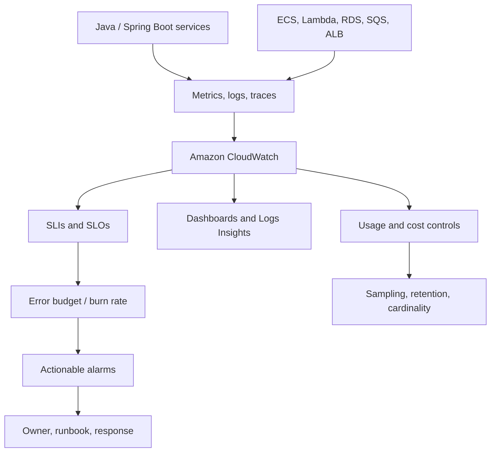
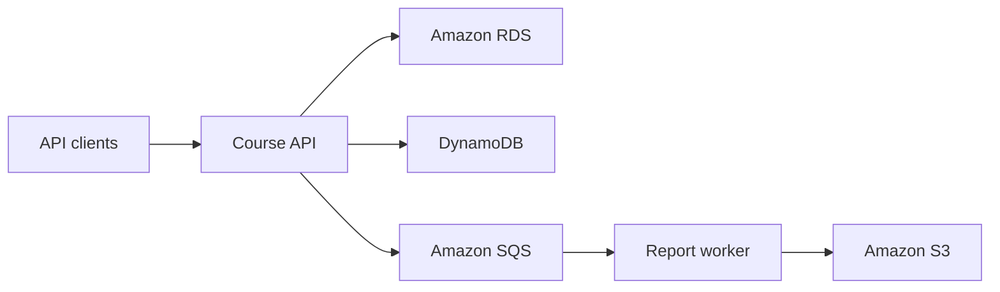
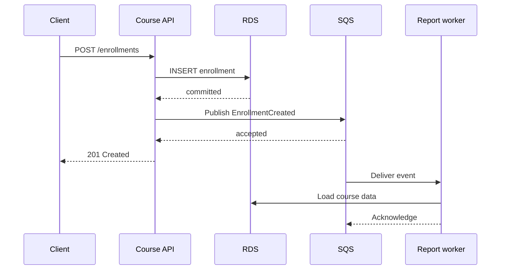
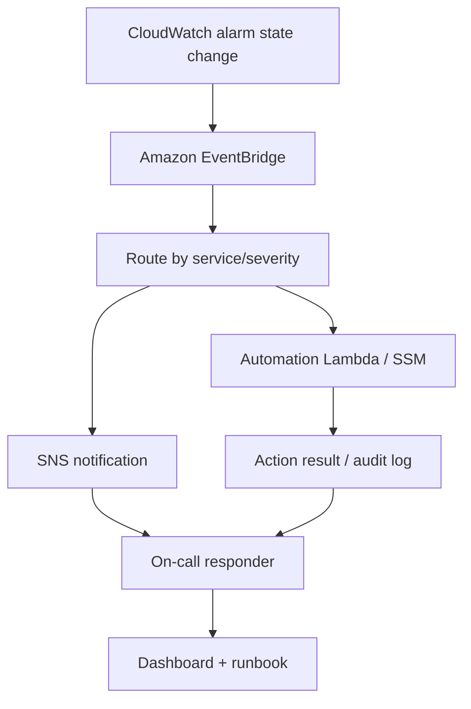

# SLOs, Actionable Alerting, and Telemetry Cost Control

> **Module:** CLOUD_PROVIDERS_AWS  
> **Chapter:** Observability with CloudWatch  
> **Lesson:** SLOs, Actionable Alerting, and Telemetry Cost Control  
> **Context:** A Java/Spring Boot team operates Course API on ECS, Lambda, and AWS services; the team needs to measure user experience, detect meaningful incidents, and keep observability spending within budget.

## 1. From Telemetry Collection to Operational Decisions

A system can ship millions of log events, thousands of metrics, and continuous traces yet still leave operations unsure when to intervene. High CPU might be normal load growth; a few exceptions may have been retried successfully; dashboards might stay green while users cannot place orders.

Observability delivers value when data answers three questions:

1. **Are users receiving the expected level of service quality?** Measured via Service Level Indicators (SLIs) and tracked against Service Level Objectives (SLOs).
2. **When quality degrades, who needs to do what?** Handled by alerts with clear owners, thresholds, priorities, runbooks, and actions.
3. **Is telemetry cost proportional to operational value?** Governed via metric cardinality, log volume, retention, query scans, and trace sampling.

Amazon CloudWatch provides metrics, logs, alarms, dashboards, Logs Insights, and application observability capabilities. CloudWatch Application Signals adds service-level metrics, service maps, and SLO tracking for applications instrumented with OpenTelemetry/AWS Distro for OpenTelemetry (ADOT).



### Learning Objectives

After this lesson, you will be able to:

1. Distinguish SLI, SLO, SLA, and error budget.
2. Select SLIs reflecting user experience for APIs, workers, and dependencies.
3. Calculate error budgets and burn rates for an SLO.
4. Create period-based or request-based SLOs using CloudWatch Application Signals.
5. Design alerts aligned with impact and actionability.
6. Use metric alarms, M-out-of-N evaluation, missing-data treatment, and composite alarms.
7. Combine metrics, structured logs, and distributed traces.
8. Organize dashboards, runbooks, and incident response workflows.
9. Control telemetry costs via cardinality, retention, log classes, query filters, and sampling.
10. Build an observability measurement, testing, and optimization plan for an AWS workload.

## 2. SLI, SLO, SLA, and Error Budget

These concepts are closely related yet serve distinct purposes.

| Concept | Meaning | Question Answered |
|---|---|---|
| SLI | Service quality measurement indicator | What are we measuring? |
| SLO | Internal target for an SLI over a time window | What quality level must we achieve? |
| SLA | Customer-facing commitment, typically with terms/remedies | What did we promise customers? |
| Error budget | Allowable degradation while still meeting the SLO | How much room for error remains? |

For example, Course API sets a 99.9% availability SLO over a 30-day window. The SLI is the ratio of eligible requests receiving a successful response per product definition. An SLA might commit to a different level, such as 99.5%, with service credits if breached. Under a 99.9% SLO, the error budget is 0.1% of requests or time within the period allowed to fail the success criteria.

Do not pick an SLO merely because it is a neat round number. Ground targets in user experience, architecture, dependencies, the cost of reliability, and business expectations.

### 2.1. Availability SLI

For a request-based SLI:

\[
Availability = \frac{Good\ requests}{Eligible\ requests}\times100\%
\]

A request counts as good per product rules. Examples:

- HTTP 2xx: typically counts as success.
- HTTP 3xx: can count as success when redirects are expected behavior.
- HTTP 4xx: may reflect invalid client input rather than a service reliability failure.
- HTTP 5xx, timeouts, or dependency errors: typically counted as bad requests.
- Client-aborted requests: explicitly define whether they belong in the denominator.

Do not exclude all 4xx responses mechanically. For example, 429 Too Many Requests can reflect rate-limiting that real users experience; depending on the SLO, it may need to count as bad.

### 2.2. Latency SLI

A latency SLI can measure the share of requests completing under a threshold:

\[
Latency\ SLI = \frac{Requests\ under\ threshold}{Eligible\ requests}\times100\%
\]

Example target: 99% of GET course requests complete within 300 ms. Use p95/p99 percentiles to understand latency distribution, yet a single percentile cannot replace a request-based SLI when the goal is the percentage of requests meeting a threshold.

### 2.3. SLIs for Workers and Batch Jobs

| Workload | Suggested SLI |
|---|---|
| SQS worker | Ratio of messages processed successfully within time SLA |
| Event consumer | Ratio of events processed before deadline |
| Batch report | Ratio of batches completed on time |
| File processing | Ratio of valid files processed successfully |
| Database dependency | Ratio of queries succeeding and under latency threshold |
| Async workflow | Ratio of workflows completing before business deadline |

For queues, track both queue age/oldest message age and completion rate. A worker might emit zero HTTP 5xx responses while a growing backlog delivers results to users far too late.

## 3. Choosing User-Meaningful SLIs

Start from critical user journeys rather than a catalog of available metrics. For instance, Course API has three flows:

- Reading the course catalog.
- Enrolling in a course and paying.
- Generating learning reports asynchronously.

Each flow may require its own SLI/SLO. Do not merge them into a single system-wide availability metric if one flow can fail while others stay up.

### 3.1. Golden Signals and Business Signals

| Signal | Measures | Examples |
|---|---|---|
| Latency | Response time | p50, p95, p99, ratio under 300 ms |
| Traffic | System demand | Requests/minute, messages/minute |
| Errors | Failed requests/events | 5xx rate, failed jobs, retry exhaustion |
| Saturation | Resource utilization | CPU, memory, thread pools, connection pools |
| Business outcome | User-visible completion | Enrollment success rate, payment completion rate |

Golden signals isolate technical causes; business signals verify whether the service actually fulfilled what users needed.

### 3.2. SLOs by Service and Operation

A service-wide SLO can hide critical operations. Consider dedicated SLOs for:

- GET /courses: availability and latency.
- POST /enrollments: transaction success and latency.
- POST /payments: payment authorization success.
- ReportWorker.process: completion within deadline.

Create SLOs only for critical flows with clear owners. Too many unmonitored SLOs add dashboard clutter and alarm costs.

### 3.3. Defining the Denominator Carefully

The denominator is the set of eligible requests/events evaluated. Align on:

- Do internal health checks count toward the SLO?
- Does synthetic monitoring count in request totals?
- How are client cancellations and malformed requests treated?
- Are internal retries counted once per original request or per attempt?
- Does traffic from a specific tenant or region need its own SLO?

If the denominator shifts between releases, SLO attainment can rise or fall without reflecting real quality changes. Version SLI definitions as part of the service contract.

## 4. Calculating the Error Budget

For a 99.9% SLO:

\[
Error\ budget = 100\% - 99.9\% = 0.1\%
\]

Measured by time over a 30-day window:

\[
30\times24\times60\times0.001 = 43.2\ minutes
\]

Measured by requests with 1,000,000 eligible requests in the period:

\[
1,000,000\times0.001 = 1,000\ bad\ requests
\]

These two calculations use two different SLI models. Period-based SLOs evaluate whether periods pass or fail; request-based SLOs evaluate good vs. bad requests. Do not translate 43.2 minutes directly into failed request counts when traffic fluctuates over time.

### 4.1. Error Budget Policy

| Budget Status | Suggested Action |
|---|---|
| Healthy budget remaining, low burn rate | Continue releasing per standard workflow |
| Budget dropping rapidly | Increase validation, shrink release size, investigate regressions |
| Budget nearly exhausted | Prioritize reliability work, defer risky changes |
| Budget exhausted | Per policy, pause non-urgent releases and restore SLO |

Policies must be agreed upon across product, engineering, and operations. Do not use error budgets to punish teams; use them to drive data-informed trade-offs between feature velocity and reliability.

## 5. Burn Rate: How Fast the Error Budget Is Consumed

Burn rate measures how much faster or slower a service consumes its error budget relative to the SLO pace.

\[
Burn\ rate = \frac{Observed\ error\ rate}{Allowed\ error\ rate}
\]

Where:

\[
Allowed\ error\ rate = 1 - SLO\ goal
\]

For example, a 99.9% SLO has an allowed error rate of 0.1%. If the actual error rate in a look-back window is 1%, the burn rate is 10. If sustained, the budget will be consumed 10 times faster than allowed.

- Burn rate = 1: consuming budget at the exact pace matching the objective.
- Burn rate < 1: consuming budget slower than the allowed pace.
- Burn rate > 1: at risk of missing the SLO if the condition persists.

### 5.1. Choosing Burn-Rate Thresholds by Budget Consumption

One way to set thresholds is picking the maximum fraction of error budget tolerated within a look-back window:

\[
Burn\ rate\ threshold =
\frac{Allowed\ budget\ fraction\times SLO\ interval}
{Lookback\ window}
\]

For example, for a 28-day rolling SLO where the team wants an alert if 2% of the error budget burns within 60 minutes:

\[
\frac{0.02\times28\times24\times60}{60}=13.44
\]

The burn-rate threshold is 13.44 over a 60-minute look-back window. This is an illustrative policy; pick budget fractions, intervals, and windows suited to your operations team's response capacity.

### 5.2. Using Multiple Time Windows

A short window catches sudden outages quickly; a long window avoids paging on brief spikes. Common pairings:

- 1 hour and 5 minutes: catch severe, ongoing outages.
- 6 hours and 30 minutes: catch sustained degradation.
- 3 days and 6 hours: monitor longer-term budget consumption.

A composite alarm can require both the long-window and short-window alarms to be in ALARM before paging on-call. This cuts false positives when one window has already recovered while the longer window still holds older error data.

### 5.3. Responding by Burn Rate

| Burn Rate | Response Channel | Action |
|---|---|---|
| Below 1 | Dashboard | Monitor normally |
| Moderate, sustained increase | Ticket/chat | Inspect trends and recent releases |
| High across short and long windows | Page on-call | Open incident, contain blast radius |
| Very high, critical SLO impacted | Page + incident commander | Roll back/disable feature or fail over per runbook |

Do not apply one threshold across all services. Payment APIs require different response thresholds than batch analytics.

## 6. CloudWatch Application Signals and SLOs

CloudWatch Application Signals provides visibility into service operations and dependencies. When applications are instrumented, Application Signals captures application metrics such as availability and latency, renders a service map, and enables SLOs on service operations or dependencies.

SLOs in Application Signals can use:

- **Period-based evaluation:** evaluates whether individual periods meet conditions.
- **Request-based evaluation:** evaluates the ratio of good requests to total eligible requests.
- **Standard application metrics:** such as Availability and Latency.
- **CloudWatch metrics or metric math expressions:** when custom SLIs are needed.
- **Warning thresholds and burn-rate alarms:** alerting before budget exhaustion or when burn rate spikes.

### 6.1. Workflow to Create an SLO

1. Enable Application Signals for the workload and confirm services/operations appear.
2. Select a critical service operation or dependency.
3. Choose period-based or request-based evaluation.
4. Pick the SLI metric and threshold, such as availability or latency.
5. Set the attainment goal, e.g., 99.9%.
6. Select a rolling interval or calendar interval.
7. Set a warning threshold to detect approaching budget exhaustion.
8. Configure burn-rate windows and alarms.
9. Attach an SNS topic or appropriate notification channel.
10. Verify the SLO dashboard once sufficient data arrives.

Application Signals can suggest configurations from service metric history. Use recommendations as a starting point; adjust them to business objectives and SLO policies.

### 6.2. Instrumenting Java/Spring Boot

For Java workloads on ECS/EC2, an integrated option combines ADOT Java auto-instrumentation with CloudWatch Agent. The collector/agent gathers application metrics and traces, pairing cleanly with Container Insights and CloudWatch Logs.

Example resource attributes configuration in the runtime environment:

```bash
OTEL_SERVICE_NAME=course-api
OTEL_RESOURCE_ATTRIBUTES=service.namespace=learning,service.version=2026.11.20,deployment.environment=production
JAVA_TOOL_OPTIONS=-javaagent:/opt/otel/javaagent.jar
```

The agent path is illustrative; javaagent.jar must be mounted or baked into the exact container location. In ECS task definitions, mount/copy the agent per your deployment pattern and confirm agent compatibility with your Java runtime and frameworks.

On ECS, run CloudWatch Agent/ADOT collector as a sidecar or daemon pattern depending on cluster design. On Lambda, select the instrumentation setup matching your runtime/packaging. Verify network egress, IAM permissions, and resource attributes so the service map renders accurate service names, environments, and versions.

### 6.3. Service Maps Help Pinpoint Dependencies



If Course API's SLO drops while RDS dependency latency spikes simultaneously, the service map narrows down the suspect. However, correlation alone does not prove root cause; inspect traces, logs, saturation, and dependency events before acting.

## 7. Three Signals: Metrics, Logs, and Traces

| Signal | Answers the Question | Best Used For |
|---|---|---|
| Metrics | What is changing and by how much? | Trends, SLOs, alarms, capacity |
| Logs | What specific event occurred? | Error details, audits, business context |
| Traces | Which components did a request hit and where was it slow? | Dependency latency, distributed failures |

Do not stuff every detail into every signal. Metrics should stay lean and stable; logs need enough context to investigate; traces must map request paths and timing.

### 7.1. Metrics

Use a dedicated namespace for custom metrics, such as CourseAPI/SLI. Use clear metric names like GoodRequests, TotalRequests, EnrollmentFailures, and QueueAgeSeconds.

Pick appropriate statistics:

- Sum: totals for requests, errors, messages.
- Average: mean CPU or duration where appropriate.
- p95, p99: percentile latency.
- Minimum/Maximum: detecting extremes or health signals.

Do not rely on average latency alone because a cohort of very slow requests can be hidden by many fast ones.

### 7.2. Structured Logs

Write logs as JSON so CloudWatch Logs Insights auto-discovers fields. A useful event typically includes:

```json
{
  "timestamp": "2026-11-20T04:30:00.000Z",
  "level": "ERROR",
  "service": "course-api",
  "environment": "production",
  "version": "2026.11.20",
  "traceId": "1-673e0000-0123456789abcdef01234567",
  "spanId": "0123456789abcdef",
  "route": "/v1/enrollments",
  "operation": "createEnrollment",
  "statusCode": 503,
  "durationMs": 812,
  "errorCode": "PAYMENT_DEPENDENCY_TIMEOUT"
}
```

Never log access tokens, passwords, card data, session secrets, or unnecessary PII. Use trace ID/correlation ID to link logs to traces; never turn those IDs into metric dimensions.

### 7.3. Distributed Traces

A trace can contain multiple spans:



Traces separate time spent in API code, RDS, SQS, or workers. Trace sampling cuts volume but omits some requests from trace analysis; keep metrics/SLO measurements independent of trace sampling.

## 8. Designing Metrics and Controlling Cardinality

CloudWatch identifies metrics by namespace, metric name, and exact dimension combination. Each unique dimension combination counts as a separate metric, even when the metric name matches.

Examples:

- Service=course-api, Environment=prod
- Service=course-api, Environment=staging
- Service=course-api, Environment=prod, Route=/courses

These are distinct metric identities.

### 8.1. What Is Cardinality?

Cardinality is the number of distinct values or combinations across dimensions/labels. The following fields can cause cardinality to explode:

- requestId
- userId
- sessionId
- orderId
- raw URLs containing path parameters
- free-form exception messages
- timestamps or UUIDs

For example, 100,000 request IDs must never become 100,000 metric time series. Keep request IDs in logs/traces; keep metric dimensions bounded such as service, environment, operation, status class, or bounded tenant tier.

### 8.2. Bounded Dimensions

| Dimension | Recommendation | Reason |
|---|---|---|
| Service | Use | Bounded number of services |
| Environment | Use | dev/staging/prod |
| Operation/route template | Use carefully | /courses/{id} instead of raw paths |
| Status class | Use | 2xx/4xx/5xx |
| Region | Use when needed | Bounded number of Regions |
| Tenant tier | Use only if tier count is small | E.g., free/pro/enterprise |
| User ID/request ID | Never use as a metric dimension | Practically unbounded cardinality |

Do not eliminate cardinality by stripping every dimension. The goal is supporting breakdown by service/operation/environment without generating a time series per request.

### 8.3. OpenTelemetry Metrics and Embedded Metric Format

Two common ways to publish custom metrics:

- **OpenTelemetry metrics (OTLP):** suited for new workloads, containerized apps, PromQL, and the OTel ecosystem. AWS recommends this path for many new workloads.
- **Embedded Metric Format (EMF):** embeds metrics inside structured log events. Helpful when keeping raw log details and extracting metrics from Lambda/ephemeral workloads without calling PutMetricData separately.

EMF still creates a custom metric for each dimension combination. Never add request ID/user ID to dimensions just because they appear in the log. OpenTelemetry supports richer labels yet is equally unsuitable for unbounded values like request ID.

Example EMF log event recording total good requests and total eligible requests for a service. The route field stays in the log event without becoming a metric dimension:

```json
{
  "_aws": {
    "Timestamp": 1795149000000,
    "CloudWatchMetrics": [
      {
        "Namespace": "CourseAPI/SLI",
        "Dimensions": [["Service"]],
        "Metrics": [
          {"Name": "GoodRequests", "Unit": "Count"},
          {"Name": "TotalRequests", "Unit": "Count"}
        ]
      }
    ]
  },
  "Service": "course-api",
  "GoodRequests": 98,
  "TotalRequests": 100,
  "route": "/v1/enrollments",
  "statusClass": "2xx"
}
```

## 9. Log Design: Content, Class, and Retention

CloudWatch Logs provides log classes with different feature sets and costs. Standard suits logs needing real-time monitoring and full capabilities. Essentials (formerly Infrequent Access) suits rarely queried logs and ad-hoc/forensic analysis with a narrower feature set. Log class must be chosen when creating a log group; existing log groups cannot change classes.

### 9.1. Organizing Log Groups by Workload

```text
/prod/course-api/application
/prod/course-api/access
/prod/course-worker/application
/prod/payment-service/application
/prod/platform/audit
```

Separate log groups by service, environment, and retention policy to govern permissions, retention, and cost. Log streams usually represent individual emitters such as containers/tasks or instances.

### 9.2. Retention Policy

CloudWatch Logs retains data indefinitely unless retention is configured. Set retention by purpose:

| Log Type | Suggested Retention | Purpose |
|---|---|---|
| Debug/dev | Short | Diagnostics during development |
| Application production | Per operational need | Investigating recent incidents |
| Security/audit | Per organizational policy | Investigations and compliance |
| High-volume access logs | Shorter or exported | Trend analysis, long-term storage |

Actual retention periods must follow legal and organizational policies. For low-cost long-term storage, consider exporting/subscribing to Amazon S3 with lifecycle policies. Evaluate retrieval costs, encryption, access controls, and restore latency before choosing S3 as an archive.

### 9.3. Data Protection

- Mask or strip secrets/PII prior to logging.
- Use CloudWatch Logs data protection policies when auditing/masking sensitive data is required.
- Restrict logs:StartQuery, logs:GetQueryResults, and log group read permissions.
- Encrypt log groups with KMS when security requires customer-managed keys.
- Avoid logging full request/response bodies containing sensitive data or large payloads.

## 10. Logs Insights and Targeted Queries

CloudWatch Logs Insights bills analysis based on uncompressed log data scanned. Limit time ranges, select exact log groups, filter early, and use field indexes where appropriate to cut scanned data.

Example finding Course API errors:

```text
fields @timestamp, level, route, statusCode, durationMs, traceId
| filter level = "ERROR"
| stats count(*) as errors,
        pct(durationMs, 95) as p95Duration
  by bin(5m), route
| sort @timestamp desc
| limit 100
```

Example tracing one trace:

```text
fields @timestamp, service, level, traceId, message
| filter traceId = "1-673e0000-0123456789abcdef01234567"
| sort @timestamp asc
```

### 10.1. Field Indexes

Create indexes for fields frequently used in filters such as trace ID, tenant tier, or request category when beneficial for queries. filterIndex lets Logs Insights scan only log groups/events carrying matching indexes; support depends on log class and query structure.

Do not index every field. Indexing policies are operational decisions; pick stable fields queried frequently enough to justify indexing.

### 10.2. filterIndex Example

```text
fields @timestamp, traceId, level, message
| filterIndex traceId = "1-673e0000-0123456789abcdef01234567"
| sort @timestamp asc
| limit 100
```

Before using, confirm the log group uses the Standard class, the field index is created, and data was ingested after the index policy took effect. Indexes do not apply retroactively to older log events.
## 11. Role-Based and Decision-Driven Dashboards

A good dashboard answers a specific operational question. There is no need to cram every metric onto one page.

### 11.1. Service Health Dashboard

Should include:

- SLO attainment and remaining error budget.
- Burn rate across look-back windows.
- Availability and p50/p95/p99 latency.
- Request rate and error rate.
- Dependency health/latency.
- Current deployment/version.
- Alarm states and incident links.

### 11.2. Infrastructure Dashboard

For ECS/Fargate:

- Desired/running task count.
- CPU/memory utilization.
- Task restarts/placement failures.
- ALB healthy/unhealthy targets.
- Network and request metrics.

For Lambda:

- Invocations, Errors, Throttles, Duration.
- Concurrent executions.
- Iterator age if using stream event sources.
- Cold start/runtime metrics when instrumented.

For RDS:

- CPU, connections, free storage.
- Read/write latency and IOPS.
- Database load/Performance Insights metrics by engine and tier.

### 11.3. Incident Dashboard

An incident dashboard must show the exact time range, release version, service, dependencies, and related alarms. Keep links to Logs Insights queries and runbooks so on-call does not have to hunt from scratch.

Dashboards do not replace alarms. Responders cannot stare at dashboards continuously; threshold breaches must fire alerts through notification channels.

## 12. CloudWatch Alarm States and Evaluation

A metric alarm has three primary states:

| State | Meaning | Interpretation |
|---|---|---|
| OK | Metric is within normal bounds | Threshold not breached |
| ALARM | Metric breached threshold | Execute configured actions |
| INSUFFICIENT_DATA | Not enough data to evaluate | Metric not emitted yet, ingestion interrupted, or newly created alarm |

INSUFFICIENT_DATA does not mean OK. If the telemetry pipeline stops sending metrics, alarms can lack the data needed to detect application failures.

### 12.1. Period, EvaluationPeriods, and DatapointsToAlarm

- **Period:** length of each evaluation data point, e.g., 60 seconds.
- **EvaluationPeriods (N):** number of recent periods evaluated.
- **DatapointsToAlarm (M):** number of data points within N periods that must breach to transition to ALARM.

This is an M-out-of-N alarm. For example, DatapointsToAlarm=3, EvaluationPeriods=5 means at least 3 of the 5 most recent data points must breach the threshold.

M-out-of-N reduces alerts caused by single transient spikes. However, if M/N is too high, alarms react slowly to outages. Tune around your SLO and maximum acceptable detection time.

### 12.2. Missing Data Treatment

CloudWatch offers four ways to treat missing data points:

- breaching: treat missing data points as breaching.
- notBreaching: treat missing data points as not breaching.
- ignore: maintain current state when handling missing data.
- missing: allow the alarm to transition to INSUFFICIENT_DATA when data points are lacking.

Choose based on metric semantics:

| Metric | Suggested Treatment | Reason |
|---|---|---|
| Heartbeat/collector expected every minute | breaching | Missing heartbeat signals interrupted telemetry |
| Request error rate when service has zero traffic | notBreaching or metric math handling zero traffic | Zero requests does not mean errors |
| Sparse business event metric | missing or ignore depending on goal | Absence of events may be normal |
| Critical dependency probe | breaching once probe cadence is clearly defined | Lost probe means lost dependency verification |

CloudWatch evaluates available real data points before applying missing-data treatment; not every missing point is immediately substituted. Always test alarm transitions when metrics stop arriving.

## 13. Designing Actionable Alerts

An alert should help responders decide on an action within the first few minutes. Every critical alert should specify:

1. **Impact:** which users/operations are affected?
2. **Signal:** which metric/SLI breached?
3. **Threshold and window:** by how much, and for how long?
4. **Owner:** responsible team or on-call rotation.
5. **Runbook:** initial investigation steps and dashboard/query links.
6. **Action:** rollback, scale, failover, disable feature, or escalate.
7. **Recovery condition:** when can the incident be closed?

Example of a helpful alert:

> Course API enrollment availability SLO burn rate exceeded 13.44 over 1-hour and 5-minute windows. Users creating enrollments are receiving errors. Check the Course API dashboard, RDS dependency, and latest release version; if errors began after a release, execute rollback per the Enrollment API runbook.

Unhelpful alert:

> CPU > 80%.

80% CPU can be completely normal. If alerting on saturation, tie it to queue depth, latency, request errors, or scaling limits, and include an owner and concrete action.

### 13.1. Page, Ticket, and Dashboard

| Severity | Example | Response Channel |
|---|---|---|
| Critical/page | Fast SLO burn, payment/enrollment unavailable | Immediate on-call page |
| Warning/ticket | Slow budget burn, low storage without current impact | Team backlog/business hours |
| Informational | Deployment completed, autoscaling event | Dashboard/event stream |
| Diagnostic | Single exception retried successfully | Logs/traces, no page |

Do not send every alarm to the same channel. Route alerts by impact and required response urgency.

### 13.2. Alarm Actions and State Transitions

CloudWatch alarm actions generally execute on state transitions. For most action types, actions do not repeat continuously simply because an alarm stays in ALARM for hours. Auto Scaling actions follow their own distinct behavior.

Actions can include SNS notifications, Lambda invocations, EC2 actions, or Auto Scaling actions depending on alarm type. Alarm state changes are also emitted to EventBridge, enabling richer automation and incident workflows.

Do not assume an SNS message was processed or a Lambda action succeeded simply because the alarm changed state. Monitor delivery, retries, DLQs, and automation failures.

## 14. Composite Alarms to Reduce Alert Noise

A composite alarm aggregates the states of multiple metric alarms using a Boolean expression. This helps when a single metric breach is insufficient to justify paging on-call.

Examples:

- Page when availability SLO burn rate is high AND error rate is high.
- Page when latency is high AND healthy target count is low.
- Suppress paging on CPU saturation during a maintenance/deployment window if service health stays good.

Example AlarmRule:

```text
ALARM(CourseApiHighErrorRate)
AND ALARM(CourseApiLatencyHigh)
AND NOT ALARM(PlannedMaintenance)
```

This rule enters ALARM only when both error-rate and latency alarms are in ALARM while the maintenance alarm is not in ALARM.

Composite alarms cut notification noise, yet do not replace underlying metric alarms. Keep underlying alarms for granular visibility and investigation.

Note: composite alarms support SNS notifications, Systems Manager OpsItems/incident integrations, and actions documented by CloudWatch; they do not execute EC2 or Auto Scaling actions like metric alarms do. Verify action support before designing automation.

## 15. CloudFormation Example: Request Error-Rate Alarm

Suppose the application publishes two custom metrics in namespace CourseAPI/SLI:

- GoodRequests: total requests meeting the SLI criteria.
- TotalRequests: total eligible requests.

Metric math computes error rate as a percentage:

\[
Error\ rate = 100\times(1-\frac{GoodRequests}{TotalRequests})
\]

CloudFormation alarm example:

```yaml
CourseApiErrorRateAlarm:
  Type: AWS::CloudWatch::Alarm
  Properties:
    AlarmName: course-api-error-rate
    AlarmDescription: "Course API request error rate is above 1 percent"
    ComparisonOperator: GreaterThanThreshold
    Threshold: 1
    EvaluationPeriods: 5
    DatapointsToAlarm: 3
    TreatMissingData: notBreaching
    Metrics:
      - Id: good
        ReturnData: false
        MetricStat:
          Metric:
            Namespace: CourseAPI/SLI
            MetricName: GoodRequests
            Dimensions:
              - Name: Service
                Value: course-api
          Period: 60
          Stat: Sum
      - Id: total
        ReturnData: false
        MetricStat:
          Metric:
            Namespace: CourseAPI/SLI
            MetricName: TotalRequests
            Dimensions:
              - Name: Service
                Value: course-api
          Period: 60
          Stat: Sum
      - Id: error_rate
        Label: Error rate percent
        ReturnData: true
        Expression: "IF(total >= 100, 100 * (1 - good / total))"
```

This example creates a metric alarm on a custom SLI. In production, configure alarm actions, SNS topics, tags, and metric publishing permissions. total >= 100 is a sample guard to avoid evaluating ratios on tiny samples; pick a minimum sample suited to service traffic.

TreatMissingData: notBreaching prevents paging during zero traffic, yet can mask a broken telemetry emitter. Create a separate heartbeat/telemetry pipeline alarm with a clear cadence and matching missing-data treatment.

### 15.1. Metric Math Is Not a Full SLO

An error-rate alarm does not manage rolling error budgets, SLO attainment, or burn-rate windows by itself. Use CloudWatch Application Signals SLOs to track attainment and error budgets; use metric alarms for immediate operational conditions and composite alarms to aggregate them.

## 16. Notifications and Controlled Automation

A common workflow:



### 16.1. SNS and EventBridge

- SNS fits fan-out notifications to email, SMS, or subscribers.
- EventBridge fits routing alarm state changes by service, environment, severity, and account.
- Lambda/Systems Manager Automation can execute predefined tasks.
- Log automation results, request IDs, principals, and modified resources.

### 16.2. Safe Automation

Automate only controllable, tested actions:

- Creating incidents or tickets.
- Collecting diagnostic snapshots.
- Running health probes.
- Scaling out within approved bounds.
- Rolling back a deployment per defined release policies.

Actions like deleting data, failing over databases, or altering network policies require guardrails, approvals, or rollback plans. Automation must be idempotent, with timeouts, retry policies, and audit trails.

## 17. Controlling Telemetry Costs

CloudWatch costs vary by Region, volume, and enabled features. Main cost groups include:

| Component | Common Cost Drivers |
|---|---|
| Custom metrics | Number of metric identities, resolution, and lifetime |
| Metric API | Number of API requests by operation type |
| Alarms | Number of metrics/queries evaluated by alarms and alarm type |
| Logs ingestion | GB of logs ingested |
| Logs storage | GB-month and retention |
| Logs Insights | Uncompressed log volume scanned |
| Traces/spans | Ingestion, retention, indexing, and analysis |
| Container Insights | Metrics per cluster/service/task/container and enhanced observability mode |
| Dashboards/queries | Dashboard count, API calls, and query workloads per pricing model |

Never bake a fixed USD unit price into long-term designs. Prices vary by Region, volume tier, log class, and feature; check the CloudWatch pricing page and AWS Pricing Calculator before approving budgets.

### 17.1. Metric Costs

- Keep dimensions restricted to bounded fields.
- Avoid creating custom metrics per request ID, user ID, order ID, or raw URL.
- Use standard resolution unless sub-minute granularity is needed.
- Enable high-resolution metrics only for use cases demanding rapid response.
- Clean up obsolete test metrics and alarms.
- Track newly introduced custom metrics after every release.
- Assess the metric volume produced by Container Insights enhanced observability before broad rollout.

### 17.2. Log Costs

- Log events supporting operations and audits; avoid continuous debug payloads in production.
- Choose short retention for debug/access logs when policy allows.
- Export data needing long-term retention to S3 with lifecycle policies.
- Choose the Essentials log class for rarely accessed logs if Standard-only features are unneeded.
- Use field indexes and time-range filters to shrink scan volume.
- Avoid querying all log groups over multi-month ranges when 15 minutes suffices.
- Inspect top log groups/usage types in Cost and Usage Reports or CloudWatch billing breakdowns.

### 17.3. Trace Costs

- Align sampling policies with workloads and criticality.
- Consider per-service/per-environment sampling; critical production flows may warrant higher coverage.
- Limit oversized span attributes or unbounded values.
- Never attach full request/response bodies to spans.
- Sample traces for investigation while keeping SLI metrics independent so sampling never skews SLOs.
- Review trace search retention and indexing.

### 17.4. Query and Dashboard Costs

- Restrict time ranges and log groups in Logs Insights.
- Use field indexes for frequently filtered fields when supported.
- Save standard queries so incidents do not trigger repeated broad ad-hoc scans.
- Avoid overly aggressive dashboard auto-refresh rates unless near-real-time updates are needed.
- Monitor metric queries, alarm evaluations, and API retrieval volume.
- Clean up duplicate or ownerless dashboards.

## 18. Choosing CloudWatch Logs Class and Storage Tier

CloudWatch Logs Standard provides the full feature set for real-time monitoring and frequent access. Essentials (formerly Infrequent Access) suits infrequently accessed logs and forensic/ad-hoc analysis with a smaller feature set.

Features such as Live Tail, metric filters, subscription filters, and field indexing are unavailable in Essentials. Check the feature matrix before selecting a class; log class cannot be changed after log group creation.

### 18.1. CloudWatch or S3?

| Need | Suggested Choice |
|---|---|
| Real-time alerting/metric filters | CloudWatch Logs Standard |
| Recent investigation via Logs Insights | Standard or Essentials depending on query/features |
| Long-term audit retention, rare queries | S3 with encryption and lifecycle rules |
| Batch analytics across large logs | S3 + Athena/analytics tools |
| Live tail during production incidents | Standard |
| Rarely accessed forensic logs | Essentials or S3 archive per policy |

Do not send all logs to S3 if operations needs real-time alerts and queries. Use subscription/centralization pipelines to retain operational logs in CloudWatch while archiving required data.

## 19. Multi-Account Observability and Governance

Across multi-account AWS organizations, a monitoring account provides centralized visibility via CloudWatch cross-account observability / Observability Access Manager per supported configuration.

Suggested topology:

- Application accounts: dev, staging, production.
- Monitoring account: dashboards, aggregated alarms, and cross-account views.
- Security/audit account: log archives and access governance.
- Central platform team: standardized namespaces, retention, alarm naming, and cost allocation.

### 19.1. Telemetry Governance

Establish conventions:

- Namespaces by domain/service.
- Log group naming by environment/service.
- Resource attributes with service.name, service.namespace, deployment.environment, and service.version.
- Alarm names containing service, signal, and severity.
- Dashboards with owners and review cadences.
- SLOs with business owners, technical owners, and error budget policies.
- Retention classes/periods managed as infrastructure configuration.

### 19.2. Cost Allocation

Use tags and account-level usage reports to attribute costs to workloads. Track:

- Log ingestion by service/account.
- Custom metrics by namespace.
- Alarms by team/service.
- Trace volume by environment.
- Container Insights metrics by cluster/service.
- Logs Insights scan volume by team or query workload where billing data supports it.

Do not look solely at the total CloudWatch bill. Break down by usage type, operation, Region, and resource to pinpoint unexpected growth.

## 20. Lab: SLOs and Actionable Alarms for Course API

**Scenario:** Course API on ECS Fargate serves the enrollment endpoint. The team sets a 99.9% 30-day availability SLO, wants alerts when the error budget burns rapidly, and wants to trim unnecessary log/metric volume.

### 20.1. Preparation

1. Have a sandbox AWS account/Region ready.
2. Run Course API emitting structured JSON logs.
3. Enable ADOT/Application Signals per your deployment pattern.
4. Confirm service name, operations, and dependencies appear.
5. Emit GoodRequests and TotalRequests custom metrics if building a custom request-based SLI.
6. Use CloudWatch Logs Standard for logs needing metric filters, field indexes, or real-time features.
7. Build dashboards covering availability, latency, errors, traffic, and dependencies.

### 20.2. Creating the SLO

- Select service operation POST /enrollments.
- Choose request-based availability SLI.
- Define eligible requests and good/bad criteria.
- Set a 99.9% attainment goal.
- Select a 30-day rolling interval.
- Configure a warning threshold when remaining error budget gets low.
- Create appropriate burn-rate windows.
- Attach alarms to an SNS topic/on-call channel.
- Verify the SLO dashboard shows attainment, remaining budget, and burn rate.

### 20.3. Testing Alarms

- Inject a controlled burst of failing traffic in the sandbox.
- Confirm the error-rate metric rises and the alarm enters ALARM after the configured data points.
- Stop emitting metrics to verify missing-data behavior.
- Restore normal traffic and confirm the alarm returns to OK.
- Create a composite alarm requiring both error-rate and latency alarms to be in ALARM.
- Verify notifications include service, environment, threshold, time window, and runbook link.
- Confirm actions fire only on appropriate state transitions.

### 20.4. Testing Telemetry Costs

- Add request ID to logs without adding it to metric dimensions.
- Compare metric identity counts before and after adding a bounded dimension.
- Turn down debug log levels in the production profile.
- Set a retention policy on the log group.
- Run a Logs Insights query across 15 minutes vs. 7 days and compare scanned bytes.
- Test a field index on a Standard log group and query with filterIndex.
- Verify Essentials log groups lack Standard-only capabilities.
- Compare trace volumes across sampling settings in the sandbox.

### 20.5. Deliverables

Lab report including:

- SLI definition and request eligibility rules.
- SLO target, interval, and remaining error budget.
- Burn-rate windows/thresholds and rationale for choices.
- Alarm configuration: period, M/N, missing-data treatment, and actions.
- Dashboard and service map screenshots/exports.
- Logs Insights queries and scanned bytes.
- Log class, retention, and metric dimensions.
- Estimated costs from Region/pricing pages at lab time.
- Runbook and rollback/notification test results.

## 21. Negative Tests and Self-Check Questions

### 21.1. Negative Tests

| Test | Condition | Expected Outcome |
|---|---|---|
| T1 | SLI includes internal health checks | Artificially inflated SLO; caught via denominator review |
| T2 | Exclude all HTTP 4xx without policy | Risks missing 429 or user-visible errors; refine SLI definition |
| T3 | Metric dimensions include requestId | Metric identities explode; caught via billing/metric inventory |
| T4 | Logs retained indefinitely outside policy | Storage grows; caught by retention governance |
| T5 | Query scans all log groups for 30 days | Scanned bytes and cost jump; restrict time range/log groups |
| T6 | Heartbeat metric stops yet alarm uses notBreaching | Telemetry outage goes unpaged; create dedicated heartbeat alarm |
| T7 | Error-rate alarm uses missing=breaching during zero traffic | False alarm; define zero-traffic behavior explicitly |
| T8 | Composite alarm wraps only one child alarm | Fails to reduce noise; add genuinely independent condition |
| T9 | SLO interval changes without updating policy | Burn-rate threshold becomes wrong; recalculate for interval/window |
| T10 | Trace sampling too low | Insufficient traces for investigation; raise sampling carefully on critical paths |
| T11 | Essentials log class chosen while runbook needs Live Tail/metric filters | Missing features; use Standard for log groups needing them |
| T12 | Retention shorter than audit requirements | Violates policy; align with security/compliance owner |
| T13 | Alarm action Lambda fails with no DLQ/monitoring | Silent automation failure; add retries, DLQ, and action telemetry |
| T14 | Dashboard has no owner | Goes stale; assign owner and review cadence |

Run negative tests that increase volume or trigger alarms only in a sandbox. Never intentionally inject sensitive data into production logs to test masking.

### 21.2. Self-Check Questions

**1. How do SLI, SLO, and SLA differ?**  
An SLI is a measurement; an SLO is an internal target for that measurement; an SLA is a customer commitment that may include remedies.

**2. What is the error budget for a 99.9% SLO?**  
0.1% of eligible requests or time within the interval, depending on the SLI type.

**3. What does a burn rate of 10 mean?**  
The service is consuming its error budget 10 times faster than the pace aligned with the SLO.

**4. Why use multiple burn-rate windows?**  
Short windows detect severe spikes quickly; long windows confirm sustained degradation and reduce false positives.

**5. Why does a request-based SLO need a clear denominator?**  
Because shifting request eligibility changes attainment even when actual service quality has not changed.

**6. When should you use Application Signals?**  
When you need service/operation/dependency metrics, service maps, and SLO tracking on properly instrumented workloads.

**7. How do metrics, logs, and traces complement each other?**  
Metrics reveal trends; logs supply event details; traces show paths and latency across components.

**8. Why shouldn't requestId be a metric dimension?**  
Each unique value creates a separate metric identity, driving up cardinality and cost.

**9. What is an M-out-of-N alarm?**  
An alarm that transitions to ALARM when at least M data points out of N evaluation periods breach the threshold.

**10. Does INSUFFICIENT_DATA mean the system is healthy?**  
No. It only indicates the alarm lacks sufficient data to evaluate.

**11. What is a composite alarm used for?**  
Combining multiple alarm states with Boolean logic to reduce noise and page only when composite conditions are met.

**12. Why does an alarm need an owner and a runbook?**  
So responders understand impact, where to investigate, and which safe action to take.

**13. What determines Logs Insights query charges?**  
The volume of uncompressed log data scanned.

**14. What impact does log retention have?**  
Governs storage duration and costs; must match operational, audit, and compliance policies.

**15. Can trace sampling distort SLOs?**  
SLOs must rely on clearly defined metrics/SLIs; never use sampled traces as a denominator if sampling is non-representative.

## 22. Summary and Official AWS Documentation

SLOs turn reliability into a measurable target. Error budgets and burn rates help teams decide when to keep shipping, when to slow down changes, and when to prioritize recovery. CloudWatch Application Signals supports tracking service operations/dependencies and defining SLOs; CloudWatch alarms, composite alarms, dashboards, and Logs Insights turn telemetry into action.

A strong alert needs a meaningful signal, clear threshold/window, owner, runbook, action, and recovery condition. Alerts without owners or remediation steps only add noise.

Telemetry costs stay under control through bounded-cardinality metric dimensions, sensible log volumes and retention, appropriate log classes, scoped queries, field indexes where supported, and intentional trace sampling. SLO metrics must remain representative even when traces are sampled.

### Official AWS Documentation

- [CloudWatch — Service level objectives (SLOs)](https://docs.aws.amazon.com/AmazonCloudWatch/latest/monitoring/CloudWatch-ServiceLevelObjectives.html)
- [CloudWatch — Application Signals supported instrumentation](https://docs.aws.amazon.com/AmazonCloudWatch/latest/monitoring/Getting-Started-App-Signals.html)
- [CloudWatch — Enable Application Signals on ECS](https://docs.aws.amazon.com/AmazonCloudWatch/latest/monitoring/CloudWatch-Application-Signals-ECS-Daemon.html)
- [CloudWatch — Application map](https://docs.aws.amazon.com/AmazonCloudWatch/latest/monitoring/ServiceMap.html)
- [CloudWatch — Alarm evaluation](https://docs.aws.amazon.com/AmazonCloudWatch/latest/monitoring/alarm-evaluation.html)
- [CloudWatch — Missing data treatment](https://docs.aws.amazon.com/AmazonCloudWatch/latest/monitoring/alarms-and-missing-data.html)
- [CloudWatch — Composite alarms](https://docs.aws.amazon.com/AmazonCloudWatch/latest/monitoring/alarm-combining.html)
- [CloudWatch — Alarm actions](https://docs.aws.amazon.com/AmazonCloudWatch/latest/monitoring/alarm-actions.html)
- [CloudWatch — Metrics concepts and dimensions](https://docs.aws.amazon.com/AmazonCloudWatch/latest/monitoring/cloudwatch_concepts.html)
- [CloudWatch — Embedded Metric Format](https://docs.aws.amazon.com/AmazonCloudWatch/latest/monitoring/CloudWatch_Embedded_Metric_Format.html)
- [CloudWatch Logs — Log classes](https://docs.aws.amazon.com/AmazonCloudWatch/latest/logs/CloudWatch_Logs_Log_Classes.html)
- [CloudWatch Logs — Retention](https://docs.aws.amazon.com/AmazonCloudWatch/latest/logs/Working-with-log-groups-and-streams.html)
- [CloudWatch Logs — Logs Insights query syntax](https://docs.aws.amazon.com/AmazonCloudWatch/latest/logs/CWL_QuerySyntax.html)
- [CloudWatch Logs — Field indexing](https://docs.aws.amazon.com/AmazonCloudWatch/latest/logs/CloudWatchLogs-Field-Indexing.html)
- [CloudWatch — Cost optimization](https://docs.aws.amazon.com/AmazonCloudWatch/latest/monitoring/cloudwatch_billing.html)
- [Amazon CloudWatch pricing](https://aws.amazon.com/cloudwatch/pricing/)

> **Practice note:** SLO targets, request eligibility, alarm thresholds, retention periods, sampling rates, and cost budgets in this lesson are illustrative examples. Select values based on your actual SLOs/SLAs, traffic profile, Region, security/compliance policies, and current pricing at deployment time.
