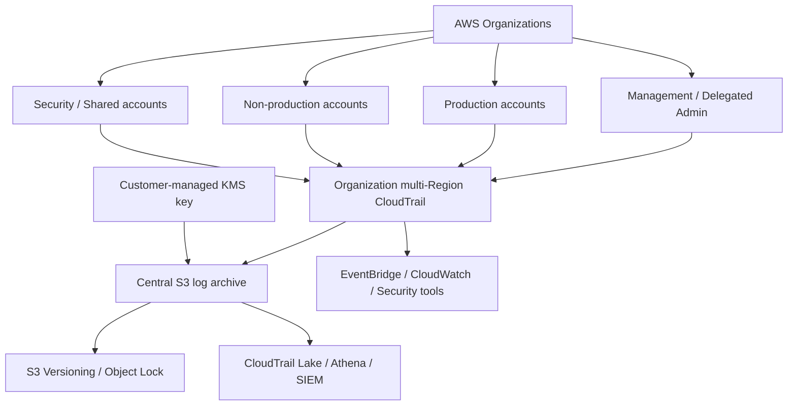

# Organization trails and centralized audit log storage

## 1. Why is centralized audit logging needed?

An AWS organization has multiple accounts for production, staging, development, security, and shared services. When a security group unexpectedly opens a port to the Internet, an IAM role has its trust policy altered, or an S3 bucket policy is modified, the operations team needs to answer quickly: who performed the action, which API was called, from where, at what time, which account was affected, and whether the change was approved.

If each account keeps its own logs, investigations require logging into multiple places, data can be deleted along with a compromised account, and retention policies are often inconsistent. AWS CloudTrail **organization trails** record activity across the entire AWS Organization and centralize log files into a separately governed storage location.

**Centralized audit logging** is the foundation for incident investigation, change control, compliance proof, and detecting anomalous behavior. It must be designed like a critical data system: with strict access control, encryption, integrity verification, retention, backup/replication, and audited access procedures.

This lesson belongs to the **Auditing and Compliance** chapter of the **CLOUD_PROVIDERS_AWS** module. The module explores Regions/AZs, IAM, VPC, compute, storage, databases, integration, and serverless; learners need to select services, design, and deploy secure applications with monitoring, resilience, and cost control. This lesson focuses on the audit control plane and building a centralized log repository for multiple accounts.

After this lesson, you will be able to:

- Explain CloudTrail trails, organization trails, multi-Region trails, and delegated administrators.
- Distinguish between management events, data events, Insights events, and application logs.
- Design a centralized log archive account/S3 bucket architecture.
- Configure bucket policies, KMS encryption, and CloudTrail delivery permissions.
- Protect logs using versioning, S3 Object Lock, lifecycle rules, and replication.
- Enable log file integrity validation and verify digest files.
- Combine CloudWatch Logs, EventBridge, and CloudTrail Lake for investigations.
- Design access permissions, retention, monitoring, and audit workflows.

## 2. What does AWS CloudTrail record?

**AWS CloudTrail** records AWS account activity as events. An event typically describes an API call or resource-related activity, the calling identity, timestamp, request source, and outcome. CloudTrail helps investigate who did what on the AWS control plane and, when configured, specific data-plane operations.

Examples of events that can be recorded:

- A principal calls `CreateRole`, `PutRolePolicy`, or `AssumeRole`.
- An operator modifies a security group ingress rule.
- A service creates or deletes an S3 bucket.
- A user changes an RDS or ECS service configuration.
- A principal reads an object in S3 when S3 data events are enabled.

CloudTrail does not automatically record all internal application activity, the contents of every HTTP request, or every shell command on EC2. For a complete audit trail, combine CloudTrail with application audit events, OS logs, VPC Flow Logs, load balancer access logs, database audit logs, and appropriate telemetry sources.

### 2.1. Common fields in an event

| Field | Meaning |
| --- | --- |
| `eventTime` | Timestamp of the event |
| `eventSource` | AWS service generating the event, e.g. `iam.amazonaws.com` |
| `eventName` | API/action name, e.g. `CreateRole` |
| `awsRegion` | Region associated with the event |
| `sourceIPAddress` | Source address or service context |
| `userAgent` | Client/service generating the request |
| `userIdentity` | Identity performing the request |
| `requestParameters` | Recorded request parameters, if available |
| `responseElements` | Recorded response outcome, if available |
| `errorCode` / `errorMessage` | Error details when the request fails |
| `resources` | Related resources, if available |
| `eventID` | Event identifier |
| `recipientAccountId` | Account receiving the event |

Some fields may be absent, omitted, or vary in value depending on the API and event type. Do not assume `requestParameters` always contains the complete payload; CloudTrail is not a copy of every request body.

### 2.2. Reading userIdentity

`userIdentity` can describe an IAM user, assumed role, federated user, AWS service, or other identity. When investigating a role session, check `sessionContext`, `sessionIssuer`, principal/session ARN, and `sourceIdentity` if the organization passes this value.

An event with `userIdentity.type` set to `AssumedRole` usually needs the role session traced back to the user or workload that assumed the role. Combine `AssumeRole` events, identity provider logs, CloudTrail event history, and session tags to determine the origin. Do not conclude that an IAM role ARN is the actor without tracing the session.

### 2.3. Event history and trails

CloudTrail Event history lets you view recent management events in a Region over the service-supported window, typically 90 days. Event history is a quick lookup tool; it does not replace a trail storing logs long-term in S3 or a CloudTrail Lake event data store with configured retention.

A trail records events according to its configuration and delivers log files to S3, and can also send them to CloudWatch Logs. For long-term investigations or compliance, ensure the trail and destinations are enabled, log delivery is working, and retention meets policy.

## 3. Distinguishing management events, data events, and Insights events

CloudTrail classifies events by the type of activity to record. This classification affects visibility scope and cost.

| Event type | Records | Examples |
| --- | --- | --- |
| Management events | Resource/control-plane management activity | `CreateBucket`, `UpdateFunctionConfiguration`, `AttachRolePolicy` |
| Data events | Data-plane operations on supported resources | S3 `GetObject`/`PutObject`, Lambda `Invoke` |
| Insights events | Unusual API activity patterns via CloudTrail Insights capabilities | Sudden spike in API calls or API error rate |

### 3.1. Management events

Management events are enabled by default for trails under typical configurations. They include:

- **Read events:** reading metadata/configurations, e.g. `DescribeInstances`, `GetRole`.
- **Write events:** modifying resources, e.g. `RunInstances`, `PutBucketPolicy`, `DeleteTrail`.

You can choose to record both read/write or only one group as needed. For security auditing, both are usually required to see who read sensitive information and who changed configurations. Keeping only write events can leave investigation context missing.

### 3.2. Data events

Data events are not recorded by default for all resources because their volume can be huge. You must explicitly configure event selectors/advanced event selectors for the resource types and operations requiring auditing.

Examples:

- S3 object-level API activity for buckets holding critical data.
- Lambda function invocations to audit function calls.
- DynamoDB item-level activity for supported tables.
- Other resource types supported by CloudTrail depending on Region/service.

Data events can generate many log records and incur significant costs. Select specific buckets/tables/functions, and filter event names or resource ARNs where appropriate. Do not enable data events account-wide without evaluating volume, retention, and control objectives.

### 3.3. CloudTrail Insights

CloudTrail Insights analyzes management events to detect unusual API activity, such as API call volume or API error rates changing relative to the baseline. Insights events are logged to a trail/event data store when enabled and can aid in investigating anomalous changes.

Insights is not a system for detecting all malicious behavior, nor does it replace GuardDuty, Security Hub, or a SIEM. It is a supplementary signal source; evaluate support scope, cost, and how findings will be handled before enabling it in production.

## 4. Trails, multi-Region trails, and organization trails

A **trail** is a CloudTrail configuration that collects events and delivers log files to S3. A trail can apply to one Region or multiple Regions, and can be an organization trail applying to accounts in an AWS Organization.

| Concept | Scope |
| --- | --- |
| Single-Region trail | Records events in the selected Region |
| Multi-Region trail | Records events from supported AWS Regions in the account |
| Organization trail | Records events for accounts in an AWS Organization |
| Organization multi-Region trail | Common model for centralized org-wide and multi-Region auditing |

### 4.1. Why use a multi-Region trail?

Workloads may be created in a Region different from the one operations teams normally use. If you only have a trail in one Region, API activity in another Region may not appear in that archive. A multi-Region trail collects events across supported Regions and detects activity where the organization has less visibility.

When deploying, check:

- The multi-Region setting is enabled.
- Global service events are included as required.
- Event selectors are consistent across the audit scope.
- Newly enabled Regions in the Organization are also covered by the monitoring design.
- Log delivery is tested and account/Region coverage is verified.

### 4.2. Global service events

Some AWS services have global endpoints or global service events. `IncludeGlobalServiceEvents` controls whether these events are included in the trail. With a multi-Region trail, CloudTrail handles global service events according to the service's delivery mechanism so you avoid assuming each Region will receive an independent copy of the event.

Do not use enabling global events as a substitute for a multi-Region trail; the two settings address different scopes.

### 4.3. Organization trails

An organization trail is a trail created in the management account or a delegated administrator account that applies to accounts in an AWS Organization. When a new account is added to the Organization, it is included in the organization trail scope without needing to create an independent trail in each account.

Member accounts can view the organization trail according to granted permissions, but do not own the organization trail configuration like the management/delegated administrator does. This design reduces the risk of individual accounts turning off or misconfiguring trails differently, while centralizing logs into a destination managed by the security team.

### 4.4. Trails and CloudTrail Lake

A trail delivers log files to S3 and can integrate with CloudWatch Logs. CloudTrail Lake uses an event data store to store and query events with SQL. The two models serve different needs: an S3 archive suits long-term storage, retention/immutability controls, and data lake integration; CloudTrail Lake suits querying and analyzing events in a managed store with separate pricing/retention.

## 5. AWS Organizations and delegated administrator for CloudTrail

AWS Organizations manages accounts by organization, organizational units (OUs), and policies. Organization trails leverage the trust relationship between CloudTrail and Organizations to deploy consistent audit logging.

### 5.1. Management account and security accounts

Architectures commonly separate responsibilities:

| Account | Responsibility |
| --- | --- |
| Management account | Organization governance and enabling trusted access/delegation |
| Security tooling account | Managing detections, integrations, and incident workflows |
| Log archive account | Owning the central S3 bucket, KMS key, and retention |
| Workload accounts | Running applications, generating audit events |

The management account should not be used as a day-to-day operational account. Restrict highly privileged users, enforce MFA/strong identity controls, and use a delegated administrator where services support it.

### 5.2. Trusted access

CloudTrail requires integration with AWS Organizations to create and manage organization trails. Trusted access allows the service to perform necessary organization-level operations. Enable trusted access following the AWS Organizations/CloudTrail procedure; verify the integration status before creating the trail.

### 5.3. Delegated administrator

An organization can register an account as a delegated administrator for CloudTrail. This account is authorized to manage organization-wide CloudTrail tasks supported by the service. This lets security/platform teams operate CloudTrail without signing into the management account for every change.

Delegated administrator status does not automatically grant all IAM permissions inside the account. You still need IAM roles, permission boundaries, approvals, and auditing for operators.

### 5.4. Creating an organization trail

General workflow:

1. Confirm AWS Organizations has all features enabled as required by the integration.
2. Enable trusted access for CloudTrail.
3. Choose the management account or register a delegated administrator.
4. Create the trail with organization scope.
5. Enable multi-Region and global service events per your baseline.
6. Choose management/data/Insights events according to your risk model.
7. Specify the central S3 bucket, prefix, and KMS key if using SSE-KMS.
8. Enable log file integrity validation.
9. Verify bucket/KMS policies and log delivery.
10. Monitor account/Region coverage and alert when the trail is modified.

Do not create duplicate organization trails without purpose; each additional trail can increase data event costs and complicate coverage checks.

## 6. Centralized audit log storage architecture

A common pattern uses a separate log archive account where workload accounts have no permission to delete or modify submitted audit data.



### 6.1. Why separate the log archive account?

- Workload administrators cannot easily delete audit evidence alongside workloads.
- Read/delete permissions on logs are managed by an independent team.
- Retention, encryption, Object Lock, and replication are configured centrally.
- Incident response has a unified log source across multiple accounts.
- The organization can apply stricter controls to the account containing evidence.

### 6.2. S3 bucket layout

CloudTrail stores logs in a prefix structure containing the Organization ID (for organization trails), account ID, log type, Region, and date. Example path format:

```text
s3://central-audit-archive/AWSLogs/o-exampleorgid/111122223333/CloudTrail/ap-southeast-1/2026/11/20/
```

This is an illustrative format; the actual prefix depends on the trail name, S3 key prefix, organization/account IDs, and Region. Use the account ID/organization ID in the path to filter by origin, rather than relying on account names which can change.

### 6.3. One bucket or multiple buckets?

A single central bucket simplifies policies, lifecycle rules, and inventory; multiple buckets can separate retention/legal holds, data classifications, or ownership. Decide based on volume, query patterns, regulatory retention, isolation requirements, and blast radius.

Do not lump application logs, security findings, and CloudTrail logs into the same ungoverned prefix. Use separate prefixes or buckets, tags, and metadata to distinguish origin, retention, and owner.

## 7. S3 bucket policy for CloudTrail delivery

CloudTrail needs permissions to write log files to the S3 bucket. The bucket policy must allow the CloudTrail service principal to perform the required operations, scoped to the exact trail/account, and ensure the bucket owner controls the objects.

### 7.1. Policy principles

- Allow `s3:GetBucketAcl` on the bucket so CloudTrail can check permissions.
- Allow `s3:PutObject` into the `AWSLogs/...` prefix.
- Restrict using `aws:SourceArn` matching the trail ARN.
- Require the `bucket-owner-full-control` ACL when using a delivery pattern that requires ACLs.
- Do not grant broad `s3:PutObject` across the entire bucket to all principals.
- Separate CloudTrail delivery permissions from analyst read/delete permissions.

### 7.2. Example bucket policy

The example below illustrates a policy for an organization trail; replace the bucket, account ID, Region, and trail name with real values:

```json
{
  "Version": "2012-10-17",
  "Statement": [
    {
      "Sid": "AWSCloudTrailAclCheck",
      "Effect": "Allow",
      "Principal": {
        "Service": "cloudtrail.amazonaws.com"
      },
      "Action": "s3:GetBucketAcl",
      "Resource": "arn:aws:s3:::central-audit-archive",
      "Condition": {
        "StringEquals": {
          "aws:SourceArn": "arn:aws:cloudtrail:ap-southeast-1:111122223333:trail/org-audit-trail"
        }
      }
    },
    {
      "Sid": "AWSCloudTrailWrite",
      "Effect": "Allow",
      "Principal": {
        "Service": "cloudtrail.amazonaws.com"
      },
      "Action": "s3:PutObject",
      "Resource": "arn:aws:s3:::central-audit-archive/AWSLogs/o-exampleorgid/*",
      "Condition": {
        "StringEquals": {
          "s3:x-amz-acl": "bucket-owner-full-control",
          "aws:SourceArn": "arn:aws:cloudtrail:ap-southeast-1:111122223333:trail/org-audit-trail"
        }
      }
    }
  ]
}
```

In an organization trail, CloudTrail writes objects under a prefix containing the Organization ID and account ID. Check current bucket policy documentation and the actual trail ARN when deploying. If there are multiple trails or a delegated administrator, the policy must allow the exact trails that need to write; avoid overly broad SourceArn wildcards when specific ARNs can be specified.

### 7.3. S3 Object Ownership and ACLs

S3 Object Ownership has a Bucket owner enforced mode that disables ACLs. Before enabling it, verify compatibility with your delivery pattern and CloudTrail's ACL requirements in your active configuration. If the policy requires the `bucket-owner-full-control` header, test behavior with Object Ownership and verify log delivery in a sandbox. Do not change ownership controls on a bucket actively receiving audit logs without verifying first.

### 7.4. Bucket policy does not replace IAM

The bucket policy allows the service to write logs; IAM policies of analysts, automation, and administrators determine who can read, edit policies, change lifecycle rules, or delete the bucket. Use explicit denies/guardrails appropriately to protect the log archive from out-of-band actions.

## 8. Encrypting audit logs with AWS KMS

CloudTrail can encrypt log files using server-side encryption. S3 applies SSE-S3 by default to new objects if no other encryption is configured; organizations can specify a customer-managed KMS key (SSE-KMS) when they need control over key policies, key usage auditing, or compliance adherence.

### 8.1. When to use a customer-managed key?

- You need to control who can decrypt audit logs.
- You need to audit key usage and manage key rotation per policy.
- You need to separate key administration permissions from S3 bucket administration permissions.
- There are compliance requirements regarding key ownership or key lifecycle.

SSE-KMS increases the number of permissions and dependencies. If the key is disabled, scheduled for deletion, or its policy prevents CloudTrail from using it, log delivery/encryption or log reading can fail. Keys must have tightly managed lifecycles and break-glass recovery.

### 8.2. KMS permissions

When configuring a KMS key for a trail, check the key policy for the CloudTrail service principal and log readers' permissions. CloudTrail needs appropriate encryption permissions such as kms:GenerateDataKey* and kms:DescribeKey; principals reading logs need decrypt permissions per policy. AWS may require encryption context conditions to scope key usage to the right trail.

Do not grant kms:* to every principal. Separate:

- Key administrators: manage policy/rotation, do not have default permissions to read data.
- CloudTrail service: encrypts log deliveries for the trail.
- Audit readers: decrypt when needed to read logs.
- Break-glass: handle key policy/availability during an incident.

### 8.3. Example KMS key declaration for a trail

In CloudFormation, the KMSKeyId property of AWS::CloudTrail::Trail points to a compatibly configured KMS key ARN/ID. Example:

```yaml
Resources:
  OrganizationTrail:
    Type: AWS::CloudTrail::Trail
    Properties:
      TrailName: organization-audit-trail
      IsOrganizationTrail: true
      IsMultiRegionTrail: true
      IncludeGlobalServiceEvents: true
      EnableLogFileValidation: true
      S3BucketName: central-audit-archive
      KMSKeyId: arn:aws:kms:ap-southeast-1:111122223333:key/11111111-2222-3333-4444-555555555555
```

This is an illustrative snippet; before deploying, you must create the key policy, bucket policy, organization integration, and corresponding selectors. Do not use this sample ARN in a real account.

### 8.4. Key rotation and recovery

For customer-managed symmetric KMS keys, consider enabling automatic key rotation based on requirements and key type capabilities. Rotation does not replace backing up the key policy or managing key deletion. Keep keys enabled for the entire duration logs need to be read; do not delete an old key just because the trail switched to a new key if old objects are still encrypted with the old key.

## 9. Protecting logs with versioning, Object Lock, and lifecycle

Audit logs are evidence. Those with permissions to write logs should not be able to silently alter or delete old evidence. S3 provides multiple layers of protection; each layer addresses a different risk.

### 9.1. Versioning

S3 Versioning keeps multiple versions of an object when it is overwritten or deleted with a delete marker. Versioning helps recover accidentally deleted/overwritten objects and supports replication. However, a principal with permissions to delete object versions can still delete evidence without additional guardrails.

### 9.2. S3 Object Lock

S3 Object Lock uses a WORM (write once, read many) model to protect object versions from being deleted or overwritten during the retention period:

| Mode | Characteristics |
| --- | --- |
| Governance | Principals with the special `s3:BypassGovernanceRetention` permission can bypass retention |
| Compliance | Retention cannot be shortened or deleted early by anyone, including the account root user |

Object Lock requires bucket versioning and must be enabled as required when creating the bucket. With compliance mode, the retention period must be approved by the legal/compliance owner because it cannot be arbitrarily shortened once applied.

### 9.3. Default retention and legal hold

A bucket can set a default retention so new objects automatically inherit a retention period. A legal hold can retain an object indefinitely until removed by an authorized principal. Distinguish regulatory retention from a legal hold used for litigation/incidents; record who placed/removed it and why.

Do not set retention overly long just to be “safe”: it increases storage cost, may affect data deletion rights under privacy obligations, and forces data to be kept longer than its lawful purpose. Choose durations based on data classification, contracts, and regulatory requirements.

### 9.4. Lifecycle and transitions

Lifecycle rules can transition log objects to more cost-effective storage classes or expire them when retention policies allow. Consider:

- How long hot querying is needed for incident response.
- Long-term storage duration and retrieval costs.
- Object Lock retention/legal holds.
- KMS key availability throughout the storage duration.
- Replication status and restore capabilities.

Lifecycle expiration cannot override an active Object Lock retention. Do not configure a lifecycle rule to delete logs before compliance deadlines or while a legal hold exists.

### 9.5. Replication and cross-account backup

S3 replication can copy audit objects to a bucket in another account/Region to increase resilience. Replication design must consider versioning on both source/destination, IAM roles, bucket policies, KMS permissions, and replication metrics. To replicate Object Lock retention/legal-hold metadata, the destination bucket must also have Object Lock configured appropriately. If protection against primary account compromise is required, the destination account must have an independent access boundary.

Replication does not automatically prove the copy is valid or guarantee every object is replicated immediately. Monitor replication status, verify object versions, and perform restore drills.

## 10. Log file integrity validation

CloudTrail supports **log file integrity validation** to help detect whether log files or digest files were modified, deleted, or missing after CloudTrail delivered them to S3. When validation is enabled, CloudTrail creates digest files periodically; digests contain hashes and signatures to verify log file integrity.

### 10.1. Hashes and digests

CloudTrail uses hashing and digital signatures to build a chain of digests. A digest references log files within a time interval and lets you verify that received contents match the data CloudTrail signed. Digest files are stored separately under the CloudTrail-Digest structure inside AWSLogs; both digests and log files must be protected. Validation detects tampering after delivery; it does not prevent authorized principals from deleting objects, and does not replace Object Lock or access control.

### 10.2. Enabling validation

In CloudFormation:

```yaml
Resources:
  OrganizationTrail:
    Type: AWS::CloudTrail::Trail
    Properties:
      TrailName: organization-audit-trail
      IsOrganizationTrail: true
      IsMultiRegionTrail: true
      EnableLogFileValidation: true
      IncludeGlobalServiceEvents: true
      S3BucketName: central-audit-archive
```

In the AWS CLI, when creating a trail you can pass `--enable-log-file-validation`; when updating a trail configuration, use the appropriate API/CLI to enable validation. Enable it as early as possible: validation does not generate retroactive digests for log files delivered before it was enabled.

### 10.3. Validating logs with the AWS CLI

```bash
aws cloudtrail validate-logs \
  --trail-arn arn:aws:cloudtrail:ap-southeast-1:111122223333:trail/organization-audit-trail \
  --start-time 2026-11-01T00:00:00Z \
  --end-time 2026-11-02T00:00:00Z \
  --region ap-southeast-1
```

The command validates digest/log files within the specified time range. Replace the ARN and time range with real values. If validation reports missing digests or log files, investigate delivery gaps, lifecycle deletions, replication, access changes, and trail status; do not immediately conclude intentional tampering.

### 10.4. Periodic integrity workflow

1. Enable validation on the organization trail.
2. Protect digest files at the same level as log files.
3. Run validation periodically or when an investigation requires it.
4. Store validation results in an evidence store with independent permissions.
5. Alert when validation fails or log delivery has a gap.
6. Investigate root causes and document remediation.

## 11. CloudFormation: organization trail and S3 archive

IaC versions trail configurations, bucket policies, and encryption controls. The following example illustrates the key properties of an organization multi-Region trail; the bucket and key must be created/configured beforehand or referenced via corresponding resources in a complete template.

```yaml
Parameters:
  AuditBucketName:
    Type: String
  AuditKmsKeyArn:
    Type: String

Resources:
  OrganizationTrail:
    Type: AWS::CloudTrail::Trail
    Properties:
      TrailName: organization-audit-trail
      IsOrganizationTrail: true
      IsMultiRegionTrail: true
      IncludeGlobalServiceEvents: true
      EnableLogFileValidation: true
      S3BucketName: !Ref AuditBucketName
      KMSKeyId: !Ref AuditKmsKeyArn
      IsLogging: true
      EventSelectors:
        - IncludeManagementEvents: true
          ReadWriteType: All
```

The example demonstrates management events. Data events require adding selectors matching the resource type/ARN and risk model; CloudTrail Insights requires configuring separate event selectors per API/resource specification. Before deploying, confirm Organization trusted access, caller is management/delegated admin, and the bucket policy and KMS key policy are ready.

### 11.1. Organization trail and bucket account

The trail is created by the management/delegated administrator account, while the S3 bucket can reside in a log archive account if the bucket policy allows CloudTrail delivery. Verify account IDs in the trail ARN, KMS key ARN, and bucket policy to avoid granting permissions to the wrong account.

### 11.2. Updating trails safely

Changing event selectors can significantly alter log volume and cost. Changing the bucket/prefix/KMS key can affect log delivery or permissions to read old logs. Review the CloudFormation change set and verify log delivery after every update.

## 12. Searching and analyzing centralized logs

S3 is a durable archive; for fast querying and response, combine it with other services.

### 12.1. CloudTrail Event history

Event history is useful for quickly investigating a single account/Region over recent timeframes. It does not replace a long-term archive and does not display data events the way a configured trail/event data store does.

### 12.2. CloudWatch Logs

A trail can send events to CloudWatch Logs to build metric filters, alarms, and run Logs Insights queries. This is suitable when you need fast alerting on API events or near-real-time operational search. You must configure a CloudWatch Logs role and log group retention; restrict access to the log group.

### 12.3. EventBridge

CloudTrail events can appear as EventBridge events to route by eventSource, eventName, account, Region, or user identity. For example, create rules to detect unusual ConsoleLogin, IAM policy changes, stopping a trail, or modifying an S3 bucket policy.

EventBridge suits near-real-time routing/automation; the S3 archive is still needed for long-term storage and investigation. Automation must be idempotent and have guardrails; an event may be redelivered or processed multiple times.

### 12.4. CloudTrail Lake

CloudTrail Lake stores events in an event data store and supports SQL queries on ingested data. It fits multi-account/Region investigations and analyzing API activity trends without building an entire query engine yourself. Event data stores have separate selectors, retention, and pricing; evaluate ingest/query costs before choosing it as your primary analytics store.

### 12.5. Athena and data lakes

CloudTrail log files in S3 can be queried using Athena with an appropriate schema, partitioning, and catalog. With large log volumes, organizations can standardize partitions by account/Region/date to reduce scan costs. Protect the Glue Data Catalog, Athena workgroups, query results bucket, and data access permissions.

Do not copy entire logs to multiple locations without clear retention/ownership. Audit data often contains identities, resource names, IP addresses, and request metadata; handle according to data classification and privacy policies.

## 13. CloudTrail CLI: creating, inspecting, and operating trails

The AWS CLI is useful for automation and status checks. Commands must be run from the management/delegated administrator account when operating on an organization trail, with credentials having appropriate permissions and the right Region.

### 13.1. Creating an organization trail

```bash
aws cloudtrail create-trail \
  --name organization-audit-trail \
  --s3-bucket-name central-audit-archive \
  --s3-key-prefix organization \
  --is-multi-region-trail \
  --include-global-service-events \
  --is-organization-trail \
  --enable-log-file-validation \
  --kms-key-id arn:aws:kms:ap-southeast-1:111122223333:key/11111111-2222-3333-4444-555555555555 \
  --region ap-southeast-1
```

This command is an example for an organization trail. Bucket policy and KMS key policy must allow delivery before enabling logging. If the organization already has a trail with the same name, CreateTrail may return an error; check the current state before creating a new one.

### 13.2. Enabling logging

```bash
aws cloudtrail start-logging \
  --name organization-audit-trail \
  --region ap-southeast-1
```

CreateTrail creates the trail configuration; StartLogging begins recording events. Verify status after starting and check log delivery to S3.

### 13.3. Checking status

```bash
aws cloudtrail get-trail \
  --name organization-audit-trail \
  --region ap-southeast-1

aws cloudtrail get-trail-status \
  --name organization-audit-trail \
  --region ap-southeast-1

aws cloudtrail describe-trails \
  --include-shadow-trails \
  --region ap-southeast-1
```

Inspect fields such as IsOrganizationTrail, IsMultiRegionTrail, IncludeGlobalServiceEvents, LatestDeliveryTime, LatestDeliveryError, and IsLogging. Field names in responses may differ between API output and CLI formatting; read the full output instead of relying on a single boolean.

### 13.4. Event selectors for data events

Illustrative example enabling S3 object-level data events for a specific bucket:

```bash
aws cloudtrail put-event-selectors \
  --trail-name organization-audit-trail \
  --event-selectors '[{"ReadWriteType":"All","IncludeManagementEvents":true,"DataResources":[{"Type":"AWS::S3::Object","Values":["arn:aws:s3:::sensitive-data-bucket/"]}]}]' \
  --region ap-southeast-1
```

The PutEventSelectors command replaces the trail's existing event selector configuration. Do not run directly on production without exporting/reviewing current selectors first; the new configuration can accidentally drop previous data resources or management-event settings. For advanced selectors, use the corresponding API/CLI and review field selectors.

### 13.5. Controlled stop of logging

```bash
aws cloudtrail stop-logging \
  --name organization-audit-trail \
  --region ap-southeast-1
```

Stopping logging loses visibility for new events while the trail is stopped. This is a sensitive operation; restrict IAM permissions, audit CloudTrail management events, and create alerts whenever a trail is stopped/updated/deleted. Only stop logging under an approved maintenance/incident plan.

## 14. IAM and audit archive access permissions

An audit archive requires separation of duties. Workload operators may need logs sent via service integration, but should not have permissions to read/delete the archive. Analysts need to read logs, but should not necessarily have permissions to change bucket policies or retention.

### 14.1. Roles to separate

| Role | Primary permissions |
| --- | --- |
| CloudTrail delivery | Service principal writes logs per bucket/key policy |
| Log archive administrator | Manages bucket, KMS, lifecycle, Object Lock per approval |
| Security auditor | Reads logs, runs Athena/CloudTrail Lake queries |
| Incident responder | Reads logs and evidence needed during an incident |
| Workload administrator | Administers workloads; no permission to delete central audit evidence |
| Break-glass administrator | Restores access under special audited procedures |

### 14.2. Least privilege for readers

Security auditors typically need S3 list/get on allowed prefixes, KMS decrypt if SSE-KMS is used, and query permissions on Athena/CloudTrail Lake. Scope by account/OU/data classification if policy permits. Do not grant s3:DeleteObject, s3:DeleteObjectVersion, or permissions to edit bucket policies to read-only roles.

### 14.3. Protecting trail configuration

Sensitive CloudTrail APIs include CreateTrail, UpdateTrail, DeleteTrail, StartLogging, StopLogging, PutEventSelectors, and PutInsightSelectors. Control who can call these APIs, especially for organization trails. Create alarms/EventBridge rules to detect changes or stopping the trail.

### 14.4. SCPs and preventive controls

SCPs can restrict permissions of member accounts, though they do not grant permissions and do not apply to the management account. Use SCPs/permission boundaries/IAM policies appropriately to reduce the chance of member accounts creating extra trails that complicate governance or disabling centrally managed controls. Check exceptions for break-glass, delegated administrators, and automation before applying.

### 14.5. Auditing access to audit logs

Reading audit logs is also a sensitive action. Record access to S3, CloudTrail Lake, Athena, and KMS; consider S3 data events for the archive bucket, CloudTrail management events, and CloudTrail Lake access controls. Investigators should not unilaterally alter evidence or erase query traces.

## 15. Monitoring log delivery and trail health

A properly configured trail can still stop recording due to bucket policy, KMS key, quota, or service issues. Do not check only once when creating the trail; monitor continuously.

### 15.1. Signals to monitor

- Trail is no longer in the logging state.
- Latest delivery time is too old compared to expectations.
- Latest delivery error has a value.
- S3 prefix has no new objects within the expected timeframe.
- KMS key disabled or its policy modified.
- Bucket policy, lifecycle, or Object Lock configuration edited.
- New organization account/Region does not appear in the archive.
- Integrity validation detects a digest/log gap.

### 15.2. CloudTrail delivery metrics/events

CloudTrail provides delivery status via API and relevant metrics/notifications. Use CloudWatch alarms or EventBridge to monitor trail health, keeping in mind that log delivery has latency; do not expect an object to appear immediately after every API call. Set thresholds based on delivery cadence and operational requirements.

### 15.3. Checking S3 inventory/coverage

You can use S3 Inventory or periodic jobs to identify which log prefixes have no objects in an expected window. Cross-reference the organization account inventory against account IDs in log paths to find accounts without events or missing logs. Distinguish legitimately quiet accounts from accounts missing telemetry.

### 15.4. Alerting on trail changes

Create EventBridge rules or metric/filters based on CloudTrail events for these APIs:

- StopLogging or DeleteTrail.
- UpdateTrail changing bucket, KMS key, or multi-Region settings.
- PutEventSelectors changing event scope.
- Changes to bucket policy, KMS key policy, Object Lock, or lifecycle.
- Changes to Organizations trusted access/delegated administrator.

Route alerts to the security team and keep events in an independent archive. If automation auto-remediates the trail, ensure it does not overwrite valid changes during maintenance.

## 16. Retention, compliance, and evidence lifecycle

Audit logs can serve as evidence for investigations, independent audits, legal holds, or regulatory requirements. There is no single retention period for every organization; it must be determined by regulations, contracts, data classification, internal policies, and processing purpose.

### 16.1. Building a retention policy

A retention policy should specify:

- Log types and data classification.
- Covered accounts/Regions/services.
- Duration in hot, warm, and archive storage.
- Object Lock retention period and legal hold process.
- When object versions are permitted to be deleted/expired.
- Who approves retention changes.
- How privacy requests and legal obligations are handled.
- Evidence to retain during incidents/audits.

Do not apply a single lifecycle expiration across all prefixes if different log types have different retentions. You can separate buckets/prefixes by classification, ensuring no loophole allows a workload account to delete logs.

### 16.2. Object Lock governance and compliance mode

Governance mode fits when protection against routine actions is needed while allowing an authorized group to bypass retention in valid cases. Compliance mode fits strict WORM requirements; retention cannot be shortened early. Legal, privacy, and storage costs must be checked before choosing a mode.

### 16.3. Audit evidence package

When auditors need evidence, prepare:

1. Organization trail configuration and account/Region coverage.
2. Event selector/Insights configuration.
3. S3 bucket policy, KMS key policy, and encryption settings.
4. Versioning/Object Lock/lifecycle/replication settings.
5. Log file integrity validation results.
6. Trail health/delivery evidence.
7. Access control review and list of roles with read/delete permissions.
8. Retention policy, legal holds, and exception approvals.

The evidence package needs timestamps, owner, source account, and version/configuration identifiers. Do not send raw audit logs more broadly than necessary; the data may contain principal names, IP addresses, and internal metadata.

### 16.4. Testing restore and retrieval

Periodically test retrieving logs from the S3 archive, decrypting with KMS, querying with Athena/CloudTrail Lake, and restoring objects from replication/backup. A bucket with objects whose key was deleted or whose permissions no longer work is not a recoverable archive.

## 17. Cost management for audit logging

Audit logging is a security control, but collection and storage scope can significantly impact costs. A cost model must include ingestion, storage, retrieval, querying, encryption, and replication.

### 17.1. Cost components

| Component | Influencing factors |
| --- | --- |
| CloudTrail management events | Trail/management-event delivery per current pricing and number of trail copies |
| Data events | Number of events and enabled selectors |
| Insights events | Insights type and volume per pricing |
| S3 storage | Volume, storage class, versions, Object Lock retention |
| S3 requests | PUT, GET, LIST, inventory, and lifecycle operations |
| KMS | API requests and key usage |
| Replication | Cross-Region transfer, destination storage, and requests |
| CloudWatch Logs | Ingestion, storage, and queries |
| CloudTrail Lake | Ingestion, retention, and queries per pricing |
| Athena | Data scanned, query frequency, and result storage |

### 17.2. Optimizing without losing audit coverage

- Enable management events for the required organizational scope.
- Select data events based on resource classification and threat model.
- Use advanced event selectors to limit resource/event names when appropriate.
- Use S3 lifecycle to transition older logs to appropriate storage classes after the hot-query period.
- Separate query workloads and limit scans using partitioning/Athena workgroups.
- Monitor data event volume, duplicate trails, and CloudTrail Lake ingestion.
- Do not reduce retention or drop event types solely to save cost without risk/compliance approval.

### 17.3. Tags and cost allocation

Tag buckets, KMS keys, CloudTrail trails, log groups, and event data stores by Application/Owner/Environment/CostCenter/DataClass. Use AWS Budgets/Cost Explorer or cost allocation reporting to track storage, query, and data-event growth.

## 18. Case study: centralized audit for Shop Organization

An organization has four account groups: production, non-production, shared services, and security. The security team needs to track IAM changes, network exposure, S3 object access in the invoice bucket, and actions that could disable audit controls.

### 18.1. Account design

| Account | Responsibility |
| --- | --- |
| Management | AWS Organizations, trusted access, and delegated admin registration |
| Security tooling | CloudTrail delegated administrator, detections, and incident routing |
| Log archive | Central S3 bucket, KMS key, Object Lock, and replication |
| Workload accounts | Java applications, ECS, RDS, S3, and other resources |

### 18.2. Trail configuration

1. Register the Security account as the CloudTrail delegated administrator.
2. Create an organization multi-Region trail, including global service events.
3. Enable management read/write events across accounts.
4. Enable S3 data events for the invoice bucket and classified sensitive data stores.
5. Enable CloudTrail Insights for the management event groups needing anomalous API activity detection.
6. Point to the central S3 bucket in the log archive account and a customer-managed KMS key.
7. Enable log file integrity validation.

### 18.3. Archive protection

- S3 versioning and Object Lock per approved retention policy.
- Bucket policy allowing only the exact organization trail to write to the prefix.
- KMS key policy allowing CloudTrail encryption and auditor decryption.
- Workload accounts have no read/delete permissions on the central archive.
- Replication to an independent account/Region for disaster recovery.
- Lifecycle transitioning older logs to an appropriate storage class after the hot investigation period.

### 18.4. Detection and investigation

EventBridge routes events such as StopLogging, DeleteTrail, PutEventSelectors, AttachRolePolicy, and PutBucketPolicy to the security workflow. CloudWatch Logs supports fast search; CloudTrail Lake/Athena serves historical investigations.

When IAM role abuse is suspected:

1. Find the AssumeRole event and trace source identity/session context.
2. Find the session's API calls within the same timeframe.
3. Identify resources read/modified and affected accounts/Regions.
4. Check event errors, source IP, user agent, and event IDs.
5. Cross-reference application/OS/network logs to understand actual impact.
6. Save evidence, digest validation results, and the incident timeline in a separate store.

### 18.5. A missing logs scenario

A newly created account's log prefix does not appear. The security team:

1. Confirms the account joined the Organization and falls under the organization trail scope.
2. Checks trail status, logging status, and event delivery errors.
3. Checks whether the S3 bucket policy allows the exact trail ARN and organization prefix.
4. Checks whether the KMS key is enabled and verifies the key policy.
5. Verifies events occurred in expected Regions rather than confusing an idle account with missing telemetry.
6. Tests with a safe management API and confirms the log appears.

## 19. Production checklist for organization trails and audit archives

1. **Organization:** trusted access and delegated administrator are clearly managed.
2. **Coverage:** organization trail applies to the right accounts, multi-Region, and global events.
3. **Events:** management read/write selected; data events/Insights aligned with risk model.
4. **Trail health:** logging enabled, delivery status and errors monitored.
5. **Archive isolation:** log archive account separated from workload/management operations.
6. **S3 policy:** CloudTrail service principal writes only to the right prefix and trail ARN.
7. **KMS:** key policy allows CloudTrail and readers; key rotation/recovery have owners.
8. **Encryption:** SSE-S3 or SSE-KMS according to data classification.
9. **Immutability:** versioning/Object Lock mode and retention approved by legal/compliance.
10. **Lifecycle:** expiration/transition does not conflict with retention or legal holds.
11. **Replication:** independent destination account/Region and replication status monitored.
12. **Integrity:** log file validation enabled; digests protected and validated periodically.
13. **Search:** Event history, CloudWatch Logs, EventBridge, CloudTrail Lake/Athena have clear purposes.
14. **IAM:** auditor read-only, archive admin, responder, and break-glass roles separated.
15. **Tamper detection:** alerts on StopLogging/DeleteTrail/UpdateTrail/selector changes and bucket/KMS policy changes.
16. **Privacy:** log data classified, access restricted, and retention aligned with obligations.
17. **Cost:** data events, Lake, S3, KMS, replication, and queries monitored.
18. **Evidence:** audit package includes coverage, policies, retention, integrity, and access reviews.
19. **Recovery:** retrieval/decryption/restore of logs tested periodically.
20. **Ownership:** every account group, trail, bucket, key, and runbook has an owner.

## 20. Self-check questions

**Question 1.** What does AWS CloudTrail record?

**Hint:** AWS account activity/API events and data-plane events for supported resources when selectors are configured.

**Question 2.** Does CloudTrail replace application logs?

**Hint:** No. It does not record every request/business event or every OS command; combine with other log sources.

**Question 3.** How do management events differ from data events?

**Hint:** Management events describe control-plane operations; data events describe operations on data/supported resources and must be scoped explicitly.

**Question 4.** Why is an organization trail needed?

**Hint:** Collects audit events for accounts across the Organization and centralizes configuration management.

**Question 5.** What problem does a multi-Region trail solve?

**Hint:** Collects events from supported Regions rather than only the Region where the trail was created.

**Question 6.** What role does a delegated administrator play?

**Hint:** An account authorized by the Organization to manage CloudTrail at the organization scope as supported by the service.

**Question 7.** Why should there be a separate log archive account?

**Hint:** Separates audit evidence from workload administrators, reducing the risk of logs being deleted if a workload account is compromised.

**Question 8.** Which S3 permissions does CloudTrail need for delivery?

**Hint:** Typically requires GetBucketAcl and PutObject on the exact AWSLogs prefix with a bucket policy scoped to the trail.

**Question 9.** What does SSE-KMS provide and what risk does it add?

**Hint:** Controls key access/auditing; a misconfigured key policy or key unavailability can cause delivery/decryption failures.

**Question 10.** Does S3 Versioning make logs immutable?

**Hint:** No. Versioning helps recover versions, but a principal with permission to delete versions can still delete evidence.

**Question 11.** How does S3 Object Lock differ from Versioning?

**Hint:** Object Lock applies WORM retention/legal holds to object versions; Versioning keeps versions but does not prevent deletion by itself.

**Question 12.** How does Governance mode differ from Compliance mode?

**Hint:** Governance allows authorized principals to bypass retention; Compliance prevents shortening/early deletion by anyone, including root.

**Question 13.** What does log file integrity validation do?

**Hint:** Uses digests/hashes/signatures to detect modified, missing, or deleted logs/digests after delivery; it does not prevent deletion.

**Question 14.** Can log files delivered before validation was enabled be validated?

**Hint:** No retroactive digests exist for the period before enabling; enable it as early as possible.

**Question 15.** What roles do CloudWatch Logs and the S3 archive serve?

**Hint:** CloudWatch Logs supports fast search/alarms; the S3 archive provides durable long-term storage.

**Question 16.** How does CloudTrail Lake differ from Athena?

**Hint:** Lake is a managed event data store with SQL; Athena queries CloudTrail data stored in S3.

**Question 17.** Why is it necessary to alert on StopLogging or DeleteTrail?

**Hint:** These operations can eliminate audit visibility and must be detected immediately.

**Question 18.** How do you verify a new account is covered?

**Hint:** Check Organization membership, trail scope, delivery status, and confirm actual log events in the account prefix.

**Question 19.** Why should read access to audit logs be audited?

**Hint:** Logs contain sensitive identity/IP/resource metadata; accessing evidence also requires accountability.

**Question 20.** What factors should a retention policy be based on?

**Hint:** Regulations, contracts, data classification, internal policies, legal holds, privacy obligations, and investigation purposes.

## 21. Key takeaways

**Organization trails** are the way to centralize CloudTrail events across accounts in an AWS Organization. Combine multi-Region and global service events to broaden coverage; enable management read/write events and choose data events/Insights according to your threat model, volume, and cost. CloudTrail provides auditing for AWS API activity, while application/OS/network/database logs still require separate sources.

**The central S3 log archive** should reside in an account independent from workloads, with a bucket policy permitting only the right trail delivery, clear KMS key policies, IAM separation of duties, and log delivery monitoring. Versioning supports recovering object versions; Object Lock provides WORM retention/legal holds. Lifecycle, replication, and key lifecycles must align with regulatory retention and recoverability.

**Integrity validation and continuous operations** help detect missing or altered log files/digests after delivery. Enable validation early, retain digest files, run validation periodically, and store results independently. Combine EventBridge/CloudWatch Logs for near-real-time alerting, CloudTrail Lake/Athena for querying, and runbooks/evidence packages for investigations. An audit archive is only valuable when logs are fully delivered, readable, decryptable, and verifiable throughout the entire retention period.

### AWS official references

- [AWS CloudTrail User Guide](https://docs.aws.amazon.com/awscloudtrail/latest/userguide/cloudtrail-user-guide.html)
- [Creating a trail for an organization](https://docs.aws.amazon.com/awscloudtrail/latest/userguide/creating-an-organizational-trail.html)
- [Organization trails](https://docs.aws.amazon.com/awscloudtrail/latest/userguide/creating-an-organizational-trail-prepare.html)
- [CloudTrail event types](https://docs.aws.amazon.com/awscloudtrail/latest/userguide/cloudtrail-events.html)
- [Management events](https://docs.aws.amazon.com/awscloudtrail/latest/userguide/logging-management-events-with-cloudtrail.html)
- [Data events](https://docs.aws.amazon.com/awscloudtrail/latest/userguide/logging-data-events-with-cloudtrail.html)
- [CloudTrail Insights](https://docs.aws.amazon.com/awscloudtrail/latest/userguide/logging-insights-events-with-cloudtrail.html)
- [CloudTrail log file integrity validation](https://docs.aws.amazon.com/awscloudtrail/latest/userguide/cloudtrail-log-file-validation-intro.html)
- [CloudTrail S3 bucket policy](https://docs.aws.amazon.com/awscloudtrail/latest/userguide/create-s3-bucket-policy-for-cloudtrail.html)
- [CloudTrail KMS key policy](https://docs.aws.amazon.com/awscloudtrail/latest/userguide/create-kms-key-policy-for-cloudtrail.html)
- [CloudTrail with CloudWatch Logs](https://docs.aws.amazon.com/awscloudtrail/latest/userguide/send-cloudtrail-events-to-cloudwatch-logs.html)
- [CloudTrail and EventBridge](https://docs.aws.amazon.com/awscloudtrail/latest/userguide/cloudtrail-events-and-eventbridge.html)
- [CloudTrail Lake](https://docs.aws.amazon.com/awscloudtrail/latest/userguide/cloudtrail-lake.html)
- [Amazon S3 Object Lock](https://docs.aws.amazon.com/AmazonS3/latest/userguide/object-lock.html)
- [S3 replication](https://docs.aws.amazon.com/AmazonS3/latest/userguide/replication.html)
- [AWS Organizations trusted access](https://docs.aws.amazon.com/organizations/latest/userguide/orgs_integrate_services.html)
- [AWS CloudTrail pricing](https://aws.amazon.com/cloudtrail/pricing/)