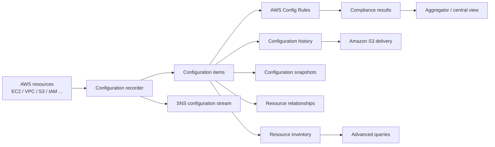
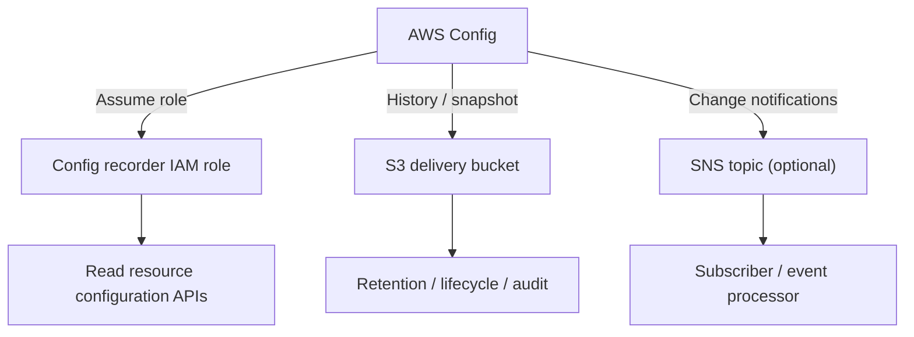
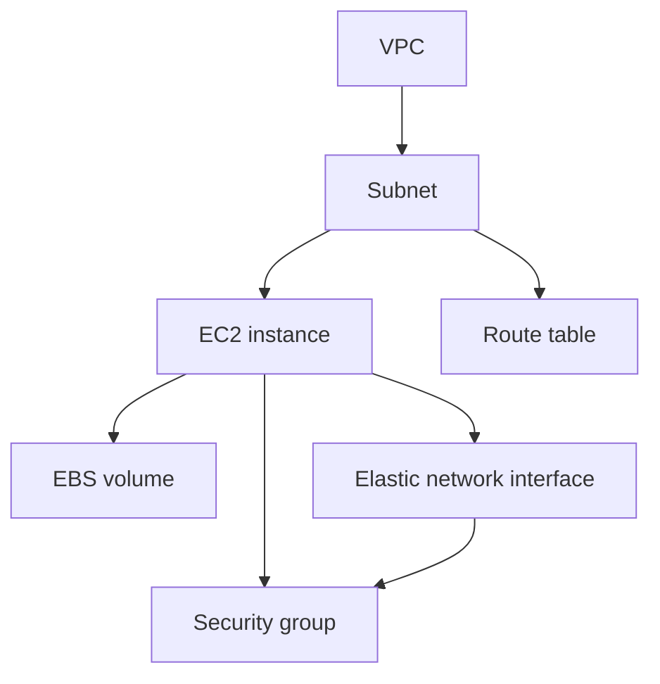
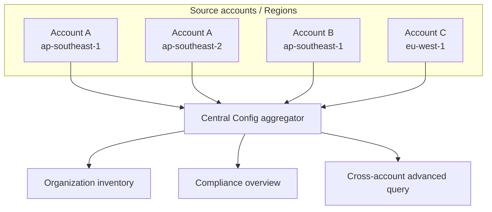
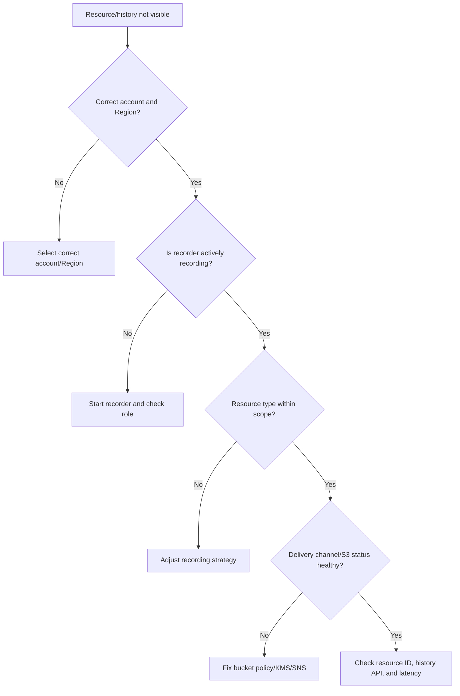

# AWS Config resource inventory and configuration history

## Learning objectives

After this lesson, you can:

1. Explain the role of AWS Config in managing inventory, configurations, and relationships between AWS resources.
2. Distinguish between configuration recorder, configuration item, configuration history, configuration snapshot, and delivery channel.
3. Choose a recording strategy and recording frequency suited to governance scope, cost, and audit requirements.
4. Configure AWS Config per Region with an IAM role, S3 delivery bucket, and SNS notification topic.
5. Look up resource inventory, current configuration, and change history using the Console, AWS CLI, and API.
6. Use the resource timeline and resource relationships to analyze the impact of changes.
7. Distinguish AWS Config from CloudTrail and understand how the two services complement each other.
8. Use AWS Config Rules, conformance packs, and remediation to evaluate configurations against policy.
9. Centralize inventory and compliance from multiple accounts/Regions using a configuration aggregator.
10. Query resource metadata using AWS Config Advanced Queries and understand the limits of the SQL subset.
11. Protect Config data, control access permissions, and optimize recording/evaluation costs.
12. Practice enabling the recorder, recording inventory, viewing configuration history, and querying resources in a lab environment.

## 1. What problem does AWS Config solve?

An AWS environment can include hundreds of VPCs, subnets, security groups, EC2 instances, EBS volumes, S3 buckets, IAM roles, and databases. These resources change over time: engineers create new ones, update configurations, attach tags, change security group rules, or delete resources.

By looking only at the AWS Console at the current moment, operations teams struggle to answer:

- Which resources currently exist in the account?
- Which rule in a security group changed, and when?
- Which EC2 instance is this EBS volume currently attached to?
- Does an S3 bucket have versioning and public access block enabled?
- How does the current configuration differ from last week's configuration?
- Does a resource violate internal policies or compliance requirements?

**AWS Config** provides inventory and configuration history for supported AWS resources in an account/Region. The service discovers resources, records configuration items, maps relationships between resources, and can evaluate configurations against AWS Config Rules.



AWS Config fits questions about **what configuration a resource currently has, how its configuration changed, and whether it meets policy**.

### 1.1. How do AWS Config and CloudTrail differ?

The two services are commonly used together in auditing:

| Service | Focuses on | Typical questions |
| --- | --- | --- |
| **AWS Config** | Resource configuration state and configuration history over time. | Which rules does the security group currently have? How did the VPC change its CIDR or routes? |
| **AWS CloudTrail** | API activity and the identity performing the action. | Who called AuthorizeSecurityGroupIngress? When and from where was the API called? |

For example: AWS Config shows that a security group gained a new ingress rule and the timeline shows the before/after configuration. CloudTrail helps identify the API call, principal, and request context that made that change.

The AWS Config timeline can display related CloudTrail events to assist investigations. However, AWS Config does not replace CloudTrail when you need to audit API activity, identities, or management/data events.

### 1.2. Use cases

- **Inventory:** list EC2, VPC, S3 buckets, IAM resources, and supported resource types.
- **Configuration history:** identify configuration changes by resource and time.
- **Impact analysis:** view relationships between EC2, EBS, security groups, subnets, and VPCs.
- **Compliance:** check encryption, public access, required tags, network exposure, and other configuration requirements.
- **Troubleshooting:** find the last configuration before an incident occurred.
- **Governance:** aggregate inventory/compliance across multiple accounts and Regions.

## 2. Core components of AWS Config

### 2.1. Configuration recorder

The **configuration recorder** tracks resource types within the recording scope and stores changes as configuration items (CIs).

Key points to remember:

- The recorder is configured per account and Region.
- Each account/Region has at most one customer-managed configuration recorder.
- AWS Config also has service-linked configuration recorders tied to an AWS service; resource scope is determined by the linked service.
- A customer-managed recorder uses an IAM role that AWS Config can assume to read resource configurations.
- The recorder must be started for AWS Config to begin recording changes.

A recorder does not automatically record every AWS resource. The resource type must be supported by AWS Config and included in the configured recording strategy.

### 2.2. Configuration item (CI)

A **configuration item** is a point-in-time snapshot of a recorded resource's configuration. A CI typically contains:

- Resource type, resource ID, and ARN if applicable.
- Account ID and Region.
- Capture timestamp.
- Resource creation time and resource state.
- Configuration attributes.
- Tags.
- Relationships to other resources.
- Metadata and related events by resource type.

For example, a CI for an EC2 instance can show the instance type, image ID, subnet, VPC, security groups, IAM profile, and state at the time of capture.

A CI is point-in-time configuration data. It is not a full backup of all data inside the resource, such as the filesystem contents of EC2 or object bodies in S3.

To detect changes, AWS Config calls the corresponding service's Describe/List APIs and retrieves the configuration of related resources. The service also checks configurations periodically to detect certain changes that do not originate directly from API calls.

### 2.3. Configuration history

**Configuration history** is the collection of configuration items for a resource over time. It helps answer:

- When was the resource first discovered?
- Which attributes changed between two points in time?
- How was the resource configured before a deployment?
- Roughly when was the resource deleted?

AWS Config creates history files by resource type and delivers them to the S3 bucket configured in the delivery channel. History files are typically delivered approximately every six hours; actual delivery times may vary because delivery operates on a best-effort basis.

History only starts from when the recorder begins recording. AWS Config cannot reconstruct complete configuration history from before the recorder was enabled.

### 2.4. Configuration snapshot

A **configuration snapshot** is a collection of configuration items for recorded resources that exist in the account/Region at the time the snapshot is created.

Snapshots are useful for:

- Reviewing inventory at a point in time.
- Exporting data for analysis or archiving.
- Comparing configurations across time milestones.
- Supporting audit workflows or periodic checks.

Snapshots differ from history: a snapshot is an overall picture at a point in time; history is the sequence of states of individual resources over time.

### 2.5. Configuration stream and delivery channel

The configuration stream is a notification stream about new configuration items. AWS Config can send notifications to an SNS topic so other systems can process changes.

The **delivery channel** defines the destination for configuration history and snapshots:

- An S3 bucket to store history files and snapshots.
- An optional S3 key prefix to organize data.
- An optional KMS key to encrypt data with a customer-managed key.
- An optional SNS topic to receive configuration stream notifications.

Each account/Region has only one delivery channel, and the delivery channel is a required component when configuring AWS Config.

## 3. Selecting resource types and recording frequency

### 3.1. Recording strategies

AWS Config supports three main strategies:

| Strategy | How it works | When to consider |
| --- | --- | --- |
| **All supported resource types** | Records currently supported resource types and automatically picks up new resource types as AWS Config adds support. | Need broad inventory, want to reduce risk of missing new resource types. |
| **Inclusion by resource types** | Records only explicitly listed resource types. | Have a narrow control scope, need to limit data/evaluations/cost. |
| **Exclusion by resource types** | Records all supported resource types except those excluded. | Want broad coverage while excluding specific resource types with unsuitable volume/cost. |

Example resource types you can select:

```text
AWS::EC2::Instance
AWS::EC2::SecurityGroup
AWS::EC2::VPC
AWS::EC2::Subnet
AWS::EC2::Volume
AWS::S3::Bucket
AWS::RDS::DBInstance
AWS::IAM::Role
```

The list above is just an example. Before configuring, check AWS Config Supported Resource Types and resource coverage by Region. Not every resource type is supported in every Region.

### 3.2. Global resource types

Some resource types are global in scope, such as certain IAM resource types. Recording global resources depends on the recording strategy and the Region where AWS Config supports them.

With the all-supported strategy, AWS Config excludes certain global IAM resource types by default unless the configuration includes them and the Region supports that recording method. With the exclusion strategy, read the semantics carefully because newly supported resource types may be recorded automatically; do not assume `includeGlobalResourceTypes=false` always excludes all global resources.

Commonly referenced global IAM resource types include AWS::IAM::Group, AWS::IAM::Policy, AWS::IAM::Role, and AWS::IAM::User. Support for recording these types depends on Region and recording strategy; check global resource documentation before designing coverage.

Example recording group recording only specific resource types:

```json
{
  "allSupported": false,
  "includeGlobalResourceTypes": false,
  "recordingStrategy": {
    "useOnly": "INCLUSION_BY_RESOURCE_TYPES"
  },
  "resourceTypes": [
    "AWS::EC2::Instance",
    "AWS::EC2::SecurityGroup",
    "AWS::S3::Bucket"
  ]
}
```

Example recording group recording all supported resource types except a few:

```json
{
  "allSupported": false,
  "includeGlobalResourceTypes": false,
  "exclusionByResourceTypes": {
    "resourceTypes": [
      "AWS::Redshift::ClusterSnapshot",
      "AWS::RDS::DBClusterSnapshot"
    ]
  },
  "recordingStrategy": {
    "useOnly": "EXCLUSION_BY_RESOURCE_TYPES"
  }
}
```

With EXCLUSION_BY_RESOURCE_TYPES, exclusionByResourceTypes defines the types excluded from recording; check global resource type rules before using this strategy.

If you need organization-wide IAM inventory, select the Region/strategy according to current coverage documentation and avoid accidentally creating duplicate records or gaps.

### 3.3. Continuous and daily recording

AWS Config supports two recording frequencies:

| Frequency | How it works | Trade-offs |
| --- | --- | --- |
| **Continuous** | Records configuration changes when changes are detected. | More detailed history and suited for fast change detection; may generate more CIs. |
| **Daily** | Records a CI representing the latest state within a 24-hour cycle if different from the previous CI. | Reduces recording frequency for resources needing less immediate history; unsuitable for investigating intra-day changes. |

You can set a default frequency and override it for specific resource types. AWS Firewall Manager depends on continuous recording to monitor resources; if using Firewall Manager, keep continuous recording per AWS guidance.

Certain resource types such as AWS::Config::ResourceCompliance, AWS::Config::ConformancePackCompliance, and AWS::Config::ConfigurationRecorder do not support daily recording. AWS Config keeps them on continuous recording in applicable recording strategies.

### 3.4. Choosing scope by need

A recording decision should consider:

1. Which resource types are in audit/compliance scope?
2. Which Regions host those resources?
3. Is near-real-time history required, or is daily sufficient?
4. Does the workload have many ephemeral resources constantly created/deleted?
5. Is compliance history needed for resources/rules?
6. Is the cost of configuration items and rule evaluations acceptable?

Do not select certain resource types simply because they are common. Tie scope to control objectives, application architecture, and audit requirements.

## 4. Setting up AWS Config: recorder, IAM, S3, and SNS

### 4.1. Deployment architecture



AWS Config needs an IAM role to read resource configurations. The delivery channel requires an S3 bucket; an SNS topic is optional if you want to receive configuration stream notifications.

### 4.2. IAM role for AWS Config

The role needs a trust policy for the service principal `config.amazonaws.com`:

```json
{
  "Version": "2012-10-17",
  "Statement": [
    {
      "Sid": "AllowAWSConfigAssumeRole",
      "Effect": "Allow",
      "Principal": {
        "Service": "config.amazonaws.com"
      },
      "Action": "sts:AssumeRole"
    }
  ]
}
```

The role needs permissions for AWS Config to read configurations of recorded resources and deliver data to configured destinations. You can start with the AWS managed policy `AWS_ConfigRole` or a role created through the AWS Config console, then add S3/KMS/SNS permissions matching your delivery design. Review current policies before using in production.

Do not grant account-wide admin permissions to the recorder just to avoid AccessDenied errors. Scope IAM permissions to actual resource coverage, S3 bucket, KMS key, and SNS topic.

### 4.3. S3 bucket receiving history and snapshots

The delivery bucket should:

- Block public access.
- Use encryption at rest (default SSE-S3 or SSE-KMS if required).
- Have a bucket policy allowing the AWS Config role/service to write objects to the right prefix.
- Have a lifecycle/retention policy matching audit and legal hold requirements.
- Use CloudTrail data events if the organization needs to audit reads/writes of objects in the bucket.
- Avoid broad read access because history/snapshots can expose architecture, resource identifiers, tags, network settings, and sensitive configurations.

If using an existing bucket or cross-account bucket, configure the bucket policy so AWS Config can verify the bucket and write objects. When using a service-linked role, AWS Config can write via the `config.amazonaws.com` service principal; when using a recorder role, delivery may use that role. Design the policy according to the exact role model and AWS Config S3 bucket permissions documentation.

AWS Config supports encrypting S3 deliveries with a specified KMS key. The KMS key policy must allow the appropriate principal/service. AWS Config does not support delivery channels to buckets with S3 Object Lock enabled with default retention enabled; verify compatibility before applying Object Lock to this bucket.

### 4.4. SNS topic for configuration stream

An optional SNS topic sends notifications when configuration items or compliance states change. The topic must be in the same Region as the AWS Config delivery channel.

Subscribers can include:

- Lambda to trigger workflows.
- SQS for asynchronous processing.
- HTTPS endpoints to integrate internal systems.
- Email for appropriate operational notifications.

Keep notification handlers idempotent because subscribers may receive duplicate notifications or reprocess messages. For notifications exceeding the SNS size limit, the payload may contain only a summary and a reference to an S3 object; subscribers must handle that case.

### 4.5. One delivery channel per Region

AWS Config allows only one delivery channel per account/Region. Therefore, design the bucket/prefix and topic clearly for the recorders/resource scopes in the Region. If you want to route data from multiple Regions into the same bucket, you can use the same bucket with prefixes separated by account/Region.

## 5. Resource inventory and relationships between resources

### 5.1. Current inventory

When the recorder starts operating, AWS Config discovers supported resources in scope and creates initial configuration items. Resource inventory in the console allows filtering by:

- Resource category/type.
- Resource ID or resource name.
- Compliance status when Config Rules exist.
- Deleted resources if the corresponding display option is enabled.

Inventory reflects only the resource types and Regions that AWS Config is recording. If the recorder does not include AWS::RDS::DBInstance, you cannot conclude the inventory has no RDS instances just because a query returns no results.

### 5.2. Resource relationships

AWS Config can record relationships between resources. For example:



Relationships help analyze impact:

- Which instances could a security group change affect?
- Which instance is an EBS volume attached to?
- Which VPC does a subnet belong to and which route table does it use?
- Which resources is a network interface attached to?

Relationships depend on resource types and AWS Config support. Do not assume all business relationships or application logical dependencies are represented.

### 5.3. Resource timeline

From Resource inventory, select a resource to open its detail page. This page can display:

- Current configuration.
- Relationships.
- Number of changes.
- Resource timeline.

The timeline can be filtered by configuration events, compliance events, or CloudTrail events. This places configuration changes alongside compliance status and related API activity.

## 6. Configuration history, snapshots, and querying history

### 6.1. Viewing history in the Console

Workflow:

1. Open AWS Config in the right Region.
2. Select Resources/Resource inventory.
3. Find the resource by type or ID.
4. Open resource details.
5. Select Resource timeline.
6. Choose the timeframe and event types to view.
7. Compare configuration items before/after a change.

If a resource was deleted, enable Include deleted resources when searching inventory if you need to view retained history.

### 6.2. Retrieving current configuration with the AWS CLI

Use `get-resource-config` to read the current configuration item:

```bash
aws configservice get-resource-config \
  --resource-type AWS::EC2::SecurityGroup \
  --resource-id sg-0123456789abcdef0
```

The command returns the configuration item of the resource if AWS Config has discovered and recorded that resource type. Replace resource type/ID with actual values in your lab account.

### 6.3. Retrieving configuration history

Use `get-resource-config-history`:

```bash
aws configservice get-resource-config-history \
  --resource-type AWS::EC2::SecurityGroup \
  --resource-id sg-0123456789abcdef0 \
  --chronological-order Reverse \
  --limit 10
```

Parameters:

- `resource-type`: resource type following the AWS Config resource type name.
- `resource-id`: ID of the resource.
- `Chronological-order Reverse`: returns newer CIs first.
- `limit`: limits the number of CIs in one response; use pagination tokens if more data exists.

The API can return multiple configuration items. Use `configurationItemCaptureTime` to sort and compare changes. If the resource type is not recorded by the recorder, history may lack the expected data.

### 6.4. Configuration snapshot

You can request AWS Config to generate a snapshot and deliver it through the delivery channel:

```bash
aws configservice deliver-config-snapshot \
  --delivery-channel-name default
```

Check snapshot delivery status:

```bash
aws configservice describe-delivery-channel-status
```

Snapshots are stored in S3 under the delivery channel's bucket/prefix. The object path depends on account, Region, and delivery configuration; do not hard-code paths in automation without checking the actual object structure.

### 6.5. History in S3

AWS Config delivers configuration history files by resource type to the specified bucket. These files can be used for:

- Offline analysis.
- Data lake or Athena workflows.
- Audit evidence.
- Comparing inventory across periods.
- Long-term retention per policy.

History files are typically delivered about every six hours, though actual timing is best effort. If you need near-real-time reactions, use the SNS configuration stream or an appropriate event-driven workflow; do not poll S3 history files expecting second-by-second updates.

### 6.6. Distinguishing configuration history and compliance history

Resource configuration history shows that resource attributes changed. Compliance history shows that evaluation results of Config Rules changed over time.

If you need to see compliance changes in the resource timeline, AWS Config provides compliance history resource types such as AWS::Config::ResourceCompliance and AWS::Config::ConformancePackCompliance. Recording these resource types supports the compliance timeline history; they are not prerequisites for Config Rules to evaluate current compliance. Some compliance history types require continuous recording.

## 7. Advanced Queries: querying inventory with a SQL subset

### 7.1. What are Advanced Queries used for?

AWS Config Advanced Queries allow querying current configuration metadata of supported resources using a SQL subset. You do not have to call each service-specific Describe API to obtain basic inventory.

Example questions:

- List all EC2 instances.
- Find S3 buckets or resources by Region.
- Count resources by account/type.
- Find resources with a specific configuration if that property is in the Config schema.
- Query an aggregator to consolidate across multiple accounts/Regions.

### 7.2. Query examples

List EC2 instances:

```sql
SELECT
  accountId,
  awsRegion,
  resourceId,
  resourceName
WHERE
  resourceType = 'AWS::EC2::Instance'
```

Count resources by type:

```sql
SELECT
  resourceType,
  COUNT(*)
GROUP BY
  resourceType
```

List S3 buckets:

```sql
SELECT
  accountId,
  awsRegion,
  resourceId,
  resourceName
WHERE
  resourceType = 'AWS::S3::Bucket'
```

Queryable properties depend on the AWS Config resource schema. Look up property names/types in the current schema list before writing queries against specific configuration fields.

### 7.3. Running queries via CLI

```bash
aws configservice select-resource-config \
  --expression "SELECT accountId, awsRegion, resourceId WHERE resourceType = 'AWS::EC2::Instance'"
```

When there are many results, handle `NextToken` to fetch the next page. With an aggregator, you can use the corresponding API to query aggregated resource configurations from a central account.

### 7.4. Limitations of the SQL subset

Advanced Queries is not a full SQL engine:

- Queries only current configuration state; does not replace configuration history.
- Cannot query resource types not recorded by the recorder.
- Does not support JOIN, UNION, HAVING, DISTINCT, FROM, or AS like standard SQL.
- Does not support NULL queries and certain nested structures, such as unpacking tags the way a SQL database normally does.
- `SELECT *` returns only supported top-level scalar properties, not the entire configuration object.
- Does not support querying deleted resources via Advanced Queries.
- Wildcards are limited and apply only to property values per AWS Config rules.

When you need history, use resource history APIs or S3 history files. When you need deep querying of nested structures, inspect configuration item JSON or use an appropriate data analytics system.

## 8. AWS Config Rules and compliance

### 8.1. AWS Config Rule

A Config Rule is a compliance check that evaluates resource configurations against desired conditions.

Examples:

- S3 buckets must not allow public read/write.
- EBS volumes must be encrypted.
- EC2 instances must have required tags.
- RDS databases must not be publicly accessible.
- Security groups must not open SSH to the entire Internet.
- CloudTrail must be enabled per governance requirements.

Rules evaluate configured resource types and scope. If the recorder does not record the needed resource type, the rule lacks sufficient configuration data to evaluate accurately.

### 8.2. Managed rules and custom rules

| Type | Description | Example |
| --- | --- | --- |
| AWS managed rule | Prebuilt rule provided by AWS; parameters can be configured. | S3_BUCKET_PUBLIC_READ_PROHIBITED. |
| Custom Lambda rule | Evaluation logic written by the organization in Lambda. | Check resource naming against internal conventions. |
| Custom policy rule | Policy written in AWS Config Guard. | Check a set of configuration attributes against policy. |

Prefer managed rules when an existing rule meets the control objective. Custom rules fit when internal requirements are not covered by built-in rules.

### 8.3. Evaluation triggers

AWS Config Rules can be evaluated:

- **Configuration change:** a resource changes and matches the rule's scope.
- **Periodic:** on a schedule, such as every 24 hours.
- **Hybrid:** combines configuration change and periodic depending on the rule.

Configuration-change triggers fit changes needing early detection. Periodic evaluation is useful for conditions requiring periodic re-evaluation or resource states that can change in ways the rule needs to recheck.

### 8.4. Detective and proactive evaluation

| Mode | Purpose | Timing |
| --- | --- | --- |
| Detective | Evaluates configurations of deployed resources. | After a resource exists/changes or on a schedule. |
| Proactive | Evaluates planned properties before deploying a resource. | Before a resource is created/updated. |

Proactive evaluation helps detect planned configurations that fail policy. It does not automatically block deployments and does not automatically remediate resources marked NON_COMPLIANT. Blocking deployments requires integrating with pipelines or appropriate preventive controls.

### 8.5. Compliance statuses

For Config Rule evaluation results, the main statuses are:

| Status | Meaning |
| --- | --- |
| COMPLIANT | Resource meets the rule condition. |
| NON_COMPLIANT | Resource does not meet the rule condition. |
| NOT_APPLICABLE | Rule does not apply to that resource. |
| ERROR | Evaluation encountered an error, such as invalid parameters or wrong data type. |

At the compliance summary level, AWS Config can return INSUFFICIENT_DATA when there are not yet evaluation results for a resource or rule. Some conformance pack summaries also use this status when no rules can be evaluated due to missing data.

Do not treat INSUFFICIENT_DATA or ERROR as COMPLIANT. Compliance dashboards should distinguish resources failing policy from rules not yet evaluated or evaluations that errored.

## 9. Conformance packs and remediation

### 9.1. Conformance pack

A conformance pack is a collection of AWS Config Rules and remediation actions deployed/monitored as a single unit.

For example, a baseline might include:

- S3 bucket public access prohibited.
- EBS volume encryption must be enabled.
- Required tags must be present.
- RDS backup retention meets minimum level.
- Security groups do not open management ports to the entire Internet.

A conformance pack is defined in a YAML template and can be deployed to an account/Region or across an AWS Organization. Before deploying, enable AWS Config recording and ensure the resource types to evaluate are recorded.

Minimal template example:

```yaml
Resources:
  S3BucketPublicReadProhibited:
    Type: AWS::Config::ConfigRule
    Properties:
      ConfigRuleName: s3-bucket-public-read-prohibited
      Source:
        Owner: AWS
        SourceIdentifier: S3_BUCKET_PUBLIC_READ_PROHIBITED
```

Deploy from a template file:

```bash
aws configservice put-conformance-pack \
  --conformance-pack-name security-baseline \
  --template-body file://security-baseline.yaml
```

This is a minimal example. Real templates must verify rule names, parameters, Region support, and prerequisites for each rule.

### 9.2. Remediation

When a rule reports NON_COMPLIANT, the organization can:

- Send notifications for operations teams to handle manually.
- Run an SSM Automation document to fix the configuration.
- Use a built-in remediation action or custom SSM document.
- Document an exception if there is a valid business justification and approved expiration.

Automatic remediation must be designed carefully:

1. Choose only predictable and reversible actions.
2. Use an automation role with least privilege.
3. Test on lab resources first.
4. Verify resource ID and account/Region parameters.
5. Implement retry limits, logging, and error notifications.
6. Provide an exception/manual approval mechanism for sensitive resources.

AWS Config auto-remediation relies on periodic compliance data snapshots. In some cases, a resource recently fixed to be compliant may still be processed based on an older snapshot. Therefore, auto-remediation can act on a resource whose state changed right before execution; design automation to be idempotent, perform precondition checks, and avoid destructive actions.

## 10. Multi-account and multi-Region aggregators

### 10.1. What is an aggregator?

A configuration aggregator gathers AWS Config configuration data and compliance data from multiple source accounts/Regions into a central account/Region.



Aggregators fit:

- Central security/compliance teams.
- Organization-wide resource inventory.
- Comparing compliance across accounts/Regions.
- Organization-wide resource querying.
- Tracking resource relationships at broad scope.

### 10.2. Source accounts and authorization

You can aggregate:

- A specified list of account IDs.
- Accounts belonging to AWS Organizations.
- Multiple Regions or all supported Regions.

For individually specified source accounts, the owner must grant aggregation authorization to the aggregator account/Region. When aggregating accounts in AWS Organizations, AWS Config provides an authorization mechanism based on the organization setup.

Sources must have AWS Config enabled and data recorded. An aggregator does not automatically enable recorders in source accounts.

### 10.3. Aggregator is a read-only view

An aggregator copies authorized configuration/compliance data for centralized display. It does not grant permission to modify resources in source accounts, does not deploy Config Rules on behalf of source accounts, and does not push snapshot files back to source accounts.

Deploying rules/conformance packs still requires organization deployment mechanisms or operations in source accounts/Regions.

AWS Config documentation states that an aggregator incurs no separate additional fee for aggregation itself; costs for recording resources, rule evaluations, S3, SNS, and remediation in source accounts still apply.

## 11. Security, operations, and cost optimization

### 11.1. Protecting configuration history

History and snapshots can expose:

- Resource IDs/ARNs and internal names.
- Network topology, subnets, routes, and security group rules.
- Tags that may contain environment/application details.
- Sensitive configuration attributes depending on resource type.

Practices:

- Block public access on the S3 bucket.
- Use encryption at rest and TLS.
- Restrict S3 GetObject/ListBucket by account, Region, and prefix.
- Restrict KMS decrypt to groups needing to read evidence.
- Enable auditing for bucket read/write permissions if required.
- Configure retention/lifecycle aligned with policy.
- Separate permissions for recorder administration, reading evidence, and remediation.

### 11.2. Monitoring recorder and delivery status

Useful APIs:

```bash
aws configservice describe-configuration-recorders
aws configservice describe-configuration-recorder-status
aws configservice describe-delivery-channels
aws configservice describe-delivery-channel-status
```

Check:

- Does the recorder exist and is it actively recording?
- Is the role ARN correct and assumable?
- Does the recording group include needed resource types?
- Does the delivery channel point to the right bucket/prefix/topic?
- Does S3 delivery status show any AccessDenied errors?
- Does the SNS topic policy allow AWS Config to publish?

### 11.3. Cost optimization

AWS Config costs are typically driven by:

- Number of configuration items recorded.
- Frequency of resource changes.
- Number of resource types and Regions/accounts with recorders enabled.
- Number of AWS Config Rule evaluations.
- Conformance packs and rule evaluations inside them.
- S3 storage/requests and SNS notifications.
- SSM Automation executions during remediation.

Ephemeral workloads such as autoscaling/containers/continuously created and deleted resources can cause configuration item counts to grow rapidly. Evaluate recording frequency and resource scope based on actual audit requirements.

Ways to control costs:

- Use daily recording for appropriate resource types if continuous history is unnecessary.
- Choose inclusion/exclusion strategies intentionally.
- Avoid deploying duplicate rules/conformance packs across multiple layers.
- Monitor Config usage metrics and billing dimensions.
- Configure S3 lifecycle for history data per retention requirements.
- Limit remediation retries.

Do not exclude resources from the recorder solely to reduce cost if those resources belong to mandatory security/compliance controls.

### 11.4. Limits and latency

- Resource type coverage varies by Region.
- Initial inventory discovery may take time.
- Configuration changes are recorded on a best-effort basis; do not treat Config as a strict real-time event bus.
- History files to S3 typically arrive roughly every six hours.
- Advanced Queries only query current recorded configuration data.
- Aggregator data replication and compliance evaluation may take time before displaying completely.

## 12. Lab: enabling AWS Config and checking inventory/history

The lab uses the AWS CLI in a sandbox account. Prepare beforehand:

- AWS CLI configured with credentials.
- IAM role for AWS Config with appropriate trust policy and permissions.
- Dedicated S3 bucket for Config delivery.
- SNS topic in the same Region if you want notifications.
- Permissions to run Config service commands in the account.

> Do not use buckets containing application data or production state as a lab bucket. Use a dedicated, private bucket with a policy configured for AWS Config.

### 12.1. Verify account and Region

```bash
aws sts get-caller-identity
aws configure get region
```

Set variables for your environment:

```bash
export AWS_REGION=ap-southeast-1
export ACCOUNT_ID=123456789012
export CONFIG_BUCKET=company-config-lab-123456789012
export CONFIG_ROLE_ARN=arn:aws:iam::123456789012:role/AWSConfigRecorderRole
```

Replace account ID, bucket, and role ARN with real sandbox values. Verify the bucket exists and the role trust policy allows `config.amazonaws.com` to assume it.

### 12.2. Create configuration recorder files

Create `configuration-recorder.json`:

```json
{
  "name": "default",
  "roleARN": "arn:aws:iam::123456789012:role/AWSConfigRecorderRole",
  "recordingMode": {
    "recordingFrequency": "CONTINUOUS"
  }
}
```

Create `recording-group.json`:

```json
{
  "allSupported": true,
  "includeGlobalResourceTypes": false,
  "recordingStrategy": {
    "useOnly": "ALL_SUPPORTED_RESOURCE_TYPES"
  }
}
```

This example records all supported resource types in the Region and does not request recording global IAM resource types. If global IAM resource coverage is needed, verify Region support and choose the appropriate recording strategy.

### 12.3. Create the recorder and delivery channel

Create the recorder:

```bash
aws configservice put-configuration-recorder \
  --configuration-recorder file://configuration-recorder.json \
  --recording-group file://recording-group.json \
  --region "$AWS_REGION"
```

Create the delivery channel:

```bash
aws configservice put-delivery-channel \
  --delivery-channel "name=default,s3BucketName=$CONFIG_BUCKET,s3KeyPrefix=config/$AWS_REGION" \
  --region "$AWS_REGION"
```

If using a KMS key, configure `s3KmsKeyArn` in the delivery channel and update the KMS key policy. If notifications are wanted, add `snsTopicARN` pointing to an SNS topic in the same Region.

Start the recorder:

```bash
aws configservice start-configuration-recorder \
  --configuration-recorder-name default \
  --region "$AWS_REGION"
```

### 12.4. Verify recorder and delivery

```bash
aws configservice describe-configuration-recorders \
  --region "$AWS_REGION"

aws configservice describe-configuration-recorder-status \
  --region "$AWS_REGION"

aws configservice describe-delivery-channels \
  --region "$AWS_REGION"

aws configservice describe-delivery-channel-status \
  --region "$AWS_REGION"
```

Wait for AWS Config to discover resources. Inventory appearance is not necessarily instantaneous; check status and delivery errors if data has still not appeared after a while.

### 12.5. List discovered resources

```bash
aws configservice list-discovered-resources \
  --resource-type AWS::EC2::Instance \
  --region "$AWS_REGION"
```

If the account has no EC2 instances or the resource type is not recorded by the recorder, the result may be empty. You can substitute a resource type that exists in the lab.

### 12.6. View current resource and history

After obtaining a resource ID from the previous step, query:

```bash
aws configservice get-resource-config \
  --resource-type AWS::EC2::Instance \
  --resource-id i-0123456789abcdef0 \
  --region "$AWS_REGION"

aws configservice get-resource-config-history \
  --resource-type AWS::EC2::Instance \
  --resource-id i-0123456789abcdef0 \
  --chronological-order Reverse \
  --limit 10 \
  --region "$AWS_REGION"
```

Replace the instance ID with an actual resource ID. If the resource has never been recorded, the commands cannot provide history prior to when the recorder started.

### 12.7. Run an Advanced Query

```bash
aws configservice select-resource-config \
  --expression "SELECT accountId, awsRegion, resourceId WHERE resourceType = 'AWS::EC2::Instance'" \
  --region "$AWS_REGION"
```

Open the AWS Config console, go to Advanced queries to view query results and save the query if reuse is needed. Compare results with resource inventory.

### 12.8. Create a configuration snapshot

```bash
aws configservice deliver-config-snapshot \
  --delivery-channel-name default \
  --region "$AWS_REGION"

aws configservice describe-delivery-channel-status \
  --region "$AWS_REGION"
```

Check the S3 prefix `config/$AWS_REGION` to verify snapshot/history files were delivered. Appearance timing depends on delivery processing.

### 12.9. Cleanup

If the lab account permits disabling AWS Config after practice:

1. Save any needed evidence.
2. Stop the recorder.
3. Delete the delivery channel.
4. Delete the configuration recorder.
5. Handle S3 history/snapshot data per retention policy.
6. Only delete the IAM role, S3 bucket, or SNS topic if they were created specifically for the lab and are no longer used.

Stop and delete commands:

```bash
aws configservice stop-configuration-recorder \
  --configuration-recorder-name default \
  --region "$AWS_REGION"

aws configservice delete-delivery-channel \
  --delivery-channel-name default \
  --region "$AWS_REGION"

aws configservice delete-configuration-recorder \
  --configuration-recorder-name default \
  --region "$AWS_REGION"
```

Do not delete recorders or delivery channels in shared/production accounts. Stopping AWS Config stops recording new changes in that Region.

## 13. Troubleshooting

| Symptom | Common cause | Investigation steps |
| --- | --- | --- |
| Inventory is empty | Recorder not started, wrong Region, or resource type not recorded. | Check recorder status, recording group, and resource coverage. |
| No history before a certain date | Recorder only started recording from that date. | Confirm start time; Config does not reconstruct prior history. |
| Recorder will not start | Wrong IAM role ARN or insufficient trust/permissions. | Check `config.amazonaws.com` trust principal and role policies. |
| S3 delivery AccessDenied | Bucket policy missing permissions or role lacks HeadBucket/PutObject. | Check IAM role, bucket policy, prefix, SourceAccount/SourceArn, and encryption key. |
| SNS receives no notifications | Topic in another Region or topic policy denies AWS Config publish. | Check SNS topic ARN, Region, and topic policy. |
| Cannot create delivery channel | Channel already exists or wrong bucket name/permissions. | Only one channel per account/Region; check `describe-delivery-channels`. |
| Resource type has no data | Type unsupported in Region or outside recorder scope. | Check Supported Resource Types and recording strategy. |
| Global IAM resources missing | Recording strategy/Region does not record global IAM types. | Verify coverage and `includeGlobalResourceTypes`/recording strategy. |
| Advanced Query returns few results | Resource type not recorded or query uses wrong property. | Check recorder, schema, and query language limits. |
| Compliance has no results | Rule not yet evaluated or resource missing configuration item. | Check rule scope, trigger, recorder, and evaluation status. |
| Aggregator has no source data | Source Config not enabled or authorization/organization setup incorrect. | Check source recorder, Region list, and aggregator source status. |
| Auto-remediation affects wrong resource | Compliance snapshot may be stale or automation lacks preconditions. | Add validation in SSM document, limit scope/retries, and prefer manual remediation. |

### 13.1. Quick troubleshooting checklist



## 14. Common misconceptions

**Misconception 1: “AWS Config records every AWS resource.”**

No. Only resource types that are supported and included in the recording scope are recorded.

**Misconception 2: “Enabling AWS Config today provides configuration history from last month.”**

No. History begins from when the recorder starts recording.

**Misconception 3: “Configuration snapshot and configuration history are the same.”**

No. A snapshot is the set of configurations at one point in time; history is the sequence of configuration items for a resource over time.

**Misconception 4: “AWS Config tells you exactly who called an API.”**

No. CloudTrail is the source for API activity/identity auditing; Config shows configuration state and resource history.

**Misconception 5: “Multiple delivery channels can be created in the same Region.”**

No. There is only one delivery channel per account/Region.

**Misconception 6: “Advanced Queries can query all fields and full history.”**

No. Advanced Queries uses a SQL subset over current recorded configuration metadata and has syntax/schema limits.

**Misconception 7: “An aggregator has permission to modify resources in source accounts.”**

No. An aggregator only provides a read-only aggregated view.

**Misconception 8: “A proactive Config Rule automatically blocks non-compliant resources.”**

No. Proactive evaluation only evaluates planned properties; blocking deployments requires integrating preventive controls/pipelines.

**Misconception 9: “NON_COMPLIANT means AWS Config automatically fixes the resource.”**

No. Remediation must be configured separately, typically via SSM Automation or manual processes.

**Misconception 10: “Without compliance history, Config Rules do not work.”**

No. Compliance history resource types support the historical timeline; current compliance evaluation can still operate without recording them.

## 15. Self-check questions

**Question 1.** What problem does AWS Config solve?

**Answer:** Tracking inventory, configurations, relationships, and change history of supported/recorded AWS resources.

**Question 2.** What is the role of the configuration recorder?

**Answer:** Recording configuration changes of resource types in the recording scope as configuration items.

**Question 3.** What is a configuration item?

**Answer:** A snapshot of a resource's attributes and metadata at a point in time.

**Question 4.** How does a snapshot differ from history?

**Answer:** A snapshot is an inventory picture at a point in time; history is the sequence of configuration items for a resource over time.

**Question 5.** What destinations does an AWS Config delivery channel require?

**Answer:** An S3 bucket to deliver history/snapshots; an SNS topic is optional for configuration stream notifications.

**Question 6.** What is the maximum number of customer-managed configuration recorders and delivery channels per account/Region?

**Answer:** At most one customer-managed recorder and one delivery channel per account/Region.

**Question 7.** How do continuous and daily recording differ?

**Answer:** Continuous records changes as detected; daily records the latest state within a 24-hour cycle if different from the previous CI.

**Question 8.** When does resource history begin?

**Answer:** From when the configuration recorder starts recording that resource type.

**Question 9.** How does CloudTrail complement AWS Config?

**Answer:** CloudTrail provides API events/identity; Config provides before/after resource configurations and history.

**Question 10.** Does Advanced Queries query history?

**Answer:** No. It queries current configuration state; use history APIs/S3 history files for historical data.

**Question 11.** What types of AWS Config Rules exist?

**Answer:** AWS managed rules and custom rules (Lambda or policy/Guard).

**Question 12.** How do detective and proactive evaluation differ?

**Answer:** Detective evaluates deployed resources; proactive evaluates planned properties before deployment.

**Question 13.** What is a conformance pack?

**Answer:** A collection of AWS Config Rules and remediation actions deployed and managed as a single unit.

**Question 14.** Does an aggregator have permission to modify source accounts?

**Answer:** No. An aggregator only provides a read-only aggregated view.

**Question 15.** Why does auto-remediation need preconditions and idempotency?

**Answer:** Compliance snapshots may be stale; automation must verify current state and avoid acting erroneously or repeating destructive actions.

## Official documentation

- [What Is AWS Config?](https://docs.aws.amazon.com/config/latest/developerguide/WhatIsConfig.html)
- [AWS Config terminology and concepts](https://docs.aws.amazon.com/config/latest/developerguide/config-concepts.html)
- [How AWS Config works](https://docs.aws.amazon.com/config/latest/developerguide/how-does-config-work.html)
- [Recording AWS resources](https://docs.aws.amazon.com/config/latest/developerguide/select-resources.html)
- [Supported resource types](https://docs.aws.amazon.com/config/latest/developerguide/resource-config-reference.html)
- [Working with the configuration recorder](https://docs.aws.amazon.com/config/latest/developerguide/stop-start-recorder.html)
- [Recording frequency](https://docs.aws.amazon.com/config/latest/APIReference/API_RecordingMode.html)
- [Working with the delivery channel](https://docs.aws.amazon.com/config/latest/developerguide/manage-delivery-channel.html)
- [S3 bucket permissions for AWS Config](https://docs.aws.amazon.com/config/latest/developerguide/s3-bucket-policy.html)
- [Viewing resource configuration and history](https://docs.aws.amazon.com/config/latest/developerguide/view-manage-resource-console.html)
- [AWS Config Advanced Queries](https://docs.aws.amazon.com/config/latest/developerguide/querying-AWS-resources.html)
- [AWS Config Rules and evaluation modes](https://docs.aws.amazon.com/config/latest/developerguide/config-concepts.html)
- [AWS Config rule evaluation results](https://docs.aws.amazon.com/config/latest/developerguide/evaluate-config_components.html)
- [Conformance packs prerequisites](https://docs.aws.amazon.com/config/latest/developerguide/cpack-prerequisites.html)
- [Setting up auto remediation](https://docs.aws.amazon.com/config/latest/developerguide/setup-autoremediation.html)
- [Multi-account, multi-Region aggregation](https://docs.aws.amazon.com/config/latest/developerguide/aggregate-data.html)
- [Creating configuration aggregators](https://docs.aws.amazon.com/config/latest/developerguide/aggregated-create.html)
- [AWS Config service limits](https://docs.aws.amazon.com/config/latest/developerguide/configlimits.html)
- [AWS Config API Reference](https://docs.aws.amazon.com/config/latest/APIReference/Welcome.html)

**Takeaway:** AWS Config records inventory and configuration history for resource types selected by the recorder. The recorder defines scope/frequency; the delivery channel sends history/snapshots to S3 and can emit notifications via SNS. Use the resource timeline, history APIs, and Advanced Queries to investigate configurations; use Config Rules/conformance packs to evaluate compliance; use an aggregator for a centralized multi-account/Region view. Combine with CloudTrail when you need to know which API and principal made a change.