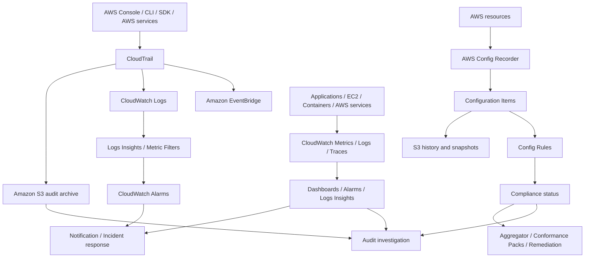
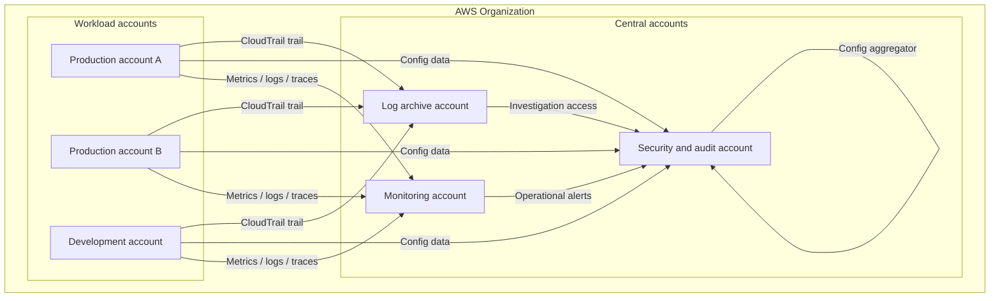

# Distinguishing CloudTrail, CloudWatch, and AWS Config

## 1. Why distinguish the three services?

In an AWS environment, the same incident can raise three different types of questions:

- Who changed the Security Group and which API was called?
- Why did application latency rise, CPU spike, or HTTP errors increase?
- What is the Security Group's current configuration, when did it change, and does it violate security policy?

These three questions are related, yet require three different perspectives:

- **AWS CloudTrail** records activity in an AWS account, especially API operations and identity activity. It helps investigate *who did what, when, where, and by what method*.
- **Amazon CloudWatch** collects and analyzes telemetry to monitor operational health. It helps answer *how the system is performing, whether it is slow or failing, and when to alert*.
- **AWS Config** records configurations of supported resources over time and evaluates those configurations against rules. It helps answer *how a resource is configured, how its configuration changed, and whether it complies with requirements*.

An organization typically needs all three services. CloudTrail provides the activity audit trail, CloudWatch provides observability and alerting, and AWS Config provides resource state history and compliance evaluation. Using the right service speeds up investigations, preserves appropriate evidence, and prevents confusing an API event with configuration state or application health.

This lesson belongs to the **CLOUD_PROVIDERS_AWS** module, where learners explore the AWS ecosystem, practice service selection, and design secure systems with monitoring, resilience, and cost control.

## 2. Learning objectives

After this lesson, learners can:

1. Explain the purpose, inputs, and primary outputs of CloudTrail, CloudWatch, and AWS Config.
2. Distinguish between management events, data events, and operational telemetry.
3. Explain Event history, trails, configuration items, configuration recorders, metrics, log groups, and alarms.
4. Choose the right service for an auditing, operational, or compliance question.
5. Combine the three services to trace who made a change, determine before/after configuration, and assess operational impact.
6. Use the AWS Management Console, AWS CLI, and CloudWatch Logs Insights to inspect data.
7. Recognize recording limits, retention periods, access permissions, and cost drivers for each service.

## 3. Mental model: three different questions

Start with the question the operations team needs to answer.

| Question to answer | Primary service | Data to look for |
|---|---|---|
| Who called which API, which action, when, and from what address? | AWS CloudTrail | Event records, identity, API name, timestamp, Region, request source |
| How is the application or infrastructure performing? | Amazon CloudWatch | Metrics, logs, traces, alarms, dashboards |
| What is the resource's configuration, how has it changed, and is it compliant? | AWS Config | Configuration items, configuration history, Config rules, compliance status |

You can remember this with three short phrases:

- **CloudTrail: actions.**
- **CloudWatch: operations.**
- **AWS Config: configuration state and compliance.**

This is a classification by primary purpose. One data source can be forwarded to or analyzed in another service. For example, CloudTrail can deliver logs to CloudWatch Logs; in that case CloudTrail remains the source recording API activity, while CloudWatch Logs is where logs are centralized, queried, and used to create alerts.

### 3.1. Concrete example

Suppose an engineer modifies a web server's Security Group:

- CloudTrail can show which identity called `AuthorizeSecurityGroupIngress`, when it was called, the source address, Region, and request parameters.
- AWS Config can show which ingress rule was added to the Security Group, its current configuration, and whether the rule violates policy.
- CloudWatch can show whether connections, traffic, latency, or application error rates changed afterward. If CloudTrail is delivered to CloudWatch Logs, CloudWatch can also trigger alerts when defined API event types appear.

None of the three services alone fully answers all three groups of questions.

## 4. High-level comparison table

| Criterion | AWS CloudTrail | Amazon CloudWatch | AWS Config |
|---|---|---|---|
| Primary goal | Account activity auditing and action investigation | Observing system performance, health, and behavior | Tracking resource configurations and evaluating compliance |
| Typical unit of data | Event | Metric datum, log event, trace, alarm state | Configuration item (CI), compliance evaluation |
| Typical question | Who called which API? | Is the system slow or failing? | Does resource configuration meet policy? |
| Data sources | AWS Management Console, CLI, SDK/API, and service activities supported by CloudTrail | AWS services, applications, servers, agents, and OpenTelemetry | Configurations of supported AWS resource types |
| Time perspective | Stream of activity events | Telemetry streams and time-series metrics | Configuration state milestones |
| Analysis | Event History, trails, CloudTrail Lake for eligible existing customers | Metrics, Logs Insights, dashboards, metric math, alarms | Resource timeline/history, Config rules, conformance packs, advanced queries |
| Alerting | Integrates with EventBridge, CloudWatch Logs/alarms, and security tools | Metric alarms; alerts from log/metric filters and monitoring features | Compliance status, SNS, and remediation workflows |
| Typical storage | S3 via trails; Event history has a 90-day limit | CloudWatch Metrics and CloudWatch Logs; configurable retention | Configuration history and snapshots, typically delivered to S3 |
| Audit example | Find who changed an IAM policy | Track CPU, latency, error rate, and application logs | Check whether buckets have encryption or public access enabled |
| What not to expect | Not a CPU profiler or evaluator of all resource configurations | Not a complete ledger of all API actions | Not a store for every API request or performance log |

## 5. AWS CloudTrail: recording account activity

### 5.1. What does CloudTrail record?

AWS CloudTrail provides a history of activity in an AWS account. An event typically describes an action performed by an IAM user, assumed role, root identity, AWS service, or another identity that CloudTrail can record.

Information commonly examined in an event:

- **eventTime**: timestamp of the event.
- **eventSource**: AWS service generating the event, e.g. `ec2.amazonaws.com`.
- **eventName**: operation name, e.g. `RunInstances` or `AuthorizeSecurityGroupIngress`.
- **awsRegion**: Region where the activity was recorded.
- **userIdentity**: identity details of the caller.
- **sourceIPAddress**: source address of the request, when available.
- **userAgent**: tool or client performing the request, when available.
- **requestParameters**: request parameters recorded by CloudTrail.
- **responseElements**: partial response information, if available.
- **errorCode** and **errorMessage**: error details if the request failed.
- **resources**: related resources, if provided.
- **readOnly**: classifies whether the operation is read or write when present in the event record.

An event record is evidence of a recorded activity. It does not necessarily contain full business data of the request, object contents, application payloads, or all sensitive information. Check each AWS service's CloudTrail documentation to know exactly which fields are recorded.

### 5.2. Types of CloudTrail events

CloudTrail has multiple event types. When configuring a trail or event data store, select the exact types of activity you want recorded.

| Event type | Meaning | Examples |
|---|---|---|
| Management events | Control-plane operations managing resources and service configurations | `CreateBucket`, `RunInstances`, `AttachRolePolicy`, `CreateTrail` |
| Data events | Data-plane operations on or inside resources; typically high volume | S3 `GetObject`/`PutObject`, Lambda `Invoke`, SNS `Publish` |
| Network activity events | Network activity supported for recording by CloudTrail, typically related to VPC endpoints and network policies | Activity denied by an endpoint policy |
| Insights events | Detects unusual API activity patterns against a baseline, such as changes in write rate or API error rate | Sudden spike in write activity or API errors |

Key principles:

- Trails and event data stores record management events by default according to default settings.
- Data events, network activity events, and Insights events must be selected explicitly during configuration. Do not assume all object reads or Lambda invocations are already recorded.
- Data events typically have high volume. Choose resource types and resource scope intentionally to control costs.
- Insights must be enabled explicitly and carries separate charges.
- Some non-API-call events, such as console sign-in events, can also be recorded by CloudTrail.

### 5.3. Event history

When an AWS account is created, users can access CloudTrail Event history without creating a trail first.

Characteristics of Event history:

- Provides history of management events for the last 90 days in a Region.
- Can be viewed, filtered, searched, and downloaded.
- Can be queried via AWS CLI using `aws cloudtrail lookup-events`.
- Does not display data events, Insights events, or network activity events.
- Event history searches apply only to one account and one Region at a time, with more limited filtering than a trail or dedicated analytics tools.
- Event history is separate from trails and event data stores. Changing trail configuration does not change Event history.
- Event history does not replace a long-term retention strategy.

If you need continuous activity retention longer than 90 days, configure a trail delivering events to Amazon S3 and design appropriate retention. You can additionally configure CloudWatch Logs or EventBridge destinations for monitoring and automation.

### 5.4. Trails and multi-account organizations

A **trail** is a configuration that records and delivers CloudTrail events. A trail can:

- Record management events and selected event types.
- Record from one Region or multiple Regions.
- Deliver log files to Amazon S3.
- Send events to CloudWatch Logs for querying or alerting.
- Integrate with EventBridge to trigger response workflows.
- Use AWS KMS to encrypt log files in S3.
- Enable log file integrity validation to help detect modified or deleted log files after CloudTrail delivery.

When sending events to CloudWatch Logs, CloudTrail typically delivers within an average of five minutes after the API call, though this timing is not guaranteed. During investigations, distinguish the occurrence time in `eventTime` from when the log was delivered to the log group.

In AWS Organizations environments, organizations can deploy an organization trail to collect activity from member accounts. A common model is:

1. Workload accounts run applications.
2. Security/monitoring account performs centralized monitoring.
3. Log archive account stores audit logs.
4. Organization trail sends logs from accounts and Regions to the central repository.

Centralized configuration reduces the risk of each account managing logs differently. Access permissions to the storage bucket must be restricted so workload administrators cannot arbitrarily delete or modify audit evidence.

### 5.5. Log integrity

CloudTrail supports **log file integrity validation**. When enabled, CloudTrail generates hashes for log files and digitally signed digest files so operators can verify whether log files were modified or deleted after delivery.

Understand the exact scope:

- Enabling validation lets CloudTrail deliver digest files; operators still need to run the verification process.
- Validation helps detect changes after delivery, not prevent a highly privileged identity from altering logging settings beforehand.
- Combine with strict S3 bucket policies, encryption, versioning, retention, Object Lock when immutable storage is required, and separating log administration from workload administration.
- Do not treat checking a single box as a complete evidence preservation strategy.

### 5.6. Note on CloudTrail Lake

Current AWS documentation states CloudTrail Lake is closed to new customers as of 31-05-2026; existing customers can continue using it under terms published by AWS. Therefore, when designing new systems, do not assume CloudTrail Lake is available for new sign-ups. Check AWS's latest availability announcements and evaluate suitable storage/analytics alternatives. Event history and trails to S3 remain foundational pillars of CloudTrail.

### 5.7. When to choose CloudTrail?

Choose CloudTrail as the primary source when you need to:

- Investigate who created, modified, or deleted resources.
- Find history of changes to IAM policies, roles, trust policies, or access keys.
- Audit console, CLI, SDK, and API activity.
- Track data access at the object or invoke level if corresponding data events were enabled.
- Audit activity across multiple accounts/Regions.
- Build activity evidence for security and compliance audits.
- Detect anomalous API behavior when Insights is appropriately configured.

Do not use CloudTrail alone to determine CPU, latency, disk capacity, HTTP error rates, or the current compliance status of all resources.

## 6. Amazon CloudWatch: observing system operations

### 6.1. What does CloudWatch answer?

Amazon CloudWatch monitors AWS resources and applications running on AWS. The service focuses on telemetry: metrics, logs, traces, and operational signals over time.

Common components:

- **CloudWatch Metrics**: data points with timestamp, namespace, metric name, and dimensions.
- **CloudWatch Logs**: collect, store, search, and query logs.
- **CloudWatch Alarms**: evaluate metrics against thresholds or conditions and transition alarm states.
- **Dashboards**: display metrics and logs on a single screen.
- **Logs Insights**: query logs using specialized syntax.
- **Metric filters**: extract metrics from logs.
- **Application Signals, Synthetics, and RUM**: monitor application performance, proactive checks, and real-user session data.
- **CloudWatch Agent and OpenTelemetry**: collect telemetry from servers, applications, and hybrid environments.

Many AWS services automatically send basic metrics to CloudWatch. For applications, development teams can emit custom metrics, structured logs, and traces to track business behavior.

### 6.2. Metrics

A metric is a time-ordered series of data points. Examples:

- `CPUUtilization` of EC2.
- `NetworkIn` and `NetworkOut`.
- API request count, error count, and latency.
- Messages remaining in an SQS queue.
- Lambda invocations, errors, and duration.
- Database connection count or performance.

A metric is identified by namespace, metric name, and a set of dimensions. Dimensions distinguish metrics by resource or attributes such as `InstanceId`, `FunctionName`, `LoadBalancer`, or `QueueName`.

CloudWatch can use metrics to:

- Display trends on dashboards.
- Trigger alarms when values cross thresholds.
- Compute new metrics via metric math.
- Combine multiple metrics to assess service health.
- Detect anomalies using appropriate features.

Do not create excessively high-cardinality dimensions arbitrarily. If every request or every user ID creates a new dimension, metric counts and costs can grow rapidly.

### 6.3. Logs

CloudWatch Logs centralizes logs from many sources, such as:

- Applications running on EC2, ECS, EKS, or Lambda.
- AWS CloudTrail.
- VPC Flow Logs and supported AWS service logs.
- Operating systems, web servers, database proxies, or application-emitted logs.

Common structure:

- **Log group**: groups logs by application, workload, or source.
- **Log stream**: specific log stream inside a log group.
- **Log event**: record with a timestamp and message.

CloudWatch Logs supports searching, filtering, Logs Insights, metric filters, subscription filters, data protection policies, and retention configuration. Log groups have different log classes; check required features and pricing for each class before choosing.

Default retention for a log group is indefinite until a retention policy is set. Therefore, configure intentional retention durations for operational logs, security logs, and logs containing sensitive data.

### 6.4. Alarms and dashboards

A CloudWatch Alarm monitors a metric or metric expression over evaluation periods. When conditions are met, the alarm transitions to states such as OK, ALARM, or INSUFFICIENT_DATA.

Examples:

- Average `CPUUtilization` exceeds 80% over several periods.
- 5xx error rate rises above threshold.
- SQS `ApproximateAgeOfOldestMessage` grows high.
- Lambda `Errors` spikes abnormally.
- Failed login counts extracted from logs exceed threshold.

A good alarm needs to define:

1. Does the metric accurately reflect the risk to detect?
2. Are statistic and period appropriate?
3. Do threshold and evaluation periods minimize false positives?
4. How should missing data be handled?
5. Which notifications or actions will the alarm trigger?
6. Who receives it and where is the runbook?

Dashboards give operations teams a quick view of system health. Group widgets by service or request journey, such as request rate, latency, error rate, saturation, and dependency health.

### 6.5. How CloudTrail and CloudWatch Logs work together

CloudTrail records events; CloudWatch Logs can receive events from a trail. Once received, operators can:

- Search events by API name, identity, Region, or resource.
- Use Logs Insights to query events.
- Create metric filters for an event type.
- Create alarms based on metrics generated from logs.
- Send notifications or integrate response workflows.

For example: the security team wants alerts when IAM policies change. CloudTrail is the source recording API events; CloudWatch Logs is where logs are queried and metric filters emit metrics; CloudWatch Alarms fire alerts when metrics meet conditions.

CloudWatch does not automatically turn every CloudTrail event into a metric. You must configure the log delivery path, log group, filter, and alarm accordingly.

### 6.6. When to choose CloudWatch?

Choose CloudWatch as the primary tool when you need to:

- Track performance and availability.
- Monitor CPU, memory, disk, network, request rate, latency, or error rate.
- Centralize application and infrastructure logs.
- Build alerts and dashboards.
- Query logs to find root causes of operational incidents.
- Monitor telemetry from EC2, containers, Lambda, databases, or hybrid applications.
- Monitor API events delivered to CloudWatch Logs.

Do not use CloudWatch alone to verify full caller identities and request parameters of all API actions, or to replace AWS Config's configuration history and compliance evaluation.

## 7. AWS Config: configuration history and compliance

### 7.1. What does AWS Config record?

AWS Config tracks configurations of supported AWS resource types. When a recorded resource changes, AWS Config creates a **configuration item (CI)** representing the resource's state at a point in time.

A CI may include:

- Resource metadata and identifiers.
- Resource type, ARN, tags, and attributes.
- Current configuration collected by AWS Config.
- Relationships between the resource and other resources.
- State and capture timestamp information.
- Event-related details when that field is provided.

For example, a CI for an EC2 Security Group can describe the associated VPC, inbound rules, outbound rules, and other attributes supported by AWS Config for that resource type.

AWS Config is not a copy of all control-plane API logs. A CI describes configuration state, whereas CloudTrail describes the activity that created or affected that state.

### 7.2. Configuration recorder

The **configuration recorder** specifies which resource types AWS Config records and the recording frequency.

Key points to note:

- The configuration recorder operates per account and Region.
- Resource scope can be configured by recording strategy and resource types.
- AWS Config records only resource types that are supported and within the recorder's scope.
- You can choose continuous recording or daily recording for supported resource types.
- Continuous recording captures configuration changes continuously when detected.
- Daily recording creates a CI representing the latest state within a 24-hour window if the state differs from the previous CI.
- Certain resource types or services have specific requirements; check supported resource types and recording frequency lists.

AWS Config records on a best-effort basis. CIs are typically generated after changes are detected or per the chosen recording frequency, though some resource types may take longer. Do not treat continuous recording as a strict real-time instant-update SLA.

If a resource type is outside the recorder's scope, you cannot expect AWS Config to have complete history for that type.

### 7.3. Delivery channel

The delivery channel controls how AWS Config delivers configuration data. Configuration typically involves:

- An Amazon S3 bucket to store configuration history and configuration snapshots.
- An Amazon SNS topic to send notifications about changes or compliance status as configured.
- Required access permissions for AWS Config to write data to these destinations.

Distinguish the three concepts:

- The recorder decides which resource types and recording frequency.
- A configuration item is the data describing resource state.
- The delivery channel decides where and how data is delivered.

### 7.4. Configuration history and snapshots

AWS Config provides resource configuration history and the ability to generate configuration snapshots at a point in time.

- **Configuration history** lets you view recorded CIs of a resource over time.
- **Configuration snapshot** is a capture of recorded resource configurations in the account/Region at the time the snapshot is generated.
- **Resource timeline** lets operators view configuration change milestones and investigate state over time.
- Data delivered to S3 can be stored according to organizational retention policies.

When you need to answer "What rules did the Security Group have before the incident?", inspect configuration history. When you need to answer "Who added that rule?", query CloudTrail.

### 7.5. Config Rules

AWS Config Rules evaluate resources against configuration requirements. A rule can be:

- **AWS managed rule**: a prebuilt rule provided by AWS.
- **Custom rule**: a rule built by the organization, typically using Lambda or Guard to express appropriate evaluation logic.

Common rule examples:

| Requirement | Example managed rule identifier |
|---|---|
| Block S3 buckets allowing public read | `S3_BUCKET_PUBLIC_READ_PROHIBITED` |
| Block S3 buckets allowing public write | `S3_BUCKET_PUBLIC_WRITE_PROHIBITED` |
| Check EBS volumes are encrypted | `ENCRYPTED_VOLUMES` |
| Check Security Groups do not open SSH from all addresses | `INCOMING_SSH_DISABLED` |
| Check CloudTrail is enabled | `CLOUD_TRAIL_ENABLED` |

Rule names, resource scope, and parameters must be verified in AWS Config documentation at deployment time. Not every rule applies to every resource type or architecture.

Evaluation results typically have statuses such as `COMPLIANT`, `NON_COMPLIANT`, `NOT_APPLICABLE`, or an undetermined evaluation status. `NON_COMPLIANT` means the resource violates the rule's condition; it does not automatically prove an attack occurred.

### 7.6. Conformance packs

A conformance pack is a collection of Config rules and remediation actions deployed as a single unit. It helps apply a consistent set of requirements to an account/Region or across an organization.

A conformance pack can express requirements such as:

- Encrypting stored data.
- Restricting public access.
- Enabling logging and auditing.
- Secure network configuration requirements.
- Resource governance rules per internal standards.

A conformance pack does not replace change management processes. Before enabling automatic remediation, understand the exact remediation action, required IAM permissions, and impact on workloads.

### 7.7. Aggregators and remediation

- **Aggregator** collects configuration and compliance data from multiple accounts/Regions into a centralized view.
- **Remediation** fixes non-compliant resources using configured actions, typically coordinating with Systems Manager Automation or supported remediation mechanisms.

An aggregator centralizes data for visibility; it does not mean recorders are fully enabled in every account/Region. Check data sources, resource scopes, and recorder statuses in each location.

Automatic remediation requires guardrails. For example, automatically deleting a Security Group rule can disrupt services if that rule serves a legitimate business flow. Classify risk levels, test, approve, and maintain rollback options.

### 7.8. When to choose AWS Config?

Choose AWS Config as the primary tool when you need to:

- View current resource configurations and change history.
- Check whether resources comply with baselines.
- Track newly created resources or configuration changes.
- Centralize compliance across multiple accounts/Regions.
- Detect configuration drift.
- Generate configuration reports over time.
- Trigger controlled remediation workflows.

Do not use AWS Config alone to determine full API caller identities, request payloads, source IP addresses, or application performance.

## 8. Distinguishing through real-world scenarios

### 8.1. Scenario A: Security Group opens SSH to the Internet

A Security Group unexpectedly has an inbound TCP/22 rule from `0.0.0.0/0`.

| Investigation step | Service | Question |
|---|---|---|
| 1 | AWS Config | Which rules does the Security Group currently have? When did the configuration change? |
| 2 | AWS Config Rules | Did the `INCOMING_SSH_DISABLED` rule evaluate the resource as non-compliant? |
| 3 | CloudTrail | Who called `AuthorizeSecurityGroupIngress` or related operations? Which parameters did the request have? |
| 4 | CloudWatch Logs | If a trail delivers logs to CloudWatch, find the event and create an alert for similar activity |
| 5 | CloudWatch Metrics/Logs | Are there anomalies in network traffic, requests, errors, or application behavior after the change? |
| 6 | Response workflow | Revoke permissions or fix the rule per runbook; save evidence and verify compliance post-remediation |

CloudTrail shows the activity; AWS Config shows the configuration and evaluation result; CloudWatch monitors operational impact and alerting.

### 8.2. Scenario B: S3 bucket becomes public

A bucket containing internal data becomes unexpectedly public.

- AWS Config can record the bucket configuration and evaluate it with appropriate public-access rules.
- CloudTrail can record operations changing the bucket policy, public access block, or related management APIs.
- If auditing object access is required, enable appropriate S3 object data events. Management events about bucket configuration do not replace object-level data events.
- CloudWatch can query CloudTrail logs forwarded to CloudWatch Logs and alert on API events of interest.
- CloudWatch Logs may also hold application logs or other access logs, though it is not automatically complete proof of every object read.

Common pitfall: `PutBucketPolicy` is a bucket configuration management operation; `GetObject` is an object access operation. Choose the event type matching the investigation goal.

### 8.3. Scenario C: API slows down and error rate rises

A Spring Boot application running on ECS experiences increased latency, high error rates, and growing queue backlogs.

- CloudWatch Metrics tracks request rate, latency, CPU, memory, task counts, errors, and queue depth.
- CloudWatch Logs centralizes application logs, container logs, and related logs.
- CloudWatch Application Signals or OpenTelemetry tracing helps analyze requests and dependencies.
- CloudTrail helps check whether anyone modified services, task definitions, security groups, IAM roles, or infrastructure settings prior to the incident.
- AWS Config helps compare resource configurations and spot changes drifting from baseline.

In this scenario, CloudWatch is usually the starting point because the symptoms are operational. After identifying the timeframe and affected resources, use CloudTrail and AWS Config to find related changes.

### 8.4. Scenario D: Auditing IAM access permissions

Auditors want to know whether a role was granted additional administrative permissions.

- CloudTrail searches for events like `AttachRolePolicy`, `PutRolePolicy`, `CreatePolicyVersion`, `SetDefaultPolicyVersion`, or related APIs.
- AWS Config can record IAM resource configurations if those resource types are in scope and supported; check configuration history to understand state.
- CloudWatch can alert when CloudTrail logs contain API events in sensitive categories.
- IAM Access Analyzer, the IAM policy simulator, and specialized IAM tools can assist in evaluating effective permissions. The three services in this lesson do not replace these permission evaluation tools.

## 9. How the three services complement each other

A typical investigation flow:

1. A CloudWatch Alarm detects rising error rates or a metric crossing a threshold.
2. Operations identifies the incident start time and affected resources.
3. AWS Config displays the configuration history of those resources during that period.
4. CloudTrail queries events to identify the identity and API that changed the configuration.
5. Security cross-references the event against approval workflows, change tickets, and IAM permissions.
6. Operations remediates, checks metrics/logs, and confirms Config rules return to compliant.
7. Logs and evidence are retained per retention policies, access controls, and audit requirements.

High-level data flow diagram:



The diagram shows that all three services can participate in one workflow while handling distinct data and roles. EventBridge is a separate event integration service; CloudWatch Alarms and CloudWatch Logs are components of CloudWatch.

## 10. Reference architecture for multi-account environments

An organization with multiple AWS accounts should design three data layers:

### 10.1. Audit layer

- Deploy an organization trail or appropriate trails to collect events from accounts and Regions requiring auditing.
- Store log files in an S3 bucket inside the log archive account.
- Enable log file integrity validation.
- Encrypt with a KMS key and restrict decrypt permissions.
- Use bucket policies, versioning, and Object Lock when immutable storage is required.
- Set S3 lifecycle rules per retention and cost requirements.
- Restrict permissions to delete or alter trails, bucket policies, and KMS keys.

### 10.2. Configuration/compliance layer

- Enable AWS Config recorders in accounts/Regions requiring tracking.
- Select resource types and recording frequencies per requirements.
- Configure delivery channels.
- Deploy appropriate managed rules or custom rules.
- Use conformance packs to standardize baselines.
- Configure an aggregator in a central account.
- Define non-compliant handling workflows and remediation permissions.

### 10.3. Observability layer

- Standardize namespaces, metric names, dimensions, and log group naming.
- Collect application logs and infrastructure metrics.
- Configure CloudWatch alarms linked to runbooks and owners.
- Use CloudWatch cross-account observability when centralized telemetry viewing is needed.
- Choose retention and log classes based on access purpose.
- Use OpenTelemetry when standardizing instrumentation or sending telemetry to multiple backends.

Reference organizational diagram:



The diagram only illustrates responsibility boundaries. Real deployment must define delegated administrators, service-linked roles, resource policies, KMS key policies, organization policies, and network paths per organizational architecture.

## 11. Practicing CloudTrail queries with the AWS CLI

### 11.1. Finding events by API name

Example finding `AuthorizeSecurityGroupIngress` events in Region `ap-southeast-1`:

```bash
aws cloudtrail lookup-events --lookup-attributes AttributeKey=EventName,AttributeValue=AuthorizeSecurityGroupIngress --max-results 20 --region ap-southeast-1
```

This command queries Event history. It only returns data within Event history's scope, primarily management events over the last 90 days in the selected Region.

### 11.2. Checking trails

```bash
aws cloudtrail describe-trails --include-shadow-trails --region ap-southeast-1

aws cloudtrail get-trail-status --name org-audit-trail --region ap-southeast-1
```

When inspecting, check whether the trail is multi-Region, the destination S3 bucket, logging status, latest delivery time, and any delivery errors. Replace the trail name in the example with the actual name.

### 11.3. Reading an event record

Abbreviated illustrative event example. Values below are sample data, not a real event:

```json
{
  "eventVersion": "1.09",
  "eventTime": "2026-11-20T04:15:00Z",
  "eventSource": "ec2.amazonaws.com",
  "eventName": "AuthorizeSecurityGroupIngress",
  "awsRegion": "ap-southeast-1",
  "sourceIPAddress": "203.0.113.25",
  "userAgent": "console.amazonaws.com",
  "userIdentity": {
    "type": "AssumedRole",
    "arn": "arn:aws:sts::111122223333:assumed-role/NetworkAdmin/session-123"
  },
  "requestParameters": {
    "groupId": "sg-0123456789abcdef0",
    "ipPermissions": [
      {
        "ipProtocol": "tcp",
        "fromPort": 22,
        "toPort": 22,
        "ipRanges": [
          {
            "cidrIp": "0.0.0.0/0"
          }
        ]
      }
    ]
  },
  "readOnly": false,
  "eventCategory": "Management"
}
```

How to read it:

- `eventName` indicates the API called.
- `userIdentity` helps identify the identity or role session.
- `eventTime` and `awsRegion` specify when and where the activity occurred.
- `sourceIPAddress` and `userAgent` assist in analyzing the request origin.
- `requestParameters` shows parameters recorded in the event record.
- `readOnly` `false` indicates a non-read-only operation.

Do not rely solely on a session name to conclude a real human performed the action. For assumed roles, trace the role assumption process and cross-reference the original identity, session context, sign-in system, and approval workflow.

## 12. Practicing AWS Config checks with the AWS CLI

### 12.1. Checking the recorder

```bash
aws configservice describe-configuration-recorders --region ap-southeast-1

aws configservice describe-configuration-recorder-status --region ap-southeast-1
```

Confirm the recorder exists, its resource type scope, and recording status. If the recorder is not running or does not include the resource type to inspect, configuration history may be incomplete.

### 12.2. Viewing resource configuration history

Example querying Security Group history:

```bash
aws configservice get-resource-config-history --resource-type AWS::EC2::SecurityGroup --resource-id sg-0123456789abcdef0 --limit 10 --region ap-southeast-1
```

Replace the resource ID with a real ID. Inspect `configurationItemCaptureTime`, resource status, and configuration details. The command only returns history recorded by AWS Config within the recorder's scope.

### 12.3. Viewing compliance status

```bash
aws configservice describe-compliance-by-config-rule --region ap-southeast-1

aws configservice describe-compliance-by-resource --resource-type AWS::EC2::SecurityGroup --resource-id sg-0123456789abcdef0 --region ap-southeast-1
```

Results show the compliance status of rules and resources. If a rule has not yet been evaluated, results may not reflect the latest state. Check evaluation timestamps and rule resource scopes before concluding.

## 13. Practicing CloudWatch

### 13.1. Checking alarms in ALARM state

```bash
aws cloudwatch describe-alarms --state-value ALARM --region ap-southeast-1
```

Read metric name, dimensions, threshold, period, evaluation periods, current state, and configured actions.

### 13.2. Retrieving EC2 metrics

Example querying `CPUUtilization` over a time window:

```bash
aws cloudwatch get-metric-statistics --namespace AWS/EC2 --metric-name CPUUtilization --dimensions Name=InstanceId,Value=i-0123456789abcdef0 --start-time 2026-11-20T04:00:00Z --end-time 2026-11-20T05:00:00Z --period 300 --statistics Average Maximum --region ap-southeast-1
```

Replace instance ID and time range according to the actual incident. The time range must use valid timestamp formats. Metrics may have no datapoints if the service/resource did not emit metrics during the query window or dimensions do not match.

### 13.3. Querying CloudTrail logs in CloudWatch Logs Insights

If a trail is configured to deliver logs to CloudWatch Logs and the log group contains CloudTrail events, you can query recent EC2 operations:

```text
fields @timestamp, eventName, userIdentity.arn, sourceIPAddress, awsRegion, errorCode
| filter eventSource = "ec2.amazonaws.com"
| sort @timestamp desc
| limit 50
```

Find inbound rule additions:

```text
fields @timestamp, eventName, userIdentity.arn, requestParameters, sourceIPAddress
| filter eventName = "AuthorizeSecurityGroupIngress"
| sort @timestamp desc
| limit 100
```

Query syntax and field names may need adjustment depending on actual log structure. First open a sample log event to confirm fields are ingested and auto-discovered as expected.

## 14. IAM and security during deployment

All three services can collect sensitive data about operations, configurations, and systems. Manage permissions following least privilege.

### 14.1. Read permissions and administrative permissions

Separate permission groups:

- Application operators have permissions to view metrics/logs related to their workloads.
- Security teams have permissions to query audit events and compliance.
- Platform teams administer recorders, trails, log groups, buckets, KMS keys, and central configurations.
- Auditors have read permissions for evidence within required scope, without permissions to modify/delete logs.

Do not grant broad administrative permissions for CloudTrail, S3 log archives, AWS Config recorders, or KMS keys to every developer.

### 14.2. Protecting log data

Logs can contain ARNs, IP addresses, resource IDs, usernames, request parameters, or application details. Therefore:

- Avoid logging passwords, access tokens, secrets, session cookies, or unnecessary personal data in application logs.
- Restrict `logs:GetLogEvents`, `logs:StartQuery`, `s3:GetObject`, `kms:Decrypt` permissions by group.
- Use encryption at rest and in transit.
- Set appropriate retention and delete data per policy.
- Use CloudWatch Logs data protection to aid auditing/masking where appropriate.
- Also monitor APIs that modify logging policies and log store access permissions.
- Protect bucket policies and KMS key policies against unauthorized changes.
- Periodically review cross-account permissions and resource policies.

### 14.3. Protecting the audit archive

For CloudTrail logs stored in S3:

- Use a dedicated bucket for the audit archive.
- Block public access.
- Restrict principals allowed to write and read.
- Use a KMS key with an appropriate key policy.
- Enable log file integrity validation.
- Consider S3 versioning and Object Lock per evidence requirements.
- Use lifecycle rules to transition storage classes or expire objects when policy permits.
- Monitor APIs that change bucket settings, lifecycle, policies, encryption, and logging.

Do not place log archive deletion permissions in the same role used for routine workload administration. Break-glass procedures must be controlled and logged.

## 15. Retention, evidence, and data limits

| Data | Common storage method | What to control |
|---|---|---|
| CloudTrail Event history | 90-day management history per Region | Not long-term storage; does not include all event types |
| CloudTrail trail logs | Amazon S3 | Bucket policy, KMS, validation, lifecycle, Object Lock if needed |
| CloudWatch Logs | Log groups/streams | Retention, log class, encryption, masking, query permissions |
| CloudWatch Metrics | Metric store | Cardinality, retention by metric type, metric and alarm counts |
| AWS Config history | Configuration history and S3 delivery | Recorder scope, recording frequency, S3 retention, read permissions |
| AWS Config compliance | Rule/pack evaluation results | Resource scope, evaluation timestamps, remediation status |

Key limitations:

- CloudTrail Event history retains only 90 days of management events in one Region.
- CloudTrail does not record all data events unless appropriate selectors are enabled.
- AWS Config does not record all AWS resource types; verify supported resource types and recorder scope.
- AWS Config does not measure CPU, latency, or application request counts.
- CloudWatch does not automatically guarantee an immutable audit record. If legal or audit evidence is needed, design separate storage, retention, permissions, and integrity controls.
- Logs Insights only analyzes data delivered to the log group and still within retention.
- Missing data because a recorder, trail, or agent was not enabled cannot be fully recovered simply by querying after an incident.

## 16. Cost and optimization

There is no fixed price fitting every workload. Review AWS pricing pages by Region, event type, data volume, and enabled features.

### 16.1. CloudTrail

Cost drivers typically include:

- Data events and other billable event types.
- Insights events.
- Log storage in S3 and related requests.
- CloudWatch Logs ingestion/storage if sending events to CloudWatch.
- Querying and analysis in downstream systems.
- KMS requests and supplementary protection/storage services.

Event history can be viewed free within its feature limits; do not assume all forms of CloudTrail recording and analysis are free.

### 16.2. CloudWatch

Cost drivers typically include:

- Custom metrics and metric cardinality.
- Logs ingestion, storage, and data scanned when querying.
- Number of alarms, dashboards, and advanced features.
- Application Signals, Synthetics, RUM, agents, or other observability features.
- Cross-account log centralization and related data flows.

Optimize by selecting logs to collect, setting retention, standardizing log levels, avoiding unbounded dimensions, using field indexes when appropriate, and querying over narrow time ranges.

### 16.3. AWS Config

Cost drivers typically include:

- Number of configuration items recorded.
- Number of rule evaluations.
- Conformance packs and related evaluations.
- Aggregation, remediation, and integrated services.
- S3 storage and requests when delivering/storing history.

Optimize by identifying resource types needing tracking, choosing suitable recording frequencies, and avoiding duplicate or unowned rules. Do not exclude resources from the recorder solely to save costs if doing so breaks audit requirements.

### 16.4. Cost management workflow

1. Identify auditing, compliance, and operational monitoring requirements.
2. Classify mandatory data, useful data, and data that can be omitted.
3. Estimate event volume, metric counts, log ingestion, and rule evaluations.
4. Select retention based on purpose and legal requirements.
5. Use the AWS Pricing Calculator and official pricing pages.
6. Monitor actual costs with AWS Cost Explorer and billing reports.
7. Periodically re-evaluate selectors, dimensions, retention, and rule scopes.

## 17. Common misconceptions

| Misconception | Accurate understanding |
|---|---|
| CloudTrail records all data activity by default | Event types and selectors must be configured; data events typically need explicit enablement |
| Event history stores all events indefinitely | Event history displays only management events for 90 days per Region |
| CloudWatch Logs is CloudTrail | CloudTrail is the audit event source; CloudWatch Logs can receive and analyze events |
| CloudWatch Alarms tell who modified a resource | Alarms indicate a metric met a condition; query CloudTrail to find the actor/API |
| AWS Config records all API calls | AWS Config records configuration state of supported resource types |
| AWS Config rules detect all attacks | Rules evaluate configuration conditions; they do not replace behavioral or threat detection |
| Config COMPLIANT means the system is completely secure | Only means the resource met the rule's condition at evaluation time |
| No need to enable AWS Config recorder if CloudTrail exists | The two services record different data and complement each other |
| CloudWatch automatically collects all application logs | Applications/agents/integrations must send logs to CloudWatch |
| Enabling CloudTrail gives an immutable audit archive | Requires S3 policies, KMS, integrity validation, retention, and access controls |
| CloudWatch Events and CloudWatch Metrics are the same | CloudWatch Events was the former name of EventBridge; EventBridge is a separate service |
| Having an aggregator means every account is recorded | Aggregators consolidate source data; recorders and permissions in each source account/Region still must be configured properly |

## 18. Service selection workflow by question

Use the decision table below when receiving an operational or audit request:

| If the request starts with... | Start with... | Then coordinate with... |
|---|---|---|
| "Who..." | CloudTrail | AWS Config to see configuration state; CloudWatch for alerting |
| "Which API..." | CloudTrail | CloudWatch Logs Insights or SIEM for querying |
| "When did the resource change configuration?" | AWS Config | CloudTrail to find the actor and request |
| "Does the resource violate the baseline?" | AWS Config | CloudTrail to investigate changes; CloudWatch to alert |
| "Why is the application slow/failing?" | CloudWatch | CloudTrail to check changes; Config to compare configurations |
| "How many errors or requests?" | CloudWatch | CloudTrail if related management APIs need investigation |
| "Who accessed which object?" | CloudTrail data events if enabled | Log analytics tools; verify selectors and object scope |
| "Centralize evidence across multiple accounts?" | CloudTrail organization trail and AWS Config aggregator | CloudWatch cross-account observability |

One question may require multiple services. Start with the service holding the most direct primary data, then use the other two services for corroborating evidence.

## 19. Runbook for investigating an unusual configuration change

When a risky configuration change is detected, use the following workflow:

1. **Define scope:** record account, Region, resource type, resource ID, and detection timestamp.
2. **Check current state:** use AWS Config or service APIs to confirm the current configuration.
3. **Check history:** query AWS Config history to determine when the CI changed and configuration diffs.
4. **Find activity:** query CloudTrail by event name, resource, time range, and Region.
5. **Identify actor:** analyze `userIdentity`, session, source IP, user agent, and request parameters.
6. **Verify approval:** check change requests, deployment pipelines, automation, and maintenance schedules.
7. **Assess impact:** use CloudWatch metrics, logs, and traces to determine workload impact.
8. **Remediate:** execute per runbook and approval workflow; do not automatically delete configurations before understanding dependencies.
9. **Verify:** check Config compliance, CloudWatch alarms, and application behavior post-change.
10. **Preserve evidence:** retain events, CIs, query results, and the incident timeline per retention policy.
11. **Improve:** add rules, alarms, selectors, or guardrails if gaps are identified.

Do not alter resources before capturing initial state and evidence, unless emergency response procedures prioritize stopping active damage. All emergency actions must also be documented.

## 20. Common troubleshooting

### 20.1. Event not found in CloudTrail

Check:

- Are you querying the right account and Region?
- Is the event outside Event history's 90-day window?
- Is it a data event while the trail lacks the matching selector?
- Is the trail actively logging and delivering to S3/CloudWatch Logs?
- Are the event source, event name, and resource filter accurate?
- Is there a timezone mismatch in the query window?
- Is the event supported for recording by the service?

If the event is outside Event history, check the trail archive or downstream analytics systems.

### 20.2. Configuration missing in AWS Config

Check:

- Is the configuration recorder enabled?
- Is it the right account and Region?
- Is the resource type supported by AWS Config?
- Is the resource type within the recorder's scope?
- Does the recording frequency fit the change timing?
- Does the recorder have permission or delivery channel errors?
- Did the resource exist before the recorder was enabled?

AWS Config cannot reconstruct history prior to when recording started if that data was not stored elsewhere.

### 20.3. Config rule not evaluating a resource

Check:

- Does the rule support the resource type?
- Is the resource within the evaluation scope?
- Does the rule have all required parameters?
- Has the recorder recorded the resource?
- Which trigger configuration does the rule use?
- Are Lambda permissions or the custom rule execution role valid?
- When was the last evaluation?

Do not treat an unevaluated status as COMPLIANT.

### 20.4. Missing metrics or alarms in CloudWatch

Check:

- Do namespace, metric name, and dimensions match?
- Did the service emit metrics during the queried window?
- Was the custom metric published successfully?
- Is the agent running with required permissions?
- Which statistic, period, and evaluation periods is the alarm using?
- How does the alarm treat missing data?
- Are notification actions configured and permitted to execute?

### 20.5. CloudTrail logs not appearing in CloudWatch Logs

Check:

- Does the trail have a CloudWatch Logs destination configured?
- Are the specified log group and IAM role accurate?
- Does the role have permissions to write logs?
- Is the trail actively logging?
- Are there delivery errors in the trail status?
- Are you checking the right Region and log group?

CloudTrail can write logs to S3 while delivery to CloudWatch Logs is failing. Check each destination separately.

## 21. Hands-on lab: tracing a Security Group change

### 21.1. Objective

Practice combining CloudTrail, AWS Config, and CloudWatch to answer:

- How did the Security Group change?
- Who executed the API change?
- Does the new configuration violate a rule?
- Can an alert be created for similar future changes?

### 21.2. Prerequisites

- A test AWS account and chosen Region.
- A VPC and Security Group not serving production workloads.
- AWS Config recorder enabled and recording `AWS::EC2::SecurityGroup`.
- CloudTrail Event history available; for long-term analysis, configure a trail to S3.
- To test Logs Insights/Alarms, configure the trail to send logs to CloudWatch Logs.
- An IAM principal with permissions to read required data and modify the Security Group in the lab environment.

Do not run the lab on production Security Groups or open SSH to the Internet on real systems.

### 21.3. Steps

1. Record the Security Group ID and initial ingress configuration.
2. Confirm the AWS Config recorder is recording the corresponding resource type.
3. Query AWS Config history and save the initial CI.
4. In the lab environment, add a narrowly scoped ingress rule, such as allowing only one test IP.
5. Wait for the recorder to update the CI per its recording mode.
6. Query CloudTrail Event history for `AuthorizeSecurityGroupIngress`.
7. Read the event record and identify event time, identity, source IP, user agent, and request parameters.
8. Check a Config rule matching Security Group policy.
9. If CloudTrail-to-CloudWatch Logs is configured, run a Logs Insights query to locate the event.
10. Create a metric filter/alarm in the lab environment if testing alerting.
11. Remove the test rule and verify Config history reflects the new state.
12. Document the timeline and explain which data came from which service.

### 21.4. Completion criteria

- Located the corresponding CloudTrail event.
- Correctly identified the recorded API and identity.
- Inspected before/after CIs if the recorder captured them completely.
- Read the Config rule compliance status.
- Distinguished audit data from configuration data.
- If an alarm was created, demonstrated the path from CloudTrail event to CloudWatch Logs, metric filter, and alarm.

## 22. Self-check questions

### Question 1

An engineer wants to know who called `DeleteBucket`. Where should they start?

**Answer:** CloudTrail. Query events for `DeleteBucket`, inspect `userIdentity`, `eventTime`, `sourceIPAddress`, `awsRegion`, and request context.

### Question 2

The operations team wants to know why EC2 CPU spiked at 10:15. Which service should they use?

**Answer:** CloudWatch Metrics and Alarms. CloudTrail can be used additionally to check administrative changes around that time.

### Question 3

Does an S3 bucket have public access block enabled? Which service helps inspect configuration history and evaluate rules?

**Answer:** AWS Config, if S3 buckets are supported and within the recorder's scope. CloudTrail helps find APIs that changed the configuration.

### Question 4

Does Event history display all S3 `GetObject` calls?

**Answer:** No. Event history only shows management events. To audit object-level activity, configure CloudTrail data events for the appropriate resources.

### Question 5

Is CloudWatch Logs the original source of a `PutRolePolicy` event?

**Answer:** Not necessarily. CloudTrail records API activity; CloudWatch Logs can receive events from a trail for querying and alerting.

### Question 6

An AWS Config rule returns `NON_COMPLIANT`. Can you conclude the account was compromised?

**Answer:** No. The result only indicates the resource failed the rule's condition. Investigate CloudTrail, security logs, and other threat detection sources.

### Question 7

An organization has 20 accounts and wants centralized compliance visibility. Which component fits?

**Answer:** AWS Config aggregator, combined with appropriate recorders/rules in source accounts/Regions. An aggregator does not automatically enable recorders for each source.

### Question 8

A trail only records management events. Can you conclude all S3 object reads are audited?

**Answer:** No. You must enable data events with appropriate selectors for S3 objects and verify resource scope.

### Question 9

Does CloudTrail Event history retain events beyond 90 days?

**Answer:** No. For long-term retention, you need a trail delivering to S3 and retention policies; Event history is not a long-term archive.

### Question 10

A CloudWatch Alarm transitions to `ALARM`. Does it automatically tell who changed a configuration?

**Answer:** No. An alarm reflects the monitored metric or condition. Use CloudTrail to find the identity and API event, and AWS Config to inspect configuration state.

### Question 11

AWS Config has no CI for a resource. Can you conclude the resource never changed?

**Answer:** No. The recorder might not be enabled, the resource type might be unsupported, the resource might be out of scope, or there may be permission/delivery issues.

### Question 12

An incident shows latency rising after a deployment. Where should you start?

**Answer:** Start with CloudWatch metrics/logs/traces to identify the timestamp, service, and affected dependencies. Then check CloudTrail for change activity and AWS Config to compare configurations.

## 23. Production deployment checklist

### CloudTrail

- [ ] Identify accounts/Regions and event types needing auditing.
- [ ] Enable an organization trail or appropriate trails for workloads.
- [ ] Select management events, data events, and network activity events per requirements.
- [ ] Enable Insights when there is a matching use case and budget.
- [ ] Deliver logs to an S3 archive; configure CloudWatch Logs/EventBridge if needed.
- [ ] Enable log file integrity validation.
- [ ] Configure KMS, bucket policy, versioning, retention, and Object Lock if needed.
- [ ] Restrict permissions to modify/delete trails and audit archives.
- [ ] Verify delivery status and log querying workflows.

### CloudWatch

- [ ] Standardize metric namespaces, dimensions, and log group naming.
- [ ] Identify critical metrics per workload.
- [ ] Collect application logs and infrastructure metrics.
- [ ] Configure retention for every log group.
- [ ] Create alarms with owners, thresholds, and runbooks.
- [ ] Check missing data handling, notifications, and alarm actions.
- [ ] Consider dashboards, Logs Insights, Application Signals, and OpenTelemetry.
- [ ] Control log ingestion, metric cardinality, and query costs.
- [ ] Check cross-account observability when needed.

### AWS Config

- [ ] Identify resource types that must be recorded.
- [ ] Enable recorders in the right accounts/Regions.
- [ ] Choose continuous or daily recording per requirements.
- [ ] Configure delivery channel, S3, and SNS.
- [ ] Deploy appropriate managed/custom rules.
- [ ] Use conformance packs to standardize baselines when needed.
- [ ] Configure aggregators for multiple accounts/Regions.
- [ ] Define owners and workflows for handling non-compliant resources.
- [ ] Test remediation and rollback before production.
- [ ] Monitor recorder status, rule evaluations, and costs.

### Integration and operations

- [ ] Maintain runbooks connecting CloudTrail events, Config history, and CloudWatch telemetry.
- [ ] Standardize timestamp and timezone recording in reports.
- [ ] Define permissions for reading evidence and administering data.
- [ ] Protect logs from unauthorized access and out-of-band changes.
- [ ] Periodically test alert paths using safe test events.
- [ ] Conduct investigation drills and document outcomes.
- [ ] Review retention, costs, and compliance requirements periodically.

## 24. Conclusion

CloudTrail, CloudWatch, and AWS Config solve three distinct parts of AWS governance:

- CloudTrail records activity and helps trace identities/APIs.
- CloudWatch observes telemetry, detects operational issues, and fires alerts.
- AWS Config tracks configuration state, resource history, and evaluates compliance.

When an incident occurs, use CloudWatch to understand operational impact, AWS Config to determine how configurations changed, and CloudTrail to find the activity that made the change. Combining all three perspectives gives operations and security teams clearer evidence, shorter investigation times, and appropriate guardrails.

## 25. Official reference documentation

The pages below are AWS documentation to re-verify during deployment because support scope, feature names, limits, and pricing can change over time.

### AWS CloudTrail

- [What is AWS CloudTrail?](https://docs.aws.amazon.com/awscloudtrail/latest/userguide/whatisawscloudtrail.html)
- [Understanding CloudTrail events](https://docs.aws.amazon.com/awscloudtrail/latest/userguide/cloudtrail-events.html)
- [Working with CloudTrail event history](https://docs.aws.amazon.com/awscloudtrail/latest/userguide/view-cloudtrail-events.html)
- [How CloudTrail works](https://docs.aws.amazon.com/awscloudtrail/latest/userguide/how-cloudtrail-works.html)
- [CloudTrail Lake availability change](https://docs.aws.amazon.com/awscloudtrail/latest/userguide/cloudtrail-lake-service-availability-change.html)
- [Logging management events](https://docs.aws.amazon.com/awscloudtrail/latest/userguide/logging-management-events-with-cloudtrail.html)
- [Validating CloudTrail log file integrity](https://docs.aws.amazon.com/awscloudtrail/latest/userguide/cloudtrail-log-file-validation-intro.html)
- [Sending CloudTrail events to CloudWatch Logs](https://docs.aws.amazon.com/awscloudtrail/latest/userguide/send-cloudtrail-events-to-cloudwatch-logs.html)
- [AWS CloudTrail pricing](https://aws.amazon.com/cloudtrail/pricing/)

### Amazon CloudWatch

- [What is Amazon CloudWatch?](https://docs.aws.amazon.com/AmazonCloudWatch/latest/monitoring/WhatIsCloudWatch.html)
- [What is Amazon CloudWatch Logs?](https://docs.aws.amazon.com/AmazonCloudWatch/latest/logs/WhatIsCloudWatchLogs.html)
- [CloudWatch Logs Insights](https://docs.aws.amazon.com/AmazonCloudWatch/latest/logs/AnalyzingLogData.html)
- [CloudWatch alarms](https://docs.aws.amazon.com/AmazonCloudWatch/latest/monitoring/AlarmThatSendsEmail.html)
- [CloudWatch billing and costs](https://docs.aws.amazon.com/AmazonCloudWatch/latest/monitoring/cloudwatch_billing.html)
- [Amazon CloudWatch pricing](https://aws.amazon.com/cloudwatch/pricing/)

### AWS Config

- [What is AWS Config?](https://docs.aws.amazon.com/config/latest/developerguide/WhatIsConfig.html)
- [AWS Config terminology and concepts](https://docs.aws.amazon.com/config/latest/developerguide/config-concepts.html)
- [Working with the configuration recorder](https://docs.aws.amazon.com/config/latest/developerguide/stop-start-recorder.html)
- [Recording AWS resources with AWS Config](https://docs.aws.amazon.com/config/latest/developerguide/select-resources.html)
- [How AWS Config works](https://docs.aws.amazon.com/config/latest/developerguide/how-does-config-work.html)
- [AWS Config rules and conformance packs](https://docs.aws.amazon.com/config/latest/developerguide/evaluate-config.html)
- [AWS Config pricing](https://aws.amazon.com/config/pricing/)

### Related services

- [Amazon EventBridge](https://docs.aws.amazon.com/eventbridge/latest/userguide/eb-what-is.html)
- [AWS Identity and Access Management](https://docs.aws.amazon.com/IAM/latest/UserGuide/introduction.html)
- [Amazon S3 Object Lock](https://docs.aws.amazon.com/AmazonS3/latest/userguide/object-lock.html)
- [AWS Organizations](https://docs.aws.amazon.com/organizations/latest/userguide/orgs_introduction.html)