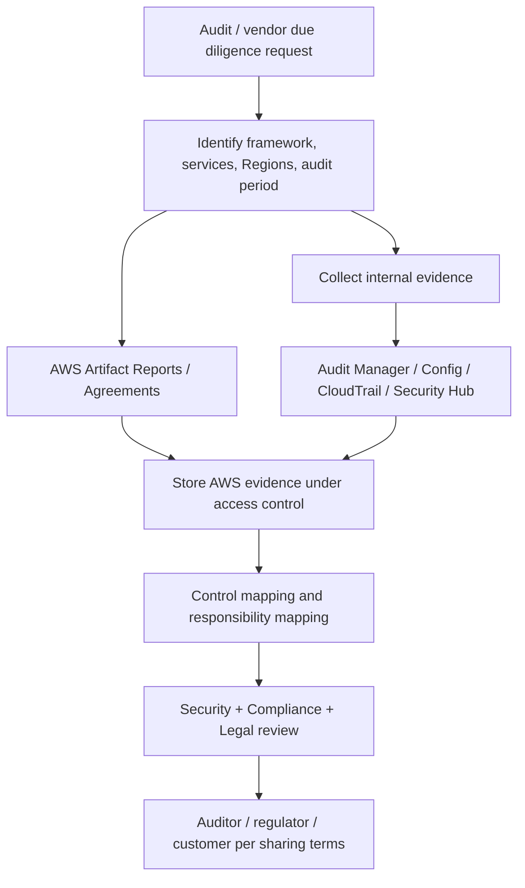
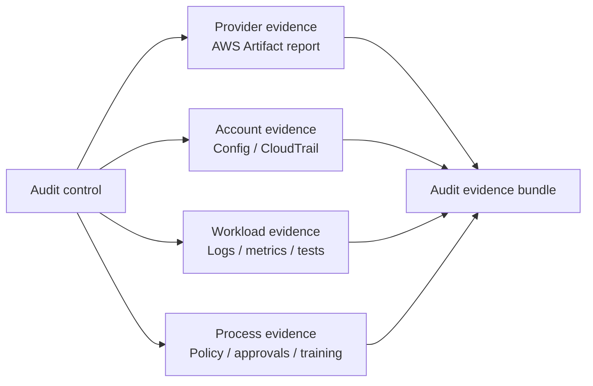

# AWS Artifact and provider compliance documentation

**AWS Artifact** is a self-service portal for accessing AWS security and compliance documents, viewing and managing legal agreements with AWS, and preparing responses for compliance evaluations. Organizations can download reports such as SOC, PCI, ISO, or related certification documents, review terms such as a Business Associate Addendum (BAA), and use those documents as evidence for controls within AWS's scope.

AWS Artifact helps security, legal, audit, and risk management teams gather evidence from the cloud provider. AWS documentation describes how AWS operates its controls and which services fall within compliance program scopes. Organizations still must demonstrate how they configure accounts, protect data, operate applications, and execute internal controls.

This lesson belongs to the **Auditing and Compliance** chapter of the **CLOUD_PROVIDERS_AWS** module. It connects AWS Artifact Reports, Agreements, AWS Organizations, Assurance Assistant, IAM, CloudTrail, AWS User Notifications, AWS Audit Manager, and the shared responsibility model.

> **Principle:** Choose the right report and version for your audit scope; protect confidential documents after downloading; conduct legal review before accepting agreements; map each piece of AWS evidence to the organization's actual responsibilities.

## 1. Learning objectives

After this lesson, you can:

1. Explain AWS Artifact and its Reports, Agreements, and Assurance Assistant feature groups.
2. Distinguish AWS compliance reports from third-party software vendor reports.
3. Locate SOC, PCI, ISO, C5, and other relevant certification documents.
4. Read scope, audit period, version, exceptions, and attachments within a report.
5. Download reports, accept download terms, and protect watermarked copies.
6. Distinguish account agreements from organization agreements.
7. Understand the role of the AWS Organizations management account when accepting agreements for an organization.
8. Manage BAA, NDA, and related agreements with appropriate legal workflows.
9. Grant role-based IAM permissions and restrict report viewing by category/series.
10. Use CloudTrail to audit Artifact document access and management activity.
11. Set up notifications when reports or agreements are updated.
12. Use Assurance Assistant to assist with questionnaires and verify cited answers.
13. Apply the shared responsibility model to distinguish AWS controls from customer controls.
14. Combine Artifact documents with AWS Audit Manager, CloudTrail, AWS Config, and internal evidence.
15. Build traceable vendor due diligence and audit evidence workflows.

## 2. What is AWS Artifact?

AWS Artifact is an on-demand service providing AWS security and compliance documents. You access it through the AWS Management Console without installing agents or deploying resources in a VPC.

Documents can include:

- Independent audit reports such as SOC 1, SOC 2, and SOC 3.
- Reports and documentation related to PCI DSS.
- Certifications from accredited bodies under ISO standards.
- Reports under regional/industry compliance programs, such as C5 or other programs depending on service scope.
- Documentation on AWS security controls, operational procedures, and attestations.
- Compliance reports from certain independent software vendors (ISVs) offering products on AWS Marketplace.

AWS Artifact also provides features to manage agreements between customers and AWS, along with Assurance Assistant to help answer questions about AWS security and compliance controls.

### 2.1. Three main feature groups

| Group | Content | Usage output |
| --- | --- | --- |
| **Reports** | Search, view metadata, and download reports/certifications | Evidence of controls and compliance scope of AWS or ISVs |
| **Agreements** | View, accept, track, and terminate eligible agreements | Legal terms and status applicable to an account or organization |
| **Assurance Assistant** | Assist with answering questions and questionnaires about AWS controls | Draft answers with source citations for human verification |

### 2.2. AWS Artifact is not certification for your workload

For example, AWS may hold a SOC 2 report for services in scope during an audit period. That does not mean your Orders API application automatically achieves SOC 2 compliance.

Your organization still must demonstrate items under its own responsibility, such as:

- IAM users, roles, policies, and MFA.
- Network segmentation, security groups, and VPC routing.
- Data encryption, key management, and secrets.
- Data classification, retention, backups, and recovery.
- Logging, monitoring, incident response, and change management.
- Hiring, training, approval workflows, and access reviews.
- Configuration of AWS services used in the workload.
- Controls over sub-vendors and integrated applications.

Artifact documents serve as evidence for the AWS provider and the controls within the document's scope. They are one piece of the customer's evidence package.

## 3. AWS Artifact in the auditing ecosystem

Artifact is typically used alongside other services. Each service answers a distinct type of question.

| Tool | Primary question | Evidence type |
| --- | --- | --- |
| **AWS Artifact** | With which documents does AWS demonstrate provider controls? | Audit reports, certifications, agreements |
| **AWS Audit Manager** | Which controls is the organization's account/workload satisfying? | Automated and manual evidence collected per assessment |
| **AWS CloudTrail** | Who called which API, and when? | Event history and trail logs |
| **AWS Config** | Do resources comply with selected configuration rules? | Configuration history, snapshots, and compliance evaluations |
| **AWS Security Hub** | Which security findings currently exist in the environment? | Findings, standards checks, and security posture |
| **IAM Access Analyzer** | Do resources/policies have unintended access? | Policy findings and access analysis |
| **AWS Organizations / SCP** | Which guardrails are applied to member accounts? | Organization configuration and policies |

Do not use one tool to replace all types of evidence. For example, Artifact can prove AWS has physical data center access controls, whereas the customer's CloudTrail is what shows who modified a security group in the customer's account.

### 3.1. Overall workflow



This workflow separates AWS evidence from organizational evidence, then maps both to audit requirements.

## 4. Reports: types of compliance documents

In AWS Artifact, the Reports page typically has separate tabs:

- **AWS reports:** reports and certifications provided by AWS.
- **Third-party reports:** reports from certain ISVs selling products on AWS Marketplace.

### 4.1. SOC reports

SOC is a group of service control reports performed under AICPA standards.

| Report | Typical objective | How to use |
| --- | --- | --- |
| **SOC 1** | Controls relevant to customers' financial reporting | Assess impact of services on financial reporting controls |
| **SOC 2** | Controls under Trust Services Criteria | Evaluate security, availability, processing integrity, confidentiality, and privacy within report scope |
| **SOC 3** | Public summary of controls under SOC 2 | Overview document that can be shared more broadly per publication terms |

SOC 1/2 are typically detailed reports for authorized recipients. SOC 3 is typically a public overview report. Always check the exact report period, Type I/Type II designation if applicable, and service scope stated in the document.

### 4.2. ISO certifications

ISO is a set of standards used across many management systems. AWS can provide certifications and assessment documentation under applicable ISO standards.

When reviewing an ISO certification, check:

- Standard and standard version.
- Certified legal entity/organization.
- Scope of activities and locations.
- Validity period.
- Certification body.
- Attached appendices or scope statement.

Do not infer that every AWS service, every Region, and every customer activity falls within the same certification scope.

### 4.3. PCI DSS

PCI DSS relates to environments that process, store, or transmit payment card data. AWS reports help evaluate the infrastructure/services within AWS's scope.

Customers still must define their cardholder data environment (CDE) scope, segmentation, encryption, access control, logging, and application controls per their role. Use AWS documents alongside current PCI guidance and QSA assessments when required.

### 4.4. Other programs

Depending on services, Regions, legal entities, and audit periods, AWS Artifact may provide other documents such as:

- C5.
- FedRAMP.
- HIPAA-related documentation.
- CSA STAR or cloud assurance documentation.
- Industry or regional certifications and attestations.

The actual catalog varies by program and scope. Look up details in AWS Artifact and AWS Compliance Programs rather than assuming a fixed list.

## 5. Selecting the right report

A report is useful only if it applies to the right scope and timeframe under evaluation.

Before downloading, identify:

1. **Framework:** is the requirement SOC 2, ISO 27001, PCI DSS, or another framework?
2. **Service:** which AWS services does the workload use?
3. **Region:** in which Regions are the services deployed?
4. **Period:** which timeframe must the audit prove?
5. **Entity/scope:** which legal entities and operations does the report cover?
6. **Report type:** do you need the full report, certificate, attestation, or bridge letter if available?
7. **Version:** the latest version or a historical version for the audit period?
8. **Terms:** does the document require accepting terms before downloading?

### 5.1. Checking services in scope

Not every AWS service is included in every compliance program. A service may:

- Be in scope for a program at one point in time.
- Be covered only in certain Regions.
- Be added or have scope changed between audit periods.
- Have feature or usage constraints.

Open the **AWS Services in Scope by Compliance Program** document and cross-check it against the report period. If a service/Region is not in the document's scope, do not conclude that the workload is certified based on another report.

### 5.2. Checking the audit period

For example, an auditor requests SOC 2 Type II covering January through June. The current report may cover a different audit period. Verify:

- Audit period start and end dates.
- Auditor opinion.
- Exceptions or findings.
- Management responses if present.
- Bridge letters or supplemental information for gaps outside the report period, if provided by AWS.

A bridge letter does not automatically extend the audit opinion or turn a gap period into a new audit period. Read the exact terms and limitations in the document.

### 5.3. Checking previous versions

The report details page may display Previous versions. Use a previous version when an auditor needs to inspect a historical period or perform a point-in-time evaluation.

Do not overwrite a prior period's document with a new report without recording versions and dates. Your evidence register should record report ID/name, version, period, and download date.

## 6. Downloading reports from AWS Artifact

Basic workflow in the AWS Console:

1. Sign in with an authorized IAM role/user.
2. Open the AWS Artifact Console.
3. Choose **View reports**.
4. Select the **AWS reports** or **Third-party reports** tab.
5. Search by name, category, series, or description.
6. Open report details to inspect metadata and previous versions.
7. Choose the appropriate report/version.
8. Accept Terms and Conditions if prompted.
9. Choose Download report.
10. Store the document in a secure evidence repository.
11. Record the report version, download date, downloader, and intended use.

### 6.1. Checking PDF attachments

Some PDFs contain embedded attachments. After downloading:

- Open the PDF with a viewer that supports attachments.
- Check the attachment/sidebar icon.
- Open and save required appendices per policy.
- Cross-check appendix names and contents against references in the report.
- Save them in the same evidence index and preserve the link between the report and attachments.

Reading only the main PDF pages can miss critical supporting documents.

### 6.2. Individually watermarked reports

Each time a report is downloaded from Artifact, AWS generates a uniquely watermarked, traceable copy. Therefore:

- Do not post reports on websites or public sharing repositories.
- Do not send confidential reports as email attachments.
- Share only under permitted conditions—for example, internally within the company, with auditors, or with regulators.
- Use a secure document sharing service when sharing is required.
- Do not remove watermarks or alter documents to obscure origin.
- Restrict access permissions and track who downloads/views them.

AWS protects documents while they remain in the AWS Cloud. Once downloaded, the customer is responsible for protecting their copy.

## 7. Protecting and managing downloaded documents

Artifact reports can contain details about security controls, architecture, operational procedures, or other sensitive information.

An evidence repository should have:

- Encryption at rest and in transit.
- Access controls by audit, compliance, legal, and security groups.
- MFA/SSO and role-based access permissions.
- Audit logs for downloads, views, sharing, and deletions.
- Retention policies aligned with contracts and audit requirements.
- Versioning or immutable storage if required by regulations.
- Offboarding procedures to revoke access when auditors/contractors finish engagements.
- Secure sharing and expiring links if the platform supports them.

### 7.1. Sample evidence register

| Field | Example |
| --- | --- |
| Evidence ID | AWS-SOC2-2026-H1 |
| Provider | AWS |
| Document | SOC 2 Type II |
| Report period | 2026-01-01 to 2026-06-30 |
| Version | Version displayed in Artifact |
| Download date | 2026-11-20 |
| Downloaded by | Compliance role |
| Applicable services | Services verified in scope list |
| Control mapping | Vendor controls / control IDs |
| Storage location | Restricted-access evidence repository |
| Review owner | Compliance lead |
| Review status | Pending / Reviewed / Accepted |
| Next review | Per vendor review schedule |

This is an internal governance template, not a mandatory AWS format.

## 8. Agreements: agreements with AWS

AWS Artifact Agreements allows viewing and managing certain agreements between customers and AWS.

Common examples:

- **Business Associate Addendum (BAA):** relates to processing Protected Health Information (PHI) in a HIPAA context when applicable conditions are met.
- **Nondisclosure Agreement (NDA):** confidentiality terms related to accessing/sharing documents.
- Other agreements or terms made available in Artifact per account/organization.

Artifact displays agreement status and lets you review accepted contents. Available catalogs and acceptance capabilities may vary by account type, organization, and current terms.

### 8.1. Agreements vs. Reports

| Reports | Agreements |
| --- | --- |
| Documents demonstrating/explaining provider controls | Legal terms between the customer and AWS |
| Have report period, version, audit scope | Have account/organization scope, effective status, and contractual obligations |
| Used as audit artifacts | Define rights, obligations, and terms of use |
| Download, review, securely store | Review, accept, track, terminate when permitted |

### 8.2. Why require legal review before accepting?

Accepting an agreement can create legal obligations for an account or an entire organization. Before accepting:

- Identify the contracting legal entity.
- Identify which accounts or organizations are covered.
- Read definitions, obligations, conditions, and exclusions.
- Evaluate planned data types and workloads.
- Identify privacy, retention, and incident notification requirements.
- Consult legal, privacy, and compliance teams.
- Retain evidence of the approver and acceptance timestamp.

Do not treat clicking Accept in the Console as a routine technical configuration step.

## 9. Account agreements

An account agreement is accepted for a specific AWS account.

General workflow:

1. Open AWS Artifact.
2. Choose Agreements.
3. Open the Account agreements tab.
4. Select the agreement.
5. Download agreement.
6. Read and accept the AWS Artifact NDA if required to download the agreement text.
7. Carefully read the agreement PDF.
8. Choose Accept agreement.
9. Confirm acceptance of the terms.
10. Verify agreement status after completion.

### 9.1. Required permissions

By default, accepting agreements typically requires appropriate administrative permissions. IAM/federated users can be granted specific permissions to view, download, and manage agreements.

Separate these roles:

- Viewer/downloader of agreements.
- Legal reviewer.
- Approver.
- Principal authorized to execute Accept/Terminate.

Someone who needs to download documents does not necessarily need permission to accept agreements.

## 10. Organization agreements with AWS Organizations

When using AWS Organizations, the management account can accept eligible organization agreements on behalf of member accounts.

Key prerequisites:

- The organization must have **All features** enabled, not just consolidated billing.
- The operator must sign in to the management account.
- That operator needs appropriate AWS Artifact permissions.
- Acceptance must be reviewed by legal/privacy/compliance teams.

### 10.1. Scope of application

When the management account accepts an organization agreement, the agreement applies to existing member accounts and accounts added to the organization afterward under the agreement's terms.

Member account users with the **organizations:DescribeOrganization** permission can view organization agreements accepted on their behalf.

If a member account is removed from or leaves the organization, that account is no longer covered by organization agreements accepted on behalf of the organization. Before moving an account, assess whether the account must establish its own separate agreement.

### 10.2. Workflow to accept an organization agreement

1. Sign in to the management account.
2. Confirm the organization has All features enabled.
3. Open AWS Artifact → Agreements.
4. Select the Organization agreements tab.
5. Choose the appropriate agreement.
6. Download and read the agreement text.
7. Accept the AWS Artifact NDA if required to download the agreement.
8. Read terms and confirm with the legal team.
9. Choose Accept agreement and confirm organization-wide scope.
10. Verify the agreement appears with the expected status in the Organization agreements list.
11. Notify member account owners about scope and obligations.

### 10.3. BAA and PHI data

For example, an organization processing healthcare data may require a BAA with AWS before using AWS services for workloads containing PHI.

A BAA does not automatically make every workload HIPAA-compliant. The organization still must:

- Use services within applicable scope.
- Configure accounts, IAM, and networking appropriately.
- Encrypt and control access to data.
- Protect logs, backups, and keys.
- Execute internal policies and incident response procedures.
- Ensure other vendors/subprocessors meet requirements.
- Maintain evidence of control execution.

### 10.4. Terminating an organization agreement

The management account can terminate an agreement accepted online on behalf of the organization, if the agreement permits that process.

Before terminating:

- Assess which workloads/accounts still depend on the agreement.
- Consult legal/privacy/compliance.
- Determine effective dates and surviving obligations.
- Confirm replacement agreements exist if needed.
- Notify member account owners.
- Retain the termination decision and evidence.

Do not terminate an agreement just to clean up the Console list.

## 11. Offline agreements

Some agreements are accepted through an offline process. AWS Artifact may display accepted offline agreements, such as an Offline BAA, with an Active status.

For offline agreements:

- Read the termination terms and instructions inside the document itself.
- Do not assume you can terminate via the Console's Terminate agreement button like an online agreement.
- Store signed copies, effective dates, and contracting legal entities.
- Synchronize status with your internal contract repository.
- When accounts/organizations change, verify agreement scope against actual contract terms.

## 12. IAM and access control for AWS Artifact

AWS Artifact supports IAM to control who can:

- List reports.
- View metadata.
- Download reports.
- List and download agreements.
- Accept or terminate agreements.
- Manage notification settings.
- Create, view, and export compliance inquiries in Assurance Assistant.

Do not grant broad permissions to all developers. Divide roles by job responsibility.

### 12.1. Common managed policies

Several AWS managed policies can serve as starting points:

| Policy | Purpose |
| --- | --- |
| **AWSArtifactReportsReadOnlyAccess** | List, view, and download AWS Artifact reports |
| **AWSArtifactAgreementsReadOnlyAccess** | View and download agreements in read-only mode |
| **AWSArtifactAgreementsFullAccess** | Manage agreements, including accept/terminate |
| **AWSArtifactComplianceInquiriesFullAccess** | Create, view, export, and submit feedback for Assurance Assistant inquiries |

Policy names and contents may be updated by AWS. Inspect the current policy JSON before attaching it to an IAM principal. AWS managed policies are convenient starting points, though not automatically least privilege for every organization.

### 12.2. Separation of duties

A reference permission model:

| Role | Appropriate permissions |
| --- | --- |
| Auditor viewer | List/view/download permitted reports |
| Compliance analyst | View reports, metadata, previous versions, and inquiry responses |
| Legal reviewer | View/download agreements and review terms |
| Agreement approver | Accept/terminate following internal approval |
| Notification administrator | Configure User Notifications and Artifact notification settings |
| Assurance Assistant user | Create, view, export inquiries per granted policy |

Use IAM Identity Center/federation or enterprise identity mechanisms to assign permissions by group. Do not use root credentials for daily work.

## 13. Fine-grained access for Reports

AWS Artifact supports condition keys to restrict permissions by report category and series.

Key condition keys:

- **artifact:ReportCategory**
- **artifact:ReportSeries**

For example, allow viewing only reports in the SOC series under the Certifications and Attestations category:

```json
{
  "Version": "2012-10-17",
  "Statement": [
    {
      "Sid": "ListReports",
      "Effect": "Allow",
      "Action": [
        "artifact:ListReports"
      ],
      "Resource": "*"
    },
    {
      "Sid": "ReadSocReports",
      "Effect": "Allow",
      "Action": [
        "artifact:GetReport",
        "artifact:GetReportMetadata",
        "artifact:GetTermForReport",
        "artifact:ListReportVersions"
      ],
      "Resource": "*",
      "Condition": {
        "StringEquals": {
          "artifact:ReportSeries": "SOC",
          "artifact:ReportCategory": "Certifications and Attestations"
        }
      }
    }
  ]
}
```

This policy is an example using IAM condition keys in AWS Artifact. Before using it, verify the actual category/series of the reports, required workflow actions, and current policy syntax in your account's partition.

### 13.1. Why does ListReports use Resource *?

The API listing reports requires list permissions on a wildcard resource per AWS examples. Permissions to retrieve report contents/metadata are restricted via condition keys. Do not remove the filter conditions from the statement just because listing still works.

### 13.2. Commercial Regions and GovCloud

IAM policy examples for commercial Regions and AWS GovCloud (US) may differ in partition ARNs and certain permissions. Do not copy commercial policies verbatim to GovCloud or vice versa. Use the exact IAM policy documentation for the partition in use.

## 14. CloudTrail auditing for Artifact activity

AWS Artifact integrates with AWS CloudTrail. API calls from the Console or APIs can be recorded as CloudTrail events.

Common event names you may encounter:

- `ListReports`.
- `GetReportMetadata`.
- `GetReport`.
- `GetTermForReport`.
- `ListAgreements`.
- `GetAgreement`.
- `GetCustomerAgreement`.
- `AcceptNdaForAgreement`.
- `AcceptAgreement`.
- `TerminateAgreement`.
- `GetAccountSettings` and `PutAccountSettings`.

The event source for AWS Artifact is **artifact.amazonaws.com**.

### 14.1. Viewing Event history

In the CloudTrail Console, open Event history and filter by Event source or Event name. You can inspect:

- Who performed the operation.
- Which role/session or IAM principal was used.
- Timestamp and Region of the event.
- Source IP and user agent.
- API operation.
- Error code/error message if the request failed.

CloudTrail Event history provides recent management events within the service's retention limit. For long-term retention, create a trail delivering logs to S3, then apply retention/immutability per audit policy.

### 14.2. Querying Artifact events via AWS CLI

Example querying recent events:

```bash
aws cloudtrail lookup-events \
  --lookup-attributes AttributeKey=EventSource,AttributeValue=artifact.amazonaws.com \
  --max-results 50 \
  --region us-east-1
```

Change the Region to where you need to query and verify CloudTrail permissions. Results may contain multiple types of Artifact API calls; filter further by `EventName` or timestamp in your analysis tools.

### 14.3. What CloudTrail does not prove

CloudTrail records API activity such as who downloaded a report or accepted an agreement. It does not replace reading report contents, reviewing legal terms, or proving that the customer properly implemented controls in their workloads.

## 15. Notifications when new documents arrive

AWS Artifact supports email notifications for report and agreement updates via AWS User Notifications.

Current documentation describes this feature for commercial AWS Regions; these notification settings do not apply to AWS GovCloud (US) Regions.

### 15.1. Initial setup

1. Open AWS User Notifications.
2. Select notification hubs in the Regions where you want notification data stored.
3. Save the notification hubs configuration.
4. Open AWS Artifact → Notification settings.
5. Create a notification configuration.
6. Choose updates for AWS Agreements, AWS Reports, or both.
7. Choose all reports or a subset by category/series.
8. Add recipient email addresses.
9. Create the configuration.
10. Recipients verify their email addresses to receive notifications.

### 15.2. Choosing a subset

If you only track SOC/ISO, select the relevant categories/series instead of receiving every report update. This keeps notifications focused on documents that actually affect your audit scope.

### 15.3. Notifications do not replace reviews

When an email notification arrives:

- Open AWS Artifact to check the new/updated report or terms.
- Identify the version and report period.
- Assess whether scope or terms changed.
- Update the evidence register.
- Notify control owners if needed.
- Document the review outcome.

The email only indicates a change occurred; it does not decide whether the new document fits your workloads or contracts.

## 16. Assurance Assistant in AWS Artifact

**Assurance Assistant** is an AI feature in AWS Artifact that generates cited answers to questions about AWS security controls, compliance posture, and operational practices.

It helps vendor risk, security, compliance, and legal teams process questionnaires or due diligence requests faster by:

1. Receiving questions or questionnaires.
2. Mapping questions to relevant AWS controls.
3. Searching verified AWS compliance documentation.
4. Generating answers accompanied by citations.
5. Allowing users to inspect sources and export responses.

### 16.1. Questionnaire formats

Assurance Assistant is optimized for:

- Consensus Assessments Initiative Questionnaire (CAIQ).
- Standardized Information Gathering questionnaire (SIG).
- Custom due diligence questionnaires (DDQ) in CSV format.
- Excel XLSX.
- Word DOCX.
- PDF.

### 16.2. Question scope

Assurance Assistant answers about AWS's responsibilities: AWS security controls, compliance status, and AWS operational practices.

It may not answer questions that:

- Lack context or are unclear.
- Are unrelated to compliance.
- Fall outside the tool's scope.
- Ask how the customer configures their own workloads.

For example, “How does AWS protect physical data centers?” is much more suitable than “Does our account's Security Group open port 22 to the Internet?”. The second question requires evidence from the customer's environment.

### 16.3. Cost

According to current AWS documentation, Assurance Assistant can be used within the AWS Artifact Console at no separate charge. Related services or the organization's evidence storage workflows may incur separate charges.

## 17. Writing good questions for Assurance Assistant

Each question should be standalone, include complete context, and use clear compliance terminology.

Examples of good questions:

- “What physical security controls protect AWS data centers for services in the SOC 2 report?”
- “Which AWS services are included in the ISO 27001 certification scope for the current report period?”
- “How does AWS manage vulnerability remediation for the infrastructure layer?”
- “What evidence describes AWS access control and personnel security controls?”

Unclear questions:

- “How is security handled?”
- “Is this compliant?”
- “What about encryption?”
- “Can you confirm our application is safe?”

### 17.1. One question should have one objective

For bulk uploads:

- CSV/XLSX: one complete question per row.
- Word/PDF: separate each question into a clear item.
- Name the service, framework, or control area.
- Do not depend on the preceding question; each question is processed independently.
- Avoid bundling multiple unrelated requests into one question.

### 17.2. Example question mapping

| Control area | Sample question | Evidence to verify |
| --- | --- | --- |
| Physical security | How does AWS control physical facility access? | SOC/ISO reports and citations |
| Personnel security | What background check and training processes does AWS follow for staff? | Report section on personnel controls |
| Vulnerability management | How does AWS manage vulnerabilities in AWS-operated infrastructure? | Security operations evidence |
| Availability | How does AWS evaluate and test infrastructure resilience? | Availability/resilience controls |
| Encryption | Which service-layer encryption controls do AWS documents describe? | Service-specific docs and report scope |

Answers must be cross-checked against cited sources and the auditor's actual requirements.

## 18. Reviewing and exporting Assurance Assistant responses

Each question in a questionnaire may be in a state of generating an answer or auto-generated and ready for review.

A response includes:

- AI-generated answer.
- Citations pointing to AWS documents.
- Processing status.
- Export options.

You can:

- Export selected: download selected responses.
- Export all: download all responses for the questionnaire.
- Include source citations in the export file.

### 18.1. Human review workflow

For each answer:

1. Read the entire response.
2. Open every citation.
3. Check the source document and report period.
4. Determine whether the answer describes AWS's or the customer's responsibility.
5. Cross-check against the auditor's question.
6. Flag missing or unsubstantiated content.
7. Edit wording if needed.
8. Obtain approval from the compliance/security owner.
9. Export only the reviewed version for official questionnaire submission.

### 18.2. AI answers are not legal conclusions

Assurance Assistant responses are AI-generated based on AWS documentation available at generation time. Citations help verify claims, yet users still must inspect original sources, context, scope, and audit-specific requirements.

Do not copy automated answers verbatim into contracts, attestations, or corporate certifications without authorized human review.

### 18.3. Saving exported copies

Retain:

- Original questionnaire.
- Exported responses.
- Citations.
- Answer generation timestamp.
- Reviewer identity.
- Edited response version.
- Approval record.
- Final status of each question.

## 19. Assurance Assistant IAM and notifications

AWS provides the managed policy **AWSArtifactComplianceInquiriesFullAccess**, which allows creating, listing, viewing, exporting, and submitting feedback for compliance inquiries.

This policy may also permit selecting an existing notification configuration when creating an inquiry. It does not replace setting up AWS User Notifications and does not automatically create a new notification configuration.

Per AWS updates, this policy was expanded with notifications/notifications-contacts permissions to support selecting notification configurations, as well as permission to submit feedback on inquiry responses. Inspect the latest JSON policy before attaching.

### 19.1. Separating notification administrator permissions

Operators configuring email recipients and notification hubs need appropriate AWS User Notifications permissions. Duties can be separated:

- Artifact inquiry user: works with questionnaires.
- Notification administrator: creates notification hubs/configurations.
- Email recipient: verifies notification email address.
- Compliance reviewer: reviews and approves content.

This avoids granting broad notification management permissions to everyone who only needs to use Assurance Assistant.

## 20. Shared Responsibility Model and audit implications

AWS divides security responsibilities into two parts:

- **Security of the Cloud:** AWS is responsible for protecting the cloud infrastructure AWS operates, such as physical facilities, hardware, virtualization layers, and certain service components.
- **Security in the Cloud:** customers are responsible for configuring and protecting workloads, data, identities, applications, and components depending on the selected service type.

Exact boundaries vary by service. With EC2, customers manage the guest OS, patching, application software, and security groups. With higher-abstraction services such as S3/DynamoDB, AWS manages much of the underlying infrastructure, while customers still manage data, IAM, encryption options, backups, versioning, and permissions.

### 20.1. Sample responsibility matrix

| Control | AWS | Customer |
| --- | --- | --- |
| Data center protection | Operates physical security controls | Reviews reports and conducts vendor assessments |
| Hypervisor/physical infrastructure | Manages infrastructure layer per service model | Selects services and configures workloads |
| IAM user/role permissions in account | Provides IAM platform | Designs least privilege, MFA, and access reviews |
| EC2 guest OS patching | Provides EC2 infrastructure | Patches OS and applications on instances |
| S3 service infrastructure | Operates service infrastructure | Configures bucket policies, encryption, lifecycle, and data access |
| Application code | Not responsible for customer code | Secure coding, reviews, and vulnerability management |
| Data classification | Does not classify data for customers | Classifies data, sets retention, encryption, and access controls |
| Workload incident response | Handles AWS-side incidents per service commitments | Detects, responds, and notifies per organizational procedures |

### 20.2. Using reports to define control boundaries

When reading a SOC/ISO report:

1. Find the system description and scope.
2. Read control objectives/criteria.
3. Identify the AWS control owner.
4. Read complementary user entity controls or customer responsibilities if present.
5. Document actions the customer must take for the AWS control to be effective.
6. Map the remaining items to internal processes and evidence.

Do not simply write “AWS is SOC 2 certified” in a control matrix. Specify which AWS controls are reported and which parts the customer must implement.

## 21. AWS Artifact and AWS Audit Manager

The two services are often used together but serve different roles.

**AWS Artifact** provides AWS documentation and manages agreements with AWS.

**AWS Audit Manager** helps customers continuously collect and organize evidence about AWS usage against selected frameworks/assessments.

Examples:

- Artifact: download AWS's SOC 2 report.
- Audit Manager: collect evidence on encryption, IAM, logging, and the organization's account configurations.
- CloudTrail: prove which principal changed a resource.
- AWS Config: prove whether resources comply with configuration rules.
- Internal evidence: policies, training records, incident runbooks, access reviews, and approvals.

Artifact does not automatically create an Audit Manager assessment for a workload. Customers must choose frameworks, define controls, and configure evidence sources.

### 21.1. Evidence map



Evidence from multiple sources must be linked by control ID, timestamp, and owner so auditors can trace everything.

## 22. Building control mappings

A good control mapping explains which requirement each piece of AWS evidence relates to and which parts remain customer responsibility.

Example control “Privileged access is restricted and reviewed”:

| Component | Evidence |
| --- | --- |
| AWS provider control | SOC/ISO report section covering AWS internal access management |
| Customer IAM design | IAM policies, Identity Center permission sets, MFA settings |
| Access review | Principal lists, approval records, and review cadence |
| Privileged activity | CloudTrail events, alert history |
| Exceptions | Tickets, risk acceptance, and remediation plan |
| Owner | IAM/security control owner |

Example control “Data is encrypted at rest”:

| Component | Evidence |
| --- | --- |
| AWS provider control | Documentation on service encryption capabilities |
| Service scope | Verify service/Region falls within report scope |
| Customer configuration | KMS key policies, S3 bucket encryption, database encryption settings |
| Key lifecycle | Rotation, access reviews, and key deletion controls |
| Evidence date | Export date of Config/IAM evidence |
| Owner | Data protection owner |

### 22.1. Do not map solely by service name

A “backup and recovery” control is not proven just because AWS offers S3 or RDS. You need evidence that the customer configured backups, retention, restore tests, recovery objectives, and appropriate access controls.

## 23. Third-party reports and vendor due diligence

AWS Artifact may offer reports from certain independent software vendors (ISVs) selling products on AWS Marketplace.

When evaluating a vendor:

- Identify the exact vendor/legal entity.
- Check who issued the report.
- Inspect the audit period and product/service scope.
- Identify the hosting model and dependencies.
- Read exceptions/findings and management responses.
- Check issue date, version, and validity period.
- Cross-check the report with contracts, DPAs/BAAs, and security questionnaires.
- Identify controls the customer still must configure.

Do not confuse AWS reports with ISV reports. A vendor selling a product on AWS Marketplace does not automatically place that product inside AWS's SOC/ISO reports.

### 23.1. Vendor assessment matrix

| Criterion | Assessment question |
| --- | --- |
| Identity | Which vendor and legal entity are responsible? |
| Service scope | Which products/versions does the report cover? |
| Audit period | Does the report cover the contract period? |
| Security controls | IAM, encryption, vulnerability management, logging? |
| Data processing | Which data is processed, where is it stored, how long is retention? |
| Subprocessors | Are any sub-vendors involved? |
| Incident handling | Under what terms are incidents notified and handled? |
| Contract | Is there an appropriate DPA/BAA/security addendum? |
| Findings | Which exceptions remain open and what is the remediation plan? |
| Exit | How is data exported/deleted upon service termination? |

## 24. Notifications and document review schedule

Compliance documents can change when AWS releases new report versions, updates service scope, or modifies terms.

The organization should define:

- Who receives notifications.
- Who is responsible for reviewing new reports.
- Who checks scope and report period.
- Who assesses impact on control mappings.
- Who updates the auditor evidence package.
- Who reviews legal agreements and renewals.
- Who approves document sharing.

### 24.1. Reference review schedule

| Frequency | Activity |
| --- | --- |
| On notification | Inspect new or updated reports/agreements |
| Quarterly | Review list of active reports and service scopes |
| Annually | Vendor risk assessment and legal agreement review |
| Pre-audit | Verify report periods, versions, attachments, and evidence index |
| When adding AWS services/Regions | Cross-check compliance scope and customer controls |
| When an account leaves the organization | Check organization agreement coverage |

Actual cadence should match contracts, frameworks, and organizational risk appetite.

## 25. Pricing and limits

AWS provides AWS Artifact documents and agreements at no charge. Assurance Assistant is also described by AWS as having no separate fee inside the Artifact Console.

Costs may arise from related customer activities, such as:

- Storing documents in a dedicated evidence repository.
- Using AWS services to analyze or retain CloudTrail logs.
- Using AWS Audit Manager or other services per their respective pricing.
- Using external secure sharing, GRC, or vendor risk management tools.

AWS Artifact is a document and agreement management portal. Do not assume all other compliance services are also free.

## 26. Troubleshooting

| Symptom | Possible cause | Resolution |
| --- | --- | --- |
| Cannot see reports | IAM permissions, filters, or different partition | Check category/series, account, and policies |
| Downloading report gets AccessDenied | Missing GetReport/metadata/terms permissions | Check managed/customer policies and SCPs |
| Cannot see previous version | Report has no prior versions in Artifact | Check details page and report availability |
| PDF missing appendices | PDF viewer does not display attachments | Use a viewer supporting PDF attachments |
| Report covers wrong period | Wrong report version selected | Check report period and previous versions |
| Cannot share report | Document marked confidential | Review terms and use approved secure sharing |
| Cannot see Organization agreements | Organization lacks All features or missing permissions | Check Organizations feature set and management account |
| Cannot accept agreement | Missing Artifact permissions or terms not reviewed | Check IAM and approval workflow |
| Member account cannot see agreement | Missing `organizations:DescribeOrganization` or no longer in org | Check membership and permissions |
| Offline agreement cannot be terminated | Agreement accepted via offline workflow | Follow termination instructions inside the agreement |
| Notification emails not sent | Notification hub not selected or email unverified | Check User Notifications and recipients |
| Notification settings unavailable in GovCloud | Feature currently applies only to commercial Regions | Follow partition-specific workflow and current guidance |
| Assurance Assistant does not answer | Question lacks context or is outside AWS controls scope | Write standalone question naming service/framework/control |
| Citations do not prove the entire answer | Source covers only part of the topic | Open source document and supplement evidence |
| Cannot export questionnaire | Inquiry not ready or policy missing permissions | Check status and compliance inquiries permissions |
| CloudTrail lacks older events | Event history has a limited retention window | Check trail S3 archive or CloudTrail Lake if configured |

### 26.1. Runbook when an auditor requests a SOC/ISO report

1. Confirm framework and control IDs.
2. Identify AWS services/Regions in the workload.
3. Check service scope under the compliance program.
4. Open Artifact Reports and choose the appropriate report.
5. Verify report period and version.
6. Download the report along with needed attachments.
7. Read exceptions and customer complementary controls.
8. Store the watermarked copy in the evidence repository.
9. Update the evidence register and control mapping.
10. Review by security/compliance.
11. Share via secure sharing per exact terms.
12. Log recipient, timestamp, and approval.

### 26.2. Runbook when a BAA is needed for an organization

1. Identify which accounts/workloads process PHI.
2. Verify planned AWS services fall within eligible program scope.
3. Confirm the organization has All features enabled.
4. Read the BAA and related terms.
5. Conduct legal/privacy/compliance review.
6. Approve contracting entity and organization scope.
7. Management account executes acceptance per workflow.
8. Verify agreement status.
9. Check covered member accounts.
10. Configure workloads and operate per BAA/HIPAA obligations.
11. Retain the agreement copy, approval, and evidence.

## 27. Hands-on exercise: preparing an AWS evidence package for a vendor audit

### 27.1. Context

An enterprise uses:

- Amazon EC2 for a Java/Spring Boot API.
- Amazon S3 to store documents.
- Amazon RDS for transactional data.
- IAM Identity Center to manage workforce access.
- CloudTrail and AWS Config for configuration auditing.
- AWS Organizations to separate development, staging, and production accounts.

The auditor requests evidence for AWS SOC 2, encryption, privileged access, logging, and data retention.

### 27.2. Task A — Define scope

Document:

- Required framework.
- Audit period.
- AWS accounts.
- Regions.
- AWS services in use.
- Sensitive data and classification.
- Controls owned by AWS.
- Controls owned by the customer.

### 27.3. Task B — Retrieve Artifact documents

1. Open AWS Artifact Reports.
2. Locate the appropriate SOC 2 report.
3. Inspect metadata and report period.
4. Check service scope.
5. Download the report and attachments.
6. Record version/download date in the evidence register.
7. Store in a restricted-access evidence repository.
8. Record terms and sharing restrictions.

### 27.4. Task C — Collect customer evidence

Collect internal evidence:

- IAM Identity Center permission sets and MFA.
- IAM policy reviews.
- CloudTrail management events.
- AWS Config compliance results.
- S3 bucket encryption/versioning/public access.
- RDS encryption, backup retention, and restore tests.
- EC2 patch management and AMI processes.
- Incident response plan.
- Access review records.
- Change management approvals.

Do not include secrets, credentials, or unnecessary personal data in the audit package.

### 27.5. Task D — Control mapping

Create a mapping:

| Audit requirement | AWS Artifact evidence | Customer evidence | Owner |
| --- | --- | --- | --- |
| Provider physical security | SOC/ISO report section | N/A or vendor review | Vendor risk |
| Privileged access | AWS provider access controls | IAM Identity Center, MFA, CloudTrail | IAM team |
| Data encryption | AWS service controls/docs | S3/RDS/KMS configurations | Platform team |
| Logging | AWS service capabilities | CloudTrail, log retention, access reviews | Security operations |
| Backup and recovery | AWS service availability docs | RDS backup policy and restore tests | Database team |
| Incident response | AWS provider incident controls | Customer IR plan and incident records | Security team |

### 27.6. Task E — Use Assurance Assistant

1. Prepare a CAIQ/SIG or DDQ questionnaire.
2. Ensure each row/section contains one standalone question.
3. Explicitly state the AWS service and control area.
4. Upload the questionnaire to Assurance Assistant.
5. Review each answer and citation.
6. Flag questions outside AWS's responsibility scope.
7. Export selected/all answers with citations.
8. Security/compliance reviewer confirms before use.

### 27.7. Task F — Audit access and document handling

1. Grant report read-only access to the compliance team.
2. Restrict report access by series/category if needed.
3. Grant agreement accept/terminate only to approved personnel.
4. Check CloudTrail events for Artifact API activity.
5. Enable notification settings in a commercial Region if appropriate.
6. Verify email recipients.
7. Maintain a list of personnel authorized to access the evidence store.
8. Verify secure sharing before sending to auditors.

### 27.8. Task G — Finalize the evidence package

The final evidence package includes:

- Audit request and control list.
- AWS Artifact report and attachments.
- Agreement status/documents if applicable.
- Reviewed Assurance Assistant response export.
- Customer-side configuration evidence.
- CloudTrail/AWS Config/Audit Manager evidence.
- Control mapping and responsibility matrix.
- Evidence register, owner, and review date.
- Approval/sharing records.

## 28. Self-check questions

1. Which need does AWS Artifact address?
2. How do Reports differ from Agreements?
3. What work does Assurance Assistant assist with?
4. Why does an AWS report not prove a customer's workload is automatically compliant?
5. What objectives do SOC 1, SOC 2, and SOC 3 serve?
6. How should scope and validity be checked on an ISO certification?
7. Why must the report period be verified?
8. What is AWS Services in Scope by Compliance Program used for?
9. Why must you not assume every AWS service is in every compliance program?
10. What are the main tabs in Artifact Reports?
11. How do third-party reports differ from AWS reports?
12. Why do downloaded reports carry a watermark?
13. Where should an organization store downloaded reports?
14. Why should confidential documents not be sent as email attachments?
15. What kinds of information can PDF attachments contain?
16. How does an account agreement differ from an organization agreement?
17. Who can accept an organization agreement?
18. Why does AWS Organizations require All features?
19. What happens to agreement coverage when a member account leaves an organization?
20. What does a BAA mean for workloads processing PHI?
21. Why is legal/privacy/compliance review needed before accepting an agreement?
22. How does an offline agreement differ from an online agreement?
23. Which operations does AWS Artifact support IAM permissions for?
24. What are `artifact:ReportCategory` and `artifact:ReportSeries` used for?
25. Why can `ListReports` and `GetReport` permissions be granted separately?
26. Which Artifact activities does CloudTrail record?
27. How does CloudTrail Event history differ from a trail delivering to S3?
28. Which service do AWS Artifact notifications depend on?
29. Why must notification recipients verify their email?
30. How does Assurance Assistant support CAIQ and SIG?
31. Which DDQ formats are supported?
32. Why should each question in a bulk questionnaire be standalone?
33. How do you review Assurance Assistant citations?
34. Why should AI-generated answers not be treated as legal conclusions?
35. How does the shared responsibility model divide Security of the Cloud and Security in the Cloud?
36. How does AWS Artifact differ from AWS Audit Manager?
37. Why must Artifact be combined with CloudTrail, Config, and internal evidence?
38. How do you map a control between AWS evidence and customer evidence?
39. What must be checked when using a third-party ISV report?
40. Which fields should a good evidence register store?

## 29. Official AWS documentation

1. [What is AWS Artifact?](https://docs.aws.amazon.com/artifact/latest/ug/what-is-aws-artifact.html).
2. [Getting started with AWS Artifact](https://docs.aws.amazon.com/artifact/latest/ug/getting-started.html).
3. [Downloading reports in AWS Artifact](https://docs.aws.amazon.com/artifact/latest/ug/downloading-documents.html).
4. [Managing agreements in AWS Artifact](https://docs.aws.amazon.com/artifact/latest/ug/managing-agreements.html).
5. [Accepting agreements for your AWS account](https://docs.aws.amazon.com/artifact/latest/ug/accept-single-agreement.html).
6. [Accepting agreements for your organization](https://docs.aws.amazon.com/artifact/latest/ug/accept-org-agreement.html).
7. [Terminating account agreements](https://docs.aws.amazon.com/artifact/latest/ug/terminate-single-agreement.html).
8. [Terminating organization agreements](https://docs.aws.amazon.com/artifact/latest/ug/terminate-org-agreement.html).
9. [Offline agreements](https://docs.aws.amazon.com/artifact/latest/ug/manage-offline-agreement.html).
10. [Identity and access management in AWS Artifact](https://docs.aws.amazon.com/artifact/latest/ug/security-iam.html).
11. [Example IAM policies for AWS Artifact](https://docs.aws.amazon.com/artifact/latest/ug/example-iam-policies.html).
12. [Using IAM condition keys for Artifact reports](https://docs.aws.amazon.com/artifact/latest/ug/using-condition-keys.html).
13. [AWS managed policies for AWS Artifact](https://docs.aws.amazon.com/artifact/latest/ug/security-iam-awsmanpol.html).
14. [Logging AWS Artifact API calls with CloudTrail](https://docs.aws.amazon.com/artifact/latest/ug/cloudtrail-logging.html).
15. [AWS Artifact and AWS Organizations](https://docs.aws.amazon.com/organizations/latest/userguide/services-that-can-integrate-artifact.html).
16. [Configuring email notifications in AWS Artifact](https://docs.aws.amazon.com/artifact/latest/ug/managing-notifications.html).
17. [Creating Artifact notification settings](https://docs.aws.amazon.com/artifact/latest/ug/notifications-configuration-create.html).
18. [Using Assurance Assistant in AWS Artifact](https://docs.aws.amazon.com/artifact/latest/ug/managing-compliance-inquiries.html).
19. [Best practices for Assurance Assistant questions](https://docs.aws.amazon.com/artifact/latest/ug/assurance-assistant-best-practices.html).
20. [Reviewing and exporting Assurance Assistant responses](https://docs.aws.amazon.com/artifact/latest/ug/assurance-assistant-reviewing-exporting.html).
21. [AWS Shared Responsibility Model](https://docs.aws.amazon.com/wellarchitected/latest/framework/sec-shared-responsibility.html).
22. [AWS Compliance Programs](https://aws.amazon.com/compliance/programs/).
23. [AWS Services in Scope by Compliance Program](https://aws.amazon.com/compliance/services-in-scope/).
24. [AWS Audit Manager User Guide](https://docs.aws.amazon.com/audit-manager/latest/userguide/what-is.html).
25. [AWS CloudTrail User Guide](https://docs.aws.amazon.com/awscloudtrail/latest/userguide/cloudtrail-user-guide.html).

> **Key takeaway:** AWS Artifact provides provider documentation and agreement status. Use Reports to demonstrate AWS-side controls, Agreements to manage contractual obligations, and Assurance Assistant to support cited questionnaires. Combine them with customer account/workload evidence, control mappings, and document protection procedures to build a trustworthy audit package.