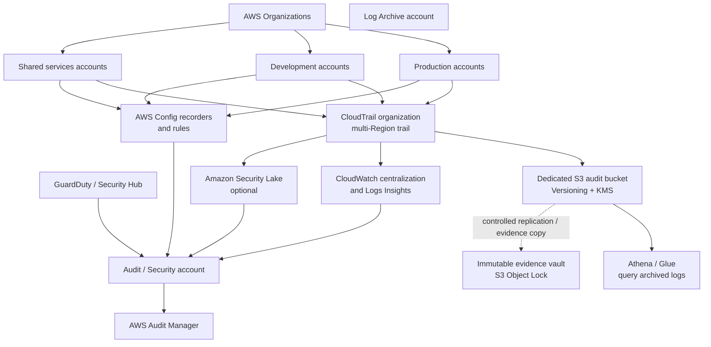

# Protecting audit logs and building evidence retrieval mechanisms on AWS

> **Chapter:** Auditing and Compliance  
> **Module:** CLOUD_PROVIDERS_AWS  
> **Objective:** design an AWS activity recording system with appropriate coverage, protect the integrity and retention of audit logs, enforce independent access permissions, and retrieve verifiable evidence during audits or incident investigations.
>
> **Scope:** AWS CloudTrail, AWS Organizations, Amazon S3, AWS KMS, Amazon CloudWatch, AWS Config, AWS Security Hub CSPM, Amazon GuardDuty, Amazon Security Lake, and AWS Audit Manager. Features, Regions, pricing, and limits can change; verify supported configurations at deployment time.

## 1. The problem: when an incident occurs, what must the organization prove?

An enterprise operates an e-commerce platform across multiple AWS accounts:

- Production account runs ECS, Lambda, RDS, S3, and API Gateway.
- Development account hosts testing environments.
- Shared services account manages networking, DNS, and CI/CD.
- Security/audit account receives centralized logs and findings.
- Log archive account stores only audit records and long-term evidence.

One day, an S3 bucket containing invoice data has its policy altered and several objects deleted. The security team needs to answer:

1. **Who performed the action?** An IAM user, assumed role, AWS service, or federated identity?
2. **What action occurred?** API event, request parameters, error, resource ARN.
3. **When and where?** UTC timestamp, account, Region, source IP, user agent.
4. **What was the resource state before and after the change?** Policy, encryption, public access, versioning.
5. **Were logs modified or deleted after collection?**
6. **Where is the evidence stored, who accessed it, and which query produced the results?**
7. **Can the conclusions be reproduced for auditors or incident responders?**

A sound audit system requires three layers:

- **Capture:** record activities and configuration states needing monitoring.
- **Protect:** guard logs against unauthorized modification/deletion, encrypt, enforce access controls, and retain for the required duration.
- **Prove:** query, verify integrity, store metadata, and preserve the chain of custody.

Audit logs are raw input data. Evidence is the selected set of records, snapshots, findings, control results, and metadata chosen to substantiate a specific claim. Having logs does not equal having complete evidence; you must specify source, time, scope, integrity, and collection methodology.

## 2. Distinguishing audit logs, configuration history, security findings, and evidence

| Data type | Question answered | Commonly used services |
|---|---|---|
| **API audit event** | Who called which API, in which account/Region, and with what outcome? | AWS CloudTrail |
| **Resource access log** | How did requests to S3/ALB/VPC endpoints unfold? | S3 server access logging, ALB access logs, VPC Flow Logs |
| **Configuration history** | How did resource configuration change over time? | AWS Config |
| **Security finding** | Were suspicious behaviors or configurations detected? | GuardDuty, Security Hub CSPM |
| **Centralized security data** | How do we normalize and analyze logs/findings across multiple sources? | Amazon Security Lake, CloudWatch |
| **Compliance evidence** | Which evidence supports evaluating a control? | AWS Audit Manager and evidence repository |

Examples:

- CloudTrail shows which principal called `PutBucketPolicy` at a timestamp.
- AWS Config can show the bucket policy/configuration change and rule evaluation result.
- Security Hub can detect the bucket violating a security control.
- Audit Manager can collect user activity/configuration evidence for supported controls.
- S3 Object Lock can protect an object version from deletion during the retention period.

These services complement each other; no single service automatically proves all legal requirements or internal controls.

## 3. Centralized audit and evidence architecture

Reference model for multi-account organizations:



### 3.1. Separating accounts by trust boundary

A common design includes:

- **Management account:** manages the AWS Organization; access heavily restricted.
- **Log Archive account:** receives and stores raw logs, digest files, snapshots, and immutable copies.
- **Security Tooling/Audit account:** runs Security Hub delegated administrator, GuardDuty administration, Config aggregators, dashboards, and evidence reviews.
- **Workload accounts:** where production, development, and shared services run.

Workload administrators should not have permissions to delete the audit archive. Separating the log archive account reduces blast radius if a production account is compromised.

### 3.2. Data flow and responsibilities

| Component | Primary responsibility |
|---|---|
| CloudTrail organization trail | Collects API activity across covered accounts/Regions |
| S3 log archive | Stores raw CloudTrail log files and digest files |
| CloudWatch | Search, alerting, and operational/security analytics |
| AWS Config | Stores configuration history and evaluates rules |
| Security Hub / GuardDuty | Aggregates posture and detects threats |
| Security Lake | Normalizes security data into OCSF for analysis |
| Audit Manager | Collects, organizes, and reviews evidence for assessments |
| Evidence vault | Stores selected evidence per retention/legal hold |

Separate raw source logs from selected evidence packages for an audit case. Do not edit raw logs to make reports easier to read; create separate extracted/formatted copies and maintain links back to the original source.

## 4. What does AWS CloudTrail record?

AWS CloudTrail records API activity of AWS accounts, including actions via the Console, AWS CLI, SDKs, and certain activities performed by AWS services.

### 4.1. Management events

Management events (control plane events) describe resource management operations, for example:

- Creating, modifying, or deleting EC2 instances or security groups.
- Changing IAM users, roles, policies, and access keys.
- Changing S3 bucket policies, encryption, versioning, or public access blocks.
- Creating, modifying, or deleting CloudTrail trails.
- Modifying VPCs, route tables, network ACLs.
- Modifying RDS configurations, KMS keys, and service settings.

CloudTrail Event history records management events by default for 90 days per Region. Event history does not replace a long-term retention trail.

### 4.2. Data events

Data events describe operations on the data plane or inside specific resources. Examples:

- S3 object-level operations: `GetObject`, `PutObject`, `DeleteObject`.
- Lambda function invocations.
- DynamoDB item-level API activity.
- Other data event types depending on the service.

Data events are **not enabled by default in trails**. You must select matching resources and event selectors/advanced event selectors. They can generate large volumes and incur charges, so prioritize sensitive buckets, functions, tables, or prefixes.

For example: record object reads/deletes in the invoice bucket rather than enabling data events across all unnecessary buckets.

### 4.3. Insights events

CloudTrail Insights analyzes baseline activity and detects certain anomalies such as sudden spikes in API call/error rates according to supported Insights types. Insights is an additional anomaly detection layer; it does not replace recording management/data events.

### 4.4. What CloudTrail cannot prove alone

- Event records do not by themselves reveal complete resource state before and after a change.
- CloudTrail is not an application audit log; business actions such as “employee approved refund” must be logged inside the application.
- CloudTrail does not record requests rejected due to invalid credentials at the authentication layer. S3 server access logging can supplement certain request-level records, though delivery is best-effort.
- Event history does not include data events, Insights events, or organization-wide aggregation.
- Log delivery has latency; do not treat it as a synchronous transaction ledger.

### 4.5. Reading a CloudTrail event

An event can contain these fields:

| Field | Meaning |
|---|---|
| `eventTime` | Event timestamp in UTC |
| `eventSource` | AWS service generating the event |
| `eventName` | API/action name |
| `awsRegion` | Region processing the event |
| `recipientAccountId` | Account receiving the event |
| `userIdentity` | Principal, role, session, and identity context |
| `sourceIPAddress` | Source IP if available |
| `userAgent` | Client/SDK/tool context |
| `requestParameters` | Request parameters, if provided by the service |
| `responseElements` | Response data, if present |
| `errorCode` / `errorMessage` | Error outcome if request failed |
| `resources` | Related resource references |
| `eventID` / `requestID` | Event/request identifiers |
| `readOnly` / `managementEvent` | Metadata about activity type |

Not every event includes all fields. Some request parameters/response fields may be omitted or contain sensitive data; control log read permissions accordingly.

## 5. Creating an organization trail across accounts and Regions

### 5.1. Why use an organization trail?

If each account configures its own trail, an administrator in an account could accidentally or intentionally turn off logging. An organization trail is managed by the management account or delegated administrator and applies across member accounts.

Benefits:

- Collects activity from the management account and member accounts.
- Uses one consistent configuration across enabled Regions.
- When a new account joins the Organization, the trail applies automatically.
- Member account users can see the organization trail but cannot modify/delete it or stop logging.
- The log archive can be centralized in an S3 bucket in a separate account.

### 5.2. Multi-Region trails

Best practice is recording activity across all AWS Regions enabled in the account:

- Use a multi-Region trail.
- Include global service events.
- Check opt-in Regions; the account must enable the corresponding Region for activity to be delivered.
- Choose a home Region that is not an opt-in Region if aligned with organizational strategy.
- Monitor newly enabled Regions and verify trail replicas operate.

If you create only a single-Region trail, activity in other Regions is not recorded in that trail.

### 5.3. Management account and delegated administrator

- An organization trail must be created by the management account or a delegated administrator with appropriate permissions.
- Only the management account or delegated administrator can modify/delete the organization trail.
- Member accounts cannot edit the organization trail configuration.
- By default, the management account has access to the S3 bucket storing logs; member accounts cannot automatically read those logs.
- If resource validation fails (bucket policy, KMS key policy, CloudWatch Logs permissions), the trail may still appear in member accounts while delivery fails. Inspect trail status.

### 5.4. Event history is not an organization-wide console

CloudTrail Event history displays management events for the currently signed-in account, in one Region, for 90 days. To centralize organization events, you need an organization trail or an organization event data store (if the organization already has access to CloudTrail Lake).

## 6. Storing CloudTrail logs in an S3 log archive

### 6.1. Using a dedicated bucket

A bucket dedicated to storing CloudTrail logs should:

- Belong to the Log Archive account.
- Have Block Public Access enabled at both account and bucket levels.
- Have a bucket policy permitting only the CloudTrail service principal to write to the right prefix/account/organization.
- Use Bucket owner enforced Object Ownership where appropriate.
- Enable server-side encryption and control the KMS key policy.
- Not enable Requester Pays.
- Enable versioning and monitor configuration changes.
- Separate CloudTrail write permissions from auditor read/query permissions.

Do not share the bucket with website assets, application uploads, or user data. A dedicated bucket makes IAM policies, retention, inventory, and cost allocation clearer.

### 6.2. Key structure

An organization trail typically creates a structure similar to:

```text
s3://central-audit-bucket/
  AWSLogs/
    o-exampleorgid/
      111122223333/
        CloudTrail/
          ap-southeast-1/
            2026/11/20/
              <log-file>.json.gz
        CloudTrail-Digest/
          ap-southeast-1/
            2026/11/20/
              <digest-file>.json.gz
      444455556666/
        CloudTrail/
          ...
```

Actual prefixes depend on trail configuration and log types. Do not hard-code an assumed prefix for all accounts; inspect actual object keys and organization IDs.

### 6.3. Bucket policy and SourceArn

The bucket policy should:

- Allow service principal **cloudtrail.amazonaws.com** to call **s3:GetBucketAcl** as required.
- Allow **s3:PutObject** into the exact **AWSLogs/...** prefix.
- Check **s3:x-amz-acl** if the policy requires **bucket-owner-full-control**.
- Use the **aws:SourceArn** condition so only the authorized trail ARN can write.
- For an organization trail, allow prefixes containing the organization ID and management account trail ARN per AWS documentation.
- Avoid broad wildcards for all principals or all bucket paths.

Prefer creating the bucket/trail via Console, CloudFormation, or IaC and letting AWS generate the standard policy, then review the actual policy. Do not copy a single-account policy onto an organization trail without updating the organization path.

### 6.4. KMS encryption

CloudTrail log files and digest files can use SSE-S3 or SSE-KMS depending on trail configuration. If choosing a customer-managed KMS key:

- The key policy must allow CloudTrail to use the key to encrypt log files.
- CloudTrail needs corresponding KMS permissions, including **GenerateDataKey** and **DescribeKey** per supported configuration.
- Auditor/query roles need decrypt permissions when reading objects.
- Separate key administrators from log readers.
- Enable rotation per organizational policy where supported by key type.
- Do not disable/delete the key while logs still need decryption or retention has not expired.

Encryption at rest does not replace bucket policies, IAM least privilege, or immutability.

## 7. Protecting logs from tampering/deletion: Versioning, Object Lock, and replication

### 7.1. Three mechanisms with distinct roles

| Mechanism | What does it protect? | Limitations |
|---|---|---|
| S3 Versioning | Retains multiple versions when objects are overwritten/deleted with delete markers | Principals with sufficient permissions can still delete versions |
| S3 Object Lock | WORM protection for object versions during retention period or legal hold | Does not itself guarantee logs were recorded completely or digests are valid |
| S3 Replication | Copies objects to another bucket/account/Region | Asynchronous; does not replace retention and access control |

A log archive can combine these mechanisms, though it must be designed in the right order and delivery/replication must be tested before production.

### 7.2. Object Lock modes

- **Governance mode:** most principals cannot delete/overwrite an object version during the retention period. Principals with **s3:BypassGovernanceRetention** who explicitly send a bypass header can override governance retention.
- **Compliance mode:** an object version cannot be deleted or have its retention shortened before the expiration date by anyone, including the account's root user.
- **Legal hold:** protects an object version with no fixed expiration date; holds until an authorized principal removes the hold.

Object Lock requires S3 Versioning. Once Object Lock is enabled on a bucket, Object Lock cannot be turned off and versioning cannot be suspended. Determine retention/legal requirements before enabling Compliance mode.

### 7.3. Designing an immutable evidence vault

One pattern to consider:

1. CloudTrail writes raw logs into a dedicated log archive bucket.
2. A narrowly scoped replication pipeline copies log objects into an evidence vault in a separate account.
3. The evidence vault enables Versioning and Object Lock with retention approved by Legal/Compliance.
4. Deletion/bypass-governance permissions are reserved strictly for custodians; Compliance mode has no bypass during retention.
5. Monitor replication status and alert on objects that fail to replicate.
6. Retain log file digests and required metadata to verify provenance.

S3 Replication requires Versioning enabled on both source and destination buckets. If the source bucket has Object Lock enabled, the destination bucket must also have Object Lock enabled. The replication role needs permissions to read retention/legal hold metadata such as **s3:GetObjectRetention** and **s3:GetObjectLegalHold**. Test exact bucket/KMS configurations and replication rules before relying on them as formal evidence.

### 7.4. Distinguishing CloudTrail and S3 server access logging

S3 server access logging has its own delivery constraints:

- The destination bucket for server access logs must not have Object Lock enabled.
- The destination bucket must be in the same account and Region as the source bucket when using direct S3 delivery.
- Delivery is best-effort and may take several hours.
- Direct S3 server access log delivery and CloudTrail log delivery are two distinct streams.

If S3 server access logs are needed, use an eligible destination bucket; do not point this stream at an Object Lock bucket. You can choose to deliver server access logs to CloudWatch Logs for structured querying/cross-account aggregation, then export to an appropriate archive.

## 8. CloudTrail log file integrity validation

### 8.1. Hash and digest chain

When log file integrity validation is enabled:

1. CloudTrail computes a hash for each delivered log file.
2. Roughly hourly, CloudTrail creates a digest file referencing log files within that interval.
3. The digest file contains hashes of the log files and is digitally signed using CloudTrail's private key.
4. Each subsequent digest file references the previous digest's signature, forming a verifiable chain.
5. Auditors/incident responders use the public key and AWS CLI to verify the digest chain.

This mechanism uses SHA-256 for hashing and SHA-256 with RSA for digital signatures. If a log file is altered, deleted, or the digest chain breaks, validation detects the issue.

### 8.2. Integrity validation does not equal immutability

- **Log file integrity validation** detects changes after CloudTrail delivers logs.
- **S3 Object Lock** prevents modifying/deleting object versions during the retention period.
- **Versioning** keeps versions but does not itself prevent deleting versions.
- **KMS** encrypts data and controls decryption; key deletion can make data unreadable.

Combine digest validation with storage protection and separation of duties. A file with a valid digest can still be deleted if bucket permissions allow it; Object Lock can preserve a file, yet does not prove the event source recorded all activities.

### 8.3. Enabling log file validation

For an existing trail:

```bash
aws cloudtrail update-trail \
  --name arn:aws:cloudtrail:ap-southeast-1:111122223333:trail/org-audit \
  --enable-log-file-validation
```

Once enabled, CloudTrail begins delivering digest files; enabling the feature **does not automatically run validation**. Schedule periodic verification and save validation outputs as evidence artifacts.

### 8.4. Verifying log files with the AWS CLI

```bash
aws cloudtrail validate-logs \
  --region ap-southeast-1 \
  --trail-arn arn:aws:cloudtrail:ap-southeast-1:111122223333:trail/org-audit \
  --account-id 111122223333 \
  --start-time 2026-11-19T00:00:00Z \
  --end-time 2026-11-20T00:00:00Z \
  --verbose
```

Interpreting output:

- **valid**: digest signature is valid or log file was unchanged after delivery.
- **INVALID: not found**: digest/log file missing at the referenced location.
- **INVALID: signature verification failed**: digest signature is invalid.
- **INVALID: hash value doesn't match**: log file contents differ from the hash recorded in the digest.
- Other **INVALID** messages may indicate a digest was moved or malformed.

For an organization trail, the CLI requires `--account-id` to specify which account's log files to validate. Validation is Region-specific; run separately for each account/Region to inspect. Preserve the full output, CLI version, trail ARN, time range, account/Region, and verification timestamp.

The AWS CLI validates only log files referenced by digests and located at their original S3 path. If logs were moved to another archive bucket/path, retain source objects for CLI validation or use a custom validator supporting the new location.

### 8.5. Scheduling verification

- Run validation periodically for completed time intervals.
- During incidents, validate the relevant time range and Region.
- If digests are missing/invalid, preserve the bucket, versions, and metadata intact for investigation.
- Do not delete/re-upload logs to “fix” validation.
- Open a ticket/security finding and keep validation results inside the evidence case.

## 9. Access permissions and separation of duties

### 9.1. Role separation

| Role | Recommended permissions | Permissions to restrict |
|---|---|---|
| CloudTrail delivery | Write log files/digests to specified prefix | No reading/deleting logs |
| Log archive operator | Manage bucket policy, lifecycle, replication per change process | Do not read/edit evidence unless required |
| Security analyst | Query/search logs, read findings | Do not edit trails or delete raw logs |
| Auditor | Read-only access to granted evidence packages | No access to workload secrets or altering retention |
| Compliance custodian | Manage retention/legal holds per approval | Do not change trail coverage |
| Platform administrator | Manage accounts/Regions/platform | No default permission to delete archive |
| Break-glass role | Recover during severe incidents, with MFA/approval | Not used for day-to-day tasks |

### 9.2. Separating control plane and data plane

CloudTrail control-plane permissions such as `CreateTrail`, `UpdateTrail`, `DeleteTrail`, `StartLogging`, and `StopLogging` should belong to controlled security/platform roles.

Data-plane access to log objects uses separate S3 permissions:

- **s3:ListBucket** scoped only to required prefixes.
- **s3:GetObject**/**s3:GetObjectVersion** for teams needing to query.
- **s3:GetObjectRetention**/**s3:GetObjectLegalHold** for custodians checking Object Lock.
- Do not grant **s3:DeleteObjectVersion** to analysts/auditors.
- Do not grant **s3:BypassGovernanceRetention** to routine roles.

### 9.3. Protecting CloudTrail configuration

Use SCPs/permission boundaries and IAM policies to restrict principals that can disable or modify audit trails. Design explicit exceptions for the management/delegated administrator and break-glass roles; an overly broad deny SCP can block even the security team from making valid configuration fixes.

Monitor and alert on:

- `StopLogging`, `DeleteTrail`, `UpdateTrail`.
- `PutEventSelectors` or `PutInsightSelectors`.
- Changes to S3 bucket policies/versioning/Object Lock/lifecycle.
- `DisableKey`, `ScheduleKeyDeletion`, `PutKeyPolicy`.
- Changes to Organizations, SCPs, delegated administrators, or security service settings.
- Disabling AWS Config recorders or delivery channels.

### 9.4. MFA and break-glass

- Protect the management account with strong MFA and minimal authorized users.
- Use IAM Identity Center/federated access and temporary credentials.
- Break-glass roles must have an owner, approval workflow, time-bound access, and an audit trail.
- Periodically audit long-lived access keys and stale roles.
- Record who approves reading/exporting sensitive evidence.

## 10. EventBridge and CloudWatch: alerting when the audit pipeline changes

CloudTrail can send API events to EventBridge to trigger responses. For example, create a rule when someone stops or deletes a trail:

```json
{
  "source": ["aws.cloudtrail"],
  "detail-type": ["AWS API Call via CloudTrail"],
  "detail": {
    "eventSource": ["cloudtrail.amazonaws.com"],
    "eventName": [
      "StopLogging",
      "DeleteTrail",
      "UpdateTrail",
      "PutEventSelectors"
    ]
  }
}
```

Events can be routed to:

- Amazon SNS to notify security/on-call.
- Amazon SQS to queue for investigation.
- AWS Lambda to enrich events and create incident tickets.
- EventBridge cross-account bus to forward to the security account.
- CloudWatch metrics/alarms to track occurrence counts.

### 10.1. Do not alert only when a trail is turned off

Also monitor:

- **PutBucketPolicy**, **DeleteBucketPolicy**, **PutBucketAcl**.
- **PutBucketVersioning**, **PutBucketObjectLockConfiguration**.
- **PutBucketLifecycle**, **DeleteObject**, **DeleteObjects**.
- **DisableKey**, **ScheduleKeyDeletion**, **PutKeyPolicy**.
- **StopConfigurationRecorder**, **DeleteConfigurationRecorder**.
- Changes to Security Hub, GuardDuty, or Security Lake settings.

For S3 object-level API events like `DeleteObject`, CloudTrail data events must be enabled for the relevant bucket/prefix. Management events do not automatically record object operations.

### 10.2. Delivery health alarms

Do not monitor only security actions; monitor the audit pipeline itself:

- CloudTrail **IsLogging** and **LatestDeliveryError**.
- **LatestDeliveryTime** and **LatestDigestDeliveryTime**.
- S3 replication status/failure events if an immutable replica exists.
- KMS key state and policy changes.
- CloudWatch log ingestion/retention.
- AWS Config recorder status and resource coverage.
- Security Hub/GuardDuty/Security Lake source status.

A dashboard showing no new data may mean the collector was disabled, a policy broke, a new Region was not enabled, or the workload generated no events. Do not treat “no findings” as proof that logging is healthy.

## 11. AWS Config: configuration history and compliance evaluation

### 11.1. How CloudTrail and AWS Config differ

| CloudTrail | AWS Config |
|---|---|
| Records API activity and actors | Records resource configurations and configuration changes |
| Answers “who called which API?” | Answers “how did resource configuration change?” |
| Event records per action | Configuration items/timeline per resource |
| Data events require enabling selectors | Recorder requires enabling resource types to track |
| Can store trail logs long-term in S3 | Can retain configuration history/snapshots and evaluate rules |

When investigating an S3 bucket opened to public access:

- CloudTrail shows who called `PutBucketPolicy` or `PutPublicAccessBlock`.
- AWS Config shows the before and after policy/configuration.
- Security Hub/Config rules evaluate the public access state.
- S3 access logs/CloudTrail data events help identify requests to objects.

### 11.2. Enabling recorders and choosing resource coverage

AWS Config does not record every resource automatically if the recorder is not enabled/configured. Define:

- Resource types to record in each Region.
- Include global resource types if needed and in the manner supported by AWS Config.
- Delivery channel/S3 bucket and SNS if notifications are needed.
- Configuration history retention.
- IAM role/service-linked role for Config.
- Appropriate AWS Config rules or conformance packs.

Do not assume having a recorder in one Region means all Regions are covered.

### 11.3. Multi-account and multi-Region aggregators

An AWS Config aggregator collects configuration/compliance data from multiple accounts/Regions or the entire Organization into a central account.

An aggregator:

- Provides an overview of compliance and resource relationships.
- Is a read-only view of authorized data.
- Does not deploy rules or modify source accounts through the aggregator.
- Does not automatically enable Config recorders in source accounts.
- Incurs no separate aggregator fee, though recorders, rules, and related services may incur charges.

### 11.4. Conformance packs

A conformance pack bundles AWS Config rules and remediation actions into a control package deployable per account/Region or Organization in supported Regions.

Example controls:

- S3 buckets must block public access.
- EBS/RDS resources must be encrypted.
- CloudTrail must enable multi-Region logging.
- Security groups must not open sensitive ports to the entire Internet.
- Required tags and backup settings must be present.

A **NON_COMPLIANT** rule is a signal to investigate; verify scope, parameters, exceptions, and evaluation timestamps before concluding a violation.

## 12. Security Hub, GuardDuty, and Security Lake

### 12.1. AWS Security Hub CSPM

Security Hub CSPM centralizes security findings and posture checks:

- Enable appropriate security standards.
- Use central configuration to manage policies across accounts/Regions.
- Choose controls to enable/disable and customize parameters where supported.
- Aggregate findings from Security Hub controls and integrated services.
- Route findings via EventBridge or workflows to ticketing/incident response.

Security Hub CSPM requires AWS Config to be enabled and recording required resource types for many controls. Enabling Security Hub does not automatically guarantee all AWS Config recorders/recording scopes are right.

### 12.2. Amazon GuardDuty

GuardDuty analyzes threat signals from supported data sources to detect suspicious behaviors such as credential misuse, anomalous API activity, malware, or network threats depending on protection plans.

GuardDuty is a threat detection service; findings do not replace raw audit logs. When a finding occurs:

1. Save finding ID, severity, type, account, Region, and timestamps.
2. Pull related CloudTrail events.
3. Pull Config timeline/resource state.
4. Collect network/application logs if needed.
5. Store evidence artifacts while preserving raw source records.

### 12.3. Amazon Security Lake

Security Lake centralizes security data from AWS and integrated sources, normalizing data into the Open Cybersecurity Schema Framework (OCSF).

For CloudTrail, Security Lake can collect separate sources:

- CloudTrail management events.
- S3 data events.
- Lambda data events.

Security Lake consumes CloudTrail event streams according to its own configuration; enabling Security Lake does not modify or manage CloudTrail trails. You still must manage CloudTrail coverage, retention, and access using CloudTrail APIs/console.

### 12.4. When to use Security Lake?

Fits when the organization wants to:

- Normalize multiple security data sources into OCSF.
- Perform centralized analysis across accounts/Regions.
- Use compatible query/analytics tools.
- Share security telemetry with SIEM/SOC tooling.

Do not enable all data sources with unlimited scope before calculating ingestion volume, retention, query costs, and access permissions.

## 13. AWS Audit Manager: organizing evidence by control

### 13.1. What does Audit Manager do?

AWS Audit Manager helps prepare, collect, organize, and review evidence for assessments. Evidence can be:

- **Compliance check evidence:** results from AWS Config or Security Hub CSPM.
- **User activity evidence:** resource change activity collected from CloudTrail.
- **Configuration data evidence:** configuration snapshots from AWS API calls.
- **Manual evidence:** documents, screenshots, approvals, or artifacts uploaded by owners.

Audit Manager can collect automated evidence from CloudTrail, Security Hub CSPM, AWS Config, and supported AWS API calls.

### 13.2. Assessments do not self-certify compliance

Audit Manager organizes evidence by framework/control, yet:

- Does not automatically determine an enterprise complies fully with a law or standard.
- A control may require non-AWS evidence such as HR processes, contracts, training, or approvals.
- Not every AWS API or security control has an automated evidence source.
- Owners still must review evidence, confirm scope, exceptions, and conclusions.
- Independent auditors may request additional documentation or external testing.

### 13.3. Evidence workflow in Audit Manager

1. Select a framework or create a suitable custom assessment.
2. Define accounts, Regions, and services in scope.
3. Map controls to supported evidence sources.
4. Enable AWS Config/Security Hub/CloudTrail and required recorders/event selectors.
5. Monitor evidence collection status.
6. Review evidence folders, verifying timestamps and resources.
7. Attach missing manual evidence.
8. Generate the assessment report and store it in a repository with retention/access controls.

### 13.4. Checking evidence collection

If evidence does not appear:

- Check whether CloudTrail recorded the needed events.
- Check whether the AWS Config recorder records the relevant resource types.
- Check whether the Security Hub control is enabled and evaluated.
- Check assessment scope and Region.
- Check IAM permissions/service-linked roles.
- Check evidence collection frequency; some compliance checks update on a schedule rather than immediately after each API call.

## 14. CloudTrail Lake and current querying options

### 14.1. Service status to know

AWS CloudTrail Lake **closed to new customers as of 31/05/2026**. CloudTrail Trails, CloudTrail Insights, and Aggregated Events remain supported; only CloudTrail Lake no longer accepts new customers. AWS notes CloudTrail Lake will receive only critical bug fixes and security updates; this does not apply to CloudTrail Trails, Insights, or Aggregated Events.

For existing CloudTrail Lake customers:

- Existing event data stores can continue operating per published AWS policy.
- Organization event data stores continue covering new member accounts added to the Organization and expanding Regions.
- Existing account-level event data stores continue for existing accounts, though they do not automatically ingest new accounts added to the Organization.
- AWS recommends migrating CloudTrail Lake data to Amazon CloudWatch.

For new deployments, do not build architectures dependent on creating new CloudTrail Lake event data stores. Evaluate CloudWatch unified data management, CloudTrail trails delivering to S3, and Amazon Athena per query/retention needs.

### 14.2. Which parts does CloudWatch replace?

CloudWatch can support:

- Collecting and centralizing security/operational/compliance logs.
- Cross-account/cross-Region log centralization.
- Querying with CloudWatch Logs Insights, SQL/PPL across supported sources/architectures.
- Alerting, metrics, and dashboards.
- Data normalization to OCSF/OTel in supported pipelines.
- Subscription filters to stream logs to Kinesis, Firehose, Lambda, or other systems.

Differences to keep in mind:

- Cross-account/cross-Region ingestion enablement may require separate per-Region configuration.
- CloudWatch does not replace all CloudTrail event selector features; selector/query capabilities depend on the data source.
- CloudTrail Network Activity and Insights Events have different limits compared to CloudTrail management/data event ingestion into CloudWatch.
- Query languages and semantics are not identical to CloudTrail Lake SQL.
- You must account for ingestion, storage, query, OpenSearch, and data export costs.

### 14.3. S3 + Athena remains an archive query path

A CloudTrail trail can deliver JSON log files to S3. With an appropriate AWS Glue Data Catalog/Athena table:

- Query logs directly in the archive.
- Partition by account, Region, year/month/day to reduce scanning.
- Use lifecycle rules to transition storage classes per retention.
- Use workgroup encryption/query result location and IAM controls.
- Record query text, execution ID, result location, and time range in the evidence manifest.

Athena fits historical investigations and reproducible queries; CloudWatch better fits near-real-time operational search/alerting along configured pipelines.

## 15. Collecting S3 access evidence

### 15.1. CloudTrail data events for S3

CloudTrail data events can record object-level operations such as:

- `GetObject`.
- `PutObject`.
- `DeleteObject`.
- Other supported object operations APIs.

Use advanced event selectors to limit scope:

```json
[
  {
    "Name": "Audit sensitive invoice objects",
    "FieldSelectors": [
      {
        "Field": "eventCategory",
        "Equals": ["Data"]
      },
      {
        "Field": "resources.type",
        "Equals": ["AWS::S3::Object"]
      },
      {
        "Field": "resources.ARN",
        "StartsWith": [
          "arn:aws:s3:::prod-invoices/"
        ]
      }
    ]
  }
]
```

This is an illustrative selector example. When deploying, verify supported fields/resource ARN formats and combine selectors per CloudTrail API syntax. Selecting sensitive prefixes helps control volume/cost.

### 15.2. What does S3 server access logging add?

S3 server access logging records detailed requests to a bucket. It can supplement details about certain authentication failure requests that CloudTrail does not record.

There are two delivery paths:

- **Direct to S3:** space-delimited text logs, destination bucket in the same account/Region, best-effort delivery typically delayed by hours.
- **To CloudWatch Logs:** structured JSON, supports Logs Insights, cross-account/cross-Region centralization, KMS encryption, and forwarding to S3/Firehose per configuration.

S3 server access logging does not guarantee every record is delivered or delivered on time. Use it as a supplementary source; do not treat it as a real-time alerting system or the sole evidence for every request.

### 15.3. CloudTrail vs. S3 server access logs

| Criterion | CloudTrail data events | S3 server access logs |
|---|---|---|
| API identity/context | Includes `userIdentity` and event context | Includes request details per access log format |
| Object-level operations | Yes, if selector enabled | Has request records |
| Authentication failures | Does not record invalid credentials at auth layer | May include corresponding records |
| Integrity digest | Has log file validation | No CloudTrail digest chain |
| Delivery | Nearer real-time but asynchronous; data events follow delivery cadence | Best-effort, potentially several hours |
| Cost | Data event charges and storage | Direct S3 delivery incurs no delivery charge; storage still billed |
| Use case | Attribution, API audit, data access | Request-level troubleshooting and supplementary access auditing |

CloudTrail does not record every request failing due to bad credentials. Do not rely on a single source to conclude “no unauthorized access” if your threat model requires multi-layered telemetry.

## 16. Querying audit logs

### 16.1. Finding recent events with Event history

Event history is available per account/Region, retains 90 days of management events, and requires no trail to view. It fits quick lookups, though it cannot query data events and does not aggregate across an organization.

AWS CLI:

```bash
aws cloudtrail lookup-events \
  --region ap-southeast-1 \
  --lookup-attributes AttributeKey=EventName,AttributeValue=StopLogging \
  --start-time 2026-11-19T00:00:00Z \
  --end-time 2026-11-20T00:00:00Z \
  --max-results 50
```

### 16.2. Querying CloudTrail logs in Athena

Example query to find sensitive IAM changes in a time window:

```sql
SELECT
    eventtime,
    eventsource,
    eventname,
    awsregion,
    sourceipaddress,
    useridentity.arn AS actor_arn,
    useridentity.sessioncontext.sessionissuer.arn AS role_arn,
    errorcode,
    requestparameters,
    eventid
FROM cloudtrail_logs
WHERE eventsource = 'iam.amazonaws.com'
  AND eventname IN (
      'CreateAccessKey',
      'CreateLoginProfile',
      'AttachUserPolicy',
      'PutUserPolicy',
      'CreatePolicyVersion',
      'SetDefaultPolicyVersion'
  )
  AND eventtime >= '2026-11-19T00:00:00Z'
  AND eventtime <  '2026-11-20T00:00:00Z'
ORDER BY eventtime DESC;
```

Table names, partition columns, field types, and nested struct names depend on your organization's Glue/Athena table definition. Check the actual schema before using in a production runbook. Do not SELECT entire request parameters into reports if they may contain sensitive values.

### 16.3. Querying in CloudWatch Logs Insights

If CloudTrail JSON events are delivered to CloudWatch Logs:

```text
fields @timestamp,
       eventSource,
       eventName,
       awsRegion,
       sourceIPAddress,
       userIdentity.arn,
       errorCode,
       eventID
| filter eventSource = "cloudtrail.amazonaws.com"
    or eventSource = "iam.amazonaws.com"
| filter eventName in ["StopLogging", "DeleteTrail", "CreateAccessKey"]
| sort @timestamp desc
| limit 100
```

Field paths depend on the log group's JSON structure. With CloudWatch pipeline/OCSF transformations, field names may already be normalized; use schema/field discovery for the exact log group.

### 16.4. Querying by principal and assumed role

When investigating an assumed role:

- Inspect `userIdentity.type`, `arn`, `principalId`, and `sessionContext`.
- Inspect `sessionIssuer.arn` to identify the underlying IAM role.
- Cross-reference STS `AssumeRole` events and `externalId`/session tags if present.
- Cross-reference `sourceIPAddress`, `userAgent`, `accessKeyId`, and time window.
- Determine whether the principal is human federation, CI/CD role, service role, or AWS service.
- Do not infer individual human identity from a role ARN alone; map back to identity provider/session logs.

### 16.5. Querying by resource

Use resource ARNs and account/Region to narrow results:

- S3 bucket/object ARN.
- IAM role/user/policy ARN.
- EC2 instance/security group/VPC ARN or resource ID.
- KMS key ARN.
- RDS DB instance/cluster ARN.
- Lambda function ARN.

When a resource is deleted, events may still retain the resource name/ARN in logs even though Describe APIs no longer return that resource. That is why raw logs and configuration history must be preserved.

## 17. Chain of custody for evidence

### 17.1. Evidence needs reproducible metadata

An evidence item should store at minimum:

| Metadata | Example / meaning |
|---|---|
| Case ID | Unique incident/audit case |
| Control ID | Control or requirement being proven |
| Evidence ID | Unique ID of the artifact |
| Source service | CloudTrail, Config, Security Hub, GuardDuty, S3... |
| Source account / Region | Account ID and Region where the event/resource originated |
| Resource ARN | Related resource |
| Event IDs | CloudTrail eventID/requestID or finding ID |
| Time range | Start/end in UTC |
| Source location | S3 bucket/key/version ID or CloudWatch log group/stream |
| Query | Query text, parameters, table/schema, and execution ID |
| Integrity result | CloudTrail digest validation, SHA-256 of export |
| Collector | IAM role/principal and collection timestamp |
| Reviewer | Reviewer and approval |
| Retention | Retain-until date or legal hold status |

### 17.2. Sample evidence manifest

```yaml
case_id: SEC-2026-0042
evidence_id: EV-0007
control_id: AUDIT-LOG-RETENTION-01
source:
  service: cloudtrail
  account_id: "111122223333"
  region: ap-southeast-1
  trail_arn: arn:aws:cloudtrail:ap-southeast-1:111122223333:trail/org-audit
  s3_bucket: central-audit-bucket
  s3_key: AWSLogs/o-exampleorgid/111122223333/CloudTrail/ap-southeast-1/2026/11/20/example.json.gz
  s3_version_id: "3HL4kqtJlcpXroDTDmJ..."
time_range_utc:
  start: "2026-11-19T00:00:00Z"
  end: "2026-11-20T00:00:00Z"
collection:
  collected_at: "2026-11-20T08:30:00Z"
  collector_role: arn:aws:iam::555566667777:role/AuditEvidenceReadOnly
  query_id: "athena-query-id"
integrity:
  cloudtrail_digest_validation: valid
  sha256: "replace-with-computed-sha256"
review:
  reviewer: "security-reviewer"
  reviewed_at: "2026-11-20T10:00:00Z"
retention:
  object_version: "s3-version-id"
  legal_hold: false
  retain_until: "2033-11-20T00:00:00Z"
```

This is a structural template, not real evidence. Do not insert fabricated data into audit reports; replace placeholders with values read from systems and save corresponding queries/outputs.

### 17.3. Keeping raw evidence and derived evidence separate

- Raw CloudTrail log/digest files remain intact at their source path/version.
- Query results, CSVs, screenshots, and reports are derived evidence.
- Record query text, parameters, timestamp, workgroup, and execution ID.
- If PII/secrets must be redacted, create a new redacted copy, document the reason, and retain the raw copy under restricted access.
- Do not modify original JSON to add annotations or normalize fields.
- Hash exported artifacts with SHA-256 and record hashes in the manifest.
- Keep version IDs and source URIs so reviewers can trace back.

### 17.4. Time correlation

Use UTC consistently across AWS events, application logs, and evidence manifests:

- CloudTrail `eventTime` is the event timestamp in UTC.
- CloudWatch `@timestamp` may be ingestion or event timestamp depending on pipeline.
- Application logs should include UTC timestamps, `requestId`, and `traceId`.
- Clearly separate event time, collection time, and export time; they are not the same timestamp.
- If a source system has clock skew, document the offset and time source.

### 17.5. Evidence for business actions

CloudTrail records only AWS API activity. A Spring Boot application needs audit events for critical business actions, for example:

- Authenticated actor/customer/staff identity.
- Action, target entity, and tenant scope.
- Business reason/approval reference.
- Before/after state or change summary stripped of sensitive data.
- Outcome, UTC timestamp, `requestId`, and `traceId`.
- Application version/environment.

Do not log passwords, session tokens, payment card data, secret values, or entire request payloads containing unnecessary PII.

## 18. Retention, legal holds, and lifecycle

### 18.1. Do not pick retention arbitrarily

Retention must be based on:

- Laws/regulations applicable in the enterprise's and customers' jurisdictions.
- Contracts, internal policies, and auditor requirements.
- Data classification and sensitivity.
- Required investigation/recovery timeframe.
- Legal holds, litigation, or incident response requirements.
- Costs for storage, queries, retrieval, and key management.

No single retention period fits all log types. Application debug logs, CloudTrail management events, and financial transaction evidence can have different retention mandates.

### 18.2. Storage tiering

| Tier | Example objective | Choice |
|---|---|---|
| Searchable hot data | Recent operational investigations | CloudWatch Logs |
| Raw audit archive | Store raw logs for re-querying | S3 Standard/Intelligent-Tiering per access patterns |
| Long-term archive | Infrequently accessed data needing long retention | S3 Glacier storage classes per retrieval SLA |
| Immutable evidence | Evidence requiring WORM/legal hold | S3 Object Lock |
| Query-ready dataset | Multi-month/multi-account analytics | S3 + Glue/Athena or CloudWatch analytics |

Transitioning to Glacier classes may require restoring before reading; factor retrieval time/cost into incident runbooks. Lifecycle transitions do not replace retention/legal hold policies.

### 18.3. Legal holds and expiration

- A legal hold has no expiration date; it is lifted only when an authorized principal removes it.
- A retention period protects an object version until the retain-until date.
- Lifecycle expiration cannot delete an object version protected by Object Lock.
- A legal hold can continue retaining an object after the retention period expires.
- Check specific version IDs; locks apply to object versions, not just object keys.
- Retain approvals when placing/removing legal holds.

### 18.4. Verifying decryption capability years later

A log archive may still contain objects yet become unreadable if the KMS key is disabled/deleted or the policy no longer allows decryption. Key management is part of evidence retention:

- Use a customer-managed KMS key with a clear owner/backup plan if policy requires.
- Do not schedule key deletion while data still needs to be read.
- Keep key policies/role access reviewed and version-controlled.
- Maintain a procedure to recover key permissions during incidents.
- Periodically test reading a sample object from the archive.

## 19. Evidence retrieval workflow for an audit/incident case

A workflow can be standardized into steps:

1. **Define question:** clearly state the control/incident to prove and the time range.
2. **Scope:** identify account, Region, resource ARN, actor/principal, and service.
3. **Identify sources:** CloudTrail, Config, application logs, VPC Flow Logs, S3 access logs, GuardDuty/Security Hub.
4. **Preserve source:** record S3 object versions/digest files or log group/time ranges before querying.
5. **Validate integrity:** run CloudTrail `validate-logs` for the relevant time range; save output.
6. **Query:** use Athena/CloudWatch Logs Insights or appropriate consoles/APIs.
7. **Correlate:** link `eventID`/`requestID`, resource ARN, principal/session, timestamp, `traceId`.
8. **Export:** generate derived evidence with query, parameters, execution ID, and export timestamp.
9. **Hash and manifest:** compute SHA-256, record source/version/collector/reviewer in the manifest.
10. **Protect:** store the evidence package in a bucket/case folder with IAM least privilege, retention, and legal hold when needed.
11. **Review:** an independent reviewer verifies sources, scope, integrity, and conclusions.
12. **Close:** document findings, exceptions, remediation, approval, and retention schedule.

### 19.1. Recommended evidence package

```text
SEC-2026-0042/
  00-case-metadata/
    scope.yaml
    approvals.pdf
  01-raw-references/
    cloudtrail-source-objects.csv
    config-resource-timeline.json
    security-findings.json
  02-integrity/
    cloudtrail-validate-logs.txt
    sha256-manifest.txt
  03-queries/
    athena-query.sql
    query-parameters.json
    execution-metadata.json
  04-derived-evidence/
    cloudtrail-events.csv
    config-snapshot.json
    timeline.pdf
  05-review/
    reviewer-notes.md
    final-evidence-index.yaml
```

You do not necessarily need to copy all raw logs into every case; you can reference S3 bucket/key/version IDs in the central archive to avoid duplicating data. If auditors require a standalone package, copy via a workflow with versioning/Object Lock and a manifest.

## 20. Runbook: investigating an unauthorized change on an S3 bucket

Scenario: the invoices bucket had its policy altered and objects deleted.

### Step 1 — Preserve current state

- Record case ID, account ID, Region, bucket ARN, and time window.
- Record current bucket policy, public access block, versioning, Object Lock, and encryption.
- Do not rush to delete objects, rotate keys, or modify the log archive.
- If containment is needed, execute per incident response approval and log every action.

### Step 2 — Find CloudTrail management events

Look up `PutBucketPolicy`, `DeleteBucketPolicy`, `PutPublicAccessBlock`, `PutBucketVersioning`, and related events in CloudTrail.

### Step 3 — Find S3 data events

If data event selectors were enabled, look up `DeleteObject`, `GetObject`, and `PutObject` for the bucket/prefix. If not enabled, do not assume Event history will contain old object events.

### Step 4 — Correlate identity

- Identify `userIdentity.type`, ARN, session issuer, and `principalId`.
- Find related STS `AssumeRole` events.
- Check `sourceIPAddress`, `userAgent`, `accessKeyId`, and MFA context if recorded.
- Cross-reference identity provider/SSO sign-in logs when needed to identify the human user.

### Step 5 — Correlate configuration history

Use the AWS Config timeline to determine when policy/public access/versioning changed and view before/after resource configuration items.

### Step 6 — Correlate object-level requests

Use CloudTrail data events and S3 server access logs if configured. Check S3 Versioning, delete markers, object versions, replication, and backups to determine recoverability.

### Step 7 — Validate and preserve

- Run CloudTrail `validate-logs` for the relevant timeframe.
- Retain digest files, source object versions, and query results.
- Create an evidence manifest and SHA-256 hashes.
- If needed, place a legal hold on evidence versions per approval.
- Separate verified conclusions from unproven hypotheses.

## 21. AWS CLI: inspecting the audit pipeline and retrieving evidence

> The commands below are **read-only**, except that they may create output/query records or incur query charges. Use AWS CLI v2 with the right Region and IAM permissions. Replace placeholders with real resources; never post account IDs, ARNs, or sensitive outputs to public issues.

### 21.1. List trails

```bash
aws cloudtrail describe-trails \
  --region ap-southeast-1 \
  --include-shadow-trails \
  --query 'trailList[*].{Name:Name,Arn:TrailARN,MultiRegion:IsMultiRegionTrail,Organization:IsOrganizationTrail,Validation:LogFileValidationEnabled,S3Bucket:S3BucketName,KmsKey:KmsKeyId,HomeRegion:HomeRegion}' \
  --output table
```

Verify organization trail, multi-Region, log file validation, bucket, and KMS key. Shadow trails are trail replicas created in other Regions for a multi-Region trail.

### 21.2. Check logging and delivery status

```bash
aws cloudtrail get-trail-status \
  --region ap-southeast-1 \
  --name arn:aws:cloudtrail:ap-southeast-1:111122223333:trail/org-audit \
  --query '{IsLogging:IsLogging,LatestDeliveryTime:LatestDeliveryTime,LatestDeliveryError:LatestDeliveryError,LatestDigestDeliveryTime:LatestDigestDeliveryTime,LatestDigestDeliveryError:LatestDigestDeliveryError,StartLoggingTime:StartLoggingTime,StopLoggingTime:StopLoggingTime}' \
  --output json
```

If `LatestDeliveryError` or `LatestDigestDeliveryError` has a value, investigate bucket policy, KMS key policy, service permissions, and Region coverage. Do not conclude the pipeline is healthy solely from `IsLogging=true`.

### 21.3. Search management events within 90 days

```bash
aws cloudtrail lookup-events \
  --region ap-southeast-1 \
  --lookup-attributes AttributeKey=EventName,AttributeValue=PutBucketPolicy \
  --start-time 2026-11-19T00:00:00Z \
  --end-time 2026-11-20T00:00:00Z \
  --max-results 50 \
  --output json
```

`LookupEvents` searches only Event history management events per account/Region within its time limit. To query organization-wide or data events, use your trail archive/query pipeline.

### 21.4. Check Config aggregators

```bash
aws configservice describe-configuration-aggregators \
  --region ap-southeast-1 \
  --query 'ConfigurationAggregators[*].{Name:ConfigurationAggregatorName,Arn:ConfigurationAggregatorArn,Organization:OrganizationAggregationSource,Accounts:AccountAggregationSources,Regions:Region}' \
  --output json
```

Verify source accounts/Regions and the Organization aggregation source. An aggregator only displays data from accounts/Regions that enabled AWS Config and authorized aggregation.

### 21.5. Check Config compliance

```bash
aws configservice describe-compliance-by-config-rule \
  --region ap-southeast-1 \
  --query 'ComplianceByConfigRules[*].{Rule:ConfigRuleName,Compliance:Compliance.ComplianceType,NonCompliant:Compliance.ComplianceContributorCount.CappedCount}' \
  --output table
```

Compliance results are evaluation snapshots at the time Config evaluated them. Record evaluation time, rule parameters, resource scope, and exceptions when using them as evidence.

### 21.6. View S3 Object Lock retention

```bash
aws s3api get-object-retention \
  --bucket immutable-evidence-vault \
  --key SEC-2026-0042/02-integrity/sha256-manifest.txt \
  --version-id EXAMPLE_VERSION_ID
```

This command reads retention for a specific object version. Use `get-object-legal-hold` to inspect legal hold status; corresponding permissions are required.

### 21.7. View Security Hub findings

```bash
aws securityhub get-findings \
  --region ap-southeast-1 \
  --filters '{"SeverityLabel":[{"Value":"HIGH","Comparison":"EQUALS"},{"Value":"CRITICAL","Comparison":"EQUALS"}],"RecordState":[{"Value":"ACTIVE","Comparison":"EQUALS"}]}' \
  --max-results 20 \
  --output json
```

Results depend on delegated administrator, Region, enabled standards, and integrations. Record finding ID, workflow status, first/last observed times, and resource ARN in the evidence manifest.

### 21.8. Run a CloudWatch Logs Insights query

```bash
aws logs start-query \
  --region ap-southeast-1 \
  --log-group-name /aws/cloudtrail/organization \
  --start-time 1795046400 \
  --end-time 1795132800 \
  --query-string 'fields @timestamp, eventSource, eventName, userIdentity.arn, sourceIPAddress, errorCode | filter eventName = "StopLogging" or eventName = "DeleteTrail" | sort @timestamp desc | limit 100'
```

`start-query` creates a query execution record. Save the query ID and retrieve results via `get-query-results`; start/end times are Unix epoch seconds, converted from the case's UTC range.

### 21.9. Check replication status

Use `head-object` with a version ID or S3 Inventory/replication metrics to check object replication status. On versioned buckets, distinguish source object versions from replica versions. Do not treat an Enabled rule as proof that every object replicated successfully.


## 22. Infrastructure as Code: sample organization trail

The CloudFormation snippet below illustrates an organization multi-Region trail with log file validation and S3 object data events for a sensitive bucket. This is a **sample resource**, not a complete stack.

```yaml
Resources:
  OrganizationAuditTrail:
    Type: AWS::CloudTrail::Trail
    Properties:
      TrailName: org-audit
      IsLogging: true
      IsOrganizationTrail: true
      IsMultiRegionTrail: true
      IncludeGlobalServiceEvents: true
      EnableLogFileValidation: true
      S3BucketName: !Ref LogArchiveBucket
      S3KeyPrefix: organization-audit
      KMSKeyId: !GetAtt AuditLogKey.Arn
      AdvancedEventSelectors:
        - Name: All management events
          FieldSelectors:
            - Field: eventCategory
              Equals:
                - Management
        - Name: Sensitive S3 object activity
          FieldSelectors:
            - Field: eventCategory
              Equals:
                - Data
            - Field: resources.type
              Equals:
                - AWS::S3::Object
            - Field: resources.ARN
              StartsWith:
                - arn:aws:s3:::prod-invoices/
```

Before deploying:

- The stack must run in the management/delegated administrator account with permissions to create an organization trail.
- The S3 bucket policy must allow the exact organization trail to write to the exact prefix.
- The KMS key policy must allow CloudTrail to encrypt log files/digest files and reader roles to decrypt.
- The bucket must be created beforehand or referenced in the stack, with Block Public Access and encryption.
- Advanced event selectors are explicitly defined for both Management events and S3 Data events; omitting the Management selector may prevent the trail from recording management events as expected.
- Check Region support, Organizations all features, and opt-in Regions.
- Do not specify both `EventSelectors` and `AdvancedEventSelectors` in the same trail resource.

### 22.1. S3 archive bucket policy

For an organization trail, the bucket policy must allow CloudTrail to write both the organization path and management-account path per the official template. Let the Console/CloudFormation generate the policy, then review:

- Principal is the CloudTrail service principal.
- Resource ARN is scoped to the exact bucket and prefix.
- Condition `aws:SourceArn` is scoped to the exact management-account trail ARN.
- Do not open `s3:PutObject` to all principals.
- Do not accidentally block CloudTrail via explicit Deny, SCPs, or KMS key policies.

### 22.2. Immutable vaults require separate configuration

If an evidence vault with Object Lock is needed:

- Create a new bucket, enabling Versioning and Object Lock from the start.
- Define Governance/Compliance mode, default retention, and legal hold workflows.
- Design the replication role, KMS permissions, and destination bucket policy.
- Monitor replication failures/replication latency.
- Test delete markers, retention expiry, and legal holds in a separate environment.
- Do not use an Object Lock destination as an S3 server access logging destination.

## 23. Audit and evidence costs

| Component | Cost drivers |
|---|---|
| CloudTrail management events | First copy of management events delivered via a trail may be free per pricing; additional copies may incur charges |
| CloudTrail data events | Billed by volume/selectors and current pricing |
| CloudTrail Insights | Billed by Insights event types |
| S3 archive | Storage class, requests, retrieval, lifecycle, and replication |
| AWS KMS | Keys, API requests, and cross-account usage |
| CloudWatch Logs | Ingestion, storage, queries, pipelines, and subscriptions |
| Athena | Data scanned per query; partitioning reduces scans |
| AWS Config | Configuration items, rules, conformance packs, and recorder scope |
| GuardDuty / Security Hub | Billed by data sources, resource coverage, and service pricing |
| Security Lake | Ingestion, storage, queries, and data processing |
| AWS Audit Manager | Billed per current service/assessment usage |

### 23.1. Controlling costs while preserving coverage

- Enable data events for sensitive resources/prefixes rather than all resources if unnecessary.
- Use advanced event selectors to filter event category, resource type, ARN, and read/write scope.
- Estimate event volume before enabling broad data events.
- Partition Athena tables by account/Region/date.
- Set appropriate CloudWatch log retention and sampling; set raw archive retention per policy.
- Transition infrequently accessed logs to cheaper storage classes while accounting for restore time.
- Review duplicate trails/duplicate deliveries; avoid multiple trails recording the same event set without purpose.
- Use AWS Cost Explorer/CUR to allocate costs by account, service, Region, and tags.

Do not reduce audit control coverage solely because a cost dashboard increases; first identify which volume sources, selectors, and retention settings are driving costs.

## 24. Troubleshooting the audit pipeline

| Symptom | Possible cause | Investigation steps |
|---|---|---|
| Trail exists but no new logs | `IsLogging=false`, Region disabled, no activity | `get-trail-status`, Region opt-in, and event history |
| `LatestDeliveryError` appears | Bucket policy, prefix, KMS, or service permissions | S3 bucket policy, `aws:SourceArn`, KMS key policy |
| Digest files do not appear | Validation not enabled or delivery error | `LogFileValidationEnabled`, `LatestDigestDeliveryError` |
| `validate-logs` reports missing | Object deleted, delivery gap, or wrong time range | Digest chain, S3 versions, lifecycle, replication |
| Organization member has no events | Trail home Region is an opt-in Region disabled in member | Organization trail config and Region enablement |
| S3 `DeleteObject` not found | Data events not enabled or selector mismatch | Advanced event selectors, bucket/prefix ARN |
| Event history lacks object APIs | Event history contains only management events | S3 data events in trail/archive |
| CloudWatch Logs has no data | Subscription/centralization/ingestion not configured | Log group, subscription filter, destination permissions |
| Athena missing new partitions | Glue table/partition projection incorrect | S3 key layout, table schema, partitions |
| Config aggregator missing accounts | Config not enabled or authorization/service access error | Recorder, Organizations trusted access, aggregator source |
| Security Hub control has no results | AWS Config recording scope lacks resource types | Config recorder and control prerequisites |
| Audit Manager evidence empty | Source service not enabled or event/control unsupported | Assessment scope, data sources, collection frequency |
| Replication status FAILED | IAM role, KMS, versioning, or destination Object Lock mismatch | Replication role, bucket/key policies, versioning |
| Auditor cannot decrypt objects | KMS key policy/Grant missing or key disabled | KMS key state, key policy, decrypt permissions |
| Cannot delete object | Object Lock retention/legal hold | Version ID, retain-until date, legal hold |
| CloudTrail Lake cannot create EDS | Account lacks CloudTrail Lake access | Use CloudWatch/S3+Athena; existing customers verify EDS scope |

## 25. Periodic operations schedule and checking evidence completeness

An audit pipeline must be operated like a production control. One successful deployment does not guarantee trails, recorders, event selectors, KMS keys, and archive permissions stay accurate as the Organization evolves.

### 25.1. Daily checks

- Check CloudTrail `IsLogging`, `LatestDeliveryError`, and `LatestDigestDeliveryError`.
- Verify new objects/digests exist for expected accounts/Regions.
- Check EventBridge alerts for `StopLogging`, `DeleteTrail`, bucket policy, and KMS changes.
- Check new Security Hub/GuardDuty findings and workflow statuses.
- Check AWS Config recorders and delivery channels in workload accounts.
- Check replication failures and unreplicated object versions if an evidence vault exists.

### 25.2. Weekly checks

- Run `validate-logs` for one or more completed time windows.
- Pick a sample evidence package and test opening raw source objects/versions.
- Verify queries can be re-executed with the same parameters and schemas.
- Test KMS decrypt permissions using an approved auditor role.
- Check log groups, subscriptions, retention, and ingestion gaps.
- Review newly added accounts/Regions in the Organization.

### 25.3. Monthly checks

- Reconcile accounts/Regions in AWS Organizations against CloudTrail/Config coverage inventory.
- Review advanced event selectors for S3, Lambda, DynamoDB, and sensitive resources.
- Review IAM access to archives, KMS keys, Object Lock bypass, and legal hold permissions.
- Check configuration drift on bucket policies, versioning, lifecycle, Object Lock, and replication.
- Review CloudWatch/Athena/Security Lake/S3 costs and event volume.
- Verify Audit Manager assessments are collecting evidence within the right scope.

### 25.4. Quarterly checks

- Perform a restore/readability test on a sample of older archived data.
- Run an incident drill tracing from an EventBridge alert to CloudTrail, Config, and an evidence manifest.
- Test legal hold workflows and approval trails.
- Review retention schedules with Legal/Compliance and data owners.
- Conduct access recertification for auditors, analysts, archive operators, and custodians.
- Verify account closure/member account removal procedures so historical archives remain retained per policy.

### 25.5. When system changes occur

Perform a coverage review when:

- Creating a new account or OU.
- Enabling a new Region or changing Region opt-in.
- Creating a new sensitive bucket/table/function.
- Changing data event selectors.
- Changing trails, bucket prefixes, KMS keys, or archive accounts.
- Enabling/disabling Security Hub, GuardDuty, Security Lake, or AWS Config.
- Changing retention, lifecycle, replication, or Object Lock.
- Changing identity providers, CI/CD roles, or break-glass access.

### 25.6. Recommended operational metrics

| Metric / signal | Meaning |
|---|---|
| Last successful CloudTrail delivery | Most recent time the trail delivered logs successfully |
| Latest digest delivery | Whether the digest chain continues to be generated |
| Delivery error count | Bucket/KMS/permission errors |
| Expected account/Region coverage | Percentage of accounts/Regions with audit sources |
| Data event selector coverage | Whether sensitive resources are covered by selectors |
| Validation result | Number of valid/invalid/missing validation runs |
| S3 replication failures | Whether the evidence vault receives all objects |
| Config recorder status | Whether resource configuration history is being recorded |
| KMS key state | Whether logs remain decryptable throughout retention |
| Evidence collection status | Whether controls have fresh, in-scope evidence |

Set thresholds based on baselines, expected event cadence, and organizational SLOs. Do not pick one universal number across all Regions/workloads; what matters is detecting logging gaps before evidence is needed.

### 25.7. Review cycle completion criteria

A review cycle can be closed only when:

- Coverage inventory is reconciled with the Organization.
- Delivery errors and missing digests are resolved or have approved exceptions.
- A sample of raw logs has been integrity-validated.
- A sample evidence package has been reproduced from sources/queries.
- Retention and KMS decryptability have been verified.
- Access reviews have reviewers/approvals and action items have owners/due dates.

## 26. Scenario exercises and answers

### Exercise 1 — Event history

An auditor needs API management events for one account over the last 60 days. Is a new trail required?

**Answer:** Not necessarily. CloudTrail Event history provides 90 days of management events per Region out of the box. If longer retention, organization-wide scope, or data events are required, a trail/archive or equivalent solution is needed.

### Exercise 2 — Data events

The application team needs to know who called `GetObject`/`DeleteObject` in the invoices bucket. Why is Event history insufficient?

**Answer:** Event history displays only management events. You must enable CloudTrail S3 data events for the appropriate bucket/prefix; factor in cost and volume.

### Exercise 3 — Organization trail

Can a member account administrator turn off an organization trail?

**Answer:** No. Member account users can view the trail, but cannot modify/delete an organization trail or disable logging. Only the management/delegated administrator has permission to change it as configured.

### Exercise 4 — Multi-Region

A multi-Region trail sets its home Region to an opt-in Region, yet several member accounts have not enabled that Region. What is the risk?

**Answer:** Member accounts that have not opted into the home Region may not deliver activity into the organization trail. Choose an appropriate home Region and verify opt-in Region coverage.

### Exercise 5 — Hash vs. Object Lock

Does CloudTrail digest validation replace S3 Object Lock?

**Answer:** No. Digest validation detects log files modified/deleted after delivery; Object Lock protects object versions from modification/deletion during retention. The two mechanisms complement each other.

### Exercise 6 — Governance vs. Compliance

An organization wants specific custodians to be able to bypass retention with approval. Which mode should be chosen?

**Answer:** Governance mode, strictly limiting `s3:BypassGovernanceRetention` and requiring explicit bypass requests. If nobody may ever delete/shorten retention early, evaluate Compliance mode after legal review.

### Exercise 7 — Legal hold

The retention period expired, yet an auditor requests keeping an object longer for an investigation. What should be used?

**Answer:** Legal hold on the specific object version, with approval and a custodian workflow. Remove the hold only after the investigation/legal owner authorizes it.

### Exercise 8 — S3 server access logs

Can S3 server access logs be sent directly to a bucket with Object Lock enabled?

**Answer:** No. S3 server access logging does not support destination buckets with Object Lock enabled. Use an eligible destination bucket or CloudWatch Logs delivery and design a separate archive.

### Exercise 9 — CloudTrail Lake

A new AWS account wants to create a CloudTrail Lake event data store in November 2026. What is the right path?

**Answer:** CloudTrail Lake closed to new customers as of 31/05/2026. Evaluate Amazon CloudWatch per AWS recommendations, or CloudTrail trails + S3 + Athena depending on requirements.

### Exercise 10 — Config aggregator

An aggregator shows an account with no resources/compliance data. Is creating the aggregator enough?

**Answer:** No. AWS Config must be enabled/recording in the source account/Region, and organization access/authorization must be properly configured. An aggregator only aggregates existing data.

### Exercise 11 — Security Hub

Security Hub CSPM is enabled, yet many resource controls have no results. What should be checked?

**Answer:** AWS Config recorders and required recorded resource types, control prerequisites, Region/standards enablement, and evaluation timing.

### Exercise 12 — GuardDuty finding

GuardDuty detects anomalous credential usage. Do findings replace CloudTrail event logs?

**Answer:** No. A finding is a detection signal. Use CloudTrail, identity/session logs, Config, and network/application logs to investigate timelines and attribution.

### Exercise 13 — Chain of custody

A CSV export is emailed without a source URI, query, or hash. Why is this inadequate?

**Answer:** The source/query cannot be reproduced and it is hard to verify the file was not tampered with. You need a manifest containing source object/version, query, parameters, execution ID, collector, timestamps, SHA-256, and reviewer.

### Exercise 14 — Data event costs

A bucket handles billions of object operations per day. Should data events be enabled for the entire bucket without testing?

**Answer:** No. Estimate event volume/cost, use advanced selectors to restrict prefixes or event types, run a pilot, and verify coverage.

### Exercise 15 — Key deletion

S3 archive objects still exist, yet the KMS key was deleted. Can the logs be read?

**Answer:** Likely not. Key lifecycle and decrypt permissions are part of evidence retention; never delete/disable keys while data must still be retrieved.

### Exercise 16 — Log delivery

`get-trail-status` shows `IsLogging=true`, yet `LatestDeliveryError` has a value. Can you conclude the audit pipeline is healthy?

**Answer:** No. Logging state does not equal successful delivery. Fix bucket policies, prefixes, KMS permissions, and verify object/digest deliveries.

### Exercise 17 — EventBridge tampering alert

You want an alert whenever someone calls `StopLogging` or `DeleteTrail`. What should you use?

**Answer:** An EventBridge rule matching source `aws.cloudtrail`, detail-type `AWS API Call via CloudTrail`, and `eventSource` `cloudtrail.amazonaws.com` with the corresponding `eventName`; route to SNS/SQS/Lambda/security account.

### Exercise 18 — AWS Config and CloudTrail

CloudTrail shows `PutBucketPolicy` succeeded. Why is AWS Config still needed?

**Answer:** CloudTrail shows the actor/action; Config timeline cross-references resource configurations and compliance state before/after the change.

### Exercise 19 — Replication

The S3 replication rule is Enabled, yet the evidence object has not appeared in the vault. What should be checked?

**Answer:** Versioning on both buckets, replication status on the object version, IAM replication role, KMS permissions, destination policy, and Object Lock compatibility. An Enabled rule does not guarantee every object has replicated.

### Exercise 20 — Application auditing

CloudTrail shows a Spring Boot task called `UpdateItem` in DynamoDB. Can it tell which employee approved the order?

**Answer:** Not necessarily. You need application audit events recording the authenticated business actor, action, order ID, approval reason, outcome, timestamp, and request/trace ID.

### Exercise 21 — Evidence retention

A control requires 7-year evidence retention, yet the team keeps only CloudTrail Event history. Is that enough?

**Answer:** No. Event history retains only 90 days of management events. You need a trail/archive, retention/lifecycle, Object Lock/legal hold where appropriate, and ensuring the KMS key remains capable of decrypting.

### Exercise 22 — S3 object deletion

CloudTrail data events record `DeleteObject`, yet the object is not gone. Can this happen?

**Answer:** Yes. Versioning may have created a delete marker; inspect object versions, delete markers, replication, and application behavior before concluding data was permanently deleted.

### Exercise 23 — CloudTrail validation

Log file validation is enabled, yet `validate-logs` has never been run. Can you tell auditors log integrity was checked?

**Answer:** No. Enabling the feature only generates digest files. You must execute validation with the CLI/custom validator and save results/time ranges.

### Exercise 24 — CloudTrail Lake existing account-level EDS

An Organization had account-level event data stores before service closure and added a new member account afterward. Does the existing EDS automatically ingest the new account?

**Answer:** No. Account-level EDSs continue for existing accounts but do not ingest new member accounts. Organization-level EDSs can cover new accounts per AWS policy; alternatively, migrate to CloudWatch.

### Exercise 25 — Audit evidence quality

An evidence package has query output, yet lacks event time, account ID, and source Region. What must be added?

**Answer:** Add case/control ID, source service, account/Region, resource ARN, event IDs, UTC time range, source object/version, query metadata, collector, integrity hash, and reviewer.

## 27. Checklist before promoting an audit/evidence pipeline to production

1. **Organization coverage:** management account, member accounts, delegated admin, and account onboarding verified?
2. **Region coverage:** multi-Region trail, global service events, and opt-in Regions verified?
3. **Event coverage:** management events, data events, and Insights selectors aligned with threat model?
4. **Trail health:** `IsLogging`, `LatestDeliveryError`, and `LatestDigestDeliveryError` monitored?
5. **Log archive:** dedicated account/bucket, Block Public Access, bucket policy, and `SourceArn` conditions?
6. **Encryption:** SSE-S3/SSE-KMS per policy; KMS key policy and decrypt role tested?
7. **Integrity:** log file validation enabled and `validate-logs` scheduled?
8. **Immutability:** versioning, Object Lock mode, retention/legal hold, and replication tested?
9. **IAM separation:** separate roles for delivery, archive operator, analyst, auditor, and custodian?
10. **Tamper detection:** EventBridge alerts for `StopLogging`/`DeleteTrail`/bucket policy/KMS/Config changes?
11. **Config coverage:** recorder resource types, delivery channel, rules, conformance packs, and aggregators?
12. **Security findings:** GuardDuty/Security Hub delegated administration and routing?
13. **Security Lake:** sources, OCSF schema, retention, query permissions, and ingestion costs?
14. **CloudWatch:** centralization, log groups, retention, Logs Insights, and subscriptions?
15. **CloudTrail Lake lifecycle:** new accounts do not depend on creating an EDS; existing EDS scope reviewed?
16. **S3 data events:** selectors scoped to sensitive buckets/prefixes; cost/volume piloted?
17. **Application audit:** business actor, action, outcome, trace/request IDs, and data minimization?
18. **Evidence manifest:** source URI/version, event IDs, query, parameters, timestamps, collector, hash, and reviewer?
19. **Retention:** duration per Legal/Compliance, lifecycle, Glacier restore, and key lifecycle?
20. **Access review:** `GetObject`, decrypt, delete version, bypass governance, and legal hold permissions reviewed?
21. **Incident runbook:** log delivery failure, missing digest, invalid signature, key deletion, and replication failure?
22. **Restore test:** can an auditor retrieve/decrypt a historical sample of evidence?
23. **Cost monitoring:** CloudTrail data events, CloudWatch ingestion, Athena scans, Security Lake, and S3 storage?
24. **Change control:** trail, bucket, KMS, Config, and security service changes require approval and auditing?
25. **Evidence review:** is there an independent reviewer before releasing audit reports?

**Final takeaway:** audit logs are only valuable when the organization records the right activities, preserves integrity, protects access permissions, and can trace evidence back to its source. CloudTrail records API activity; AWS Config provides configuration history; Security Hub/GuardDuty detect posture/threats; CloudWatch and Athena support searching; S3 Versioning/Object Lock/KMS protect storage; Audit Manager organizes evidence by control. Combine these layers with manifests, digest validation, separation of duties, and approved retention policies to produce verifiable evidence.

## Official AWS documentation

- [AWS CloudTrail User Guide](https://docs.aws.amazon.com/awscloudtrail/latest/userguide/)
- [Logging management events with CloudTrail](https://docs.aws.amazon.com/awscloudtrail/latest/userguide/logging-management-events-with-cloudtrail.html)
- [Filtering data events with advanced event selectors](https://docs.aws.amazon.com/awscloudtrail/latest/userguide/filtering-data-events.html)
- [Creating a trail for an organization](https://docs.aws.amazon.com/awscloudtrail/latest/userguide/creating-trail-organization.html)
- [Multi-Region trails and opt-in Regions](https://docs.aws.amazon.com/awscloudtrail/latest/userguide/cloudtrail-multi-region-trails.html)
- [CloudTrail log file integrity validation](https://docs.aws.amazon.com/awscloudtrail/latest/userguide/cloudtrail-log-file-validation-intro.html)
- [Validate CloudTrail log file integrity with the AWS CLI](https://docs.aws.amazon.com/awscloudtrail/latest/userguide/cloudtrail-log-file-validation-cli.html)
- [Amazon S3 bucket policy for CloudTrail](https://docs.aws.amazon.com/awscloudtrail/latest/userguide/create-s3-bucket-policy-for-cloudtrail.html)
- [Encrypting CloudTrail logs with AWS KMS](https://docs.aws.amazon.com/awscloudtrail/latest/userguide/encrypting-cloudtrail-log-files-with-aws-kms.html)
- [CloudTrail data events for S3](https://docs.aws.amazon.com/AmazonS3/latest/userguide/enable-cloudtrail-logging-for-s3.html)
- [CloudTrail Lake availability change](https://docs.aws.amazon.com/awscloudtrail/latest/userguide/cloudtrail-lake-service-availability-change.html)
- [CloudWatch Logs centralization and subscription filters](https://docs.aws.amazon.com/AmazonCloudWatch/latest/logs/Subscriptions.html)
- [Amazon S3 Object Lock](https://docs.aws.amazon.com/AmazonS3/latest/userguide/object-lock.html)
- [Configuring S3 Object Lock](https://docs.aws.amazon.com/AmazonS3/latest/userguide/object-lock-configure.html)
- [Object Lock with S3 Replication](https://docs.aws.amazon.com/AmazonS3/latest/userguide/object-lock-managing.html)
- [S3 replication requirements and considerations](https://docs.aws.amazon.com/AmazonS3/latest/userguide/replication-requirements.html)
- [AWS Config multi-account multi-Region aggregation](https://docs.aws.amazon.com/config/latest/developerguide/aggregate-data.html)
- [AWS Config Conformance Packs](https://docs.aws.amazon.com/config/latest/developerguide/conformance-packs.html)
- [Security Hub CSPM configuration policies](https://docs.aws.amazon.com/securityhub/latest/userguide/configuration-policies-overview.html)
- [CloudTrail event logs in Amazon Security Lake](https://docs.aws.amazon.com/security-lake/latest/userguide/cloudtrail-event-logs.html)
- [AWS Audit Manager evidence sources](https://docs.aws.amazon.com/audit-manager/latest/userguide/control-data-sources.html)
- [AWS Audit Manager concepts](https://docs.aws.amazon.com/audit-manager/latest/userguide/concepts.html)
- [Amazon S3 logging options](https://docs.aws.amazon.com/AmazonS3/latest/userguide/logging-with-S3.html)
- [S3 server access logging to CloudWatch Logs](https://docs.aws.amazon.com/AmazonS3/latest/userguide/ServerLogs.html)
- [AWS CloudTrail pricing](https://aws.amazon.com/cloudtrail/pricing/)
- [Amazon CloudWatch pricing](https://aws.amazon.com/cloudwatch/pricing/)
- [AWS Pricing Calculator](https://calculator.aws/)

