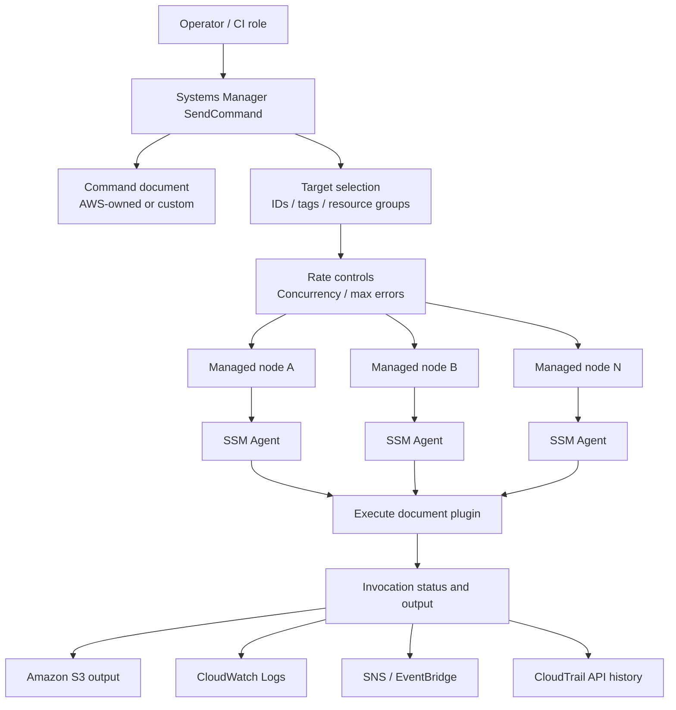

# Run Command and Multi-Server Task Execution

**AWS Systems Manager Run Command** enables administrators to run remote commands across managed nodes without opening SSH/RDP sessions or manually logging into each server. A single command can target one instance, a list of nodes, or an entire fleet defined by tags and AWS Resource Groups. Systems Manager distributes the command via **SSM Agent**, controls how many nodes execute concurrently, halts further rollout when errors exceed a threshold, and collects per-node results.

Run Command is well suited for one-off or batched administrative tasks such as checking service status, gathering system diagnostics, restarting applications, updating configurations, and running operational scripts. For large fleets, combine accurate targeting, concurrency limits, error thresholds, timeouts, logging, and scoped IAM permissions so a single misconfigured command does not impact the entire environment.

This lesson belongs to the **Systems Manager Operations** chapter of the **CLOUD_PROVIDERS_AWS** module. It connects EC2, hybrid managed nodes, SSM Agent, IAM, Systems Manager documents, Parameter Store, S3, CloudWatch Logs, SNS, EventBridge, the AWS CLI, and operating Java/Spring Boot across multiple servers.

> **Operational principle:** verify the fleet before sending a command; test on a single node or canary group first; limit concurrency and max errors; use a reviewed document version; store sufficient output for investigation; and record the sender, targets, parameters, command ID, and per-node results.

## 1. Learning Objectives

After this lesson, you will be able to:

1. Explain Run Command and its role in AWS Systems Manager.
2. Distinguish between a managed node, SSM Agent, Systems Manager document, command, and command invocation.
3. Prepare EC2 instances and hybrid servers to become managed nodes.
4. Configure an IAM instance profile or Default Host Management Configuration.
5. Verify SSM Agent, Online status, and network connectivity.
6. Select targets using instance IDs, tags, or AWS Resource Groups.
7. Design Systems Manager Command documents for Linux and Windows.
8. Use `AWS-RunShellScript` and `AWS-RunPowerShellScript`.
9. Control concurrency, max errors, timeouts, and exit codes.
10. Send commands to multiple servers using the AWS Console and AWS CLI.
11. Collect command output in S3 or CloudWatch Logs.
12. Track command status and per-node invocation status.
13. Send SNS notifications and integrate with EventBridge.
14. Protect parameters, secrets, output, and execution permissions with IAM.
15. Distinguish Run Command from State Manager, Automation, and Maintenance Windows.
16. Troubleshoot agent, IAM, target, document, network, and command execution failures.
17. Design a safe operational workflow for an EC2 fleet running Java/Spring Boot.

## 2. Run Command in AWS Systems Manager

Run Command is the capability for executing remote commands on managed nodes governed by Systems Manager. Administrators submit requests from the Console, AWS CLI, AWS Tools for PowerShell, or AWS SDKs. Systems Manager resolves target nodes, distributes the request, and receives results from SSM Agent.

Common tasks include:

- Checking CPU, memory, disk, processes, and service status.
- Restarting a service after a configuration update.
- Collecting logs or diagnostic files.
- Installing or configuring software.
- Updating SSM Agent.
- Running post-deployment health checks.
- Performing maintenance tasks across a group of EC2 instances.
- Running scripts on hybrid servers registered with Systems Manager.

Run Command does not require inbound SSH/RDP from administrators. SSM Agent initiates outbound HTTPS connections to Systems Manager endpoints. As a result, servers in private subnets can be administered without exposing public management ports, provided networking and IAM are properly configured.

### 2.1. Run Command Is Not a Full Application Build/Deploy Tool

Run Command can invoke scripts to deploy or restart applications, but it does not replace build, testing, and release management pipelines. For Java/Spring Boot applications:

- Maven/Gradle builds the artifact.
- The CI pipeline runs tests and stores artifacts.
- CodeDeploy or an appropriate deployment mechanism manages the release lifecycle.
- Run Command can perform controlled operational tasks such as checking services, gathering diagnostics, or executing planned restarts.

If you need a multi-step workflow with approvals, branching, rollback, and AWS service orchestration, consider Systems Manager Automation or a CI/CD pipeline instead of packing all logic into a single shell command.

### 2.2. Run Command and Cost

Per AWS documentation, Run Command is available at no additional charge on Amazon EC2 managed nodes. For hybrid and multicloud managed nodes, check AWS Systems Manager pricing and the features in use. Supporting services such as S3, CloudWatch Logs, SNS, KMS, or data transfer may still incur separate charges.

## 3. Execution Architecture

A command running across multiple servers follows this general flow:



Main steps:

1. The operator calls the `SendCommand` API with a document, parameters, and targets.
2. Systems Manager validates IAM permissions and resolves matching nodes.
3. Rate controls limit how many nodes receive the command concurrently and enforce the error threshold.
4. SSM Agent on each node receives the document and runs the plugin.
5. The agent returns status, exit code, and output to Systems Manager.
6. Output can also be stored in S3 or CloudWatch Logs.
7. SNS/EventBridge can emit notifications when status changes.
8. CloudTrail records API activity for auditing.

### 3.1. Concepts to Distinguish

| Concept | Meaning |
| --- | --- |
| Managed node | An EC2 instance or hybrid/multicloud server configured for Systems Manager management |
| SSM Agent | Software running on the node that contacts Systems Manager and executes documents |
| Systems Manager document | Defines operations, parameters, and plugins/steps to execute |
| Command | A `SendCommand` request with a single command ID |
| Command invocation | A single execution of a command on one managed node |
| Plugin | An execution block inside a document, such as `aws:runShellScript` |
| Command output | `stdout`/`stderr` or plugin result data |
| Target | Nodes selected by ID, tag, or Resource Group |

If you send a command to 20 instances, the system creates one command ID and up to 20 command invocations. Each invocation has its own status. The aggregate status of the command can differ from that of an individual invocation.

## 4. Managed Nodes and SSM Agent

Run Command only operates on nodes managed by Systems Manager in an appropriate state. An EC2 instance running normally in the EC2 Console is not guaranteed to be a managed node.

### 4.1. Basic Prerequisites for EC2

An EC2 instance typically requires:

- SSM Agent installed and running.
- An IAM instance profile with appropriate Systems Manager permissions, or management via Default Host Management Configuration.
- Outbound HTTPS connectivity to the required Systems Manager endpoints.
- Being in the same AWS Region where the administrator is operating.
- An operating system supported by Systems Manager.
- Properly configured system clock, DNS, and proxy if required by the environment.

Many AWS-provided Amazon Linux AMIs and Windows Server AMIs come with SSM Agent preinstalled, but you should verify the version and service status. Custom AMIs or older servers may need agent installation or updates.

### 4.2. Checking SSM Agent on Linux

On Amazon Linux, the service name is typically `amazon-ssm-agent`:

```bash
sudo systemctl status amazon-ssm-agent
sudo systemctl enable amazon-ssm-agent
sudo systemctl start amazon-ssm-agent

amazon-ssm-agent -version
```

Some Ubuntu images install the agent via Snap with a different service name, such as `snap.amazon-ssm-agent.amazon-ssm-agent`. Check how the AMI actually installs the agent before running `systemctl` commands.

### 4.3. Checking SSM Agent on Windows Server

Open PowerShell as Administrator:

```powershell
Get-Service AmazonSSMAgent
Get-Service AmazonSSMAgent | Start-Service
Get-Service AmazonSSMAgent | Set-Service -StartupType Automatic
```

You can check the executable version inside the SSM Agent installation directory per AWS guidance for Windows.

### 4.4. Verifying in Systems Manager

Open Systems Manager Console → Fleet Manager → Managed nodes. Check:

- Node ID.
- Platform name/version.
- Ping status.
- Agent version.
- IAM role/profile if displayed.
- Last ping time.
- AWS Region.

A node must appear as a managed node with ping status **Online** to receive commands normally. If the node does not appear, start by checking the agent, IAM, and networking before resending the command.

## 5. IAM for Managed Nodes

SSM Agent needs credentials to call Systems Manager APIs. For EC2, the standard approach is attaching an IAM instance profile to the instance.

### 5.1. AmazonSSMManagedInstanceCore

The AWS managed policy **AmazonSSMManagedInstanceCore** provides the core permissions required for an EC2 instance to communicate with Systems Manager. This is the standard starting point for an instance profile.

An EC2 role can be created using this flow:

1. Open IAM → Roles.
2. Select AWS service as the trusted entity.
3. Select EC2.
4. Attach the `AmazonSSMManagedInstanceCore` policy.
5. Name the role according to the workload.
6. Create an instance profile if required by your workflow.
7. Attach the instance profile to the EC2 instance or launch template.
8. Wait for the agent to reconnect and check Fleet Manager.

Do not attach broad AWS administrative privileges to an instance just to get Run Command working.

### 5.2. Default Host Management Configuration

**Default Host Management Configuration (DHMC)** lets Systems Manager automatically manage EC2 instances in an account/Region using a default management role, reducing the need to attach individual instance profiles to every instance.

Important requirements per current AWS documentation:

- The instance must use IMDSv2.
- SSM Agent must be version 3.2.582.0 or later.
- Default Host Management Configuration must be enabled in the account/Region.
- The default role and service setting must be configured with appropriate permissions.

DHMC is not automatically enabled in every account/Region. When managing multiple accounts, you can use Systems Manager Quick Setup across AWS Organizations if prerequisites are met.

### 5.3. Instance Profile and DHMC

Choose the credential mechanism matching your governance model. If using DHMC, verify the role/default service setting and agent prerequisites. If using an instance profile, verify the role is properly attached to the instance or launch template. When a node has multiple credential sources, understand the credential selection order so the agent does not pick the wrong identity or lack permissions.

### 5.4. Hybrid Managed Nodes

On-premises servers or servers on other clouds can be registered as hybrid managed nodes using hybrid activations:

- Create an activation in Systems Manager.
- Retrieve the activation code and activation ID.
- Install SSM Agent.
- Register the node with the activation.
- Assign an IAM service role to the hybrid activation.
- Verify the node ID and Online status.

Hybrid nodes typically have IDs starting with `mi-`, distinct from EC2 instance IDs starting with `i-`. Protect the activation code/ID because they are used to register new nodes.

## 6. Network Connectivity and VPC Endpoints

SSM Agent initiates outbound HTTPS connections to Regional Systems Manager endpoints. Run Command does not require opening an inbound SSH port.

### 6.1. Public Subnets

In a public subnet, an instance can reach AWS endpoints through an Internet Gateway if routes, DNS, and security policies allow it. A public IP is not strictly required if another egress path exists.

### 6.2. Private Subnets

For EC2 in private subnets, you can use a NAT Gateway or VPC interface endpoints for private connectivity to supported AWS services.

Endpoints commonly considered:

- Systems Manager endpoint: `com.amazonaws.<region>.ssm`.
- Systems Manager Messages endpoint: `com.amazonaws.<region>.ssmmessages`.
- EC2 Messages endpoint: `com.amazonaws.<region>.ec2messages`, when required by Region/agent compatibility.
- S3 gateway endpoint if nodes need to download packages/scripts or write output to S3.
- CloudWatch Logs endpoint if sending command output privately to Logs.

Endpoint availability and `ec2messages` requirements depend on the Region and agent version. Check current endpoint documentation for your target Region.

### 6.3. Security Groups and DNS

- The interface endpoint security group must allow inbound TCP 443 from the managed nodes' security group/subnet.
- Managed nodes need outbound TCP 443.
- Enable VPC DNS resolution and DNS hostnames as appropriate.
- Check Private DNS for interface endpoints.
- Check route tables, NACLs, and proxy configuration.
- Verify endpoint policies do not block required APIs.
- If the S3 bucket is in another account, check both the bucket policy and the endpoint policy.

Do not open all inbound ports from the Internet to troubleshoot SSM Agent. Identify the specific endpoints and network path required.

## 7. Systems Manager Documents

Run Command executes a Systems Manager document of type **Command**. A document defines parameters, step order, and plugins to execute.

There are two common groups of documents:

- AWS-owned documents: provided and maintained by AWS.
- Custom documents: created by your organization to standardize internal tasks.

### 7.1. AWS-RunShellScript

Use the **AWS-RunShellScript** document to run shell commands on Linux managed nodes.

Task example:

```bash
set -e
hostname
date -u
df -h
free -m
systemctl is-active orders-api
```

### 7.2. AWS-RunPowerShellScript

Use the **AWS-RunPowerShellScript** document to run PowerShell on Windows Server managed nodes.

```powershell
$ErrorActionPreference = "Stop"

$env:COMPUTERNAME
Get-Date -AsUTC
Get-Volume
Get-Service -Name "W3SVC"
```

Do not send Linux commands to Windows nodes or PowerShell commands to Linux nodes. When targeting by tags, ensure the fleet does not mix OSes unless the document includes platform preconditions.

### 7.3. Command Document Schema

For new custom Command documents, AWS recommends schema version 2.2 or later. A document can contain:

- `schemaVersion`.
- `description`.
- `parameters`.
- `mainSteps`.
- `action`/plugin.
- `inputs`.
- `precondition` to restrict platforms.
- `timeout` and error handling.

Custom documents standardize an operation so multiple operators run it using the same parameter interface and error handling.

## 8. Creating a Custom Command Document

Example Linux document to check the status of or restart a systemd service based on a parameter.

File **RestartLinuxService.yml**:

```yaml
---
schemaVersion: "2.2"
description: "Check or restart an approved Linux systemd service"
parameters:
  ServiceName:
    type: String
    description: "Systemd service name"
    default: "orders-api"
    allowedPattern: "^[a-zA-Z0-9_.@-]+$"
    interpolationType: ENV_VAR
  Operation:
    type: String
    description: "Operation to perform"
    default: "status"
    allowedValues:
      - "status"
      - "restart"
mainSteps:
  - action: aws:runShellScript
    name: manageService
    precondition:
      StringEquals:
        - platformType
        - Linux
    inputs:
      timeoutSeconds: "120"
      runCommand:
        - |
          set -euo pipefail
          SERVICE="$SSM_ServiceName"
          ACTION="{{Operation}}"

          if ! systemctl list-unit-files "$SERVICE.service" --no-legend | grep -q "$SERVICE.service"; then
            echo "Service is not installed: $SERVICE" >&2
            exit 2
          fi

          case "$ACTION" in
            status)
              systemctl status "$SERVICE.service" --no-pager
              ;;
            restart)
              systemctl restart "$SERVICE.service"
              systemctl is-active --quiet "$SERVICE.service"
              ;;
            *)
              echo "Unsupported operation" >&2
              exit 3
              ;;
          esac
```

Notable characteristics of this document:

- Runs only on Linux.
- `ServiceName` is validated with `allowedPattern`.
- `ServiceName` uses environment variable interpolation.
- `Operation` accepts only `status` or `restart`.
- The script enables strict error handling and returns a non-zero exit code if the service is invalid or the operation fails.

### 8.1. ENV_VAR Interpolation

For String parameters used inside commands, use `interpolationType: ENV_VAR` so SSM Agent creates an environment variable prefixed with `SSM_`. For example, the `ServiceName` parameter becomes `SSM_ServiceName`.

This feature requires SSM Agent version 3.3.2746.0 or later. Verify agent versions across the fleet before deploying documents that use `ENV_VAR`. Always quote shell variables and validate inputs; `ENV_VAR` does not replace escaping or validation.

### 8.2. Do Not Concatenate Arbitrary Shell Strings from Parameters

Do not allow users to pass arbitrary shell command strings into production documents without approval and controls. It is much safer to expose a small set of parameters with clear `allowedValues`/`allowedPattern` constraints mapped to permitted actions.

### 8.3. Creating and Inspecting Documents

You can create a custom document via the Console or CLI:

```bash
aws ssm create-document \
  --name RestartLinuxService \
  --document-type Command \
  --document-format YAML \
  --content file://RestartLinuxService.yml \
  --region ap-southeast-1
```

After creating it, inspect the document:

```bash
aws ssm describe-document \
  --name RestartLinuxService \
  --region ap-southeast-1
```

Review the document content and test on a staging node before rolling out to a broader fleet. When updating, create a new version and manage the default version through a review process.

## 9. Selecting Targets for a Command

Run Command supports selecting managed nodes in several ways:

1. Specific instance/managed node IDs.
2. EC2 tags or managed-node tags.
3. AWS Resource Groups.
4. Appropriate target lists by API-supported resource type.

### 9.1. Targeting by Instance IDs

Useful when inspecting or fixing a few known nodes:

```bash
aws ssm send-command \
  --document-name "AWS-RunShellScript" \
  --instance-ids "i-0123456789abcdef0" \
  --parameters '{"commands":["hostname","systemctl is-active orders-api"]}' \
  --region ap-southeast-1
```

This is explicit, though inconvenient when the fleet changes frequently.

### 9.2. Targeting by Tags

Tag nodes by environment, application, and role:

| Tag key | Example | Meaning |
| --- | --- | --- |
| Environment | staging | Environment |
| Application | orders-api | Application |
| Role | web | Node role |
| Owner | platform-team | Responsible team |
| MaintenanceWindow | weekly | Maintenance group |

For example, to target web nodes in staging for the Orders application:

```text
Environment = staging
Application = orders-api
Role = web
```

When specifying multiple target criteria, maintain a consistent tagging schema and check the matching node count beforehand. Perform a dry run by listing nodes/tags before sending the command; never assume the fleet is tagged accurately just from tag names.

### 9.3. Targeting by AWS Resource Groups

A Resource Group lets you group resources by tags or defined group criteria. Run Command can target a Resource Group when the resource types and configuration are supported.

This is helpful when multiple operations teams share a centrally managed set of resources.

### 9.4. Avoiding Overly Broad Targets

Do not target a broad tag such as `Environment=production` if it covers databases, web servers, workers, and bastions while the document is meant for only one node type. Add `Application`/`Role` filters or target via a Resource Group.

Before running an impactful command, record:

- Expected managed node count.
- Actual target node list.
- Region/account.
- OS/platform.
- Objective of the operation.
- Approver if required.

## 10. Rate Controls: Concurrency and Max Errors

Run Command provides two main controls to limit blast radius across multiple nodes:

- **Max concurrency:** the number or percentage of managed nodes processed concurrently.
- **Max errors:** the number of errors allowed before Systems Manager stops sending the command to additional nodes.

These parameters are especially important when targeting by tags or Resource Groups, where node counts can change over time.

### 10.1. Max Concurrency

Can be specified as an absolute count or a percentage of the target set:

| Value | Meaning |
| --- | --- |
| 1 | Process one node at a time |
| 5 | Up to five nodes simultaneously |
| 10% | Up to roughly 10% of the target set simultaneously |
| 50% | Up to roughly half of the target set simultaneously |

If omitted, the default `max-concurrency` for Run Command is 50.

Example for a 100-instance fleet:

- 1: sequential execution, easy to observe but slow.
- 10: up to 10 nodes at once.
- 10%: up to roughly 10 nodes at once.
- 50%: can affect half the fleet at the same time.

When the exact target count is uncertain, use a percentage so concurrency scales automatically with the target set size.

### 10.2. Max Errors

Max errors sets how many invocation failures are tolerated before stopping delivery to subsequent nodes. If omitted, the default `max-errors` is 0: the system stops sending the command to new nodes after the first error.

Examples:

| Max errors | Behavior |
| --- | --- |
| 0 | Stop sending commands to new nodes after the first error |
| 1 | Stop after receiving the second error |
| 3 | Stop after receiving the fourth error |
| 5% | Stop when failures exceed the chosen percentage threshold |

If a command is already running on other nodes when the error threshold is exceeded, those in-flight invocations may still finish and may also fail. Rate controls are not a fleet-wide transactional rollback.

### 10.3. Safe Rollout Example

For a 40-node production fleet:

1. Test on a single canary instance.
2. Run on 10% of the fleet with max errors set to 0 or 1.
3. Verify health, logs, and metrics.
4. Expand to 25%.
5. After verification, run on the rest of the fleet.
6. Halt the rollout if error rates or service health degrade.

Specific thresholds should be based on capacity, blast radius, SLOs, and the task's rollback capability.

## 11. Timeouts and Exit Codes

Run Command has distinct timeout concepts. Do not conflate them into a single number.

### 11.1. Command Timeout

The `Timeout seconds` parameter when sending a command defines the overall window for Systems Manager to wait for command delivery under Run Command's timeout mechanics. If a node does not receive the command before this timeout expires, the invocation can transition to `DeliveryTimedOut`.

### 11.2. Plugin Execution Timeout

Inside an SSM document, a plugin can specify `timeoutSeconds`. If the script starts running on the node but does not finish before the deadline, the invocation can become `ExecutionTimedOut`.

Example:

```yaml
mainSteps:
  - action: aws:runShellScript
    name: checkService
    inputs:
      timeoutSeconds: "120"
      runCommand:
        - "systemctl is-active orders-api"
```

With `AWS-RunShellScript`, the document has an `executionTimeout` parameter whose common default is 3600 seconds. Total timeout behavior follows the rules of the document and command timeout; check the defaults of the document/version in use.

### 11.3. Exit Codes

- Exit code 0 is generally treated as plugin success.
- Non-zero exit codes indicate failure.
- Shell scripts should enable error handling, such as `set -euo pipefail`.
- Do not mask errors by appending `|| true` throughout the script.
- If a command is expected to fail under specific conditions, inspect its exit code and handle it explicitly.

A command can report `Success` if the script returns exit code 0 even when a logic bug prevented it from doing the intended work. Therefore, scripts should verify the post-action state—for instance, checking that the service is active or the health endpoint responds after a restart.

## 12. Understanding Command Status and Invocation Status

Systems Manager tracks status at multiple levels:

- Plugin status: status of each individual step/plugin.
- Invocation status: outcome on a single managed node.
- Command status: aggregate status of the overall request.

### 12.1. Common Invocation Statuses

| Status | Meaning |
| --- | --- |
| Pending | Command has not been sent or the agent has not picked it up yet |
| InProgress | Being delivered or currently executing |
| Delayed | Delivery did not succeed yet; the system will retry |
| Success | Plugin completed with exit code 0 |
| Failed | Plugin or invocation failed |
| DeliveryTimedOut | Command could not be delivered before the timeout |
| ExecutionTimedOut | Script started but exceeded the execution timeout |
| Undeliverable | Cannot be delivered to the node |
| InvalidPlatform | Document does not support the target OS/platform |
| AccessDenied | Sending principal lacks permissions on the target |
| Terminated | Invocation stopped due to the command's max errors limit |
| Cancelled | Command was cancelled before completion |

### 12.2. Aggregate Command Status

Common command statuses:

- Pending.
- InProgress.
- Success.
- Failed.
- Incomplete.
- DeliveryTimedOut.
- Cancelled.
- RateExceeded.
- NoInstancesInTag.

Key point to remember: the aggregate command status can be `Success` while some invocations timed out or failed, if the failure count did not exceed `max-errors` under Run Command's status logic. A tag-targeted command that matches no instances also has its own distinct status.

**Do not check only the aggregate command status.** For critical tasks, inspect `ListCommandInvocations` and confirm every required node succeeded.

## 13. Running Run Command from the Console

Procedure:

1. Open the AWS Systems Manager Console.
2. Choose Run Command in the navigation pane.
3. Choose Run command.
4. Select a Systems Manager document, such as `AWS-RunShellScript`.
5. Enter parameters.
6. Select managed nodes by IDs, tags, or Resource Groups.
7. Enter a comment explaining the purpose.
8. Set Timeout seconds.
9. Configure Max concurrency and Max errors.
10. Configure S3/CloudWatch output if needed.
11. Configure SNS notifications if needed.
12. Review target count and command parameters.
13. Choose Run.
14. Open the Command ID to monitor progress.
15. View output per managed node.

### 13.1. Useful Comments

Comments should include:

- Ticket/change request ID.
- Purpose.
- Environment.
- Responsible person or team.
- Time/maintenance window if applicable.

Example: `CHG-2026-042 - verify Orders API status on staging after deployment`.

Never put passwords, tokens, or sensitive details in comments.

## 14. Running Commands Across Multiple Servers via AWS CLI

The following example checks the status of the `orders-api` service on all Linux nodes tagged `Environment=staging` and `Application=orders-api`.

Run from a Bash shell:

```bash
aws ssm send-command \
  --document-name "AWS-RunShellScript" \
  --document-version '$DEFAULT' \
  --targets \
    "Key=tag:Environment,Values=staging" \
    "Key=tag:Application,Values=orders-api" \
  --parameters '{"commands":["set -euo pipefail","hostname","systemctl is-active orders-api"]}' \
  --comment "CHG-2026-042: verify Orders API on staging" \
  --timeout-seconds 600 \
  --max-concurrency "10%" \
  --max-errors "1" \
  --cloud-watch-output-config '{"CloudWatchOutputEnabled":true,"CloudWatchLogGroupName":"/aws/ssm/run-command"}' \
  --region ap-southeast-1
```

The API returns a `CommandId`. Record the `CommandId` in the change record for traceability.

### 14.1. Checking Command Status

List overview information:

```bash
aws ssm list-commands \
  --command-id "COMMAND_ID" \
  --region ap-southeast-1
```

List invocations and details:

```bash
aws ssm list-command-invocations \
  --command-id "COMMAND_ID" \
  --details \
  --region ap-southeast-1
```

Retrieve output for a single instance:

```bash
aws ssm get-command-invocation \
  --command-id "COMMAND_ID" \
  --instance-id "i-0123456789abcdef0" \
  --region ap-southeast-1
```

Replace placeholders with the actual command ID and instance ID. For managed hybrid nodes, use the corresponding managed node ID.

### 14.2. Cancelling a Command

If you need to stop a command:

```bash
aws ssm cancel-command \
  --command-id "COMMAND_ID" \
  --region ap-southeast-1
```

Cancel is not a rollback mechanism. Some invocations may have already executed or completed before the cancel request takes effect. After cancelling, inspect the state of each node and recover the application per runbook if needed.

## 15. Saving Output to Amazon S3

By default, Systems Manager returns output directly to the Console/API with a size limit. `GetCommandInvocation` returns up to 24,000 characters of output. If you need full output or long-term retention, configure S3 output.

CLI example:

```bash
aws ssm send-command \
  --document-name "AWS-RunShellScript" \
  --targets "Key=tag:Environment,Values=staging" \
  --parameters '{"commands":["hostname","journalctl -u orders-api -n 200 --no-pager"]}' \
  --output-s3-bucket-name "company-ssm-output" \
  --output-s3-key-prefix "run-command/orders-api" \
  --max-concurrency "10%" \
  --max-errors "1" \
  --region ap-southeast-1
```

### 15.1. S3 Write Permissions Belong to the Managed Node

Permissions to write output to S3 belong to the EC2 instance profile or the hybrid managed node's IAM service role—not solely to the operator calling `SendCommand`.

Verify:

- `s3:PutObject` for the target bucket/prefix.
- Bucket policy.
- KMS key policy if using SSE-KMS.
- S3 endpoint policy if nodes access S3 through a VPC endpoint.
- Cross-account permissions if the output bucket is in another account.

### 15.2. Securing the Output Bucket

Output can contain hostnames, IPs, package lists, process arguments, log lines, or sensitive data. You should:

- Enable encryption.
- Block public access.
- Scope bucket/prefix permissions.
- Enable versioning or Object Lock when required for auditing.
- Configure lifecycle/retention rules.
- Control read and download permissions.
- Avoid printing secrets to `stdout`/`stderr`.

## 16. Saving Output to CloudWatch Logs

Run Command can stream `stdout`/`stderr` to CloudWatch Logs in near real time. This makes it easy to search logs, compare errors across nodes, and build metric filters/alarms.

Example:

```bash
aws ssm send-command \
  --document-name "AWS-RunShellScript" \
  --targets "Key=tag:Application,Values=orders-api" \
  --parameters '{"commands":["hostname","systemctl status orders-api --no-pager"]}' \
  --cloud-watch-output-config '{"CloudWatchOutputEnabled":true,"CloudWatchLogGroupName":"/aws/ssm/orders-api"}' \
  --max-concurrency "10%" \
  --max-errors "1" \
  --region ap-southeast-1
```

If no log group is specified, Systems Manager can create a log group named after the document according to service rules.

### 16.1. IAM Permissions for CloudWatch Logs

Managed nodes need permission to send logs to CloudWatch Logs. You can use an appropriate policy such as `CloudWatchAgentServerPolicy` alongside Systems Manager permissions, or an organization-approved least-privilege policy.

Ensure the role includes necessary actions such as `CreateLogStream`, `DescribeLogStreams`, and `PutLogEvents` on the target log group. If KMS encryption is enabled, verify the key policy.

### 16.2. Log Retention

CloudWatch Logs retention must be explicitly configured. Do not leave operational logs containing potentially sensitive data retained indefinitely simply because retention was never set. Separate log groups by application/environment to simplify access control and lifecycle management.

## 17. Notifications with SNS and EventBridge

Run Command can publish command/invocation status updates to Amazon SNS. Operators or incident management tools can receive alerts when a command starts, succeeds, fails, times out, or is cancelled as configured.

### 17.1. SNS Notifications

When configuring SNS:

- Choose an SNS topic.
- Choose which event types to notify on.
- Choose command-level or invocation-level notifications.
- Grant an appropriate IAM role for Systems Manager to publish.
- Verify subscriptions/endpoints receive notifications.

Notifications do not include full output for every command. Use the Command ID to query detailed status and output.

### 17.2. EventBridge

Systems Manager emits command state events. An EventBridge rule can react to changes such as command status or invocation status and then:

- Send notifications.
- Invoke Lambda to update tickets.
- Record deployment/change entries.
- Trigger follow-up Automation workflows.
- Forward events to a centralized event bus.

Design rules with filters on document, account, Region, target, or status. Avoid automatically retrying a destructive command without idempotency checks and retry limits.

## 18. Parameters and Parameter Store

Run Command supports passing parameters directly to a document or referencing values from Systems Manager Parameter Store.

Example of a non-sensitive String parameter:

```bash
aws ssm send-command \
  --document-name "AWS-RunShellScript" \
  --instance-ids "i-0123456789abcdef0" \
  --parameters '{"commands":["echo {{ssm:/orders/staging/banner}}"]}' \
  --region ap-southeast-1
```

This is useful for non-secret configuration such as endpoints, environment names, or versions.

### 18.1. SecureString Cannot Be Referenced Directly Like String

SSM documents do not support referencing `SecureString` parameters the same way as `String` parameters. When a secret is needed:

1. Do not pass plaintext secrets in `SendCommand` parameters.
2. Grant the managed node role permission to read the specific `SecureString` parameter.
3. Grant `kms:Decrypt` on the corresponding key if needed.
4. Have the script fetch the secret on the node via the AWS CLI/SDK using the instance's temporary credentials.
5. Do not echo the secret or write it to output/logs.
6. Unset temporary variables after use when appropriate.

Example showing fetching a secret and only checking whether it is non-empty:

```bash
SECRET_VALUE=$(aws ssm get-parameter \
  --name "/orders/staging/api-token" \
  --with-decryption \
  --query "Parameter.Value" \
  --output text)

if [ -z "$SECRET_VALUE" ]; then
  echo "Required parameter is empty" >&2
  exit 1
fi

unset SECRET_VALUE
```

In real applications, pass the secret directly into the consuming process rather than keeping it in the shell environment or writing it to unprotected files. Ensure the instance role can read only the specific parameter path.

### 18.2. Do Not Pass Secrets on the Command Line

AWS Systems Manager API activity is logged in CloudTrail. Parameter values sent in `SendCommand` may appear in audit trails or other storage. Never pass passwords, tokens, private keys, or sensitive connection strings in plaintext command parameters.

## 19. Least-Privilege IAM for Command Senders

Run Command can execute commands with very high privileges on a node. By default, commands on Linux typically run as `root` and on Windows as `SYSTEM`. Therefore, `ssm:SendCommand` permission is equivalent to powerful remote administration access.

### 19.1. Separating Document and Target Permissions

An IAM policy for `SendCommand` should govern both:

- Which Systems Manager documents may be invoked.
- Which managed nodes may be targeted.

Do not restrict only the document while leaving targets open to all EC2 instances. Likewise, do not restrict only the targets while allowing arbitrary documents to be called.

### 19.2. Restricting by Tags

AWS supports the `ssm:resourceTag/` condition key to scope `SendCommand` based on managed node tags. For example, staging operators are only allowed to run commands on nodes tagged `Environment=staging`.

Illustrative policy modeled after AWS patterns:

```json
{
  "Version": "2012-10-17",
  "Statement": [
    {
      "Sid": "AllowApprovedDocument",
      "Effect": "Allow",
      "Action": "ssm:SendCommand",
      "Resource": "arn:aws:ssm:*:*:document/AWS-RunShellScript"
    },
    {
      "Sid": "AllowStagingNodes",
      "Effect": "Allow",
      "Action": "ssm:SendCommand",
      "Resource": "arn:aws:ec2:*:*:instance/*",
      "Condition": {
        "StringEquals": {
          "ssm:resourceTag/Environment": "staging"
        }
      }
    },
    {
      "Sid": "ReadCommandStatus",
      "Effect": "Allow",
      "Action": [
        "ssm:ListCommands",
        "ssm:ListCommandInvocations",
        "ssm:GetCommandInvocation",
        "ssm:DescribeInstanceInformation"
      ],
      "Resource": "*"
    }
  ]
}
```

This is a directional example. Document ARNs, partitions, Regions, accounts, actions, and conditions must be verified against the IAM Service Authorization Reference and the Restricting Run Command access based on tags documentation. For custom documents, scope the document ARN to the specific name and account.

### 19.3. Role Separation by Environment

A reference model:

| Role | Scope |
| --- | --- |
| Developer | Read status, run diagnostic documents on dev |
| Staging operator | Run approved documents on staging |
| Production operator | Run production commands under change approval |
| Platform administrator | Manage documents, managed nodes, and IAM integration |
| Auditor | Read command history, CloudTrail, and permitted output |

Do not grant production execution permissions to all developers simply because they need to check command status.

### 19.4. Guardrails

- Restrict which documents can be invoked.
- Use custom documents with parameter allowlists.
- Scope targets using tags.
- Apply SCPs/permissions boundaries if organizational guardrails exist.
- Separate the command-sending role from the EC2 instance role.
- Enable CloudTrail and output logging.
- Require change approval for restart/stop/patch operations in production.
- Review permissions periodically.

## 20. Securing Systems Manager Documents

Documents represent remotely executable code, so permissions to create and modify documents are equally sensitive.

Controls:

- Allow only the platform team to create/modify production custom documents.
- Review document contents like source code.
- Create new versions instead of making uncontrolled edits.
- Set the default version only after testing.
- Use document tags to govern access by owner/environment.
- Restrict parameters with `allowedValues`/`allowedPattern`.
- Use `ENV_VAR` interpolation for appropriate string parameters.
- Never hard-code credentials or secrets.
- Monitor `CreateDocument`, `UpdateDocument`, `UpdateDocumentDefaultVersion`, and `SendCommand` in CloudTrail.

When sending production commands, pin the reviewed document version if reproducibility is required. Do not run a release against a document version that can change mid-execution.

## 21. Run Command with a Java/Spring Boot Fleet

Suppose the Orders API application runs across multiple EC2 instances under the `orders-api` systemd service.

Tasks well suited for Run Command:

- Checking service status.
- Inspecting the JVM process and listening port.
- Collecting journal logs.
- Confirming the running version.
- Restarting the service during a maintenance window.
- Running post-deployment health checks.
- Gathering diagnostics before terminating an instance.

### 21.1. Fleet Inspection

```bash
hostname
java -version
systemctl is-active orders-api
systemctl show orders-api --property=ActiveState,SubState,MainPID
curl --fail --silent http://127.0.0.1:8080/actuator/health
```

If the health endpoint requires authentication, configure a secure check mechanism and do not pass tokens in plaintext command parameters.

### 21.2. Rolling Restart in Small Batches

Use target tags `Environment=staging` and `Application=orders-api`, concurrency `1` or `10%`, and max errors `0` or `1`. After each batch, inspect ALB target health and error rates before proceeding.

Do not restart the entire web fleet simultaneously when continuous capacity is required.

### 21.3. Do Not Use Run Command as an Uncontrolled Deployment Coordinator

If you need to deploy a new version across many nodes, manage release artifacts, traffic draining, health validation, and rollbacks using CodeDeploy or an appropriate pipeline. Run Command can support auxiliary operational tasks, but avoid building a custom ad-hoc deployment system that is difficult to audit.

## 22. Monitoring Status and Results

Track Run Command via the Console, CLI, SDK, EventBridge, or SNS.

### 22.1. Command ID

Every `SendCommand` returns a `CommandId`. Record the `CommandId` along with:

- Change ticket.
- Document name/version.
- Parameters used (excluding secrets).
- Target filters.
- Max concurrency/max errors.
- Operator identity.
- Start/end time.
- Per-node outcome.

### 22.2. Invocation Details

When a command runs on multiple nodes, inspect each invocation to view:

- Instance ID/managed node ID.
- Status.
- Plugin name.
- Response code.
- Standard output.
- Standard error.
- Execution start/end time.
- S3/CloudWatch output location if configured.

### 22.3. Eventual Consistency

The Run Command API follows an eventual consistency model. After sending a command or experiencing a state change, results may not appear immediately in the next list call. If you just called `SendCommand` and `ListCommandInvocations` does not yet show results, wait briefly and query again by command ID; do not resend the command merely because results do not appear instantaneously.

### 22.4. Command History

Run Command history is retained for up to 30 days in Systems Manager. If longer retention is needed, export output to S3/CloudWatch Logs and use a CloudTrail trail to retain API audit events per your retention policy.

## 23. Combining Run Command with Other Systems Manager Features

Not every operational task should be run as an ad-hoc shell command.

| Feature | Purpose | When to Use |
| --- | --- | --- |
| Run Command | Execute a one-off command across one or more nodes | Inspections, restarts, gathering diagnostics |
| State Manager | Maintain desired configuration via associations | Ensure agents/configuration/packages stay in state periodically |
| Automation | Orchestrate multi-step runbooks across AWS resources | Workflows with branching, approvals, remediation |
| Maintenance Windows | Schedule tasks within maintenance windows | Periodic patching/restarts during approved hours |
| Patch Manager | Manage OS patch scanning/installation | Patch baselines and compliance |
| Distributor | Distribute packages/software to managed nodes | Installing agents or managed packages |
| Session Manager | Interactive shell sessions via Systems Manager | Live troubleshooting when interactivity is needed |

### 23.1. Run Command vs. State Manager

Run Command sends a one-time command. State Manager uses associations to maintain a desired state or execute documents on a schedule.

For example, if you need to ensure CloudWatch Agent stays installed on every instance, a State Manager association is better than manually sending an installation command every week.

### 23.2. Run Command and Automation

Automation uses runbooks to coordinate multi-step workflows and can invoke Run Command through the `aws:runCommand` action. Example workflow:

1. Check instance tags and state.
2. Run a health check.
3. Take a snapshot or verify backup.
4. Send a restart command.
5. Wait for the service to become healthy.
6. Record results and send notifications.

When multiple conditional steps and state tracking are needed, use Automation instead of cramming all logic into one long script.

### 23.3. Maintenance Windows

Maintenance Windows let you schedule tasks during designated maintenance periods. A maintenance window can define targets and tasks such as Run Command or Automation. Combine schedules, task priorities, concurrency, and error thresholds to avoid conflicting maintenance tasks.

## 24. Scheduled and Event-Driven Tasks

Run Command is typically used for on-demand tasks. To run on a schedule or in response to events, combine it with:

- Maintenance Windows for maintenance schedules.
- State Manager for configuration enforcement.
- EventBridge for AWS events.
- Automation for multi-step workflows.
- CodePipeline for release/deployment lifecycles.

For example, when a new EC2 instance is launched, EventBridge can trigger a workflow to validate tags, confirm managed node status, and execute an approved bootstrap command. Design for idempotency because events may be delivered more than once.

## 25. Troubleshooting

| Symptom | Possible Cause | How to Check |
| --- | --- | --- |
| Instance missing from Fleet Manager | Agent not installed/running or missing IAM role | Check SSM Agent, instance profile, DHMC |
| Ping status ConnectionLost/Offline | Agent cannot reach endpoints | Check DNS, HTTPS 443, routes, proxy |
| SendCommand AccessDenied | Operator lacks document or target permissions | Check IAM policy, SCP, resource tags |
| Invocation Undeliverable | Node does not exist/is unresponsive | Check node state, agent, and Region |
| DeliveryTimedOut | Command could not be delivered before timeout | Check agent connectivity and timeout |
| ExecutionTimedOut | Script exceeded time limit | Check `timeoutSeconds`, process, and logs |
| InvalidPlatform | Document does not support target OS | Separate Linux/Windows targets or add preconditions |
| NoInstancesInTag | No nodes match target tags | Check tag keys/values and Region |
| RateExceeded | Exceeded pending invocations quota | Batch the fleet or check quotas |
| Command status Success but node state is wrong | Exit code 0 or aggregate status masked invocation errors | Inspect individual invocations and actual health |
| S3 output AccessDenied | Instance profile lacks `PutObject` or bucket policy blocks it | Check role, prefix, KMS, and endpoint policy |
| Missing CloudWatch Logs output | Node role lacks Logs permissions | Check log group, role, and endpoint |
| SNS notification not arriving | Wrong topic policy/subscription/role | Check SNS permissions and subscription |
| Custom document fails to run | Invalid YAML/schema/plugin/parameter | Validate document content and version |
| Parameter interpolation not working | Outdated agent or wrong `interpolationType` | Check agent version and `SSM_` variable |
| Service restart succeeded but app unhealthy | Script only checked `systemctl`, not endpoint | Add post-action health validation |
| Duplicate command runs | Operator retried due to eventual consistency | Check the command ID before resending |
| Node cannot access Parameter Store | Instance role lacks `ssm:GetParameter` or `kms:Decrypt` | Check parameter ARN, key policy, and Region |

### 25.1. Agent Logs on Linux

Common log files:

```text
/var/log/amazon/ssm/amazon-ssm-agent.log
/var/log/amazon/ssm/errors.log
/var/log/amazon/ssm/audits/amazon-ssm-agent-audit.log
```

Names/paths may vary by OS and installation method. On Windows Server, logs are usually under:

```text
C:\ProgramData\Amazon\SSM\Logs\
```

### 25.2. Runbook for Investigating a Failed Command

1. Record `CommandId`, Region, account, document, and target filters.
2. Open the command summary and invocation list.
3. Identify the first failing node and plugin status.
4. Check the managed node's ping status and agent version.
5. Check the instance profile or DHMC role.
6. Check `ssm`/`ssmmessages`/`ec2messages` connectivity.
7. Read agent logs and command output.
8. Check document version, parameters, platform preconditions, and timeout.
9. Check exit code, shell syntax, and filesystem permissions.
10. Check S3/CloudWatch/SNS permissions if output or notifications are missing.
11. Determine whether the command already ran on part of the fleet before failing.
12. Recover affected nodes per runbook; only send a new command after understanding the state of the previous one.

## 26. Security and Operational Best Practices

### 26.1. Run Command Is Remote Code Execution

Because commands typically execute as `root`/`SYSTEM`, permission to send commands must be treated as host administrative access. Grant it only to trusted principals and restrict by document, tags, account, and Region.

### 26.2. Never Put Secrets in Plaintext

- Do not pass passwords/tokens/private keys in `SendCommand` parameters.
- Do not place secrets in comments or document descriptions.
- Use Parameter Store `SecureString` or Secrets Manager.
- Have nodes fetch secrets using their own IAM role.
- Do not echo secrets.
- Limit sensitive data in `stdout`/`stderr`.
- Protect CloudTrail, S3 output, and CloudWatch Logs.

### 26.3. Canary Testing and Blast Radius

- Test on a single node first.
- Use low concurrency when the impact is uncertain.
- Choose an appropriate max errors limit.
- Verify target count.
- Do not restart/reboot the entire fleet simultaneously if availability is required.
- Use maintenance windows for disruptive tasks.
- Have health checks and a rollback plan ready.

### 26.4. Idempotency

Commands may run more than once due to retries, operator mistakes, or eventual consistency. Design scripts so repeated execution is safe:

- Check current state before making changes.
- Avoid creating duplicate resources.
- Avoid unbounded config appending.
- Use atomic file replacement when updating configuration.
- Use locks for tasks that must execute only once.
- Log before/after state.
- Never assume a command runs at most once per node.

### 26.5. Audit Trail

Record the following details:

- Principal who sent the command.
- Document/version.
- Non-sensitive parameters.
- Target filters and actual node list.
- Command ID.
- Start/end time.
- Invocation status.
- Output location.
- Change/ticket ID.
- Approval record if required.

CloudTrail records API activity; S3/CloudWatch Logs store output; change management captures justification and approval. Combine all three sources for complete evidence.

## 27. Cost, Quotas, and Limits

Run Command has limits to factor into operational design:

- Max concurrency affects how fast commands are distributed.
- Max errors controls when distribution halts for remaining nodes.
- Pending command/invocation quotas can trigger `RateExceeded`.
- Direct API output has a size limit.
- Command history in Systems Manager has a retention limit.
- Plugin runtime/timeouts constrain script duration.
- Service quotas and API throttling can affect very large fleets.

Do not hard-code quotas into long-lived runbooks, as quotas can change by account/Region. Check Service Quotas and current AWS Systems Manager quotas before large-scale rollouts.

### 27.1. Cost Optimization

- Use Run Command on EC2 for on-demand tasks.
- Avoid sending repetitive commands too frequently when State Manager or a maintenance schedule fits better.
- Enable CloudWatch Logs only when long-term or searchable log retention is needed.
- Use S3 lifecycle rules to manage output retention.
- Avoid printing overly verbose or unnecessary `stdout`.
- Choose retention aligned with audit policy.
- Monitor related S3, CloudWatch Logs, SNS, KMS, and data transfer costs.

## 28. Hands-On Lab: Inspecting and Restarting Orders API on a Staging Fleet

### 28.1. Context

An Orders API system runs on 6 EC2 instances in an Auto Scaling Group. Each instance carries these tags:

```text
Environment = staging
Application = orders-api
Role = web
```

The application runs as the `orders-api` systemd service and exposes an internal health endpoint on port 8080.

Objective: verify fleet status, perform a rolling service restart in small batches, and store results in CloudWatch Logs.

### 28.2. Task A — Prepare Managed Nodes

1. Verify SSM Agent is installed on all 6 instances.
2. Verify the agent service is running.
3. Attach `AmazonSSMManagedInstanceCore` to the instance profile or configure DHMC with all prerequisites met.
4. Verify outbound HTTPS 443 to Systems Manager endpoints.
5. Open Fleet Manager and confirm all 6 nodes are Online.
6. Verify tags on each node.
7. Record instance IDs and AZs.

### 28.3. Task B — Send a Health Check

Run on one node first:

```bash
aws ssm send-command \
  --document-name "AWS-RunShellScript" \
  --instance-ids "i-0123456789abcdef0" \
  --parameters '{"commands":["set -euo pipefail","hostname","systemctl is-active orders-api","curl --fail --silent http://127.0.0.1:8080/actuator/health"]}' \
  --max-concurrency "1" \
  --max-errors "0" \
  --region ap-southeast-1
```

Inspect the command ID and invocation output. Proceed only if the canary node returns the expected result.

### 28.4. Task C — Check the Entire Staging Fleet

```bash
aws ssm send-command \
  --document-name "AWS-RunShellScript" \
  --targets \
    "Key=tag:Environment,Values=staging" \
    "Key=tag:Application,Values=orders-api" \
    "Key=tag:Role,Values=web" \
  --parameters '{"commands":["set -euo pipefail","hostname","systemctl is-active orders-api","curl --fail --silent http://127.0.0.1:8080/actuator/health"]}' \
  --max-concurrency "50%" \
  --max-errors "1" \
  --cloud-watch-output-config '{"CloudWatchOutputEnabled":true,"CloudWatchLogGroupName":"/aws/ssm/orders-api-lab"}' \
  --comment "LAB-SSM-001: verify staging fleet" \
  --region ap-southeast-1
```

Verify the actual target count and the status of each invocation. If any node did not match the target filter or was Offline, document it explicitly rather than assuming all 6 were checked.

### 28.5. Task D — Rolling Restart in Small Batches

After obtaining lab approval, run the `RestartLinuxService` document with concurrency `1` and max errors `0`. Restart one node at a time, verifying the service is active and the health endpoint returns the expected response before moving to the next node.

Do not restart all nodes at once. In real environments, coordinate with ALB target health and ASG capacity.

### 28.6. Task E — Save and Review Output

1. Open CloudWatch Logs group `/aws/ssm/orders-api-lab`.
2. Locate streams by command/node.
3. Correlate hostnames and instance IDs.
4. Verify the service is active and health checks succeeded.
5. Record the command ID in the lab record.
6. Confirm no secrets appear in the output.
7. Set retention on the log group.

### 28.7. Task F — Controlled Failure Testing

On a separate lab node:

- Send a document for the wrong platform.
- Send a command checking a non-existent service.
- Set an execution timeout that is too short for a `sleep` command.
- Target a tag that matches no nodes.
- Test `max-errors` set to `0` on a test group containing an intentionally failing command.

Observe statuses such as `InvalidPlatform`, `Failed`, `ExecutionTimedOut`, `NoInstancesInTag`, or `Terminated`. Note the difference between individual invocation status and aggregate command status.

### 28.8. Task G — Finalize the Runbook

Create an internal runbook containing:

- Document name/version.
- Target tag schema.
- Required IAM roles.
- Network endpoints.
- Default max concurrency/max errors.
- Timeouts.
- Output destination.
- Health validation.
- Cancellation procedure.
- Rollback/recovery steps.
- Owner and approval requirements.

## 29. Self-Check Questions

1. What problem does AWS Systems Manager Run Command solve?
2. How does Run Command differ from SSH/RDP server administration?
3. What is a managed node?
4. What does SSM Agent do?
5. How does a command differ from a command invocation?
6. What components does a Systems Manager document define?
7. Why might an EC2 instance in the `running` state not be a managed node?
8. What permissions does `AmazonSSMManagedInstanceCore` provide?
9. What is Default Host Management Configuration?
10. What IMDSv2 and agent version requirements apply to DHMC per current documentation?
11. How is a hybrid managed node registered?
12. Why does SSM Agent need outbound HTTPS 443?
13. Which VPC endpoints should be considered for private subnets?
14. Which operating system uses `AWS-RunShellScript`?
15. Which platform uses `AWS-RunPowerShellScript`?
16. Which schema version is recommended for new Command documents?
17. Why create custom documents instead of sending arbitrary shell commands?
18. How can targets be selected?
19. How do tags help limit blast radius?
20. How does max concurrency differ from max errors?
21. What is Run Command's default `max-concurrency`?
22. What does `max-errors` set to `0` mean?
23. Why can an already-running invocation still fail after `max-errors` is exceeded?
24. How does `DeliveryTimedOut` differ from `ExecutionTimedOut`?
25. Why is checking exit codes necessary?
26. Why is an aggregate command status of `Success` insufficient to prove every node succeeded?
27. How do you query output by command ID and instance ID?
28. Why is `GetCommandInvocation` output capped?
29. Which IAM principal owns the permission to write S3 output?
30. How do you send command output to CloudWatch Logs?
31. What do SNS and EventBridge add to monitoring?
32. Why should plaintext secrets never be passed in `SendCommand` parameters?
33. How is a `SecureString` used with Run Command?
34. Which environment variable does `interpolationType` `ENV_VAR` create?
35. Why is `SendCommand` a sensitive remote-execution permission?
36. How do you restrict Run Command by document and tags?
37. How does Run Command differ from State Manager?
38. When should Automation or Maintenance Windows be used?
39. How do you investigate a node that is not Online?
40. What details should a production Run Command runbook record?

## 30. Official AWS Documentation

1. [AWS Systems Manager Run Command](https://docs.aws.amazon.com/systems-manager/latest/userguide/run-command.html).
2. [Setting up Run Command](https://docs.aws.amazon.com/systems-manager/latest/userguide/run-command-setting-up.html).
3. [Setting up managed nodes](https://docs.aws.amazon.com/systems-manager/latest/userguide/managed_instances.html).
4. [Troubleshooting managed node availability](https://docs.aws.amazon.com/systems-manager/latest/userguide/fleet-manager-troubleshooting-managed-nodes.html).
5. [Installing and updating SSM Agent](https://docs.aws.amazon.com/systems-manager/latest/userguide/ssm-agent.html).
6. [Default Host Management Configuration](https://docs.aws.amazon.com/systems-manager/latest/userguide/fleet-manager-default-host-management-configuration.html).
7. [Set up Default Host Management Configuration with Quick Setup](https://docs.aws.amazon.com/systems-manager/latest/userguide/quick-setup-default-host-management-configuration.html).
8. [Run commands at scale](https://docs.aws.amazon.com/systems-manager/latest/userguide/send-commands-multiple.html).
9. [Running commands from the Console](https://docs.aws.amazon.com/systems-manager/latest/userguide/running-commands-console.html).
10. [Command document schemas and features](https://docs.aws.amazon.com/systems-manager/latest/userguide/documents-schemas-features.html).
11. [Command document plugin reference](https://docs.aws.amazon.com/systems-manager/latest/userguide/documents-command-ssm-plugin-reference.html).
12. [Document parameters and data elements](https://docs.aws.amazon.com/systems-manager/latest/userguide/documents-syntax-data-elements-parameters.html).
13. [Secure parameter handling in SSM documents](https://docs.aws.amazon.com/systems-manager/latest/userguide/documents-schemas-features.html).
14. [Working with Parameter Store parameters in Run Command](https://docs.aws.amazon.com/systems-manager/latest/userguide/sysman-param-runcommand.html).
15. [Understanding command statuses and timeouts](https://docs.aws.amazon.com/systems-manager/latest/userguide/monitor-commands.html).
16. [Configuring Amazon S3 output for Run Command](https://docs.aws.amazon.com/systems-manager/latest/userguide/integration-s3.html).
17. [Configuring CloudWatch Logs for Run Command](https://docs.aws.amazon.com/systems-manager/latest/userguide/sysman-rc-setting-up-cwlogs.html).
18. [SNS notifications for Run Command](https://docs.aws.amazon.com/systems-manager/latest/userguide/monitoring-sns-rc-send.html).
19. [EventBridge events for Systems Manager](https://docs.aws.amazon.com/systems-manager/latest/userguide/reference-eventbridge-events.html).
20. [Restricting Run Command access based on tags](https://docs.aws.amazon.com/systems-manager/latest/userguide/run-command-setting-up.html).
21. [IAM identity-based policy examples for Systems Manager](https://docs.aws.amazon.com/systems-manager/latest/userguide/security_iam_id-based-policy-examples.html).
22. [Systems Manager IAM service authorization reference](https://docs.aws.amazon.com/service-authorization/latest/reference/list_awssystemsmanager.html).
23. [Systems Manager VPC endpoint configuration](https://docs.aws.amazon.com/systems-manager/latest/userguide/setup-create-vpc.html).
24. [Systems Manager State Manager](https://docs.aws.amazon.com/systems-manager/latest/userguide/systems-manager-state.html).
25. [Systems Manager Automation](https://docs.aws.amazon.com/systems-manager/latest/userguide/systems-manager-automation.html).
26. [Systems Manager Maintenance Windows](https://docs.aws.amazon.com/systems-manager/latest/userguide/systems-manager-maintenance.html).
27. [AWS Systems Manager pricing](https://aws.amazon.com/systems-manager/pricing/).

> **Key takeaway:** Run Command dispatches a document to managed nodes via SSM Agent. Choose targets carefully, apply least-privilege IAM, control concurrency and max errors, set explicit timeouts, inspect per-node invocations, and store output safely. For recurring tasks or multi-step workflows, combine State Manager, Maintenance Windows, or Automation for more consistent operations.
