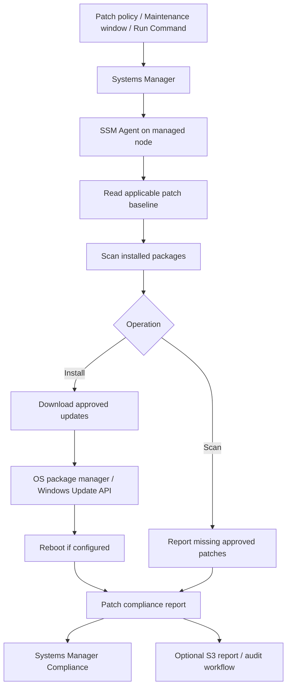

# Patch Manager and Operating System Patching Strategy

## 1. The OS Patching Problem in AWS

Servers must be updated regularly to remediate security vulnerabilities, fix bugs, maintain compatibility, and satisfy audit requirements. However, patching operating systems across a large fleet can disrupt applications if rolled out at the wrong time or with uncontrolled reboots.

A patching strategy must answer these questions:

- Which servers are managed and eligible to receive patches?
- Which patches are permitted to be installed, and which must be delayed or blocked?
- When does the system scan for patches and when does it install them?
- Can patches be tested on a small group before fleet-wide rollout?
- What happens when installation fails, a server requires a reboot, or an application does not come back healthy?
- How can you prove servers met the approved baseline at a specific point in time?

**AWS Systems Manager Patch Manager** automates scanning, installing, and reporting patch compliance for managed nodes. It can manage EC2 instances, on-premises servers, and virtual machines registered with Systems Manager, subject to supported operating systems and versions.

Patch Manager does not decide an enterprise's patching policy on its own. Organizations must define baselines, deployment schedules, target scope, maintenance windows, reboot handling, and compliance criteria. That strategy determines how safe patching operations are.

## 2. Learning Objectives

After this lesson, learners will be able to:

1. Explain the roles of Patch Manager, SSM Agent, managed nodes, patch baselines, and patch policies.
2. Distinguish between Scan and Install operations and interpret patch compliance results.
3. Build patch baselines based on operating system, classification, severity, approval delay, and allow/deny lists.
4. Choose among Quick Setup patch policies, maintenance windows, or Run Command for each deployment scale.
5. Design ring-based rollouts across server groups to minimize disruption risk.
6. Control concurrency, error thresholds, reboots, and lifecycle hooks.
7. Prepare IAM, networking, repositories, and S3 permissions required for patching to work.
8. Use the AWS CLI and Systems Manager Compliance to scan, install, and verify patches.
9. Investigate common failures and build a recurring operations checklist.

## 3. Mental Model: Policy, Schedule, and Actual State

A patching workflow can be divided into five layers:

| Layer | Component | Question to Answer |
|---|---|---|
| Scope | Managed nodes, tags, OUs, accounts, Regions | Which servers are governed by the policy? |
| Rules | Patch baseline | Which patches are approved or rejected? |
| Schedule | Patch policy, maintenance window, Run Command | When to scan and when to install? |
| Execution | SSM Agent, SSM documents, package managers | How do servers download and install patches? |
| Verification | Systems Manager Compliance, S3 reports, AWS Config | What state are servers in and when was data recorded? |

A patch baseline defines the desired state. A patch policy or maintenance schedule determines when it runs. SSM Agent executes the operation on the server. The compliance report reflects the outcome of the most recent successful run.

Remember this in one sentence: **the baseline defines what is allowed, the policy defines when and where, and compliance reports the latest evaluation result.**

## 4. Core Components of Patch Manager

### 4.1. Managed Node

A managed node is a server recognized and controllable by Systems Manager. A managed node can be:

- An EC2 instance in an AWS account.
- An on-premises server or VM in a hybrid/multicloud environment activated for Systems Manager management.
- A supported edge device.
- Certain macOS environments running on EC2, with specific OS update limitations.

The server must have SSM Agent, appropriate IAM permissions, and connectivity to required endpoints. A running EC2 instance is not automatically ready for Patch Manager.

### 4.2. SSM Agent

SSM Agent receives commands from Systems Manager, executes steps on the server, and returns results to the service. For the `AWS-RunPatchBaseline` document, AWS requires SSM Agent version 2.0.834.0 or later; keep the agent on a current supported version for bug fixes and new features.

Some advanced SSM documents require newer agents. For example, `AWS-RunPatchBaselineWithHooks` requires SSM Agent 3.0.502 or later.

### 4.3. Patch Baseline

A patch baseline is a rule set defining which patches are approved, which are rejected, and how compliance is evaluated. A baseline is tied to a specific supported operating system type.

### 4.4. Patch Policy

A patch policy is a configuration in Systems Manager Quick Setup that orchestrates scan schedules, install schedules, baselines, and target node groups. AWS recommends using patch policies to manage patching, especially across multiple accounts and Regions.

### 4.5. Maintenance Window

A maintenance window is a time window permitting potentially disruptive tasks on servers, such as installing patches, rebooting, updating agents, or running verification scripts.

### 4.6. Systems Manager Compliance

Systems Manager Compliance aggregates patch status and State Manager association status. Compliance data is a point-in-time snapshot from a successful scan or install operation; it is not continuous second-by-second telemetry.

## 5. Operating Architecture

General patching flow:



Main steps:

1. The administrator defines target nodes and baselines.
2. A patch policy, maintenance window, or Run Command invokes the SSM document.
3. SSM Agent receives the command and retrieves the applicable baseline snapshot.
4. The node compares installed patches against approved patches.
5. For Scan, the node only reports missing approved patches.
6. For Install, the node downloads and installs approved, missing, applicable patches.
7. The server reboots according to the SSM document configuration.
8. Patch Manager sends compliance data back to Systems Manager.

Patch Manager relies on the OS package manager and repository sources. Thus, the agent may communicate with Systems Manager normally while patching still fails if the server cannot reach its update repositories.

## 6. Prerequisites Before Patching

### 6.1. Supported Operating Systems

Patch Manager supports multiple versions of Linux, Windows Server, and certain macOS versions. The supported OS/version list evolves over time. Check the Patch Manager prerequisites page before standardizing a fleet.

Key caveats:

- Patch Manager does not support major OS version upgrades, such as Windows Server 2016 to 2019 or RHEL 7 to RHEL 8.
- For macOS, Patch Manager does not perform OS version upgrades. It can manage certain application updates via Homebrew on supported EC2 Mac instances.
- On Windows Server, application patching is limited to Microsoft-published applications.
- Operating systems at end of life (EOL) may no longer receive vendor patches. Without new updates, an EOL server may even report `Compliant` against a baseline while still carrying serious security risk.
- AWS does not individually test every patch before it appears in Patch Manager.

Therefore, manage OS lifecycle alongside patching. Patch Manager does not replace platform upgrade plans or migrating workloads off EOL operating systems.

### 6.2. SSM Agent and IAM

For EC2, the instance profile usually needs `AmazonSSMManagedInstanceCore` to let Systems Manager manage the node. Hybrid servers use a service role per the managed node activation process.

Verify:

- SSM Agent is running and at a sufficient version.
- Instance profile/service role is attached properly.
- IAM policies permit required Systems Manager actions.
- Operators have permission to call Run Command, inspect command invocations, and read compliance.
- If using Quick Setup patch policies with self-managed IAM profiles, the profile also needs read access to the S3 bucket created by Quick Setup for the patch policy.
- If using an S3 VPC endpoint, the endpoint policy must allow access to the patch policy configuration bucket.

Do not grant broad administrator permissions just to install patches. Separate policy administration, node execution, and report viewing by responsibility.

### 6.3. Network Connectivity and Repositories

Servers must be able to reach:

- The Systems Manager endpoints used by SSM Agent in the Region.
- AWS-managed S3 buckets required for Systems Manager and patching operations.
- Linux distribution repositories or internal mirrors.
- Windows Update Catalog or WSUS if Windows Server uses WSUS.
- Application update sources if the baseline includes application updates.

For nodes in private subnets, you can use VPC endpoints for Systems Manager and S3. However, a Systems Manager VPC endpoint does not automatically provide access to Linux repositories or WSUS. Design appropriate NAT, proxy, firewall rules, or internal mirrors.

### 6.4. Local Tools and Privileges

Patch Manager uses the Administrator account on Windows Server and `root` on Linux to install patches. Some platforms require Python or additional system utilities. For example, DNF-based operating systems may require `zstd`, `xz`, and `unzip`.

Check prerequisites for the exact distro and version. Do not blindly apply Amazon Linux 2 package manager settings to Amazon Linux 2023, or RHEL 7 settings to RHEL 8 and later.

## 7. Designing a Patch Baseline

### 7.1. AWS-Managed Baselines vs. Custom Baselines

Patch Manager provides predefined baselines for supported operating systems. You can use predefined baselines or create custom baselines.

AWS describes predefined baselines as sample configurations; they are not an optimal security standard for every organization. AWS recommends creating custom baselines to precisely govern fleet compliance criteria.

A custom baseline lets an organization decide:

- Which products/operating systems are in scope.
- Which classifications are approved, such as `Security`, `CriticalUpdates`, or `Bugfix`.
- Which severities are approved, such as `Critical` and `Important`.
- How many days to wait after patch release before auto-approval.
- Which specific Patch IDs are explicitly approved or rejected.
- Whether non-security updates are allowed.
- What compliance severity is assigned when an approved patch is missing.

### 7.2. Approval Rules

Approval rules typically combine these attributes:

| Attribute | Meaning | Example |
|---|---|---|
| Product | OS version/product family | Amazon Linux 2023, Windows Server |
| Classification | Patch category | Security, Bugfix, CriticalUpdates |
| Severity | Severity provided by the update source | Critical, Important |
| ApproveAfterDays | Days to wait before auto-approval | 7 days |
| ApproveUntilDate | Cutoff date for auto-approved patches | Only approve patches released before the chosen date |
| ComplianceLevel | Compliance severity if an approved patch is missing | HIGH or CRITICAL |

Not all operating systems publish identical release metadata. For example, Ubuntu Server does not support release-date-based auto-approval delays because its repositories do not supply reliable release dates for that mechanism. Some default baselines may approve Ubuntu security updates immediately.

For Linux, severity typically relies on software vendor metadata. Patch Manager does not compute severity from CVSS or NVD on its own. If your organization prioritizes by CVSS, combine an external vulnerability assessment source.

### 7.3. Approved and Rejected Patch Lists

In addition to approval rules, a baseline can include:

- **Approved patches**: explicitly approved patch IDs.
- **Rejected patches**: patch IDs disallowed from installation.
- **Global filters**: narrow the candidate patch set before applying approval rules.
- **Rejected patches action**: how to handle a rejected package that is also a dependency of an approved package on supported platforms.

Explicit lists are useful when blocking a patch that causes compatibility issues or forcing deployment of a specific patch. However, patch ID lists need an owner and review cycle. Leaving exceptions untouched too long can cause the baseline to drift away from current security policy.

### 7.4. Custom Baseline Example for Linux

The following example illustrates a rule approving `Critical` or `Important` security updates after 7 days. This is a sample configuration for discussion; confirm the exact classifications/severities provided by your distro's repositories before production use.

Create `approval-rules.json`:

```json
{
  "PatchRules": [
    {
      "PatchFilterGroup": {
        "PatchFilters": [
          {
            "Key": "CLASSIFICATION",
            "Values": ["Security"]
          },
          {
            "Key": "SEVERITY",
            "Values": ["Critical", "Important"]
          }
        ]
      },
      "ApproveAfterDays": 7,
      "ComplianceLevel": "HIGH",
      "EnableNonSecurity": false
    }
  ]
}
```

Create the baseline via AWS CLI:

```bash
aws ssm create-patch-baseline \
  --name "Org-Linux-Security-Baseline" \
  --operating-system AMAZON_LINUX_2023 \
  --approval-rules file://approval-rules.json \
  --description "Approve critical and important security patches after a test delay" \
  --region ap-southeast-1
```

The command returns a `BaselineId`. In environments using patch policies, select this baseline for the corresponding OS in Quick Setup. If using the legacy patch group model, associate the baseline with a patch group.

### 7.5. Determining the Approval Delay

Approval delay is part of your rollout strategy:

- Short delays deploy patches faster, but leave less testing time.
- Long delays allow observing compatibility issues, but keep servers unpatched longer.
- Emergency patches may require an exception workflow with separate deadlines and approvals.
- Do not use the same delay for every workload if risk levels and recovery capabilities differ.

A common pattern is testing patches on a canary group first, then expanding to production. An approval delay adds a buffer, but does not replace real testing.

## 8. Patch Policies in Systems Manager Quick Setup

### 8.1. Why Does AWS Recommend Patch Policies?

Patch policies are AWS's recommended way to configure patching. A single policy can span an entire Organization, specific Organizational Units (OUs), selected accounts/Regions, or an individual account-Region pair.

Key benefits:

- Configure schedules and baselines in one workflow.
- Support multiple accounts and Regions via AWS Organizations.
- Separate Scan and Install schedules.
- Select AWS-managed or custom baselines per operating system.
- Target managed nodes by tags or organizational scope.
- Control concurrency and error thresholds.
- Store patching logs in S3 if needed.

For organization-wide configurations, the policy is set up from the management account. AWS currently does not allow creating organization patch policies from a delegated administrator or member account. Check Quick Setup Regional support before designing a rollout.

A patch policy can span multiple accounts and Regions, yet compliance is still reported per account-Region pair. Therefore, centralized reporting must aggregate results from each source rather than treating the entire Organization as a single compliance record.

### 8.2. Scan and Install Schedules

Quick Setup allows setting Scan and Install schedules independently.

For example:

- Scan daily to detect missing patches.
- Install weekly during the application's maintenance window.
- For emergency patches, use a separate deployment schedule after risk assessment.
- Use CRON or Rate expressions to customize schedules.

At the time of writing, the default recommended patch policy configuration scans daily at 01:00 UTC and installs weekly on Sundays at 02:00 UTC. Those are wizard defaults, not a universal schedule for every organization. Verify operating time zones and workload maintenance windows before choosing schedules.

An option lets you wait until the first CRON interval before scanning newly targeted nodes. For installation, policies wait for the first scheduled install window by default. This prevents a newly tagged node from immediately receiving unexpected patches.

### 8.3. Targeting Accounts, Regions, and Nodes

A patch policy can target:

- Entire organization.
- Selected OUs and Regions.
- Current account across one or more Regions.
- All managed nodes in scope.
- Nodes by tags.
- Resource Groups in supported single-account configurations.
- Manual node lists within UI limits.

Use clear tagging conventions, such as:

| Tag | Value | Meaning |
|---|---|---|
| Environment | dev, test, staging, prod | Environment |
| PatchRing | canary, wave-1, wave-2 | Rollout wave |
| PatchWindow | sun-0200-utc | Maintenance window |
| Application | orders-api | Application group |
| Owner | platform-team | Responsible team |

Avoid inconsistent or ad-hoc tag changes. A wrong target tag can cause production nodes to receive patches during a test group's schedule.

### 8.4. Rate Control

Quick Setup lets you configure:

- **Concurrency**: number or percentage of managed nodes running simultaneously.
- **Error threshold**: maximum number or percentage of errors before the operation is marked failed.

For example, with 100 nodes, 10% concurrency processes roughly 10 nodes at once. If the error threshold is too low, a transient network blip can halt the rollout; if too high, widespread failures can propagate before stopping.

Choose values based on fault tolerance, redundancy, and application recovery speed.

### 8.5. S3 Logs and Patch Policy IAM Permissions

Quick Setup creates a dedicated S3 bucket containing `baseline_overrides.json` to store baseline metadata used by the policy. If using self-managed instance profiles/service roles rather than letting Quick Setup attach policies, ensure the role has:

- `AmazonSSMManagedInstanceCore` or equivalent Systems Manager permissions per your architecture.
- `s3:GetObject` permission on the specific patch policy bucket.
- An IAM tag formatted as `QSConfigId-<configuration-id>` with the configuration ID as its value, per Quick Setup guidance.
- An S3 VPC endpoint policy permitting access to this bucket if using an S3 endpoint.

When writing patching output to an organization-selected S3 bucket, target accounts need write access and the management account needs read access to view reports. Configure appropriate cross-account bucket policies.

If you update a custom patch baseline used by Quick Setup, changes synchronize to the patch policy configuration roughly hourly. If you delete a referenced baseline, subsequent patching operations may fail until the policy is updated to select an existing baseline.

## 9. Patch Groups: The Legacy Tagging Mechanism

Patch groups are the legacy mechanism for associating managed nodes with a patch baseline. Nodes are tagged with `Patch Group` or `PatchGroup`, and the tag value is registered with a baseline.

Example:

```bash
aws ec2 create-tags \
  --resources i-0123456789abcdef0 \
  --tags Key=PatchGroup,Value=Staging

aws ssm register-patch-baseline-for-patch-group \
  --baseline-id pb-0123456789abcdef0 \
  --patch-group Staging \
  --region ap-southeast-1
```

Notes:

- Patch groups are not used in patch-policy-based patching operations.
- If `Allow tags in instance metadata` is enabled on EC2, tag keys cannot contain spaces; use `PatchGroup`.
- Account-Regions already using patch groups before patch policies existed can continue using them.
- For new deployments, prefer patch policies in Quick Setup per AWS recommendation.

Do not mix patch groups and patch policies without explicitly confirming which baseline-selection mechanism each operation uses.

## 10. Scan and Install with AWS-RunPatchBaseline

### 10.1. Scan

`AWS-RunPatchBaseline` with `Operation=Scan`:

- Compares installed patches against the applicable baseline.
- Identifies approved, applicable patches that are missing.
- Reports patch compliance to Systems Manager.
- Does not install patches and does not require a node reboot.

Scan is ideal for checking scope, assessing risk, and planning before installation.

### 10.2. Install

`AWS-RunPatchBaseline` with `Operation=Install`:

- Finds approved, applicable, missing patches.
- Downloads patches from repositories or configured update sources.
- Installs via the OS package manager or Windows Update API.
- Reports compliance results.
- Reboots the node according to `RebootOption`.

Patch Manager does not blindly install every available update. The baseline determines which patches are allowed.

### 10.3. Snapshot ID and Consistency

When a patching command targets multiple nodes, ensure nodes evaluate the same baseline snapshot so one node does not receive a different patch set if the baseline changes mid-run.

- When running `AWS-RunPatchBaseline` inside a maintenance window, let Systems Manager generate the Snapshot ID automatically.
- When running directly outside a maintenance window across multiple nodes, AWS recommends generating one shared GUID Snapshot ID for the same operation/baseline.
- If each node receives a separate Snapshot ID, nodes may be evaluated against different baseline snapshots.

This is especially important in wave-based rollouts when comparing results across nodes in the same wave.

### 10.4. Recommended SSM Documents

AWS-recommended SSM documents for patching include:

- `AWS-RunPatchBaseline`: primary document for Scan and Install on supported Linux, macOS, and Windows Server.
- `AWS-RunPatchBaselineAssociation`: supports certain State Manager association/Quick Setup workflows.
- `AWS-RunPatchBaselineWithHooks`: supports lifecycle hooks on Linux and Windows Server.
- `AWS-ConfigureWindowsUpdate` and `AWS-InstallWindowsUpdates`: simpler Windows workflows when baseline-based patch compliance is not needed.

The legacy `AWS-ApplyPatchBaseline` document supports only Windows Server and is no longer recommended. For new workflows, prefer the AWS-maintained replacements.

## 11. Operating System Differences

### 11.1. Linux

Patch Manager uses the package manager matching the distro/version, typically:

| OS / Version Family | Typical Package Manager |
|---|---|
| Amazon Linux 2, RHEL 7, Oracle Linux 7 | YUM |
| Amazon Linux 2023 | DNF |
| RHEL 8+, Oracle Linux 8+, Rocky Linux, AlmaLinux | DNF |
| Debian, Ubuntu Server | APT |
| SUSE Linux Enterprise Server | Zypper |

Repositories must be configured and reachable. Some distros require Python or compression/extraction utilities. If the package manager is locked by another update process, Patch Manager may fail because it cannot install packages.

With Amazon Linux 2023, you can use versioned repositories for deterministic upgrades. Decide how your organization controls repository versions rather than letting each node update from an unpinned moving source.

### 11.2. Windows Server

On Windows Server, Patch Manager obtains the baseline-approved patch list and hands processing to the Windows Update API. Nodes must reach Windows Update Catalog or WSUS as configured.

Key points:

- You can use Microsoft KB IDs to approve/reject specific patches.
- Application patching on Windows Server in Patch Manager is limited to Microsoft applications.
- Windows Server may require multiple reboots to complete updates.
- WSUS must be synchronized and have policies aligned with the baseline.
- If a node cannot reach WSUS or Windows Update Catalog, the operation can fail even while SSM Agent remains online.

### 11.3. macOS

Patch Manager supports macOS on Amazon EC2 Mac in the Regions and versions listed in prerequisites. With Homebrew, Patch Manager can manage certain applications/packages.

Patch Manager does not support macOS OS version updates/upgrades, such as 13.1 to 13.2. Use Apple's OS update management mechanisms for that.

`AWS-RunPatchBaselineWithHooks` also does not support macOS.

## 12. Ring-Based Rollout Strategy

Do not patch the entire production fleet simultaneously if workloads have high-availability requirements. Divide servers into groups with increasing impact levels.

A reference rollout model:

| Ring | Scope | Goal | Promotion Criteria |
|---|---|---|---|
| Ring 0 | Dev or test machines | Verify packages and basic compatibility | Installation and smoke tests pass |
| Ring 1 | Staging/canary | Test under production-like conditions | Application health, logs, and latency stable |
| Ring 2 | Subset of production | Catch issues under real traffic | Error threshold not exceeded, sufficient capacity |
| Ring 3 | Remaining production | Complete rollout | Compliance and service health meet criteria |

### 12.1. Pre-Rollout Preparation

Before installing:

1. Inventory operating systems, versions, package managers, and repositories.
2. Classify nodes by application, environment, criticality, and owner.
3. Define patch SLAs by risk tier.
4. Create custom baselines and review approved/rejected patch lists.
5. Run Scan to see affected nodes and missing patch counts.
6. Confirm maintenance windows and reboot requirements.
7. Verify backups, snapshots, AMIs, or recovery plans.
8. Prepare post-patch smoke tests and health checks.

### 12.2. Canary Deployment

Start with a small number of nodes that can tolerate interruption. For multi-instance applications behind a load balancer:

- Drain the node from the target group or stop sending traffic to it.
- Confirm remaining capacity can serve the load.
- Install patches.
- Reboot per plan.
- Verify services, application health, and dependencies.
- Return the node to service once criteria pass.

You can use lifecycle hooks or Automation workflows to orchestrate these steps. Without hooks, design separate tasks inside a maintenance window and control execution order.

### 12.3. When to Halt the Rollout?

Stop or postpone the next wave when:

- Command failure rate exceeds the error threshold.
- Nodes fail to boot or SSM Agent does not come back online.
- Application health checks fail.
- Latency, error rates, or queue backlogs spike abnormally.
- Patches cause compatibility or package dependency errors.
- Backups/restores or rollback plans are not ready.

Never automatically advance to the next wave merely because the install command returned completed. Verify the workload after reboot.

## 13. Maintenance Windows and Orchestration Methods

### 13.1. Maintenance Windows

A maintenance window schedules tasks within a defined time period. For patching, the task typically invokes Run Command with `AWS-RunPatchBaseline`.

A maintenance window can:

- Define a cron/rate schedule.
- Target nodes by tags or resource groups.
- Run Scan or Install.
- Limit concurrency and error thresholds.
- Invoke Automation, Lambda, or Step Functions to coordinate additional steps.

Maintenance windows are useful for single account-Region orchestration or specialized workflows. Across multiple accounts and Regions, Quick Setup patch policies provide more centralized configuration.

### 13.2. Patch Policy, Maintenance Window, and Patch Now

| Method | Best Fit | Key Notes |
|---|---|---|
| Quick Setup patch policy | Centralized management, multi-account/Region, separate Scan/Install schedules | AWS-recommended method |
| Maintenance window | Maintenance-window workflows or coordinating other tasks | Configured per account-Region |
| Run Command | One-off scan/install or specific nodes | Must manage targets, concurrency, and snapshots |
| Patch now | On-demand remediation in one account-Region | Does not replace recurring patch schedules |

Use one primary method to manage compliance for a node group. If multiple Scan methods with different baselines run on the same node, the latest compliance result may overwrite earlier scan data.

## 14. Reboots and Lifecycle Hooks

### 14.1. RebootOption

`AWS-RunPatchBaseline` supports two values:

| Value | Behavior |
|---|---|
| `RebootIfNeeded` | Default. If Install applies one or more patches, the node reboots to ensure updates take effect. |
| `NoReboot` | Does not reboot the node after installation, allowing the organization to control reboot timing. |

Important detail: `RebootIfNeeded` does not mean Patch Manager inspects each package to check whether it strictly requires a reboot. If the operation installs one or more patches, the node may reboot even when a package does not require it.

With `NoReboot`, patches may remain in `INSTALLED_PENDING_REBOOT`; the node reports Non-Compliant until rebooted and re-scanned. `NoReboot` also does not prevent a package from restarting dependent services during installation.

For clustered systems or workloads with special reboot procedures, consult service documentation before using Patch Manager. AWS does not recommend using Patch Manager to patch Amazon EMR cluster instances; especially do not choose `RebootIfNeeded`.

### 14.2. Lifecycle Hooks with AWS-RunPatchBaselineWithHooks

`AWS-RunPatchBaselineWithHooks` lets you invoke SSM documents at three points:

1. `PreInstallHookDocName`: before installation.
2. `PostInstallHookDocName`: after installation with `NoReboot`, before the reboot step.
3. `OnExitHookDocName`: after the reboot step completes or at operation exit.

Applications can use hooks to:

- Drain nodes from a load balancer.
- Stop services or place workloads into maintenance mode.
- Capture state, record package versions, or run check scripts.
- Restart services and run post-reboot health checks.
- Return nodes to the target group once healthy.

This document requires SSM Agent 3.0.502 or later, supports only Linux and Windows Server, does not support macOS, and does not support `InstallOverrideList`.

Parameter example:

```json
{
  "Operation": ["Install"],
  "RebootOption": ["RebootIfNeeded"],
  "PreInstallHookDocName": ["DrainFromLoadBalancer"],
  "PostInstallHookDocName": ["ValidatePackageState"],
  "OnExitHookDocName": ["RestoreTrafficAndHealthCheck"]
}
```

The hook document names in the example are organization-created SSM documents. Verify execution permissions, timeouts, and failure-handling behavior for each hook.

## 15. Reading Patch Compliance Correctly

### 15.1. Common States

| Patch state | Meaning | Typical Compliance |
|---|---|---|
| `INSTALLED` | Patch approved by baseline and installed | Compliant |
| `INSTALLED_OTHER` | Package installed outside the baseline, or installed as a dependency/via override per platform rules | Usually Compliant |
| `MISSING` | Patch approved and applicable, not yet installed | Non-Compliant |
| `FAILED` | Patch approved, but installation failed | Non-Compliant |
| `INSTALLED_PENDING_REBOOT` | Installed, but node has not rebooted since installation | Non-Compliant |
| `INSTALLED_REJECTED` | Patch currently installed, but listed on the rejected list | Non-Compliant |
| `NOT_APPLICABLE` | Patch does not apply to features/config on Windows Server or has been superseded | Not applicable |

State details vary between Windows Server, Debian/Ubuntu, and other operating systems. Consult the Patch compliance state values documentation when interpreting specific results.

### 15.2. Compliance Is a Point-in-Time Snapshot

Patch compliance reports reflect the most recent successful patching operation. Reports include a capture time showing when the data was computed.

If a node scanned last week was not re-scanned after a baseline change, compliance status may not reflect the new baseline. If multiple scan methods run on the same node, prior compliance data may be overwritten by the latest scan.

Never conclude a node is compliant solely from an old report. Check capture time, baseline ID used, operation type, and command execution history.

### 15.3. Compliant Does Not Mean Completely Secure

`Compliant` only means patches approved by the baseline and currently available were installed as of the latest evaluation. It does not prove:

- The OS is still within vendor support lifecycle.
- No unpatched vulnerabilities remain.
- Applications lack dependency vulnerabilities.
- IAM, network, and host firewall configurations are secure.
- No malware or compromise is present.
- No patches were excluded from the baseline via exceptions.

Combine patch compliance with vulnerability management, security configuration, EDR, logging, and change control.

### 15.4. Integrating AWS Config for Compliance History

Systems Manager Compliance shows current status. To retain history and change tracking for patch compliance, enable AWS Config recording for these resource types:

- `SSM:PatchCompliance`
- `SSM:AssociationCompliance`

AWS Config tracks compliance resource changes over time. This is an optional configuration; evaluate recording scope and AWS Config costs.

## 16. Security and Access Governance

### 16.1. Separation of Duties

Responsibilities can be divided into:

- **Patch policy administrator**: creates baselines, policies, and schedules.
- **Node administrator**: maintains SSM Agent, instance profiles, repositories, and OS settings.
- **Operations team**: monitors maintenance windows, command status, reboots, and health checks.
- **Security/compliance team**: reviews compliance reports, approves exceptions, and tracks SLAs.
- **Application owner**: validates compatibility and runs smoke tests.

Do not grant permissions to edit baselines, alter IAM instance profiles, and delete logs to the same operational role without clear justification.

### 16.2. Protecting Update Sources

- Use official repositories or managed internal mirrors.
- Ensure repositories provide valid package metadata and signatures for the distro.
- Do not add untrusted repositories just to work around package download errors.
- Manage repository changes via version control/configuration management.
- Monitor repository enable/disable events and source list changes.
- Verify network access to update sources from private subnets.

### 16.3. Protecting Logs and Evidence

Patch operation outputs can be saved to S3 for investigation. The bucket needs:

- Block Public Access enabled.
- A bucket policy restricting which principals can write/read.
- Appropriate encryption.
- Lifecycle/retention rules as required.
- Proper cross-account permissions if multiple accounts write logs.
- CloudTrail monitoring bucket administration and IAM changes.

Do not write secrets or tokens into script/hook output. Minimize sensitive OS or application data in logs.

## 17. AWS CLI: Scanning, Installing, and Checking Results

### 17.1. Checking Managed Nodes

List managed nodes in a Region:

```bash
aws ssm describe-instance-information \
  --region ap-southeast-1 \
  --query "InstanceInformationList[].{Id:InstanceId,Platform:PlatformName,Version:PlatformVersion,Ping:PingStatus,Agent:AgentVersion}"
```

Only send patch commands to managed nodes with an online agent. If a node is missing, check its IAM role, SSM Agent, Region, and network connectivity first.

### 17.2. Scanning a Staging Group

Example scanning all EC2 instances tagged `Environment=Staging`:

```bash
aws ssm send-command \
  --document-name "AWS-RunPatchBaseline" \
  --targets "Key=tag:Environment,Values=Staging" \
  --parameters '{"Operation":["Scan"]}' \
  --max-concurrency "10%" \
  --max-errors "1" \
  --region ap-southeast-1
```

The command returns a `CommandId`. Use the command ID to view per-node status and output. Scan neither installs patches nor reboots.

### 17.3. Installing During a Maintenance Window

Example installing baseline-approved patches on the staging group:

```bash
aws ssm send-command \
  --document-name "AWS-RunPatchBaseline" \
  --targets "Key=tag:Environment,Values=Staging" \
  --parameters '{"Operation":["Install"],"RebootOption":["NoReboot"]}' \
  --max-concurrency "10%" \
  --max-errors "1" \
  --region ap-southeast-1
```

This example chooses `NoReboot` to demonstrate controlling restart timing. After installation, reboot on the approved schedule, then run Scan to confirm compliance status.

If using `RebootIfNeeded`, nodes may reboot during the operation. Ensure applications are drained and sufficient capacity remains.

### 17.4. Checking Command Invocations

```bash
aws ssm list-command-invocations \
  --command-id "00000000-0000-0000-0000-000000000000" \
  --details \
  --region ap-southeast-1
```

Replace the command ID with the value returned by `send-command`. Inspect status, response code, output, and errors for each node.

### 17.5. Checking an Instance's Patch State

```bash
aws ssm describe-instance-patch-states \
  --instance-ids i-0123456789abcdef0 \
  --region ap-southeast-1

aws ssm describe-instance-patches \
  --instance-id i-0123456789abcdef0 \
  --filters Key=State,Values=Missing \
  --region ap-southeast-1
```

The first command returns the node's summary state. The second lists patches in the `Missing` state. Adjust the filter to view other states per AWS CLI documentation.

### 17.6. Exporting Compliance Reports to S3

In the Patch Manager console, select Compliance reporting and use Export to S3. Reports can be generated on a schedule or on demand.

A single-node report can include patch ID/KB, state, severity, classification, and capture time. Fleet-wide reports provide mainly summary information; for detailed patch lists, export per-node reports or use the appropriate APIs.

## 18. Monitoring and Auditing Patching Operations

An operational process should track at least:

- Targeted managed node count and online node count.
- Scanned nodes, nodes with missing patches, and nodes lacking fresh compliance data.
- Command success/failure by account, Region, OS, and application.
- Nodes pending reboot.
- Time from patch release to installation.
- Exceptions and remediation deadlines.
- EOL nodes or nodes no longer receiving vendor updates.

Data sources:

- Systems Manager Patch Manager and Compliance: patch states.
- Run Command/maintenance window executions: progress and output.
- Amazon S3: exported logs or compliance reports.
- AWS CloudTrail: who created/edited policies, baselines, maintenance windows, or sent commands.
- Amazon CloudWatch: application logs/metrics confirming operational impact.
- AWS Config: patch compliance history if relevant resource types are enabled.

Do not monitor only how many nodes finished the command. Combine compliance with application health checks to verify outcomes.

## 19. Cost and Optimization

Patching cost depends on fleet size, integrated services, runtime, and evidence retention. Factors to evaluate include:

- EC2 runtime during maintenance, including standby nodes if needed.
- S3 storage for patch logs and compliance reports.
- Data transfer when nodes download packages from the Internet, mirrors, or other Regions.
- KMS requests and encryption/storage costs if used.
- Pre-patch snapshots/AMIs/backups and retention duration.
- Systems Manager/managed node tier or advanced feature pricing if used by the workload.
- Operational costs from reboots, downtime, or reduced capacity.

Optimize by:

1. Tailoring baselines by OS and actual requirements.
2. Avoiding redundant scans from overlapping policies/associations.
3. Aligning schedules with vendor release cadence.
4. Limiting log retention per audit requirements.
5. Using internal mirrors where appropriate to reduce repository load and data transfer costs.
6. Setting concurrency high enough to finish within maintenance windows while preserving capacity.
7. Reviewing EOL nodes, offline nodes, and patching exceptions periodically.

Do not cut costs by removing mandatory patches from baselines or disabling compliance without risk assessment and approval.

## 20. Common Troubleshooting

### 20.1. Node Does Not Appear in Patch Manager

Check:

- Is SSM Agent installed and running?
- Is the node in the correct account and Region?
- Does the IAM instance profile/service role have Systems Manager permissions?
- Can the node reach Systems Manager and S3 endpoints?
- Has the managed node registered successfully?
- Is the OS/version supported by Patch Manager?

### 20.2. Command Fails Due to Repository Access

Check:

- Are Linux repository URLs and DNS reachable?
- Does the private subnet have NAT/proxy or a route to a mirror?
- Can Windows nodes reach WSUS or Windows Update Catalog?
- Is a firewall blocking update endpoints?
- Is repository metadata valid and synchronized?
- Is the package manager locked by unattended updates or another process?

### 20.3. Baseline Does Not Select Expected Patches

Check:

- Are the operating system/product filters right?
- Do classification and severity match vendor metadata?
- Does the auto-approval delay/cutoff date keep the patch ineligible?
- Is a rejected patch or global filter excluding the patch?
- Is Ubuntu configured with an unsupported auto-approval delay?
- Does the repository provide metadata for the package?

Never assume vendor severity equals CVSS. Inspect actual metadata.

### 20.4. Node Is in INSTALLED_PENDING_REBOOT State

Check:

- Did the previous operation use `NoReboot`?
- Were patches installed manually or by another tool since the last reboot?
- Does the maintenance window include a reboot task?
- After rebooting, was a Scan run again?

Do not delete or edit patch tracking files on the node. If tracking files are deleted or corrupted, compliance data can become inaccurate; follow AWS guidance to restore state, typically involving a reboot and running Scan.

### 20.5. Newer Scan Overwrites Older Compliance

Check whether multiple patch scan methods are running on the same node—such as Quick Setup Host Management, a patch policy, a State Manager association, and a maintenance window. Each successful scan can update the latest compliance data. Standardize on one primary scan method per node group and export historical reports to S3/AWS Config if needed.

### 20.6. Operation Reports Failed After Unexpected Reboot

Some updates trigger an OS-level reboot while the document is still executing. SSM Agent may not resume execution state and report failure even though packages installed. Run a Scan after the node comes back online to verify patch state rather than relying solely on command status.

## 21. Hands-On Lab: Building a Patching Workflow for a Staging Group

### 21.1. Objective

Create a controlled update workflow for a group of staging Linux EC2 instances:

- Verify managed nodes and SSM Agent.
- Create an appropriate baseline.
- Scan before installing.
- Install inside a maintenance window.
- Control reboots.
- Read compliance and record results.

### 21.2. Prerequisites

- A test AWS account.
- A non-production EC2 instance.
- An OS on the Patch Manager supported list.
- An instance profile with appropriate Systems Manager permissions.
- Node online in Fleet Manager.
- Reachable update repositories.
- Tag `Environment=Staging`.

Do not run labs against a production fleet or alter repositories of live business systems.

### 21.3. Lab Steps

1. Open Systems Manager Fleet Manager and confirm the instance appears online.
2. Check the SSM Agent version.
3. Open Patch Manager and confirm the baseline applicable to the OS.
4. Run Scan targeting `Environment=Staging`.
5. Record missing patch counts and severities.
6. Inspect the command invocation to confirm the node completed Scan.
7. Create or select a test maintenance window.
8. Register a Run Command task using `AWS-RunPatchBaseline` with `Operation` `Install`.
9. Choose a `RebootOption` suitable for the lab.
10. Wait for the operation to complete; if using `NoReboot`, reboot the node on schedule.
11. Run Scan again.
12. Check `describe-instance-patch-states` and the compliance report.
13. Record the scan timestamp, baseline, command ID, and result.

### 21.4. Completion Criteria

- The node is recognized by Systems Manager and online.
- Scan identifies missing patches.
- Install applies only baseline-approved patches.
- Reboot behaves as configured.
- The final Scan updates compliance.
- The learner can explain which patches were installed, which remain missing, and why.

## 22. Common Misconceptions

| Misconception | Correct Understanding |
|---|---|
| Patch Manager automatically installs all updates | The baseline determines which patches are approved |
| Scan is the same as Install | Scan only evaluates and reports; it does not install |
| Compliant means the server is completely secure | Compliant only reflects the baseline and data from the latest evaluation |
| Patch groups are required for patch policies | Patch policies do not use patch groups |
| Having a Systems Manager VPC endpoint is enough | Nodes still need S3 and update repository access |
| `RebootIfNeeded` only reboots when a package asks | When Install applies one or more patches, the node may reboot even if not required by the package |
| `NoReboot` keeps the node Compliant | Patches may enter pending reboot and mark the node Non-Compliant |
| AWS-managed baselines are optimal for every company | AWS considers them samples; build custom baselines to match requirements |
| Patch Manager performs major OS version upgrades | Major version upgrades require a separate OS upgrade workflow |
| Patch compliance is real-time state | Reports are snapshots of the latest successful operation |
| macOS can upgrade OS versions via Patch Manager | Patch Manager does not support OS version updates on macOS |
| A command failure always means packages weren't installed | An unexpected reboot can fail execution even after installation; verify with Scan |

## 23. Self-Check Questions

### Question 1

An operations team wants to know which EC2 instances are missing security updates without installing anything yet. Which Operation should they choose?

**Answer:** `Scan`. This operation evaluates patch compliance and reports missing patches without installing or rebooting nodes.

### Question 2

Which component defines which patches are permitted to be installed?

**Answer:** The patch baseline. Execution schedules are configured via patch policies, maintenance windows, or Run Command.

### Question 3

Which method does AWS recommend for centralized patching across multiple accounts and Regions?

**Answer:** Patch policies in Systems Manager Quick Setup.

### Question 4

Do patch policies use patch groups?

**Answer:** No. Patch groups are the legacy mechanism; patch policies select baselines directly by operating system and target scope.

### Question 5

A node reports Compliant while running an EOL operating system. Can you conclude the node is secure?

**Answer:** No. If repositories publish no new updates, the node can report Compliant against the baseline even though the OS is out of vendor support.

### Question 6

How does `NoReboot` affect compliance?

**Answer:** If patches were installed without rebooting, patches may enter `INSTALLED_PENDING_REBOOT` and the node reports Non-Compliant until rebooted and re-scanned.

### Question 7

Can Patch Manager upgrade RHEL 7 to RHEL 8?

**Answer:** No. Major OS version upgrades require a separate upgrade process.

### Question 8

An EC2 instance in a private subnet has SSM Agent online but cannot patch Linux packages. What should you check?

**Answer:** Check access to required S3 buckets and connectivity to Linux package repositories/mirrors, DNS, routes, proxies, and firewalls.

### Question 9

An organization wants to drain nodes from a load balancer before patching and run health checks after reboot. Which document can they use?

**Answer:** `AWS-RunPatchBaselineWithHooks`, using `PreInstallHookDocName`, `PostInstallHookDocName`, and `OnExitHookDocName`. This document requires SSM Agent 3.0.502 or later and does not support macOS.

### Question 10

Two different Scan mechanisms run on the same node using different baselines. What can happen?

**Answer:** The most recent compliance report can overwrite data from the earlier Scan. Standardize on one primary Scan mechanism and archive historical reports separately.

### Question 11

An Install command returns failed after an unexpected node reboot. Can you conclude the patches were not installed?

**Answer:** Not yet. Once the node is online, run Scan and check patch compliance to confirm package state.

### Question 12

Does Patch Manager support updating macOS from 13.1 to 13.2?

**Answer:** No. Patch Manager does not support macOS OS version updates/upgrades; use Apple's update mechanisms.

## 24. Production Operations Checklist

### Scope and Prerequisites

- [ ] Inventory exists for managed nodes, OS versions, owners, and applications.
- [ ] OS/version is confirmed supported by Patch Manager.
- [ ] SSM Agent is running and at a sufficient version.
- [ ] IAM instance profiles/service roles follow least privilege.
- [ ] Nodes can reach Systems Manager, S3, and patch repositories.
- [ ] Processes exist for handling EOL OSes and major version upgrades.

### Baselines and Policies

- [ ] Custom baselines exist per OS type according to organizational policy.
- [ ] Approval rules are based on classification, severity, and release delay.
- [ ] Approved/rejected patch lists have owners and review dates.
- [ ] Repository metadata and distro specifics have been verified.
- [ ] Patch policies target the exact OUs/accounts/Regions/tags.
- [ ] Scan schedules and Install schedules are separated.
- [ ] Concurrency and error thresholds match capacity.
- [ ] Multiple scan methods are not competing on the same nodes.

### Rollout and Recovery

- [ ] Canary ring and rollout waves are defined.
- [ ] Scan is run before Install.
- [ ] Maintenance window and on-call owner are assigned during patching.
- [ ] Backups/snapshots or restore procedures are verified.
- [ ] `RebootOption` matches workload requirements.
- [ ] Lifecycle hooks or Automation are used for workloads needing drain/health checks.
- [ ] Stop-rollout and rollback criteria are defined.

### Compliance and Auditing

- [ ] Compliance reports have recent capture times.
- [ ] Missing, failed, and pending-reboot patches are reviewed.
- [ ] S3 export or historical retention system is in place.
- [ ] CloudTrail records baseline/policy changes and administrative actions.
- [ ] AWS Config is enabled for SSM patch compliance if history is required.
- [ ] SLAs and exception workflows exist for patches that cannot yet be installed.
- [ ] EOL and offline node reports are reviewed periodically.

## 25. Official Reference Documentation

The AWS pages below serve as references for design and operations. Supported OS lists, Regional availability, agent requirements, and Quick Setup UI may change; re-verify before deployment.

### AWS Systems Manager Patch Manager

- [AWS Systems Manager Patch Manager](https://docs.aws.amazon.com/systems-manager/latest/userguide/patch-manager.html)
- [Patch Manager prerequisites](https://docs.aws.amazon.com/systems-manager/latest/userguide/patch-manager-prerequisites.html)
- [Patch policy configurations in Quick Setup](https://docs.aws.amazon.com/systems-manager/latest/userguide/patch-manager-policies.html)
- [Configure patching using a Quick Setup patch policy](https://docs.aws.amazon.com/systems-manager/latest/userguide/quick-setup-patch-manager.html)
- [Predefined and custom patch baselines](https://docs.aws.amazon.com/systems-manager/latest/userguide/patch-manager-predefined-and-custom-patch-baselines.html)
- [Creating and managing patch groups](https://docs.aws.amazon.com/systems-manager/latest/userguide/patch-manager-tag-a-patch-group.html)
- [How patches are installed](https://docs.aws.amazon.com/systems-manager/latest/userguide/patch-manager-installing-patches.html)

### SSM Documents and Scheduling

- [AWS-RunPatchBaseline](https://docs.aws.amazon.com/systems-manager/latest/userguide/patch-manager-aws-runpatchbaseline.html)
- [AWS-RunPatchBaselineWithHooks](https://docs.aws.amazon.com/systems-manager/latest/userguide/patch-manager-aws-runpatchbaselinewithhooks.html)
- [SSM command documents for patching managed nodes](https://docs.aws.amazon.com/systems-manager/latest/userguide/patch-manager-ssm-documents.html)
- [Patching schedules using maintenance windows](https://docs.aws.amazon.com/systems-manager/latest/userguide/sysman-patch-scheduletasks.html)
- [AWS Systems Manager Maintenance Windows](https://docs.aws.amazon.com/systems-manager/latest/userguide/maintenance-windows.html)

### Compliance and Reporting

- [Patch compliance state values](https://docs.aws.amazon.com/systems-manager/latest/userguide/patch-manager-compliance-states.html)
- [Working with patch compliance reports](https://docs.aws.amazon.com/systems-manager/latest/userguide/patch-manager-compliance-reports.html)
- [Generating CSV patch compliance reports in S3](https://docs.aws.amazon.com/systems-manager/latest/userguide/patch-manager-store-compliance-results-in-s3.html)
- [Viewing patch compliance results](https://docs.aws.amazon.com/systems-manager/latest/userguide/patch-manager-view-compliance-results.html)
- [AWS Systems Manager Compliance](https://docs.aws.amazon.com/systems-manager/latest/userguide/compliance-about.html)

### Related Services

- [AWS Systems Manager Run Command](https://docs.aws.amazon.com/systems-manager/latest/userguide/run-command.html)
- [AWS Systems Manager Quick Setup](https://docs.aws.amazon.com/systems-manager/latest/userguide/quick-setup.html)
- [AWS Systems Manager pricing](https://aws.amazon.com/systems-manager/pricing/)
- [AWS Systems Manager service endpoints](https://docs.aws.amazon.com/general/latest/gr/ssm.html)
- [Amazon EC2 VPC endpoints](https://docs.aws.amazon.com/vpc/latest/privatelink/vpc-endpoints.html)
