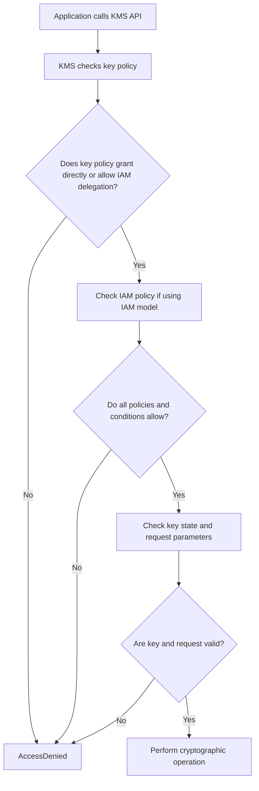

# KMS Keys, Key Policies, and IAM Permissions

AWS Key Management Service (AWS KMS) is the centralized encryption key management service in the AWS ecosystem. When designing applications on AWS, we commonly use KMS to protect data stored in Amazon S3, EBS, RDS, DynamoDB, Secrets Manager, or data encrypted directly by the application. To use KMS securely, you must understand three closely linked concepts: a **KMS key** defines the key and its cryptographic purpose; a **key policy** specifies who is allowed to operate on the key; and an **IAM policy** grants permissions to AWS identities such as users or roles.

Within the `CLOUD_PROVIDERS_AWS` module, this lesson places KMS in the broader AWS infrastructure picture: applications run with an IAM role, data resides in storage services or databases, and KMS controls key usage for encryption and decryption. A sound design must restrict key access to the right people and services, separate key administration from key usage, and preserve operational capability and data recoverability.

After this lesson, you can:

- Distinguish between AWS managed keys, customer managed keys, and AWS owned keys.
- Explain the role of key policies and the relationship between key policies and IAM policies.
- Design key administration and key usage permissions following the principle of least privilege.
- Read sample policies and identify encryption/decryption permissions versus key management permissions.
- Analyze `AccessDenied` errors when an application or AWS service calls KMS.

## 1. What Is a KMS Key?

A KMS key is a logical resource representing a cryptographic key in AWS KMS. This resource has metadata, state, algorithm configuration, intended usage, and an access policy. KMS performs cryptographic operations within the service; applications typically receive only the encrypted output, decrypted output, or generated key material as requested.

A KMS key has common identifying attributes:

- **Key ID**: the identifier of the key within a Region.
- **Key ARN**: the full ARN, including partition, Region, account ID, and key ID. When granting permissions in an IAM policy, reference the specific ARN.
- **Alias**: a human-friendly name pointing to a KMS key, such as `alias/orders-data`. Aliases help applications and operators choose keys easily, but an alias itself does not grant permission to use the key.
- **Key state**: states such as Enabled, Disabled, or Pending deletion. A disabled key or one pending deletion cannot serve normal cryptographic operations.

KMS keys are Regional. A key ARN in `ap-southeast-1` is a different resource from a key in `ap-southeast-2`. When configuring an application, verify that the key's Region matches the Region the application or service uses, unless you intentionally design with multi-Region keys.

### 1.1. Key Types by Ownership and Management

| Key type | Who manages the policy? | Control level | Use cases |
|---|---|---|---|
| AWS owned key | Managed by AWS; customers cannot view or edit the policy | Low | Some AWS services use AWS-owned keys to protect data |
| AWS managed key | AWS manages the policy and lifecycle | Limited; customers cannot edit the key policy | Use default keys created and managed by AWS services in your account |
| Customer managed key | Customer manages configuration, key policy, related IAM permissions, and lifecycle | High | Need control over key users, auditing, cross-account sharing, or custom policies |

A customer managed key is appropriate when an organization needs explicit control over who can decrypt data, who can change the policy, and who can disable or schedule deletion of the key. High control also means the operations team must manage policies carefully: if permissions are revoked incorrectly, applications can lose the ability to read encrypted data.

### 1.2. Key Spec and Intended Usage

When creating a key, select a configuration suited to the cryptographic operations:

- **Symmetric encryption keys** are typically used to encrypt and decrypt application data, as well as integrate with many AWS services.
- **Asymmetric keys** have a public and private key pair, suitable for operations such as encrypt/decrypt or sign/verify depending on configuration.
- **HMAC keys** are used to generate and verify message authentication codes.

Not all key types support the same set of IAM actions. For example, `kms:Sign` and `kms:Verify` apply only to keys with the corresponding signing/verification usage; `kms:GenerateDataKey` is typically tied to symmetric encryption workflows. Choose the key spec and key usage based on application requirements before writing policies.

A KMS key is also not a place to store arbitrary text secrets. For database passwords, API tokens, or connection credentials, use an appropriate secrets management service such as AWS Secrets Manager or Systems Manager Parameter Store; KMS can protect the data stored in those services with an encryption key.

### 1.3. KMS and Envelope Encryption

KMS is well suited for managing keys and performing cryptographic operations, but applications typically do not send large amounts of data directly to KMS for encryption. For large data, the common pattern is **envelope encryption**:

1. The application requests KMS to create a data key via `GenerateDataKey`.
2. KMS returns a plaintext data key and a copy of the data key encrypted with the KMS key.
3. The application uses the plaintext data key to encrypt data directly inside its own process.
4. The application stores the ciphertext along with the encrypted data key; the plaintext data key must be removed from memory when no longer needed.
5. When reading, the application sends the encrypted data key to KMS via `Decrypt`, receives the plaintext data key, and decrypts the data.

This approach lets KMS protect the root wrapping key while the application processes large payloads with a local encryption library. With the KMS `Encrypt` API, the plaintext limit for symmetric keys is 4 KiB; larger data should use data keys or storage-service-side encryption mechanisms.

## 2. Key Policy Is the Foundational Access Control Layer of KMS

A key policy is a resource-based policy attached directly to a KMS key. Every KMS key must have a key policy. This is an important distinction when comparing KMS with many other AWS services: **an IAM policy attached to a user or role does not automatically grant permission to use a KMS key**.

A key policy can:

- Grant permissions directly to a specific IAM principal.
- Allow the key-owning account to use IAM policies to delegate permissions to principals within the same account.
- Allow principals in other accounts to use the key, if configured appropriately for cross-account sharing.
- Restrict permissions using conditions, such as requiring requests to go through a specific AWS service or include a matching encryption context.

In a policy, `Principal` identifies the allowed identity, `Action` specifies the operations, `Effect` is Allow or Deny, `Resource` identifies the resource, and `Condition` adds constraints. For a key policy attached directly to a key, `"Resource": "*"` in a statement generally refers to the KMS key carrying that policy.

### 2.1. Statement Allowing the Account to Use IAM Policies

The default key policy created by AWS KMS usually contains a statement similar to:

```json
{
  "Sid": "EnableAccountIamPermissions",
  "Effect": "Allow",
  "Principal": {
    "AWS": "arn:aws:iam::111122223333:root"
  },
  "Action": "kms:*",
  "Resource": "*"
}
```

The `root` part of the ARN here represents the **AWS account principal**, not just the root user login. This statement allows the key-owning account to use IAM policies to grant permissions to IAM principals in the account. It does not mean every user and role in the account can automatically call every KMS API; each principal still needs explicit permissions via IAM policies and remains subject to other control layers.

If you remove the statement enabling IAM delegation, a newly attached IAM policy on a role may not be enough to grant access to the key. In that case, you need a key policy statement granting permissions directly to the principal, or you must restore the appropriate delegation mechanism.

### 2.2. Granting Permissions Directly in the Key Policy

You can specify a concrete role in the `Principal` field of the key policy. This is useful when you want the key's policy to explicitly state which identities can operate on it. Example:

```json
{
  "Sid": "AllowOrderServiceToDecrypt",
  "Effect": "Allow",
  "Principal": {
    "AWS": "arn:aws:iam::111122223333:role/OrderService"
  },
  "Action": [
    "kms:Decrypt",
    "kms:DescribeKey"
  ],
  "Resource": "*"
}
```

When a key policy grants permissions directly to a role, a matching IAM Allow for the same actions is not strictly required. However, requests can still be blocked by an explicit Deny or other constraints such as a service control policy (SCP), permissions boundary, session policy, or VPC endpoint policy where applicable.

Consider identity management when referencing principals directly. If a role is deleted and recreated, its ARN or principal identity can change in ways that affect the policy. In larger systems, manage role and key policy changes together through infrastructure deployment pipelines.

## 3. How Do IAM Policies Work Together with Key Policies?

An IAM policy is an identity-based policy attached to an IAM user, group, or role. It describes what actions that identity is allowed to perform on resources. For KMS, an IAM policy takes effect when the key policy allows the key-owning account to delegate authorization decisions to IAM, or when the key policy has corresponding configuration for the principal.

There are two common models:

| Model | Key policy | IAM policy | Characteristics |
|---|---|---|---|
| Delegation via IAM | Allows the account to use IAM policies for authorization | Grants specific actions to roles/users on the key ARN | Centralized identity-based permission management; convenient with many applications |
| Direct grants in key policy | Names the principal and allowed actions directly in the key policy | May not need a duplicate Allow for those actions | Key usage permissions are expressed directly on the resource |

Within the same account, the IAM delegation model usually scales better: the key policy sets the delegation boundary, while IAM policies determine which roles can use the key and which actions they can perform. For systems requiring per-key centralized policies, you can choose direct grants or intentionally combine both models.

### 3.1. Example IAM Policy for an Application

Suppose account `111122223333` has role `OrderService` and a customer managed key in Region `ap-southeast-1`. The key policy includes a statement allowing the account to use IAM policies. The IAM policy attached to the role can grant permissions as follows:

```json
{
  "Version": "2012-10-17",
  "Statement": [
    {
      "Sid": "UseOrdersDataKey",
      "Effect": "Allow",
      "Action": [
        "kms:Decrypt",
        "kms:Encrypt",
        "kms:GenerateDataKey",
        "kms:DescribeKey"
      ],
      "Resource": "arn:aws:kms:ap-southeast-1:111122223333:key/12345678-1234-1234-1234-123456789012"
    }
  ]
}
```

This policy grants common operations for an application that encrypts and decrypts data. In production, retain only the actions the application actually needs. If the application only reads encrypted data, it may only need `kms:Decrypt` plus `DescribeKey` if the library or deployment workflow inspects metadata. If the application writes data using envelope encryption, it also needs permission to generate data keys.

Using the specific key ARN limits scope. Avoid granting `kms:*` or using a wildcard for all keys in the account when an application only needs one key. Aliases are useful in application configuration, but when writing IAM policies for key usage, verify the resource ARN and how KMS APIs evaluate resources.

### 3.2. Other Control Layers Can Still Block Requests

An Allow in a key policy or IAM policy does not guarantee a request will succeed. Effective permissions are also subject to related control layers:

- **Explicit Deny** in any applicable policy blocks the request.
- **SCPs** can cap the maximum actions principals in AWS Organizations are allowed to perform.
- **Permissions boundaries** limit the maximum permissions an IAM principal can receive.
- **Session policies** can narrow the permissions of a role session.
- **VPC endpoint policies** can restrict requests passing through that endpoint.
- **Key state and key usage** must match the operation. For example, a Disabled key cannot decrypt data while disabled.
- **Conditions** in policies must match the request, such as encryption context or `kms:ViaService`.

You can visualize a request passing through the evaluation layers as follows:



The diagram illustrates the high-level flow. When a key policy grants permissions directly, an IAM Allow does not necessarily need to be repeated; explicit Denies and other constraints can still block the request.

## 4. Separating Key Administration from Key Usage

A common design mistake is granting the same broad permissions to both KMS administrators and applications. The two groups have different responsibilities:

- **Key administrator**: manages configuration, policies, state, tags, rotation, and deletion schedules.
- **Key user**: performs cryptographic operations such as `Encrypt`, `Decrypt`, or `GenerateDataKey`.
- **Application role**: should only have the minimum permissions required for application functionality.
- **Security auditor**: may need metadata read or log viewing permissions, without needing permission to decrypt data.

Anyone with policy administration permissions can change who is allowed to use the key. Therefore, key administration permissions carry major security impact even if that principal cannot directly call `kms:Decrypt`. Limit the number of key administrators, require approvals for critical policy changes, and record activity through AWS CloudTrail.

### 4.1. Example Key Policy with Separation of Duties

The following example illustrates a customer managed key in account `111122223333`. The key policy allows the account to delegate via IAM and grants key administration permissions to a dedicated role. The application role receives usage permissions via the IAM policy shown earlier.

```json
{
  "Version": "2012-10-17",
  "Id": "key-policy-orders",
  "Statement": [
    {
      "Sid": "EnableAccountIamPermissions",
      "Effect": "Allow",
      "Principal": {
        "AWS": "arn:aws:iam::111122223333:root"
      },
      "Action": "kms:*",
      "Resource": "*"
    },
    {
      "Sid": "AllowKeyAdministrators",
      "Effect": "Allow",
      "Principal": {
        "AWS": "arn:aws:iam::111122223333:role/KMSKeyAdmin"
      },
      "Action": [
        "kms:Describe*",
        "kms:Enable*",
        "kms:Disable*",
        "kms:Get*",
        "kms:List*",
        "kms:Put*",
        "kms:Update*",
        "kms:TagResource",
        "kms:UntagResource",
        "kms:ScheduleKeyDeletion",
        "kms:CancelKeyDeletion",
        "kms:CreateGrant",
        "kms:RevokeGrant"
      ],
      "Resource": "*"
    }
  ]
}
```

This is an example for learning role separation, not a complete policy for every organization. Verify each action against actual operational duties. Some alias management operations target alias resources; some service integrations require grants or dedicated statements. Never grant broad administrative permissions to a workload role just to work around a decryption error.

### 4.2. Which Permissions Match Which Operations?

| KMS action | Purpose | Groups typically needing it |
|---|---|---|
| `kms:Encrypt` | Encrypt plaintext with a key | Applications writing data or encryption components |
| `kms:Decrypt` | Decrypt ciphertext or an encrypted data key | Applications reading data |
| `kms:GenerateDataKey` | Generate a data key for envelope encryption | Applications encrypting large data, integrated services |
| `kms:ReEncryptFrom`, `kms:ReEncryptTo` | Re-encrypt ciphertext from one key to another without returning plaintext to the caller | Key migration or re-encryption workflows |
| `kms:DescribeKey` | Read key metadata | Applications or ops tools needing to inspect keys |
| `kms:PutKeyPolicy` | Modify the key policy | Key administrators |
| `kms:EnableKey`, `kms:DisableKey` | Enable or disable a key | Key administrators |
| `kms:ScheduleKeyDeletion`, `kms:CancelKeyDeletion` | Schedule or cancel key deletion | Key administrators under change control |
| `kms:CreateGrant` | Create a grant delegating key usage for certain integrations | Principals permitted to issue grants by design |

Do not assume an application needs an entire group of actions just because an SDK supports them. Base permissions on actual business flows: whether the application writes or reads, calls KMS directly or via an AWS service, uses symmetric or asymmetric keys, and needs to create grants.

## 5. Policy Conditions Help Constrain How Keys Are Used

After defining the principal and actions, you can use `Condition` to constrain the request context.

### 5.1. Restricting Requests Through an AWS Service

For example, a role permitted to use a key only through Amazon S3 in Region `ap-southeast-1` can use the `kms:ViaService` condition in an IAM policy:

```json
{
  "Version": "2012-10-17",
  "Statement": [
    {
      "Sid": "DecryptOnlyThroughS3",
      "Effect": "Allow",
      "Action": [
        "kms:Decrypt",
        "kms:GenerateDataKey"
      ],
      "Resource": "arn:aws:kms:ap-southeast-1:111122223333:key/12345678-1234-1234-1234-123456789012",
      "Condition": {
        "StringEquals": {
          "kms:ViaService": "s3.ap-southeast-1.amazonaws.com"
        }
      }
    }
  ]
}
```

This condition limits KMS requests to those made via S3 in the specified Region. It is not suitable if the application needs to call KMS directly outside S3. The service name in the condition must match the actual service and Region. When using other integrations such as EBS or RDS, select the correct service principal path and check the corresponding integration documentation.

### 5.2. Encryption Context

Encryption context is a set of non-secret key-value pairs passed into certain KMS symmetric encryption operations. The context is cryptographically bound to the ciphertext: when decrypting, the request must supply the matching context. Applications can use context to bind encrypted data to a purpose or record, for example:

```json
{
  "application": "orders",
  "environment": "production",
  "record-type": "payment"
}
```

Policies can check encryption context using condition keys such as `kms:EncryptionContext:application`. This helps constrain key usage by business context, but requires consistent design between the `Encrypt`/`GenerateDataKey` and `Decrypt` paths. Encryption context is not a place for passwords, tokens, or sensitive data because its values are not treated as secret.

### 5.3. Grants and Service Integrations

A grant is a KMS-specific delegation mechanism. A principal with permission to create grants can delegate a restricted set of permissions to another principal, commonly for AWS service integrations or temporary delegation workflows. Grants can include constraints, such as requiring a matching encryption context.

In integrated environments, an AWS service may need to create or use a grant to operate on a key on the workload's behalf. Therefore, when encountering KMS errors from S3, EBS, RDS, or other services, check the service integration guide and CloudTrail to identify the actual principal and denied action. Do not resolve errors by granting `kms:*` to the application role.

## 6. Sharing KMS Keys Across Accounts

A common scenario in multi-account architectures is data encrypted with a key in a security or data account while workloads run in an application account.

For a principal in another account to use a customer managed key, both sides typically must allow it:

1. The key policy in the key-owning account allows the external principal or account to perform the required actions.
2. The IAM policy in the principal's account grants the corresponding permissions on the key's ARN.

For example, the key belongs to account `111122223333`, while the application runs with role `arn:aws:iam::444455556666:role/ReportingService`. The key policy in the owning account can add a statement:

```json
{
  "Sid": "AllowReportingAccountRoleToDecrypt",
  "Effect": "Allow",
  "Principal": {
    "AWS": "arn:aws:iam::444455556666:role/ReportingService"
  },
  "Action": [
    "kms:Decrypt",
    "kms:DescribeKey"
  ],
  "Resource": "*"
}
```

The role in account `444455556666` also needs an IAM policy allowing `kms:Decrypt` on the full key ARN belonging to account `111122223333`. If either side is missing, the cross-account request will be denied. AWS managed keys are not an option for cross-account sharing under this model; use customer managed keys when you need to control shared access.

When sharing a key, prefer specific principals and minimal actions. Allowing an entire external account can widen delegation beyond intent if that account attaches IAM policies to many roles. Coordinate with the receiving account's administrators to define owners, duration, and revocation procedures.

## 7. Updating Key Policies Safely

Key policies can be modified via the AWS Management Console, AWS CLI, SDKs, or APIs. When updating, ensure the new policy retains a valid administrative path. If you accidentally remove permissions for every principal able to modify the policy, the operations team can lock themselves out of key management.

For example, updating the default policy via the AWS CLI after saving the policy JSON to a file:

```bash
aws kms put-key-policy \
  --key-id 12345678-1234-1234-1234-123456789012 \
  --policy-name default \
  --policy file://key-policy.json \
  --region ap-southeast-1
```

Before running the command:

1. Verify the correct account, Region, and key ID.
2. Read the current policy with `get-key-policy` and save a backup copy for rollback.
3. Verify the new policy retains a valid administrative statement.
4. Have principals, actions, resources, and conditions independently reviewed.
5. Test permissions with a representative role in a test environment.
6. Record the change and approver.

AWS KMS performs safety checks to prevent policy updates that would cause the caller to lose key management access. Do not bypass this safeguard as a quick fix when a command is rejected; find the root cause and adjust the policy under governance procedures.

Some operations such as creating or deleting aliases target alias resources and require corresponding permissions, which are not necessarily covered by the key administration statement in the example above. When writing production policies, match actions to the resource types required by the API.

## 8. Rotation, State, and Key Lifecycle

Key policies and IAM policies determine who is allowed to operate; key lifecycle determines whether the key can currently execute those operations.

- **Enabled**: the key is ready for allowed operations.
- **Disabled**: cryptographic operations are blocked until the key is re-enabled.
- **Pending deletion**: the key is scheduled for deletion and in a waiting period; cancel the schedule if the deletion decision changes.
- **Pending import** or other specialized states may appear depending on key material configuration.

Automatic key rotation periodically rotates key material for supported customer managed key types. For symmetric encryption keys with AWS KMS-generated key material, automatic rotation can be enabled. Asymmetric keys and HMAC keys do not support automatic rotation via the same mechanism; keys with imported material also have specific constraints. Determine the key type before designing a rotation policy.

Rotation does not mean all ciphertext must be re-encrypted immediately. KMS retains the key material versions needed to decrypt data previously encrypted under the same logical key. Applications continue referencing the stable key ID or ARN while KMS manages the underlying material versions.

Scheduling key deletion is a high-impact operation: once a key is permanently deleted, data that can only be decrypted by that key may become unrecoverable. Enforce waiting periods, require approvals, check data dependencies, and verify backups before deletion. Never grant `kms:ScheduleKeyDeletion` to an application role.

## 9. Practical Scenario: Encrypting Order Data in S3

An e-commerce system stores invoices and order data exports in S3. The platform team creates a customer managed key `alias/orders-data` in Region `ap-southeast-1`. The application writes data using IAM role `OrderService`, while the security team administers the key using role `KMSKeyAdmin`.

Permission design:

- The key policy retains the statement allowing the account to delegate permissions via IAM policies.
- The key policy grants key administration permissions to `KMSKeyAdmin`.
- `OrderService`'s IAM policy grants only the KMS actions required for read/write flows.
- S3 bucket policies and IAM policies restrict which objects the application can read or write.
- To enforce that all KMS operations go through S3, the policy can add an appropriate `kms:ViaService` condition.
- CloudTrail records key management activities and KMS API calls for investigation.

When `OrderService` writes an object with SSE-KMS, S3 requires appropriate KMS permissions to generate a data key. When reading an object, S3 requires decrypt permissions. If the role has S3 permissions but lacks KMS permissions, the request will still fail. Conversely, having KMS permissions does not mean the role can read objects in the bucket; S3 and KMS are two separate permission layers.

Identify which principal performs the KMS operation in a given integration flow. Some services call KMS on the caller's behalf and may use grants; policies must reflect that integration behavior. Inspecting CloudTrail helps confirm the principal, key ARN, API, and request conditions when an incident occurs.

## 10. Troubleshooting AccessDenied Errors

When an application reports `AccessDeniedException` or an AWS service cannot use a KMS key, investigate in order:

1. **Identify the actual principal**: which role is running? Is it the expected configured role or another role assumed by the compute service?
2. **Identify the key and Region**: do the key ID/ARN match the right account, Region, and environment?
3. **Check key state**: is the key `Enabled`, is it `Pending deletion`, and does the key usage match the operation?
4. **Check the key policy**: does the policy grant permissions directly to the principal or allow IAM delegation? Is the principal ARN exact?
5. **Check the IAM policy**: does the role have an Allow for the right action on the right key ARN? Is a policy attached to the role or group missing?
6. **Check explicit Denies and guardrails**: are SCPs, permissions boundaries, session policies, VPC endpoint policies, or conditions blocking the request?
7. **Check request conditions**: does the encryption context match? Is the request passing through the expected `kms:ViaService`?
8. **Check grants and integrations**: does the service require a grant? Is the grant active with matching constraints?
9. **Correlate with CloudTrail**: find the corresponding KMS event to see the API, principal, key, timestamp, and error details.

For example, a role with `s3:GetObject` but without `kms:Decrypt` will still be denied when reading an SSE-KMS encrypted object. If a role has `kms:Decrypt` but lacks `s3:GetObject`, KMS does not grant object read access. Both permissions must be controlled independently.

Do not fix errors by adding `kms:*` to every principal or replacing the key policy with a broad default policy without understanding the root cause. The right fix is to identify the denied API, the actual principal, the blocking policy layer, and the minimal permission to add.

## 11. Policy Design Principles for Production

When deploying KMS in production, apply these principles:

- **Separate admin and user roles**: the role administering policies should not be the role running daily application workloads.
- **Least privilege**: grant only the required actions, exact key ARN, and intended principal.
- **Preserve an administrative path**: before updating a key policy, verify a trusted principal can still manage the key.
- **Restrict deletion permissions**: tightly control `kms:ScheduleKeyDeletion` and deletion cancellation workflows.
- **Use conditions where appropriate**: constrain by service, encryption context, or calling account.
- **Manage cross-account access explicitly**: define owners, specific principals, duration, and revocation workflows.
- **Monitor with CloudTrail**: audit policy changes, grants, key state changes, and sensitive cryptographic operations.
- **Test end-to-end business flows**: verify both writes and reads; test the real role's permissions in a production-like environment.
- **Plan rotation and backups**: understand the impact of rotation, disabling, and deletion on data readability.
- **Manage policies as code**: review changes, keep history, deploy under change control, and avoid untracked manual edits.

A good policy should be easy to explain: which role can use which key, for what purpose, under what conditions, and who can change those permissions. If you cannot answer those questions clearly, the permission design needs review before production.

## 12. Misconceptions to Avoid

| Misconception | Correct understanding |
|---|---|
| Attaching an IAM Allow policy guarantees a role can use a KMS key | The key policy must allow IAM delegation or grant permissions directly; explicit Denies and guardrails can still block |
| The `root` ARN in a key policy grants permissions only to the root user | This ARN represents the AWS account principal in the delegation mechanism |
| An alias grants access to a key | An alias is only a reference name; access is still evaluated against the KMS key and policies |
| Having `kms:Decrypt` lets you read S3 objects | S3 permissions and bucket/object conditions are also required |
| A key administrator always needs `kms:Decrypt` | Key administration and key usage are separate duties; grant decrypt only when clearly required operationally |
| Rotation makes older ciphertext undecryptable | KMS manages key material versions to continue decrypting data encrypted under the logical key |
| You can delete a key and still recover data from ciphertext | Once a key is permanently deleted, ciphertext relying on that key may become permanently unrecoverable |

## 13. Summary

A KMS key is a cryptographic resource that applications and AWS services use to protect data. The key policy is the foundational policy attached to the key and decides which principals have direct access or whether the account can delegate via IAM. IAM policies grant permissions to users or roles within the scope allowed by the key policy. Other control layers—explicit Denies, SCPs, permissions boundaries, session policies, conditions, and grants—further determine the final outcome.

When designing, choose a customer managed key when you need policy and lifecycle control; keep key administration permissions in a separate role; grant applications only the cryptographic actions they need; scope to the key ARN; and monitor changes with CloudTrail. When troubleshooting, start from the principal, key ARN, Region, and denied API, then inspect key policy, IAM policy, guardrails, conditions, and grants in sequence.

## References

- [AWS KMS key policies](https://docs.aws.amazon.com/kms/latest/developerguide/key-policies.html)
- [Default key policy](https://docs.aws.amazon.com/kms/latest/developerguide/key-policy-default.html)
- [IAM policies for AWS KMS](https://docs.aws.amazon.com/kms/latest/developerguide/iam-policies.html)
- [Allowing users in other accounts to use a KMS key](https://docs.aws.amazon.com/kms/latest/developerguide/key-policy-modifying-external-accounts.html)
- [Rotating AWS KMS keys](https://docs.aws.amazon.com/kms/latest/developerguide/rotate-keys.html)
