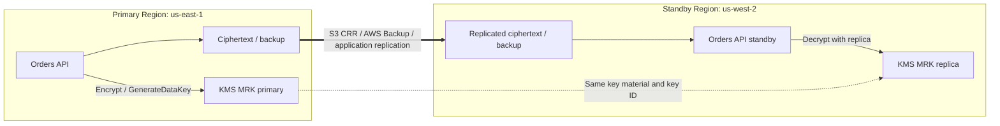
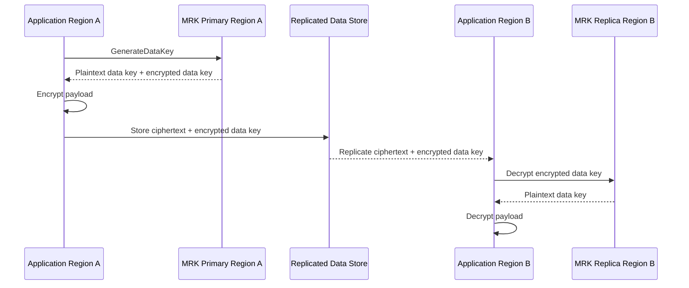

# Multi-Region KMS Keys and Data Recovery Requirements

> **Chapter:** Encryption, Secrets, and Certificates  
> **Module:** CLOUD_PROVIDERS_AWS  
> **Scope:** Designing, creating, managing, and using AWS KMS Multi-Region keys in backup, disaster recovery, and multi-Region application architectures. This lesson focuses on primary/replica relationships, key material synchronization, per-Region access permissions, envelope encryption, data replication, key rotation, and recovery testing.

## Learning Objectives

After this lesson, learners can:

1. Explain Multi-Region KMS keys (MRKs) and distinguish between a primary key and a replica key.
2. Identify properties synchronized by AWS KMS versus properties that must be managed independently in each Region.
3. Evaluate when an MRK is appropriate and when a single-Region KMS key is the safer choice.
4. Create a primary key, create a replica, and verify status using the AWS Console or AWS CLI.
5. Design key policies, IAM policies, grants, and aliases for applications running across multiple Regions.
6. Explain how data is encrypted in a source Region and decrypted in a target Region using the same key material.
7. Combine MRKs with envelope encryption and the AWS Encryption SDK.
8. Distinguish key replication from replicating ciphertext, snapshots, backups, and application configurations.
9. Establish RPO/RTO requirements and recovery procedures for encrypted data.
10. Manage automatic rotation, on-demand rotation, and imported key material in an MRK set.
11. Change the primary Region when needed and understand the impact of deleting a primary/replica key.
12. Test decryption capability, access permissions, and recovery in the standby Region.
13. Control risks around data residency, tenant isolation, auditing, and cost.

## 1. The Cross-Region Encrypted Data Recovery Problem

An application may store data in a primary Region and maintain copies in a standby Region. When the primary Region experiences an outage, the application needs to read the replicated data and continue writing new data.

To recover successfully, the system must simultaneously have:

- Replicated data or backups transferred to the standby Region.
- A key capable of decrypting ciphertext in the standby Region.
- IAM roles, key policies, and grants allowing the recovery workload to call KMS.
- Secrets, application configurations, networking, DNS, and required dependencies.
- A tested runbook to bring the service up within target recovery times.

If you replicate only data without preparing keys, the application may have all the ciphertext yet be unable to decrypt it. Conversely, if you create only a replica KMS key without replicating data, the standby Region has a key but no data to recover.

### 1.1 Architectural Example

An Orders service runs across two Regions:

- Primary Region: `us-east-1`.
- Standby Region: `us-west-2`.
- The application encrypts data in the primary Region.
- Data is replicated to the standby Region.
- A primary MRK in `us-east-1` has a corresponding replica in `us-west-2`.
- During recovery, the application in `us-west-2` uses the replica key in that same Region to decrypt data.



The dashed line between the two KMS keys represents the MRK relationship and synchronization of shared properties. The data replication path is a separate flow handled by S3, AWS Backup, a database service, or the application.

### 1.2 Quantifying Recovery Requirements

Before choosing an MRK, define:

| Requirement | Question to answer |
|---|---|
| RPO | How much data loss is acceptable when switching Regions? |
| RTO | Within what timeframe must the service resume operation? |
| Data replication | Is data replicated continuously, on a schedule, or via snapshots? |
| Key availability | Does the replica key exist and is it in the `Enabled` state? |
| Access recovery | Are IAM roles and key policies in the target Region ready? |
| Application recovery | Are secrets, parameters, certificates, DNS, and dependencies in place? |
| Compliance | Is data legally/policy-permitted to be decrypted in the target Region? |
| Test cadence | How often is a full end-to-end recovery test executed? |

MRKs address an important part of the recovery workflow: the ability to use interoperable key material across multiple Regions. They do not by themselves guarantee RPO, RTO, or full application recoverability.

## 2. What Is a Multi-Region KMS Key?

AWS KMS Multi-Region keys are a set of KMS keys that share the same key ID and key material across multiple AWS Regions. Related keys can be used interchangeably in supported cryptographic operations.

An MRK set consists of:

- One primary key in one Region.
- Zero or more replica keys in other Regions.
- The same key ID, typically prefixed with `mrk-`.
- The same key material and attributes defined by AWS KMS as shared properties.
- A distinct ARN per Region.

Illustrative key ID and ARNs:

```text
Key ID:
mrk-1234abcd12ab34cd56ef1234567890ab

Primary ARN:
arn:aws:kms:us-east-1:111122223333:key/mrk-1234abcd12ab34cd56ef1234567890ab

Replica ARN:
arn:aws:kms:us-west-2:111122223333:key/mrk-1234abcd12ab34cd56ef1234567890ab
```

The key ID is identical, while the ARN differs in the Region field. When a workload runs in `us-west-2`, the application should call the replica ARN in `us-west-2` to use the local KMS endpoint.

### 2.1 Primary Key

The primary key is the source of shared properties in an MRK set.

The primary key has these roles:

- Used directly in encryption, decryption, signing, or MAC verification depending on key type.
- Is the only key from which additional replicas can be created.
- Is where automatic key rotation is managed.
- Is the source from which AWS KMS synchronizes shared properties to replicas.

### 2.2 Replica Key

A replica key is a full-fledged KMS key in the target Region.

A replica:

- Shares the same key ID and key material as the primary.
- Can perform cryptographic operations as an independent KMS key.
- Has its own ARN and key policy.
- Can be enabled or disabled independently.
- Has its own aliases, tags, description, and grants.
- Can be used to decrypt ciphertext created by the primary or by another related replica.

A replica is not a read-only copy. An application in the target Region can use the replica key both to encrypt new data and to decrypt data encrypted by related keys.

### 2.3 An MRK Is Not a Global Key

An MRK does not automatically appear in every Region.

Administrators must:

1. Create the primary key.
2. Choose each Region that needs a key.
3. Create a replica in each Region.
4. Configure permissions and aliases in each Region.
5. Monitor the state and policy of each key.

Regions must belong to the same AWS partition. For example, a Region in the `aws` partition cannot replicate an MRK to `aws-cn`. The target Region must also be enabled for the account if that Region requires opt-in enablement.

You cannot convert an existing single-Region KMS key into an MRK. To migrate a workload, create a new MRK set and then re-encrypt data or generate new signatures according to the corresponding design.

## 3. Shared Properties vs. Independent Properties

The most important aspect of operating MRKs is distinguishing synchronized properties from properties that must be managed individually.

### 3.1 Shared Properties

AWS KMS synchronizes the following core properties between the primary and replicas:

| Shared property | Meaning |
|---|---|
| Key ID | Related keys have the exact same key ID |
| Key material | Uses the same cryptographic material |
| Key spec | Same key type, such as `SYMMETRIC_DEFAULT` or `RSA_2048` |
| Key usage | Same purpose, such as `ENCRYPT_DECRYPT` or `SIGN_VERIFY` |
| Origin | Same key material source, such as `AWS_KMS` or `EXTERNAL` |
| Automatic rotation status | Automatic rotation status/configuration is shared with replicas |
| Primary/replica relationship | AWS KMS maintains the relationship between primary and replicas |

When a shared property changes through a supported operation, AWS KMS synchronizes the change to related keys. Synchronization may experience a brief delay.

### 3.2 Independent Properties

The following properties must be managed separately for each key:

| Independent property | Operational consequence |
|---|---|
| Key policy | Editing the primary's policy does not update replicas |
| Grants | Each grant applies to one key in one Region |
| Aliases | Create separate aliases in each Region |
| Tags | Must be maintained separately |
| Description | Not automatically synchronized |
| Enabled/Disabled state | Enabling or disabling one key does not change the state of related keys |
| Key ARN | Each key has its own Regional ARN |

For example, if the key policy in `us-east-1` allows role `OrdersApiRole` to call `Decrypt`, but the key policy in `us-west-2` does not, the DR application will still receive `AccessDenied` when calling the replica in `us-west-2`.

Never assume that creating a replica copies all access permissions from the primary.

### 3.3 Synchronization and Auditing

AWS KMS performs shared property synchronization automatically. Operators have no API to manually trigger synchronization on demand.

You can monitor synchronization activity via CloudTrail events:

```text
eventSource: kms.amazonaws.com
eventName: SynchronizeMultiRegionKey
```

Collect CloudTrail logs from all relevant Regions and centralize them for correlation. Auditing only one Region will miss usage of replica keys.

## 4. When Should You Use an MRK?

### 4.1 Suitable Use Cases

MRKs are helpful when workloads need the same key material across multiple Regions.

Examples:

- Client-side encryption: an application encrypts data in one Region and decrypts it in another.
- Backup recovery: ciphertext is replicated to a standby Region and must be decrypted there.
- Active-active: multiple Regions encrypt and decrypt data that may move between Regions.
- Distributed signing: an application needs to create compatible signatures using an asymmetric MRK across Regions.
- Global data workflows: encrypted data must be processed in different Regions without remote KMS calls.

The AWS Encryption SDK and AWS Database Encryption SDK are options to consider for the corresponding client-side encryption flows.

### 4.2 When Should You Not Use an MRK?

A single-Region KMS key is usually more appropriate if:

- Data exists and is processed in only one Region.
- Data residency requirements mandate that key material and decryption capability remain restricted to one Region.
- An AWS service already has its own Regional encryption and replication mechanism.
- There is no need to decrypt ciphertext using a key in another Region.
- The organization wants independent security boundaries between Regions.

MRKs expand the geographic scope where the same key material can be used. If a principal in another Region has permission to use a replica, that principal can decrypt data protected by any related key. Therefore, MRKs require careful evaluation of tenant isolation, data residency, and access boundaries.

### 4.3 Distinguishing KMS Capabilities from How AWS Services Integrate with KMS

Not every AWS service handles MRKs the same way a client-side application does.

Some services treat an MRK like a single-Region KMS key and still decrypt/re-encrypt the data key in the target Region. Certain features provide explicit MRK resolution support.

Example with Amazon S3:

- S3 Replication can support Multi-Region key resolution.
- Replication for SSE-KMS encrypted objects must be enabled.
- `UseSourceMultiRegionKey` must be configured in the replication rule's encryption configuration.
- The destination replica key must exist, be in a valid state, and have appropriate KMS permissions.

Without MRK resolution enabled, S3 may re-encrypt the data key in the target Region according to its standard replication behavior.

With AWS Backup, how a copy is encrypted depends on the resource type and destination backup vault. Check the encryption guide for the exact resource type. Do not assume every backup copy automatically uses the same MRK just because a primary and replica exist.

## 5. Envelope Encryption Architecture with MRKs

In envelope encryption, the application uses a data key to encrypt data. KMS protects the data key rather than directly encrypting large files or payloads.

Basic flow:

1. The application calls `GenerateDataKey` on the MRK in the current Region.
2. KMS returns a plaintext data key and an encrypted copy of the data key.
3. The application uses the plaintext data key to encrypt the payload.
4. The application stores the ciphertext together with the encrypted data key and required metadata.
5. The application clears the plaintext data key from memory when no longer needed.
6. When decrypting in another Region, the application calls `Decrypt` using the MRK replica in the target Region.
7. KMS returns the plaintext data key.
8. The application uses the data key to decrypt the payload.



### 5.1 What Does KMS Protect?

KMS protects the data key using the MRK's key material. KMS does not store application payloads, replicate files, or replace backup mechanisms.

Data must be replicated by an appropriate service or application replication mechanism. During recovery, the application must have both the encrypted data key and the corresponding ciphertext.

### 5.2 Why Is Calling KMS in the Source Region Unnecessary?

Because the primary and replica share the same key ID and key material, the replica in the target Region can decrypt an encrypted data key generated by the primary.

If the application calls the replica key ARN in the target Region, the `Decrypt` operation executes locally in that Region. This avoids depending on the source Region's KMS endpoint during recovery.

### 5.3 Encryption Context

With a symmetric encryption KMS key, an application can use encryption context to attach non-secret metadata to encryption operations.

Example:

```json
{
  "application": "orders",
  "environment": "production",
  "record-type": "order"
}
```

Encryption context:

- Is used as additional authenticated data.
- Is cryptographically bound to the ciphertext.
- Must be supplied identically when decrypting.
- Is not treated as a secret.
- Can appear in plaintext in CloudTrail.

Do not put passwords, tokens, personal information, or secrets in encryption context.

If key policies or grants include conditions on encryption context, maintain compatible policies across all Regions. The DR application must send the exact same context used at encryption time.

Asymmetric KMS keys and HMAC KMS keys do not use encryption context.

## 6. Creating a Primary Key and Replica Key

### 6.1 Choosing the Key Type

For application data encryption, a common configuration is:

| Property | Illustrative value |
|---|---|
| Key type | Symmetric |
| Key spec | `SYMMETRIC_DEFAULT` |
| Key usage | `ENCRYPT_DECRYPT` |
| Origin | `AWS_KMS` |
| Multi-Region | Enabled |
| Primary Region | `us-east-1` |
| Replica Region | `us-west-2` |

Actual choices must reflect algorithm, application, and security requirements. MRKs also support asymmetric keys, HMAC keys, and imported key material.

You cannot create an MRK in a custom key store.

### 6.2 Creating the Primary Key with the AWS CLI

Example creating a primary key in `us-east-1`:

```bash
aws kms create-key \
  --description "Orders application multi-region encryption key" \
  --key-spec SYMMETRIC_DEFAULT \
  --key-usage ENCRYPT_DECRYPT \
  --origin AWS_KMS \
  --multi-region \
  --region us-east-1
```

The response includes `KeyId` and `Arn`. Record the primary ARN in your key management inventory.

Abbreviated example output:

```json
{
  "KeyMetadata": {
    "KeyId": "mrk-1234abcd12ab34cd56ef1234567890ab",
    "Arn": "arn:aws:kms:us-east-1:111122223333:key/mrk-1234abcd12ab34cd56ef1234567890ab",
    "KeyState": "Enabled",
    "KeyUsage": "ENCRYPT_DECRYPT",
    "KeySpec": "SYMMETRIC_DEFAULT",
    "Origin": "AWS_KMS",
    "MultiRegion": true
  }
}
```

This is illustrative data. Never use placeholder ARNs or account IDs in production.

### 6.3 Creating a Replica Key

Use `ReplicateKey` to create a replica in the target Region:

```bash
aws kms replicate-key \
  --key-id arn:aws:kms:us-east-1:111122223333:key/mrk-1234abcd12ab34cd56ef1234567890ab \
  --replica-region us-west-2 \
  --region us-east-1
```

Do not use `CreateKey` to create a replica. `ReplicateKey` takes shared properties from the primary and creates the key in the target Region.

### 6.4 Checking Replica State

Immediately after creation, a replica may be in the `Creating` state. When complete, the key normally transitions to `Enabled`. With imported key material, the replica may remain in `PendingImport` until material import finishes.

Check using:

```bash
aws kms describe-key \
  --key-id mrk-1234abcd12ab34cd56ef1234567890ab \
  --region us-west-2
```

Introduce the replica into encryption/decryption flows only after confirming an appropriate key state, valid key policy, and ready access permissions.

### 6.5 Creating Separate Aliases in Each Region

Aliases are not automatically synchronized between primary and replicas.

Create an alias in the primary Region:

```bash
aws kms create-alias \
  --alias-name alias/orders-data \
  --target-key-id mrk-1234abcd12ab34cd56ef1234567890ab \
  --region us-east-1
```

Create an alias with the same name in the standby Region:

```bash
aws kms create-alias \
  --alias-name alias/orders-data \
  --target-key-id mrk-1234abcd12ab34cd56ef1234567890ab \
  --region us-west-2
```

The aliases share the same name but are two independent resources in two Regions. Verify the alias target after creation and avoid reusing an alias that previously pointed to a different key.

### 6.6 Creating Additional Replicas

To add another Region, call `ReplicateKey` on the primary. A replica cannot create additional replicas.

Each Region can contain only one key from a given MRK set. All Regions must belong to the same AWS partition and be enabled for the account.

## 7. Managing IAM and Key Policies Across Regions

MRKs do not automatically synchronize access permissions. This is one of the most common reasons DR tests fail even though the replica key already exists.

### 7.1 Three Control Layers

| Mechanism | Scope |
|---|---|
| Key policy | Policy attached directly to each individual KMS key |
| IAM policy | Permissions of an IAM principal; requires the key policy to allow IAM policies to take effect |
| KMS grant | Grants permissions to a principal for a specific key |

Each primary/replica has its own key policy. Grants are also Regional and allow operations on only one key.

### 7.2 Minimal Permissions for Applications

An envelope encryption application typically needs permissions such as:

- `kms:GenerateDataKey`
- `kms:Decrypt`
- `kms:DescribeKey`

An application that only reads ciphertext may need only `Decrypt` and `DescribeKey`, depending on implementation. An application creating new ciphertext may need `GenerateDataKey` or `Encrypt`.

Grant only the actions actually needed. Never assign `kms:*` or `AdministratorAccess` to an application role.

### 7.3 Administration and Replication Permissions

The principal creating a primary key needs permission to create KMS keys and create the required service-linked role. AWS KMS uses the service-linked role `AWSServiceRoleForKeyManagementServiceMultiRegionKeys` to synchronize shared properties.

The principal creating a replica needs appropriate permissions for `ReplicateKey` and KMS administration permissions in the source/target Regions depending on the operations performed.

### 7.4 Restricting Allowed Replica Regions

You can use the `kms:ReplicaRegion` condition key to allow creating replicas only in approved Regions.

Abbreviated example policy:

```json
{
  "Version": "2012-10-17",
  "Statement": [
    {
      "Sid": "ReplicateOnlyToApprovedRegion",
      "Effect": "Allow",
      "Action": "kms:ReplicateKey",
      "Resource": "arn:aws:kms:us-east-1:111122223333:key/mrk-1234abcd12ab34cd56ef1234567890ab",
      "Condition": {
        "StringEquals": {
          "kms:ReplicaRegion": "us-west-2"
        }
      }
    }
  ]
}
```

Illustrative policies must be integrated with real key policies, IAM policies, and permissions boundaries. Do not copy verbatim without updating ARNs and principals.

### 7.5 Controlling Multi-Region Key Creation

Organizations can use the `kms:MultiRegion` and `kms:MultiRegionKeyType` conditions to restrict who can create primary/replica keys.

You can use `aws:RequestedRegion` to control which Regions are permitted for operations.

Do not allow every developer to create MRKs in any Region. MRKs allow key material to be used in multiple geographic locations and must be governed according to data classification.

### 7.6 Reviewing Policy Drift

Establish a periodic process comparing:

- Key policies of the primary and each replica.
- IAM policies of application roles.
- Grants created by AWS services.
- Alias targets.
- `Enabled`/`Disabled` state.
- Tags used for inventory and compliance.

If the primary's policy changes, evaluate and update replica policies under the same change process. Do not wait for AWS KMS to synchronize them, as key policies are independent properties.

## 8. Rotating Key Material in an MRK Set

Rotation changes the key material used for new encryption operations. It does not automatically re-encrypt existing data.

### 8.1 Automatic Rotation

Automatic rotation is supported for symmetric encryption KMS keys with origin `AWS_KMS`.

With an MRK:

- Enable or disable automatic rotation on the primary.
- Do not enable/disable independently on replicas.
- AWS KMS synchronizes rotation status to replicas.
- When key material rotates, the new key material is synchronized to replicas.
- Older key material versions are retained to decrypt previously created ciphertext.

By default, automatic rotation generates new key material annually. AWS KMS also supports configuring the rotation period within the limits documented in current guidelines.

Example enabling automatic rotation on the primary:

```bash
aws kms enable-key-rotation \
  --key-id mrk-1234abcd12ab34cd56ef1234567890ab \
  --region us-east-1
```

Check status:

```bash
aws kms get-key-rotation-status \
  --key-id mrk-1234abcd12ab34cd56ef1234567890ab \
  --region us-east-1
```

Do not run `enable-key-rotation` on a replica. Manage rotation on the primary and verify status across replicas.

### 8.2 On-Demand Rotation

On-demand rotation lets you request a key material change immediately when needed, independent of the automatic rotation schedule.

With an MRK:

- Call `RotateKeyOnDemand` only on the primary.
- Supports symmetric encryption keys only.
- With origin `AWS_KMS`, AWS KMS synchronizes new key material to replicas.
- Monitor rotation status to confirm completion.

On-demand rotation has a per-key usage limit. Check quotas and rotation status before using it.

### 8.3 Imported Key Material

For an MRK with origin `EXTERNAL`:

- AWS KMS does not automatically generate or replicate imported key material as it does for origin `AWS_KMS`.
- You must import the exact same key material into the primary and each replica.
- When performing on-demand rotation, import the new material into all related keys first.
- Initiate rotation on the primary only after the new material is present in every Region.
- Each imported key material may have its own per-key state and expiration.

If you import new material only into the primary and not into replicas, you cannot assume all Regions are ready to use the new material.

Organizations must maintain a secure backup copy of imported key material outside AWS KMS per key management procedures. AWS KMS does not allow exporting imported material back out.

### 8.4 Asymmetric and HMAC Keys

Automatic rotation is not supported for asymmetric KMS keys and HMAC KMS keys. On-demand rotation does not apply to these key types either.

When you need to rotate key material for asymmetric/HMAC keys, you typically must create a new key, update applications, and execute a planned migration. For signing keys, manage the lifecycle of public keys, certificates, trust stores, and existing signatures.

### 8.5 Rotation Does Not Replace Re-Encryption

KMS key rotation:

- Does not rotate data keys already generated by applications.
- Does not automatically re-encrypt ciphertext.
- Does not remediate a compromised plaintext data key.
- Does not replace procedures for rotating secrets, tokens, or certificates.

If you need to change key identity or algorithms, design a separate migration and re-encryption plan.

## 9. Changing the Primary Region

An MRK set always has exactly one primary key. You can transfer the primary role to an existing replica using `UpdatePrimaryRegion`.

### 9.1 When Is Changing Primary Needed?

Examples:

- You want the primary located closer to the key management team.
- You need to delete the primary in its current Region while keeping the replicas.
- You want to move replication administration to another Region after an architecture change.

You do not need to change the primary solely so a replica can decrypt ciphertext during DR. A replica is already a fully functional KMS key.

### 9.2 Prerequisites

- The current primary must be in the `Enabled` state.
- The replica chosen as the new primary must be in the `Enabled` state.
- The principal needs appropriate `kms:UpdatePrimaryRegion` permissions in both Regions.
- After the call, AWS KMS may take a few seconds to complete synchronizing the role change.

While in the `Updating` state, certain administrative operations are restricted. Wait until the keys return to `Enabled` before making further configuration changes.

### 9.3 AWS CLI Example

Example transferring primary from `us-east-1` to the `us-west-2` replica:

```bash
aws kms update-primary-region \
  --key-id arn:aws:kms:us-east-1:111122223333:key/mrk-1234abcd12ab34cd56ef1234567890ab \
  --primary-region us-west-2 \
  --region us-east-1
```

After completion:

- The key in `us-west-2` becomes the primary.
- The key in `us-east-1` becomes a replica.
- Any other replicas remain part of the same MRK set.
- Each Region's key ARN remains unchanged.
- Key policies, grants, aliases, tags, and enablement states remain independent.

Run `DescribeKey` in each Region to confirm `MultiRegionConfiguration` and `MultiRegionKeyType`.

## 10. Cross-Region Data Recovery Requirements

A complete DR design must verify multiple layers. MRKs solve only the key interoperability layer.

### 10.1 Data Must Be Replicated Separately

Choose a replication mechanism based on data type:

| Data | Mechanisms you can use |
|---|---|
| Objects in S3 | S3 Cross-Region Replication |
| EBS snapshots | Snapshot copy or AWS Backup |
| RDS/Aurora | Cross-Region snapshots/backups or appropriate replication features |
| File/application data | Replication or backups supported by the application/managed service |
| Database logical data | Native replication or backup/restore |
| Application artifacts | CI/CD artifact replication or deployment pipelines |

Check service-specific encryption behavior. Not every service uses MRKs the same way a client-side application does.

### 10.2 Keys in the Target Region

Before running DR, verify:

- The replica key exists in the target Region.
- Key state is `Enabled`.
- The key policy allows the application role or service role.
- Required grants exist in the target Region.
- The alias or key ARN in application configuration points to the right replica.
- The KMS endpoint and network path are reachable.
- Encryption context conditions match the recovered data.

If the replica key is `Disabled` or `PendingDeletion`, the application will fail to decrypt even if data replication completed.

### 10.3 Applications and Dependencies

Prepare:

- IAM roles and policies in the standby Region.
- Secrets and parameters needed by the application.
- Certificates and trust chains.
- Networking, security groups, VPC endpoints, and DNS.
- Database endpoints and connection settings.
- Queues, event buses, and object storage.
- Monitoring, alerting, and audit trails.
- Service quotas and capacity in the target Region.

Never store plaintext secrets in key descriptions, aliases, tags, or logs.

### 10.4 RPO and RTO Can Differ

An MRK can be ready while data replication lags behind. For example, the key was created days ago, but the latest snapshot lags primary data by several hours.

Therefore:

- RPO depends on the data replication mechanism.
- RTO depends on incident detection time, restore, application startup, and data verification.
- KMS key availability is a necessary prerequisite, not the entirety of recovery time.

## 11. Recovery Runbook When the Primary Region Is Unavailable

Example: primary Region `us-east-1` is unavailable, and the application must operate in `us-west-2`.

### 11.1 Before an Incident

1. Create the primary MRK in `us-east-1`.
2. Create the replica MRK in `us-west-2`.
3. Set up key policies and application IAM roles in both Regions.
4. Create identically named aliases in each Region if the application uses aliases.
5. Configure replication or backups for data.
6. Verify encryption context and metadata stored with ciphertext.
7. Prepare application infrastructure in the standby Region.
8. Test decryption using the replica key.
9. Document key ARNs, aliases, policy owners, and the recovery runbook.
10. Monitor key state, policy drift, and CloudTrail.

### 11.2 When the Primary Region Experiences an Outage

1. Confirm the outage and decide to activate DR per organizational procedure.
2. Route traffic or launch workloads in the standby Region.
3. Verify the replicated data or backup is ready.
4. Confirm the replica key in the target Region is `Enabled`.
5. Confirm the application role has appropriate `Decrypt`/`GenerateDataKey` permissions.
6. Confirm the alias or ARN points to the replica in the target Region.
7. Decrypt a test dataset before opening traffic.
8. Restore database/application state in dependency order.
9. Verify data integrity and new write flows.
10. Open traffic in stages and monitor KMS errors, latency, and application errors.

### 11.3 Do You Need to Promote the Replica?

You do not need to promote a replica just to continue `Encrypt`/`Decrypt` operations. A replica can already perform cryptographic operations independently.

Consider `UpdatePrimaryRegion` only if you need to change where primary administration occurs or need to create new replicas from another Region. Promotion should be deliberate, with permissions in both Regions and verification afterward.

### 11.4 When the Primary Region Recovers

1. Identify new data generated in the DR Region.
2. Decide data synchronization direction and conflict resolution.
3. Check primary/replica states and key policies.
4. Do not overwrite data based solely on timestamps if the application requires conflict resolution.
5. Test decryption in both Regions.
6. Fail traffic back according to the failback plan.
7. Retain copies and logs as needed until verification finishes.

MRKs provide shared key material, but they do not resolve data conflicts or synchronize application state.

## 12. Example: S3 Cross-Region Replication with MRKs

S3 provides a Multi-Region key resolution feature to use a replica MRK in the destination Region when replicating objects encrypted with an MRK.

High-level flow:

1. Enable versioning on the source bucket.
2. Enable versioning on the destination bucket.
3. Create corresponding MRK primary and replica keys in both Regions.
4. Enable replication for SSE-KMS encrypted objects.
5. Configure `UseSourceMultiRegionKey` in the encryption configuration.
6. Grant `kms:Decrypt` on the source key.
7. Grant `kms:Encrypt` and `kms:GenerateDataKey` on the destination replica key.
8. Verify replicated objects can be read in the target Region.

Example replication configuration fragment:

```xml
<SourceSelectionCriteria>
  <SseKmsEncryptedObjects>
    <Status>Enabled</Status>
  </SseKmsEncryptedObjects>
</SourceSelectionCriteria>
<Destination>
  <Bucket>arn:aws:s3:::orders-dr-bucket</Bucket>
  <EncryptionConfiguration>
    <UseSourceMultiRegionKey>
      <Status>Enabled</Status>
    </UseSourceMultiRegionKey>
  </EncryptionConfiguration>
</Destination>
```

This is an illustrative fragment, not a complete configuration. Combine it with `Rule`, `Filter`, `Role`, `Destination`, and other replication elements per the S3 schema.

If a source object is encrypted with a single-Region KMS key, configure an appropriate destination key per replication requirements. Do not assume `UseSourceMultiRegionKey` turns a single-Region key into an MRK.

## 13. AWS Backup and Encrypted Backup Copies

AWS Backup can copy recovery points to another Region if the resource type and Region support it.

When copying:

- The destination backup vault has its own encryption key.
- How the copy is encrypted depends on whether the resource is fully managed by AWS Backup.
- For some resources, the destination vault key is used for the copy.
- For other resources such as EC2/EBS, behavior depends on resource type and the destination vault key.
- Cross-account copies have specific requirements for customer managed keys and key policies.

Therefore, check the encryption guide for the exact resource type. If your design relies on MRKs, verify whether AWS Backup actually uses the related replica key as expected.

### 13.1 Validating Backup Recovery Points

A backup is considered recoverable only when:

- The recovery point exists in the target Region.
- The resource type supports restore in that Region.
- The required KMS key is active.
- The IAM principal has permission to restore and use the KMS key.
- Dependencies such as subnets, security groups, option groups, parameter groups, and secrets are prepared.
- The application can start and data can be verified after restore.

Never measure DR success solely by `Copy job = Completed`.

## 14. Imported Key Material and DR Requirements

Imported key material can be used with MRKs, but it carries higher operational requirements than origin `AWS_KMS`.

### 14.1 Creating an MRK Set with Imported Material

General workflow:

1. Create the primary key with `Origin = EXTERNAL`.
2. Import key material into the primary.
3. Create a replica in the target Region.
4. Import the exact same key material into each replica.
5. Check the key state in each Region.
6. Test `Encrypt`/`Decrypt` with both primary and replica.

A replica may remain in `PendingImport` until material is imported.

### 14.2 Rotation with Imported Material

When rotating material:

- Prepare the new material and a secure distribution workflow.
- Import the new material into the primary.
- Import the exact same new material into each replica.
- Verify material status on each key.
- Initiate on-demand rotation on the primary only after all related keys have the required material.
- Monitor rotation completion before production use.

### 14.3 Risk of Losing Imported Material

AWS KMS cannot export imported material. If external copies of the key material are lost and the material in KMS is deleted or expires, data may become undecryptable.

The DR plan must protect:

- Backup copies of imported key material.
- Re-import procedures.
- Permissions and tools required to perform imports.
- Expiration alarms.
- HSMs or external key management systems.
- Records of key material IDs and status in each Region.

Never store imported key material in source code, unprotected object storage, or support tickets.

## 15. Deleting and Replacing Primary/Replica Keys

Deleting a KMS key is an operation that can make data unrecoverable.

### 15.1 Deleting a Replica

You can schedule deletion of a replica independently from the primary. Once a replica enters `PendingDeletion`, it cannot be used for cryptographic operations.

If a replica is deleted while the primary still exists, you can recreate the replica from the primary in the same Region after the old key finishes deleting. Recreating does not restore custom aliases, policies, grants, tags, or descriptions; independent properties must be reconfigured.

### 15.2 Deleting a Primary

AWS KMS will not delete a primary while replica keys still exist.

If you schedule deletion of a primary while replicas exist:

- The primary transitions to `PendingReplicaDeletion`.
- The primary cannot be used for cryptographic operations.
- This state persists until all replicas finish deleting.
- The primary's deletion waiting period starts only after the last replica is deleted.

### 15.3 Safeguards

- Do not grant `ScheduleKeyDeletion` broadly to application roles.
- Require approvals for key lifecycle changes.
- Use `DisableKey` if the goal is only to temporarily block usage.
- Check for ciphertext/backups still relying on the key before deleting.
- Maintain an inventory of key ARNs and Regions.
- Monitor CloudTrail for `ScheduleKeyDeletion` and `CancelKeyDeletion`.
- Never delete an entire set of related MRKs until proving no data still needs decryption.

## 16. Auditing, Monitoring, and Cost Control

### 16.1 Multi-Region Auditing

Enable a multi-Region CloudTrail trail or equivalent centralized logging to capture:

- `Encrypt`, `Decrypt`, and `GenerateDataKey`.
- `ReplicateKey`.
- `UpdatePrimaryRegion`.
- `EnableKeyRotation` and `RotateKeyOnDemand`.
- `PutKeyPolicy` and `CreateGrant`.
- `DisableKey`, `EnableKey`.
- `ScheduleKeyDeletion` and `CancelKeyDeletion`.
- `SynchronizeMultiRegionKey`.

Track caller identity, Region, key ARN, encryption context, and operation timestamps. Encryption context is not secret and can appear in CloudTrail, so it must not contain secrets.

### 16.2 Monitoring

Signals to monitor:

| Signal | Meaning |
|---|---|
| KMS `AccessDenied` | Key policy, IAM, or grant missing permissions |
| Replica key state | Key not ready or disabled |
| `PendingImport` | Imported material not yet imported |
| `PendingDeletion` | Key soon to be deleted and unusable |
| CloudTrail policy change | Change to permissions or key governance |
| `SynchronizeMultiRegionKey` | AWS KMS synchronizing shared properties |
| Backup copy status | Whether data has reached the target Region |
| Restore test result | Whether data can actually be recovered |

Do not rely solely on `Enabled` state to conclude the whole DR workflow works. Verify the application can call KMS and decrypt real data.

### 16.3 Cost

Costs to evaluate:

- Each primary/replica key counts toward pricing and quotas in its respective Region.
- KMS API requests in each Region.
- Total number of keys and replicas maintained.
- AWS Backup, S3 replication, and storage.
- CloudTrail, log aggregation, and monitoring.
- Compute/network costs of the DR environment.

MRKs do not automatically make every operation cheaper. Their primary benefit is interoperable key material across Regions, helping some workloads avoid re-encryption or cross-Region KMS calls.

### 16.4 Impact on Data Residency

MRKs allow key material to exist in KMS across multiple Regions. This can conflict with policies requiring data to be decrypted only within a specific geography.

If data is classified by country, tenant, or business unit:

- Define which Regions are allowed to host replica keys.
- Restrict who can call `Decrypt` in each Region.
- Use appropriate encryption context and policy conditions.
- Audit service roles and grants created by AWS services.
- Collect audit logs from all Regions.
- Do not share MRKs across tenants if doing so breaks security boundaries.

## 17. Troubleshooting

| Symptom | Possible cause | How to check |
|---|---|---|
| `ReplicateKey` fails | Region in different partition or replica already exists | Check partition, Region, and `DescribeKey` |
| Replica stuck in `Creating` | Creation not yet complete | Call `DescribeKey` and retry once `Enabled` |
| Replica in `PendingImport` | Material not yet imported | Import the same material into the replica |
| `Decrypt` `AccessDenied` in DR | Key policy/IAM/grant on replica lacks permission | Check principal and policies in target Region |
| `Decrypt` `InvalidCiphertext` | Corrupted ciphertext or wrong encryption context | Check bytes and original context |
| KMS key not found | App calling ARN/alias in wrong Region | Check Region and alias target |
| Primary policy changed but DR still fails | Key policy is not synchronized | Update policy independently on replica |
| Alias missing in DR | Aliases are independent properties | Create alias in target Region |
| Rotation status differs from expectation | Operated on replica or still synchronizing | Check primary and `GetKeyRotationStatus` |
| S3 replication fails | SSE-KMS replication not enabled or missing permissions | Check rule, destination key, and role |
| Backup restore fails | Wrong destination vault key or resource dependencies | Check encryption and restore prerequisites |
| Primary `PendingReplicaDeletion` | Deletion scheduled on primary while replicas remain | Cancel deletion if needed or finish lifecycle per plan |
| CloudTrail missing expected events | Region not collected or wrong trail selector | Check multi-Region trail and event history |

### 17.1 Runbook When Decrypt Returns AccessDenied

1. Identify the exact key ARN the application calls.
2. Confirm the ARN's Region matches the KMS client's Region.
3. Check the key state.
4. Check the replica's key policy.
5. Check the application role's IAM policy.
6. Check grants and grant constraints.
7. Check permissions boundaries, SCPs, and explicit Denies.
8. Check encryption context conditions.
9. Check the VPC endpoint policy if using a KMS interface endpoint.
10. Inspect CloudTrail events to confirm principal, Region, and key ARN.

### 17.2 Runbook When Decrypt Returns InvalidCiphertextException

1. Confirm ciphertext was read completely without truncation or encoding changes.
2. Check whether the application confused plaintext and encrypted data keys.
3. Verify encryption context matches exactly.
4. Verify the key ID belongs to the same MRK set.
5. Verify key spec and key usage match.
6. If using imported key material, verify material is present and not expired.
7. Try decrypting a test ciphertext stored alongside its original metadata.

Never fix `InvalidCiphertext` by creating a new key with the same name. A new key does not have the same key material and cannot decrypt older ciphertext.

## 18. Lab: Verifying Cross-Region Decryption

**Goal:** Create an MRK primary/replica pair, encrypt a file in the primary Region, and decrypt the ciphertext in the standby Region.

**Environment:**

- A lab AWS account.
- AWS CLI configured with a profile having appropriate KMS permissions.
- Two Regions enabled in the account.
- Never use production data or production keys.
- Example Regions: `us-east-1` and `us-west-2`.

### 18.1 Create the Primary Key

```bash
aws kms create-key \
  --description "Lab multi-region recovery key" \
  --key-spec SYMMETRIC_DEFAULT \
  --key-usage ENCRYPT_DECRYPT \
  --origin AWS_KMS \
  --multi-region \
  --region us-east-1
```

Record the returned `KeyId` and `ARN`.

### 18.2 Create the Replica

Replace the example ARN with the primary ARN just created:

```bash
aws kms replicate-key \
  --key-id arn:aws:kms:us-east-1:111122223333:key/mrk-1234abcd12ab34cd56ef1234567890ab \
  --replica-region us-west-2 \
  --region us-east-1
```

Check status:

```bash
aws kms describe-key \
  --key-id mrk-1234abcd12ab34cd56ef1234567890ab \
  --region us-west-2
```

Proceed only once the replica is `Enabled`.

### 18.3 Create Test Plaintext

Create `plaintext.txt` with non-sensitive content:

```text
orders recovery lab - sample payload
```

### 18.4 Encrypt in the Primary Region

The `Encrypt` command accepts a plaintext file and returns a Base64 `CiphertextBlob`. Decode Base64 to a binary file to store the ciphertext:

```bash
aws kms encrypt \
  --key-id arn:aws:kms:us-east-1:111122223333:key/mrk-1234abcd12ab34cd56ef1234567890ab \
  --plaintext fileb://plaintext.txt \
  --encryption-context purpose=dr-lab \
  --region us-east-1 \
  --query CiphertextBlob \
  --output text | base64 --decode > ciphertext.bin
```

Keep `ciphertext.bin` to simulate a backup transferred to the target Region.

### 18.5 Transfer Ciphertext to the Target Region

In a lab, you can copy `ciphertext.bin` via file transfer or object storage. In production, use replication/backup mechanisms suited to real data.

You do not need to manually copy key material when the MRK uses origin `AWS_KMS`. AWS KMS manages key material synchronization for the MRK set.

### 18.6 Decrypt Using the Replica

```bash
aws kms decrypt \
  --key-id arn:aws:kms:us-west-2:111122223333:key/mrk-1234abcd12ab34cd56ef1234567890ab \
  --ciphertext-blob fileb://ciphertext.bin \
  --encryption-context purpose=dr-lab \
  --region us-west-2 \
  --query Plaintext \
  --output text | base64 --decode > recovered.txt
```

Compare `recovered.txt` with `plaintext.txt`:

```bash
cmp plaintext.txt recovered.txt
```

If `cmp` produces no output and exits with code 0, both files are identical.

### 18.7 Verify Key Policy and Alias

Try creating identically named aliases in both Regions and calling `DescribeKey` by alias in each Region.

Verify the application role in the target Region has `Decrypt` permission on the replica key. If different roles are used across the two Regions, policies must allow the right principal for each workload.

### 18.8 Verify Results

| Check | Expected result |
|---|---|
| Primary key | `MultiRegion = true` |
| Replica key | Same key ID, different Region |
| Replica state | `Enabled` |
| Encryption | Succeeds in `us-east-1` |
| Ciphertext transfer | File transferred intact |
| Decryption | Succeeds using replica in `us-west-2` |
| Encryption context | Same value at `Encrypt` and `Decrypt` |
| File comparison | `plaintext.txt` and `recovered.txt` match |
| IAM | Role in target Region has required permissions |

### 18.9 Lab Cleanup

Perform only after confirming data and keys are no longer needed.

1. Remove local test files per your lab environment procedures.
2. Delete aliases in each Region if created.
3. Schedule deletion of the replica key.
4. Wait for the replica to finish deleting.
5. Schedule deletion of the primary key.
6. Check status and CloudTrail.

Never run this cleanup procedure on keys protecting data that must be retained.

## 19. Self-Check Exercises

**Exercise 1 — Concepts.** On which properties does an MRK differ from a single-Region KMS key?

**Exercise 2 — Primary/replica.** Why can a replica key still perform `Encrypt` and `Decrypt` independently?

**Exercise 3 — Key identity.** Why do ARNs in an MRK set differ while their key IDs are identical?

**Exercise 4 — Region.** Can an MRK be replicated from partition `aws` to `aws-cn`? Explain.

**Exercise 5 — Shared properties.** Name at least four properties synchronized by AWS KMS.

**Exercise 6 — Independent properties.** Why must key policies be updated on both primary and replicas?

**Exercise 7 — Data recovery.** Why is creating a replica key insufficient on its own to recover an application?

**Exercise 8 — Envelope encryption.** What is the role of the encrypted data key during recovery?

**Exercise 9 — Encryption context.** Why must the application send the exact encryption context during `Decrypt`?

**Exercise 10 — Rotation.** On which key is automatic rotation of an MRK enabled?

**Exercise 11 — Imported material.** Why must imported key material be imported separately into each replica?

**Exercise 12 — Primary Region.** Is promoting a replica mandatory to decrypt data when the primary Region suffers an outage?

**Exercise 13 — S3.** What must be verified when using MRKs with S3 Cross-Region Replication?

**Exercise 14 — Deletion.** What happens when scheduling deletion of a primary while replicas still exist?

**Exercise 15 — Auditing.** Which CloudTrail event can be used to monitor shared property synchronization?

**Exercise 16 — Security.** Why can MRKs complicate data residency requirements?

**Exercise 17 — DR.** Distinguish RPO, RTO, and the role of MRKs in each target.

**Exercise 18 — Troubleshooting.** The replica is `Enabled`, yet the application receives `AccessDenied`. Which permission layers should be checked?

<details>
<summary>Answer Hints</summary>

1. An MRK shares the same key ID and key material across multiple Regions; a single-Region key exists only in its single Region.
2. A replica is a complete KMS key capable of performing cryptographic operations independently.
3. The ARN includes the specific Region; related keys share the same key ID and key material.
4. No. Regions must belong to the same AWS partition.
5. Key ID, key material, key spec, key usage, origin, and automatic rotation status.
6. Key policy is an independent property and is not automatically synchronized.
7. You also need ciphertext/backups, IAM, key policies, applications, secrets, and dependencies.
8. The encrypted data key is decrypted by KMS using the replica so the application retrieves the plaintext data key and decrypts the payload.
9. Encryption context is cryptographically bound to the ciphertext and must match.
10. Only on the primary key; rotation status is synchronized to replicas.
11. AWS KMS does not distribute imported material to replicas automatically; operators must import the same material in each Region.
12. No. Replicas can decrypt independently; promotion is only needed for administrative/replication role changes.
13. Enable replication for SSE-KMS objects, MRK resolution, destination replica, and KMS permissions.
14. The primary transitions to `PendingReplicaDeletion` and cannot perform cryptographic operations until all replicas finish deleting.
15. `SynchronizeMultiRegionKey`.
16. The same key material can be used in multiple Regions, expanding the geographic scope where decryption is possible.
17. RPO is acceptable data loss; RTO is recovery time. MRKs support decryption capability in the standby Region but do not replicate data.
18. Key policy, IAM policy, grants, permissions boundaries, SCPs, VPC endpoint policies, and encryption context conditions.

</details>

## 20. Production Checklist

### Architecture and Data Recovery

- [ ] Clear justification for using an MRK instead of a single-Region key.
- [ ] Primary and replicas created in the right partition/Regions.
- [ ] Replica key is in the `Enabled` state.
- [ ] Data or backups are replicated separately to the standby Region.
- [ ] RPO and RTO are defined.
- [ ] Encryption behavior of each AWS service has been verified.
- [ ] Application uses the replica ARN or alias in the target Region.
- [ ] Decryption of real data tested after copy/restore.

### IAM and Key Lifecycle

- [ ] Key policy configured separately per Region.
- [ ] IAM roles hold only required KMS permissions.
- [ ] Grants verified in both Regions.
- [ ] `ReplicateKey` permission restricted to approved Regions.
- [ ] Required service-linked role exists.
- [ ] Aliases, tags, and descriptions managed separately.
- [ ] Approval process in place for `DisableKey` and `ScheduleKeyDeletion`.
- [ ] Keys never deleted until confirming all dependent ciphertext/backups are accounted for.

### Rotation and Imported Material

- [ ] Rotation managed on the primary.
- [ ] Rotation status verified on replicas.
- [ ] Imported key material imported in every required Region.
- [ ] Secure backup copy of imported material maintained outside KMS.
- [ ] Expiration alerts configured for imported material.
- [ ] Rotation is not confused with data re-encryption.

### Auditing and DR Exercises

- [ ] CloudTrail collects activity across all relevant Regions.
- [ ] `SynchronizeMultiRegionKey` is monitored.
- [ ] Alerts configured for `AccessDenied` and abnormal key states.
- [ ] Failover and failback runbooks exist.
- [ ] Scheduled restore testing cadence exists.
- [ ] Tests confirm data decrypts, applications function, and permissions are accurate.
- [ ] Owners assigned for key inventory, policies, and DR procedures.

## 21. Official AWS Documentation

### AWS KMS Multi-Region Keys

- [Multi-Region keys in AWS KMS](https://docs.aws.amazon.com/kms/latest/developerguide/multi-region-keys-overview.html)
- [How multi-Region keys work](https://docs.aws.amazon.com/kms/latest/developerguide/mrk-how-it-works.html)
- [Create multi-Region primary keys](https://docs.aws.amazon.com/kms/latest/developerguide/create-primary-keys.html)
- [Create multi-Region replica keys](https://docs.aws.amazon.com/kms/latest/developerguide/multi-region-keys-replicate.html)
- [Control access to multi-Region keys](https://docs.aws.amazon.com/kms/latest/developerguide/multi-region-keys-auth.html)
- [Change the primary key in a set of multi-Region keys](https://docs.aws.amazon.com/kms/latest/developerguide/multi-region-update.html)
- [Security considerations for multi-Region keys](https://docs.aws.amazon.com/kms/latest/developerguide/mrk-when-to-use.html)
- [Rotate AWS KMS keys](https://docs.aws.amazon.com/kms/latest/developerguide/rotate-keys.html)
- [SynchronizeMultiRegionKey CloudTrail event](https://docs.aws.amazon.com/kms/latest/developerguide/ct-synchronize-multi-region-key.html)

### Encryption and Recovery

- [Encryption context](https://docs.aws.amazon.com/kms/latest/developerguide/encrypt_context.html)
- [Using multi-Region keys with AWS Encryption SDK](https://docs.aws.amazon.com/encryption-sdk/latest/developer-guide/configure.html)
- [Encryption for backups in AWS Backup](https://docs.aws.amazon.com/aws-backup/latest/devguide/encryption.html)
- [Creating backup copies across AWS Regions](https://docs.aws.amazon.com/aws-backup/latest/devguide/cross-region-backup.html)
- [Replicating encrypted S3 objects](https://docs.aws.amazon.com/AmazonS3/latest/userguide/replication-config-for-kms-objects.html)

## Summary

AWS KMS Multi-Region keys allow KMS keys across multiple Regions to share the same key ID and key material. Applications can encrypt in one Region and decrypt in another using a related key, reducing reliance on the source Region's KMS endpoint in client-side encryption and disaster recovery scenarios.

When designing, remember:

1. Create the primary first, then create replicas in each required Region.
2. MRKs are not global keys and do not replicate data automatically.
3. Key policies, grants, aliases, tags, descriptions, and enablement states must be managed separately per Region.
4. Automatic rotation is configured on the primary; imported material must be imported separately into each replica.
5. Replicas can perform `Encrypt`/`Decrypt` without being promoted to primary.
6. Promotion only changes the primary/replica administrative roles, not key material or ARNs.
7. Backups, ciphertext, application configurations, IAM, and dependencies must be prepared separately.
8. Recovery testing must prove that data actually decrypts and the application operates in the standby Region.

**Core principle:** Encrypted data recovery succeeds when data, key material, access permissions, and applications are all ready in the target Region. MRKs solve cross-Region key interoperability; data replication and recovery procedures must still be designed and tested independently.
