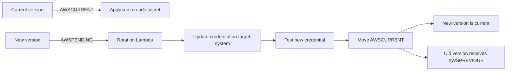
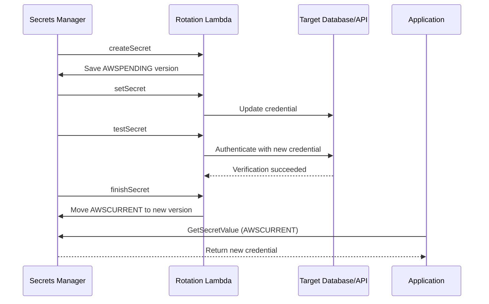
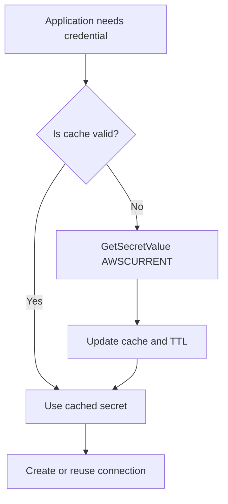

# Secret Rotation, Credential Synchronization, and Secret Caching

In an AWS system, secrets typically contain database passwords, API keys, tokens, or authentication credentials that an application needs to connect to other services. Storing secrets securely solves only part of the problem. Organizations must also replace credentials periodically, synchronize new values to where they are consumed, and ensure applications do not keep using expired values.

AWS Secrets Manager supports storing, encrypting, versioning, and automatically rotating secrets. The service can work with AWS Lambda to update credentials on target systems. Applications can retrieve secrets via the AWS SDK or a caching client. When combining these components, you must clearly design the source of truth, update order, cache TTL, and recovery steps if a rotation step fails.

## Learning Objectives

After this lesson, you can:

- Explain why secret rotation is necessary and how Secrets Manager manages secret versions.
- Describe the four-step rotation workflow and the roles of `AWSCURRENT`, `AWSPREVIOUS`, and `AWSPENDING`.
- Distinguish single-user rotation from alternating-users rotation for databases.
- Design credential synchronization for applications, containers, multiple Regions, and external services.
- Choose an appropriate cache TTL, handle stale secrets after rotation, and avoid connection disruptions.
- Monitor, test, and recover rotation workflows safely.

## 1. Why Rotate Secrets?

Long-lived credentials increase the window an attacker can exploit if a password or token is leaked. Rotation replaces the current credential with a new credential on a schedule or in response to an event. Rotation reduces exposure from leaked credentials, supports internal control requirements, and helps organizations revoke old access in a planned manner.

Rotation does not automatically guarantee security if applications continue using the old credential, if the new credential is not applied on the target system, or if an old secret copy remains in logs or configuration files. A complete workflow must coordinate at least three places:

1. **Secret store**: stores the authoritative credential value that applications read.
2. **Target authentication system**: such as a database or API provider, where credentials must be created, updated, or revoked.
3. **Consumers**: applications, Lambdas, containers, or jobs that use credentials to connect.

The goal is to update both the target system and the secret store in a verifiable sequence, then transition consumers to the new credential before the old credential is invalidated.

### Typical Participating Components

| Component | Role |
|---|---|
| AWS Secrets Manager | Stores secrets, encrypts with AWS KMS, manages versions and staging labels |
| AWS Lambda | Executes custom rotation logic or rotation templates |
| AWS IAM | Grants least-privilege permissions to the rotation function and applications |
| AWS KMS | Protects secrets at rest and controls decryption permissions |
| Amazon EventBridge | Receives lifecycle/rotation events to trigger downstream processing |
| Amazon CloudWatch | Stores logs, metrics, and alarms for rotation failures |
| AWS CloudTrail | Records administrative API activity and Secrets Manager access |
| Target application or service | Authenticates with credentials and transitions to new values |

## 2. Versions and Staging Labels in Secrets Manager

Each time a new secret value is saved, Secrets Manager creates a version. A version is identified by a version ID and can carry one or more staging labels indicating its role in the secret lifecycle.

The three most important staging labels are:

- `AWSCURRENT`: the version currently considered the active credential. If an application calls `GetSecretValue` without specifying a version, Secrets Manager returns the version carrying this label.
- `AWSPREVIOUS`: the version that was current before the most recent transition. Useful for investigation or controlled rollback, though it does not guarantee the old credential is still accepted by the target system.
- `AWSPENDING`: the version being prepared during a rotation run. Normal applications should not read this version.

When rotation completes, the `AWSCURRENT` label moves to the new version; the previous current version typically receives `AWSPREVIOUS`. Labels are pointers to versions, not the secret value itself.



Label management allows rotation to span multiple Lambda invocations while still tracking the pending version. The rotation function must inspect the version ID and labels before acting to avoid mixing up different rotation runs.

## 3. The Four-Step Rotation Workflow

Secrets Manager-orchestrated rotation typically uses an AWS Lambda rotation function. Secrets Manager invokes the function across four steps using the same `ClientRequestToken` representing the version being processed.

### Step 1: `createSecret`

The function generates a new credential and saves it as a version labeled `AWSPENDING`.

For a database, the function can generate a random password via an appropriate API, then store the new password along with required metadata such as engine, host, port, database name, and username. If an `AWSPENDING` version for the current token already exists, the function must detect and reuse that version rather than generating a new value on every retry.

### Step 2: `setSecret`

The function uses the current credential to authenticate to the target system, then updates or creates the new credential on that system.

For example, with a database, the function connects using the active account and changes the password of the target user. For an external API, the function can call an administrative API to create a new key or update a token. Before making changes, verify the secret belongs to the intended target resource to avoid sending credentials to the wrong database or endpoint.

### Step 3: `testSecret`

The function authenticates using the credential in `AWSPENDING` and runs a minimal verification check. For instance, connecting to the database, running a non-mutating query, or calling a permission-check endpoint. This step proves the new credential actually works before Secrets Manager promotes it to current.

### Step 4: `finishSecret`

The function moves `AWSCURRENT` to the new version. The prior current version becomes `AWSPREVIOUS` via staging label rules. After this step, consumers fetch the new secret without specifying a version ID.



This sequence prevents publishing a credential not yet accepted by the target system. The rotation function must be idempotent: if a step is retried after a timeout or network error, the function recognizes completed state and continues safely.

## 4. Managed Rotation and Custom Rotation

### Service-Managed Rotation

For certain AWS services, Secrets Manager provides built-in integrations or supported rotation templates. Common examples include Amazon RDS, Amazon Aurora, Amazon Redshift, and Amazon DocumentDB. Depending on the engine, version, and configuration, services may support single-user or alternating-users rotation.

When using managed rotation, verify the service prerequisites: database type, secret JSON format, IAM permissions, network path, security groups, VPC subnets, and Lambda role. Successfully enabling rotation on a secret does not guarantee Lambda can reach the database if networking is misconfigured.

### Custom Rotation

For SaaS provider API keys, internal system tokens, or credentials without a built-in template, organizations can write a Lambda rotation function. The function must know how to generate a new credential, install it on the target system, test permissions, and revoke the old credential.

A secure rotation function should:

- Check `ClientRequestToken`, version, and staging labels before each operation.
- Verify the hostname, resource ID, or target identifier from secret metadata before changing credentials.
- Never log secrets, passwords, tokens, or responses containing secrets.
- Use TLS when connecting to databases/APIs and validate server certificates.
- Configure reasonable timeouts, bounded retries, and clear error handling.
- Grant only the IAM permissions needed for the specific secret, KMS key, and target resource.
- Be safe to re-run after failures without creating unexpected duplicate credentials.

### Scheduling Rotation

Secrets Manager allows configuring rotation by number of days or schedule expressions. You can define a rotation window to avoid peak traffic hours. Frequency should be based on security requirements, target system limits, and how quickly applications can refresh credentials.

Do not set an overly aggressive schedule if the target system limits credential creation or consumers cannot refresh connections fast enough. Conversely, overly long periods increase exposure if a secret leaks. Test the schedule in a test environment and monitor actual completion times.

Example enabling periodic rotation for a secret that already has an appropriate rotation Lambda:

```bash
aws secretsmanager rotate-secret \
  --secret-id prod/orders/database \
  --rotation-lambda-arn arn:aws:lambda:us-east-1:111122223333:function:rotate-orders-db \
  --rotation-rules '{"AutomaticallyAfterDays":30,"Duration":"2h"}' \
  --no-rotate-immediately
```

Replace the ARN with your actual Lambda rotation function, account, and Region. The command configures the schedule; verify the rotation function is deployed, has access to the secret, and has network reachability to the target system before enabling in production.

## 5. Database Rotation: Single-User vs. Alternating-Users

### Single-User Rotation

Single-user rotation changes the password of the same database user. This approach is simple, uses fewer accounts, and is easy to reason about. However, once the password changes in the database while the application still holds the old password in a cache or connection pool, new connections may be rejected.

Already-authenticated and open database connections may continue working depending on the engine and configuration. Yet when the connection pool needs to open a new connection using the old credential, the application will hit errors. Therefore, you need a mechanism to refresh the secret and rebuild connections.

### Alternating-Users Rotation

Alternating-users rotation uses two database users with equivalent permissions, typically referred to as user A and user B. While one user is current, rotation updates the other user's credential, tests that user, and then switches the current secret to the new user. The next rotation alternates back.

The advantage is that applications can switch to the new user while the prior user remains valid to support active connections or transition windows. Both users must have equivalent privileges and be tightly governed; if the two users' permissions drift apart, application behavior can change after rotation.

| Criterion | Single-user | Alternating-users |
|---|---|---|
| Number of users | One | Two alternating users |
| Complexity | Lower | Higher |
| Transition behavior | Brief window where app may hold old password | Can reduce disruption when switching to new user |
| Permission requirements | Manage permissions for one user | Both users must have equivalent permissions |
| Best fit | Systems that refresh connections fast or tolerate reconnects | Workloads needing minimized disruption during credential swaps |

Alternating-users does not eliminate connection pool refreshing. Applications must still retrieve the new secret, open connections with the new username/password, and gradually close old connections according to an appropriate policy.

## 6. Synchronizing Credentials Between Secret Store and Consumers

Secrets Manager should be the source of truth for managed secrets. Consumers should retrieve credentials from this source using a strategy suited to how the application is deployed.

### Applications Fetching Secrets at Runtime

Applications call the AWS SDK `GetSecretValue` when credentials are needed or use a caching client to reduce requests. The workload's IAM role should hold read permission only for the specific secret and required KMS decryption permissions. This lets the application proactively refresh secrets without baking values into images or configuration files.

### ECS and Container Environment Variables

Amazon ECS can retrieve secrets from Secrets Manager and inject them into containers as environment variables at task startup. Environment variable values are snapshots from container startup time. When secret rotation completes, running containers do not automatically receive updated environment variables.

To update values, deploy new tasks or force an ECS service deployment so new tasks pick up the current secret. If an application needs to react rapidly to rotation without restarting tasks, have the application query Secrets Manager at runtime and manage its cache/connection pool.

### Lambda

Lambda functions can call Secrets Manager via the SDK or use the AWS Parameters and Secrets Lambda Extension to retrieve and cache secrets within the execution environment. Execution environments are reused across invocations, so caches can hold older values until TTL expires or a refresh occurs. TTL design and authentication error handling must account for this behavior.

Do not place periodically changing passwords directly in Lambda environment variables if automatic rotation is required. Use secret references/runtime retrieval so the function can fetch the current version.

### EKS and Kubernetes

On Amazon EKS, workloads can retrieve secrets via the AWS SDK, the AWS Secrets and Configuration Provider (ASCP) with the Secrets Store CSI Driver, or a sync controller such as External Secrets Operator. Each approach updates differently:

- Runtime SDK: the application calls Secrets Manager directly and manages caching.
- CSI mounted files: file contents can be synced per the driver's rotation polling configuration; the application must re-read the file to observe new values.
- Kubernetes Secrets/environment variables: pods typically retain values loaded at startup; consumers may require a rollout/restart to pick up updated values.

Check the driver version, rotation reconciler, and sync configuration in use. Never assume all secret mounts or environment variables update instantaneously when Secrets Manager finishes rotating.

### EC2 and Direct Host Applications

Applications on EC2 can use an instance profile to call Secrets Manager via the SDK. Avoid storing secrets in AMIs, user data, source code, or config files baked into images. If you must write credentials to a temporary file, restrict file permissions, lifetime, and deletion; prefer keeping secrets in process memory.

## 7. Synchronizing to External Services and Multiple Regions

### External API/SaaS Credentials

Many API providers allow two API keys to coexist temporarily. A safe workflow is typically:

1. Create a new key at the provider.
2. Save the new key as `AWSPENDING`.
3. Update consumers or target configs to use the new key.
4. Verify a real request using the new key.
5. Move `AWSCURRENT` to the new version.
6. Revoke the old key only after consumers have switched and no valid requests remain using the old key.

If the provider allows only one active key at a time, rotation may cause brief interruption. Coordinate a maintenance window, consumer rollout, and recovery plan. Never revoke the old credential before confirming all consumers have moved to the new credential.

### Event-Driven Synchronization

After rotation succeeds, EventBridge can receive rotation events to trigger a Lambda or workflow that updates dependent systems. Event consumers should read the `AWSCURRENT` version from Secrets Manager rather than passing secret values inside event payloads.

Event-driven synchronization is asynchronous. Handle retries, duplicate events, event ordering, and slow-updating targets. Make update operations idempotent, track per-consumer status, and maintain reconciliation mechanisms to detect targets that missed the new credential.

### Cross-Region Replication

Secrets Manager supports replicating secrets to other Regions. The secret in the primary Region acts as the source for updating replicas; applications in secondary Regions can read a replica closer to the workload. Replicating secrets distributes values and supports resilience, but it does not replace failover testing or guarantee every consumer switches credentials simultaneously.

In multi-Region deployments, define which Region is authoritative for secret management, which KMS key encrypts the secret in each Region, which replica each application reads, and how to handle replication lag or primary Region unavailability. Do not configure independent rotation schedules in secondary Regions for the same shared database account credential.

## 8. Secret Caching: Reducing Latency and Cost

Every call to `GetSecretValue` generates a request to Secrets Manager and incurs network latency. Caching holds the secret in application memory for a period to reduce requests, lower latency, and improve resilience against transient secret service issues.

Caching introduces a trade-off: applications may continue using the old credential after rotation completes. Therefore, TTL must be chosen based on staleness tolerance and the rotation schedule.

### Choosing a TTL

TTL is the maximum duration a cached value is considered valid before refreshing. No single TTL fits every application.

- A short TTL lets applications pick up new secrets faster, but increases requests and reliance on Secrets Manager.
- A long TTL reduces requests and latency, but extends how long applications may use an older credential.
- TTL must be shorter than the transition window the workload can tolerate. Account for rotation time, replication, rollout, and connection pool lifetime.
- For multi-instance workloads, add jitter to refresh timing so all instances do not call Secrets Manager simultaneously.

AWS provides caching clients for several languages and runtimes. You can use an AWS-supported library or implement a controlled custom cache. Verify the features, default TTL, and invalidation behavior of the exact library version in use; do not rely on defaults without checking.

### Basic Cache Flow



Scope caches appropriately, usually per process or execution environment. Avoid sharing caches over unprotected storage. Cached secrets remain sensitive data: restrict process access, avoid unnecessary memory dumps, never log values, and never write plaintext to disk.

### Cache and Connection Pool Are Two Distinct Layers

Refreshing the secret cache does not automatically change credentials used by already-open connections. A connection pool can keep connections authenticated with the old username/password. When opening a new connection, the pool must use the new secret.

Applications should have an explicit refresh flow: fetch the current secret, create and test new connections, introduce new connections into the pool, and gracefully close older connections. With some databases, existing connections may stay alive even after the user's password changes; this does not mean new connections using the old credential will succeed.

### Handling Authentication Errors After Rotation

If a connection or API call fails with an authentication error:

1. Determine whether it is an authentication error versus a network/permission error; do not refresh secrets for every error type.
2. Invalidate the cache or force-refresh the `AWSCURRENT` secret.
3. Recreate the connection/client with the new credential.
4. Retry once or a bounded number of times with backoff and jitter.
5. If it still fails, emit metrics/alerts and return an observable error.

Never retry indefinitely, as this can overload the database or Secrets Manager. Never fall back indefinitely to the old secret, because the old credential may already be revoked.

### TTL Cache Pseudocode

The snippet below illustrates the concept; it is pseudocode and must be adapted to your application's SDK, runtime, and caching library:

```text
function getCurrentSecret(secretId):
    if cache.contains(secretId) and cache[secretId].expiresAt > now():
        return cache[secretId].value

    response = secretsManager.getSecretValue(
        SecretId = secretId,
        VersionStage = "AWSCURRENT"
    )

    value = parse(response.SecretString)
    cache[secretId] = {
        value: value,
        expiresAt: now() + ttlWithJitter()
    }
    return value

function connectWithRefresh(secretId):
    secret = getCurrentSecret(secretId)
    try:
        return connect(secret.username, secret.password)
    catch AuthenticationError:
        cache.invalidate(secretId)
        latest = getCurrentSecret(secretId)
        return connectOnce(latest.username, latest.password)
```

Pseudocode shows only the logical flow. In real implementations, distinguish authentication errors from connectivity errors, protect cache data structures under concurrent thread access, bound retries, and guarantee secrets are never written to logs or exception messages.

## 9. IAM, KMS, and Protecting the Rotation Function

A rotation function typically needs permission to read the current secret, write a pending version, move staging labels, generate random credentials, and call the target system. Grant only required actions for the specific secret. If the secret uses a customer managed KMS key, the role needs matching KMS permissions and the key policy must allow it.

For databases in private subnets, the rotation Lambda must run in a VPC with routes and security groups allowing connectivity to the database. If Lambda lacks NAT or suitable egress, configure an interface VPC endpoint for Secrets Manager so the function can still read/write secrets. The database security group should accept traffic only from the Lambda security group or approved sources. Never expose a database to the Internet just so rotation Lambda can connect.

Items to review:

- Lambda role cannot read every secret in the account if it only needs one secret.
- Lambda has permission to call only required database or provider APIs.
- KMS key policy and IAM policy both permit the right principal.
- Networking, DNS, route tables, subnets, and security groups are tested from the Lambda environment.
- Logs never contain passwords, tokens, secret JSON, or sensitive request bodies.
- CloudTrail, CloudWatch Logs, and alerts are enabled with appropriate retention policies.
- Secret resource policies are reviewed if cross-account access exists.

## 10. Monitoring and Troubleshooting

Rotation is a multi-step process that can fail partway through. Monitor rotation status, Lambda errors, timeouts, throttling, database connection errors, authentication failures, and how long consumers remain on stale secrets.

Useful alerts include:

- Rotation failed or did not finish within the expected window.
- Secret was not rotated within the maximum policy period.
- Rotation Lambda exhibits elevated errors, timeouts, or abnormal duration.
- Consumers experience an increased authentication failure rate after rotation.
- Some consumers remain on an older version beyond the allowed grace period.
- Secrets Manager or KMS returns `AccessDenied`, throttling, or service errors.

### When Rotation Fails at Each Step

| Failure point | Common causes | Remediation |
|---|---|---|
| `createSecret` | Missing version write permission, password generation failure, duplicate token, or invalid version state | Check IAM, KMS, token, and labels; ensure idempotent retries |
| `setSecret` | Lambda cannot reach DB/API, wrong current credential, resource metadata mismatch | Check VPC/security groups, endpoints, user, and verify exact target resource |
| `testSecret` | New credential lacks privileges or is not yet accepted by target system | Check new user permissions and test query; keep `AWSCURRENT` unchanged until test passes |
| `finishSecret` | Staging label update error or changed version state | Check version ID and labels; safely re-run step after verifying target state |
| Consumer | Stale cache, un-rolled-out task/pod, connection pool holding old connections | Refresh secret, open new connections, or redeploy workload per chosen mechanism |

If rotation fails after the target system changed credentials but before `AWSCURRENT` moved, the secret store and target system can be temporarily out of sync. Do not delete the pending version or manually swap labels without understanding the database/API state. First determine which credential the target system currently accepts, inspect current/pending versions, and then continue or recover using a tested runbook.

## 11. Design Scenarios

### Scenario A: Monolithic Application Connecting to Amazon RDS

An application runs on EC2 and connects to RDS using a single database user. Secrets Manager stores JSON with username, password, host, port, and database name. A rotation Lambda runs inside the VPC, changes the database password, tests connectivity with `AWSPENDING`, and moves `AWSCURRENT`.

The application uses the AWS SDK and caches the secret with a TTL shorter than the acceptable transition period. When the connection pool encounters an authentication failure, the application refreshes the secret, creates new connections, and retries within bounds. Operations monitors rotation errors and connection failure rates after every password change.

### Scenario B: ECS Service Requiring Zero Disruption

ECS tasks receive the secret as an environment variable at startup. When rotation completes, running tasks retain the old value. The team configures EventBridge to receive rotation-success events, triggering a workflow that checks status and initiates an ECS deployment so new tasks fetch `AWSCURRENT`. The deployment uses health checks and an appropriate minimum healthy percent to maintain capacity. Rotation is marked complete only after new tasks run stably.

### Scenario C: SaaS API Allowing Only Two Concurrent Keys

The rotation function creates a second key, stores it as `AWSPENDING`, updates consumers, sends a test request, and promotes the current label. After confirming all consumers have switched to the new key, the function or a follow-up workflow revokes the old key. If updating consumers fails, the old key remains valid so service continues uninterrupted.

### Scenario D: Workload Deployed Across Two Regions

The secret is managed in the primary Region and replicated to the standby Region. Workloads in each Region read the nearest replica. The DR runbook verifies replication is complete, the standby Region's KMS key is available, IAM roles can read the secret, and credentials remain valid on the target system. The application does not configure an independent rotation schedule in the secondary Region for the same shared database account.

## 12. Deployment Checklist

Before enabling rotation in production, confirm:

- [ ] The secret has a documented owner, purpose, target system, and consumers.
- [ ] `AWSCURRENT`, `AWSPREVIOUS`, and `AWSPENDING` are properly accounted for in runbooks.
- [ ] The rotation function can safely execute retries and handle timeouts between steps.
- [ ] The function verifies the exact target resource before altering credentials.
- [ ] IAM, KMS, VPC, DNS, routes, and security groups have been tested.
- [ ] New credentials are tested before moving `AWSCURRENT`.
- [ ] A plan exists for transitioning consumers and connection pools after rotation.
- [ ] Cache TTL aligns with the rotation schedule, rollout time, and staleness tolerance.
- [ ] ECS/EKS/Lambda/EC2 are configured according to their runtime secret update mechanics.
- [ ] Old credentials are revoked only after consumers have safely transitioned.
- [ ] Alerts exist for rotation failures, authentication failures, and unsynced consumers.
- [ ] Failure modes at every step have been tested with recovery runbooks.
- [ ] Secrets and credentials never appear in logs, source code, images, or unprotected config files.

## Conclusion

Secret rotation is a coordinated workflow spanning Secrets Manager, target authentication systems, and consumers. The four steps—`createSecret`, `setSecret`, `testSecret`, and `finishSecret`—prepare, install, verify, and finally publish the current version. Synchronizing across ECS, EKS, Lambda, EC2, API providers, or other Regions must account for each runtime's update mechanics.

Caching reduces latency and request volume, but increases the chance an application keeps using stale credentials. Choose TTLs to fit workload requirements, refresh caches on authentication failures, update connection pools, and monitor consumers after rotation. A sound design supports safe retries, observable state, and clean recovery when the secret store and target system temporarily fall out of sync.

## References

- [AWS Secrets Manager User Guide](https://docs.aws.amazon.com/secretsmanager/latest/userguide/intro.html)
- [Rotate AWS Secrets Manager secrets](https://docs.aws.amazon.com/secretsmanager/latest/userguide/rotating-secrets.html)
- [Rotation schedules](https://docs.aws.amazon.com/secretsmanager/latest/userguide/rotate-secrets_schedule.html)
- [Rotation function four steps](https://docs.aws.amazon.com/secretsmanager/latest/userguide/rotate-secrets_lambda-functions.html)
- [Secret versions](https://docs.aws.amazon.com/secretsmanager/latest/userguide/whats-in-a-secret.html)
- [Caching secrets](https://docs.aws.amazon.com/secretsmanager/latest/userguide/retrieving-secrets_cache.html)
- [Replicate secrets across Regions](https://docs.aws.amazon.com/secretsmanager/latest/userguide/replicate-secrets.html)
- [AWS Parameters and Secrets Lambda Extension](https://docs.aws.amazon.com/secretsmanager/latest/userguide/retrieving-secrets_lambda.html)
- [Amazon ECS secrets](https://docs.aws.amazon.com/AmazonECS/latest/developerguide/secrets-envvar-secrets-manager.html)
- [Amazon EKS Secrets Store CSI Driver provider](https://docs.aws.amazon.com/secretsmanager/latest/userguide/integrating_csi_driver.html)
