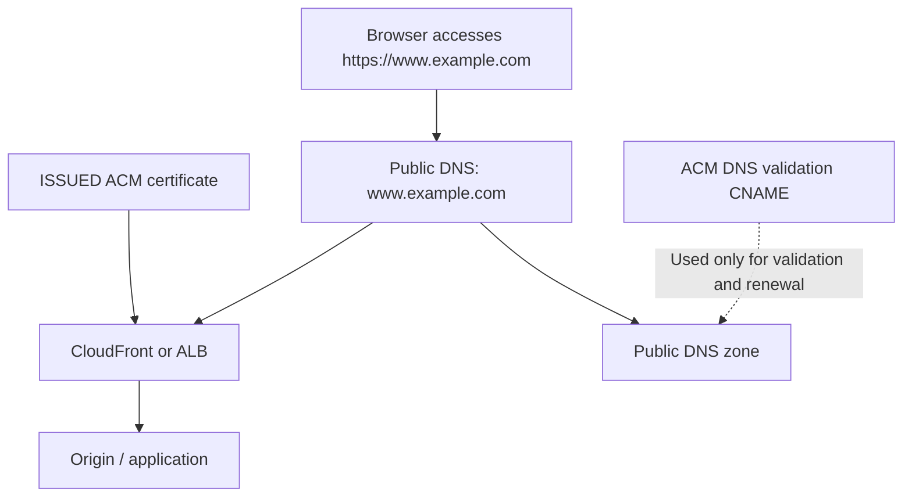

# ACM, Domain Validation, and Automatic Certificate Renewal

AWS Certificate Manager (ACM) helps request, manage, and deploy TLS/SSL certificates for AWS services. When a website or API uses a custom domain name, TLS certificates allow browsers and clients to verify the server's identity while encrypting data in transit. For ACM to issue a public certificate, the requester must prove ownership or control of the domain names included in the certificate. After issuance, certificates must also be renewed before expiration so HTTPS connections are not interrupted.

Within the `CLOUD_PROVIDERS_AWS` module, ACM integrates directly with DNS, IAM, networking, and application delivery services. Route 53 can store DNS validation records; IAM controls who can request or attach certificates; Application Load Balancer, CloudFront, and API Gateway use certificates to serve HTTPS. Domain validation, certificate deployment, and traffic routing are distinct steps that must be coordinated accurately.

After this lesson, you can:

- Explain ACM's role and the differences between public certificates, private certificates, and imported certificates.
- Choose an appropriate domain validation method, preferring DNS validation.
- Create and maintain CNAME validation records so ACM can issue and automatically renew certificates.
- Check renewal eligibility, certificate status, and warning events.
- Troubleshoot `PENDING_VALIDATION`, `VALIDATION_TIMED_OUT`, and renewal failures.
- Choose the right Region and attach certificates to AWS services requiring HTTPS.

## 1. Role of AWS Certificate Manager

A digital TLS certificate is a data structure signed by a CA (Certificate Authority) that binds a public key to one or more domain names. When a browser connects over HTTPS, the server presents the certificate and proves possession of the corresponding private key. The browser checks the CA signature, validity period, trust chain, and domain name in the certificate before establishing the TLS session.

ACM provides these core capabilities:

- Requesting public certificates issued by a publicly trusted CA.
- Requesting private certificates from AWS Private Certificate Authority (AWS Private CA) when the account has an appropriate CA configured.
- Importing certificates issued by an external CA.
- Managing status, domain details, expiration dates, and renewal for eligible certificates.
- Integrating certificates with AWS services such as Elastic Load Balancing, Amazon CloudFront, and Amazon API Gateway.

ACM eliminates manual CSR generation, private key distribution, and certificate installation when using ACM-managed certificate issuance. For ACM-issued public certificates, ACM manages the private key internally; permissions to view certificate details and permissions to use certificates are controlled separately.

### 1.1. Distinguishing Certificate Types

| Certificate type | Issuing source | Trust scope | Renewal responsibility |
|---|---|---|---|
| Public certificate issued by ACM | Public CA via ACM | Trusted by public browsers and clients | ACM managed renewal if eligible |
| Private certificate issued by ACM via AWS Private CA | Organization's Private CA | Only clients trusting the private CA | Eligible for ACM managed renewal if conditions are met |
| Imported certificate | External CA or private PKI | Depends on issuing CA and client trust stores | Owner monitors, renews, and re-imports |

Public certificates fit websites and APIs accessible from the Internet. Private certificates fit internal services, VPC workloads, or systems where the organization manages trust stores. Imported certificates are useful when an enterprise already operates an external CA or PKI workflow, though tracking expiration dates and re-importing new certificates rests with the operations team.

Do not confuse ACM storing a certificate with ACM automatically renewing that certificate. Imported certificates are not eligible for ACM managed renewal; when the external CA issues a new certificate, the organization must re-import it before the current certificate expires.

### 1.2. ACM Certificates Are Regional Resources

ACM certificates are Region-scoped resources. If an Application Load Balancer runs in `ap-southeast-1`, the certificate attached to the ALB listener must exist in that same Region. API Gateway with a Regional custom domain likewise needs a certificate in the API's Region.

CloudFront is a critical exception: an ACM certificate used for HTTPS between viewers and a CloudFront distribution must be requested or imported in Region `us-east-1` (US East, N. Virginia), regardless of where users or origins are located.

| Where used | ACM certificate Region |
|---|---|
| Application Load Balancer or Network Load Balancer | Same Region as the load balancer |
| API Gateway Regional custom domain | Same Region as the API |
| API Gateway Edge-optimized custom domain | `us-east-1` |
| CloudFront viewer certificate | `us-east-1` |

If you need the same domain name across multiple Regions, you can request separate certificates in each Region. With DNS validation, ACM can reuse the validation token for the same FQDN in the same account across multiple Regions if the corresponding CNAME remains in DNS.

## 2. Domain Names in Certificates and Validation Scope

When requesting a certificate, you specify a primary fully qualified domain name (FQDN) and can add additional names in Subject Alternative Name (SAN).

For example, a certificate may include:

- `example.com`: apex/root domain.
- `www.example.com`: website subdomain.
- `api.example.com`: API subdomain.
- `*.example.com`: wildcard covering first-level subdomains.

The wildcard `*.example.com` covers `www.example.com` or `api.example.com`, but does not cover `example.com` and does not cover multi-level subdomains such as `v2.api.example.com`. If you need both the apex domain and wildcard, include both names in the certificate.

ACM requires proving control over every domain name in a public certificate request. Each SAN may require its own validation record. For an apex domain and its corresponding wildcard, ACM may share a single CNAME validation record pair; always use the exact values returned by ACM rather than inventing tokens.

Domain validation proves that the requester controls the domain's DNS or email channel. It does not prove that the website already points to the right server, nor does it automatically configure HTTPS for the application. Once the certificate is issued, you must still attach it to the service and configure DNS traffic routing to the corresponding endpoint.

## 3. Domain Validation Methods

ACM offers validation methods for public certificates. DNS validation is recommended for most systems because it is easy to automate and supports automatic renewal. Email validation may still appear in existing systems, while HTTP validation applies to supported CloudFront scenarios.

| Method | How control is proven | Strengths | Things to note |
|---|---|---|---|
| DNS validation | Add an ACM-provided CNAME to public DNS | Easy to automate; supports managed renewal | Must keep the CNAME in DNS and the domain must resolve publicly |
| Email validation | Receive email at administrative addresses and click verification link | No DNS changes needed | Requires recipient action; renewal requires re-verification |
| HTTP validation | Configure HTTP redirect/challenge per ACM guidance | Can be automated with CloudFront | Applies only to certificates used with CloudFront within supported scope |

AWS has announced it will discontinue email validation in 2027 for new public certificates and renewals. Therefore, choose DNS validation when designing new systems; for certificates currently using email validation, plan a migration following ACM guidance before the method is retired.

## 4. How Does DNS Validation Work?

When selecting DNS validation, ACM generates one or more CNAME record pairs. Each pair serves as proof that the requester has permission to edit the domain's DNS. A record typically looks like:

```text
Record name:  _token.example.com
Record type:  CNAME
Record value: _another-token.acm-validations.aws
```

The `token` strings are illustrative examples. In real deployments, copy the exact Record name and Record value verbatim from the ACM console, API, or AWS CLI.

Validation workflow:

1. An operator requests a certificate and selects DNS validation.
2. ACM generates CNAME validation records for each domain requiring validation.
3. Someone with public DNS management access adds the CNAME records to the authoritative zone.
4. ACM queries public DNS looking for the matching name and value pair.
5. Once all domains are validated, ACM issues the certificate and transitions status to `ISSUED`.

If you use Route 53 as your DNS provider and the account has write permissions to the corresponding public hosted zone, the ACM console may provide a button to create the record directly. If using another DNS provider, add the record through that provider's console or API.

### 4.1. Adding the CNAME to Public DNS

Suppose ACM provides:

```text
Name:  _a1b2c3.example.com
Type:  CNAME
Value: _d4e5f6.acm-validations.aws
```

The administrator must create a CNAME with that exact name and value in the authoritative public DNS zone for `example.com`.

Some DNS providers automatically append the zone name to the Name field. Entering the full FQDN in an interface that auto-appends the suffix can accidentally create `_a1b2c3.example.com.example.com`. Check your DNS provider's rules to determine whether to enter the full name or only the label prefix.

Important requirements:

- The record must exist in the domain's authoritative public DNS.
- Record name and value must match ACM's provided data exactly.
- Do not change the CNAME to an A, TXT, or other record type.
- Do not delete or alter the CNAME if you still want ACM to automatically renew the certificate.
- If the DNS provider proxies records, ensure public CNAME validation queries resolve cleanly to the exact value ACM provided.
- Do not chain more than eight consecutive CNAMEs in the resolution path; ACM cannot validate if a CNAME chain exceeds this limit.

A private hosted zone inside a VPC is insufficient for validating a public certificate. ACM must be able to query the record over public DNS. Internal domains or non-public domains should consider private certificates from AWS Private CA.

### 4.2. Reusing DNS Validation Records

A CNAME validation record does not serve only initial issuance. As long as the record remains in place, ACM can reuse the token to:

- Renew eligible DNS-validated certificates.
- Request a new certificate for the same FQDN.
- Create a replacement certificate after deleting an old one.
- Request a certificate for the same domain in another Region within the same account.

An apex domain and its corresponding wildcard can share a record. Other SANs such as `www.example.com` usually have separate records. If a certificate contains multiple SANs, verify all ACM-required records are present; missing even one record can prevent issuance or renewal from completing.

A validation CNAME is not a website traffic routing record. It only proves domain control. To route users to your application, your DNS zone still needs separate routing records such as Alias/A/AAAA pointing to your ALB or CloudFront, depending on architecture.

## 5. Email Validation and Its Limitations

With email validation, ACM sends verification messages to common administrative addresses for the domain, including:

- `admin@example.com`
- `administrator@example.com`
- `hostmaster@example.com`
- `postmaster@example.com`
- `webmaster@example.com`

A domain administrator opens the email and clicks the verification link. Every domain in the certificate must be validated as required by ACM. Email validation requires active mailboxes, an accountable person monitoring them, and no spam filters blocking emails from ACM.

Verification links expire; tokens in initial emails expire after 72 hours. If an email is lost or the token expires, you can resend validation emails from the ACM console or appropriate API. For active systems, document recipient addresses and handling procedures so certificates do not get stuck pending.

Email validation also affects renewals. ACM sends renewal notices roughly 45 days before certificate expiration; the domain owner must click the links in the emails to re-validate the domains. Without completing validation, ACM cannot renew the certificate. AWS has announced a timeline to discontinue email validation in 2027, making DNS validation the better choice for new systems.

## 6. HTTP Validation for CloudFront

ACM supports HTTP validation for certificates used with CloudFront. This method uses an HTTP redirect/challenge mechanism to prove domain control. It can support automated validation and renewal when redirect configuration meets ACM's requirements.

HTTP validation is appropriate only within AWS-supported service scopes and conditions. If a system already uses DNS validation, there is no need to switch to HTTP just for automation; DNS validation is usually simpler when your organization controls public DNS. When choosing HTTP validation, follow the exact challenge and redirect details ACM provides, and monitor changes to your CDN, origin, and redirect rules so the challenge remains reachable.

## 7. Requesting and Verifying Certificates with the AWS CLI

The following example requests a public certificate for an apex domain and two SANs. The certificate is created in Region `ap-southeast-1` using DNS validation:

```bash
aws acm request-certificate \
  --domain-name example.com \
  --subject-alternative-names www.example.com api.example.com \
  --validation-method DNS \
  --region ap-southeast-1
```

The command returns the ARN of the certificate request. After submitting the request, use the ARN to inspect details:

```bash
aws acm describe-certificate \
  --certificate-arn arn:aws:acm:ap-southeast-1:111122223333:certificate/12345678-1234-1234-1234-123456789012 \
  --region ap-southeast-1
```

In the output, pay attention to these fields:

- `Status`: certificate issuance status, such as `PENDING_VALIDATION` or `ISSUED`.
- `DomainValidationOptions`: each domain and its validation status.
- `ResourceRecord`: CNAME name, type, and value to add to DNS.
- `NotBefore`, `NotAfter`: start and end of certificate validity.
- `RenewalSummary`: managed renewal status when available.

You can filter key fields with a query:

```bash
aws acm describe-certificate \
  --certificate-arn arn:aws:acm:ap-southeast-1:111122223333:certificate/12345678-1234-1234-1234-123456789012 \
  --region ap-southeast-1 \
  --query "Certificate.{Status:Status,Domains:DomainValidationOptions,Renewal:RenewalSummary,NotAfter:NotAfter}"
```

To verify whether the CNAME resolves in public DNS, use `dig` or `nslookup`:

```bash
dig +short CNAME _a1b2c3.example.com
```

The result should point to the exact `_another-token.acm-validations.aws` target provided by ACM. If the query returns no record, check authoritative nameservers, the public hosted zone, record spelling, and whether the DNS provider auto-appended a suffix.

## 8. Certificate Status and Renewal Status

Distinguish certificate issuance status from managed renewal status. A certificate can be `ISSUED` while renewal is still pending validation or encountering errors.

### 8.1. Certificate Issuance Status

| Status | Meaning | Remediation |
|---|---|---|
| `PENDING_VALIDATION` | ACM is waiting to validate domains | Add DNS CNAMEs, complete email, or configure HTTP challenge per chosen method |
| `ISSUED` | Certificate has been issued | Attach to AWS service and verify HTTPS |
| `INACTIVE` | Certificate is not yet in a usable state under current configuration | Check issuance, import process, or associated state |
| `VALIDATION_TIMED_OUT` | ACM could not validate within the timeout window | Fix DNS/email/challenge and request a new certificate |
| `FAILED` | Certificate request failed | Inspect failure reason and adjust config before requesting again |
| `EXPIRED` | Certificate has expired | Issue or renew a valid certificate and update services |
| `REVOKED` | Certificate was revoked | Determine root cause, issue a replacement certificate, and deploy |

ACM typically attempts validation for up to 72 hours. If time expires without validation, the request transitions to `VALIDATION_TIMED_OUT`. After fixing DNS or email issues, submit a new certificate request per ACM guidance.

### 8.2. RenewalSummary Status

| Renewal status | Meaning | Action |
|---|---|---|
| `PENDING_AUTO_RENEWAL` | ACM is executing automated validation checks | Monitor progress; inspect eligibility if it persists |
| `PENDING_VALIDATION` | ACM could not automatically validate one or more domains | Restore CNAMEs or complete email/HTTP validation |
| `SUCCESS` | Certificate has been renewed | Confirm services have picked up the new certificate |
| `FAILED` | Validation failed before expiration and certificate was not renewed | Request a new certificate, fix root cause, and update services |

Renewal is asynchronous. After all domains validate, ACM may take additional time to issue the renewed certificate and for integrated services to deploy it. Status changes can take several hours to appear fully.

## 9. Conditions for ACM Automatic Renewal

Managed renewal applies to eligible ACM-issued certificates. For DNS-validated public certificates, ACM checks key conditions before renewing:

1. The certificate is actively in use by an integrated AWS service, or has been exported since its most recent issuance/renewal where export is supported.
2. All required CNAME validation records still exist and are reachable over public DNS.
3. Domains in the certificate remain validated under the chosen method.
4. The certificate has not expired and is not of a type excluded from managed renewal.

For DNS-validated certificates with a 198-day validity period, ACM checks renewal eligibility roughly 45 days before expiration. Older certificates with a 395-day validity period follow a different renewal timeline; do not apply legacy timelines to new certificates. With email validation, ACM sends renewal notices 45 days before expiration and requires recipient verification. HTTP validation uses the corresponding CloudFront challenge workflow.

Imported certificates are never renewed via ACM managed renewal. Private certificates issued directly via the AWS Private CA `IssueCertificate` API are also ineligible for ACM managed renewal. Distinguish issuance source and method before designing operational schedules.

### 9.1. What Happens When ACM Renews Successfully?

When ACM renews a certificate, the certificate's ARN stays the same. Integrated AWS services detect the renewal and update the certificate in use. Operations should still monitor renewal status, inspect listener/distribution configurations, and verify HTTPS works once deployment finishes.

If one certificate is used in multiple places, verify each service references the exact ARN and check deployment status. For certificates across multiple Regions, each certificate is an independent resource and renews independently.

### 9.2. Changes That Can Break Automatic Renewal

The following actions can prevent ACM from renewing:

- Deleting a CNAME validation record or changing its value.
- Migrating authoritative nameservers to a new DNS provider and forgetting to copy CNAME validation records.
- Detaching the certificate from integrated AWS services without exporting it under supported conditions.
- Deleting or altering the redirect challenge when using HTTP validation.
- Failing to process verification emails when using email validation.
- Letting the certificate expire, or using an imported certificate without a re-import workflow.

Therefore, manage validation records as critical infrastructure configuration. When migrating DNS, switching DNS providers, or restructuring hosted zones, audit all ACM records before finalizing changes.

## 10. Attaching Certificates to AWS Services

Issuing a certificate does not automatically enable HTTPS for an application. You must attach the certificate to the TLS-terminating service:

- **Application Load Balancer**: select the certificate on an HTTPS listener. The ALB terminates TLS at the load balancer layer and forwards requests to target groups as configured.
- **CloudFront**: attach the certificate to the distribution and declare matching alternate domain names (CNAMEs). The viewer certificate must reside in `us-east-1`.
- **API Gateway**: create a custom domain and choose the certificate ARN matching the endpoint type and Region.
- **Other integrated AWS services**: follow the service's documentation regarding certificate types, Regions, and association steps.

Website architecture example:



The diagram shows two distinct DNS purposes. Routing records direct users to the endpoint; validation CNAMEs prove domain control and support renewal. Never replace routing records with validation CNAMEs or vice versa.

### 10.1. Testing TLS After Attaching a Certificate

After association and deployment complete, verify:

- The domain accessed by users is listed in the certificate's SANs.
- The certificate is valid, not expired, and trusted by browsers.
- The endpoint serves the new certificate.
- The intermediate certificate chain is complete and verifiable by clients.
- Traffic DNS resolves to the intended endpoint.
- The listener or distribution references the right certificate ARN.

Use a browser or TLS tools such as `openssl s_client` to inspect the certificate the endpoint actually presents. Seeing `ISSUED` in ACM alone is not enough to conclude HTTPS on the website is working.

## 11. Monitoring Renewals and Alerting

Do not wait for users to report expired-certificate errors. Monitor renewal status and AWS Health/EventBridge events so operations can act before expiration.

For DNS-validated certificates, if ACM cannot automatically validate when renewal time arrives, AWS may emit reminder events at 30, 15, 7, 3, and 1 day before expiration. These events help trigger alerts, tickets, or automated remediation workflows.

A monitoring process should include:

1. Listing ACM certificates per Region and account.
2. Tracking `NotAfter`, certificate status, SANs, and consuming services.
3. Monitoring `RenewalSummary.RenewalStatus` when present.
4. Creating EventBridge rules or using AWS Health to receive failed-renewal events.
5. Routing alerts to DNS owners, application teams, and platform teams.
6. After fixing issues, re-checking renewal status and live HTTPS endpoints.

For imported certificates, maintain a dedicated tracking schedule based on `NotAfter`, since ACM will not renew on behalf of an external CA. Use EventBridge or certificate asset management tools to alert ahead of expiration, then request a new certificate from the CA and re-import it.

## 12. Practical Scenario: Deploying HTTPS for an E-Commerce Website

An e-commerce system uses domains `shop.example.com`, `www.example.com`, and `api.example.com`. The website serves content through CloudFront, while the API runs behind an Application Load Balancer in Region `ap-southeast-1`.

The platform team deploys as follows:

1. Request certificates containing the required SANs using DNS validation.
2. Since CloudFront serves viewer HTTPS, request one certificate in `us-east-1`.
3. If the ALB terminates TLS for the API, request another certificate in `ap-southeast-1`.
4. Add the ACM-generated CNAME validation records to the public DNS zone.
5. Wait until both certificate requests transition to `ISSUED`.
6. Attach the `us-east-1` certificate to CloudFront and the `ap-southeast-1` certificate to the ALB HTTPS listener.
7. Configure traffic DNS records for `shop.example.com`, `www.example.com`, and `api.example.com` pointing to the proper endpoints.
8. Set up EventBridge/AWS Health alerts and include CNAME validation records in DNS change management.

When the networking team migrates DNS providers, they must copy both routing records and CNAME validation records. Copying only routing records leaves the website reachable temporarily, yet prevents ACM from renewing the certificate. This is a dangerous operational failure because the system can appear healthy for months until the certificate nears expiration.

## 13. Troubleshooting Common Errors

| Symptom | Possible cause | How to check and fix |
|---|---|---|
| Certificate stuck in `PENDING_VALIDATION` | CNAME missing, wrong name/value, or DNS not yet propagated | Query public DNS with `dig`; compare against ACM `ResourceRecord` |
| `VALIDATION_TIMED_OUT` | Could not validate within 72 hours | Fix DNS/challenge, then submit a new certificate request |
| Route 53 lacks a "Create record" button | Wrong account, missing IAM permission, zone is private, or domain mismatch | Check hosted zone, account, and Route 53 write permissions |
| DNS record has doubled domain name | DNS provider auto-appends zone suffix | Enter only the label prefix if the UI appends the domain automatically |
| Record exists in private hosted zone but ACM cannot see it | ACM public validation queries public DNS | Add the record to the authoritative public zone |
| DNS is right yet issuance is blocked | CAA record does not permit Amazon's CA | Inspect CAA records and authorize the appropriate Amazon CA per AWS docs |
| Renewal stuck in `PENDING_VALIDATION` | CNAME deleted/modified; certificate no longer eligible | Restore record, check association/export status, and re-monitor |
| Email renewal incomplete | Nobody processed the email or link expired | Resend email and validate each domain |
| HTTPS still serves old certificate | Association or distribution rollout still propagating | Check ARN attached to listener/distribution and wait for propagation |
| CloudFront does not list certificate for selection | Certificate is in the wrong Region | Request or import the certificate in `us-east-1` |

If a CAA record exists in DNS, it can restrict which CAs are permitted to issue certificates for the domain. When ACM fails to issue despite a correct CNAME, check CAA records and configure permission for Amazon's CA per current guidance. CAA controls which CA may issue certificates; it does not replace domain control validation.

## 14. Safe Operational Principles

When deploying ACM in production, apply these principles:

- Prefer DNS validation for new public certificates; retain CNAME records throughout the certificate lifecycle.
- Manage validation CNAMEs via Infrastructure as Code or reviewed DNS change workflows.
- Separate IAM permissions for requesting certificates, editing DNS, attaching certificates, and deleting certificates.
- Track certificates by Region; remember the `us-east-1` exception for CloudFront.
- Use the right certificate for the right SANs, endpoint, and environment.
- Never delete a certificate actively used by a service; disassociate or replace it with another certificate first.
- Monitor `NotAfter` and `RenewalSummary`, even when ACM automatic renewal is expected.
- Set up AWS Health/EventBridge alerts and assign an accountable team to respond.
- For imported certificates, manage re-issuance schedules, re-import, and deployment checks yourself.
- When changing DNS providers, verify both routing records and CNAME validation records.
- Test HTTPS from a client perspective after issuance or renewal, rather than relying solely on ACM status.

A sound workflow clearly defines who owns the domain, who manages DNS, who manages certificates, and who operates the service. When one team makes changes, the other teams must understand the impact on validation and renewal.

## 15. Misconceptions to Avoid

| Misconception | Correct understanding |
|---|---|
| `ISSUED` status means the website already has HTTPS enabled | You must attach the certificate to a listener/distribution/API and configure traffic DNS |
| The validation CNAME routes users to the website | It only proves domain control and supports renewal |
| You can delete the CNAME after ACM issues the certificate | Deleting the CNAME can prevent ACM from validating during renewal |
| ACM certificates can be used in any Region | Certificates are Regional resources; CloudFront viewer certificates must be in `us-east-1` |
| ACM automatically renews every certificate stored in ACM | Only eligible certificates renew automatically; imported certificates require owner renewal and re-import |
| A wildcard covers all subdomain levels | `*.example.com` does not cover `example.com` or `a.b.example.com` |
| Changing DNS providers only requires copying A/CNAME routing records | You must also copy validation CNAMEs to preserve managed renewal |
| Email validation is a long-term equivalent to DNS | AWS plans to discontinue email validation in 2027; migrate to DNS validation |

## 16. Summary

ACM manages the TLS certificate lifecycle for AWS services. To issue a public certificate, ACM must validate control over each domain in the certificate. DNS validation uses ACM-generated CNAMEs, supports automation, and is the recommended option for new systems. Email validation requires administrators to process emails and verification links; this method is scheduled for retirement in 2027. HTTP validation has supported scope for CloudFront.

Managed renewal works only when certificates meet ACM eligibility rules—such as remaining in use by an integrated AWS service or having been exported under supported conditions—alongside valid validation records/challenges. With DNS validation, CNAMEs must remain in public DNS. Imported certificates are not automatically renewed by ACM.

In operations, verify SANs, Region, issuance status, renewal status, CNAMEs, and consuming services. Monitor AWS Health/EventBridge events, handle alerts before expiration, and verify live HTTPS endpoints after renewal. This maintains stable TLS connectivity and prevents expired-certificate outages.

## References

- [AWS Certificate Manager DNS validation](https://docs.aws.amazon.com/acm/latest/userguide/dns-validation.html)
- [Validate domain ownership for ACM public certificates](https://docs.aws.amazon.com/acm/latest/userguide/domain-ownership-validation.html)
- [AWS Certificate Manager email validation](https://docs.aws.amazon.com/acm/latest/userguide/email-validation.html)
- [Managed certificate renewal in AWS Certificate Manager](https://docs.aws.amazon.com/acm/latest/userguide/managed-renewal.html)
- [Renewal for domains validated by DNS](https://docs.aws.amazon.com/acm/latest/userguide/dns-renewal-validation.html)
- [Check a certificate's renewal status](https://docs.aws.amazon.com/acm/latest/userguide/check-certificate-renewal-status.html)
- [Troubleshoot DNS validation problems](https://docs.aws.amazon.com/acm/latest/userguide/troubleshooting-DNS-validation.html)
- [Requirements for using SSL/TLS certificates with CloudFront](https://docs.aws.amazon.com/AmazonCloudFront/latest/DeveloperGuide/cnames-and-https-requirements.html)
