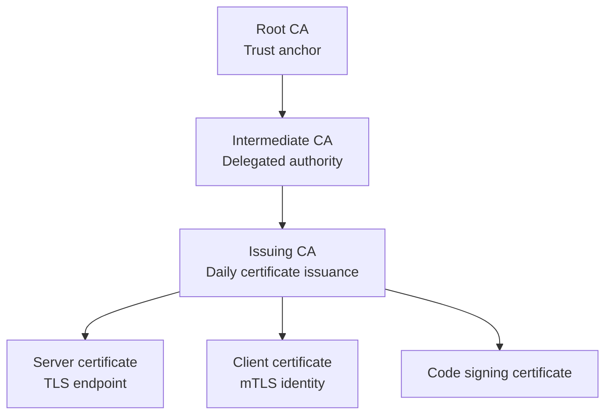
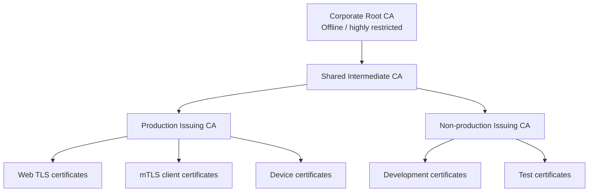
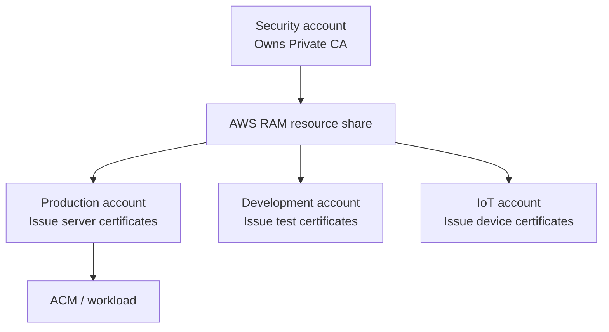
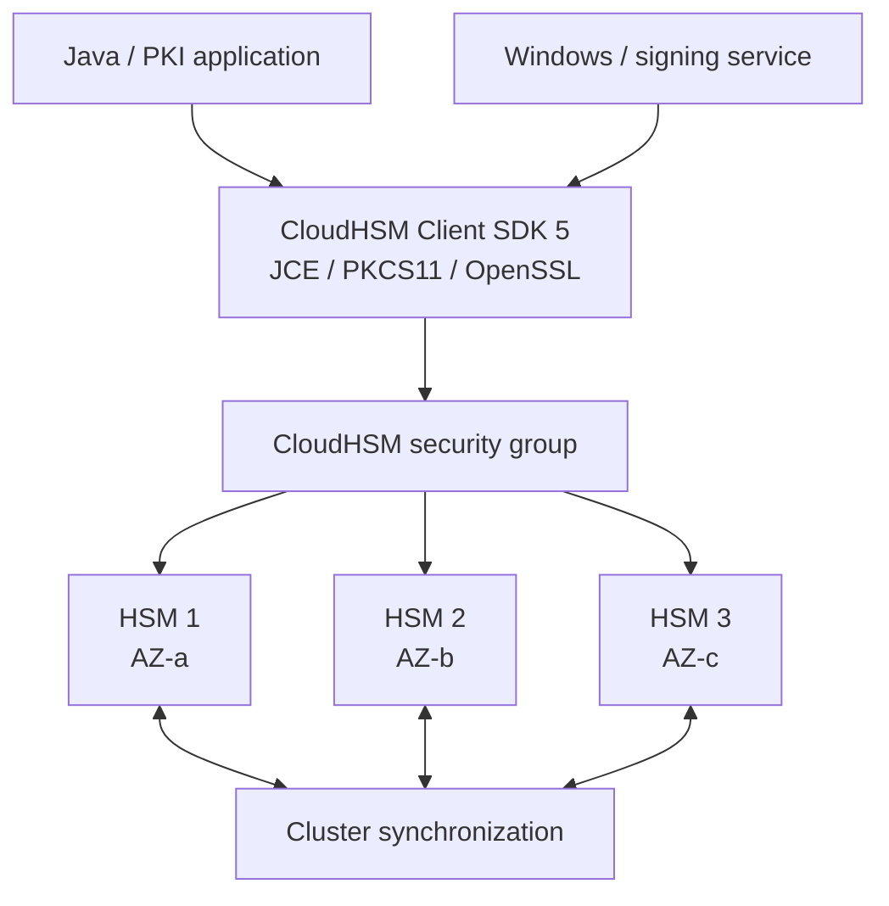
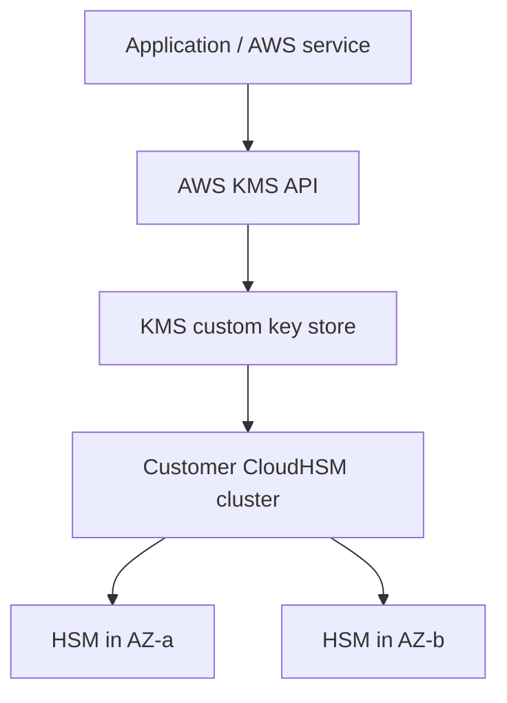
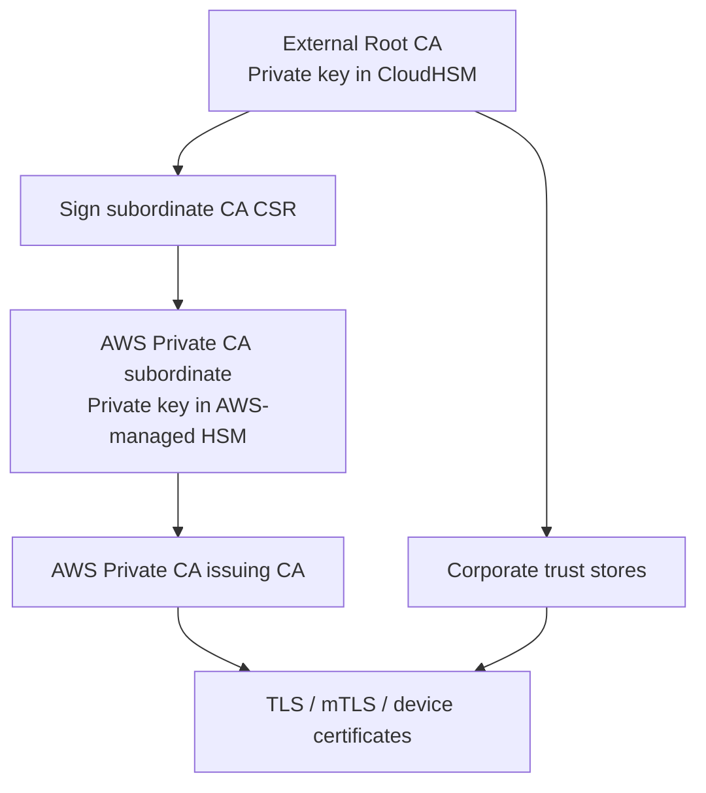

# AWS Private CA, CloudHSM, and Specialized Key Management Needs

**AWS Private Certificate Authority (AWS Private CA)** and **AWS CloudHSM** solve two related yet distinct security problems. Private CA provides managed PKI infrastructure to create CA hierarchies and issue and revoke X.509 certificates for internal systems. CloudHSM provides single-tenant hardware security modules (HSMs) inside a VPC so organizations can directly manage HSM users, keys, and policies, and perform cryptographic operations through interfaces such as PKCS #11, Java Cryptography Extension (JCE), OpenSSL, and Windows KSP.

AWS Private CA protects CA private keys inside AWS-managed HSMs. CloudHSM is for cases where applications or CA systems require direct control over dedicated HSMs. When an organization needs to keep its root CA key in CloudHSM while still using Private CA for day-to-day certificate issuance, it can operate an external parent CA in CloudHSM to sign the CSR of a subordinate CA managed by AWS Private CA.

This lesson belongs to the **Encryption, Secrets, and Certificates** chapter of the **CLOUD_PROVIDERS_AWS** module. It connects PKI, X.509, AWS Private CA, AWS Certificate Manager (ACM), AWS CloudHSM, AWS KMS, KMS custom key stores, IAM, AWS RAM, CloudTrail, VPC, and Java applications.

> **Design Principle:** Choose the right service based on required key custody and integration model. Separate the root CA from issuing CAs, protect HSM users independently from IAM, separate issuance/revocation duties, test recovery, and plan certificate lifecycles before bringing PKI into production.

## 1. Learning Objectives

After this lesson, you can:

1. Distinguish PKI, CAs, certificates, CSRs, public keys, and private keys.
2. Explain the role of AWS Private CA in a private PKI.
3. Design root, intermediate, and issuing CAs along administrative boundaries.
4. Choose general-purpose or short-lived certificate mode.
5. Select certificate templates for TLS server, TLS client, code signing, and CA certificates.
6. Issue certificates via the AWS Private CA API/CLI or ACM.
7. Manage renewal, revocation, CRLs, and OCSP.
8. Share a private CA across AWS accounts using AWS RAM.
9. Explain how private CA keys are protected inside AWS-managed HSMs.
10. Describe AWS CloudHSM clusters, HSM types, FIPS modes, and network architecture.
11. Distinguish IAM permissions from HSM user credentials.
12. Manage key ownership, backups, synchronization, and quorum authorization.
13. Integrate CloudHSM into Java applications using the JCE provider.
14. Distinguish direct CloudHSM usage from a KMS custom key store.
15. Combine an external parent CA in CloudHSM with a subordinate CA in AWS Private CA.
16. Establish key protection, auditing, and PKI recovery procedures.
17. Evaluate cost, availability, latency, and limits before deployment.

## 2. PKI and HSM Foundations

### 2.1. What Is PKI?

Public Key Infrastructure (PKI) is a system of policies, procedures, software, and hardware used to create, distribute, verify, and revoke digital certificates.

An X.509 certificate typically contains:

- Subject: identity of the entity.
- Subject Alternative Name (SAN): DNS names, addresses, or additional identifiers.
- The subject's public key.
- Issuer: the CA that signed the certificate.
- Serial number.
- Validity: `Not Before` and `Not After`.
- Key Usage and Extended Key Usage.
- The CA's signature.
- Extensions related to CRL or OCSP if configured.

The corresponding private key must be protected. Anyone possessing the private key can perform the cryptographic operations permitted by that key, such as signing data or proving TLS identity.

### 2.2. CAs and Certificate Chains

A Certificate Authority (CA) is an entity authorized to sign certificates. A certificate is trusted when a client can build a certificate chain from the end-entity certificate through intermediate CAs to a root CA installed in a trust store.



The Root CA holds the highest authority and should be used very rarely. Intermediate/issuing CAs limit blast radius if a lower-tier CA is compromised or needs replacement.

### 2.3. CSRs and Key Ownership

A Certificate Signing Request (CSR) contains a public key along with subject/SAN details and a signature generated with the corresponding private key.

Typical flow:

1. The subject generates a key pair in the environment where the private key will be protected.
2. The subject generates a CSR containing the public key.
3. The CSR is sent to the CA.
4. The CA validates the request against policy and signs the certificate.
5. The subject receives the certificate and chain.
6. The subject installs the certificate together with its corresponding private key onto the service.

The CA only needs the public key in the CSR to issue a certificate. Server/client private keys never need to be sent to the CA.

### 2.4. What Is an HSM?

A Hardware Security Module is a specialized cryptographic device built to generate, store, and use key material within a protected hardware boundary. An HSM can perform signing, verification, encryption, decryption, key generation, and key wrapping through supported mechanisms.

An HSM reduces the risk of private keys being extracted from the device, but does not by itself replace:

- IAM and HSM user access controls.
- Key lifecycle and rotation policies.
- Backup/restore and disaster recovery.
- Governance over which applications may call the HSM.
- Auditing, approvals, and separation of duties.
- Availability and capacity design.

## 3. Choosing the Right Service

AWS offers several options for key and certificate management. Do not choose CloudHSM merely because a workload requires encryption.

| Service | Primary role | When suitable |
| --- | --- | --- |
| **AWS Certificate Manager (ACM)** | Manages public/private certificates and integrates with AWS services | TLS certificates for ALB, CloudFront, API Gateway, and integrated services |
| **AWS Private CA** | Operates a private certificate authority and issues X.509 certificates | Internal PKI, mTLS, device identity, code signing |
| **AWS KMS** | Manages KMS keys and provides cryptographic APIs | Data encryption, envelope encryption, signing, and AWS service integrations |
| **AWS CloudHSM** | Provides single-tenant HSMs where customers manage users/keys | Apps needing PKCS #11/JCE/OpenSSL/KSP, CA keys, or dedicated HSM control |
| **KMS custom key store backed by CloudHSM** | Uses the KMS API with key material residing in a customer's CloudHSM cluster | Integrations supporting KMS customer-managed keys when dedicated HSM is required |
| **KMS external key store (XKS)** | KMS forwards operations to an external key manager via proxy | Mandatory requirement to keep key material outside AWS |

### 3.1. Decision Questions

- Need to issue private TLS certificates for thousands of services? Start with AWS Private CA and ACM.
- Need to encrypt S3, EBS, RDS, or secrets? Typically use AWS KMS.
- Need a Java application to call an HSM via JCE and keep signing keys in a dedicated HSM? Evaluate CloudHSM.
- Regulations require the root CA key to be managed directly by your organization in an HSM? Use an external parent CA, optionally in CloudHSM, to sign an AWS Private CA subordinate CSR.
- An AWS service requires the KMS interface while key material must sit in CloudHSM? Evaluate a KMS custom key store while verifying throughput and feature limitations.

## 4. How Does AWS Private CA Work?

AWS Private CA lets you create and operate a private CA hierarchy without managing the full underlying CA infrastructure yourself. The service provides APIs, Console, and CLI to create CAs, issue certificates, manage revocation, and integrate with ACM.

Components:

| Component | Responsibility |
| --- | --- |
| Private CA | Entity that signs certificates and manages CA configuration |
| CA certificate | Certificate establishing the CA's public key and signing authority |
| CA private key | Key used to sign certificates, CRLs, and OCSP responses |
| Certificate template | Defines certificate type and extensions/usages |
| CSR | Certificate request containing the subject's public key |
| Certificate | Digital identity signed by the CA |
| CRL | List of revoked certificates |
| OCSP responder | Returns revocation status for certificates |
| ACM | Integrates requests, deployment, and managed renewal for eligible certificates |

Private CA is a **Regional** resource. To deploy private PKI across multiple Regions, create appropriate CA hierarchies in each Region; you cannot copy a private CA resource from one Region to another.

### 4.1. Protecting the CA Private Key

AWS Private CA private keys are stored in AWS-managed HSMs compliant with FIPS PUB 140-3 Level 3. AWS manages the HSM hardware, backups, and key protection operations as part of the service.

Customers cannot access HSM users or export the CA private key of an AWS Private CA. Customers manage API permissions, CA configuration, certificate policies, renewal, revocation, and trust chain distribution.

This differs from AWS CloudHSM, where customers create HSM users and directly manage keys inside their own HSM cluster.

### 4.2. Integration with ACM

When requesting a private certificate through ACM and selecting AWS Private CA, ACM manages certificate inventory and can automatically renew eligible certificates. Certificates requested directly via the AWS Private CA `IssueCertificate` API/CLI are unmanaged by ACM and are not automatically renewed by ACM.

AWS Private CA can also issue certificates for use outside integrated AWS services, such as exporting a private certificate from ACM or installing certificates on customer-managed servers. When exporting, the end-entity certificate's private key must be protected wherever it is stored and deployed.

## 5. Designing a CA Hierarchy

AWS Private CA supports hierarchies up to five levels deep: a root CA and up to four levels of subordinate CAs per branch.

A reference model:



### 5.1. Root CA

The Root CA is the trust anchor. Protect the root with strict approval workflows, restricted access, key ceremonies, and tested backup/restore procedures.

If a root private key is compromised, the entire certificate chain relying on that root loses trust. Therefore, the root is normally used only when initializing the hierarchy, replacing intermediates, or performing rare CA operations.

### 5.2. Intermediate and Issuing CAs

An intermediate CA receives signing authority from a parent CA and can constrain path length. Issuing CAs issue end-entity certificates to workloads.

Separating issuing CAs by environment, business unit, or certificate type helps:

- Limit blast radius.
- Delegate issuance permissions.
- Replace a branch without replacing the root.
- Apply distinct validity periods and templates.
- Collect audit evidence by owner.

### 5.3. Path Length and Name Constraints

A path length constraint limits how many subordinate CA tiers may appear below a CA. Name constraints restrict the namespaces subordinate CAs are allowed to issue for.

For example, an issuing CA may issue certificates only for designated internal domains. Check AWS Private CA's support and enforcement behavior for each X.509 extension before designing policies around it.

### 5.4. When to Use Multiple Roots?

Multiple hierarchies can make sense when independent trust boundaries are required, for example:

- Production and development must not share a trust anchor.
- Legal entities have separate PKI policies.
- IoT devices have different lifecycles and trust store update mechanics than TLS servers.
- A legacy system needs to retain an old root during migration.

Every additional root increases operational overhead for trust distribution, rotation, and incident response. Split only when a clear security or operational boundary justifies it.

## 6. CA Modes and Certificate Templates

### 6.1. General-Purpose Mode

General-purpose is the default mode. The CA can issue certificates with validity periods governed by policy and supports revocation via CRL, OCSP, or both when configured.

This mode suits most private PKI use cases such as TLS servers/clients, service identities, and device certificates.

### 6.2. Short-Lived Certificate Mode

A short-lived CA issues certificates with a maximum validity of **7 days**. Because certificates expire quickly, some architectures can reduce reliance on CRL/OCSP.

Important limitations:

- A short-lived CA must be the final CA in the hierarchy.
- Certificates cannot exceed seven days of validity.
- The short-lived CA's own CA certificate also needs renewal on a seven-day cycle; automate this process to avoid issuance outages.
- AWS Certificate Manager cannot issue certificates signed by a short-lived CA.
- High-frequency automated issuance and deployment are required.
- The CA certificate also requires appropriate lifecycle renewal.

This mode is useful for workloads capable of automatically fetching certificates frequently, such as short-lived service identities. Do not pick it solely for lower CA fees if applications cannot automatically renew and deploy certificates.

### 6.3. Certificate Templates

Templates define the certificate type and appropriate extensions.

| Template | Purpose |
| --- | --- |
| `EndEntityCertificate/V1` | General-purpose end-entity certificate |
| `EndEntityServerAuthCertificate/V1` | TLS server authentication |
| `EndEntityClientAuthCertificate/V1` | TLS client authentication |
| `CodeSigningCertificate/V1` | Code signing |
| `RootCACertificate/V1` | Root CA certificate |
| `SubordinateCACertificate_PathLen0/V1` | Subordinate CA barred from issuing further subordinate CAs |
| `SubordinateCACertificate_PathLen1/V1` | Subordinate CA allowed to issue one CA tier below it |

AWS Private CA offers multiple CSR passthrough and API passthrough variants. Choose templates matching actual requirements rather than defaulting to an overly broad template for all certificate types.

### 6.4. Algorithm Compatibility

AWS Private CA supports common algorithms such as RSA and ECDSA, as well as newer algorithms such as ML-DSA within service-supported scope. SM2 applies only to China Regions.

Verify individually:

- CA key algorithm.
- Signing algorithm.
- Certificate template.
- Client/browser/OS trust support.
- ACM integration support.
- HSM mechanism support if using CloudHSM.
- FIPS mode and standards the organization must meet.

An algorithm supported by the CA is not guaranteed to be accepted by every relying party or integrated service. Test the entire certificate chain prior to production.

## 7. Issuing Certificates

Certificate issuance flow:

1. Identify the CA and certificate template.
2. Generate a key pair and CSR on the requester side or via ACM.
3. Submit the CSR to the CA.
4. The CA checks permissions and policies.
5. The CA signs the certificate.
6. The requester receives the certificate and chain.
7. Install the certificate on the TLS endpoint or application.
8. Distribute root/intermediate certificates to required trust stores.
9. Monitor expiration and revocation.

### 7.1. Requesting via ACM

When using ACM, ACM generates the key pair and manages certificate inventory. This is convenient for ACM-integrated AWS services such as Elastic Load Balancing, CloudFront, or API Gateway.

Certificates requested via ACM may qualify for managed renewal. For private certificates, trust is established by distributing the root CA certificate to client trust stores.

### 7.2. Requesting Directly via the Private CA API

When using the Private CA `IssueCertificate` API/CLI, the requester must supply a CSR. Returned certificates are not automatically managed or renewed by ACM.

Use this approach when installing certificates in custom environments, devices, or software that does not use the ACM lifecycle. Operations must track expiration, renew, deploy, and verify manually or via custom automation.

### 7.3. Illustrative CLI

Create a CA configuration file, for example **ca-config.json**:

```json
{
  "KeyAlgorithm": "RSA_2048",
  "SigningAlgorithm": "SHA256WITHRSA",
  "Subject": {
    "Country": "VN",
    "Organization": "Example Engineering",
    "OrganizationalUnit": "Platform Security",
    "CommonName": "Example Internal Root CA"
  }
}
```

Create a general-purpose root CA. This example omits revocation; production must evaluate CRL/OCSP before creating the CA:

```bash
aws acm-pca create-certificate-authority \
  --certificate-authority-configuration file://ca-config.json \
  --certificate-authority-type ROOT \
  --usage-mode GENERAL_PURPOSE \
  --region ap-southeast-1
```

AWS Private CA returns the CA ARN. After creation, the CA awaits CA certificate installation. Activating a root includes fetching its CSR, signing the CSR with a Root CA template, and importing the certificate. For a subordinate CA, the CSR can be signed by an internal parent CA or an external parent CA.

Example retrieving the CSR:

```bash
aws acm-pca get-certificate-authority-csr \
  --certificate-authority-arn "arn:aws:acm-pca:ap-southeast-1:123456789012:certificate-authority/CA_ID" \
  --region ap-southeast-1 \
  --output text > subordinate.csr
```

If a subordinate CA CSR must be signed by an external parent, send the CSR to the external CA through a secure workflow, receive the signed CA certificate and certificate chain, and import them into AWS Private CA:

```bash
aws acm-pca import-certificate-authority-certificate \
  --certificate-authority-arn "arn:aws:acm-pca:ap-southeast-1:123456789012:certificate-authority/CA_ID" \
  --certificate fileb://subordinate-cert.pem \
  --certificate-chain fileb://ca-chain.pem \
  --region ap-southeast-1
```

This illustrates the subordinate CA workflow. Certificates and chains must match the format, path length, algorithm, and chain ordering required by AWS Private CA.

### 7.4. Issuing an End-Entity Certificate

Once the CA is `ACTIVE`, the requester generates a CSR for the server/client. Example using the server-auth template:

```bash
aws acm-pca issue-certificate \
  --certificate-authority-arn "arn:aws:acm-pca:ap-southeast-1:123456789012:certificate-authority/CA_ID" \
  --csr fileb://orders-api.csr \
  --signing-algorithm SHA256WITHRSA \
  --template-arn "arn:aws:acm-pca:::template/EndEntityServerAuthCertificate/V1" \
  --validity Value=365,Type=DAYS \
  --region ap-southeast-1
```

The command returns `CertificateArn`. Use `GetCertificate` to retrieve the certificate and chain. Note that certificates issued directly via API are not managed for renewal by ACM.

## 8. Renewal and Certificate Lifecycle

The certificate lifecycle covers issuance, deployment, monitoring, renewal, revocation, and replacement.

### 8.1. ACM Managed Renewal

Private certificates requested through the ACM Console or `RequestCertificate` API may qualify for managed renewal. ACM begins attempting renewal roughly 60 days before expiration.

Certificates issued directly via the Private CA `IssueCertificate` API are outside ACM managed renewal.

### 8.2. Automated Renewal

When managing certificates yourself:

- Track `NotAfter` and alert well before expiration.
- Generate CSRs/key pairs per key rotation policy.
- Request a new certificate.
- Verify chain, SANs, EKU, and validity.
- Deploy the new certificate using a rolling strategy.
- Verify TLS handshakes and client trust.
- Revoke the old certificate when appropriate.
- Record serial numbers and replacement timestamps.

Never wait until the expiration date to start renewal. A single expired certificate can trigger widespread TLS handshake failures.

### 8.3. Key Rotation and Certificate Renewal

Renewing a certificate does not automatically mean generating a new private key. Your PKI design should explicitly decide whether to reuse key pairs or generate fresh key pairs.

For service identities, generating a new key pair at renewal helps limit exposure if an older private key leaked. For CA keys, rotation requires planning hierarchy updates, trust distribution, and cross-signing if backward compatibility must be maintained.

## 9. Revocation: CRL and OCSP

A certificate may need revocation before expiration when:

- The private key is compromised.
- A device is lost or an employee leaves the organization.
- A service identity is no longer valid.
- A certificate was issued with wrong subject/SAN details.
- A CA or intermediate CA is compromised.
- A workload changes owner or trust boundary.

### 9.1. Certificate Revocation List (CRL)

A CRL is a list of revoked certificate serial numbers published by the CA. AWS Private CA can generate CRLs and store them in Amazon S3.

Clients download the CRL, check the certificate's serial number, and cache it according to its validity period. CRLs fit clients needing offline checks or wanting to minimize responder queries.

Decisions required:

- S3 bucket and bucket policy.
- CRL distribution point in certificates.
- CRL validity period.
- Public/private access and network reachability.
- Client caching behavior.
- Monitoring CRL publishing.

A CRL does not necessarily update instantaneously after revocation. Clients may continue trusting a cached CRL until it refreshes.

### 9.2. Online Certificate Status Protocol (OCSP)

OCSP lets clients query a certificate's status from a responder instead of downloading an entire CRL. It fits clients with network connectivity to the responder.

AWS Private CA manages OCSP responses. After revocation, OCSP status can take up to roughly 60 minutes to reflect the updated state. Never treat OCSP as an instantaneous real-time switch.

### 9.3. Choosing CRL, OCSP, or Both

| Criterion | CRL | OCSP |
| --- | --- | --- |
| Verification method | Download list and check serial | Send status query |
| Network pattern | Periodic download, cached | Query responder |
| Bandwidth | Can be large as CRL grows | Usually smaller per query |
| Client support | Broad across many PKI clients | Depends on client and network |
| Freshness | Depends on publish/cache intervals | Usually faster, still has propagation delay |
| Offline use | Can use downloaded CRL | Unsuitable without responder reachability |

### 9.4. Short-Lived Certificates

Certificates with a maximum seven-day validity can reduce revocation infrastructure requirements if systems can rapidly and automatically replace them. Account for compromise detection time, re-issuance/deployment time, and how to revoke trust if a CA is compromised.

## 10. Sharing Private CAs Across Multiple Accounts

AWS Private CA can share a CA via AWS Resource Access Manager (RAM) or resource-based policies. This is useful when a central security account manages the CA and application accounts need to issue certificates.

Reference model:



### 10.1. AWS RAM

The CA owner creates a resource share and shares the CA with the appropriate AWS account, organization, or organizational unit. Consuming accounts can use the CA according to the granted permissions.

Certificate charges during cross-account issuance are billed to the account performing the issuance.

### 10.2. Customer-Managed Permissions

Starting April 2026, AWS Private CA supports customer-managed permissions in RAM. The CA owner can select the exact set of actions for consumer accounts.

Read actions include:

- `DescribeCertificateAuthority`.
- `GetCertificate`.
- `GetCertificateAuthorityCertificate`.
- `ListPermissions`.
- `ListTags`.

Write actions include:

- `IssueCertificate`.
- `RevokeCertificate`.

You can create read-only permissions for teams needing to inspect CAs and certificates, or issue/revoke permissions for operating accounts. Separate issuance and revocation permissions per organizational responsibility.

### 10.3. Guardrails

- Share only with specific accounts/OUs.
- Restrict certificate templates via IAM/resource policies where appropriate.
- Do not grant `RevokeCertificate` to every application account.
- Document owners and chargeback models.
- Audit resource shares periodically.
- Revoke shares when an account no longer hosts the workload.
- Monitor certificate issuance events in the calling accounts.

## 11. IAM and AWS Private CA Security

IAM controls who can call AWS Private CA APIs. Key permissions can include:

- `ListCertificateAuthorities`.
- `DescribeCertificateAuthority`.
- `GetCertificateAuthorityCsr`.
- `IssueCertificate`.
- `GetCertificate`.
- `RevokeCertificate`.
- `ImportCertificateAuthorityCertificate`.
- `UpdateCertificateAuthority`.
- `DeleteCertificateAuthority`.
- `CreatePermission` and `PutPolicy` when sharing CAs.

### 11.1. Separation of Duties

| Role | Reference permissions |
| --- | --- |
| PKI administrator | Create CAs, configure revocation, and manage hierarchy |
| Certificate issuer | `IssueCertificate` with allowed templates and CAs |
| Certificate consumer | Retrieve required certificates/chains |
| Revocation operator | `RevokeCertificate` per incident procedures |
| Auditor | Read metadata, CloudTrail, and permitted evidence |

Do not grant Create/Delete/Update CA permissions to runtime applications that only need to request certificates.

### 11.2. Certificate Template Restrictions

Use template ARNs and policy conditions to restrict which certificate types principals can request. For example, an application account may only be allowed to issue server-auth certificates from the production issuing CA.

### 11.3. Root Account and Break-Glass

Never use root credentials for daily tasks. Use IAM Identity Center/federation, MFA, privileged access workflows, and controlled break-glass accounts. Actions such as disabling/deleting a CA, changing policies, or bulk revocation require approvals and audit records.

## 12. What Is AWS CloudHSM?

AWS CloudHSM provides single-tenant HSM appliances in the AWS Cloud. AWS manages hardware, provisioning, maintenance, and cluster backups; customers control HSM users, keys, policies, and how applications invoke cryptographic operations.

Unlike the KMS API, applications connect to CloudHSM through client software and SDKs. HSMs are grouped into a synchronized cluster forming one logical unit.

Use cases:

- Storing CA signing keys for an external PKI.
- Code signing and document signing.
- TLS private key operations via OpenSSL/NGINX/Apache.
- Java applications using JCE.
- Windows applications using CNG/KSP.
- Legacy software requiring PKCS #11.
- Workloads requiring dedicated HSMs and direct key/user management.

### 12.1. Single-Tenant HSMs

CloudHSM provides dedicated HSM instances for a customer cluster. Customers manage HSM users and keys inside the cluster. AWS does not know HSM user passwords and cannot perform cryptographic operations on the customer's behalf using those credentials.

### 12.2. IAM vs. HSM Users

IAM controls AWS resource management actions such as creating clusters, adding HSMs, deleting clusters, and reading status.

HSM users authenticate directly with the device to create, use, share, or delete keys. Roles include administrators/crypto officers and crypto users depending on the Client SDK.

Having IAM permissions does not automatically let a principal log into the HSM. Conversely, HSM user credentials do not replace IAM permissions for managing cluster resources.

## 13. HSM Types and FIPS Modes

AWS CloudHSM currently has two HSM types:

| HSM type | Status and compatibility |
| --- | --- |
| **hsm1.medium** | Legacy type, FIPS mode; AWS no longer allows creating new clusters with this type |
| **hsm2m.medium** | Current type, supports FIPS and non-FIPS modes |

`hsm2m.medium` is FIPS 140-3 Level 3 certified in FIPS mode configuration. Verify actual certificate validation and service scope when preparing compliance documentation.

### 13.1. FIPS Mode

FIPS mode allows only FIPS-approved keys and cryptographic mechanisms within CloudHSM's supported scope.

Choose this mode when policies/regulations mandate FIPS-approved mechanisms. Verify algorithms, key sizes, signing mechanisms, and Client SDK versions.

### 13.2. Non-FIPS Mode

Non-FIPS mode permits all mechanisms supported by CloudHSM, including certain mechanisms that are not FIPS validated. The HSM remains secure hardware, but an organization cannot claim every operation in the cluster satisfies FIPS requirements.

### 13.3. Mode Cannot Be Changed After Creation

A cluster's FIPS/non-FIPS mode cannot be switched after creation. Backups of a FIPS cluster can only be restored into a FIPS cluster; non-FIPS backups can only be restored into a non-FIPS cluster.

Before creating a cluster, check:

- Compliance requirements.
- Required algorithms.
- Client SDK compatibility.
- Backup/restore strategy.
- Region and HSM type availability.
- Application integration tests.

## 14. CloudHSM Cluster Architecture

When creating a cluster, the customer selects a VPC and subnets. Each HSM is placed in an Availability Zone and has an elastic network interface (ENI) in the customer's subnet.

Applications typically run on EC2 client instances in the same VPC and use the CloudHSM Client SDK to communicate with HSM ENIs.



### 14.1. Security Groups

CloudHSM creates a security group for the cluster. The security group controls network access to HSM ENIs.

Allow access only from required client instances/hosts. Never open HSM network ports to the Internet or the entire VPC unnecessarily.

### 14.2. Client Connectivity

The Client SDK must know the cluster configuration and be able to authenticate the HSM. Check:

- Client instances have network routes to HSM ENIs.
- Security groups/NACLs permit required ports.
- Client SDK and HSM type are compatible.
- Cluster certificates/trust configuration are correct.
- HSM credentials are provisioned securely.
- DNS and client configurations are updated when the cluster changes.

### 14.3. Private Networking

Place CloudHSM in private subnets. Administer client instances via Systems Manager Session Manager or approved management channels. Avoid exposing public SSH/RDP solely to reach the HSM client.

## 15. High Availability, Synchronization, and Backups

### 15.1. High Availability

AWS recommends production clusters have at least two HSMs across two different Availability Zones. The Client SDK load-balances cryptographic operations across HSMs by capacity. Placing HSMs across multiple AZs prevents a single HSM or AZ from becoming a single point of failure.

For applications needing high durability for newly created keys, AWS recommends considering at least three HSMs spread across different AZs. Final capacity should be validated by load testing.

### 15.2. Key Synchronization

CloudHSM automatically synchronizes key objects across HSMs in a cluster. When adding an HSM, the service creates a backup from an existing HSM and restores it onto the new HSM.

User and policy synchronization has different limits from key synchronization. The CloudHSM CLI performs best-effort synchronization for user/policy operations; inconsistencies can occur if an operation succeeds only partially. Verify user/policy state after major administrative changes.

### 15.3. Backups

AWS CloudHSM creates encrypted cluster backups at least every 24 hours. Backups contain:

- HSM users.
- Key material and certificates.
- HSM configuration.
- Policies.

Backup retention can be configured from 7 to 379 days; the default is typically 90 days for new clusters. Backups are created automatically rather than triggered manually at arbitrary times by an operator.

### 15.4. Restore Strategy

Backups do not replace disaster recovery testing. Practice:

1. Creating a restored cluster in the right compatible mode and HSM type.
2. Initializing the cluster.
3. Inspecting HSM users and policies.
4. Checking key labels/attributes and key availability.
5. Connecting a test application.
6. Executing sign/decrypt tests.
7. Verifying client configuration and certificate chains.
8. Recording actual RTO/RPO.

Protect backup retention and restore permissions as part of key governance.

## 16. HSM Users, Key Ownership, and Quorum

### 16.1. HSM Administrators

Admin/crypto officers manage users and HSM administrative operations. Protect their credentials as privileged secrets.

AWS recommends having at least two admins to prevent lockout if one credential is lost. Never share a single admin account across everyone.

### 16.2. Crypto Users

A Crypto User (CU) creates and uses keys. The CU who creates a key is its owner; the owner can share the key with other CUs per permissions and key attributes.

Create multiple CUs with separated duties, for example:

- Key provisioning operator.
- Application signing user.
- Certificate authority signing user.
- Backup/recovery operator if required by workflow.

Do not let all applications share one CU with full permissions across the cluster.

### 16.3. Quorum Authorization

CloudHSM supports quorum authentication, also known as M-of-N control. Certain sensitive operations require at least the configured number of approvers before execution.

Quorum can be used for:

- Creating/deleting HSM users.
- Changing another user's password.
- Certain cluster administration operations.
- Sharing/revoking key permissions.
- Certain supported key management and key usage operations.

Quorum reduces the risk that a single compromised credential can unilaterally perform critical operations. Design quorum so enough approvers are always available to avoid operational lockouts.

### 16.4. Key Attributes

When creating keys, set attributes such as:

- Identifying label.
- Key type and size.
- Sign/verify or encrypt/decrypt permissions.
- Extractable/sensitive flags.
- Key sharing permissions.
- Quorum value if using quorum.
- Key usage and lifecycle owner.

For CA signing keys, prefer non-extractable keys and grant signing permission only to the required identity.

## 17. CloudHSM Client SDK and Application Interfaces

CloudHSM Client SDK 5 is the current default SDK version. Primary interfaces:

| Interface | Platform / use case |
| --- | --- |
| PKCS #11 | C/C++ and applications requiring standard HSM interfaces |
| JCE provider | Java applications |
| OpenSSL Dynamic Engine/Provider | OpenSSL, TLS, NGINX/Apache integrations |
| Windows KSP/CNG | Windows applications, IIS, Microsoft signing tools |
| CloudHSM CLI | Managing users, keys, and HSM operations |

Choose the interface based on the framework your application uses. You do not need to rewrite an entire application if the software already supports PKCS #11 or JCE providers.

### 17.1. Java JCE Provider

The JCE provider lets Java use standard APIs such as `Cipher`, `Signature`, `KeyPairGenerator`, and `KeyStore` while cryptographic operations are offloaded to the HSM.

With Client SDK 5, the provider class is:

```java
com.amazonaws.cloudhsm.jce.provider.CloudHsmProvider
```

The default provider name is typically `CloudHSM`. You can specify the provider explicitly per operation to avoid accidentally routing operations to the HSM that do not need offloading.

### 17.2. Configuring JCE

After installing Client SDK 5 and bootstrapping the client:

- Configure cluster connectivity.
- Install the JCE provider.
- Supply HSM CU credentials via a protected mechanism.
- Register the provider in Java security configuration or programmatically in code.
- Verify provider name and algorithms.
- Generate keys inside the HSM.
- Verify the application never exports private keys to files or logs.

Never hardcode HSM passwords in source code, Docker images, or command history. Use controlled secret management and runtime injection.

## 18. Java Example: Signing Data with CloudHSM JCE

The example below illustrates using the CloudHSM `KeyStore` to retrieve a private key by label and sign data using RSA. The cluster, Client SDK 5, provider configuration, and HSM user must be set up beforehand.

```java
import java.nio.charset.StandardCharsets;
import java.security.Key;
import java.security.KeyStore;
import java.security.Security;
import java.security.Signature;

import com.amazonaws.cloudhsm.jce.provider.CloudHsmProvider;

public final class HsmSigningExample {
    public static void main(String[] args) throws Exception {
        if (Security.getProvider("CloudHSM") == null) {
            Security.addProvider(new CloudHsmProvider());
        }

        KeyStore keyStore = KeyStore.getInstance("CloudHSM");
        keyStore.load(null, null);

        String keyLabel = "orders-signing-key";
        Key key = keyStore.getKey(keyLabel, null);

        if (!(key instanceof java.security.PrivateKey privateKey)) {
            throw new IllegalStateException("HSM private key was not found");
        }

        byte[] payload = "orders-release-2026.11"
            .getBytes(StandardCharsets.UTF_8);

        Signature signer = Signature.getInstance("SHA256withRSA", "CloudHSM");
        signer.initSign(privateKey);
        signer.update(payload);

        byte[] signature = signer.sign();

        System.out.println("Signature bytes: " + signature.length);
    }
}
```

The example focuses on the signing flow. In production:

- The key must be created inside the HSM with approved labels/attributes.
- Client SDK 5 JCE provider requires a compatible JDK; current documentation lists OpenJDK 17, 21, and 25. Check the compatibility matrix for your installed SDK release.
- HSM CU credentials must be provisioned securely.
- Verify the algorithm is supported by the HSM type and FIPS mode.
- Do not log sensitive payloads or signatures unnecessarily.
- Public keys/certificates are distributed separately for verifiers.
- Test concurrency, latency, retries, and behavior when an HSM/AZ becomes unavailable.

### 18.1. Creating Keys with Java Keytool

AWS CloudHSM Client SDK 5 provides a CloudHSM `KeyStore` for Java `keytool`. Example generating an RSA 3072 key pair:

```bash
keytool -genkeypair \
  -alias orders-signing-key \
  -keyalg RSA \
  -keysize 3072 \
  -sigalg SHA384withRSA \
  -keystore orders-keystore.p12 \
  -storetype CLOUDHSM \
  -J-classpath '-J/opt/cloudhsm/java/*'
```

Key material is generated inside the HSM. The local `KeyStore` manages certificate association/metadata; it does not mean the private key is stored in plaintext inside the PKCS12 file.

Verify exact syntax for Client SDK 5 and your operating system. Do not use Client SDK 3 commands with SDK 5 without checking migration guidance.

## 19. AWS KMS Custom Key Store Backed by CloudHSM

A KMS custom key store lets you use AWS KMS APIs while key material is generated and stored in a customer-managed CloudHSM cluster.

Architecture:



KMS forwards cryptographic requests to the cluster. Applications still use familiar KMS APIs, key policies, and IAM permissions.

### 19.1. Cluster Prerequisites

A KMS custom key store requires a compatible, connected CloudHSM cluster. When creating a KMS key in a CloudHSM key store, the cluster must have at least two active HSMs in different Availability Zones.

### 19.2. Important Limitations

A CloudHSM custom key store supports only symmetric encryption KMS keys. It does not support:

- Asymmetric KMS keys.
- HMAC KMS keys.
- Imported key material.
- Automatic key rotation.
- Multi-Region keys.
- Asymmetric data key pair generation.

Not every default KMS feature works with a custom key store.

### 19.3. Performance and Availability

KMS custom key stores have higher latency and lower throughput than the standard KMS key store. Availability, durability, and scalability depend on the customer-managed CloudHSM cluster; AWS documentation notes custom key stores do not carry the same SLA coverage as standard KMS.

AWS recommends against using custom key stores for high-TPS workloads such as analytics, high-volume S3 operations, or DynamoDB workloads. This is a specialized option for low-TPS workloads with explicit HSM requirements.

### 19.4. Key Lifecycle

A KMS key created in a CloudHSM key store has key material generated by KMS inside the cluster. You cannot enable automatic key rotation or import key material like standard KMS keys.

When scheduling deletion of a KMS key, KMS deletes key metadata and performs best-effort deletion of key material in the cluster. You may need to inspect and clean up orphaned key material in the HSM/backups following AWS documentation procedures.

## 20. Combining AWS Private CA with CloudHSM

Both services can combine in a tiered architecture when an organization wants to keep its root CA signing key in a self-managed HSM while using AWS Private CA for subordinate CAs and issuance.

### 20.1. External Root CA in CloudHSM

One model:



Deployment flow:

1. Create a root CA outside AWS Private CA using CloudHSM-compatible CA software.
2. Generate and keep the root CA private key inside CloudHSM.
3. Create a subordinate CA in AWS Private CA.
4. Retrieve the subordinate CA's CSR.
5. Send the CSR to the external root CA.
6. The external CA signs the CSR using the private key in CloudHSM.
7. Import the signed subordinate certificate and chain into AWS Private CA.
8. The subordinate CA becomes `ACTIVE` and can issue end-entity certificates.
9. Distribute the root certificate to client trust stores.

### 20.2. Key Custody Boundary

In this architecture:

- The Root CA private key resides in customer-managed CloudHSM.
- The Subordinate CA private key resides in AWS Private CA's AWS-managed HSM.
- End-entity private keys are generated by requesters or ACM per workflow.
- AWS Private CA does not offer an option to attach a customer's CloudHSM cluster directly as the key backend for its own CA private keys.

This distinction is critical when compliance states the root key must reside in a customer-controlled HSM. If compliance applies to every CA private key, verify whether an external CA must be used for the whole hierarchy; do not assume AWS Private CA subordinate CAs carry the same CloudHSM custody model.

### 20.3. Benefits and Trade-offs

Benefits:

- The root trust anchor stays under organizational control.
- AWS Private CA reduces operational burden for subordinate CA issuance.
- Issuing CAs can be shared via AWS RAM.
- Application accounts never need access to the root HSM.

Trade-offs:

- Operating two CA systems.
- External root CA requires key ceremonies, backups, quorum, and disaster recovery.
- Policies, validity periods, name constraints, and path lengths must stay aligned.
- Incident response must coordinate between the CloudHSM root and AWS Private CA subordinate.
- Root CA compromise still affects the entire hierarchy.

## 21. Practical Usage Patterns

| Need | Recommended architecture |
| --- | --- |
| TLS for ALB/API Gateway/CloudFront | ACM + AWS Private CA |
| mTLS between microservices | AWS Private CA, client/server templates, trust distribution |
| IoT device certificates | Private CA hierarchy, short-lived or standard certs based on device capability |
| Root CA key must reside in dedicated HSM | External root CA on CloudHSM signing an AWS Private CA subordinate CSR |
| Java code signing key in HSM | CloudHSM + JCE provider + signing pipeline |
| NGINX/Apache TLS key in HSM | CloudHSM + OpenSSL integration |
| KMS encryption with dedicated HSM | KMS custom key store, only when symmetric/low-TPS limits are acceptable |
| Key material must stay outside AWS | XKS or external key manager per mandatory requirements |

### 21.1. Microservices mTLS

Each service identity holds a certificate with explicit SANs and matching EKUs. A service mesh or application gateway validates the chain back to the distributed trust anchor.

Automate certificate renewal and reloading. If a service cannot reload certificates safely, use rolling deployments or sidecars/agents.

### 21.2. Code Signing

Signing keys should be generated in the HSM, marked non-exportable, restricted to narrow signing roles, and audited on every signing call.

Pipelines should verify:

- Artifact hash.
- Build provenance.
- Signing approval.
- Key label/version.
- Signature algorithm.
- Certificate chain and timestamp.
- Verification result before publishing.

### 21.3. Document Signing

CloudHSM can hold signing keys for documents or transactions. Applications must still manage canonicalization, timestamps, signature formats, certificate chains, and key access. The HSM protects the key, not the business validity of the content.

## 22. Key Governance and Operational Procedures

### 22.1. Key Inventory

Every key/CA should have an inventory entry:

| Field | Example |
| --- | --- |
| Key/CA ID | `orders-prod-issuing-ca` |
| Owner | Platform Security |
| Purpose | TLS server issuance |
| Key location | AWS Private CA / CloudHSM |
| Algorithm | RSA 3072 |
| HSM mode | FIPS |
| Access principals | PKI administrators / issuer role |
| Backup | Cluster backup / AWS-managed CA protection |
| Rotation/renewal | Annual review / certificate lifecycle |
| Dependencies | ALB, Spring Boot, service mesh |
| Recovery owner | Security Operations |

### 22.2. Separation of Duties

Separate individuals who:

- Create/maintain CAs.
- Approve certificate issuance.
- Manage HSM users.
- Use keys for signing.
- Approve quorum operations.
- Manage backups/restores.
- Audit and review access.

Never let a single principal create keys, grant permissions, sign, and delete audit evidence.

### 22.3. Key Ceremony

For root CAs or critical HSM keys, key ceremony procedures should specify:

- Participants and roles.
- Approval/quorum requirements.
- HSM initialization and user provisioning.
- Key generation parameters.
- Non-extractable attributes.
- Backup validation.
- Evidence and audit logs.
- Recovery tests.
- Secure storage of credentials.
- Ceremony closeout and environment sanitization procedures.

### 22.4. Incident Response

If a CA/HSM key is suspected of compromise:

1. Identify affected keys, CAs, and certificate chains.
2. Halt new issuance if necessary.
3. Disable or isolate the CA per runbook.
4. Identify issued certificate serial numbers.
5. Revoke affected certificates.
6. Publish CRL/OCSP updates.
7. Distribute trust updates or replace the root if needed.
8. Create replacement CAs/keys following change procedures.
9. Reissue certificates and deploy.
10. Preserve CloudTrail, HSM audits, and incident evidence.

If a root CA is compromised, revoking a single end-entity certificate is not enough; you may need to replace the trust anchor and re-issue the entire hierarchy.

## 23. Monitoring and Auditing

### 23.1. AWS Private CA

Monitor:

- CA status: `ACTIVE`, `DISABLED`, `EXPIRED`, or error states.
- Certificate issuance volume.
- Certificate expiration.
- Revocation events.
- CRL publication.
- OCSP availability.
- IAM policy changes.
- RAM resource shares.
- CA configuration changes.

CloudTrail records AWS API calls related to Private CA. Maintain a centralized trail and retain management events per organizational retention policy.

### 23.2. CloudHSM

Monitor:

- Cluster state and HSM state.
- HSM count per AZ.
- Client connectivity and SDK errors.
- HSM user management events.
- Key creation/deletion/sharing.
- Authentication failures.
- Quorum operations.
- Backup status and retention.
- Cryptographic operation latency/error rates.
- CPU/capacity indicators and throttling.

HSM audit logs and AWS CloudTrail reflect different layers of activity. CloudTrail captures control-plane API activity; HSM logs inspect internal HSM activity as supported by the SDK/service.

### 23.3. Alert Examples

| Condition | Meaning | Action |
| --- | --- | --- |
| CA not `ACTIVE` | CA cannot issue certificates normally | Check CA state and CloudTrail |
| Certificate nearing expiration | Risk of TLS outage | Renew and deploy |
| Sudden spike in issuance | Possible faulty automation or abuse | Inspect principal, template, and volume |
| HSM lost in one AZ | Reduced HA | Check HSM/cluster and capacity |
| Increasing CU login failures | Wrong credentials or attack attempt | Review HSM audit logs and rotate credentials |
| Key operation throttling | Cluster lacks capacity | Load test and scale HSMs |
| Backup restore test fails | DR risk | Investigate backup compatibility and users |
| Delayed CRL/OCSP updates | Revocations not reaching clients | Check publication and client caching |

## 24. Troubleshooting

| Symptom | Possible cause | Remediation |
| --- | --- | --- |
| Private CA in `Pending certificate` state | CA certificate/chain not yet imported | Complete root self-signing or subordinate signing workflow |
| `IssueCertificate` returns `AccessDenied` | Missing IAM permission or blocked by CA policy | Check identity/resource policies and template conditions |
| CSR rejected | Incompatible algorithm, key size, or format | Check CSR and supported algorithms |
| Invalid certificate chain | Wrong chain order, path length, or Basic Constraints | Verify each certificate and re-import the proper chain |
| Client does not trust certificate | Root CA not distributed or incomplete chain | Install trust anchor and intermediate chain |
| ACM does not renew certificate | Certificate issued directly via Private CA API | Manage renewal yourself or request via ACM |
| CRL unreachable | S3 bucket policy or wrong distribution point | Check S3 access and CRL URL |
| OCSP still reports old status | Propagation delay or client cache | Check update delay and client cache behavior |
| Cross-account issuance returns `AccessDenied` | RAM share not accepted or missing permissions | Check resource share and CA policy |
| CloudHSM cluster not `ACTIVE` | HSM not created/initialized or setup error | Check `describe-clusters` and initialization |
| Client cannot connect to HSM | Wrong SG, subnet, ENI, SDK config, or cert | Check networking and client logs |
| HSM login failed | Wrong CU credentials or user not yet synced | Check HSM users and credentials |
| Key missing on new HSM | Synchronization/user policy issue | Check key sync and user state |
| CloudHSM JCE provider not found | Wrong SDK/JAR/`java.security` config | Check Client SDK 5 installation and provider registration |
| Java signing algorithm unsupported | Incompatible HSM type/mode/mechanism | Cross-check JCE supported mechanisms |
| KMS custom key store disconnected | Cluster or HSM availability/network issue | Check cluster connection state and HSM count |
| KMS key operations time out | Low TPS or HSM capacity/network bottleneck | Check throughput, latency, and cluster scaling |
| Backup restore fails | Incompatible FIPS mode or HSM type | Restore into a supported cluster of matching mode/type |

### 24.1. Checking Private CA

```bash
aws acm-pca describe-certificate-authority \
  --certificate-authority-arn "arn:aws:acm-pca:ap-southeast-1:123456789012:certificate-authority/CA_ID" \
  --region ap-southeast-1

aws acm-pca list-permissions \
  --certificate-authority-arn "arn:aws:acm-pca:ap-southeast-1:123456789012:certificate-authority/CA_ID" \
  --region ap-southeast-1
```

### 24.2. Checking a CloudHSM Cluster

```bash
aws cloudhsmv2 describe-clusters \
  --filters clusterIds=cluster-EXAMPLE \
  --region ap-southeast-1
```

Check HSM state, AZ mapping, cluster mode, HSM type, and security group. Use the CloudHSM CLI on the client to inspect HSM users, key labels, and synchronization status.

## 25. Cost and Capacity Planning

### 25.1. AWS Private CA

AWS Private CA charges based on:

- Number of active private CAs.
- CA mode: general-purpose or short-lived.
- Number of issued certificates.
- OCSP usage.
- Region and certificate issuance volume.

Pricing pages publish monthly operating fees per mode; general-purpose carries a higher monthly fee than short-lived. Check current pricing, free trials, certificate tiers, and OCSP pricing before budgeting.

### 25.2. AWS CloudHSM

CloudHSM charges by HSM instance count and hours used, alongside related costs such as EC2 client instances, VPC networking, logs, and data transfer.

Costs increase with:

- Number of HSMs in the cluster.
- Number of Regions.
- HA/DR clusters.
- Performance capacity.
- Backup retention and operational tooling.
- Client compute and monitoring.

### 25.3. KMS Custom Key Store

In addition to KMS key charges, customers pay for the CloudHSM cluster. Because custom key stores have lower throughput and depend on cluster availability, do not choose one merely to "keep keys in a dedicated HSM" without evaluating workload performance.

### 25.4. Capacity Planning

Before production:

1. Determine cryptographic operations per second.
2. Measure latency of sign/decrypt/key generation.
3. Load test peak and burst traffic.
4. Test application concurrency.
5. Simulate losing one HSM/AZ.
6. Determine HSM count required for HA and throughput.
7. Check key count/capacity limits.
8. Calculate cost per Region and operating schedule.
9. Measure backup/restore time.
10. Set up alerts before live workloads run.

## 26. Lab: Private PKI with an External Root in CloudHSM

### 26.1. Context

An enterprise wants to keep its root CA private key in a self-managed HSM, while using AWS Private CA to issue server certificates for the Orders API and internal services.

Design:

- The security account owns the external root CA.
- The root CA key is generated in an AWS CloudHSM FIPS cluster.
- An AWS Private CA subordinate CA is created in the security account.
- The external root CA signs the subordinate's CSR.
- Application accounts receive issuance rights via AWS RAM.
- ACM manages private certificates for integrated AWS services.

### 26.2. Task A — Design the PKI

Document:

- Root CA owner.
- Subordinate CA owner.
- Issuing CA purpose.
- Certificate templates.
- Path length.
- Name constraints.
- Validity periods.
- CRL/OCSP strategy.
- Trust store distribution.
- Renewal/revocation owner.

### 26.3. Task B — Create the CloudHSM Cluster

1. Select a Region and VPC.
2. Create private subnets across multiple AZs.
3. Choose `hsm2m.medium` and FIPS mode if required by policy.
4. Create the cluster and HSMs.
5. Configure the security group allowing only client instances.
6. Initialize the cluster.
7. Install CloudHSM Client SDK 5 on clients.
8. Create at least two HSM admins.
9. Enable quorum for critical administrative operations.
10. Create a dedicated CU for root CA signing.

### 26.4. Task C — Create the External Root Key and CA

Use CA software compatible with CloudHSM JCE/PKCS #11/KSP. Generate the root key inside the HSM with non-extractable attributes per policy.

Collect evidence:

- HSM cluster ID and mode.
- HSM count/AZs.
- Key label.
- Key type/size.
- Non-extractable attribute.
- HSM user/owner.
- Quorum configuration.
- Backup/restore test.

### 26.5. Task D — Create the AWS Private CA Subordinate

1. Create a subordinate CA in AWS Private CA.
2. Retrieve the CSR.
3. Transfer the CSR to the external root CA via a secure channel.
4. Sign the CSR with the root key in CloudHSM.
5. Import the subordinate CA certificate and chain.
6. Confirm the subordinate CA is `ACTIVE`.
7. Verify chain validation from a test client.

### 26.6. Task E — Share the CA with Application Accounts

1. Create an AWS RAM resource share.
2. Select customer-managed permissions.
3. Grant Describe/Get to accounts needing to read certificates.
4. Grant `IssueCertificate` to issuer accounts.
5. Grant `RevokeCertificate` only to approved PKI operations roles.
6. Accept the resource share in receiving accounts.
7. Test issuance using the server-auth template.
8. Verify CloudTrail and issuer account billing.

### 26.7. Task F — Issue and Deploy Certificates

1. Create a private certificate request for the Orders API.
2. Verify SANs, EKU, and validity.
3. Deploy the certificate to an ACM-integrated service or self-managed server.
4. Distribute the root trust certificate to clients.
5. Test the TLS handshake.
6. Test mTLS if required by the workload.
7. Set alarms before expiration.
8. Practice renewal and certificate replacement in staging.

### 26.8. Task G — Failure Testing

In a lab environment:

- Revoke a test certificate.
- Observe CRL/OCSP updates.
- Simulate a client that does not trust the root.
- Stop one HSM to verify cluster availability.
- Test application behavior when the HSM client loses connectivity.
- Practice restoring from a backup.
- Test quorum when one admin is unavailable.
- Record RTO/RPO and recovery steps.

Never revoke root or production certificates for testing.

## 27. Self-Check Questions

1. What is PKI and what role does a CA perform?
2. How is a certificate chain verified?
3. Does a CSR contain a private key or a public key?
4. Why should a private key never be sent to a CA?
5. How does AWS Private CA differ from ACM?
6. Where are Private CA keys stored?
7. How many hierarchy levels deep does AWS Private CA support?
8. How do a root CA and an issuing CA differ?
9. What is a path length constraint used for?
10. How do general-purpose and short-lived certificate modes differ?
11. Why must a short-lived CA be the final CA in a hierarchy?
12. Why does ACM not issue certificates from a short-lived CA?
13. Which extensions do certificate templates control?
14. When do you use server-auth versus client-auth templates?
15. How does calling Private CA `IssueCertificate` directly differ from ACM `RequestCertificate`?
16. Which certificates qualify for ACM managed renewal?
17. How do CRL and OCSP differ?
18. Why does revocation not always take effect instantaneously?
19. How does AWS RAM help share a CA cross-account?
20. Which actions do customer-managed permissions in RAM allow restricting?
21. Which account is billed for AWS Private CA charges during cross-account issuance?
22. How does CloudHSM differ from KMS in control and integration?
23. What does a single-tenant HSM mean?
24. How do IAM permissions differ from HSM user credentials?
25. How do `hsm1.medium` and `hsm2m.medium` differ?
26. How do FIPS mode and non-FIPS mode differ?
27. Why can cluster mode not be changed after creation?
28. Why should production clusters have HSMs across multiple AZs?
29. How does key synchronization differ from user/policy synchronization?
30. At what frequency and retention are CloudHSM backups created?
31. What is a Crypto User and who owns keys created by a CU?
32. Which operations does quorum authentication help protect?
33. Which applications do PKCS #11, JCE, OpenSSL, and KSP serve?
34. Which operations does CloudHSM's Java JCE provider offload?
35. Why must HSM credentials never be hardcoded in source code?
36. Which KMS key types does a KMS custom key store support?
37. Why are custom key stores unsuitable for high-TPS workloads?
38. How do AWS Private CA and CloudHSM combine via an external parent CA?
39. When a root CA is compromised, how must the trust hierarchy change?
40. What evidence does a production key governance workflow require?

## 28. Official AWS Documentation

1. [What is AWS Private CA?](https://docs.aws.amazon.com/privateca/latest/userguide/).
2. [Certificate authorities and CA hierarchy](https://docs.aws.amazon.com/privateca/latest/userguide/creating-managing.html).
3. [Design a CA hierarchy](https://docs.aws.amazon.com/privateca/latest/userguide/ca-hierarchy.html).
4. [Create a private CA](https://docs.aws.amazon.com/privateca/latest/userguide/create-CA.html).
5. [Use externally signed private CA certificates](https://docs.aws.amazon.com/privateca/latest/userguide/PcaExternalRoot.html).
6. [Issue private end-entity certificates](https://docs.aws.amazon.com/privateca/latest/userguide/PcaIssueCert.html).
7. [AWS Private CA certificate templates](https://docs.aws.amazon.com/privateca/latest/userguide/UsingTemplates.html).
8. [Certificate template varieties](https://docs.aws.amazon.com/privateca/latest/userguide/template-varieties.html).
9. [Understand AWS Private CA CA modes](https://docs.aws.amazon.com/privateca/latest/userguide/short-lived-certificates.html).
10. [Certificate revocation configuration](https://docs.aws.amazon.com/privateca/latest/userguide/revocation-setup.html).
11. [AWS Private CA CRL and OCSP configuration](https://docs.aws.amazon.com/privateca/latest/userguide/PCAUpdateCA.html).
12. [Cross-account access to private CAs](https://docs.aws.amazon.com/privateca/latest/userguide/pca-resource-sharing.html).
13. [Customer-managed permissions in AWS RAM](https://docs.aws.amazon.com/privateca/latest/userguide/pca-cmp.html).
14. [Data protection in AWS Private CA](https://docs.aws.amazon.com/privateca/latest/userguide/data-protection.html).
15. [Private certificate renewal in ACM](https://docs.aws.amazon.com/acm/latest/userguide/renew-private-cert.html).
16. [What is AWS CloudHSM?](https://docs.aws.amazon.com/cloudhsm/latest/userguide/introduction.html).
17. [AWS CloudHSM clusters](https://docs.aws.amazon.com/cloudhsm/latest/userguide/clusters.html).
18. [AWS CloudHSM cluster modes](https://docs.aws.amazon.com/cloudhsm/latest/userguide/cluster-hsm-types.html).
19. [HSM types in AWS CloudHSM](https://docs.aws.amazon.com/cloudhsm/latest/userguide/hsm-types.html).
20. [AWS CloudHSM cluster architecture](https://docs.aws.amazon.com/cloudhsm/latest/userguide/cluster-architecture.html).
21. [CloudHSM high availability and load balancing](https://docs.aws.amazon.com/cloudhsm/latest/userguide/cluster-high-availability-load-balancing.html).
22. [CloudHSM cluster backups](https://docs.aws.amazon.com/cloudhsm/latest/userguide/manage-backups.html).
23. [HSM users and key management](https://docs.aws.amazon.com/cloudhsm/latest/userguide/manage-hsm-users.html).
24. [CloudHSM user management best practices](https://docs.aws.amazon.com/cloudhsm/latest/userguide/bp-hsm-user-management.html).
25. [CloudHSM quorum authentication](https://docs.aws.amazon.com/cloudhsm/latest/userguide/quorum-authentication.html).
26. [CloudHSM Client SDKs](https://docs.aws.amazon.com/cloudhsm/latest/userguide/client-tools-and-libraries.html).
27. [AWS CloudHSM JCE provider for Client SDK 5](https://docs.aws.amazon.com/cloudhsm/latest/userguide/java-library.html).
28. [Install CloudHSM JCE provider](https://docs.aws.amazon.com/cloudhsm/latest/userguide/java-library-install_5.html).
29. [CloudHSM Java code samples](https://docs.aws.amazon.com/cloudhsm/latest/userguide/java-samples.html).
30. [CloudHSM Java KeyStore for Client SDK 5](https://docs.aws.amazon.com/cloudhsm/latest/userguide/alternative-keystore_5.html).
31. [AWS KMS custom key stores](https://docs.aws.amazon.com/kms/latest/developerguide/key-store-overview.html).
32. [AWS KMS keys in a CloudHSM key store](https://docs.aws.amazon.com/kms/latest/developerguide/manage-cmk-keystore.html).
33. [Create a KMS key in a CloudHSM key store](https://docs.aws.amazon.com/kms/latest/developerguide/create-cmk-keystore.html).
34. [AWS KMS CloudHSM key store limitations](https://docs.aws.amazon.com/kms/latest/developerguide/keystore-cloudhsm.html).
35. [AWS CloudHSM pricing](https://aws.amazon.com/cloudhsm/pricing/).
36. [AWS Private CA pricing](https://aws.amazon.com/private-ca/pricing/).

> **Key Takeaway:** AWS Private CA is a managed private PKI service whose CA private keys reside in AWS-managed HSMs. AWS CloudHSM is for organizations needing to directly manage HSM users, keys, and cryptographic interfaces. KMS custom key stores combine the KMS API with CloudHSM but carry feature and throughput limitations. Clearly define key custody boundaries, CA hierarchy, certificate lifecycle, HSM availability, and recovery procedures before choosing an architecture.
