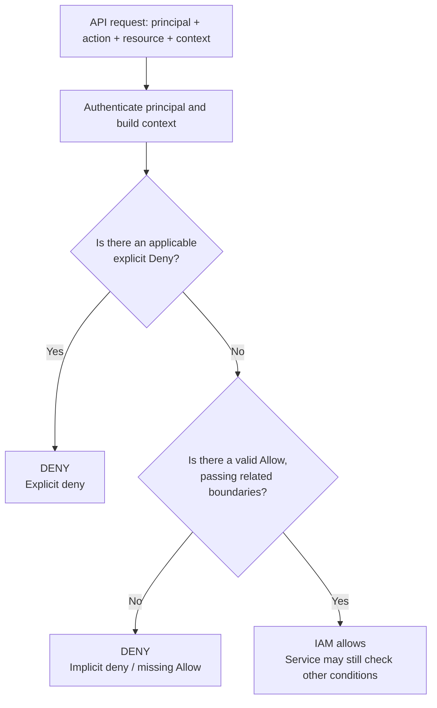
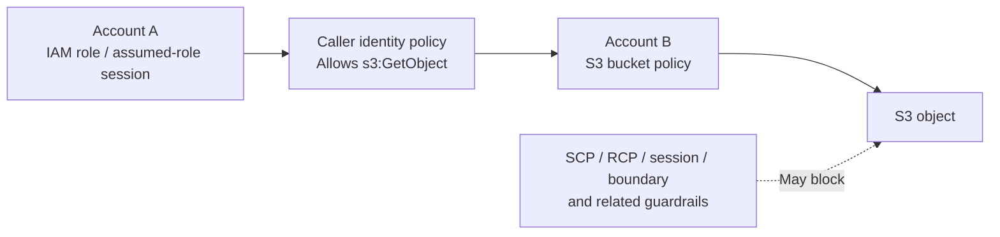

# How IAM Evaluates Permissions and Explicit Deny on AWS

> **Chapter:** IAM and Permissions · **Module:** `CLOUD_PROVIDERS_AWS`  
> **Focus:** understand how AWS IAM decides *Allow* or *Deny* for an access request, especially the overriding precedence of **explicit deny** across applicable policies.

## 1. Learning Objectives and Real-World Problem

When an AWS application calls an API, the critical question is not just "does this role have a policy allowing it?", but:

- **Who** is calling: an IAM user, assumed role session, AWS service, or a principal from another account?
- Calling **what action**: for example, `s3:GetObject`, `s3:ListBucket`, or `ec2:TerminateInstances`?
- Against **which resource**: a specific bucket ARN, object, instance, or key?
- In **what context**: Region, IP address, tags, MFA, TLS connection, time, VPC endpoint...?
- Which **policies and boundary mechanisms** apply: identity policy, resource policy, permissions boundary, session policy, SCP, RCP...?

After this lesson, learners can interpret `AccessDenied` results accurately; distinguish **implicit deny** from **explicit deny**; trace the impact of `Allow`, `Deny`, and `Condition`; understand cross-account permissions; and safely test policies before deploying to production.

This knowledge is foundational for implementing IAM for applications running on **EC2, Lambda, S3, RDS, and VPC**, monitoring with **CloudTrail**, enforcing **least privilege**, and reducing the risk of destructive resource operations.

## 2. Core Mindset: Default Deny, Valid Allow Required, Explicit Deny Wins

AWS IAM starts from the principle of **deny by default**. Without an appropriate granted permission, a request is denied.

Three rules to remember:

1. **Default is implicit deny.** When no valid `Allow` grants permission for the action/resource/context, IAM denies the request.
2. **Allow takes effect only when related constraints permit it.** An `Allow` statement in an identity policy is insufficient if an applicable permissions boundary, session policy, or SCP restricts the permission.
3. **Explicit deny has highest precedence.** If an `Effect: "Deny"` statement matches the request in an effective policy, the request is denied—even if another policy contains an `Allow`.



This diagram is a **general mental model** and does not replace exceptions in resource policies, session permissions, Organizations, or service-specific handling presented later.

### 2.1. How Do Implicit Deny and Explicit Deny Differ?

| Criterion | Implicit deny | Explicit deny |
|---|---|---|
| Origin | No valid `Allow` after evaluating applicable constraints | A `Deny` statement matches action, resource, and principal/context |
| Requires writing `"Effect": "Deny"`? | No | Yes |
| Can it be overridden by another `Allow`? | In some models, yes: e.g., a same-account resource-based policy granting Allow directly to an eligible principal | **No**, if that Deny applies to the request |
| Typical effect | Implements "deny by default", limits permissions via boundary/session/SCP | Establishes explicit guardrails, such as blocking data deletion |
| When troubleshooting | Look for missing Allow or a restricting boundary | Find the exact effective Deny statement and which condition matched |

**Quick example:** a role is granted `s3:GetObject` on `arn:aws:s3:::course-data/public/*`. Accessing `public/lesson.json` can be allowed. Accessing `private/salary.csv` results in *implicit deny* because it falls outside the Allow scope. If the policy also has a `Deny` for `public/restricted/*`, then `public/restricted/secret.json` results in *explicit deny*, despite the `Allow` covering `public/*`.

## 3. What Information Does AWS Collect to Evaluate a Request?

An access request typically includes these components:

| Component | Example | Why does it matter? |
|---|---|---|
| **Principal** | `arn:aws:sts::111122223333:assumed-role/ShopApiRole/session-01` | Identifies the user/role session performing the action |
| **Action** | `s3:GetObject` | Determines the API permission that must be granted |
| **Resource** | `arn:aws:s3:::shop-training-data/public/item.json` | Identifies the requested ARN or resource set |
| **Request context** | `aws:SecureTransport = true`, source IP, tags, MFA | Used to evaluate `Condition` blocks in policies |
| **Account/organization context** | Resource-owning account, principal account, OU, and SCP/RCP | Determines guardrail policies and cross-account access rules |

For some services/actions, an API requires multiple permissions or multiple resource types; some actions do not support resource-level permissions and require `"Resource": "*"`. Do not assume an API only checks a single ARN.

### 3.1. Structure of an IAM JSON Statement

An IAM policy usually consists of `Version` and a list of `Statement` items. Key elements inside a statement:

- `Effect`: `Allow` or `Deny`.
- `Action` / `NotAction`: matching operations.
- `Resource` / `NotResource`: matching resources.
- `Condition`: conditions that must match for the statement to take effect.
- `Principal` / `NotPrincipal`: identifies applicable subjects in a **resource-based policy** or role trust policy; normally `Principal` is not used in an identity-based policy.

Example identity-based policy allowing reads in `public/` while blocking `public/restricted/`:

```json
{
  "Version": "2012-10-17",
  "Statement": [
    {
      "Sid": "AllowReadPublicObjects",
      "Effect": "Allow",
      "Action": "s3:GetObject",
      "Resource": "arn:aws:s3:::shop-training-data/public/*"
    },
    {
      "Sid": "DenyReadRestrictedObjects",
      "Effect": "Deny",
      "Action": "s3:GetObject",
      "Resource": "arn:aws:s3:::shop-training-data/public/restricted/*"
    }
  ]
}
```

Let's evaluate each request:

| Action and object | Allow statement | Deny statement | Result if no other policy/boundary applies |
|---|---|---|---|
| `GetObject` on `public/catalog.json` | Matches | Does not match | **Allow** |
| `GetObject` on `public/restricted/plan.json` | Matches | Matches | **Explicit deny** |
| `GetObject` on `private/plan.json` | Does not match | Does not match | **Implicit deny** |
| `PutObject` on `public/new.json` | Does not match (different Action) | Does not match | **Implicit deny** |
| `ListBucket` on bucket `shop-training-data` | Does not match (different Action/Resource) | Does not match | **Implicit deny** |

**The order** in which the two statements appear in the JSON array does not change precedence. AWS does not evaluate top-down like "last line wins"; a matching explicit Deny always takes precedence.

> **S3 ARN Note:** `s3:ListBucket` uses the bucket ARN (`arn:aws:s3:::shop-training-data`), whereas `s3:GetObject` uses the object ARN (`arn:aws:s3:::shop-training-data/*` or a specific prefix). Mixing up these two ARN formats is a common reason permissions fail to work.

## 4. Policy Layers Involved in Evaluation

A single action can be affected by multiple policy types. The following layers have **different roles** and cannot simply be merged into one flat list of `Allow`s.

| Policy type | Where attached? | Role during evaluation |
|---|---|---|
| **Identity-based policy** | IAM user, group, or role | Grants or denies actions for the principal; can be AWS managed, customer managed, or inline |
| **Resource-based policy** | S3 bucket, SQS queue, Lambda function, KMS key, role trust policy... | Specifies which principals may operate on the resource; effect depends on service and same-account/cross-account relationship |
| **Permissions boundary** | IAM user/role | Caps the **maximum permissions** an identity-based policy can grant; the boundary itself **grants no permissions** |
| **Session policy** | STS session on supported role/federation assumption | Narrows session permissions relative to the source role/user per the corresponding mechanism; **grants no extra permissions** |
| **Service Control Policy (SCP)** | AWS Organizations: root, OU, account | Caps maximum permissions for principals in member accounts within SCP scope; SCP **grants no permissions** |
| **Resource Control Policy (RCP)** | AWS Organizations: root, OU, account | Permission guardrail for RCP-supported resource types in organization accounts; RCP **grants no permissions** |
| **VPC endpoint policy** | Certain VPC endpoint types | Controls which requests may pass through that endpoint; does not replace IAM or resource policies |
| **Other service rules** | E.g., KMS key policy/grant, S3 Block Public Access, service-specific conditions | May add separate requirements; an IAM Allow does not guarantee the operation succeeds |

**Correct understanding:** Identity policies are usually where permission grants begin; boundaries, session policies, SCPs, and RCPs act as limits; resource policies can grant permissions from the resource side or explicitly deny. There is an exception when a resource policy grants Allow **directly to an IAM user or assumed-role session** in the same account. Therefore, always inspect which principal type is named in a resource policy before concluding access was blocked solely due to a missing Allow in a boundary/session.

### 4.1. Identity-Based and Resource-Based Policies: Union Within the Same Account

In the standard **same-account** scenario, Allows from identity-based policies and resource-based policies are combined via **union**: either one can supply the Allow, provided there is no Deny or blocking boundary.

Example with bucket and role in the same account:

- `ShopApiRole`'s identity-based policy Allows `s3:GetObject`.
- The bucket policy has no specific Allow statement for the role.
- If the bucket policy has no Deny and other boundaries allow it, the request can be accepted based on the identity policy.

Conversely, a resource policy can grant permissions directly to a same-account principal without needing a matching Allow in the identity policy. However, the outcome still depends on **which principal type is specified** (IAM role ARN, IAM user ARN, role session ARN), permissions boundaries, session policies, and other limiting mechanisms.

**Do not blindly apply the "union" rule to cross-account access.** Cross-account access typically requires permission from both the principal's account and the resource's account across their respective policy layers.

### 4.2. Permissions Boundary: Restricts, Does Not Grant on Its Own

Suppose role `CatalogReaderRole` has:

- Identity policy: `Allow s3:GetObject` on `arn:aws:s3:::shop-training-data/public/*`.
- Permissions boundary: only `Allow s3:ListBucket` on `arn:aws:s3:::shop-training-data`.
- No resource-based policy directly granting permission under the exception case.

When the role calls `s3:GetObject`, it receives **implicit deny**, because the permission granted by the identity policy lies outside the boundary's Allow cap. Having an Allow in the identity policy cannot expand the boundary.

Mental expression for the standard identity policy path:

```text
Effective permissions from identity policy
  = Identity policy Allow permissions
  ∩ Permissions boundary Allow permissions (if present)
  ∩ Session policy Allow permissions (if present)
  ∩ Applicable SCP/RCP scope
  - Any effective explicit Deny
```

The expression above only describes the **identity policy grant path**. It is not the complete formula for every call because direct grants via resource-based policies have nuances explained in `4.5`. SCPs and RCPs also have their own scope, principal/resource types, and exceptions.

### 4.3. SCP: AWS Organizations Permission Guardrail

An SCP has a `Deny` on `ec2:TerminateInstances` for member accounts in the `Production` OU. Even if `OperationsRole` in one of those accounts has `ec2:*` in its identity policy, terminating EC2 instances results in **explicit deny** if the request falls under SCP scope.

Minimal illustrative SCP for the scenario:

```json
{
  "Version": "2012-10-17",
  "Statement": [
    {
      "Sid": "DenyTerminateInstances",
      "Effect": "Deny",
      "Action": "ec2:TerminateInstances",
      "Resource": "*"
    }
  ]
}
```

Key points to remember:

- SCPs set a **permission ceiling**, and do not grant permissions to accounts or principals on their own.
- When using an allow-list SCP strategy, permissions also depend on `Allow`s at each relevant organization level (root → OU → account); without a valid Allow at every level, requests can be blocked by **implicit deny**.
- SCPs apply per Organizations scope and have **exceptions**, such as not restricting principals in the management account and certain principal/service-linked role types per AWS documentation.
- If Organizations is not used or no SCP applies to the request in question, never assume an SCP is blocking it.

### 4.4. RCP: Permission Guardrail on the Resource Side

A **Resource Control Policy (RCP)** is an AWS Organizations guardrail layer applying to supported resource types and actions. It sets limits on principals accessing resources belonging to accounts within RCP scope; RCPs are not used to grant permissions to principals.

Mental example: an S3 bucket in an account governed by an RCP has a guardrail denying a certain access pattern; an `Allow` in the bucket's resource-based policy cannot override that active guardrail.

Do not assume RCP applies to **every** AWS service. When evaluating errors, check the list of RCP-supported resources/actions, which OU/account receives the RCP, and AWS-documented exceptions. Like SCPs, RCPs follow an organization hierarchy and do not replace identity/resource policies.

### 4.5. Important Exception When a Resource-Based Policy Grants Directly to a Principal

Within the **same account**, resource-based policies granting permissions to different principal types can result in different implicit-deny behavior:

- Granted directly to an **IAM user ARN**: a matching Allow in a resource policy might not be restricted by an **implicit deny** in the identity policy or permissions boundary.
- Granted directly to an **assumed-role session ARN**: an Allow might not be restricted by an **implicit deny** in the identity policy, permissions boundary, or session policy in certain cases.
- Granted to an **IAM role ARN**: implicit deny constraints from permissions boundaries and session policies can still limit permissions granted by the resource policy.

These differences depend on **the actual principal in the request** and **how the policy specifies the principal**, including cases using the `aws:PrincipalArn` condition. Never use these exceptions to design ways around guardrails.

**Invariant:** an explicit `Deny` in an effective policy still overrides any Allow granted under the cases above. SCP/RCP constraints, where applicable, must still be checked separately.

## 5. How Does Explicit Deny Work?

A Deny statement must **match the request** to take effect: Action, Resource, Principal (if present), and any related Conditions must all be satisfied per IAM syntax. Deny does not "spread to every request" just because a policy contains the keyword `Deny`.

### 5.1. Deny by Action or Resource

Suppose we need to prevent production EC2 instances from being deleted. A guardrail can Deny `ec2:TerminateInstances` with an appropriate resource scope or tag condition; depending on requirements, this can use an SCP, identity policy, or another layer.

Distinctions:

- Denying `ec2:TerminateInstances` does **not automatically** Deny `ec2:StopInstances`.
- Denying a specific instance ARN does **not automatically** apply to other instance ARNs.
- Tag-based Denies trigger only when the key/value and Condition operator match the request context.

### 5.2. Deny When Not Using HTTPS/TLS

Example bucket policy denying object and bucket access when requests do not use TLS:

```json
{
  "Version": "2012-10-17",
  "Statement": [
    {
      "Sid": "DenyInsecureTransport",
      "Effect": "Deny",
      "Principal": "*",
      "Action": "s3:*",
      "Resource": [
        "arn:aws:s3:::shop-training-data",
        "arn:aws:s3:::shop-training-data/*"
      ],
      "Condition": {
        "Bool": {
          "aws:SecureTransport": "false"
        }
      }
    }
  ]
}
```

This is a **resource-based policy** for an S3 bucket; `Principal` specifies whom the statement applies to. When `aws:SecureTransport = false` and the statement matches, explicit Deny blocks the request, even if the role has `Allow s3:*` in its identity policy.

If `aws:SecureTransport = true`, this Deny statement **does not match**; that only means the request *was not denied by this statement*, not that the request is Allowed. For certain service-to-service calls, network/SSL info might not be fully present in the authorization context; when creating production TLS policies, consult AWS guidance on AWS service principals and `aws:PrincipalIsAWSService` to avoid blocking legitimate service calls.

### 5.3. Condition Directly Affects Whether a Statement Matches

For example, Allow only when the caller uses MFA, an allowed source IP, or a specified tag. In IAM:

- Multiple condition keys in the same statement are usually combined with **AND** logic.
- Multiple values for a single key and operator are evaluated according to the respective IAM operator rules; do not assume all are AND or all are OR.
- `StringEquals`, `StringNotEquals`, `Bool`, `Null`, `IpAddress`, and `IfExists` operators each have distinct rules.
- When a key is missing from the request context, the result depends on the operator; be especially careful with `Not...`, `IfExists`, and Deny.
- Specific keys such as `aws:RequestedRegion`, `aws:PrincipalTag/...`, `aws:ResourceTag/...`, and `aws:MultiFactorAuthPresent` must be verified for support by the service/action.

Never copy policies with Region/IP/MFA conditions from one environment to another without verifying context. A flawed Deny can lock out an entire application or administrative workflow.

## 6. Interpreting Multiple Policies Through Scenarios

### 6.1. Permission Decision Table

Suppose a role executes an action based on an identity-based policy (no direct Allow from a resource policy under exception rules) and the policy layers listed in the table all apply:

| Identity policy | Boundary | SCP | Resource policy | Decision |
|---|---|---|---|---|
| Allow `GetObject` | Allow `GetObject` | Permitted within guardrail | No Deny | **Allow** if all other conditions are valid |
| Allow `GetObject` | Does not Allow `GetObject` | Permitted | No Deny | **Implicit deny** due to boundary |
| Allow `GetObject` | Allow | Explicit Deny `GetObject` | No Deny | **Explicit deny** due to SCP |
| Allow `GetObject` | Allow | Permitted | Explicit Deny `GetObject` | **Explicit deny** due to resource policy |
| Does not Allow `GetObject` | Allow | Permitted | No Allow granted | **Implicit deny** due to missing permission |
| Allow `GetObject` | Allow | Permitted | Deny only for non-TLS connections | **Allow over TLS**, **Deny without TLS**, if no other boundary blocks it |

This table helps predict outcomes, though each production scenario must also consider RCPs, session policies, endpoint policies, cross-account rules, service-specific authorization, and how the resource policy specifies principals.

### 6.2. Scenario A: Lambda Is Allowed to Read S3 but Still Gets AccessDenied

A Lambda in the Singapore Region uses execution role `ShopReportRole` to read `arn:aws:s3:::shop-training-data/public/sales.json`. The role has:

```json
{
  "Version": "2012-10-17",
  "Statement": [
    {
      "Effect": "Allow",
      "Action": "s3:GetObject",
      "Resource": "arn:aws:s3:::shop-training-data/public/*"
    }
  ]
}
```

However, the bucket policy has a Deny on `s3:GetObject` with a network-restricting `Condition`; the actual request matches the Deny. The outcome is **explicit deny**.

**Investigation steps:** verify the Lambda execution role session, object ARN, bucket location, action, and request context; read every Deny statement in the bucket policy, and check boundary/SCP/RCP if present. Adding `s3:*` to the role **will not resolve** an active explicit Deny and only increases risk.

### 6.3. Scenario B: Identity Allows, Boundary Lacks Allow

Role `DeployRole` has an identity policy Allowing `cloudformation:CreateStack`. The role's permissions boundary only Allows certain read actions (`Describe*`, `List*`), not `CreateStack`.

Outcome: **implicit deny** because CreateStack is outside the boundary cap, assuming no exception-based direct grant from a resource policy.

**Proper fix:** check business requirements and adjust permissions **in sync** across the identity policy and boundary following least privilege with review; do not delete the boundary just to "make it run."

### 6.4. Scenario C: Admin Role Cannot Delete EC2

A role has identity policy `AdministratorAccess` or `Allow ec2:*`; the production OU's SCP has `Deny ec2:TerminateInstances`.

Outcome: **explicit deny** by the SCP when the request is subject to that SCP. Admin permissions within a member account cannot override Organizations guardrails.

**How to handle:** determine which SCP is attached at the root/OU/account level, whether the specific principal is subject to it, and the intended safeguard. Only authorized administrators should adjust guardrails if there is a valid business requirement.

### 6.5. Scenario D: Account A Needs Access to an S3 Bucket in Account B

Account A holds an application role. Account B owns the data bucket.



For cross-account access under the standard pattern:

1. In **A**, the caller's permissions must allow the action on the resource in **B**, accounting for any applicable boundary/session/SCP.
2. In **B**, the bucket policy must allow the appropriate principal from **A** (directly or via a supported cross-account configuration), with no matching Deny.
3. Any RCP applicable to **B**'s resource, if present, must not block it. Separate requirements such as permission to use a KMS key when objects are SSE-KMS encrypted must also be satisfied.
4. If the request traverses a VPC endpoint, the corresponding endpoint policy must also permit it.

**An Allow on only one side is not enough** to conclude cross-account access will succeed. This is also why many cross-account bugs appear only in production even though the application worked in a single-account test environment.

### 6.6. Scenario E: Role Assumption Differs from the Role's API Permissions

To allow a service or another principal to **assume a role**, AWS also evaluates the **role trust policy** and permissions related to `sts:AssumeRole`. A trust policy is a resource-based policy attached to the IAM role. After successful assumption, the application receives **temporary credentials** for the role session; subsequent APIs are evaluated against the effective permissions of that **session**.

Therefore, distinguish two steps:

1. Is creating a session of the role allowed?
2. Once the session exists, is the session allowed to call `s3:GetObject`, `dynamodb:PutItem`, etc.?

A role whose trust policy lets Lambda assume it does **not automatically** gain S3 access; the execution role still needs an appropriate permissions policy.

## 7. Systematic Method for Reading AccessDenied Errors

When encountering `AccessDenied` or `UnauthorizedOperation`, analyze in order:

1. **Confirm the actual principal.** Check the role, user, or assumed-role session in use; do not infer the identity from a profile name or environment variable.
2. **Identify the action and resource.** Read the denied API and exact ARN; distinguish bucket resources from object resources, or write actions from list actions.
3. **Read the error message if present.** Some services return reasons such as "because no identity-based policy allows..." or "with an explicit deny in a service control policy." Messages are not always complete and may cite only one cause.
4. **Search for any applicable Deny.** Check identity policies, resource policies, boundaries, session policies, SCPs/RCPs, VPC endpoint policies, and relevant service constraints.
5. **If there is no Deny, look for the missing Allow.** Check Action, Resource, Principal, Condition, ARN, prefix, Region, and the intersection of limiting policies.
6. **Verify execution conditions.** Encryption/KMS, network path, VPC endpoint, tags, MFA, and service-specific policies.
7. **Retest with minimal queries and record changes.** Never open full permissions just to "see if the error goes away."

Following this model avoids two mistakes: granting overly broad permissions while the error persists, or deleting security guardrails that should remain in place.

### 7.1. AWS CLI: Identify the Active Identity

The following examples are **read/inspection** commands and do not create or modify resources. They require AWS CLI v2 and appropriate credentials/profile.

```bash
aws sts get-caller-identity
```

Output includes `Account`, `Arn`, and `UserId`. For an assumed-role session, the ARN typically looks like:

```text
arn:aws:sts::111122223333:assumed-role/ShopApiRole/session-name
```

Note: the base role ARN and the assumed-role session ARN are two distinct ARN forms; this distinction can affect how resource policies grant access directly to principals.

### 7.2. IAM Policy Simulator: Test an Action and ARN

Example simulating a role reading an object:

```bash
aws iam simulate-principal-policy \
  --policy-source-arn arn:aws:iam::111122223333:role/CatalogReaderRole \
  --action-names s3:GetObject \
  --resource-arns arn:aws:s3:::shop-training-data/public/catalog.json \
  --query "EvaluationResults[].[EvalActionName,EvalResourceName,EvalDecision]" \
  --output table
```

`EvalDecision` can be `allowed`, `implicitDeny`, or `explicitDeny`. Requires IAM simulation permissions and an existing role.

**Limitations:** Policy Simulator does not completely replace live requests; certain cases with resource-based policies, Organizations SCPs/RCPs, service-specific logic, context keys, or cross-account access require separate inspection and may not be fully simulated. Use the simulator to narrow down causes, combine it with **CloudTrail** and live policies, and verify with permitted actions in a test environment.

### 7.3. IAM Access Analyzer and CloudTrail

- **IAM Access Analyzer**: helps validate policies and catch common security risks; includes analysis/recommendation capabilities based on access data. Warning findings are not a final verdict for individual requests.
- **AWS CloudTrail**: helps trace API calls, principals, timestamps, and error outcomes when events are logged; requires checking the right account, Region, trail/event data store, and configured event types. Do not assume all S3 data events are logged by default.
- **IAM policy summary, policy viewer, Organizations policy viewer**: use these to inspect live deployed policies, not just JSON files in source code.
- **Resource policies and endpoint policies**: must be inspected directly on the resource/endpoint because they do not appear inside a role's identity policy.

## 8. Designing Secure Policies for AWS Applications

A web application with an **API on Lambda or EC2**, files in **S3**, records in **DynamoDB or RDS**, and logs in **CloudWatch** often needs several permissions, each of which should be narrowly scoped:

| Component | Permissions to review | How to keep scope minimal |
|---|---|---|
| Lambda/EC2 execution role | Read/write permissions for app resources | Restrict Actions, ARNs, environments, and Conditions where supported by the service |
| S3 bucket | Reading objects in required prefixes | Separate `GetObject`/`PutObject` from `ListBucket`; enforce TLS and appropriate public access settings |
| DynamoDB | `GetItem`/`Query`/`PutItem` per task | Scope to specific tables/indexes; consider item/attribute conditions where supported |
| RDS | Connection credentials or IAM DB authentication when configured | Distinguish RDS management API permissions from SQL permissions inside the database |
| KMS | `Decrypt`/`Encrypt`/`GenerateDataKey` when using encryption | Combine IAM policies with key policies/grants and required encryption context conditions |
| CloudWatch Logs | Writing logs to specific log groups/streams | Restrict unnecessary log management/deletion permissions |
| Production administration | Boundary/SCP/RCP and appropriate approvals | Place explicit Denies on sensitive operations when required; verify scope to avoid locking out operations |

An effective design principle is to **place Allow at the smallest valid scope and use Deny for clear, justified prohibitions**. Do not pile up Deny statements to compensate for overly broad identity policies if you can tighten the source grant. Conversely, org-level Deny guardrails are valuable when enforcing consistent protections across many accounts.

### 8.1. Do Not Confuse IAM with Networking, Deployment Scope, and Services

IAM users/roles are global identity sources within an AWS partition, yet a Lambda function, VPC, RDS instance, or S3 bucket still has deployment locations and service-specific constraints. An IAM Allow does not mean:

- connections to RDS will pass through security groups/NACLs/firewalls;
- S3 data is permitted to cross configured data residency boundaries;
- a KMS key in another Region can be used automatically;
- an action is allowed in any Region if an SCP or IAM condition restricts `aws:RequestedRegion`;
- the resource exists, supports the feature, or has available capacity/quota.

**IAM's decision is only one part of the final operational outcome.** When a request fails, beyond policies you must check networking, encryption, application configuration, and service state.

## 9. Thought Exercises: Identify the Cause of Deny Yourself

### Exercise 1 — Statement order

An identity policy contains:

- Statement 1: `Allow s3:GetObject` on `arn:aws:s3:::shop-training-data/*`.
- Statement 2: `Deny s3:GetObject` on `arn:aws:s3:::shop-training-data/secrets/*`.

A user reads `secrets/key.json`. If the two statements are swapped, does the result change?

**Answer:** No. Because the explicit Deny matches objects in `secrets/*`, the result remains Deny regardless of statement order.

### Exercise 2 — Missing Allow

A role only has `Allow s3:ListBucket` on the bucket ARN, without `Allow s3:GetObject`. The role downloads an object from the bucket.

**Answer:** Typically implicit deny for `s3:GetObject` because ListBucket and GetObject are different actions. You must still check whether a resource policy grants Allow directly and check related boundaries before concluding for a specific request.

### Exercise 3 — Blocked by boundary

A role has `Allow dynamodb:PutItem`, while its boundary only permits `dynamodb:GetItem` and `dynamodb:Query`. No resource policy grants extra permissions.

**Answer:** Implicit deny for PutItem; the identity policy's Allow falls outside the boundary.

### Exercise 4 — SCP blocks admin

A role is granted `AdministratorAccess` in a member account, but an applicable SCP has `Deny iam:CreateUser`.

**Answer:** Explicit deny; admin permissions inside the account cannot override the SCP's Deny when the SCP actually applies to the principal/action.

### Exercise 5 — Deny condition does not match

A bucket policy has Deny `s3:GetObject` when `aws:SecureTransport = false`. The request uses HTTPS and has a valid identity Allow, with no other boundaries denying it.

**Answer:** The TLS Deny does not match; the request can be Allowed. "Not blocked by this Deny" and "Allowed overall" are two distinct statements.

### Exercise 6 — Cross-account

A role in A has `Allow s3:GetObject` for B's bucket, but B has not granted cross-account permissions in the bucket policy and no equivalent permission mechanism exists.

**Answer:** Access fails. Bucket owner B must also allow the principal from A under an appropriate cross-account authorization model.

### Exercise 7 — Direct grant to a role session

A same-account resource policy grants Allow directly to `arn:aws:sts::111122223333:assumed-role/MyRole/session-A`, while the identity policy lacks a matching Allow.

**Answer:** You cannot automatically conclude implicit deny just because the identity policy lacks Allow; direct grants to a role session follow different rules. You must still check for explicit Deny and all applicable guardrail layers for the request.

## 10. Checklist for Code Reviews and Incident Troubleshooting

Before deploying an IAM policy to production:

1. Verify the actual principal, action, ARN, and context of the real request.
2. Separate **identity-based Allow**, **resource-based Allow**, and **boundaries** (boundary/session/SCP/RCP).
3. Check for explicit Deny first; if a Deny matches, do not try to add Allows to bypass it.
4. If no Deny exists, check valid Allows and how limiting policies intersect; keep in mind direct-grant exceptions via resource policies.
5. Inspect `Resource`, `Principal`, Region, prefix, tags, MFA, and Condition keys closely.
6. For cross-account access, verify both sides as well as KMS/endpoint permissions if applicable.
7. Use the simulator, Access Analyzer, and CloudTrail to gather evidence; test within a safe scope.
8. Grant only least-privilege permissions and document the rationale for critical Deny statements.

**Key takeaway:** IAM does not resolve permissions by "which policy is stronger" or "which line appears last." The outcome emerges from request context, valid Allows passing all guardrail mechanisms, and any applicable explicit Deny. Mastering this helps deploy AWS workloads securely, observably, and with clear root-cause analysis for authorization errors.

## AWS Reference Documentation

- [Policy evaluation logic — IAM User Guide](https://docs.aws.amazon.com/IAM/latest/UserGuide/reference_policies_evaluation-logic.html)
- [Determining whether a request is allowed or denied — IAM](https://docs.aws.amazon.com/IAM/latest/UserGuide/reference_policies_evaluation-logic_policy-eval-denyallow.html)
- [How permissions boundaries work — IAM](https://docs.aws.amazon.com/IAM/latest/UserGuide/access_policies_boundaries.html)
- [Identity-based policies and resource-based policies — IAM](https://docs.aws.amazon.com/IAM/latest/UserGuide/access_policies_identity-vs-resource.html)
- [Cross-account policy evaluation logic — IAM](https://docs.aws.amazon.com/IAM/latest/UserGuide/reference_policies_evaluation-logic-cross-account.html)
- [Service Control Policies — AWS Organizations](https://docs.aws.amazon.com/organizations/latest/userguide/orgs_manage_policies_scps.html)
- [Resource Control Policies — AWS Organizations](https://docs.aws.amazon.com/organizations/latest/userguide/orgs_manage_policies_rcps.html)
- [Testing IAM policies with the IAM policy simulator](https://docs.aws.amazon.com/IAM/latest/UserGuide/access_policies_testing-policies.html)
- [IAM JSON policy elements reference](https://docs.aws.amazon.com/IAM/latest/UserGuide/reference_policies_elements.html)
- [IAM Access Analyzer](https://docs.aws.amazon.com/IAM/latest/UserGuide/what-is-access-analyzer.html)
