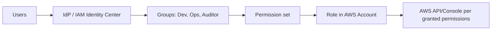
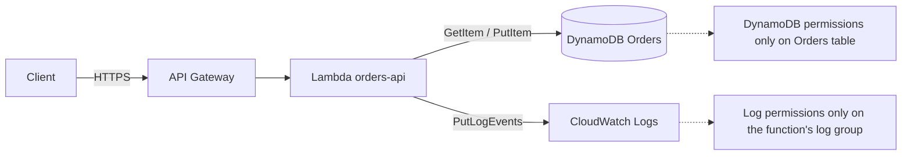

# Designing Least-Privilege Permissions for Users and Workloads on AWS

> **Chapter:** IAM and Permissions  
> **Scope:** Designing AWS access permissions following the *least privilege* principle for console/CLI users and workloads running on EC2, Lambda, ECS, EKS, or CI/CD systems. Examples use fictional AWS Account `123456789012`, Region `ap-southeast-1`.

## Learning Objectives

After this lesson, learners can:

1. Explain **least privilege** and distinguish **human** identities from **workload** identities.
2. Separate **who can assume a role**, **what the role is allowed to do**, **which resources accept access**, and **additional defensive boundaries**.
3. Write IAM policies using `Effect`, `Action`, `Resource`, and `Condition`, narrowing permissions by resource, environment, and business requirement.
4. Choose appropriate credential mechanisms for AWS IAM Identity Center, Lambda execution roles, EC2 instance profiles, ECS task roles, EKS, and CI/CD.
5. Test permissions, analyze `AccessDenied`, and use CloudTrail/IAM Access Analyzer to refine and maintain policies across releases.
6. Recognize privilege escalation risks and control access when deploying multi-account, multi-Region systems.

## 1. What Is Least Privilege?

**Least privilege** means granting each identity **only the actions it needs to perform, on the exact resources, under the required conditions and timeframe**. The goal is not to write the shortest policy, but to create the **smallest permission set that still satisfies business requirements**.

For example, a daily report export job only needs to read S3 objects under `reports/daily/`:

- Needs: `s3:GetObject` for objects under that prefix.
- Might need: `s3:ListBucket` if the job must list objects to pick files.
- Does not need: `s3:DeleteObject`, `s3:PutBucketPolicy`, `s3:ListAllMyBuckets`, or `AdministratorAccess`.
- Does not need permission to read customer data in another bucket or Account.

This distinction matters when credentials leak, an application has a vulnerability, or a user accidentally runs the wrong command: **the granted permissions determine the blast radius of what can happen**.

To design it, answer five questions:

| Question | Example for the reporting service |
|---|---|
| **Who?** Which identity (principal) sends the request? | IAM role for Lambda `DailyReportJobRole` |
| **What?** Which API actions are truly needed? | `s3:GetObject`, `dynamodb:Query` |
| **On what?** Which resource ARNs? | `arn:aws:s3:::example-report-bucket/daily/*` |
| **When/under what conditions?** Should policy conditions restrict it? | Only requests carrying a principal tag or coming from an allowed endpoint, where supported by the access path |
| **Who allows the identity to obtain the role?** What trust relationship is valid? | The Lambda service is allowed `sts:AssumeRole` on the execution role |

**Deployment-time permissions** (creating roles, attaching policies, creating Lambdas, creating VPCs) are usually **completely different** from runtime permissions (reading/writing specific data). Never merge these two roles just because they belong to the same project.

## 2. IAM Foundations to Understand Before Writing Policies

### 2.1 Principal, identity, and session

A **Principal** is the entity making an AWS request: an IAM user, IAM role, assumed-role session, account, or service principal depending on context. An **IAM role** does not carry built-in long-term access keys the way an IAM user can; roles are normally used via **temporary security credentials** from AWS STS or an AWS-managed mechanism.

For humans, prefer **AWS IAM Identity Center** combined with an identity provider (IdP) and user groups to receive time-bounded access to AWS accounts. For workloads running on AWS, prefer **runtime environment roles**. Avoid creating long-term access keys for applications when an appropriate role/federation mechanism exists.

### 2.2 Policy types and their roles

| Component | Function | Does it grant API execution permissions on its own? |
|---|---|---|
| **Identity-based policy** | Attached to an IAM role/user/group; lists actions and resources the identity may use | Can create `Allow` grants, subject to overall evaluation |
| **Resource-based policy** | Attached to supported resources, e.g., S3 bucket, KMS key, SQS queue, Lambda function | Can allow principals per resource syntax/policy, depending on context |
| **Role trust policy** | Type of resource-based policy on an IAM role; determines which principals can assume the role | Allows the assume-role operation; does not grant the role's data actions |
| **Permissions boundary** | Sets the maximum permissions cap of identity-based policies on an IAM user/role | No; restricts only |
| **AWS Organizations SCP** | Caps maximum permissions for principals in accounts affected by the SCP | No; restricts only |
| **AWS Organizations RCP** | Sets resource permission guardrails within supported organization scope | No; restricts only |
| **Session policy** | Further restricts permissions of a corresponding role/federated session | No; cannot expand the underlying role's permissions |

**Key takeaway:** One `Allow` statement in one policy does not guarantee a request will ultimately be permitted. AWS aggregates applicable policies, and **explicit `Deny` takes precedence**. The outcome also depends on principal type, resource policies, Organizations controls, boundaries, session policies, and request conditions. Some cases evaluating permissions via resource policies have special rules; do not assume all policies always intersect by one simple formula.

### 2.3 Policy structure

A common identity-based IAM policy:

```json
{
  "Version": "2012-10-17",
  "Statement": [
    {
      "Sid": "ReadSelectedObjects",
      "Effect": "Allow",
      "Action": "s3:GetObject",
      "Resource": "arn:aws:s3:::example-report-bucket/daily/*"
    }
  ]
}
```

Fields to understand:

- `Version` is the **IAM policy language version**, not the date you updated the document. `2012-10-17` is the standard value.
- `Statement` contains one or more permission rule blocks.
- `Effect` is `Allow` or `Deny`.
- `Action` takes the form `service:Operation`, for example `dynamodb:Query`.
- `Resource` specifies the target ARN when the action supports resource-level permissions.
- `Condition` restricts access based on request context, such as principal tags, source VPC endpoint, or resource tags, **when the service/action supports that condition key**.
- `Sid` is an optional descriptive label useful for auditing.

**Do not confuse an IAM policy with an ACL, security group, or network route.** IAM controls API authorization; security groups and routes control network connectivity. A request with IAM permission can still fail due to DNS, firewalls, missing endpoints, KMS keys, or application-layer authentication requirements.

## 3. Two Identity Types, Two Ways to Grant Permissions

### 3.1 Human users: access via Identity Center and groups

Operators, developers, and auditors typically work via the console or CLI. Common model:



**Job-role-based design:**

| Example group | Responsibilities | Suggested permission scope |
|---|---|---|
| `Developers` | View logs and inspect an app in dev | Read-only/observability in dev Account, rather than all of prod |
| `Deployers` | Deploy stacks from pipeline | Dedicated deployment permissions, scoped by stack, passable role, and environment |
| `Operations` | Operate/troubleshoot production | Controlled operational permissions; sensitive changes require privilege elevation workflows |
| `Auditors` | Inspect configurations, logs, and compliance state | Read-only matching audit scope, avoiding write/edit permissions |
| `Break-glass administrators` | Handle severe incidents when normal access paths fail | Special privileges, strictly protected and monitored, used under emergency procedures |

Use **groups and permission sets** to manage permissions by function. Avoid ad-hoc individual permission assignments, which become hard to audit during staff changes. Separate **dev/staging/prod** by Account when possible to reduce the blast radius of human error and overly broad policies.

**MFA** should be enforced for human logins; session duration, privilege elevation approvals, and production access must match sensitivity levels. Never copy `aws:MultiFactorAuthPresent` into every policy without verifying how the IdP/Identity Center represents sessions and supports MFA context.

### 3.2 Workloads: applications using roles and temporary credentials

Workloads are automated code calling AWS APIs, such as an order-processing job on Lambda, EC2 app, ECS task, EKS Pod, or CI/CD pipeline.

| Runtime environment | Recommended mechanism | Distinction to remember |
|---|---|---|
| **AWS Lambda** | **Execution role** | Role for Lambda code; not the role of the user deploying Lambda |
| **Amazon EC2** | **IAM role via instance profile** | App uses temporary credentials from instance metadata, never hardcoded access keys |
| **Amazon ECS** | **Task role** | Task role lets app code call AWS APIs; **task execution role** is for the ECS agent, pulling images, sending logs, or supporting bootstrap tasks |
| **Amazon EKS** | **EKS Pod Identity** or **IRSA** depending on cluster/needs | Assign roles per workload/pod, avoiding excess permissions via node role |
| **CI/CD outside AWS** | OIDC federation/`AssumeRoleWithWebIdentity` where supported by platform | Allow only matching repo, branch, environment, or job via trust conditions |
| **Workload from another Account** | STS `AssumeRole` into target role | Requires trust configured at target and assume-role permission at source |

**Do not share one high-privilege role across all applications.** Two Lambdas in the same VPC serving different purposes should have separate execution roles, unless their access requirements are genuinely identical and controlled.

**Never store access keys in source code, images, user-data, or long-lived environment variables.** SDKs can use the default credential provider chain to automatically resolve environment credentials. Protect logs, stack traces, and configs so credential data is never leaked.

## 4. Process for Designing Least-Privilege Policies

### Step 1 — Map the business operation flow

List only the actions the application **genuinely must perform** instead of opening `service:*` for convenience.

Example order-creation API:



Operations **not** needed at runtime: creating/deleting tables, editing IAM policies, creating roles, deleting buckets, or configuring API Gateway. Those belong to deployment/administration.

### Step 2 — Identify exact Actions and Resources

Check the **Service Authorization Reference** to learn which actions support specific resource ARNs, which resource types are required, and which condition keys are available.

Examples:

| Need | Corresponding Action | Resource to restrict |
|---|---|---|
| Fetch an item by key | `dynamodb:GetItem` | DynamoDB table ARN |
| Write a new item | `dynamodb:PutItem` | DynamoDB table ARN |
| Read an object's contents | `s3:GetObject` | S3 object ARN, not bucket ARN |
| List objects by prefix | `s3:ListBucket` | Bucket ARN + matching `s3:prefix` |
| Send logs to a log stream | `logs:PutLogEvents` | Log stream ARN inside log group |
| Invoke a specific function | `lambda:InvokeFunction` | Matching Lambda function/alias/version ARN |

Not every AWS action supports `Resource` by ARN; some list/describe actions require `Resource: "*"`. In those cases, narrow down the granted actions and use supported condition keys rather than slapping `*` across the whole policy out of habit.

### Step 3 — Choose credential mechanism and trust relationship

Humans use Identity Center/IdP; Lambda uses execution roles; EC2 uses instance profiles; ECS uses task roles; pipelines use OIDC/STS. For roles, the **trust policy** defines who can obtain the role.

Ensure the trust policy permits only the principal truly needed, and configure **caller IAM permissions** for `sts:AssumeRole` when the scenario requires it.

### Step 4 — Narrow permissions with Resource, Condition, and environment

Picking the "right Action" is only the start. For example, the same `s3:GetObject` at different scopes:

- Broad: `Resource: "*"` — could cover many matching buckets/objects, inappropriate for reading a single report.
- Narrowed to bucket: `arn:aws:s3:::example-report-bucket/*`.
- Narrowed to data prefix: `arn:aws:s3:::example-report-bucket/daily/*`.

Consider policy conditions like `aws:PrincipalTag/Team`, `aws:ResourceTag/Environment`, `aws:SourceVpce`, or `aws:RequestedRegion`. **No condition key automatically fits every service.** Specifically, forcing `aws:SourceVpce` only makes sense for requests genuinely traversing that VPC endpoint; misusing it can break console access or legitimate AWS service-to-service flows.

### Step 5 — Test permitted actions and actions that must be blocked

Verify the **positive path**: users can view logs, workloads read/write the right resources. Also test the **negative path**: jobs cannot delete tables, dev users cannot modify prod, runtime cannot create IAM roles.

Use IAM Access Analyzer to **validate policies** and spot unintended access scope; use IAM Policy Simulator as an analysis aid. The simulator cannot accurately model every interaction across policy types, environment data, and service state. Combine controlled integration testing, live logs, and inspection of applicable policies.

### Step 6 — Observe and refine

Use CloudTrail to find executed API actions, IAM last accessed information to check permission usage signals, and IAM Access Analyzer policy generation (when sufficient CloudTrail data supports it) to draft tighter policies.

**Do not automatically conclude "no log means no permission needed."** Rare events such as disaster recovery, key rotation, incident response, or quarterly jobs may not appear during the observation window. Coordinate with business owners before removing permissions.

### Step 7 — Maintain via Infrastructure as Code and reviews

Store policies, trust policies, permission sets, and related settings as reviewed IaC. When adding features, add only the new required actions; when retiring features, remove obsolete permissions.

Periodically review unused roles, trust relationships, IAM user access keys, external sharing, wildcards, and sensitive deployment permissions. Combine CloudWatch/CloudTrail/Config/AWS Security Hub or existing monitoring tools to detect anomalous changes. Logging levels, retention, and auditing must balance compliance requirements, observability, and cost.

## 5. Complete Example: Granting Permissions to an Order-Processing Lambda

Assume Lambda `orders-api` in Account `123456789012`, Region `ap-southeast-1`, only needs to read and create items in DynamoDB table `Orders`. We design **two separate parts**.

### 5.1 Execution role trust policy

Trust policy on IAM role `OrdersApiExecutionRole`:

```json
{
  "Version": "2012-10-17",
  "Statement": [
    {
      "Sid": "AllowLambdaServiceToAssumeRole",
      "Effect": "Allow",
      "Principal": {
        "Service": "lambda.amazonaws.com"
      },
      "Action": "sts:AssumeRole"
    }
  ]
}
```

The trust policy above allows **the Lambda service** to assume the role as an execution role. It does not grant DynamoDB permissions to the code. Who can create/update Lambdas and use `iam:PassRole` for that role must also be controlled separately to prevent attaching the role to functions managed by unauthorized actors.

### 5.2 Execution role permissions policy

Attach the identity-based permissions policy:

```json
{
  "Version": "2012-10-17",
  "Statement": [
    {
      "Sid": "ReadAndCreateOrders",
      "Effect": "Allow",
      "Action": [
        "dynamodb:GetItem",
        "dynamodb:PutItem"
      ],
      "Resource": "arn:aws:dynamodb:ap-southeast-1:123456789012:table/Orders"
    }
  ]
}
```

This policy intentionally **omits** `dynamodb:Scan`, `dynamodb:DeleteItem`, `dynamodb:DeleteTable`, `dynamodb:UpdateTable`, and IAM permissions. If the app needs `Query` on a GSI, verify the exact action, index ARN, and actual data requirement before expanding it.

For Lambda logging, if log group `/aws/lambda/orders-api` already exists, you can add a dedicated policy:

```json
{
  "Version": "2012-10-17",
  "Statement": [
    {
      "Sid": "WriteFunctionLogs",
      "Effect": "Allow",
      "Action": [
        "logs:CreateLogStream",
        "logs:PutLogEvents"
      ],
      "Resource": "arn:aws:logs:ap-southeast-1:123456789012:log-group:/aws/lambda/orders-api:log-stream:*"
    }
  ]
}
```

This CloudWatch Logs permission example assumes **the log group is pre-created** by infrastructure; if the workload is allowed to create its own log group, analyze `logs:CreateLogGroup` and its resource scope separately. AWS managed policies like `AWSLambdaBasicExecutionRole` may grant broader scope than the example above; inspect policy contents before using them by default.

### 5.3 Deployment permissions do not belong in the runtime role

A deployment role may need permissions to create/update Lambdas and pass the execution role to the service. To restrict `iam:PassRole`, you can use:

```json
{
  "Version": "2012-10-17",
  "Statement": [
    {
      "Sid": "PassOnlyOrdersExecutionRoleToLambda",
      "Effect": "Allow",
      "Action": "iam:PassRole",
      "Resource": "arn:aws:iam::123456789012:role/OrdersApiExecutionRole",
      "Condition": {
        "StringEquals": {
          "iam:PassedToService": "lambda.amazonaws.com"
        }
      }
    }
  ]
}
```

**`iam:PassRole` is not a standalone API**; it is a permission AWS checks when a caller passes a role to a service in supported APIs. This policy only controls passing the role; the deployment role also needs separately designed Lambda and related permissions. Deployers should never be free to create new roles with `AdministratorAccess` and pass them to functions.

**Why is this example least privilege?** The Lambda execution role only executes required data and logging APIs; the deployment role manages configuration. Separating responsibilities limits runtime vulnerability impact and simplifies auditing.

## 6. Human User Example: Read-Only Reports in S3

Assume an analytics team only needs to **list and download objects** under prefix `daily/` of bucket `example-report-bucket`, without uploading, deleting, or editing bucket policies.

The following policy can be placed in a permission set under the IAM Identity Center model if supported by applicable features and configurations:

```json
{
  "Version": "2012-10-17",
  "Statement": [
    {
      "Sid": "ListDailyPrefixOnly",
      "Effect": "Allow",
      "Action": "s3:ListBucket",
      "Resource": "arn:aws:s3:::example-report-bucket",
      "Condition": {
        "StringLike": {
          "s3:prefix": [
            "daily",
            "daily/*"
          ]
        }
      }
    },
    {
      "Sid": "DownloadDailyObjects",
      "Effect": "Allow",
      "Action": "s3:GetObject",
      "Resource": "arn:aws:s3:::example-report-bucket/daily/*"
    }
  ]
}
```

**Analysis:**

- `s3:ListBucket` is evaluated against the **bucket ARN**, and `s3:prefix` constrains requested key listings.
- `s3:GetObject` is evaluated against **object ARNs** under `daily/`.
- Does not grant `s3:PutObject`, `s3:DeleteObject`, `s3:PutBucketPolicy`, or `s3:*`.
- Actual access outcomes still depend on bucket policies, SCPs, KMS keys if objects are SSE-KMS encrypted, additional conditions, and session permissions.

**Note when operating via the S3 console:** the console UI may require extra permissions to browse bucket lists or paths. When requirements restrict access strictly to reading a prefix, prioritize testing behavior via AWS CLI/SDK with the exact URI before widening a policy solely for a UI action.

Expected operations example:

```bash
aws s3 ls s3://example-report-bucket/daily/ --region ap-southeast-1
aws s3 cp s3://example-report-bucket/daily/report.csv ./report.csv --region ap-southeast-1
```

Commands succeed only if the resource actually exists, the caller has appropriate permissions, and access conditions are satisfied. The `cp` command downloads to the local machine; protect report data according to organizational policy.

## 7. Frequently Confused Permission Boundaries

### 7.1 Trust policy differs from permissions policy

When Lambda runs:

1. **Trust policy** allows the Lambda service to assume the execution role.
2. Role **permissions policy** specifies which resources the code can act upon.
3. Target **resource policy** (if any) can allow, constrain, or deny access.
4. Additional guardrails such as SCPs, RCPs, boundaries, session policies, and explicit denies can still take effect.

Editing only the trust policy to "open DynamoDB access" targets the wrong layer. Editing only the permissions policy also fails to resolve cases where the service is not allowed to assume the role.

### 7.2 Permissions boundary does not grant additional permissions

Suppose a developer is permitted to create roles for the dev environment, provided new roles attach a permissions boundary allowing only a specific set of services. Then:

- Identity policy **does not grant** `s3:PutBucketPolicy` → still not allowed.
- Identity policy grants the action, yet **boundary does not allow it** → blocked within the applicable boundary scope.
- Boundary allows an action that the identity policy does not grant → boundary **does not make the action allowed on its own**.

Monitor the ability to detach/remove boundaries or create roles without boundaries attached. For cases where resource-based policies grant directly to a user/role session, AWS has different detailed rules; verify principal types and policy evaluation documentation instead of extrapolating from simple examples.

### 7.3 SCP does not replace IAM permissions

AWS Organizations SCPs restrict available permissions for affected accounts. For example, an organization policy can block dangerous administrative actions in production. Yet if a role is not allowed `dynamodb:GetItem` in its applicable policies, an SCP "allowing" DynamoDB **does not create** that permission.

SCPs and RCPs must be designed around AWS Organizations structure, attachment scope, and mechanism exceptions; not every account or principal in an organization is governed identically.

### 7.4 IAM Allow does not open network paths

An EC2 instance in a private subnet with a role allowed to call DynamoDB but lacking a valid network path will still fail with network errors. Use appropriate routes, NAT, or VPC endpoints; adjust security groups/DNS for the endpoint type. Conversely, adding a VPC endpoint does not automatically grant `dynamodb:GetItem`.

### 7.5 Read permissions and write/modify permissions must be cleanly separated

Seemingly "configuration management" actions like `iam:PassRole`, `iam:AttachRolePolicy`, `iam:CreatePolicyVersion`, `lambda:UpdateFunctionConfiguration`, or modifying resource policies can create privilege escalation paths if combined without controls. When granting deployment permissions, evaluate **combinations of actions that can be chained**, not just individual actions in isolation.

## 8. Scaling Least Privilege Across Multiple Accounts and Regions

### 8.1 Cross-account AssumeRole

A job in Account A (`210987654321`) needs to read a table in Account B (`123456789012`). Rather than copying access keys from Account B to A, create a role in B with a trust policy for **a specific role** in A:

```json
{
  "Version": "2012-10-17",
  "Statement": [
    {
      "Sid": "TrustReportingJobInSourceAccount",
      "Effect": "Allow",
      "Principal": {
        "AWS": "arn:aws:iam::210987654321:role/ReportingJobRole"
      },
      "Action": "sts:AssumeRole"
    }
  ]
}
```

To use this pattern, you typically need:

1. Source role `ReportingJobRole` in A has `sts:AssumeRole` permission on the target role ARN.
2. Target role trust policy in B trusts the exact source principal.
3. Target role permissions policy allows reading only the required resources in B.
4. Organizational guardrails and other resource policies do not block it.
5. Code in A assumes the role, then uses the resulting **temporary credentials** to call services in B.

If a **third party** is authorized to access multiple customers, consider the `sts:ExternalId` condition in the trust policy to mitigate *confused deputy* risk. External ID is not a secret replacing authentication; its value generation and provisioning workflow must fit each partner integration.

### 8.2 By Region and environment

ARNs of Regional resources typically contain Region and Account. Even if Lambda `orders-api` in dev and production share a name, their ARNs differ when Account/Region differ. Specify exact resources in policies; avoid wildcards like `arn:aws:lambda:*:*:function:*` just because you deploy across multiple Regions.

Some IAM roles and services are global within a partition, yet most data permissions should consider deployment geography. If using `aws:RequestedRegion` to restrict actions, test global APIs, cross-Region effects, and service support exceptions before applying in production.

## 9. ABAC: Attribute-Based Limits When Resources Grow Rapidly

**ABAC (attribute-based access control)** uses supported tags or attributes to express rules instead of manually listing hundreds of ARNs. For example, a user with principal tag `Project=Shop` may only operate on resources carrying the matching resource tag, provided the action/resource type supports the required condition.

ABAC reduces policy maintenance as environments/resources scale, but carries strict requirements:

- Tags must be reliably governed. If principals can freely edit `Project` or resource tags, they can escalate their own permissions.
- Check **tag-on-create** and tag update/delete permissions; enforce proper tag governance policies.
- **Not every service, action, or resource type supports every tag condition key**.
- Verify how conditions behave when tags are absent; distinguish `StringEquals`, `StringEqualsIfExists`, and set operators where needed.
- ABAC does not replace role trust controls or credential security.

Example scenario: each team can run certain EC2 instance types tagged with their project. Combine ABAC rules, action scopes, and organizational guardrails to prevent tag edits aimed at taking over another team's resources.

## 10. Designing Secure CI/CD Permissions

Pipelines usually need infrastructure provisioning permissions, giving them greater impact than runtime roles. A pipeline deploying Lambda via IaC might need:

- Permissions to update the specific stack/resources and create defined dependencies.
- `iam:PassRole` restricted strictly to approved execution roles and the exact target service principal.
- An OIDC trust relationship allowing only **the exact organization, repository, branch/tag, or environment** supported by claims and the IdP.
- Separate staging and production pipelines; enforce approvals and branch/environment protections in the CI platform.
- Monitor CloudTrail events to trace role sessions and policy modifications.

**Distinguish three permission sets:** permission to edit source code ≠ permission to run deployment pipelines ≠ permissions of the running application. If a developer can edit a pipeline and push a production deployment with `iam:*`, that breaks the entire least-privilege design.

For Amazon ECS, remember to separate the ECS agent's **execution role** (e.g., pulling ECR images and writing logs per config) from the **task role** used inside the container. With EKS, assign roles per appropriate service account/pod and restrict who can attach that service account; never use a broad node role to compensate for missing workload identity setup.

## 11. Verification and Diagnostics Guide

### 11.1 Identify the active principal and account

AWS CLI:

```bash
aws sts get-caller-identity
```

Typical output:

```json
{
  "UserId": "AROAEXAMPLEID:example-session",
  "Account": "123456789012",
  "Arn": "arn:aws:sts::123456789012:assumed-role/OrdersApiExecutionRole/example-session"
}
```

This is illustrative data. With an assumed role, `Arn` is the **session ARN**, not identical to the IAM role ARN `arn:aws:iam::123456789012:role/OrdersApiExecutionRole`.

### 11.2 Validate policies with IAM Access Analyzer

Example CLI command to **validate a policy** saved in a file prepared beforehand by an operator:

```bash
aws accessanalyzer validate-policy \
  --policy-document file://orders-permissions.json \
  --policy-type IDENTITY_POLICY \
  --region ap-southeast-1
```

The API can return findings about syntax, recommendations, or security issues. Inspect `findingType`, `issueCode`, and `locations`; "no findings" does not prove a policy is strictly minimal or that every live request will succeed.

This lesson **does not require creating** policy files or issuing credentials; the command above illustrates how to validate during labs.

### 11.3 Simulate permissions at the action/resource level

Illustrative example only with fictional role and table:

```bash
aws iam simulate-principal-policy \
  --policy-source-arn arn:aws:iam::123456789012:role/OrdersApiExecutionRole \
  --action-names dynamodb:GetItem dynamodb:DeleteTable \
  --resource-arns arn:aws:dynamodb:ap-southeast-1:123456789012:table/Orders
```

Expected per the policy in section 5: `dynamodb:GetItem` is allowed assuming no other deny/boundary applies, while `dynamodb:DeleteTable` is not allowed. The simulator has limitations regarding policy types, request context, and certain cross-account/resource-based policy cases; **do not** treat simulation results as a substitute for controlled live testing.

### 11.4 Verify permission usage after deployment

Inspect CloudTrail event history or relevant log trails to find:

- `eventSource` and `eventName` showing which API was called.
- `userIdentity`/session information tracing the role, session, and caller origin.
- `errorCode` and `errorMessage` classifying IAM denies vs. service errors.
- Combine with CloudWatch metrics to distinguish permission failures from throttling, wrong endpoints, or quotas.

Logging configuration must match the event category: CloudTrail **management events** and **data events** have different collection scopes. Never assume S3 object or DynamoDB item operations appear in event history unless appropriate collection is configured.

### 11.5 Common error diagnosis table

| Symptom | What to check | How to resolve |
|---|---|---|
| `AccessDenied` despite `Allow` attached | Action/Resource ARN, explicit deny, boundary, SCP/RCP, session policy, condition key, resource policy | Confirm principal, request context, and all applicable policies |
| Lambda cannot read DynamoDB | Trust and execution role, right Account/Region/table ARN, `dynamodb:GetItem` policy, VPC network if applicable | Verify caller with actual role; check IAM and network paths independently |
| S3 `GetObject` denied | Bucket ARN used instead of object ARN; missing KMS decrypt; bucket policy deny | Switch to prefix-scoped object ARN, inspect key policy and KMS permissions if needed |
| Developer can pass admin role to a service | `iam:PassRole` on `*` or missing role/`PassedToService` restriction | Restrict role ARN, target service, and role creation/editing permissions |
| AssumeRole rejected | Wrong principal in trust policy, missing `sts:AssumeRole` at source, missing required `ExternalId`/condition | Check both sides of the trust relationship and session constraints |
| Access fails only in production | Wrong AWS profile/account, Region, tag condition, different SCP or boundary | Check `sts get-caller-identity`, ARNs, Organizations controls, tags, and deployment config |
| API call times out | DNS, routes, SG, NAT/VPC endpoint, TLS, endpoint Region | Investigate connectivity before widening IAM policies |
| API returns `ThrottlingException` | Rate limits/quotas or load design | Observe metrics, apply jittered backoff, and adjust capacity appropriately |

**Never fix `AccessDenied` by attaching `AdministratorAccess` and leaving it in production.** If scope analysis is needed, test in a controlled environment, read error codes/ARN fields, and tighten policies around actual operations.

## 12. Designing Least-Privilege Access That Remains Operable

Least privilege can hinder operations if incident-response procedures are missing. A solid design needs:

- **Clear ownership:** who is responsible for application, data, networking, KMS, deployment, security, and incident response.
- **Controlled recovery roles:** emergency access and audit paths when routine permissions are insufficient.
- **Change monitoring:** CloudTrail, IAM Access Analyzer findings, IaC reviews, and alerts on sensitive permission edits.
- **Account, environment, and data isolation:** reduce blast radius during credential compromise or misdeployment.
- **Investigability:** log role/session identity, account, Region, API, resource, and timestamp; avoid logging unnecessary secrets/PII.
- **Cost control:** broad permissions allow launching expensive services/resources; constrain deployment permissions alongside AWS Budgets, CloudWatch, and appropriate quota checks.

Least privilege does not mean every API must work on the very first run. The right workflow is **grant justified permissions → verify → observe → refine policy**. Permissions must cover both normal execution paths and identified rare events such as failover or data recovery.

## 13. Applied Exercises

### Exercise 1 — Role design

A Lambda only reads items from DynamoDB `Orders`. Current policy:

```json
{
  "Version": "2012-10-17",
  "Statement": [
    {
      "Effect": "Allow",
      "Action": "dynamodb:*",
      "Resource": "*"
    }
  ]
}
```

Narrow down Action and Resource. When the role also needs to write CloudWatch Logs, how will you grant logging permissions without adding extra DynamoDB permissions?

### Exercise 2 — Human user permissions

An operations engineer is tasked with reading production Lambda logs and viewing function configurations, without changing code or deleting functions. Classify the actions:

- Potentially needed: `logs:FilterLogEvents`, `logs:GetLogEvents`, `lambda:GetFunctionConfiguration` (per actual requirement).
- Should not be granted by default: `lambda:UpdateFunctionCode`, `lambda:DeleteFunction`, `iam:PassRole`.

Which resources do the CloudWatch Logs actions require? Do they differ from Lambda ARNs? What extra permissions might the console UI need?

### Exercise 3 — CI/CD and privilege escalation

A pipeline has permission to create Lambdas but also has `iam:PassRole` on `*`. What could an attacker able to edit the pipeline attempt to exploit? Propose ways to constrain roles, services, deployment branches, and production approval gates.

### Exercise 4 — Cross-account

A role in Account A needs to assume a role reading a DynamoDB table in Account B. Is adding `sts:AssumeRole` in role A's identity policy enough? Explain the role of the trust policy in B and the data policy on role B.

### Exercise 5 — Error analysis

A function in a private subnet has a `dynamodb:GetItem` policy on the right table, yet the client times out. In what order will you check network/DNS/routes/VPC endpoints and IAM? When CloudTrail records no data events, can you conclude the function never sent a request?

<details>
<summary>Answer hints</summary>

1. Use `dynamodb:GetItem` on `arn:aws:dynamodb:ap-southeast-1:123456789012:table/Orders`. Grant logging permissions via a separate statement/policy on the appropriate log group/stream.
2. Restrict log reading to the function's log group and Lambda permissions to the function ARN. Check resource types and actions per service separately; add minimal console permissions only if required.
3. They could try passing a high-privilege role to a workload and using that workload to call privileged APIs. Restrict `iam:PassRole` by ARN, `iam:PassedToService`, manage source roles, protect branches/environments, and isolate production deployments.
4. Not enough. Account B must trust the source principal via a trust policy, the source role must have assume-role permission, role B must have DynamoDB permissions, and deny/Organizations controls must not block it.
5. Timeouts first point to a connectivity issue. Check DNS, routes, NAT/gateway endpoints, and security groups where relevant; next inspect authentication/authorization errors once requests reach AWS. Missing data events may simply mean the right logging category isn't enabled.

</details>

## 14. Checklist Before Merging or Deploying

- [ ] Clearly identified the human/workload principal and **business responsibility**.
- [ ] Human users sign in to AWS via Identity Center/IdP, MFA, and appropriate groups/permission sets.
- [ ] Workloads use **temporary credentials** via roles, Pod Identity/IRSA, or federation; no access keys in code.
- [ ] Trust policy allows only the exact service principal or authorized specific principal.
- [ ] IAM permissions have **specific Actions and ARNs**; avoid wildcards wherever boundaries can be specified.
- [ ] Evaluated **Conditions** by tag, environment, network, or request origin and confirmed API support.
- [ ] Separated **deployment roles**, **runtime roles**, and human user permissions.
- [ ] Controlled `iam:PassRole` and IAM/resource policy editing permissions against privilege escalation risks.
- [ ] Verified resource policies, KMS key policies, permissions boundaries, SCPs/RCPs, and session policies where applicable.
- [ ] Tested both **permitted actions** and **actions that must be denied**.
- [ ] Validated/reviewed policies, enabled CloudTrail monitoring, and set up a process to trim unused permissions.
- [ ] Established incident investigation capability, privilege-elevation/recovery procedures, and appropriate cost alerts.

## Official AWS Documentation

- [AWS IAM — Security best practices](https://docs.aws.amazon.com/IAM/latest/UserGuide/best-practices.html)
- [AWS IAM — Policies and permissions](https://docs.aws.amazon.com/IAM/latest/UserGuide/access_policies.html)
- [AWS IAM — Policy evaluation logic](https://docs.aws.amazon.com/IAM/latest/UserGuide/reference_policies_evaluation-logic.html)
- [AWS IAM — Service Authorization Reference](https://docs.aws.amazon.com/service-authorization/latest/reference/reference.html)
- [AWS IAM Identity Center — User Guide](https://docs.aws.amazon.com/singlesignon/latest/userguide/what-is.html)
- [AWS Lambda — Execution role](https://docs.aws.amazon.com/lambda/latest/dg/lambda-intro-execution-role.html)
- [Amazon ECS — Task IAM role](https://docs.aws.amazon.com/AmazonECS/latest/developerguide/task-iam-roles.html)
- [Amazon EKS — IAM roles for service accounts](https://docs.aws.amazon.com/eks/latest/userguide/iam-roles-for-service-accounts.html)
- [Amazon EKS — EKS Pod Identity](https://docs.aws.amazon.com/eks/latest/userguide/pod-identities.html)
- [AWS IAM Access Analyzer — Validate policies](https://docs.aws.amazon.com/IAM/latest/UserGuide/access-analyzer-policy-validation.html)
- [AWS STS — Temporary security credentials](https://docs.aws.amazon.com/IAM/latest/UserGuide/id_credentials_temp.html)

A well-authorized AWS system starts from the needs of users and workloads, translates those needs into specific API actions and ARNs, and verifies them through policy evaluation, activity tracing, and testing. This approach supports designing secure, observable, and resilient applications while avoiding permissions to create, modify, or consume resources beyond requirements and budgets.
