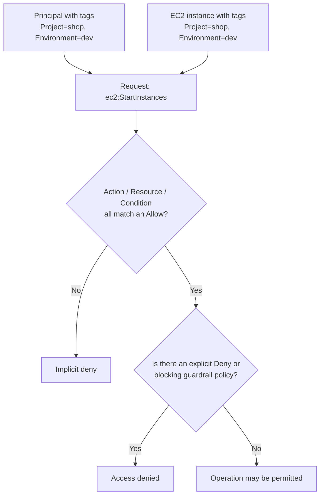
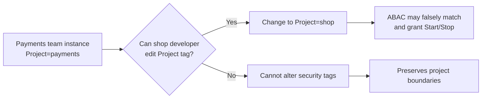
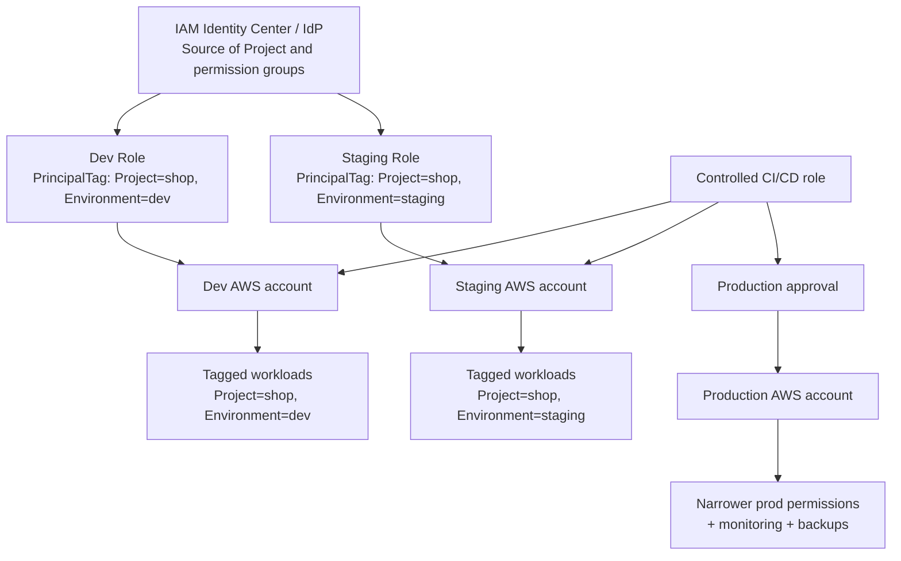

# ABAC with Tags and Resource Access Conditions on AWS

In the **Amazon Web Services (AWS)** ecosystem, Identity and Access Management (**IAM**) controls who or which service is allowed to perform what operations on which resources, under what conditions. As the number of development teams, applications, accounts, and resources grows rapidly, maintaining a dedicated policy for each server or bucket quickly becomes hard to manage. **Attribute-Based Access Control (ABAC)** expresses permissions using **attributes** of the identity, resource, and access request.

This lesson belongs to the **IAM and Permissions** chapter, module **CLOUD_PROVIDERS_AWS**. Within the scope of learning AWS from Regions/AZs, IAM, and VPC to compute, storage, databases, integration, serverless, monitoring, recovery, and cost, ABAC is a tool for consistent authorization when multiple teams deploy infrastructure together. The focus of this lesson is **ABAC with tags and resource access conditions**: designing tags, reading and writing IAM conditions, preventing privilege escalation via tag modification, and applying ABAC safely across dev, staging, and production.

## 1. Why Do We Need ABAC?

Suppose a company has three teams: `shop`, `payments`, and `analytics`. Each team deploys its own EC2 instances, secrets, and queues in a dev account. With traditional authorization, the platform team may have to update multiple policies whenever new resources are created:

- The exact list of instances the `shop` team can start and stop.
- The list of secrets the `payments` team can access.
- The resource list per environment: `dev`, `staging`, `prod`.

If policies list resources by ARN, every newly created resource may require editing a policy. ABAC lets you write a more general rule: **users tagged `Project=shop` may operate on resources also tagged `Project=shop`**, with additional conditions on environment, actions, and account scope.

Example:

| Subject | Subject attributes | Resource | Resource attributes | Desired outcome |
|---|---|---|---|---|
| Shop team developer | `Project=shop`, `Environment=dev` | EC2 A | `Project=shop`, `Environment=dev` | Allow Start/Stop if other policies also permit |
| Shop team developer | `Project=shop`, `Environment=dev` | EC2 B | `Project=payments`, `Environment=dev` | Deny Start/Stop |
| Shop team developer | `Project=shop`, `Environment=dev` | EC2 C | `Project=shop`, `Environment=prod` | Deny Start/Stop |
| Shop team developer | `Project=shop`, `Environment=dev` | EC2 D | Missing `Project` tag | Deny Start/Stop |

**Benefit**: one policy can serve multiple teams or continuously created resources; no need to update ARN lists every time a server is provisioned. **In return**, permission accuracy depends on tagging rules, tag-modification permissions, and condition support in each AWS API.

### ABAC and RBAC complement each other

| Approach | Based on what? | Example | Characteristics |
|---|---|---|---|
| **RBAC** — Role-Based Access Control | User role/job function | `Developer` can use EC2; `Auditor` reads logs | Easy to understand when the number of roles is stable |
| **ABAC** — Attribute-Based Access Control | Attributes of principal, resource, or request | Principal's `Project` must equal instance's `Project` | Fits rapidly changing resources, teams, and projects |
| **Combined RBAC + ABAC** | Role defines allowed operation types, tags define resource scope | `Developer` role can Start/Stop EC2 **only in their own project** | Common real-world practice |

ABAC does not grant any permissions on its own. IAM still requires an `Allow` policy for the requested action; tag matching only decides whether that policy matches in the specific context.

## 2. Which Attributes Participate in Access Decisions?

In AWS, a **tag** is usually a `key=value` pair, such as `Project=shop`. Not every IAM attribute is a tag: timestamps, IP addresses, requested Region, source organization, or VPC endpoint can also be placed in conditions.

### 2.1. Distinguishing key condition keys

| Condition key | Data checked | When used |
|---|---|---|
| `aws:PrincipalTag/Project` | Tag attached to the current IAM principal or session | Identify which project the principal belongs to |
| `aws:ResourceTag/Project` | Tag on the target resource, if supported by the action/service | Check whether principal shares the same project as the resource |
| `ec2:ResourceTag/Project` | Resource tag via EC2's service-specific context key | Control EC2 APIs supporting this condition |
| `aws:RequestTag/Project` | Tag passed in a create/tag request, if supported by the API | Require newly created resources to carry permitted tags |
| `aws:TagKeys` | Set of tag keys appearing in the request | Restrict the list of tag keys a request may use |
| `aws:RequestedRegion` | AWS Region targeted by the API request | Restrict operational Region where appropriate |
| `aws:PrincipalOrgID` | AWS Organizations ID of the principal | Restrict source access from the org, often used in resource-based policies |
| `aws:SourceVpce` | VPC endpoint ID traversed by the request, when present | Restrict network entry point for supported actions |

Keys prefixed with `aws:` are **global condition context keys**, though **that does not mean every service and every action supports every key**. Services may also offer service-specific condition keys like `ec2:ResourceTag/…`, `s3:ExistingObjectTag/…`, or `s3:RequestObjectTag/…`. Check the **Service Authorization Reference** for each action, resource type, and condition key before selecting an implementation.

### 2.2. Where do principal tags come from?

A principal can be an IAM user, IAM role, or access session issued via AWS STS. Values read by `aws:PrincipalTag/…` can originate from:

1. **IAM user or IAM role tags**: assigned to the identity by administrators.
2. **Session tags**: passed into an STS session during federation/assume role, if allowed by the trust policy and STS permissions.
3. **IAM Identity Center attributes for access control**: attributes from the identity source passed into the session for ABAC, depending on configuration.

For example, role `DeveloperShopDev` has principal tags:

```text
Project     = shop
Environment = dev
Team        = storefront
```

A session granted these attributes can match resources in the same project and environment. However, **users must never be allowed to arbitrarily pass `Project=payments` when assuming a role** if that lets them access another team's resources. Authority to assign principal tags is as critical as authority to grant IAM permissions.

### 2.3. Recommended minimal tag set

| Tag key | Examples | Role |
|---|---|---|
| `Project` | `shop`, `payments` | Team/workload boundary for applying ABAC |
| `Environment` | `dev`, `staging`, `prod` | Distinguish environments |
| `Owner` | `shop-platform` | Operational contact and accountability |
| `CostCenter` | `commerce` | Cost allocation and analysis |
| `DataClassification` | `public`, `internal`, `restricted` | Support data governance requirements |
| `ManagedBy` | `terraform`, `cloudformation` | Identify automated resources |

**Not every tag should participate in authorization.** `Project` and `Environment` can be security-sensitive tags; `Owner` and `CostCenter` are primarily administrative. Only reference a key in ABAC policies once a process exists to issue, modify, audit, and protect that key.

Tag keys and values must follow consistent spelling and casing standards. Never store passwords, API keys, personal data, or confidential data inside tags.

## 3. How Does IAM Evaluate ABAC Conditions?

An AWS request includes:

- **Principal**: who is requesting, e.g., a session of role `DeveloperShopDev`.
- **Action**: operation, e.g., `ec2:StartInstances`.
- **Resource**: target resource, e.g., an EC2 instance.
- **Context**: tags, Region, request origin, and available condition keys.



Interpretation:

1. If no matching `Allow` policy exists, IAM denies by default (**implicit deny**).
2. If a matching `Deny` policy exists, **explicit deny** takes precedence over any Allow.
3. Permissions boundaries, session policies, SCPs, and other governance mechanisms can cap maximum permissions; resource-based policies also participate in evaluation depending on principal type and request.
4. For **cross-account** access, trust paths and permissions must exist on all involved sides. Tags do not create cross-account access on their own.

> **Key rule:** `StringEquals` matches only when the key in context has a matching value. A missing principal tag or missing resource tag normally causes an Allow condition requiring a match to fail; you can use a `Null` condition to explicitly express that a key must be present.

## 4. Main Example: Role Allowed to Start/Stop EC2 in the Same Project

Requirement: developers on project `shop` in the `dev` environment may **view instance lists and start/stop** EC2 instances belonging to their own `Project` and `Environment` in a dev account.

Assumptions:

- Dev account has example ID `111122223333`; Region used is `ap-southeast-1`.
- Principal has received `Project=shop` and `Environment=dev` tags from a trusted source.
- Every EC2 instance is tagged with `Project` and `Environment` during deployment.
- No other policy grants broader permissions or explicitly denies the actions.

Attach this identity-based policy to the developer IAM role:

```json
{
  "Version": "2012-10-17",
  "Statement": [
    {
      "Sid": "DescribeInstances",
      "Effect": "Allow",
      "Action": [
        "ec2:DescribeInstances",
        "ec2:DescribeTags"
      ],
      "Resource": "*"
    },
    {
      "Sid": "StartStopInstancesInSameProjectAndEnvironment",
      "Effect": "Allow",
      "Action": [
        "ec2:StartInstances",
        "ec2:StopInstances"
      ],
      "Resource": "arn:aws:ec2:ap-southeast-1:111122223333:instance/*",
      "Condition": {
        "StringEquals": {
          "ec2:ResourceTag/Project": "${aws:PrincipalTag/Project}",
          "ec2:ResourceTag/Environment": "${aws:PrincipalTag/Environment}"
        },
        "Null": {
          "aws:PrincipalTag/Project": "false",
          "aws:PrincipalTag/Environment": "false"
        }
      }
    }
  ]
}
```

**Line-by-line reading:**

- `Action`: allows only describing info and Start/Stop; no permission to Terminate or change IAM roles.
- `Resource`: Start/Stop restricted by instance ARN within one account and one Region.
- `ec2:ResourceTag/Project`: must equal the current session's `aws:PrincipalTag/Project`.
- `ec2:ResourceTag/Environment`: must equal `aws:PrincipalTag/Environment`.
- `Null: false`: requires the corresponding principal tags to be present in the request context.

Example with principal `Project=shop, Environment=dev`:

| Instance | Instance tags | Start/Stop | Reason |
|---|---|---|---|
| `i-shop-dev` | `Project=shop, Environment=dev` | Allowed if no other deny layer applies | Both tags match |
| `i-payments-dev` | `Project=payments, Environment=dev` | Denied | Project differs |
| `i-shop-prod` | `Project=shop, Environment=prod` | Denied | Environment differs |
| `i-untagged` | Missing `Project` | Denied | Missing required tag |
| Same-tagged instance in another Region | `Project=shop, Environment=dev` | Denied by this policy | Resource ARN does not match |

**Practical limitation:** certain EC2 `Describe*` APIs require `Resource: "*"` and do not filter returned results by ABAC like Start/Stop operations do. This example policy may let developers **view metadata** of other instances in the same account, even though they cannot Start/Stop them. If metadata isolation is also required, account separation and organizational design provide an important boundary. Also, this illustrative policy only covers Start/Stop; deploying applications requires a separate policy with separately vetted permissions.

## 5. ABAC When Creating New Resources: Checking RequestTag and TagKeys

Matching `ResourceTag` works when a resource **already exists**. When creating a new resource, intended tags usually reside only in the **request**. In that case, use `aws:RequestTag/<Key>` to check submitted tag values and `aws:TagKeys` to restrict allowed tag keys.

Example: developers may create secrets in the dev account when supplying `Project` and `Environment` matching their principal and using only those two keys. Illustrative policy for AWS Secrets Manager:

```json
{
  "Version": "2012-10-17",
  "Statement": [
    {
      "Sid": "CreateSecretsWithAuthorizedTags",
      "Effect": "Allow",
      "Action": "secretsmanager:CreateSecret",
      "Resource": "arn:aws:secretsmanager:ap-southeast-1:111122223333:secret:*",
      "Condition": {
        "StringEquals": {
          "aws:RequestTag/Project": "${aws:PrincipalTag/Project}",
          "aws:RequestTag/Environment": "${aws:PrincipalTag/Environment}"
        },
        "ForAllValues:StringEquals": {
          "aws:TagKeys": ["Project", "Environment"]
        },
        "Null": {
          "aws:RequestTag/Project": "false",
          "aws:RequestTag/Environment": "false"
        }
      }
    }
  ]
}
```

Explanation:

1. `aws:RequestTag/Project` and `aws:RequestTag/Environment` require the new tag values to match the principal tags.
2. `ForAllValues:StringEquals` on `aws:TagKeys` requires every tag key in the request to belong to the allowed list. It does not mean the request must include **all** keys in the list.
3. The `StringEquals` and `Null` conditions ensure the required tags are actually submitted. This avoids pitfalls where an empty set still satisfies a `ForAllValues` condition.
4. This policy addresses only `CreateSecret` and condition keys supported by the service. Reading/updating/deleting secrets requires separate policies; for every API, also verify authorization behavior when creating with tags.

In practice, you often need `Owner`, `CostCenter`, or pipeline-applied tags too. When expanding the allowed tag list, keep **requiring** ABAC authorization tags to be present with matching values.

### Request cases

| Secret creation request | Result under example policy |
|---|---|
| `Project=shop, Environment=dev` from matching principal | May be allowed |
| `Project=payments, Environment=dev` in `Project=shop` session | Denied because Project value mismatches |
| `Project=shop` without Environment | Denied due to missing required tag |
| `Project=shop, Environment=dev, Privileged=true` | Denied due to TagKey outside allowed list |

**Distinction:** `aws:RequestTag` reflects data sent by the caller in the request; it does not mean the tag was already applied or is protected afterward. Resource creation permissions and **tag edit/delete** permissions must be evaluated together.

## 6. Protecting Tags So ABAC Cannot Be Bypassed

This determines the security of the entire model. Suppose role `DeveloperShopDev` can Start/Stop instances tagged `Project=shop`. If it is also permitted to change an instance's tag from `Project=payments` to `Project=shop`, the role can make that resource match its own policy.



### Practical governance measures

- **Only trusted sources assign security tags**: IaC pipelines, account bootstrap, or dedicated audited roles.
- **Restrict tag editing operations**: review `ec2:CreateTags` / `ec2:DeleteTags`, `secretsmanager:TagResource` / `secretsmanager:UntagResource`, and equivalent service tagging APIs.
- **Separate initial tagging from later edits**: for supported actions, control tagging at resource creation time using condition keys like `ec2:CreateAction`; prohibit arbitrary `Project`/`Environment` changes post-creation.
- **Block indirect privilege escalation**: protect permissions to edit IAM policies, role trust policies, permissions boundaries, STS session tags, and resources capable of creating stronger principals.
- **Enable drift detection**: monitor CloudTrail, AWS Config where appropriate, and report resources missing tags or experiencing sensitive tag edits.

Example conservative **explicit deny** in a policy for a role that only starts/stops EC2:

```json
{
  "Version": "2012-10-17",
  "Statement": [
    {
      "Sid": "DenyChangingEC2Tags",
      "Effect": "Deny",
      "Action": [
        "ec2:CreateTags",
        "ec2:DeleteTags"
      ],
      "Resource": "*"
    }
  ]
}
```

This deny policy suits operational roles **not responsible for creating or editing tags**. Attaching it to an EC2 provisioning role needing tag-on-create could prevent pipelines from launching instances as designed. The right practice is separating developer roles from provisioning/CI-CD roles, or crafting granular tested policies allowing only approved tags during creation.

Denying only `ec2:CreateTags` is not enough across AWS: other services have different tagging APIs, and some resource update APIs can also modify tags. Inventory every service in use.

### Who can change principal tags?

If a user can add `Project=payments` to their own IAM role or pass arbitrary session tags via `sts:AssumeRole`, the impact is just as dangerous as editing resource tags. Therefore:

- Identity/Identity Center administrators must control attribute sources and mappings.
- Trust policies, `sts:TagSession` permissions, allowed `aws:RequestTag` values, and `aws:TagKeys` must be appropriately restricted.
- When using role chaining, understand which session tags propagate (transitive tags), which tags take precedence on key collision, and who can modify them.
- Never allow principals to self-assign authorization tags through unverified self-service mechanisms.

## 7. IAM Condition Operators to Master

Each condition key type pairs with suitable operators. Choosing the wrong operator can make a policy overly broad or accidentally block valid flows.

| Operator / usage | Meaning | Scenario example |
|---|---|---|
| `StringEquals` | String value must equal an allowed value | Resource Project equals principal Project |
| `StringLike` | Pattern matching with wildcards | Paths/values matching conventions, where API supports |
| `StringNotEquals` | Value differs from given condition | Used in targeted deny conditions |
| `Bool` | Boolean true/false value | Enforce TLS, MFA, or flag conditions when key is available |
| `Null` | Check whether a context key exists | `"false"` means the key is required to be present |
| `ForAnyValue:StringEquals` | At least one element of a multi-value set matches | Accept at least one key from a required set |
| `ForAllValues:StringEquals` | All elements of a multi-value set belong to the allowed set | Block unlisted tag keys |
| `...IfExists` | Ignore condition when key is absent in certain contexts | Fits policies handling requests where the key may be missing |

### Warnings when using multi-value sets

`ForAllValues:StringEquals` is commonly used with `aws:TagKeys`. However, **an empty request set can still satisfy a ForAllValues condition**. If a Project tag is mandatory, combine it with presence/value checks like `aws:RequestTag/Project` and `Null`. Never use `ForAllValues` alone to assert that a mandatory tag exists.

`...IfExists` can make Allow or Deny behave differently from a reader's intuition. For instance, putting `StringEqualsIfExists` into a rule meant to require a resource tag creates a gap because a missing context key does not fail the condition. For security tags, prefer conditions that check **explicit presence and exact match**.

**Note:** If multiple keys appear in one `StringEquals` block, all keys must match. If one key has a list of values, that list usually represents acceptable alternatives for **that key**. Set operator rules differ; verify exact IAM documentation before using them.

## 8. Combining Tags with Other Access Conditions

ABAC does not have to rely solely on tags. A thorough policy can add request context conditions:

### 8.1. Region restrictions

`aws:RequestedRegion` can be used in supported policies to restrict requests to permitted Regions. For example, restricting dev workloads to `ap-southeast-1`. However, an API called in one Region can still affect resources elsewhere depending on the service, and many AWS services are global. Never copy a Deny-all-other-Regions rule without listing exceptions and testing.

### 8.2. Network entry restrictions

`aws:SourceVpce` can apply to requests traversing a specified VPC endpoint. However, requests from the console, AWS service-to-service flows, or services not traversing endpoints may omit this key. When designing explicit Deny policies based on network context, consider AWS services calling on a principal's behalf and related condition keys; a rigid Deny can break pipelines, log delivery, or service integrations.

### 8.3. Source organization restrictions

In resource-based policies, `aws:PrincipalOrgID` specifies that the source principal belongs to the same AWS Organizations organization. This key **does not replace** `Project`/`Environment` checks, specific access permissions, or cross-account trust mechanisms. Belonging to the same organization does not automatically grant read access to all data.

### 8.4. Strong authentication conditions

MFA and federated authentication should be enforced at the IAM Identity Center/identity provider layer and privileged operation workflows. Note that `aws:MultiFactorAuthPresent` is not populated identically across every authentication session type; do not mechanically apply this condition to every federated principal. Test the exact session type production will use.

### 8.5. ARN and environment boundaries

Tag conditions should never be the sole guardrail layer. In the EC2 policy above, `Resource` already locks down account and Region. For production, using **separate accounts**, dedicated production roles, and approval workflows prevents a single misconfigured tag or role from impacting multiple environments.

## 9. ABAC in AWS Organizations and Multi-Account Setups

An architecture with `shop-dev`, `shop-staging`, and `shop-prod` accounts typically combines **RBAC, ABAC, SCPs, and tagging governance**:

| Layer | Purpose | Example |
|---|---|---|
| **IAM Identity Center** | Manage login, groups, and account access assignments | Shop developer receives dev role |
| **IAM role/policy** | Define operations and ABAC conditions | Start/Stop EC2 when Project, Environment match |
| **Session tags** | Carry principal attributes per session | `Project=shop`, `Environment=dev` |
| **SCP** | Set maximum permission caps for member accounts/OUs | Restrict sensitive operations or Regions |
| **AWS Organizations tag policies** | Standardize tag usage and help enforce tag compliance on supported resource types | Standardize `Project` key and valid values |
| **IaC / policy-as-code** | Create resources with accurate tags and detect drift | Terraform/CDK/CloudFormation apply consistent tags |
| **Monitoring/auditing** | Detect unexpected access and tag modifications | CloudTrail, AWS Config, EventBridge |

**Clear distinctions**:

- **SCPs do not grant Allow permissions.** They only cap maximum permissions within their active scope.
- **Organizations tag policies do not replace IAM authorization.** Tag standardization or enforcement applies only to supported resources/operations per configuration and does not inherently guarantee every API denies missing tags.
- **Each member account has its own resources and policies.** A session carrying `Project=shop` does not create access into the production account.

If users or pipelines must **assume roles cross-account**, ensure the target account's trust policy accepts the designated principal, and that the source identity policy, target role policy, and related control layers permit that flow. If session attributes must carry into the target account, configure session tags and `sts:TagSession` securely; never assume source role tags automatically propagate across every role assumption.

### Permission allocation pattern by environment

| User/role | Dev account | Staging account | Production account |
|---|---|---|---|
| Shop developer | Read and operate on `Project=shop, Environment=dev` resources per specific permissions | Mostly read-only or deploy via pipeline | No direct write permissions |
| QA | Read logs, run authorized test tasks | Read and test workloads per project | Only approved, required permissions |
| CI/CD role | Create/update infrastructure and services within project scope | Promote artifacts and run release tests | Deploy approved artifacts with narrow permissions |
| Security/SRE | Investigate and operate per role scope | Investigate and operate per role scope | Short-lived elevated privileges and auditing |

ABAC reduces policy volume when multiple projects share an account. When security requirements are high, never use tags as a substitute for stronger isolation via accounts, VPCs, KMS, networking, and independent operational permissions.

## 10. AWS Service-Specific ABAC Limitations

There is no single universal tag condition across all services:

| Service / resource | What to verify before writing ABAC |
|---|---|
| **Amazon EC2** | Which actions support resource-level permissions, `ec2:ResourceTag`, tag-on-create, and `CreateTags/DeleteTags` permissions |
| **Amazon S3** | Distinguish bucket tags from object tags; some actions use `s3:ExistingObjectTag/…` or `s3:RequestObjectTag/…`; verify per API |
| **Secrets Manager** | `CreateSecret`, `GetSecretValue`, `TagResource`, and ARN/tag policies; KMS permissions when using a customer managed key |
| **AWS Lambda** | Function tags and update/invoke permissions may apply conditions differently; check action and resource type |
| **Amazon SQS** | Queue policies, queue tags, and send/receive permissions; cross-account requires appropriate resource policy |
| **RDS / Aurora** | Resource ARN scope (DB instance, cluster, snapshot), actions supporting tag conditions, and tag modification permissions |
| **IAM / STS** | Who can create/edit roles, attach policies, pass session tags, and assume roles; escalation risks |
| **KMS** | Key policies, grants, encryption context, and IAM interaction; tags do not replace key usage permissions |

Example: a policy allowing object reads based on **S3 object** tags cannot arbitrarily reuse the same condition keys as a policy for reading **EC2 instances**. When integrating services, actual ARNs, context keys, and API calls decide which policy takes effect.

**Mandatory reference when implementing in production:** the **Actions, resources, and condition keys** page for each AWS service in the Service Authorization Reference; then test with the actual APIs, principals, and resources of your system.

## 11. End-to-End Scenario: E-Commerce App on AWS

An e-commerce application uses:

- **EC2/ECS/Lambda** for APIs or background tasks.
- **Amazon S3** for product images.
- **RDS/Aurora/DynamoDB** for business data.
- **SQS/EventBridge** for asynchronous processing.
- **CloudWatch/CloudTrail** for monitoring and auditing.

The organization has two projects, `shop` and `payments`, each running dev and staging; production resides in an isolated account. One deployment layout:



**Division of responsibilities:**

1. **IAM Identity Center/IdP** manages sign-in permissions and project attributes. Developers cannot change their own Project value.
2. **Dev IAM policy** permits operations on certain resources sharing Project/Environment. For resources lacking full tag condition support, use specific ARNs, account boundaries, and dedicated roles.
3. **IaC pipeline** provisions resources and applies trusted tags. The pipeline holds required tagging permissions; developers usually cannot modify authorization tags.
4. **Staging** mirrors production service layout to validate deploy/rollback, while developer operational permissions are narrowed.
5. **Production** uses dedicated accounts, dedicated IAM roles, approvals, and guardrails; ABAC can refine granularity without bypassing change controls.
6. **Logging** captures IAM, tagging, and deployment activity; **cost allocation tags** support cost tracking and are kept distinct from security authorization tags.

### Tracing a request from application to resource

Suppose a Shop application Lambda needs to read secret `/shop/dev/payment-api`. The Lambda's execution role is the **principal** in IAM; tags on the developer signed in to the console **do not automatically transfer to the runtime role**. To apply ABAC to the secret, attach valid attributes to the execution role (or its trusted session) and write a policy using condition keys supported by Secrets Manager.

Analyze with three questions:

1. **Who is actually calling the API?** Lambda execution role, ECS task role, EC2 instance role, or human user session?
2. **Which Action and Resource?** `secretsmanager:GetSecretValue` against the secret ARN, plus KMS permissions if needed.
3. **Do tags and conditions match?** Are Project/Environment on the principal, secret, and other policy layers consistently configured?

If `AccessDenied` occurs, the secret merely having `Project=shop` is not enough to conclude the Lambda should be able to read it: the role might lack `GetSecretValue`, have the wrong resource ARN, mismatch principal tags, hit an explicit deny, or lack KMS permissions.

## 12. Step-by-Step ABAC Implementation Process

### Step 1: define permission boundaries

List applications, teams, environments, accounts, and permitted operations. For example, `shop-dev` may Start/Stop EC2 in dev, but must not Terminate EC2 or access production secrets.

### Step 2: standardize the tag taxonomy

Select authorization tags such as `Project` and `Environment`. Define who creates them, who edits them, valid values, how missing tags are handled, and resource lifecycles. If a service lacks tag support on a critical API, choose another control mechanism.

### Step 3: establish trusted principal tag sources

Configure IAM role tags or Identity Center attributes/session tags. Restrict `sts:TagSession`, trust policies, and IAM tag editing permissions. Attach test tags to a test role.

### Step 4: configure resource tags

Apply tags via IaC when provisioning resources. For existing resources, inventory and tag them under provisioning privileges, remediating untagged resources before enforcing policies.

### Step 5: write action-specific policies

Before writing:

- Does the action support resource-level permissions?
- Are resource type and ARN accurate?
- Is the service's tag condition key supported by that action?
- Which session principal does the request use; are tags present in context?
- Could other policies grant broader access or block the request?

Write policies for **only the required actions**, combining Action + Resource + Condition. Avoid `Action:"*"` or `Resource:"*"` for operations that can be accurately scoped.

### Step 6: prevent tag tampering and privilege escalation

Audit tagging permissions, IAM role edits, STS session tag passing, role passing, policy edits, and pipeline changes. Tags affecting authorization must be protected as part of the IAM security perimeter.

### Step 7: test both Allow and Deny

Build a test suite covering same-project users, different-project users, different-environment users, untagged resources, untagged principals, attempts to edit security tags, fresh STS sessions, and cross-account requests.

### Step 8: enable monitoring and governance

Monitor CloudTrail for role/policy changes and tagging APIs; use AWS Config or inventory tools to detect missing or drifted tags. Update documentation and deploy via review/pipeline rather than manual production edits.

## 13. Testing and Troubleshooting AccessDenied Errors

A concise investigation workflow:

1. Run `aws sts get-caller-identity` to identify the calling session's **Account, ARN, and UserId**. Never assume the console human and the workload's actual principal are the same.
2. Confirm the exact operation, resource ARN, Region, timestamp, and account from the error message/CloudTrail.
3. Inspect tags on both principal (including session tags per how they were issued) and resource—check key names, values, and presence.
4. Check whether the action/service supports the applied condition keys; for resource creation APIs, verify the request passes tags properly.
5. Audit identity policies, resource policies, trust policies, permissions boundaries, session policies, SCPs, and relevant deny rules; for KMS/S3, inspect dependent resource policies.
6. Use **IAM Access Analyzer policy validation** to catch policy issues; use the simulator where supported to test scenarios, then verify with real principals and APIs in a safe environment.
7. After fixing, retest both **cases that must Allow** and **cases that must Deny**. A passing Allow test alone does not prove other teams' resources are safe.

| Symptom | Common cause | Inspection hint |
|---|---|---|
| Developer cannot Start/Stop own instance | Role/session lacks principal tag, resource lacks tag, or wrong account/Region/ARN | Check live context and ARN first, then inspect policies |
| Developer can affect another team's instance | Broad Allow in another policy or permission to edit tags/roles | Find the extra permission path and protect tags |
| Resource creation fails despite `Create*` permission | Missing RequestTag, disallowed tag key, or extra tagging permission required | Check creation API, tag-on-create, and related permissions |
| ABAC on S3 does not behave like EC2 | Using a condition key or resource type unsupported by the S3 action | Check Service Authorization Reference for the exact action |
| Pipeline deploys staging fine, fails on prod | Different target trust/role, approvals, session policy, KMS/SCP, or condition | Trace the full assume-role/deploy path |
| Lambda role denied reading secret | Runtime principal lacks tags, or missing Secrets Manager/KMS permissions | Check execution role and secret ARN/key policy |

## 14. Common ABAC Design Mistakes

| Mistake | Consequence | Fix |
|---|---|---|
| Treating every tag as trustworthy | Users edit tags to gain permissions | Protect tags used in IAM authorization |
| Granting overly broad `TagResource` or `CreateTags` | Creates a self-escalation path | Separate provisioning roles; condition tagging by action/service |
| Allowing arbitrary session tags | Users spoof project attributes | Restrict `sts:TagSession` and trust policies |
| Using `ForAllValues` assuming a mandatory tag exists | Requests with no tags can still match set check | Pair with `RequestTag` and `Null` checks |
| Using `StringEqualsIfExists` when a tag must be required | Missing tag may not fail Allow | Use `StringEquals` and presence checks |
| Assuming ABAC supports every AWS API | Some actions cannot be scoped by tags | Check Service Authorization Reference and use ARN/account boundaries |
| Sharing admin roles across dev and production | Risk of mutating live production systems by mistake | Separate accounts, roles, deployment paths, and approvals |
| Using tags instead of business data authorization | IAM governs AWS APIs, not row-level app data filtering | Enforce authorization at the application/database layer |
| Reusing billing tags as security tags | Tags may be editable by cost-management staff | Separate tag purposes and apply proper governance permissions |
| Skipping negative deny tests | Overly broad policies go unnoticed | Test an Allow/Deny matrix, missing tags, and spoofed tags |

## 15. Guided Practice Exercises

### Exercise A — Predict outcomes by tag

Principal of an IAM role:

```text
Project=shop
Environment=staging
```

The role has the EC2 Start/Stop policy from section 4 attached, with Resource ARNs adjusted for the account and Region containing the instances below.

| Resource | Project | Environment | ABAC Allow outcome |
|---|---|---|---|
| Instance A | shop | staging | Matches |
| Instance B | shop | dev | Does not match |
| Instance C | payments | staging | Does not match |
| Instance D | *untagged* | staging | Does not match |

**Explanation:** both resource tags must equal the principal tags. Row A only means the ABAC Allow statement matches; whether the API call succeeds still depends on all policy layers and resource state.

### Exercise B — Find flaws in a policy

Consider this policy:

```json
{
  "Effect": "Allow",
  "Action": "ec2:StartInstances",
  "Resource": "*",
  "Condition": {
    "StringEqualsIfExists": {
      "ec2:ResourceTag/Project": "${aws:PrincipalTag/Project}"
    }
  }
}
```

**Task:** find at least three risk points.

**Solution approach:**

1. `StringEqualsIfExists` is inappropriate when the `Project` tag must be **mandatory**.
2. Missing `Environment` condition, so a role with a valid Project tag could match multiple environments.
3. `Resource:"*"` is broader than necessary; restrict to account, Region, and instance ARN.
4. Fails to address protecting tag-modification permissions or principal tags; also check other policies that might grant extra permissions.

### Exercise C — Design a policy for a scenario

The `analytics` team needs to read secrets in the dev environment without editing secret values, modifying tags, or accessing `shop` secrets. Propose:

1. Principal tags and resource tags to attach.
2. Appropriate secret-read actions (e.g., `secretsmanager:GetSecretValue`, plus `DescribeSecret` if needed), restricted ARN, and tag conditions per Secrets Manager support.
3. Administrative/tagging permissions to withhold from this role.
4. How to test same-project secrets, other-project secrets, untagged secrets, and secrets encrypted with a dedicated KMS key.

**Evaluation criteria:** policy restricts Actions/Resources and matches Project and Environment; provides no path to edit tags or secrets; explains how Secrets Manager permissions interact with KMS key policies/permissions when using a customer managed key.

## 16. Checklist Before Using ABAC in Production

- [ ] Clearly selected which tags are **authorization attributes**; assigned a taxonomy owner.
- [ ] Identities and session tags are issued from trusted sources and cannot be arbitrarily spoofed.
- [ ] Mandatory tagging workflow exists for new resources, with remediation for untagged resources.
- [ ] Verified each **action/resource/condition key** is supported by the AWS service.
- [ ] Every IAM policy allows only necessary actions, scoped by ARN/account/Region wherever possible.
- [ ] Protected permissions to edit resource tags and principal tags; reviewed corresponding tagging APIs.
- [ ] Accounted for permissions boundaries, session policies, SCPs, and resource-based policies in live context.
- [ ] Tested Allow/Deny thoroughly across different projects/environments, missing tags, spoofed tags, and cross-account assume-role.
- [ ] Production has isolated account/role boundaries and proper approval workflows.
- [ ] Enabled auditing for policy/tag changes and drift detection mechanisms.
- [ ] Confirmed tags contain no secrets or sensitive data.
- [ ] Have a plan for APIs that do not support ABAC without accidentally granting overly broad permissions.

## 17. Knowledge Summary

**ABAC uses attributes to scope operations; IAM policies still decide which actions are permitted.** On AWS, three sets of context keys must regularly be checked:

- `aws:PrincipalTag/<Key>`: attributes **of the subject** in the request context.
- `aws:ResourceTag/<Key>` or service-specific keys like `ec2:ResourceTag/<Key>`: attributes **of an existing resource**.
- `aws:RequestTag/<Key>` and `aws:TagKeys`: attributes **submitted when creating/tagging**.

A resilient approach combines **RBAC for permission types + ABAC for resource scope + tag protection + ARN/account boundaries + auditing**. Without protecting tag-modification permissions, ABAC can become a privilege-escalation vector. Without checking API support, policies can deny unexpectedly or fail to restrict as intended.

In the **CLOUD_PROVIDERS_AWS** module, this skill helps learners build multi-team, multi-environment, multi-service AWS infrastructure that maintains **least-privilege authorization, observability, recoverability, and cost control**.

### AWS Reference Documentation

- [AWS IAM — Attribute-based access control (ABAC)](https://docs.aws.amazon.com/IAM/latest/UserGuide/introduction_attribute-based-access-control.html)
- [AWS IAM — Control access using tags](https://docs.aws.amazon.com/IAM/latest/UserGuide/access_tags.html)
- [AWS IAM — Global condition context keys](https://docs.aws.amazon.com/IAM/latest/UserGuide/reference_policies_condition-keys.html)
- [AWS IAM — IAM policy elements: Variables](https://docs.aws.amazon.com/IAM/latest/UserGuide/reference_policies_variables.html)
- [AWS IAM — Passing session tags in AWS STS](https://docs.aws.amazon.com/IAM/latest/UserGuide/id_session-tags.html)
- [AWS IAM — Condition operators](https://docs.aws.amazon.com/IAM/latest/UserGuide/reference_policies_elements_condition_operators.html)
- [AWS IAM — Policy evaluation logic](https://docs.aws.amazon.com/IAM/latest/UserGuide/reference_policies_evaluation-logic.html)
- [AWS Service Authorization Reference — Actions, resources and condition keys](https://docs.aws.amazon.com/service-authorization/latest/reference/reference_policies_actions-resources-contextkeys.html)
- [AWS Organizations — Tag policies](https://docs.aws.amazon.com/organizations/latest/userguide/orgs_manage_policies_tag-policies.html)
