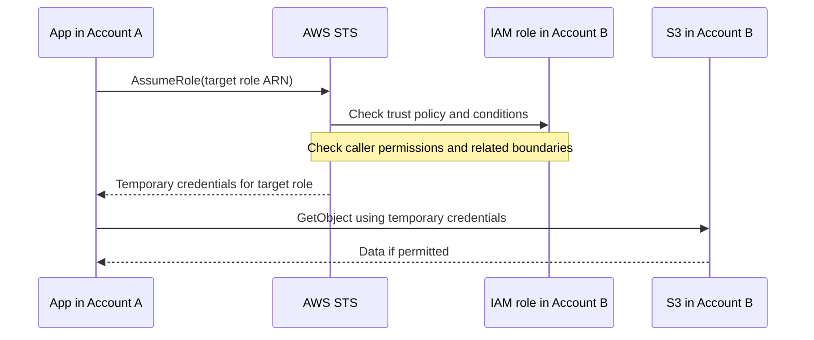
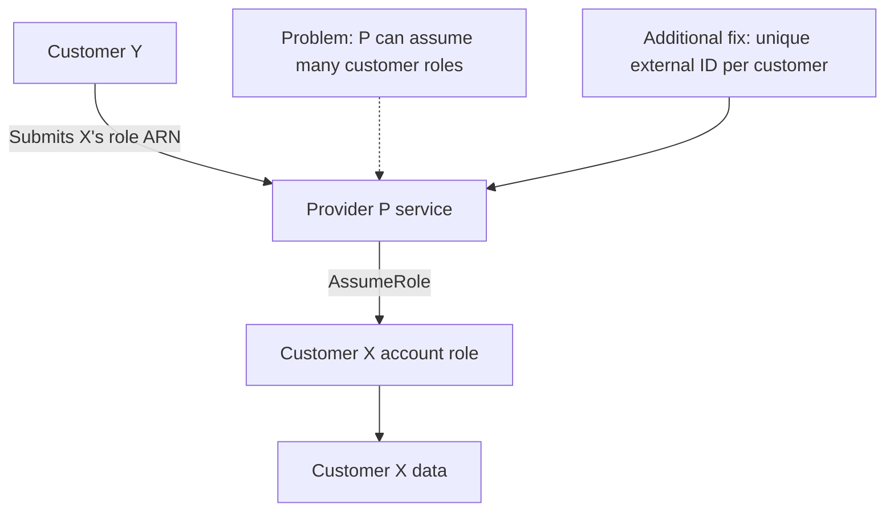
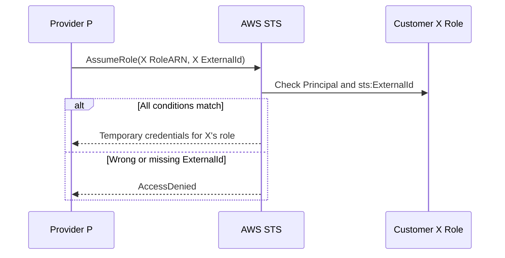
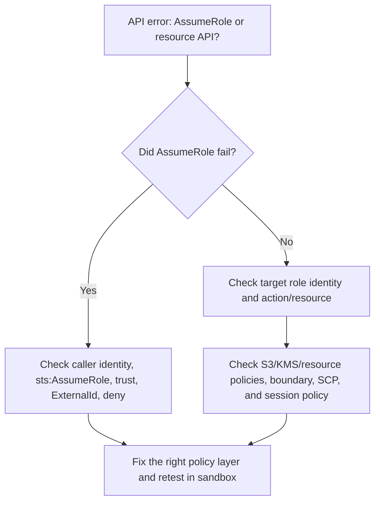

# Cross-Account Access and External ID

> **Module:** CLOUD_PROVIDERS_AWS  
> **Chapter:** IAM and Permissions  
> **Scope:** AWS IAM, AWS Security Token Service (STS), *trust policies*, *cross-account access*, and `sts:ExternalId`.

## 1. Learning Objectives and Context

When designing applications on AWS, all resources rarely live inside a single account. Organizations often separate accounts for development, testing, and production; a monitoring system may need to read CloudWatch Logs across multiple accounts; or an external vendor must be allowed to read a subset of S3 data to deliver a contracted service.

Across the AWS ecosystem—Regions/AZs, VPC, EC2, Lambda, S3, databases, and integration services—**cross-account permissions** separate administrative boundaries while still letting a designated identity perform the exact job needed. **External ID** is an additional defensive condition, especially important when granting access to a third party serving multiple customers.

After this lesson, learners can:

1. Describe how AWS STS `AssumeRole` issues temporary security credentials for cross-account access.
2. Distinguish the **trust** policy, **role permissions** policy, **caller** policy, and other control boundaries.
3. Create a role in a target account that trusts only a specific role in a source account.
4. Explain the **confused deputy** risk and how `sts:ExternalId` mitigates it.
5. Invoke a role using AWS CLI, verify the switched identity, and troubleshoot common `AccessDenied` errors.
6. Choose a permission model that is secure, observable, and revocable when operating AWS applications.

## 2. Cross-Account Access Model

Consider an organization with two accounts:

| Component | Illustrative value | Responsibility |
|---|---|---|
| **Account A — source** | `444455556666` | Holds the application or role calling APIs. |
| **Account B — target** | `111122223333` | Holds the S3 bucket and IAM role granting data read access. |
| **Caller role** in A | `AppReader` | Identity running the application. |
| **Target role** in B | `CrossAccountReportsRead` | Grants read permissions on the exact resources in B. |
| **AWS STS** | `AssumeRole` API | Checks eligibility conditions and issues temporary credentials. |

All account IDs, role names, and resource names throughout this lesson are **examples** and must be replaced with values from your real environment.



Key point: the application **does not need to own long-term access keys from Account B**. It uses its existing identity in A to request a session (*role session*) in B. Once the call succeeds, subsequent APIs run with the permissions of the **target role in Account B**.

### 2.1. An IAM role is not an IAM user

An IAM role is an identity that can be *assumed* under permitted conditions. A role has no fixed login password or directly attached long-term access keys like an IAM user. When `AssumeRole` succeeds, STS returns:

- `AccessKeyId`
- `SecretAccessKey`
- `SessionToken`
- `Expiration`

This credential set is time-limited. Session permissions are derived from the target role's policies, and can be further restricted by a **session policy**, **permissions boundary**, **Service Control Policies (SCPs)**, and related policies/contexts. Once the session expires, fresh credentials must be obtained.

**ARN examples:**

- IAM role defined in B: `arn:aws:iam::111122223333:role/CrossAccountReportsRead`
- Assumed-role session that may appear in `sts get-caller-identity`: `arn:aws:sts::111122223333:assumed-role/CrossAccountReportsRead/report-reader-session`

Do not confuse the **role** ARN with the **role session** ARN: they represent two different objects within the same access flow.

## 3. Which Policies Must Align?

A cross-account call typically requires all of the following simultaneously:

| Control layer | Where does it live? | Question to answer |
|---|---|---|
| **Caller's identity-based policy** | Account A | Does the caller have permission to call `sts:AssumeRole` on the target role ARN? |
| **Target role's trust policy** | Account B | Does B trust the caller in A and allow `sts:AssumeRole` under the current conditions? |
| **Target role's permissions policy** | Account B | Once assumed, what can this session do on S3, DynamoDB, CloudWatch, etc. in B? |
| **SCPs, permissions boundaries, session policies** | At their respective scopes | Does any guardrail or explicit deny block the call? |
| **Resource-based policy**, when applicable | S3 bucket, KMS key, SQS queue... | Does the resource's policy impose extra requirements or deny the action? |

**Two questions frequently conflated into one:**

- "Can I **assume the role**?" → check caller permissions, trust policy, and related conditions.
- "After assuming the role, can I **read the S3 object**?" → check target role permissions, bucket policy, KMS key policy if data uses SSE-KMS, and other boundaries.

The trust policy does not automatically grant `s3:GetObject`. Conversely, attaching `s3:GetObject` to the target role does not automatically allow any identity to assume that role.

### 3.1. Explicit deny still overrides allow

IAM enforces **deny by default**. A valid `Allow` must satisfy conditions in each involved layer and not be blocked by an explicit `Deny`. For example, even if trust allows Account A, an organization SCP may block `sts:AssumeRole`; or a bucket policy in B may deny S3 access to the role session.

Therefore, `AccessDenied` errors must be diagnosed against the **specific failing API** and **actual identity making the call**, rather than looking at a single policy in isolation.

## 4. Practicing the Internal A → B Pattern

In this example, an administrator controls both Account A and Account B. The goal is for role `AppReader` in A to read a reports folder in an S3 bucket owned by B.

### 4.1. Create the target IAM role in Account B

In Account B, go to **IAM → Roles → Create role**, select the **AWS account** trusted entity type and configure for the source account or follow the corresponding creation workflow; then **edit the trust policy** to trust the exact IAM role in Account A.

Sample trust policy for `CrossAccountReportsRead`:

```json
{
  "Version": "2012-10-17",
  "Statement": [
    {
      "Sid": "AllowSpecificCallerRole",
      "Effect": "Allow",
      "Principal": {
        "AWS": "arn:aws:iam::444455556666:role/AppReader"
      },
      "Action": "sts:AssumeRole"
    }
  ]
}
```

Analysis:

- `Principal` defines **who is allowed** to request assuming the role; here it is **one specific role** in Account A.
- `Action` allows the `sts:AssumeRole` operation.
- There is no `Resource` in an IAM role's trust policy, because the role holding the policy is itself the trusted target object.
- Never set `"Principal": "*"` casually. Conditions and Principal scope determine access exposure.

Another common configuration is `"AWS": "arn:aws:iam::444455556666:root"`. In a trust policy, this value **delegates to Account A** the ability to grant assume-role permissions; it **does not mean only A's root user is allowed**. Account A administrators can then grant `sts:AssumeRole` to identities inside that account. When the caller role is known upfront, naming the exact role ARN is clearer and tighter.

> **Maintenance note:** When a trust policy specifies an IAM role ARN in another account, IAM may store an internal reference by **principal ID**. If the source role is deleted and recreated with the same name, the trust policy may need to be updated because the new role has a different internal identity.

### 4.2. Attach the permissions policy to the target role in B

Suppose bucket `company-reports-demo-111122223333` stores reports under prefix `exports/`. The following policy allows listing that exact prefix and reading objects inside it:

```json
{
  "Version": "2012-10-17",
  "Statement": [
    {
      "Sid": "ListReportPrefix",
      "Effect": "Allow",
      "Action": "s3:ListBucket",
      "Resource": "arn:aws:s3:::company-reports-demo-111122223333",
      "Condition": {
        "StringLike": {
          "s3:prefix": [
            "exports/",
            "exports/*"
          ]
        }
      }
    },
    {
      "Sid": "ReadReportObjects",
      "Effect": "Allow",
      "Action": "s3:GetObject",
      "Resource": "arn:aws:s3:::company-reports-demo-111122223333/exports/*"
    }
  ]
}
```

Attach this policy to the **role in B**, not by mistake to the caller role in A. `s3:ListBucket` applies to the **bucket ARN**; `s3:GetObject` applies to the **object ARN**. Mixing these up is a common mistake when writing IAM permissions for S3.

If objects are encrypted using **SSE-KMS** with a customer managed KMS key, the role session must also be allowed to use that KMS key, checking both the IAM policy and the **KMS key policy**. If the bucket policy has an explicit deny, the role's permissions cannot override that deny.

### 4.3. Grant the caller in A permission to assume the role

Attach an identity-based policy to `AppReader` in Account A:

```json
{
  "Version": "2012-10-17",
  "Statement": [
    {
      "Sid": "AssumeReportsRoleInB",
      "Effect": "Allow",
      "Action": "sts:AssumeRole",
      "Resource": "arn:aws:iam::111122223333:role/CrossAccountReportsRead"
    }
  ]
}
```

This is permission to call the STS API to obtain a role session; it **does not directly grant** `s3:GetObject` in Account B. Only after assuming succeeds does the application use the target role's credentials to read objects.

### 4.4. Verify with the CLI

First sign in to the AWS CLI using the caller's **time-limited credential source**, such as IAM Identity Center:

```bash
aws sso login --profile caller-base
aws sts get-caller-identity --profile caller-base
```

`caller-base` is just an example profile name and must be preconfigured for an identity in A that has permission to call `sts:AssumeRole`.

Use `sts assume-role` to test:

```bash
aws sts assume-role \
  --profile caller-base \
  --role-arn arn:aws:iam::111122223333:role/CrossAccountReportsRead \
  --role-session-name reports-reader-lab
```

On success, the CLI outputs JSON containing `AssumedRoleUser` and **temporary credentials**. Never paste this output into issues, public docs, application logs, or group chats. You can switch to an automatic assume-role profile to avoid manually copying credentials; see the example in section 6.

You do **not** need `--external-id` for this internal scenario if B's trust policy does not require it. External ID is not mandatory for every role assumption.

## 5. External ID and the Confused Deputy Problem

External ID is especially useful when **an external service provider** (*third-party provider*) uses its own single AWS identity to operate on behalf of multiple customers.

Suppose:

- **Provider P** owns AWS account `444455556666` and integration role `IntegrationWorker`.
- **Customer X** owns account `111122223333` and role `PartnerReportsRead`, which P is allowed to assume.
- **Customer Y** also uses P, but must not be allowed to read X's data.

If X's trust policy only trusts account P, and P's system accepts a **customer-entered role ARN** without binding it tightly to the authenticated customer, Y could try asking P to assume **X's role**. P then becomes a *confused deputy*: an authorized party tricked into executing a request against the wrong target.



### 5.1. How does External ID work?

When P onboarded X, P supplied **a unique external ID for X**. Account X places this value in its **trust policy** using the `sts:ExternalId` condition. When P calls STS to assume X's role, P passes that exact value in the `ExternalId` parameter. AWS allows the call only when all conditions are satisfied.



Suppose P assigns Customer X this illustrative value:

```text
customer-x-integration-9a4e8d72
```

This is just a random identifier for documentation. In real integrations, **provider P should generate/assign a unique external ID per customer and manage the mapping**. Customers should not guess or enter an arbitrary string if the provider already has an ID-issuance flow.

### 5.2. External ID is not a password

Understand the exact scope of protection:

- **External ID is not an authentication secret**; it is an extra condition on the STS call. Knowing the external ID alone is **not enough** to assume the role if the Principal is not trusted.
- External ID **does not replace** a principal-restricted trust policy, least-privilege permissions on the target role, MFA/Identity Center, auditing, or provider-side data isolation.
- Each customer of the same provider needs a **different** external ID to avoid cross-tenant mix-ups.
- The provider must bind **role ARN + external ID** to the authenticated customer. Allowing users to freely swap another customer's pair can break tenant isolation.
- For accounts all under internal governance where the caller role is well-known, external ID may be unnecessary; prioritize trusting the exact Principal and least privilege.

Also distinguish from `sts:SourceIdentity`: source identity helps attach and track the original identity of a role session across role assumptions, whereas **external ID controls the condition for being allowed to assume the role**. These serve two distinct purposes.

## 6. Practice: Third-Party Integration with External ID

Let's switch to a scenario where Customer X is Account B and Provider P is Account A. The provider needs to read S3 reports under `exports/`, with no write or delete operations.

### 6.1. Customer creates a role with a trust policy checking external ID

Role in customer account: `arn:aws:iam::111122223333:role/PartnerReportsRead`.

Sample trust policy:

```json
{
  "Version": "2012-10-17",
  "Statement": [
    {
      "Sid": "AllowVendorOnlyWithCustomerExternalId",
      "Effect": "Allow",
      "Principal": {
        "AWS": "arn:aws:iam::444455556666:role/IntegrationWorker"
      },
      "Action": "sts:AssumeRole",
      "Condition": {
        "StringEquals": {
          "sts:ExternalId": "customer-x-integration-9a4e8d72"
        }
      }
    }
  ]
}
```

Meaning of each component:

| Attribute | Effect |
|---|---|
| `Principal.AWS` | Trusts only the provider's `IntegrationWorker` role. |
| `Action = sts:AssumeRole` | Allows requesting a target role session. |
| `Condition.StringEquals.sts:ExternalId` | Requires the STS request to carry **the exact** external ID issued for Customer X. |

No party outside P can assume the role just by knowing the external ID string. Conversely, if P calls with a valid identity but **omits the ID or sends the wrong one**, it will be denied.

**Common mistake:** Putting `sts:ExternalId` into the **role's permissions policy** instead of the **trust policy** will not enforce the condition on `AssumeRole` calls as intended. This condition must be evaluated when authorizing role assumption.

### 6.2. Grant least-privilege business permissions to the target role

The customer attaches an S3 permissions policy to `PartnerReportsRead` similar to the sample in section 4.2, scoped to the exact bucket/prefix to read. If the provider needs to read a specific DynamoDB table or secret, create a dedicated policy granting only the required actions and ARNs—never attach `AdministratorAccess` just to speed up integration.

The customer should document the **provider**, **internal owner**, **role ARN**, **permission scope**, **who issued the external ID**, and **review/revocation date**. Use a dedicated role per integration so revocation and access log auditing remain straightforward.

### 6.3. Provider grants caller permission to call STS

Role `IntegrationWorker` in P gets an identity-based policy:

```json
{
  "Version": "2012-10-17",
  "Statement": [
    {
      "Sid": "AssumeCustomerXReportsRole",
      "Effect": "Allow",
      "Action": "sts:AssumeRole",
      "Resource": "arn:aws:iam::111122223333:role/PartnerReportsRead"
    }
  ]
}
```

This policy is an example scoped to **one customer**. A multi-tenant provider may need multiple allowed ARNs, while choosing the matching role ARN/external ID pair must be strictly controlled inside the integration application.

### 6.4. Calling AssumeRole with external ID via CLI

When the CLI runs with an identity that genuinely holds permissions equivalent to `IntegrationWorker`:

```bash
aws sts assume-role \
  --profile provider-source \
  --role-arn arn:aws:iam::111122223333:role/PartnerReportsRead \
  --role-session-name customer-x-report-sync \
  --external-id customer-x-integration-9a4e8d72
```

The STS API returns temporary credentials if both caller permissions and the customer's trust policy allow it. **Never store or publicly post the `Credentials` section of the output.**

To have AWS CLI automatically assume the role whenever calling services, add this profile to the operator's AWS CLI config file (`~/.aws/config`):

```ini
[profile customer-x-reports]
role_arn = arn:aws:iam::111122223333:role/PartnerReportsRead
source_profile = provider-source
external_id = customer-x-integration-9a4e8d72
role_session_name = customer-x-report-sync
region = ap-southeast-1
```

Source profile `provider-source` must already be configured and signed in to **provider P's valid identity** (for example, a profile using IAM Identity Center or temporary credentials). Configuring `source_profile` does not grant permissions on its own.

Verify:

```bash
# This profile automatically calls AssumeRole when needed.
aws sts get-caller-identity --profile customer-x-reports

# Test read-only access to the exact allowed prefix.
aws s3api list-objects-v2 \
  --bucket company-reports-demo-111122223333 \
  --prefix exports/ \
  --max-items 5 \
  --profile customer-x-reports
```

If `get-caller-identity` displays an ARN like `arn:aws:sts::111122223333:assumed-role/PartnerReportsRead/customer-x-report-sync`, the session has switched to Customer X's role. Whether S3 calls succeed still depends on S3 permissions, bucket policies, and actual encryption settings.

### 6.5. Verify denied scenarios

To verify the external ID condition, you can compare **session-request-only** calls without altering data:

| Case | Expected outcome |
|---|---|
| Correct caller `IntegrationWorker`, accurate external ID | `AssumeRole` succeeds if no other deny applies. |
| Correct caller, **missing** `--external-id` | `AccessDenied`. |
| Correct caller, wrong external ID | `AccessDenied`. |
| Untrusted caller, correct external ID | `AccessDenied`. |

Use test accounts you control or an authorized sandbox environment. If you do not own the real provider role, you **cannot successfully simulate it** just by declaring an arbitrary profile and pretending to be that principal. To practice with two test accounts, create matching caller roles and follow the same policies and principles above.

### 6.6. Console limitation

**Switch Role in the AWS Management Console does not support entering an external ID** when switching roles. If a trust policy requires `sts:ExternalId`, use STS/API/SDK/CLI or an integration mechanism supported by the provider. Never remove the external ID condition just so users can Switch Role in the Console.

## 7. External ID in Java/Spring Boot Applications

In a Java application running under the provider's role, AWS SDK for Java 2.x can obtain credentials for the target role via STS. Illustrative example:

```java
import java.time.Duration;
import software.amazon.awssdk.auth.credentials.StsAssumeRoleCredentialsProvider;
import software.amazon.awssdk.regions.Region;
import software.amazon.awssdk.services.s3.S3Client;
import software.amazon.awssdk.services.sts.StsClient;
import software.amazon.awssdk.services.sts.model.AssumeRoleRequest;

public class CustomerReportsClient {
    public static void main(String[] args) {
        // The application's source role must have sts:AssumeRole on the target role.
        try (StsClient sts = StsClient.builder()
                .region(Region.AP_SOUTHEAST_1)
                .build();
             StsAssumeRoleCredentialsProvider provider =
                StsAssumeRoleCredentialsProvider.builder()
                    .stsClient(sts)
                    .refreshRequest(AssumeRoleRequest.builder()
                        .roleArn("arn:aws:iam::111122223333:role/PartnerReportsRead")
                        .roleSessionName("customer-x-report-sync")
                        .externalId("customer-x-integration-9a4e8d72")
                        .build())
                    .build();
             S3Client s3 = S3Client.builder()
                .region(Region.AP_SOUTHEAST_1)
                .credentialsProvider(provider)
                .build()) {

            // Example business call: list objects under a prefix.
            s3.listObjectsV2(request -> request
                .bucket("company-reports-demo-111122223333")
                .prefix("exports/")
                .maxKeys(5))
              .contents()
              .forEach(item -> System.out.println(item.key()));
        }
    }
}
```

**Explanation:** The SDK uses the **source** role's credentials to call STS, obtains temporary credentials for the **target role**, and uses them to call S3. `StsAssumeRoleCredentialsProvider` handles refreshing credentials for subsequent sessions. There is no need to hardcode access keys from the customer's account.

In production, the role ARN and external ID should come from **managed tenant configuration**, not hardcoded in source code. The application must authenticate the tenant and look up the pair issued for that tenant; never trust arbitrary role ARN/external ID values passed from external requests. Use session identifiers that support audit tracing, while avoiding personal data in session names.

> **Example limitation:** This Java snippet focuses solely on granting access; it does not implement retries, pagination, logging, configuration management, or application error handling. When running for real, include the matching AWS SDK for Java 2.x dependencies and configure the appropriate bucket/endpoint Region.

## 8. Secure Operations and AWS Organizations

### 8.1. When is external ID needed?

| Scenario | Recommendation |
|---|---|
| Lambda in Account A reads DynamoDB in Account B, both managed by the same team | Create target role and trust the exact source role. External ID is usually not the focus. |
| SaaS company reads AWS data from hundreds of customers | Use a **per-customer** target role, unique external ID per customer, and tenant isolation on the SaaS side. |
| Third-party auditing tool asks for an AWS role ARN | Require the vendor to provide exact AWS Principal, their workflow's external ID, least-privilege scope, and revocation steps. |
| EC2/ECS/EKS app needs to call AWS APIs **within the same account** | Prefer the workload's dedicated IAM role; do not add cross-account mechanisms unnecessarily. |
| Employees need access to multiple AWS accounts in one organization | Prefer IAM Identity Center/permission sets and appropriate centralized access controls. |

### 8.2. Controls to enforce

1. **Trust specific Principals:** Use the vendor's role ARN rather than trusting an entire account whenever possible. Never use unrestricted wildcards.
2. **Grant least privilege:** Only required actions and resources. Restrict S3 prefixes, DynamoDB tables, secrets, queues, etc. to business needs.
3. **Separate roles per vendor/integration:** Avoid sharing one high-privilege role across multiple partners.
4. **Assign unique external IDs per customer:** Provider generates and manages mappings; review periodically during onboarding/offboarding.
5. **Use temporary credentials:** Never ask customers for long-term access keys; avoid logging tokens.
6. **Monitor CloudTrail:** Inspect `AssumeRole` events and role session activity against expected accounts/roles/sessions.
7. **Review SCPs and resource policies:** With AWS Organizations, SCPs can restrict the caller or target role; a valid trust policy does not make those boundaries disappear.
8. **Revoke cleanly:** Remove/edit the vendor's trust statement, block assume permissions, or change conditions when needed. For already-issued temporary sessions, consider **revoke active sessions**/time-based deny mechanisms rather than assuming deleting trust immediately kills all active sessions.

### 8.3. Audit trail in CloudTrail

When the integration is running, look for:

- The `AssumeRole` API call and **timestamp** of session creation.
- Target role ARN, source account, `roleSessionName`, and calling identity per observable data.
- Subsequent APIs invoked by the `assumed-role/...` ARN, such as `GetObject` or `ListObjectsV2`.

**Note:** CloudTrail management events capture STS activity, whereas observing S3 object operations like `GetObject` requires configuring **S3 data events**; data events are not enabled by default in all trails/event data stores and can incur extra costs. Do not claim every object action is visible simply because default CloudTrail is on.

## 9. Diagnosing Common Errors

| Symptom | Causes to check | How to fix |
|---|---|---|
| `AccessDenied` right at `sts:AssumeRole` | Caller lacks `sts:AssumeRole`, wrong Principal in trust policy, missing/wrong external ID, explicit deny/SCP. | Run `sts get-caller-identity` on source profile; verify ARNs, trust, conditions, and boundaries. |
| `AssumeRole` succeeds yet `s3:GetObject` is denied | Target role lacks `s3:GetObject`, wrong prefix ARN, bucket policy deny, KMS key policy lacks grant. | Verify using target role profile; check action/resource, bucket policy, and KMS. |
| `Switch Role` in Console cannot enter vendor role | Trust policy requires external ID; Console has no input field for it. | Use SDK/CLI/API supporting the ExternalId parameter. |
| Recreated source role with same name and suddenly denied | Trust policy stored the old deleted role's principal ID. | Update the Principal ARN for the new source role in the trust policy. |
| CLI still uses source account after configuring profile | Target role profile not selected, wrong `source_profile`, not logged in, or missing `role_arn`. | Run `aws sts get-caller-identity --profile customer-x-reports` and check the ARN. |
| Target role can be assumed, yet only partial reads succeed | Policy limits prefix/Region, missing KMS permission, explicit deny, or tag condition. | Verify against actual resources and all policy layers. |
| Session expires mid-task | Temporary credentials expired, provider not refreshing; chained roles have session duration limits. | Use an SDK credentials provider with auto-refresh and sensible duration limits. |

### 9.1. Three-step debugging workflow



An `AccessDenied` error from S3 **does not mean** the trust policy is wrong if `AssumeRole` already succeeded. Conversely, adding `s3:*` to the target role **will not fix** a failure at the STS step caused by a mismatched external ID.

## 10. Applied Exercises

**Scenario:** Your team operates a Java/Spring Boot course-management system. Learning report data is stored in Account B. An external analytics vendor P wants to run a daily job reading only files under the S3 prefix `exports/daily/`. Your team wants to prevent unexpected costs from out-of-scope reads and be able to revoke access when the partnership ends.

**Requirements:**

1. Draw a diagram with three entities: P's source role, target role in B, and reports bucket in B. Annotate the `AssumeRole` API.
2. Write the **trust policy** trusting only `arn:aws:iam::444455556666:role/IntegrationWorker` and requiring external ID `customer-x-integration-9a4e8d72`.
3. Write the **permissions policy** for the target role containing only prefix-scoped `s3:ListBucket` and `s3:GetObject` on `exports/daily/*`.
4. Write the **identity-based policy** at the provider allowing assumption of only the target role.
5. Write two CLI calls: one using the right external ID and one using a wrong ID. Predict the outputs; never expose credentials in results.
6. Explain how to monitor access with CloudTrail and when S3 data events need to be enabled.
7. Suppose the vendor ends collaboration while an STS session is still valid: explain how to revoke permissions and the limitation of merely deleting the trust policy.

**Self-assessment criteria:** A solid solution clearly specifies **caller policy + trust condition + target permission**, enforces proper tenant isolation, demonstrates wrong external IDs are denied, and does not confuse budgets/cost monitoring with IAM enforcement boundaries.

### 10.1. Quick check questions

**1. With the correct external ID, can any IAM user in another account assume the role?**  
No. The Principal in the trust policy and all other permission layers must still authorize the caller.

**2. Is External ID a customer's access key?**  
No. It is a value checked inside the `sts:ExternalId` condition of a trust policy.

**3. Does a trust policy allowing `sts:AssumeRole` grant permission to read every bucket in the target account?**  
No. Read permissions depend on the target role's permissions and any relevant resource policies or guardrails.

**4. Does using `arn:aws:iam::444455556666:root` in Principal mean only account A's root user can assume the role?**  
No. It lets **account A delegate** permission to eligible identities; it does not restrict access exclusively to the root user.

**5. Why should you never "quick-fix" with `AdministratorAccess`?**  
Because if a session is compromised, every operation allowed to an admin role is exposed; permissions must remain scoped to the agreed task.

## 11. Summary and References

**Cross-account access** combines permission **to switch roles** and permission **to act after switching roles**. AWS STS issues temporary credentials that eliminate the need to share long-term access keys. For multi-tenant third parties, external ID provides an extra control layer against customer mix-ups in the confused deputy problem; enforcing tenant isolation inside the third-party application remains mandatory.

Official AWS documentation to consult and verify during implementation:

- [AWS IAM — Tutorial: Delegate access across AWS accounts using IAM roles](https://docs.aws.amazon.com/IAM/latest/UserGuide/tutorial_cross-account-with-roles.html)
- [AWS IAM — Providing access to third parties](https://docs.aws.amazon.com/IAM/latest/UserGuide/id_roles_common-scenarios_third-party.html)
- [AWS IAM — How to use an external ID](https://docs.aws.amazon.com/IAM/latest/UserGuide/id_roles_create_for-user_externalid.html)
- [AWS IAM — Principal element in policies](https://docs.aws.amazon.com/IAM/latest/UserGuide/reference_policies_elements_principal.html)
- [AWS IAM — Policies and permissions in IAM](https://docs.aws.amazon.com/IAM/latest/UserGuide/access_policies.html)
- [AWS STS — AssumeRole API](https://docs.aws.amazon.com/STS/latest/APIReference/API_AssumeRole.html)
- [AWS CLI — Configuration settings and precedence](https://docs.aws.amazon.com/cli/latest/topic/config-vars.html)
- [AWS IAM — Revoking IAM role temporary security credentials](https://docs.aws.amazon.com/IAM/latest/UserGuide/id_roles_use_revoke-sessions.html)
- [AWS CloudTrail — Logging data events](https://docs.aws.amazon.com/awscloudtrail/latest/userguide/logging-data-events-with-cloudtrail.html)

> All account IDs, resource names, ARNs, external IDs, and code snippets in this lesson are simulated practice data. Before applying to a live environment, verify target accounts, active policies, Regions, auditing costs, and your organization's security requirements.
