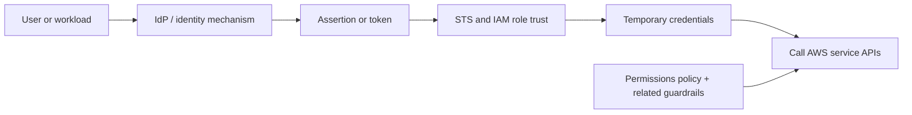
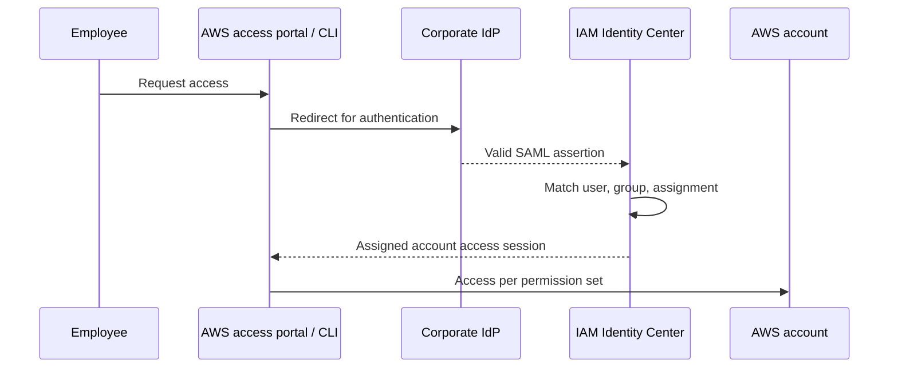
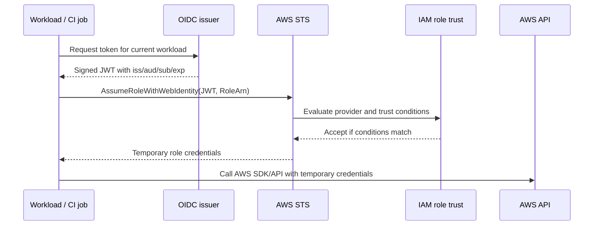

# Identity Federation via SAML, OIDC, and Workload Identity

## 1. Context: Why Do We Need Identity Federation?

When an enterprise operates multiple AWS accounts, creating a separate IAM user with a password and access keys for every employee or system creates difficulties in permission revocation, auditing, and credential rotation. HR systems may already use Microsoft Entra ID, Okta, or another identity management platform; deployment pipelines run on GitHub Actions; applications run on EC2, ECS, Lambda, EKS, or in private data centers. These environments need AWS access without necessarily owning **IAM users** and **long-term access keys**.

**Identity federation** enables AWS to trust an external authentication system or workload identity mechanism and issue appropriate access accordingly. On AWS, the outcome is typically **temporary credentials** tied to an **IAM role**, rather than long-lived secret keys stored in source code.

This lesson belongs to the **IAM and Permissions** chapter of the **CLOUD_PROVIDERS_AWS** learning path. Its content supports designing, deploying, and operating applications on Regions/AZs, VPC, EC2, containers, serverless, storage, and databases following least privilege, observability, recoverability, and cost control.

After this lesson, you can:

- Distinguish authentication, authorization, identity federation, and role assumption.
- Explain the SAML 2.0 flow for **workforce identity** and the OIDC flow for **web identity/workload identity**.
- Choose among **IAM Identity Center**, IAM SAML/OIDC providers, and AWS's workload identity mechanisms.
- Read trust policies, configure `aud`/`sub` conditions, and distinguish **trust policies** from **permissions policies**.
- Design temporary access permissions for CI/CD, EKS, EC2, ECS, Lambda, or workloads outside AWS.
- Diagnose `AccessDenied` errors, audience/subject mismatches, expired tokens, and inappropriate permission scopes.

## 2. Components in a Federation System

| Term | Meaning | Example |
| --- | --- | --- |
| **Principal** | Identity making a request | Employee, IAM role session, pod, pipeline |
| **Identity provider (IdP)** | System verifying identity and issuing authentication proof | Microsoft Entra ID, Okta, GitHub OIDC issuer |
| **Relying party / Service provider (SP)** | System accepting proof from the IdP under a trust relationship | AWS or an app accepting SAML/OIDC |
| **Assertion / Token** | Signed identity proof with lifetime, target audience, and related attributes | SAML assertion; OIDC JWT |
| **IAM role** | Assumable IAM entity containing a trust policy and attached permissions | `DeploymentRole`, `ReadReportsRole` |
| **AWS STS** | Service issuing temporary AWS credentials | `AssumeRoleWithSAML`, `AssumeRoleWithWebIdentity` |
| **Temporary credentials** | Expiring set of `AccessKeyId`, `SecretAccessKey`, `SessionToken` | Role session used to call S3, DynamoDB |

Distinguish three steps that are often confused:

1. **Authentication:** verifying *who* the person/workload making the request is. The IdP performs this step when issuing a token or assertion.
2. **Federation / role assumption:** AWS verifies the trusted identity and conditions permitting assumption of an IAM role.
3. **Authorization:** when the role session calls an API, IAM and related mechanisms evaluate *what can be done* on *which resources*.

> A valid login token **does not automatically** grant permission to read S3 or delete DynamoDB items. Role session permissions are governed separately; successful IdP authentication is only part of the process.

### 2.1. Trust policies and permissions policies differ

- **Role trust policy** (*assume role policy*) defines **who or which system is allowed to assume the role** and under what conditions. For example: only workflows from a specific repository running on branch `main` can use `DeploymentRole`.
- **Permissions policy** attached to the role defines **which AWS APIs the role session can invoke**. For example: only `s3:PutObject` into an approved prefix.
- **SCPs**, permissions boundaries, session policies, and resource policies can further restrict or affect effective permissions; a trust policy does not bypass these boundaries.

High-level diagram:



## 3. SAML 2.0: Federation for Employees

**SAML 2.0 (Security Assertion Markup Language)** is an XML-based authentication exchange standard. SAML is widespread in enterprise **Single Sign-On (SSO)**: employees sign in with their corporate account, optionally using IdP-managed MFA, and gain access to assigned accounts and applications.

A **SAML assertion** typically contains the subject, issuing IdP, permitted recipient, validity period, and related attributes. The receiving system must verify the assertion's signature, issuer, audience/recipient, lifetime, and required protective conditions. You cannot simply decode XML and trust its contents by default.

### 3.1. Recommended approach for workforce: IAM Identity Center

**AWS IAM Identity Center** is the centralized access management service for users accessing multiple AWS accounts and supported applications. With an **external IdP**, an organization can configure:

- **SAML 2.0** to federate the **sign-in/authentication** flow from the corporate IdP into IAM Identity Center.
- **SCIM** (*System for Cross-domain Identity Management*) to **synchronize users and groups** where supported; SCIM handles provisioning, updates, and deprovisioning, and **does not replace SAML for sign-in**.
- **Permission sets** and **account assignments** to decide which AWS accounts users/groups can access and at what permission level.

For example, the `Developers` group is assigned the `DeveloperReadOnly` permission set for the `sandbox` account, while `ProductionOperators` is assigned a scoped operational permission set in the production account. Users go through the AWS access portal or an IAM Identity Center-capable CLI; AWS supplies session credentials rather than requiring employees to manage IAM user access keys themselves.



To operate securely, administrators must verify users/groups are provisioned accurately, permission sets are not overly broad, access revocation stays synchronized, and the IdP is protected with MFA and recovery procedures. A user who authenticates successfully yet **has no account assignment** will not automatically gain permissions across all accounts in AWS Organizations.

**AWS CLI example for an end user already configured with SSO:**

```bash
# This profile must be configured beforehand using 'aws configure sso'
aws sso login --profile company-dev

# Confirm the active role session and actual account
aws sts get-caller-identity --profile company-dev
```

The CLI does not convert an IdP account into an IAM user. It uses IAM Identity Center's sign-in session and credential mechanism; never paste temporary access keys into repositories or logs for convenience.

### 3.2. Direct SAML federation to an IAM role

In some legacy systems or applications, organizations use an **IAM SAML identity provider** attached directly to a single AWS account and **AWS STS `AssumeRoleWithSAML`**. This is a different mechanism from centralized workforce management via IAM Identity Center.

Primary flow:

1. An administrator registers the SAML IdP in IAM using appropriate XML metadata/certificates, and configures an IAM role and its trust policy.
2. The employee authenticates at the IdP. The IdP issues a SAML assertion for AWS, typically including permitted role/provider attributes.
3. AWS validates the assertion and trust policy; the federation flow or application calls `AssumeRoleWithSAML`.
4. STS returns temporary credentials tied to the accepted role; subsequent actions are governed by the role's permissions policy and other AWS constraints.

Example **trust policy for a role accepting SAML assertions**:

```json
{
  "Version": "2012-10-17",
  "Statement": [
    {
      "Effect": "Allow",
      "Principal": {
        "Federated": "arn:aws:iam::123456789012:saml-provider/CompanyIdP"
      },
      "Action": "sts:AssumeRoleWithSAML",
      "Condition": {
        "StringEquals": {
          "SAML:aud": "https://signin.aws.amazon.com/saml"
        }
      }
    }
  ]
}
```

`123456789012` and `CompanyIdP` are illustrative values. `Principal.Federated` must point to a SAML provider **already registered** in IAM in the role's account. `SAML:aud` binds the assertion's audience to the corresponding AWS sign-in endpoint; verify endpoints/Regions and actual sign-in architecture if using another variant. The IdP side must also configure role and trust attributes so unauthorized groups cannot arbitrarily pick privileged roles.

**Session duration:** the duration of STS `AssumeRoleWithSAML` depends on `DurationSeconds`, the role's `MaxSessionDuration` cap, and the expiration recorded in the assertion. Do not treat the IdP login lifetime, assertion lifetime, and AWS role session lifetime as the same; all three can differ.

### 3.3. Choosing between IAM Identity Center and direct SAML roles

| Need | Typically suitable option | Reason |
| --- | --- | --- |
| Employees accessing multiple AWS accounts | IAM Identity Center + external IdP | Permission sets, group assignments, and centralized governance |
| Synchronizing users/groups from an IdP | IAM Identity Center + SCIM | Avoids manual user and group provisioning/updates |
| Specialized app integration already using `AssumeRoleWithSAML` | IAM SAML provider + IAM role | Provides a direct STS flow per application design |
| Automated CI/CD pipelines | OIDC federation or workload-specific credentials | Binds permissions to workload identity and reduces static secrets |

**Do not create a dedicated IAM user for every employee** just so they can sign in to the AWS console; across multiple accounts, centralized federation is far easier to govern and revoke.

## 4. OIDC: Identities and Tokens for Applications and Pipelines

**OpenID Connect (OIDC)** is an identity layer built on OAuth 2.0. An OIDC system issues tokens containing JSON claims (typically JWTs) so a relying party can verify subject details by issuer, audience, signature, and expiration.

In AWS IAM federation, an **IAM OIDC identity provider** is registered in an account, an IAM role has a trust policy trusting that provider, and **STS `AssumeRoleWithWebIdentity`** exchanges accepted tokens for temporary role credentials.

### 4.1. Claims to understand

| Claim | Meaning | Condition to check |
| --- | --- | --- |
| `iss` (issuer) | Who issued the token? | Must match the trusted OIDC provider |
| `aud` (audience) | For which recipient was the token issued? | Matches client ID/audience accepted by AWS, e.g., `sts.amazonaws.com` |
| `sub` (subject) | Specific identity assigned by the IdP | Restrictions on repository, branch, Kubernetes service account… |
| `exp`, `iat` | Expiration/issued-at timestamps | Token must still be valid and within required bounds |
| `kid`, signature | IdP signing key | AWS verifies signature against valid key material |

**An ID token is not an AWS access key**; only when AWS validates the token against the trust relationship and role conditions does the workload receive AWS STS credentials. A JWT's payload can be decoded without any secret key, so **decoding a token does not prove the token is trustworthy**; signature and conditions must be verified. In the STS model, AWS handles those verification checks when issuing credentials.

### 4.2. OIDC workload federation flow



Modern AWS SDK libraries and integration tools can automatically fetch and refresh credentials via the **default credential provider chain**. By design, applications do not need custom code to store, distribute, or rotate long-term access keys.

## 5. Real-World Example: GitHub Actions Deploying to AWS via OIDC

Suppose repository `acme/shop-api` is allowed to deploy to a test environment from branch `main` into AWS account `123456789012`. The operations team wants to avoid storing long-lived `AWS_ACCESS_KEY_ID` and `AWS_SECRET_ACCESS_KEY` in GitHub Secrets.

Design components:

1. Create an **OIDC identity provider** with issuer `https://token.actions.githubusercontent.com` in the target IAM account; configure audience `sts.amazonaws.com`.
2. Create an IAM role, e.g., `GitHubShopApiDeployRole`, with a trust policy accepting only subjects from the **exact repository and branch**.
3. Attach a permissions policy to the role containing only the APIs and resources needed to deploy that app.
4. In GitHub Actions, request permission to mint an OIDC token and use the AWS credentials action to obtain a temporary role session.

**Sample trust policy** attached to `GitHubShopApiDeployRole`:

```json
{
  "Version": "2012-10-17",
  "Statement": [
    {
      "Effect": "Allow",
      "Principal": {
        "Federated": "arn:aws:iam::123456789012:oidc-provider/token.actions.githubusercontent.com"
      },
      "Action": "sts:AssumeRoleWithWebIdentity",
      "Condition": {
        "StringEquals": {
          "token.actions.githubusercontent.com:aud": "sts.amazonaws.com",
          "token.actions.githubusercontent.com:sub": "repo:acme/shop-api:ref:refs/heads/main"
        }
      }
    }
  ]
}
```

The `sub` field is especially critical. **Restricting `aud` alone is not enough**: any repository on GitHub can request a token with the same audience. Using `StringLike` with an overly broad wildcard like `repo:acme/*` lets every matching repository assume the role unless other barriers block it.

Example minimal GitHub Actions workflow to **verify the AWS identity after assuming the role**:

```yaml
name: Verify AWS OIDC session
on:
  push:
    branches: [main]
permissions:
  id-token: write
  contents: read
jobs:
  verify-aws:
    runs-on: ubuntu-latest
    steps:
      - name: Configure temporary AWS credentials
        uses: aws-actions/configure-aws-credentials@v4
        with:
          role-to-assume: arn:aws:iam::123456789012:role/GitHubShopApiDeployRole
          aws-region: ap-southeast-1
      - name: Confirm current AWS identity
        run: aws sts get-caller-identity
```

This is a teaching example; in production, pin action versions per supply-chain security policy (e.g., an audited full commit SHA), add branch/environment protection rules, and replace ARNs, repositories, and accounts with real values. The `id-token: write` permission allows the job to request an OIDC token; **it does not grant write permissions to AWS resources**. Those permissions live on the assumed IAM role.

**When a GitHub job uses a GitHub Environment**, the default `sub` may take the form `repo:acme/shop-api:environment:production` instead of `ref:refs/heads/main`. In that case, write the trust policy to match the actually emitted subject and enable **environment protection rules** (such as deployment branch restrictions and required reviewers). Never loosen trust to wildcards just to fix `AccessDenied`.

### 5.1. Illustrative least-privilege permissions policy

If the role only needs to upload artifacts into the `releases/` prefix of a bucket, use a policy like this instead of `AdministratorAccess`:

```json
{
  "Version": "2012-10-17",
  "Statement": [
    {
      "Sid": "WriteReleaseArtifactsOnly",
      "Effect": "Allow",
      "Action": ["s3:PutObject"],
      "Resource": "arn:aws:s3:::example-shop-artifacts/releases/*"
    }
  ]
}
```

The policy above illustrates only `PutObject` on a prefix. A real ECS/Lambda/CloudFormation deployment pipeline may also need corresponding deployment permissions, `iam:PassRole` scoped to the exact approved roles, KMS permissions if the bucket uses a customer managed key, and artifact read permissions. Never grant `iam:*`, `sts:*`, or broad `Resource: "*"` just because a workflow hits initial errors.

## 6. Workload Identity: Identity Tied to the Runtime Environment

**Workload identity** identifies a program, job, container, or service so it receives access permissions specific to that workload's role. The core principle is **never sharing long-term AWS keys** across multiple applications. Some mechanisms use OIDC directly; others use native AWS service identity features or X.509 certificates.

| Runtime environment | Typically suitable mechanism | Notes |
| --- | --- | --- |
| **Amazon EC2** | IAM role via **instance profile** | AWS supplies temporary credentials via IMDS; enforce IMDSv2 and protect metadata access |
| **Amazon ECS** | **Task role** | Application receives permissions per task; distinguish task role from task execution role |
| **AWS Lambda** | **Execution role** | Lambda receives temporary credentials to call required AWS APIs |
| **Amazon EKS** | **EKS Pod Identity** or **IAM Roles for Service Accounts (IRSA)** | Two distinct mechanisms; select based on platform and support |
| **GitHub Actions / external CI** | OIDC federation → `AssumeRoleWithWebIdentity` | Constrain issuer, audience, repository/branch/environment |
| **On-premises servers or non-AWS environments** | **IAM Roles Anywhere** with X.509 certificates; or OIDC if IdP supports it and model fits | Authenticate workload via CA/IdP and obtain temporary credentials |
| **Mobile/web end users needing direct AWS access** | Amazon Cognito identity pools or backend proxy architecture, per requirements | End users differ from machine-to-machine workloads; control both authenticated and unauthenticated permissions |

### 6.1. EC2, ECS, and Lambda: prefer native service roles

When an application runs on a supported AWS service, prefer the **native** role-attachment mechanism:

- **EC2:** attach an IAM role via an instance profile; the AWS SDK reads temporary credentials via the credential chain. Never embed access keys in AMIs or startup scripts. Protect Instance Metadata Service with IMDSv2 and isolate network/application boundaries appropriately.
- **ECS:** use the **task role** for application access to resources like S3/DynamoDB. The **task execution role** primarily serves the agent for operations like pulling images or writing logs; do not use it in place of a task role for business permissions.
- **Lambda:** configure a minimal **execution role** for the function; Lambda supplies credentials to the runtime automatically. Narrow permissions per function, especially for functions invocable externally.

These mechanisms do not require creating an OIDC provider per workload, while still following role trust, least privilege, credential rotation, and monitoring principles.

### 6.2. Amazon EKS: distinguishing IRSA and EKS Pod Identity

**IRSA (IAM Roles for Service Accounts)** uses the EKS cluster's OIDC issuer. Pods run with a Kubernetes service account annotated with an IAM role ARN; the service account token has `sub` formatted as `system:serviceaccount:<namespace>:<service-account>` and an appropriate audience. The AWS SDK picks up the token via the web identity credential provider and calls `AssumeRoleWithWebIdentity`.

Example **IRSA** trust policy for service account `orders-api` in namespace `production`:

```json
{
  "Version": "2012-10-17",
  "Statement": [
    {
      "Effect": "Allow",
      "Principal": {
        "Federated": "arn:aws:iam::123456789012:oidc-provider/oidc.eks.ap-southeast-1.amazonaws.com/id/EXAMPLE123456789"
      },
      "Action": "sts:AssumeRoleWithWebIdentity",
      "Condition": {
        "StringEquals": {
          "oidc.eks.ap-southeast-1.amazonaws.com/id/EXAMPLE123456789:aud": "sts.amazonaws.com",
          "oidc.eks.ap-southeast-1.amazonaws.com/id/EXAMPLE123456789:sub": "system:serviceaccount:production:orders-api"
        }
      }
    }
  ]
}
```

`EXAMPLE123456789` is a placeholder and must be replaced with the cluster's OIDC issuer ID. To use IRSA, register the corresponding IAM OIDC provider for the EKS cluster and configure Kubernetes service accounts/pods per EKS documentation. Using `StringEquals` for a specific subject locks down the exact workload; if multiple namespaces/service accounts are needed, carefully evaluate scope expansion.

**EKS Pod Identity** uses the **EKS Pod Identity Agent and associations** between Kubernetes service accounts and IAM roles; the role trusts the `pods.eks.amazonaws.com` service principal instead of creating an IAM OIDC identity provider per cluster. How the pod obtains credentials via the Pod Identity Agent/credential provider differs from IRSA, even though the application still uses the AWS SDK.

Example minimal illustrative role trust policy for EKS Pod Identity:

```json
{
  "Version": "2012-10-17",
  "Statement": [
    {
      "Effect": "Allow",
      "Principal": {
        "Service": "pods.eks.amazonaws.com"
      },
      "Action": ["sts:AssumeRole", "sts:TagSession"]
    }
  ]
}
```

This policy shows only **minimal trust conditions**. In deployment, consider anti-*confused deputy* conditions such as `aws:SourceOrgId`, protect permissions to create/edit Pod Identity associations, constrain namespaces/service accounts, and scope role permissions tightly. Official AWS templates may add security conditions fitting your organization's architecture.

| Criterion | IRSA | EKS Pod Identity |
| --- | --- | --- |
| Primary IAM authentication mechanism | OIDC provider + `AssumeRoleWithWebIdentity` | EKS Pod Identity Agent/association; role trusts EKS service principal |
| IAM OIDC provider for the cluster | Required | Not required for Pod Identity mechanism |
| Binding role to workload | Kubernetes service account with role annotation | EKS Pod Identity association |
| Compatibility needs | Useful for IRSA-supporting environments or existing deployments | Recommended by AWS for new EKS workloads on supported node types/platforms |
| Cross-account access | Can be designed directly via target account OIDC trust | Can use target role/role chaining per supported configuration |

**Note:** Do not treat EKS Pod Identity as merely another name for IRSA. Setup instructions, role trust, quotas, supported node platforms, and credential retrieval paths differ. For instance, for EKS workloads running on platforms not yet supporting Pod Identity such as certain Fargate/Windows scenarios, IRSA may be the right choice.

### 6.3. Workloads outside AWS: IAM Roles Anywhere

When an application runs on servers in a private data center, **IAM Roles Anywhere** can be used if the organization manages **PKI/X.509 certificates**. AWS trusts a **trust anchor** referencing a CA; the workload uses its certificate and matching private key to request temporary credentials for a configured role/profile.

High-level flow: CA issues certificate to workload → admin registers trust anchor, profile, and role trust with `rolesanywhere.amazonaws.com` → workload uses the Roles Anywhere helper tool/SDK to obtain temporary credentials → SDK calls AWS APIs per role permissions.

IAM Roles Anywhere is **not OIDC**; it is a certificate- and PKI-based federation model. If a company already runs a CA, it can fit better than standing up an OIDC issuer solely for a group of servers. Still, private keys, certificate lifecycles, revocation, trust anchors, IAM roles, and logs must be strictly managed.

## 7. Identity Federation in a Multi-Account AWS Organization

Suppose AWS Organizations contains `security`, `development`, and `production` accounts:

```text
Corporate IdP ── SAML ──> IAM Identity Center
                             ├─ Developers    → development (Developer)
                             └─ Operators     → production  (ReadOnly / Operator)

GitHub Actions ── OIDC ─────> development IAM role
GitHub Actions ── OIDC ─────> production IAM role (approved workflows only)

EC2/ECS/Lambda/EKS ─────────> workload IAM role in the respective account
```

This design separates **human identities** from **system identities** and segments permissions by account:

- IAM Identity Center authenticates/brokers employees and assigns appropriate permission sets per account.
- CI/CD has separate roles per environment; production roles are stricter, gated by branch/environment and deployment approvals.
- Workloads use only roles for their required functions, never shared pipeline admin roles.
- For **cross-account** resource access, simultaneously verify target role trust, source permissions, related resource policies, and SCP boundaries.

Never attach a shared `AdministratorAccess` role across all pipelines in an organization. Doing so lets one compromised repository or job escalate privileges into other environments.

### 7.1. Authorization still evaluates all policies

For requests calling AWS APIs from a federated role session:

1. The trust policy must allow the corresponding principal/IdP to **assume the role**.
2. STS must accept the assertion/token/certificate along with federation conditions.
3. The role session must have the required AWS API permissions via identity-based permissions and related policies.
4. Explicit `Deny` rules in IAM, resource policies, member-account SCPs, and other boundaries continue to be evaluated.

For example, an OIDC role has `s3:GetObject` on bucket `reports`, yet the `Production` OU SCP blocks `s3:GetObject` for restricted resource categories. The request is still denied even when both the GitHub token and trust policy are valid.

## 8. Security Risks and Controls

| Risk | Impact | Mitigation |
| --- | --- | --- |
| OIDC trust checks only `aud`, overly broad `sub` | Other repositories/jobs can assume the role | Lock `sub` to specific repository + branch/environment; limit wildcards |
| Overly broad role permissions | Valid tokens become privilege escalation paths | Least privilege on APIs, resource ARNs, conditions, and permissions boundaries where appropriate |
| SAML IdP misconfigured audience/role mapping | Login failures or wrong role assignment | Verify metadata, SAML assertions, group/role mapping, MFA, and certificate rotation procedures |
| Logging JWTs, assertions, or STS credentials | Leaks still-valid authentication material | Never log tokens/secrets to stdout; restrict log access |
| Mixing up workload roles and infrastructure roles | Pods/containers receive broader permissions than needed | Use dedicated ECS task roles, Lambda execution roles, IRSA/Pod Identity per application |
| Ignoring token/certificate lifetimes | Pipelines suddenly lose access | Use auto-refreshing SDKs; monitor expired tokens/certificates and rotate on schedule |
| Trusting an OIDC issuer without tight constraints | Attackers with another issuer token within broad scope may assume role | Verify `iss`, `aud`, `sub`, signatures, JWKS, and IAM trust configuration |
| Departed employees still have assignments | Continued system access | Deprovision users/groups, revoke sessions per service capabilities, audit regularly |

### 8.1. Operational design principles

**Prefer temporary credentials**, apply least privilege, and separate development/production environments. Create roles per business function rather than shared full-access roles. Use explicit trust conditions, especially for OIDC CI/CD and external workloads.

**Manage the IdP as critical security infrastructure:** protect IdP admins, MFA, signing certificate/key rotation workflows, issuer/audience settings, and employee offboarding. If an IdP is compromised or issues unchecked tokens, every role trusting that IdP can be affected.

**Design session lifecycles:** AWS STS credentials have finite lifetimes; when a source token expires or is revoked, already-issued AWS sessions **are not necessarily revoked immediately**. Choose appropriate role session durations, plan IAM session revocation steps for incidents, and monitor anomalous behavior. Never rely solely on deleting an IdP user to assume all active STS sessions immediately terminate.

**Logging and auditing:** monitor CloudTrail for STS/role session activity and IAM, Identity Center, and Organizations administrative actions. Use meaningful session/role labels and job names where supported to trace original actors. Never log raw SAML assertions, ID tokens, access tokens, or session tokens for debugging.

## 9. Sample Implementation Workflows

### 9.1. Workforce SAML with IAM Identity Center

1. Identify the **identity source** and employee groups needing AWS access. Enable MFA/access controls per IdP capabilities.
2. Configure the **external identity provider** in IAM Identity Center, exchanging SAML metadata/issuer/signing certificate and ACS/recipient accurately per AWS docs.
3. Set up user/group sync via **SCIM** or manual provisioning if required; verify identity names and account assignments.
4. Create task-oriented **permission sets** such as `ReadOnly`, `Developer`, and `Operator`; assign them to users/groups on the right accounts.
5. Test console login and `aws sso login`; run `aws sts get-caller-identity` to verify the expected role and account.
6. Verify users outside approved groups **cannot** gain access; finalize logging, support, and access revocation procedures when staff change teams or leave.

### 9.2. OIDC for CI/CD

1. Determine the exact issuer and claims (`iss`, `aud`, `sub`) of the CI platform; review trusted OIDC issuer documentation.
2. Register the OIDC provider in the **target IAM account** with the right issuer and audience. Certificate/TLS and endpoint steps must follow current IAM guidance.
3. Create an IAM role with a **tightly scoped trust policy** matching valid sources; for GitHub, specify the exact approved repository, branch, or environment.
4. Attach a permissions policy granting only the APIs and resources required for deployment.
5. Configure the workflow to request a token and use the STS integration library to obtain temporary credentials; never store long-term AWS keys in secrets.
6. Test **both permitted and denied cases**: valid branch job, another branch job, another repository, wrong audience, missing role permission.
7. Audit session usage via CloudTrail; periodically review repositories, branch protections, trust policies, permissions, and workflows granted `id-token: write`.

### 9.3. Workloads on EKS

1. Identify the cluster, node type, namespace, service account, and AWS APIs the workload needs.
2. Choose **EKS Pod Identity** if it fits your platform and operating model; use **IRSA** if an OIDC setup already exists or for environments Pod Identity does not yet cover.
3. Create a least-privilege IAM role; configure trust/association according to the chosen mechanism.
4. Bind the workload to the right service account. Verify Pods assume the expected role session instead of falling back to node credentials or stale environment variables.
5. Test allowed/disallowed APIs, monitor STS/EKS Pod Identity, and verify credential refresh after token/session expiration.

## 10. Troubleshooting Federation Errors

When encountering `AccessDenied`, `InvalidIdentityToken`, `IDPRejectedClaim`, `ExpiredToken`, or IAM Identity Center login failures, inspect at **the right layer**:

| Symptom | Common cause group | Inspection steps |
| --- | --- | --- |
| SAML sign-in fails | Assertion wrong audience/recipient, certificate, clock skew, role mapping | IdP metadata, `SAML:aud`, signature, and assertion timestamps |
| Employee signs in via SSO but sees no accounts | User/group not provisioned or missing account assignment | IdC identity source, SCIM, permission set assignments |
| `AssumeRoleWithWebIdentity` rejected | Wrong IAM OIDC provider, `aud`/`sub` mismatch, wrong role ARN | Trust policy, issuer, actual claims, account ID |
| `InvalidIdentityToken` | Token expired/wrong issuer, token verification failure, OIDC discovery/JWKS config | `iss`, `aud`, `exp`, OIDC provider and endpoint |
| Role assumption succeeds yet S3 returns `AccessDenied` | Permissions policy, bucket policy, KMS, SCP, or resource condition | `get-caller-identity`, IAM/SCP, and resource policies |
| EKS pod uses wrong permissions | Wrong service account/annotation/association, credential chain reads another source | Pod identity setup, role, runtime/SDK environment |
| Long-running session fails authentication | STS credentials expired, app does not refresh | Credential provider chain, session duration, SDK |

Two useful commands to inspect identity/role once valid credentials exist:

```bash
# Check the actual account and role session currently active
aws sts get-caller-identity

# View the role's active trust policy (requires IAM read permissions)
aws iam get-role --role-name GitHubShopApiDeployRole
```

In CI, run `get-caller-identity` after configuring OIDC credentials to confirm the target role/account. On personal CLIs, pass the right `--profile` to avoid mixing up accounts. Never print all environment variables, assertions, or web identity tokens to logs just to debug an error.

## 11. Analytical Scenarios

### Scenario A — GitHub pipeline receives an overly broad role

A role has `Principal.Federated` pointing to the GitHub issuer and a `Condition` containing only `aud=sts.amazonaws.com`, while its permissions policy grants production deployment permissions. A job from another repository with a matching token can then satisfy the trust policy unless blocked by other conditions. The fix is restricting `sub` to the permitted repository + branch/environment and adding workflow protection policies.

### Scenario B — Employee changes groups yet still sees the account

An employee is moved from `Operators` to `Analysts` in the IdP yet continues using an already-issued AWS session. Investigate SCIM provisioning, old assignments, session lifetimes, and session revocation capabilities. Changing a group in the IdP does not guarantee instant invalidation of all previously issued temporary credentials.

### Scenario C — EKS pod only needs to read one DynamoDB table

Application `orders-api` in namespace `production` only needs `dynamodb:GetItem` and `dynamodb:Query` on one table. Create a role with a policy scoped to the exact table/index used, attach it via IRSA or EKS Pod Identity to the corresponding service account, and verify the pod has no write/delete permissions. Never use node instance permissions or `AdministratorAccess` as a shortcut.

### Scenario D — On-premises app requests long-term AWS keys

A job outside AWS needs to periodically download data from S3. If the company already operates server PKI, consider IAM Roles Anywhere to exchange X.509 certificates for temporary credentials. If the job platform has a trusted OIDC issuer, OIDC federation is another path. Choose based on source identity governance, key-storage risk, and deployment requirements.

## 12. Self-Check Questions

**Question 1.** Why is `Effect: Allow` in an OIDC role trust policy insufficient for a pipeline to write to S3?

**Hint:** A trust policy only controls who can assume the role. The role still needs a permissions policy granting `s3:PutObject` on the appropriate ARN, without being denied by resource policies, SCPs, or other controls.

**Question 2.** In IAM Identity Center, how do SAML and SCIM differ in function?

**Hint:** SAML handles federated sign-in/authentication; SCIM synchronizes user/group lifecycles so Identity Center can assign permission sets and manage identity changes.

**Question 3.** Why must you check `sub` on a GitHub token instead of checking only `aud`?

**Hint:** `aud` only names the recipient. Many jobs share `aud=sts.amazonaws.com`; `sub` narrows the access source to the specific repository/branch/environment.

**Question 4.** Does EKS Pod Identity require registering an IAM OIDC provider for the cluster like IRSA does?

**Hint:** No. Pod Identity uses associations, the Pod Identity Agent, and EKS's service principal; IRSA relies on an IAM OIDC provider and `AssumeRoleWithWebIdentity`.

**Question 5.** How should a workload on EC2 obtain AWS credentials?

**Hint:** Attach an IAM role via an instance profile, protect the metadata service, and let the AWS SDK retrieve/refresh temporary credentials via the credential chain.

## 13. Key Takeaways

**SAML** typically solves employee identity federation, especially when pairing an external IdP with **IAM Identity Center** and synchronizing users/groups via **SCIM**. **OIDC** fits many web identity and workload identity scenarios—notably CI/CD pipelines and IRSA—where signed tokens are exchanged by AWS STS for temporary credentials according to a **trust policy**. Workloads running directly on AWS should use service-provided roles; EKS offers two distinct options, **IRSA** and **EKS Pod Identity**; workloads outside AWS can use **IAM Roles Anywhere** or another suitable federation pattern.

The overarching principle is **trusted identities + tight role trust + least-privilege permissions + short-lived credentials + well-designed monitoring and revocation**. Only by combining these elements with IAM, SCPs, resource policies, and operational processes can a multi-account AWS system ensure the right people and workloads access only the right resources.

### AWS Reference Documentation

- [IAM Identity Center — External identity providers (SAML/SCIM)](https://docs.aws.amazon.com/singlesignon/latest/userguide/manage-your-identity-source-idp.html)
- [IAM Identity Center — SAML and SCIM implementation](https://docs.aws.amazon.com/singlesignon/latest/userguide/scim-profile-saml.html)
- [IAM — Create a role for SAML 2.0 federation](https://docs.aws.amazon.com/IAM/latest/UserGuide/id_roles_create_for-idp_saml.html)
- [AWS STS — AssumeRoleWithSAML](https://docs.aws.amazon.com/STS/latest/APIReference/API_AssumeRoleWithSAML.html)
- [IAM — Create a role for OIDC federation](https://docs.aws.amazon.com/IAM/latest/UserGuide/id_roles_create_for-idp_oidc.html)
- [AWS STS — AssumeRoleWithWebIdentity](https://docs.aws.amazon.com/STS/latest/APIReference/API_AssumeRoleWithWebIdentity.html)
- [IAM — Security best practices](https://docs.aws.amazon.com/IAM/latest/UserGuide/best-practices.html)
- [Amazon EKS — Grant Kubernetes workloads access to AWS](https://docs.aws.amazon.com/eks/latest/userguide/service-accounts.html)
- [Amazon EKS — Pod identities](https://docs.aws.amazon.com/eks/latest/userguide/pod-identities.html)
- [IAM Roles Anywhere — Introduction](https://docs.aws.amazon.com/rolesanywhere/latest/userguide/introduction.html)
- [AWS IAM — Policy evaluation logic](https://docs.aws.amazon.com/IAM/latest/UserGuide/reference_policies_evaluation-logic.html)
